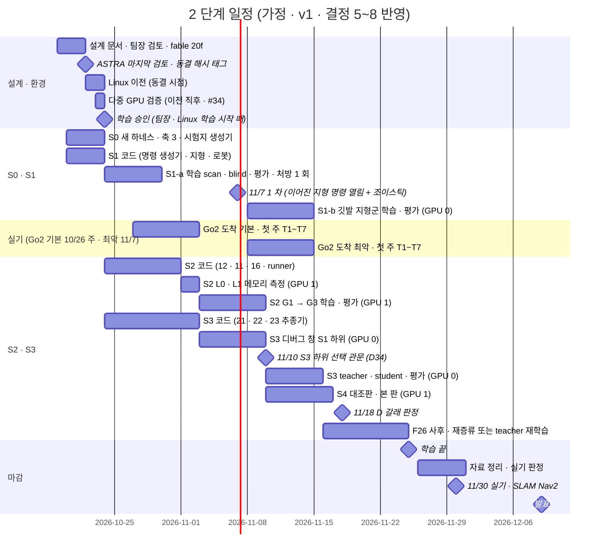

> 분류: A/정책학습 · 설계 (70 자원과 일정 · 구현 주체)
> 작성: 오흥재 (lead 세션 초안 · fable 20f 가 v1 으로 고쳐 씀 · 팀장 결정 23:2x 반영)
> 근거: 팀장 결정 10/18 (11/7 1 차 · 11/25 학습 끝 · 11/26~30 자료 · 11/30 SLAM · Nav2 · 12/9~10 발표) · APPROVED I(결정 5~8 승인 · Go2 도착 기본 10/26 주 · 최악 11/7) · 18 §4 · §6 · training-benchmarks.md 19 행 · evidence/seokheon-sept-iteration-timing.txt · REPORT-seokheon-ame2.md 128 행 · vfxpedia/mai-os#34 · fable 20e Q6 · ASTRA 19f Q6 · APPROVED G-3 · G-9 · H(학습 승인 시점 · Linux 이전 = 동결 시점 · 다중 GPU 검증은 이전 직후 · Windows 업데이트 11/7 · 앱은 시뮬 먼저) · VERIFY-fable-20f P12~P14 · P30 · P31 · 5 절
> 요지: 10/19 기준 날짜표와 GPU 두 장 배치. 계산 시간보다 코드 준비가 병목이다. S3 teacher 의 하위 선택은 11/10 날짜 관문(승인), S1 은 두 판(승인), S1-b 는 11/14 까지(승인). Go2 도착은 기본 10/26 주 · 최악 11/7 두 경우를 다 적는다. codex 한도가 거의 차서 ASTRA 검토는 마지막 한 회다
> 상태: v1 · 팀장 검토 전 · 날짜는 가정 · 결정 5~8 승인 반영(D34~D38) · 결정 9 는 확인 중

# 70 · 자원과 일정

## 0. 쉬운 요약

달력이다. 10/22 에 설계를 얼리고(동결), 같은 날 Linux 로 옮기고, 10/23 에 GPU 두 장이 같이 도는지 확인하고, 10/24 0 시에 팀장 승인을 받아 첫 학습(S1-a, 눈 있는 판과 없는 판 둘)을 시작한다. 11/7 에 첫 결과를 보이고, 11/3 부터는 GPU 두 장이 각각 「길 찾기(S3)」 와 「눈 달기(S2)」 를 동시에 돈다. 11/10 에 「눈 달기가 충분히 됐나」 를 보고 길 찾기를 어느 보행 위에서 배울지 정한다(승인). 징검다리 연습(S1-b)은 11/7 뒤 11/14 까지. 11/25 에 학습을 끝내고 11/26~30 은 자료 정리와 실기다. Go2 는 기본으로 10/26 주에 온다고 보고, 늦어도 11/7 로 잡는다. 기본대로 오면 첫 주 실측값을 눈 달기 학습 전에 넣을 수 있고, 최악이면 실기 창이 약 3 주로 준다. 계산 시간은 넉넉하고(전체의 10 % 안팎), 모자란 것은 코드를 짜는 손이다.

## 1. 날짜표 (가정, 10/19 기준 · 결정 5~8 반영)

| 날짜 | 무엇 | 등급 |
|---|---|---|
| 10/19~21 | 설계 문서 v1 · 팀장 검토 · fable 20f | 진행 중 |
| 10/22 | ASTRA 마지막 검토(codex, 1 회) → **동결**(해시 · 태그 `s2-freeze-v1` · manifest, 50 §4) = **Linux 이전 시작**(D32) | **가정** |
| 10/22~23 | Linux 이전. **다중 GPU 검증은 이전 직후**(mai-os#34 런북 7 절: 두 장 인식 · NCCL · Go2 10 회 두 장 / 한 장 · depth 두 장) | **가정** · D4 · D32 |
| 10/23 | S0 관문: 새 하네스가 v2 · E1 옛 값을 재현 · 축 3 · START 시험지 · `gates-v1.json` | **가정** |
| 10/24 00:00 | **2 단계 학습 승인(팀장 직접, D25)** → S1-a 학습 시작(GPU 0 scan · GPU 1 blind, 각 7 h, **D35**) | 팀장 |
| 10/25~10/29 | S1-a 평가 · 처방 1 회 여유 · 10/30 관문 S1 | **가정** |
| 10/27~11/2 (기본) | **Go2 도착 기본 10/26 주(D38)** → 42 첫 주 T1~T7(bag 기록 · 관절 · D435i · L1 가림 · Orin NX 추론). T2 · T3 값을 17 · 11 에 반영해 S2 cfg 를 새 판으로(11/3 전) | **가정** · 운영진 회신 기준 |
| 10/30~11/2 | S1-a 처방 · S2 L0 · L1 메모리 측정(GPU 1) · 23 깃발 추종기 시뮬 시험 준비 | **가정** |
| 11/3~11/9 | GPU 1: S2 G1(18~30 h) → 평가 → G3(18~30 h) → 평가. GPU 0: S3 디버그 창(첫 10 update · 예행 8 판 · 메모리) | **가정** |
| 11/7 | S1-a 결과 + 이어진 지형 전체 명령 열림 + 조이스틱(시뮬) + 앱 시뮬 연결 시작(D23) | 팀장 목표 |
| 11/8~11/14 | **S1-b**(깃발 지형군 이어 학습, GPU 0 3.5~5 h, S3 디버그 창과 나눠 씀) → 평가 → 11/14 관문 S1-b(**D36**) | 승인 |
| 11/8~11/14 (최악) | **Go2 도착 최악 11/7(D38)** → 첫 주 T1~T7. S2 는 URDF 값으로 이미 시작했으므로 실측값은 S4 · 재학습 · 이어 학습(60 E)에 반영. 실기 창 11/7~11/30 약 3 주 | **가정** |
| 11/10 | **S3 하위 선택 관문(D34)**: S2 가 F26 사전 (1)(2) 통과면 S2 하위, 아니면 S1-scan 하위로 teacher 시작 | 승인 |
| 11/10~11/15 | GPU 0: S3 teacher(22~25 h) → student(7.5~8.5 h) → 평가. GPU 1: S4 대조판 → 본 판 | **가정** |
| 11/16~11/18 | S3 관문 · F26 사후(student 재증류 8 h) · **11/18 24:00 D 갈래 판정** | **가정** |
| 11/19~11/24 | 여유: teacher 재학습(S1 위에서 배웠고 S2 가 뒤늦게 통과한 경우 30~34 h) · 재시도 1 회 · S4 마무리 | **가정** |
| 11/25 | 학습 끝 | 팀장 결정 |
| 11/26~30 | 자료 · 실기 단계 판정(42 §3). 첫 주 시험은 도착 시점에 이미 끝남. 앱 실기 SDK 연결은 시뮬 연결 뒤(D23) | 팀장 결정 |
| 12/9~10 | 발표 | 팀장 결정 |

Windows 업데이트 일시 중지는 11/7 까지 연장됐다(D26). 블루스크린(10/18 nvlddmkm) 원인은 미확인이라 Linux 이전 전에는 학습을 띄우지 않는다.

### 1.1 실기 선행 조건 (결정 8 승인 · D37)

| 항목 | 기본 (Go2 10/26 주) | 최악 (Go2 11/7) | 메모 |
|---|---|---|---|
| Go2 도착 | 10/26 주 | 11/7 | 운영진 회신 기준(D38). 도착 즉시 42 §1 안전 준비 |
| D435i 브래킷(위치 (0.25, 0, 0.12) · pitch 35°) | 도착 + 3 일 | 도착 + 3 일 | 11 §2 공칭값으로 제작, 실측으로 교체 |
| Orin NX 접근 · ROS 2 · TensorRT | 도착 시 확인 | 도착 시 확인 | T7 전 |
| 첫 주 시험 T1~T7 | 10/27~11/2 | 11/8~11/14 | 기본이면 T2 · T3 값이 S2 시작(11/3) 전에 17 · 11 로 들어간다 |
| 앱 어댑터 정책 노드 모드 | 시뮬 11/7 시작 · 실기 11/14 | 시뮬 11/7 · 실기 11/20 | 23 §7 현민 협의 |
| SLAM 지도 틀 계약 | 11/20 | 11/20 | 11/30 트랙 |
| 실기 창 | 약 5 주(10/27~11/30) | 약 3 주(11/7~11/30) | 최악이면 42 §3 판정 가운데 S3 + S2(듬성한 지형 목표)는 11/24 뒤 한 주에 몰린다 |

## 2. GPU 두 장 배치

| 기간 | GPU 0 | GPU 1 |
|---|---|---|
| ~10/23 | S0 평가(새 하네스 옛 값 대조 · 축 3 · START 시험지) | 같이(판 나눠) |
| 10/24~10/29 | S1-a scan → 평가 → 처방 | S1-a blind → 평가 |
| 10/30~11/2 | S1-a 처방 재시도(필요 시) | S2 L1 짧은 실행(메모리 · steps/s) |
| 11/3~11/9 | S3 디버그 창(짧은 실행만) · 11/8~ S1-b 3.5~5 h | S2 G1 → G3 |
| 11/10~11/15 | S3 teacher → student | S4 대조판 → S4 (또는 G0-gt) |
| 11/16~11/18 | S3 평가 · 재증류 | S4 평가 |
| 11/19~11/24 | teacher 재학습(필요 시) 또는 재시도 | 재시도 · 예산 남으면 G2 |
| 11/25 | 학습 끝 | |

- 한 실험이 16 GB 를 넘으면 두 장을 묶는다(Linux DDP, **1 순위**, D20 · 18 §5). 그때 다른 GPU 의 판은 끝날 때까지 민다(60 B). 두 장을 묶어도 S2 의 두 판은 순서대로 돈다.
- 처리량 실측: NVIDIA 식 Go2 rough 5080 1 장 4096 env 1 회 4.17 s(training-benchmarks.md 19 행) · 석헌 9 월 이어학습 4096 env 1 회 수집 + 학습 합 2.6~3.8 s(RunPod, evidence/seokheon-sept-iteration-timing.txt 중앙값) · 석헌 AME-2 teacher 4090 1 회 7.9~8.8 s · 최대 17.3~17.8 GiB.
- 계산 총량은 18 §4 표 하나로: 110~160 GPU·h(teacher 재학습 포함 140~195), 가능한 1,536 GPU·h 의 7~12 %. **병목은 코드**(START · HiPAN 모두 공개 코드 없음).
- GPU 두 장 상태를 보고마다 한 줄 적고, 다음 일을 끝나기 전에 걸어 둔다. 무인 사슬은 heartbeat(CronCreate 20 분 안팎)로.

## 3. 사람 · 세션 역할과 구현 주체

| 누구 | 맡는 것 | 메모 |
|---|---|---|
| 팀장 | 결정 · 동결 · 학습 승인 · 실기 · 발표 | 결정 9(확인 중) · O5~O8 |
| lead (이 세션) | 설계 · 지시 · 확인 · 평가 해석 · 문서 · Kit 실행 · 무인 사슬 | |
| mai-code(Claude 엔진) · Claude 하위 작업 | 모듈 코드(18 §6 표: 생성기 · 지형 · 보상 · 로봇 · 센서 · 지각 · runner · 주행층 · 평가 · ROS 노드) | **90 O5 팀장 결정**. codex 한도 때문에 sol 대신 |
| sol (codex) | Kit 통합 · 실행 창(한도 안에서) | 주간 한도 약 82 % |
| ASTRA (codex) | 동결 직전 설계 · 코드 검토 1 회 | 주간 한도 약 19 % 남음(10/19), APPROVED G-9 |
| fable 창 (Claude Fable) | 20f 검증 · v1 재작성(이 묶음) · 이후 명세 | Claude 한도 |
| pipeline | mai-code · 도구 | 90 D12 |
| super2 | Linux 이전 · 다중 GPU 검증 · 정리 | mai-os#34 · #31 |
| 석헌 | AME-2 Go2 포팅 경험 · RunPod 기록 | 참고 자료 |
| 현민 | 앱(목표 · 정지 · 조이스틱) · 어댑터 정책 노드 모드 · 시뮬 연결 | PR #553 · 23 §7 질문 |

## 4. 갈래 코드의 날짜 (60 이 실제로 갈 수 있게)

| 갈래 | 미리 있어야 하는 것 | 날짜 |
|---|---|---|
| D 주행층 지연 | 23 깃발 추종기 노드 + 시뮬 시험(Isaac 에서 미리 만든 경로를 추종기에 넣어 보행층이 따라가는지) | 11/10 |
| B 16 GB | 다중 GPU 실행 스크립트 · NCCL 검증 | 10/23 |
| A 재구현 실패 | G0-gt 설정 키(13 §4) | 10/31 |
| E 실기 차이 | 42 T1~T7 bag 해석 스크립트 · 이어 학습 cfg(새 판) | 기본 11/2 · 최악 11/14 |
| F 실기 선행 조건 | 앱 시뮬 연결(23 §5) · 정책 노드 모드 설계 합의(현민) · 브래킷 | 11/7 시작 · 도착 + 3 일 |

## 5. codex 한도

- 주간 약 82 % 사용(팀장 10/19). ASTRA 검토는 동결 직전 **한 회**만(APPROVED G-9).
- 구현은 mai-code(Claude 엔진) · Claude 하위 작업으로(18 §6, 90 O5). 동결 때가 아니라 **지금** 정해야 S2 코드가 10/31 에 선다(VERIFY 20f 5 절).

## 6. 열린 항목

- 결정 9(팀장 · lead 확인 중) · O5 · O7.
- Linux 이전 실제 완료일 · 다중 GPU 검증 결과(#34).
- Go2 실제 도착일(기본 · 최악 중 어느 쪽인지 운영진 회신) · 브래킷 · 현민 어댑터 일정.
