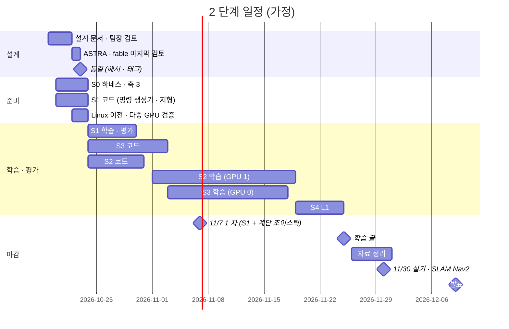

> 분류: A/정책학습 · 설계 (70 자원과 일정)
> 작성: 오흥재 (lead 세션 작성)
> 근거: 팀장 결정 10/18 (11/7 1 차 · 11/25 학습 끝 · 11/26~30 자료 · 11/30 SLAM · Nav2 · 12/9~10 발표) · training-benchmarks.md 19 행 · REPORT-seokheon-ame2.md 128 행 · evidence/seokheon-sept-iteration-timing.txt · vfxpedia/mai-os#34 · fable 20e Q6 · ASTRA 19f Q6
> 요지: 10/19 기준 날짜표와 GPU 두 장 배치. 계산 시간보다 코드 준비가 병목이다. codex 한도가 거의 차서 ASTRA · fable 검토는 마지막 한 회다
> 상태: 초안 · 팀장 검토 전 · 날짜는 가정

# 70 · 자원과 일정

## 1. 날짜표 (가정, 10/19 기준)

| 날짜 | 무엇 | 등급 |
|---|---|---|
| 10/19~21 | 설계 문서 · 팀장 검토 | 진행 중 |
| 10/22 | ASTRA · fable 마지막 검토 → 동결 | **가정** |
| 10/22~23 | Linux 이전 · 다중 GPU 검증(mai-os#34 런북 7 절) | **가정** (팀장 결정 (가): 학습은 Linux 에서) |
| 10/24 | S1 학습 시작 | **가정** |
| 11/7 | S1 결과 + 계단 조이스틱 시연(시뮬, 실기는 Go2 도착 뒤) | 팀장 목표 |
| 11/18 | S3 상위 「논문대로 한 벌」 (fable 20e) | **가정** |
| 11/25 | 학습 끝 | 팀장 결정 |
| 11/26~30 | 자료 · 실기 | 팀장 결정 |
| 12/9~10 | 발표 | 팀장 결정 |

## 2. GPU 두 장 배치

| 기간 | GPU 0 | GPU 1 |
|---|---|---|
| ~10/23 | S0 평가(축 3 · START 시험지) | 비움 또는 S0 평가 병렬 |
| 10/24~11/2 | S1 학습 → 평가 | S1 평가 · S2 짧은 메모리 측정 |
| 11/3~11/18 | S3 상위 학습(S1 하위 내장) | S2 G1 → G3 학습 |
| 11/19~11/25 | S3 재증류(F26 통과 시) · 평가 | S4 L1 |

- 한 실험이 16 GB 를 넘으면 두 장을 묶는다(Linux, DDP). 그때는 병렬 갈래 하나를 미룬다(60 B).
- 처리량 실측: NVIDIA 식 Go2 rough 5080 1 장 4096 env 1 회 4.17 s(training-benchmarks.md) · 석헌 9 월 이어학습 4096 env 1 회 2.6~3.8 s(RunPod, evidence/seokheon-sept-iteration-timing.txt) · 석헌 AME-2 teacher 4090 1 회 7.9~8.8 s · 최대 17.3~17.8 GiB.
- 계산 총량 추정 66~84 GPU 시간(fable 20e) 은 가능한 GPU 시간의 일부다. **병목은 코드**(START · HiPAN 모두 공개 코드 없음).

## 3. 사람 · 세션 역할

| 누구 | 맡는 것 | 메모 |
|---|---|---|
| 팀장 | 결정 · 동결 · 실기 · 발표 | |
| lead (이 세션) | 설계 · 지시 · 확인 · 평가 해석 · 문서 | |
| sol (codex) | Isaac Lab 구현(명령 생성기 · 지형 · 하네스) | codex 한도 영향 |
| ASTRA (codex) | 마지막 설계 검토 1 회 | 주간 한도 약 19 % 남음(10/19) |
| fable 창 (Claude Fable) | 마지막 설계 검토 1 회 · 명세 작성 | Claude 한도 |
| pipeline | mai-code · 도구 | mai-code 분석은 Claude 엔진으로(90 D12) |
| super2 | Linux 이전 · 다중 GPU 검증 · 정리 | mai-os#34 · #31 |
| 석헌 | AME-2 Go2 포팅 경험 · RunPod 기록 | 참고 자료 |
| 현민 | 앱(목표 · 정지 · 조이스틱) | PR #553 |

## 4. codex 한도

- 주간 약 82 % 사용(팀장 10/19). ASTRA · fable 설계 검토는 동결 직전 **한 회**만.
- 구현은 sol 대신 Claude 하위 작업이나 mai-code(Claude 엔진)로 나눌 수 있는지 동결 때 정한다(90 열린 결정 O5).
