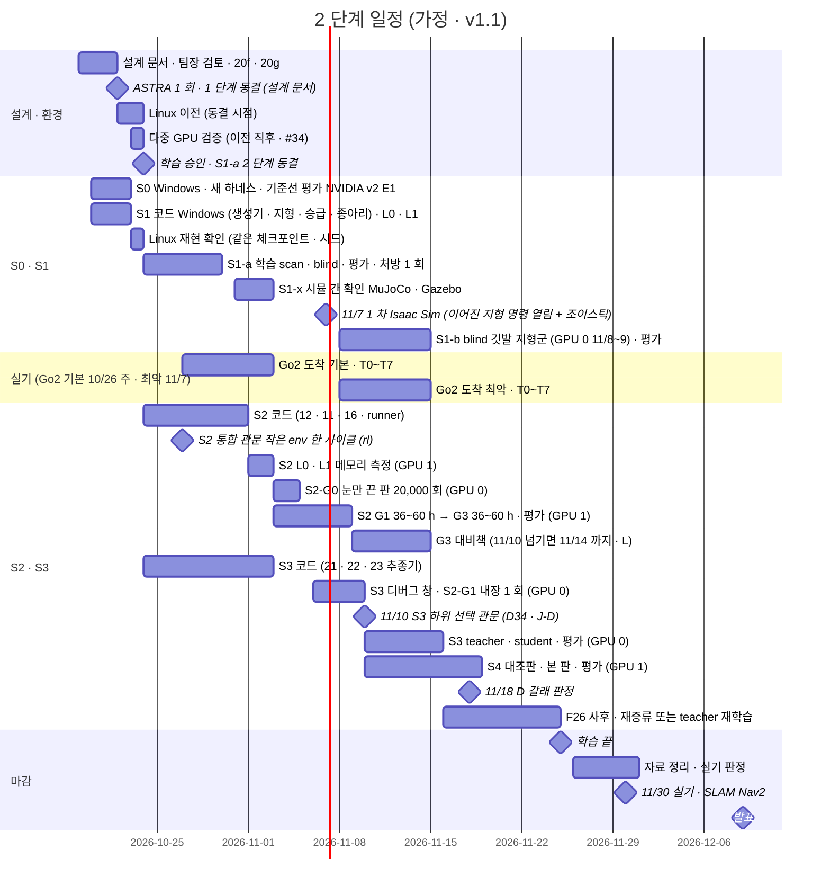

> 분류: A/정책학습 · 설계 (70 자원과 일정 · 구현 주체)
> 작성: 오흥재 (lead 세션 초안 · fable 20f 가 v1 으로 고쳐 씀 · 팀장 결정 23:2x · 10/20 00:0x · 00:1x(K 절) 반영)
> 근거: 팀장 결정 10/18 (11/7 1 차 · 11/25 학습 끝 · 11/26~30 자료 · 11/30 SLAM · Nav2 · 12/9~10 발표) · APPROVED I(결정 5~8 · 역할) · J(A~F) · **K(G · H · I, 팀장 승인 10/20 00:1x)** · **L(S2 반복 20,000 · 11/10 대비책, 팀장 승인 10/20 00:4x)** · **VERIFY-lead-final2 3 · 10 · 18 · 19 · 20(20j)** · **VERIFY-astra-final 5 · 7(20k · 10/27 통합 관문 · 실측 재계산 시점)** · JEPLO 2609.15770v1 246 · 249 행 · 18 §4 · §6 · training-benchmarks.md 19 행 · evidence/seokheon-sept-iteration-timing.txt · REPORT-seokheon-ame2.md 128 행 · vfxpedia/mai-os#34 · fable 20e Q6 · ASTRA 19f Q6 · APPROVED G-3 · G-9 · H · VERIFY-fable-20f P12~P14 · P30 · P31 · VERIFY-lead-final 1 · 4 · 16 · 17 · 20 · 21 · 24
> 요지: 10/20 기준 날짜표와 GPU 두 장 배치. 동결은 두 단계(설계 문서 10/22 · 단계별 cfg · 관문 해시는 각 학습 직전). 눈 효과 기준선 S2-G0 판을 GPU 0 11/3~11/4 에 실제로 넣었다. 11/10 하위 선택(S2 또는 S1-blind), S1-b 11/14, Go2 도착 기본 10/26 주 · 최악 11/7. 역할은 rl + lead 구현 · Sonnet 코딩 · Haiku 감시 · fable 검증 · ASTRA 1 회 · sol 스크립트만. K 절(10/20 00:1x): 이사 전 Windows 에서 새 평가 도구 · S1 코드 · S0 기준선 평가를 끝내고(10/20~10/22) 이사일은 Linux 재현 확인만(K-H). 11/7 시연은 Isaac Sim, 그 전에 S1-x 시뮬 간 확인(MuJoCo · Gazebo, 10/31~11/2)을 두고 앱 시뮬 연결은 그 위(K-I). L 절: S2 세 판은 20,000 회(G0 18~28 h · G1 · G3 36~60 h), G3 평가 끝은 11/6 08:00 ~ 11/8 08:00 으로 11/10 안이고, 넘기면 11/10 관문은 G1 결과 · G3 는 11/14 까지(대비책, §1.2). 계산 시간보다 코드 준비가 병목이다
> 상태: v1.5 · 팀장 검토 전 · 날짜는 가정 · 결정 1~9 · J A~F · K G · H · I 반영(D48~D50) · L 반영(D51) · 최종 점검 2(20j) · ASTRA 마지막 검증(20k) 반영 · 팀장 결정 1~8 승인(APPROVED M · 10/20 09:4x) 가운데 70 에 해당하는 결정 6(담당 확정) 반영(fable 20l)

# 70 · 자원과 일정

## 0. 쉬운 요약

달력이다. 이사(Linux 이전) 전인 10/20~10/22 에 지금 쓰는 Windows 기계에서 평가 도구와 S1 코드를 만들고 옛 모델 셋의 기준선 평가(S0)까지 끝낸다. 10/22 에 설계 문서를 얼리고(1 단계 동결), 같은 날 Linux 로 옮기고, 10/23 에는 「같은 모델 · 같은 시드로 같은 숫자가 Linux 에서도 나오나」 와 GPU 두 장이 같이 도는지만 확인하고, 10/24 0 시에 팀장 승인을 받아 첫 학습(S1-a, 눈 있는 판과 없는 판 둘)을 시작한다. 11/7 시연은 Isaac Sim 에서 하고, 그 전에 다른 시뮬(MuJoCo · Gazebo)에서도 같은 명령에 같은 동작이 나오는지 확인(S1-x, 10/31~11/2)해 앱은 그 위에 붙인다. 학습마다 그 직전에 설정 파일과 관문 숫자를 다시 얼린다(2 단계 동결). 11/7 에 첫 결과를 보이고, 11/3 부터는 GPU 두 장이 「길 찾기 준비(S3)」 와 「눈 달기(S2)」 를 동시에 돈다. 눈 달기는 논문의 2 배인 20,000 번 반복이라(이어진 지형을 섞은 만큼 징검다리 연습량을 논문과 같게 하려고) 한 판에 36~60 시간이 걸리고, 눈이 정말 도움이 됐는지 가르려고 「눈만 끈 판(S2-G0)」 도 11/3~11/4 에 실제로 돌린다. 두 번째 눈 판(G3)이 11/10 까지 못 끝나면 11/10 판단은 첫 눈 판(G1) 결과로 하고 G3 는 11/14 까지 이어 돌린다. 11/10 에 길 찾기를 어느 보행 위에서 배울지 정한다(눈 달린 S2 가 준비됐으면 S2, 아니면 진짜 로봇에 올릴 수 있는 눈 없는 S1-blind). 징검다리 연습(S1-b)은 11/8~11/14. 11/25 에 학습을 끝내고 11/26~30 은 자료 정리와 실기다. Go2 는 기본으로 10/26 주에 온다고 보고, 늦어도 11/7 로 잡는다. 어느 경우든 실측값은 돌고 있는 학습 설정에 넣지 않고 따로 이어 학습한다. 계산 시간은 넉넉하고(전체의 10 % 안팎), 모자란 것은 코드를 짜는 손이다.

## 1. 날짜표 (가정, 10/20 기준)

| 날짜 | 무엇 | 등급 |
|---|---|---|
| 10/19~21 | 설계 문서 v1 · 팀장 검토 · fable 20f · 20g · 20h | 진행 중 |
| 10/20~10/22 (Windows) | **K-H**: 새 평가 도구(41 · `foothold_s2/eval/`) 와 S1 코드(명령 생성기 · 지형 · 승급 · 종아리 한계)를 **Windows 에서 지금 만들고**, **S0 기준선 평가(NVIDIA · v2 · E1 의 축 1 · 2 · 3 · START 시험지)를 Windows GPU 0 · 1 로 끝낸다**. S1 L0(CPU) 와 L1 Kit 첫 10 update 도 Windows(학습이 아니라 사다리 시험, **가정**). 본 학습은 띄우지 않는다(D4 · 80 #12) | **팀장 승인 K-H** · 날짜 **가정** |
| 10/22 | ASTRA 1 회(Isaac Lab 2.3.2 API 구현 가능성 + 큰 위험 셋, 새 창 · 결과 파일 하나) → **1 단계 동결 = 설계 문서**(25 장 + APPROVED + 관문 후보, 태그 `s2-design-v1`, 50 §4) = **Linux 이전 시작**(D32) | **가정** |
| 10/22~23 | Linux 이전. **이사일은 Linux 재현 확인만**(K-H): 같은 체크포인트(v2 · E1) · 같은 시드 42 로 축 2 9 칸 + 축 1 범위 안 8 칸(**가정**, 51 §3-7)을 Linux 에서 다시 돌려 Windows 값과 **8 칸 평균 ±0.02 · 칸별 Wilson 95 % 구간 겹침 · 축 2 판정 동일**(51 §3-7). 어긋나면 10/23 밤 GPU 두 장으로 세 판 전부 Linux 재측정(≈ 6~8 h) 하고 S0 관문을 10/24 12:00 으로 민다(S1-a 학습 시작 10/24 00:00 은 유지, VERIFY-lead-final2 18). **다중 GPU 검증은 이전 직후**(mai-os#34 런북 7 절: 두 장 인식 · NCCL · Go2 10 회 두 장 / 한 장 · depth 두 장) | **가정** · D4 · D32 · D49 |
| 10/23 | S0 관문 = Windows 결과(10/22) + Linux 재현 확인 통과 · `gates-v1.json` 후보 | **가정** |
| 10/24 00:00 | **2 단계 학습 승인(팀장 직접, D25)** + **S1-a 2 단계 동결**(cfg · 하네스 · 관문 해시, 태그 `s2-S1a-v1`) → S1-a 학습 시작(GPU 0 scan · GPU 1 blind, 각 7 h, D35) | 팀장 |
| 10/25~10/29 | S1-a 평가 · 처방 1 회 여유(방향 이탈 > 0.1 이면 heading 같은 기준 75 %(플래그 14 §3.2) 새 판 S1a-v1.1, K-G · 결정 4) · 10/30 관문 S1 | **가정** |
| **10/27** | **S2 통합 관문(rl 책임, VERIFY-astra-final 5)**: 64 env · GPU 한 장(Windows 또는 Linux 어느 쪽이든 짧은 실행)에서 센서 · 두 GRU · 두 손실 · edge 보상 · checkpoint 왕복이 연결된 **한 사이클**(수집 → PPO update → 지각 update → reset → 저장/복원, 12 §6.1 · 13 §7). 못 넘으면 S2 의 11/3 본 학습 준비를 「미완료」 로 표시하고 11/10 하위는 S1a-blind-v1 경로를 일정의 기준으로 삼는다(60 G). 11/1 shape 시험만 통과한 상태는 준비 완료가 아니다 | **가정**(날짜) |
| 10/31~11/2 | **S1-x 시뮬 간 확인(K-I)**: S1-a blind 정책(ONNX)을 MuJoCo(`unitree_mujoco`) · Gazebo 에서 같은 명령 열로 돌려 속도 추종 · 생존 · 방향 이탈을 Isaac 값과 비교(41 §9 S1-x 행). **담당 lead(Sonnet 코딩) · 검증 fable**. GPU 는 거의 안 쓴다(CPU 위주). 현민 앱 어댑터는 이 시뮬에 붙인다(23 §5) | **가정** · D50 |
| 10/27~11/2 (기본) | **Go2 도착 기본 10/26 주(D38)** → 42 첫 주 T0(안전 연결) ~ T7. 실측값은 **S2 cfg 에 넣지 않고** 별도 이어 학습판(60 E)에만(VERIFY-lead-final 21) | **가정** · 운영진 회신 기준 |
| 10/27~10/30 | **42 T0 시뮬(policy_node 50 Hz · STOP 래치 · deadman 0.3 s · hb 1.0 s 를 Isaac 시뮬 어댑터에서, 10/30 까지 · 날짜 관문)** · 23 깃발 추종기 시뮬 시험 준비 · 11/7 시연 모듈 `sim/isaac_teleop.py` 시작 | **가정** · VERIFY-lead-final2 3 · 20 |
| 10/30~11/2 | S1-a 처방 · S2 L0 · L1 메모리 측정(GPU 1) · S1-x 직전 Isaac 기준값 16 칸 × 50 판(41 §9 S1-x) | **가정** |
| 11/3~11/4 | **GPU 0: S2-G0(눈만 끈 판, 3072 · 20,000, 18~28 h, J-A · L)** → 평가(11/4 08:00 까지). GPU 1: S2 G1(36~60 h) 11/3 00:00 시작 | **가정** |
| 11/3~11/8 | GPU 1: S2 G1(36~60 h, 11/4 12:00 ~ 11/5 12:00 끝) → 평가 4 h → G3(36~60 h) → 평가 끝 **11/6 08:00 ~ 11/8 08:00**(§1.2 표). **각 판 직전 2 단계 동결**(`s2-S2-G0-v1` · `s2-S2-G1-v1` · `s2-S2-G3-v1`). **대비책(L · 학습 전 등록)**: G3 평가가 11/10 00:00 까지 안 끝나면(G1 처방 재시도 · B 갈래 · 메모리 문제) 11/10 관문은 G1 결과로 판정하고 G3 는 11/14 까지 | **가정** · L |
| 11/5~11/9 | GPU 0(11/4 08:00 부터 빔): S3 디버그 창(첫 10 update · 예행 8 판 · 메모리) + **S2-G1 중간 체크포인트를 정답 지도 하위로 내장해 1 회 실행**(J-E). 11/8~11/9 는 S1-b(3.5~5 h)와 나눠 씀 | **가정** |
| 11/6 | **11/7 시연 리허설**: `foothold_s2/sim/isaac_teleop.py`(조이스틱 → 세 칸 → 정책, lead · Sonnet) 로 최신 S1-a 체크포인트(처방 판 포함) 를 GPU 0 에서 1 h. 실패 갈래는 52 §5 | **가정** · VERIFY-lead-final2 20 |
| 11/7 | S1-a 결과 + 이어진 지형 전체 명령 열림 + 조이스틱(**Isaac Sim** · GPU 0 · `sim/isaac_teleop.py`, K-I) + 앱 시뮬 연결 시작(D23, **S1-x 에서 숫자가 맞은 시뮬 위**) | 팀장 목표 |
| 11/8~11/14 | **S1-b**(blind 판 깃발 · 듬성한 지형 이어 학습, GPU 0 11/8~11/9) → 평가 → 11/14 관문 S1-b(D36) | 승인 |
| 11/8~11/14 (최악) | **Go2 도착 최악 11/7(D38)** → T0~T7. 실기 창 11/7~11/30 약 3 주 | **가정** |
| 11/10 | **S3 하위 선택 관문(D34 · J-D)**: S2 가 F26 사전 (1)(2) 통과면 S2 하위, 아니면 **S1a-blind-v1**(S1-a blind 체크포인트 · sha256 고정. 11/10 에 S1-b 는 아직 없다, VERIFY-lead-final2 5) 하위로 teacher 시작. **G3 가 안 끝났으면 (1)(2) 는 G1 결과로 판정**(L 대비책). S3 2 단계 동결(`s2-S3-v1`). 11/10 부터 GPU 0 은 S3 전용 | 승인 |
| 11/10~11/15 | GPU 0: S3 teacher(22~25 h) → student(7.5~8.5 h + 하위 depth) → 평가. GPU 1: S4 대조판(11/10~12) → 본 판(11/13~16) · 2 단계 동결 `s2-S4-v1`. **G3 가 11/14 까지 돌면 S4 는 그 뒤**(대조판 11/14~16 · 본 판 11/16~19 · 평가 11/20~21, 11/25 안, L) | **가정** |
| 11/16~11/18 | S3 관문 · F26 사후(student 재증류 8 h, 사후 (3)) · S4 평가(11/17~18) · **11/18 24:00 D 갈래 판정** | **가정** |
| 11/19~11/24 | 여유: teacher 재학습(S1-blind 위에서 배웠고 S2 가 뒤늦게 통과한 경우 30~34 h, 사후 (3′)) · 재시도 1 회 · 실측 이어 학습판 · G3 가 뒤늦게 G1 을 넘으면 student 재증류 1 회(8 h) 추가(L) | **가정** |
| 11/25 | 학습 끝 | 팀장 결정 |
| 11/26~30 | 자료 · 실기 단계 판정(42 §3). 앱 실기 SDK 연결은 시뮬 연결 뒤(D23) | 팀장 결정 |
| 12/9~10 | 발표 | 팀장 결정 |

Windows 업데이트 일시 중지는 11/7 까지 연장됐다(D26). 블루스크린(10/18 nvlddmkm) 원인은 미확인이라 Linux 이전 전에는 **본 학습**을 띄우지 않는다. 평가(S0)와 사다리 시험(L0 · L1)은 K-H 로 Windows 에서 한다. G(heading 30 %) · H(이사 전 Windows) · I(11/7 Isaac Sim · S1-x)는 10/20 00:1x 팀장 승인(APPROVED K, D48~D50)으로 이 표에 반영했다.

### 1.1 실기 선행 조건 (D37 · D38)

| 항목 | 기본 (Go2 10/26 주) | 최악 (Go2 11/7) | 메모 |
|---|---|---|---|
| Go2 도착 | 10/26 주 | 11/7 | 운영진 회신 기준. 도착 즉시 42 §1 안전 준비 |
| D435i 브래킷(위치 (0.25, 0, 0.12) · pitch 35°, 한 자세 J-C) | 도착 + 3 일 | 도착 + 3 일 | 11 §2 공칭값으로 제작, 실측으로 교체 |
| Orin NX 접근 · ROS 2 · TensorRT | 도착 시 확인 | 도착 시 확인 | T7 전 |
| **T0 안전 연결**(policy_node · STOP · deadman · 리모컨 우선권) | **시뮬 10/30 까지** · 실기 도착 첫 주(10/27~) | 시뮬 10/30 · 실기 11/8~ | **날짜 관문: T0 ① 시뮬 · ② 실기 통과 전에는 T6 를 시작하지 않는다**(42 §1 · VERIFY-lead-final2 3). 시뮬 T0 가 10/30 을 넘기면 T6 를 그만큼 민다 |
| 첫 주 시험 T0~T7 | 10/27~11/2(T6 는 T0 뒤) | 11/8~11/14(T6 는 T0 뒤) | 실측값은 별도 이어 학습판에만 |
| 앱 어댑터 정책 노드 모드 | 시뮬 11/7 시작(S1-x 시뮬 위, K-I) · 실기 11/14 | 시뮬 11/7 · 실기 11/20 | 23 §7 현민 협의 |
| SLAM 지도 틀 계약 | 11/20 | 11/20 | 11/30 트랙 |
| 실기 창 | 약 5 주(10/27~11/30) | 약 3 주(11/7~11/30) | 최악이면 42 §3 판정 가운데 S3 + S2(듬성한 지형 목표)는 11/24 뒤 한 주에 몰린다 |

### 1.2 S2 날짜 계산 (APPROVED L · 20,000 회 · fable 20i 계산)

가정: G1 과 S2-G0 는 2 단계 동결 뒤 **11/3 00:00** 시작(S2 L0 · L1 메모리 측정은 11/1~11/2 에 끝남), 판 하나 평가 **4 h**(축 1 범위 안 32 칸 약 20 분 + START 시험지 4 종 × 10 레벨 × 500 판 + 축 3 + 재구성 MAE, **가정**), 동결 · 판 사이 대기 0 h, 학습 시간은 18 §4(G0 18~28 h · G1 · G3 36~60 h).

| 판 | 시작 | 학습 시간 | 학습 끝 (짧게 / 길게) | 평가 끝 (+4 h) | 11/10 00:00 전? |
|---|---|---|---|---|---|
| S2-G0 (GPU 0) | 11/3 00:00 | 18~28 h | 11/3 18:00 / 11/4 04:00 | 11/3 22:00 / 11/4 08:00 | 예 |
| G1 (GPU 1) | 11/3 00:00 | 36~60 h | 11/4 12:00 / 11/5 12:00 | 11/4 16:00 / 11/5 16:00 | 예 |
| G3 (GPU 1) | G1 평가 끝 | 36~60 h | 11/6 04:00 / 11/8 04:00 | **11/6 08:00 / 11/8 08:00** | **예** (여유 3 일 16 h / 1 일 16 h) |
| G1 처방 재시도 1 회(G1-v1.1 36~60 h) 뒤 G3 | 11/4 16:00 / 11/5 16:00 | 72~120 h + 평가 4 h | G3 끝 11/7 20:00 / 11/10 20:00 | 11/8 00:00 / **11/11 00:00** | 짧으면 예 · 길면 **아니오** → 대비책 |
| B 갈래(두 장 DDP · 처리량 1.6 배 **가정** H18-2) | 11/3 00:00 | G1 23~38 h · G3 23~38 h, 그 동안 S2-G0 · S3 디버그 창 멈춤 | G3 끝 11/5 13:00 / 11/6 07:00 | G3 11/5 17:00 / 11/6 11:00 · 그 뒤 S2-G0(18~28 h) 11/7 09:00 / 11/7 19:00 | 예 · 다만 11/10 관문은 60 §5 규칙(최대 11/12) |

- **결론**: 처방 없이 가면 길게 걸려도 G3 평가가 11/8 08:00 에 끝나 11/10 관문 안이다. G1 처방 재시도 1 회가 끼면 짧을 때만 들어오고 길면 11/11 00:00 이라 **대비책이 필요**하다.
- **대비책(L · 학습 전 `gates-v1.json` 에 등록)**: G3 평가가 11/10 00:00 까지 안 끝나면 11/10 관문(F26 사전 (1)(2) · S3 하위 선택 D34)은 **G1 결과로 판정**하고 G3 는 **11/14 까지** 계속한다. 그때 S4 는 G3 뒤(대조판 11/14~16 · 본 판 11/16~19 · 평가 11/20~21, 11/25 안). G3 가 뒤에 G1 을 넘으면 11/19~11/24 여유 창에서 student 재증류 1 회(8 h) 추가 · S4 입력은 G3 로.
- B 갈래(두 장 DDP)는 60 §5 규칙대로 11/10 관문을 최대 11/12 까지 민다. 두 규칙이 겹치면 더 늦은 날짜 하나를 쓴다(**가정**).
- **실측으로 다시 계산하는 시점(VERIFY-astra-final 7)**: 위 표는 18 §4 의 가정 시간이지 실측이 아니다. S2 L1(11/1~11/2) 직후 첫 10 회의 실측 반복 시간(수집 + PPO + 지각 update) × 20,000 과 평가 예행 시간으로 G1 · G3 끝 시각을 **11/2 24:00 까지** 다시 계산해 이 표를 갱신하고 `gates-v1.json` 에 적는다. 조건: 11/3 00:00 ~ 11/10 00:00 은 168 h 이고 평가 4 h × 2 를 빼면 160 h 이므로 두 판 40,000 회가 들어오려면 **반복당 ≤ 14.4 s**(18 §4 의 36~60 h 는 6.5~10.8 s/회로 조건 안이지만 미측정). B 갈래의 23~38 h 는 **두 GPU 를 쓰는 벽시계 시간**이라 S2-G0 · S3 디버그 창과 병렬로 더하지 않는다(상한 38 + 4 + 38 + 4 + 28 + 4 = 116 h 뒤에야 G0 비교 자료까지 준비).

## 2. GPU 두 장 배치

| 기간 | GPU 0 | GPU 1 |
|---|---|---|
| ~10/22 (Windows, K-H) | S0 평가: 새 하네스 옛 값 대조 · 축 3 · START 시험지 · S1 L1 첫 10 update | 같이(판 나눠) |
| 10/23 (Linux) | Linux 재현 확인(v2 · E1 축 2 9 칸 + 축 1 8 칸) · 다중 GPU 검증(#34) | 같이 |
| 10/24~10/29 | S1-a scan → 평가 → 처방 | S1-a blind → 평가 |
| 10/27~11/2 | S1-a 처방 재시도(필요 시, heading 75 % 같은 기준 판 · 14 §3.2) · 42 T0 시뮬(10/30 까지) · S1-x 직전 Isaac 기준값 16 칸 × 50 판 · S1-x 는 CPU(MuJoCo · Gazebo) | S2 L1 짧은 실행(메모리 · steps/s) |
| 11/3~11/4 | **S2-G0 눈만 끈 판**(20,000 회 · 18~28 h) → 평가 | S2 G1(36~60 h) |
| 11/5~11/9 | S3 디버그 창(짧은 실행) + S2-G1 중간 체크포인트 내장 1 회 · 11/8~9 S1-b 3.5~5 h | G1 평가 → G3(36~60 h) → 평가(11/6~11/8) · 넘기면 11/14 까지(L) |
| 11/10~11/15 | S3 teacher → student (GPU 0 전용) | S4 대조판 → S4 본 판 (G3 가 11/14 까지 돌면 S4 는 11/14 부터) |
| 11/16~11/18 | S3 평가 · 재증류 | S4 평가 |
| 11/19~11/24 | teacher 재학습(필요 시) 또는 재시도 | 재시도 · 실측 이어 학습판 · 예산 남으면 G0-gt → G2 |
| 11/25 | 학습 끝 | |

- 한 실험이 16 GB 를 넘으면 두 장을 묶는다(Linux DDP, **1 순위**, D20 · 18 §5). 그때 다른 GPU 의 판은 끝날 때까지 밀고 관문 날짜도 묶인 시간만큼 민다(60 §5 규칙: 11/10 → 최대 11/12, 11/18 → 최대 11/20, 11/25 고정).
- 처리량 실측: NVIDIA 식 Go2 rough 5080 1 장 4096 env 1 회 4.17 s(training-benchmarks.md 19 행 · Windows · 눈 없음 조건) · 석헌 9 월 이어학습 4096 env 1 회 수집 + 학습 합 2.6~3.8 s(RunPod, evidence/seokheon-sept-iteration-timing.txt 중앙값) · 석헌 AME-2 teacher 4090 1 회 7.9~8.8 s · 최대 17.3~17.8 GiB.
- 계산 총량은 18 §4 표 하나로: 154~224 GPU·h(teacher 재학습 포함 184~258), 가능한 1,536 GPU·h 의 10~17 %(L 로 S2 세 판이 2 배). **병목은 코드**(START · HiPAN 모두 공개 코드 없음).
- GPU 두 장 상태를 보고마다 한 줄 적고, 다음 일을 끝나기 전에 걸어 둔다. 무인 사슬은 heartbeat(CronCreate 20 분 안팎)로, 감시는 Haiku 하위 작업(18 §6).

## 3. 사람 · 세션 역할과 구현 주체 (팀장 승인 10/20 00:0x · D41)

| 누구 | 맡는 것 | 메모 |
|---|---|---|
| 팀장 | 결정 · 동결 · 학습 승인 · 실기 · 발표 | O7 · 90 §2.2 남은 질문 셋 |
| lead | **구현**: 명령 생성기(heading 포함) · 지형과 승급 · 새 평가 도구 · 학습 실행 · **S1-x 포팅(MuJoCo `unitree_mujoco` · Gazebo, 10/31~11/2)**. 설계 · 지시 · 평가 해석 · 문서 · Kit 실행 · 무인 사슬 | Sonnet 코딩 세션을 띄워 모듈을 만든다 |
| rl 세션 | **구현**: 눈 있는 보행 신경망(TR-Net · I-E · AdaSmpl) · 학습 runner · 진입점 · 지각 재생 버퍼(12 §6.1 · §8) · **10/27 S2 통합 관문 책임** · S3 teacher · student · 하위 내장 어댑터(팀장 결정 6 확정) | Sonnet 코딩 세션. S2 와 S3 코드 기간이 겹치므로(10/24~11/3) 통합 관문이 늦으면 S3 쪽 Sonnet 세션을 S2 로 돌린다(60 G) |
| Sonnet 코딩 세션 | 18 §6 표의 모듈 코딩(lead · rl 이 띄움) | |
| Haiku 하위 작업 | 학습 감시: heartbeat · 첫 update 확인 · 로그 · GPU 두 장 상태 | 18 §7 사다리 L2 · L3 |
| fable 창 (Claude Fable) | **검증**: 단계 관문마다 · 답을 아는 입력 시험(L0) · 실제 첫 실행 확인(L1) · 관문 판정 | 20f · 20g 까지 설계 검증 |
| ASTRA (codex) | **한 회**: Isaac Lab 2.3.2 코드로 설계가 실제 API 로 구현 가능한지(RayCasterCamera · 다중 GPU DDP · DCMotor 종아리 분리 · 지형 생성기 · 순환 신경망 runner) + 큰 위험 셋(눈 있는 보행 코드 · 16 GB · 11/10 관문) 반대 의견. 새 창 · 결과 파일 하나 | 주간 한도 약 19 % 남음(10/19), APPROVED G-9 |
| sol (codex) | **실행 스크립트만** | 주간 한도 약 82 % |
| pipeline | mai-code · 도구 | 90 D12 |
| super2 | Linux 이전 · 다중 GPU 검증 · 정리 | mai-os#34 · #31 |
| 석헌 | AME-2 Go2 포팅 경험 · RunPod 기록 | 참고 자료 |
| 현민 | 앱(목표 · 정지 · 조이스틱) · 어댑터 정책 노드 모드 · 시뮬 연결(S1-x 시뮬 위, 11/7 시작) | PR #553 · 23 §7 질문 |

## 4. 갈래 코드의 날짜 (60 이 실제로 갈 수 있게)

| 갈래 | 미리 있어야 하는 것 | 날짜 |
|---|---|---|
| D 주행층 지연 | 23 깃발 추종기 노드 + 시뮬 시험(Isaac 에서 미리 만든 경로를 추종기에 넣어 보행층이 따라가는지) | 11/10 |
| B 16 GB | 다중 GPU 실행 스크립트(sol) · NCCL 검증 | 10/23 |
| A 재구현 실패 | G0-gt 설정 키(13 §4) | 10/31 |
| A · G S2 코드 준비 | **10/27 통합 관문**: 작은 env 한 사이클(수집 → PPO · 지각 두 손실 → reset → 저장/복원, 12 §6.1 · 13 §7) · 실측 반복 시간으로 §1.2 재계산(11/2) | 10/27 · 11/2 |
| E 실기 차이 | 42 T1~T7 bag 해석 스크립트 · 이어 학습 cfg(새 판, S2 cfg 와 분리) | 기본 11/2 · 최악 11/14 |
| F 실기 선행 조건 | 앱 시뮬 연결(23 §5) · 정책 노드 모드 설계 합의(현민) · 브래킷 · T0 시뮬 어댑터 | T0 시뮬 **10/30** · 앱 시뮬 연결 11/7 시작 · 브래킷 도착 + 3 일 |
| 11/7 시연 | `sim/isaac_teleop.py`(lead · Sonnet) · 11/6 리허설 GPU 0 1 h · 실패 갈래(52 §5) | 11/6 |
| J-E 경로 | S2-G1 중간 체크포인트 + 정답 지도 하위 내장 어댑터 | 11/6 |
| K-I S1-x | 시뮬 무관 명령 열 재생기 · 지표 모듈(41 §10) · Go2 MuJoCo 모델(`unitree_mujoco`, Unitree 공식 저장소) · Gazebo 는 ROS 2 Go2 패키지 후보(khaledgabr77/unitree_go2_ros2 Jazzy · anujjain-dev/unitree-go2-ros2 Humble, 라이선스 · 활동 **미확인**) · 정책 ONNX 내보내기 | 10/31 |
| K-G 처방 | heading 플래그 cfg 키(0.417 · 0.333 → 처방 플래그, 14 §3.2 · 결정 4) · 새 판 번호 S1a-v1.1 | 10/24(S1-a 와 같이) |

## 5. codex 한도

- 주간 약 82 % 사용(팀장 10/19). ASTRA 검토는 동결 직전 **한 회**만(APPROVED G-9 · D41 범위).
- 구현은 rl + lead(Sonnet 코딩 세션)로(18 §6, D41). sol 은 스크립트만.

## 6. 열린 항목

- O7(관문 수치) · S1-x 시뮬 선택(MuJoCo 우선, Gazebo 는 앱 어댑터가 ROS 2 면)과 Go2 모델 출처 · 라이선스 확인 · S1-x 차 문턱 근거.
- Linux 이전 실제 완료일 · 다중 GPU 검증 결과(#34) · Linux 의 rsl_rl 버전 · 환경 이름(18 §5: Windows isaac311 은 3.1.2, isaac311-moects 는 3.3.0 이라 이름 없이 버전을 추정하지 않는다).
- Go2 실제 도착일(기본 · 최악 중 어느 쪽인지 운영진 회신) · 브래킷 · 현민 어댑터 일정.
- (닫힘 · 팀장 결정 6) 주행층 · ROS 노드의 lead / rl 배정은 18 §6 표대로.
