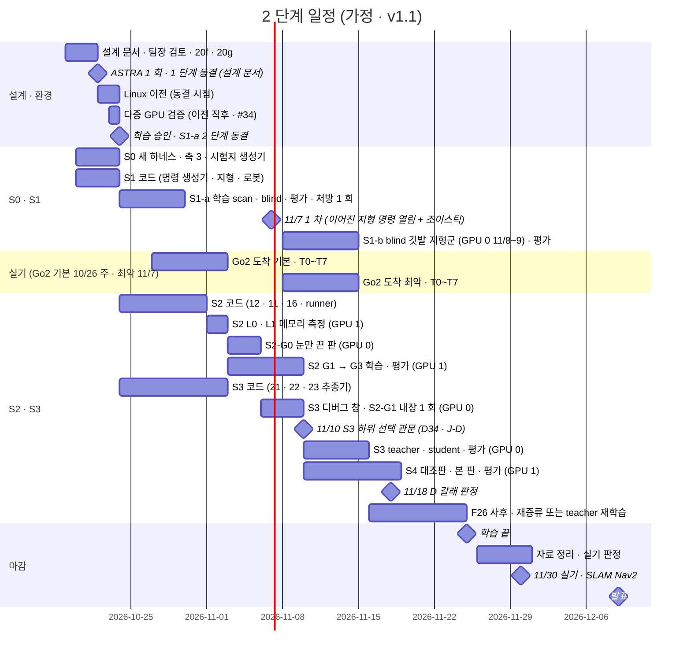

> 분류: A/정책학습 · 설계 (70 자원과 일정 · 구현 주체)
> 작성: 오흥재 (lead 세션 초안 · fable 20f 가 v1 으로 고쳐 씀 · 팀장 결정 23:2x · 10/20 00:5x 반영)
> 근거: 팀장 결정 10/18 (11/7 1 차 · 11/25 학습 끝 · 11/26~30 자료 · 11/30 SLAM · Nav2 · 12/9~10 발표) · APPROVED I(결정 5~8 · 역할) · J(A~F) · 18 §4 · §6 · training-benchmarks.md 19 행 · evidence/seokheon-sept-iteration-timing.txt · REPORT-seokheon-ame2.md 128 행 · vfxpedia/mai-os#34 · fable 20e Q6 · ASTRA 19f Q6 · APPROVED G-3 · G-9 · H · VERIFY-fable-20f P12~P14 · P30 · P31 · VERIFY-lead-final 1 · 4 · 16 · 17 · 20 · 21 · 24
> 요지: 10/20 기준 날짜표와 GPU 두 장 배치. 동결은 두 단계(설계 문서 10/22 · 단계별 cfg · 관문 해시는 각 학습 직전). 눈 효과 기준선 S2-G0 판을 GPU 0 11/3~11/5 에 실제로 넣었다. 11/10 하위 선택(S2 또는 S1-blind), S1-b 11/14, Go2 도착 기본 10/26 주 · 최악 11/7. 역할은 rl + lead 구현 · Sonnet 코딩 · Haiku 감시 · fable 검증 · ASTRA 1 회 · sol 스크립트만. 계산 시간보다 코드 준비가 병목이다
> 상태: v1.1 · 팀장 검토 전 · 날짜는 가정 · 결정 1~9 와 J A~F 반영 · G · H · I(J 절) 는 팀장 결정 대기

# 70 · 자원과 일정

## 0. 쉬운 요약

달력이다. 10/22 에 설계 문서를 얼리고(1 단계 동결), 같은 날 Linux 로 옮기고, 10/23 에 GPU 두 장이 같이 도는지 확인하고, 10/24 0 시에 팀장 승인을 받아 첫 학습(S1-a, 눈 있는 판과 없는 판 둘)을 시작한다. 학습마다 그 직전에 설정 파일과 관문 숫자를 다시 얼린다(2 단계 동결). 11/7 에 첫 결과를 보이고, 11/3 부터는 GPU 두 장이 「길 찾기 준비(S3)」 와 「눈 달기(S2)」 를 동시에 돈다. 눈이 정말 도움이 됐는지 가르려고 「눈만 끈 판(S2-G0)」 도 11/3~11/5 에 실제로 돌린다. 11/10 에 길 찾기를 어느 보행 위에서 배울지 정한다(눈 달린 S2 가 준비됐으면 S2, 아니면 진짜 로봇에 올릴 수 있는 눈 없는 S1-blind). 징검다리 연습(S1-b)은 11/8~11/14. 11/25 에 학습을 끝내고 11/26~30 은 자료 정리와 실기다. Go2 는 기본으로 10/26 주에 온다고 보고, 늦어도 11/7 로 잡는다. 어느 경우든 실측값은 돌고 있는 학습 설정에 넣지 않고 따로 이어 학습한다. 계산 시간은 넉넉하고(전체의 10 % 안팎), 모자란 것은 코드를 짜는 손이다.

## 1. 날짜표 (가정, 10/20 기준)

| 날짜 | 무엇 | 등급 |
|---|---|---|
| 10/19~21 | 설계 문서 v1 · 팀장 검토 · fable 20f · 20g | 진행 중 |
| 10/22 | ASTRA 1 회(Isaac Lab 2.3.2 API 구현 가능성 + 큰 위험 셋, 새 창 · 결과 파일 하나) → **1 단계 동결 = 설계 문서**(25 장 + APPROVED + 관문 후보, 태그 `s2-design-v1`, 50 §4) = **Linux 이전 시작**(D32) | **가정** |
| 10/22~23 | Linux 이전. **다중 GPU 검증은 이전 직후**(mai-os#34 런북 7 절: 두 장 인식 · NCCL · Go2 10 회 두 장 / 한 장 · depth 두 장) | **가정** · D4 · D32 |
| 10/23 | S0 관문: 새 하네스가 v2 · E1 옛 값을 재현 · 축 3 · START 시험지 · `gates-v1.json` 후보 | **가정** |
| 10/24 00:00 | **2 단계 학습 승인(팀장 직접, D25)** + **S1-a 2 단계 동결**(cfg · 하네스 · 관문 해시, 태그 `s2-S1a-v1`) → S1-a 학습 시작(GPU 0 scan · GPU 1 blind, 각 7 h, D35) | 팀장 |
| 10/25~10/29 | S1-a 평가 · 처방 1 회 여유 · 10/30 관문 S1 | **가정** |
| 10/27~11/2 (기본) | **Go2 도착 기본 10/26 주(D38)** → 42 첫 주 T0(안전 연결) ~ T7. 실측값은 **S2 cfg 에 넣지 않고** 별도 이어 학습판(60 E)에만(VERIFY-lead-final 21) | **가정** · 운영진 회신 기준 |
| 10/30~11/2 | S1-a 처방 · S2 L0 · L1 메모리 측정(GPU 1) · 23 깃발 추종기 시뮬 시험 준비 · 42 T0 시뮬 어댑터 | **가정** |
| 11/3~11/5 | **GPU 0: S2-G0(눈만 끈 판, 3072 · 10,000, 9~14 h, J-A)** → 평가. GPU 1: S2 G1(18~30 h) 시작 | **가정** |
| 11/3~11/9 | GPU 1: S2 G1 → 평가 → G3(18~30 h) → 평가(11/9). **각 판 직전 2 단계 동결**(`s2-S2-G0-v1` · `s2-S2-G1-v1` · `s2-S2-G3-v1`) | **가정** |
| 11/6~11/9 | GPU 0: S3 디버그 창(첫 10 update · 예행 8 판 · 메모리) + **S2-G1 중간 체크포인트를 정답 지도 하위로 내장해 1 회 실행**(J-E). 11/8~11/9 는 S1-b(3.5~5 h)와 나눠 씀 | **가정** |
| 11/7 | S1-a 결과 + 이어진 지형 전체 명령 열림 + 조이스틱(시뮬) + 앱 시뮬 연결 시작(D23) | 팀장 목표 |
| 11/8~11/14 | **S1-b**(blind 판 깃발 · 듬성한 지형 이어 학습, GPU 0 11/8~11/9) → 평가 → 11/14 관문 S1-b(D36) | 승인 |
| 11/8~11/14 (최악) | **Go2 도착 최악 11/7(D38)** → T0~T7. 실기 창 11/7~11/30 약 3 주 | **가정** |
| 11/10 | **S3 하위 선택 관문(D34 · J-D)**: S2 가 F26 사전 (1)(2) 통과면 S2 하위, 아니면 **S1-blind** 하위로 teacher 시작. S3 2 단계 동결(`s2-S3-v1`). 11/10 부터 GPU 0 은 S3 전용 | 승인 |
| 11/10~11/15 | GPU 0: S3 teacher(22~25 h) → student(7.5~8.5 h + 하위 depth) → 평가. GPU 1: S4 대조판(11/10~12) → 본 판(11/13~16) · 2 단계 동결 `s2-S4-v1` | **가정** |
| 11/16~11/18 | S3 관문 · F26 사후(student 재증류 8 h, 사후 (3)) · S4 평가(11/17~18) · **11/18 24:00 D 갈래 판정** | **가정** |
| 11/19~11/24 | 여유: teacher 재학습(S1-blind 위에서 배웠고 S2 가 뒤늦게 통과한 경우 30~34 h, 사후 (3′)) · 재시도 1 회 · 실측 이어 학습판 | **가정** |
| 11/25 | 학습 끝 | 팀장 결정 |
| 11/26~30 | 자료 · 실기 단계 판정(42 §3). 앱 실기 SDK 연결은 시뮬 연결 뒤(D23) | 팀장 결정 |
| 12/9~10 | 발표 | 팀장 결정 |

Windows 업데이트 일시 중지는 11/7 까지 연장됐다(D26). 블루스크린(10/18 nvlddmkm) 원인은 미확인이라 Linux 이전 전에는 학습을 띄우지 않는다. G(heading 모드) · H(이사 전 Windows 작업) · I(11/7 시연 시뮬) 은 APPROVED J 의 팀장 결정 대기라 이 표에 넣지 않았다.

### 1.1 실기 선행 조건 (D37 · D38)

| 항목 | 기본 (Go2 10/26 주) | 최악 (Go2 11/7) | 메모 |
|---|---|---|---|
| Go2 도착 | 10/26 주 | 11/7 | 운영진 회신 기준. 도착 즉시 42 §1 안전 준비 |
| D435i 브래킷(위치 (0.25, 0, 0.12) · pitch 35°, 한 자세 J-C) | 도착 + 3 일 | 도착 + 3 일 | 11 §2 공칭값으로 제작, 실측으로 교체 |
| Orin NX 접근 · ROS 2 · TensorRT | 도착 시 확인 | 도착 시 확인 | T7 전 |
| T0 안전 연결(policy_node · STOP · deadman · 리모컨 우선권) | 시뮬 11/5 · 실기 도착 첫 주 | 시뮬 11/5 · 실기 11/8~ | T6 앞에 반드시(42 §1) |
| 첫 주 시험 T0~T7 | 10/27~11/2 | 11/8~11/14 | 실측값은 별도 이어 학습판에만 |
| 앱 어댑터 정책 노드 모드 | 시뮬 11/7 시작 · 실기 11/14 | 시뮬 11/7 · 실기 11/20 | 23 §7 현민 협의 |
| SLAM 지도 틀 계약 | 11/20 | 11/20 | 11/30 트랙 |
| 실기 창 | 약 5 주(10/27~11/30) | 약 3 주(11/7~11/30) | 최악이면 42 §3 판정 가운데 S3 + S2(듬성한 지형 목표)는 11/24 뒤 한 주에 몰린다 |

## 2. GPU 두 장 배치

| 기간 | GPU 0 | GPU 1 |
|---|---|---|
| ~10/23 | S0 평가(새 하네스 옛 값 대조 · 축 3 · START 시험지) | 같이(판 나눠) |
| 10/24~10/29 | S1-a scan → 평가 → 처방 | S1-a blind → 평가 |
| 10/30~11/2 | S1-a 처방 재시도(필요 시) · 42 T0 시뮬 어댑터 | S2 L1 짧은 실행(메모리 · steps/s) |
| 11/3~11/5 | **S2-G0 눈만 끈 판**(9~14 h) → 평가 | S2 G1 |
| 11/6~11/9 | S3 디버그 창(짧은 실행) + S2-G1 중간 체크포인트 내장 1 회 · 11/8~9 S1-b 3.5~5 h | S2 G1 평가 → G3 → 평가 |
| 11/10~11/15 | S3 teacher → student (GPU 0 전용) | S4 대조판 → S4 본 판 |
| 11/16~11/18 | S3 평가 · 재증류 | S4 평가 |
| 11/19~11/24 | teacher 재학습(필요 시) 또는 재시도 | 재시도 · 실측 이어 학습판 · 예산 남으면 G0-gt → G2 |
| 11/25 | 학습 끝 | |

- 한 실험이 16 GB 를 넘으면 두 장을 묶는다(Linux DDP, **1 순위**, D20 · 18 §5). 그때 다른 GPU 의 판은 끝날 때까지 밀고 관문 날짜도 묶인 시간만큼 민다(60 §5 규칙: 11/10 → 최대 11/12, 11/18 → 최대 11/20, 11/25 고정).
- 처리량 실측: NVIDIA 식 Go2 rough 5080 1 장 4096 env 1 회 4.17 s(training-benchmarks.md 19 행 · Windows · 눈 없음 조건) · 석헌 9 월 이어학습 4096 env 1 회 수집 + 학습 합 2.6~3.8 s(RunPod, evidence/seokheon-sept-iteration-timing.txt 중앙값) · 석헌 AME-2 teacher 4090 1 회 7.9~8.8 s · 최대 17.3~17.8 GiB.
- 계산 총량은 18 §4 표 하나로: 120~175 GPU·h(teacher 재학습 포함 150~210), 가능한 1,536 GPU·h 의 8~14 %. **병목은 코드**(START · HiPAN 모두 공개 코드 없음).
- GPU 두 장 상태를 보고마다 한 줄 적고, 다음 일을 끝나기 전에 걸어 둔다. 무인 사슬은 heartbeat(CronCreate 20 분 안팎)로, 감시는 Haiku 하위 작업(18 §6).

## 3. 사람 · 세션 역할과 구현 주체 (팀장 승인 10/20 00:0x · D41)

| 누구 | 맡는 것 | 메모 |
|---|---|---|
| 팀장 | 결정 · 동결 · 학습 승인 · 실기 · 발표 | J 의 G · H · I 결정 대기 · O7 |
| lead | **구현**: 명령 생성기 · 지형과 승급 · 새 평가 도구 · 학습 실행. 설계 · 지시 · 평가 해석 · 문서 · Kit 실행 · 무인 사슬 | Sonnet 코딩 세션을 띄워 모듈을 만든다 |
| rl 세션 | **구현**: 눈 있는 보행 신경망(TR-Net · I-E · AdaSmpl) · 학습 runner · S3 teacher · student · 하위 내장 어댑터(가정) | Sonnet 코딩 세션 |
| Sonnet 코딩 세션 | 18 §6 표의 모듈 코딩(lead · rl 이 띄움) | |
| Haiku 하위 작업 | 학습 감시: heartbeat · 첫 update 확인 · 로그 · GPU 두 장 상태 | 18 §7 사다리 L2 · L3 |
| fable 창 (Claude Fable) | **검증**: 단계 관문마다 · 답을 아는 입력 시험(L0) · 실제 첫 실행 확인(L1) · 관문 판정 | 20f · 20g 까지 설계 검증 |
| ASTRA (codex) | **한 회**: Isaac Lab 2.3.2 코드로 설계가 실제 API 로 구현 가능한지(RayCasterCamera · 다중 GPU DDP · DCMotor 종아리 분리 · 지형 생성기 · 순환 신경망 runner) + 큰 위험 셋(눈 있는 보행 코드 · 16 GB · 11/10 관문) 반대 의견. 새 창 · 결과 파일 하나 | 주간 한도 약 19 % 남음(10/19), APPROVED G-9 |
| sol (codex) | **실행 스크립트만** | 주간 한도 약 82 % |
| pipeline | mai-code · 도구 | 90 D12 |
| super2 | Linux 이전 · 다중 GPU 검증 · 정리 | mai-os#34 · #31 |
| 석헌 | AME-2 Go2 포팅 경험 · RunPod 기록 | 참고 자료 |
| 현민 | 앱(목표 · 정지 · 조이스틱) · 어댑터 정책 노드 모드 · 시뮬 연결 | PR #553 · 23 §7 질문 |

## 4. 갈래 코드의 날짜 (60 이 실제로 갈 수 있게)

| 갈래 | 미리 있어야 하는 것 | 날짜 |
|---|---|---|
| D 주행층 지연 | 23 깃발 추종기 노드 + 시뮬 시험(Isaac 에서 미리 만든 경로를 추종기에 넣어 보행층이 따라가는지) | 11/10 |
| B 16 GB | 다중 GPU 실행 스크립트(sol) · NCCL 검증 | 10/23 |
| A 재구현 실패 | G0-gt 설정 키(13 §4) | 10/31 |
| E 실기 차이 | 42 T1~T7 bag 해석 스크립트 · 이어 학습 cfg(새 판, S2 cfg 와 분리) | 기본 11/2 · 최악 11/14 |
| F 실기 선행 조건 | 앱 시뮬 연결(23 §5) · 정책 노드 모드 설계 합의(현민) · 브래킷 · T0 시뮬 어댑터 | 11/5 · 11/7 시작 · 도착 + 3 일 |
| J-E 경로 | S2-G1 중간 체크포인트 + 정답 지도 하위 내장 어댑터 | 11/6 |

## 5. codex 한도

- 주간 약 82 % 사용(팀장 10/19). ASTRA 검토는 동결 직전 **한 회**만(APPROVED G-9 · D41 범위).
- 구현은 rl + lead(Sonnet 코딩 세션)로(18 §6, D41). sol 은 스크립트만.

## 6. 열린 항목

- J 의 G · H · I(팀장 결정 대기) · O7(관문 수치).
- Linux 이전 실제 완료일 · 다중 GPU 검증 결과(#34).
- Go2 실제 도착일(기본 · 최악 중 어느 쪽인지 운영진 회신) · 브래킷 · 현민 어댑터 일정.
- 주행층 · ROS 노드의 lead / rl 배정(18 §6 가정).
