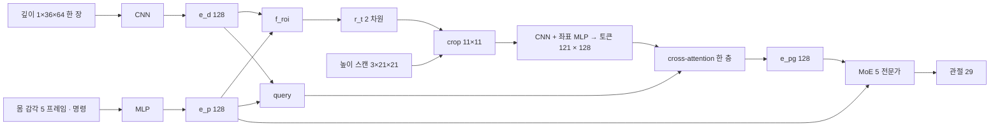

> 분류: A/정책학습 · 논문 분석
> 작성: 오흥재 (lead 의뢰 · 하위 분석, mai-code · lead 가 핵심 행 원문 대조)
> 근거: arXiv 2606.05880v2 (2026-09-24 판) 본문 `s2_lab/_papers/2606.05880v2.txt` 행 번호(아래 「행」 은 전부 이 파일) · 표는 `s2_lab/_papers/taga/2606.05880v2.table.txt` 행(「표 행」) · v1 대조 `2606.05880v1.txt` · 프로젝트 페이지 marmotlab.github.io/taga-humanoid (10/20 열람, 코드 링크 없음) · mai-code 단위 taga-deep (`s2_lab/_mai_code/make_units_taga.py` · `taga-deep_wt/analysis.json`) · deep-research `evidence/deep-research-taga.json` · 우리 설계 inbox/jay/20261019-design 11 · 12 · 13 · 14 · 15 · 18 · APPROVED-DIRECTION · foothold-project/foothold-lab#559
> 요지: TAGA 의 「능동 시선」 은 카메라를 움직이는 장치가 아니라, LiDAR 로 만든 21×21 높이 스캔 위에서 11×11 창의 위치를 PPO 로 함께 배우는 미분 가능한 crop 이다. 표 1 에서 성공률은 전체 스캔 판(FullScan)과 비슷하고 이득은 학습 비용(약 17 대 49 GPU-days)이다. 우리 1 차는 지도가 이미 작고(32×16 · 토큰 128) 높이 스캔을 LiDAR 가 아니라 깊이 재구성으로 얻으므로 그대로 옮길 부품은 없다. 동결 설계를 바꾸는 권고는 없고, 검증 항목 둘(지도 앞 범위 대 틈 · attention 가중치 기록)과 2 차(L1) 참고 몇 개만 후보로 올린다
> 상태: 초안 · 10/20 · 공개 코드 없음(10/20 GitHub 검색 0 건)이라 모든 수치는 「논문」 또는 「미확인」 · 동결(10/22) 대상 문서는 건드리지 않음 · 후보는 팀장 결정 전

# TAGA (arXiv 2606.05880) 분석: Go2 · D435i 고정 장착 설계와 견주어

lead 원문 대조(10/20): 94 행(시선 모듈 정의) · 218 행(Isaac Lab 8,000 env · RTX 5090 4 장 · 30k + 10k 회 · 약 17 GPU-days · 50 Hz · 200 Hz PD) · 230 행(고정 crop 대신 시선) · 표 행 471 · 473(InactiveGaze 틈 57.10 · FullScan GPU 8 장 ∼49) 을 직접 열어 일치 확인.

## 0. 자료 상태

| 항목 | 내용 |
|---|---|
| 판 | v1 2026-06-04, v2 2026-09-24. v2 기준. 표 1 은 같고, v2 에 저자 4 명 · 표 2 「Vel Tracking AME-2」 재현 행(243 행 · 표 행 669) 추가 |
| 파일 | `s2_lab/_papers/taga/2606.05880v1.pdf` · `v2.pdf`. 본문 `pdftotext -enc UTF-8` 693 행. 수식 글자 CESU 바이트를 UTF-8 로 재인코딩(행 수 불변). 표 1 은 `-table` 판(표 행 465~477)으로 행 대응 확인 |
| 코드 | 없음. 프로젝트 페이지는 arXiv · PDF · BibTeX 뿐, 「Under Review」. 그래서 「코드」 등급 값 없음 |
| mai-code | taga-deep, engine claude. 시행 기록 8 절 |

## 1. 쉬운 요약

사람 키만 한 로봇(Unitree G1)이 틈 · 징검다리 · 좁은 빔을 건너는 법을 강화학습으로 배운다. 눈은 둘이다. 앞을 보는 깊이 카메라 영상 한 장, 그리고 레이저 거리 센서(LiDAR)로 만든 발 주변 높이 지도(21×21 점). 지도를 통째로 보면 계산이 비싸서, 신경망이 「지도에서 어디를 자세히 볼까」 를 스스로 고르게 했다. 카메라를 돌리는 것이 아니라 지도에서 11×11 창을 오려 낼 **위치**만 고른다. 정답을 따로 가르치지 않고 「잘 걸으면 보상」 만으로 함께 배운다. 창을 고르는 판은 통째로 보는 판과 성공률이 거의 같고 학습 비용은 약 3 분의 1 이다. 창을 한 자리에 고정하면 먼 발판이 창 밖으로 나가 틈 건너기가 크게 떨어진다. **그래서** 이미 작은 지도를 쓰는 우리에게 더 직접적인 교훈은 「앞쪽 범위가 틈 건너편까지 닿는가」 를 확인하라는 것이다.

- 「시선이 움직이면 카메라가 움직이나?」 아니다. 움직이는 것은 지도 위의 창이다(94 · 427 행).
- 「우리 D435i(고정)에도 쓸 수 있나?」 TAGA 의 창은 LiDAR 높이 지도에 걸린다. 우리 1 차에는 LiDAR 지도가 없고 깊이로 재구성한 작은 지도(앞 1.1 m)가 있다(4 절).
- 「성능이 좋아졌나?」 전체 지도 판보다 좋아지지 않았다. 싸졌다(230 행 · 표 1).

## 2. 구조 표

등급: **논문**(v2 행) · **계산**(논문 숫자로 셈) · **미확인**(논문에 없음, 코드도 없음).

### 2.1 입력 · 출력

| 항목 | 값 | 등급 · 위치 |
|---|---|---|
| 로봇 · 행동 | G1, 관절 위치 목표 29 | **논문** 90 · 384 · 407~409 행 |
| 제어 주기 | 정책 50 Hz, PD 200 Hz | **논문** 218 · 384 행 |
| 몸 감각 한 프레임 | 각속도 3 · 중력 3 · 관절각 29 · 관절속도 29 · 이전 행동 29 · 명령 3 = 96 | **논문** 90 · 383 행 (합은 **계산**) |
| 몸 감각 이력 | 5 프레임 → 480 | **논문** 90 · 371~375 행 |
| 명령 | (vx, vy, ωz) | **논문** 90 · 383 행. 범위 · 표집 **미확인** (표 4 「Forward progress」 가 I(c_x > 0.3) 사용, 표 행 1356) |
| 깊이 영상 | 1×36×64 한 장, 이력 없음 | **논문** 90 · 366 · 370 · 412~420 행 |
| 깊이 갱신 · 범위 | 2 단계 fine-tuning 30 Hz · [0.4, 3.0] m 자름 | **논문** 622 행. 1 단계 · 배포 주기 **미확인** |
| 카메라 기종 · 장착 · pitch · FOV | 없음 | **미확인** |
| 높이 스캔 | 3×21×21, 칸마다 (x, y, z) | **논문** 90 · 370 · 427 행 |
| 칸 간격 · 물리 범위 | 없음 | **미확인** |
| 실기 높이 스캔 | Livox Mid-360 + DLIO 국소 고도 지도 | **논문** 218 행 |

### 2.2 신경망

| 모듈 | 값 | 등급 · 위치 |
|---|---|---|
| Depth encoder | CNN → 128 | **논문** 93 행. 층 **미확인** |
| Proprio encoder | MLP → 128 (명령 포함) | **논문** 90 · 93 행 |
| 시선 머리 f_roi | [e_d, e_p] → r_t ∈ [0, 1]^2 | **논문** 94 · 427 · 459 행 |
| crop | r_t 중심 11×11 창, 미분 가능한 bilinear grid sampling | **논문** 94 · 431 · 441 행. 부록 B(431 행)는 정수 crop 처럼 적어 본문과 어긋남 |
| 경계 손실 L_roi | 여유 0.05 hinge | **논문** 676~688 행. 계수 **미확인** |
| 높이 스캔 encoder | 창에 lightweight CNN + 좌표 MLP → 토큰 121 × 128 | **논문** 95 · 99 행 |
| 융합 | query = f_proj([e_p, e_d]), key · value = 창 토큰, multi-head cross-attention 한 층 → 128 | **논문** 99~100 행. head 수 **미확인** |
| Actor | MoE 5 전문가, 입력 [e_p, e_pg], soft gating | **논문** 102~140 행 |
| MoE 대조 손실 | CMoE 방식, 전체 스캔 embedding 과 정렬 | **논문** 208 · 634~661 행 |
| Critic 특권 | 실제 선속도 · 자르지 않은 전체 스캔 | **논문** 149 행 |
| 시간 기억 | 없음(몸 5 프레임 · 깊이 한 장). 발밑 기억은 바깥 SLAM 지도 | **논문** 90 · 93 행 · 17 행(순환 기억 한계 지적) |
| 학습 틀 | 단일 정책 비대칭 PPO, teacher-student 없음, 2 단계(깨끗 → DR) | **논문** 149 · 152 · 620 행 |

### 2.3 학습

| 항목 | 값 | 등급 |
|---|---|---|
| 시뮬 · 규모 | Isaac Lab, 8,000 env, RTX 5090 4 장, 30k + 10k 회, 약 17 GPU-days | **논문** 218 행 |
| PPO | rollout 24 · epoch 5 · mini-batch 10 · lr 1e-3 adaptive · γ 0.99 · λ 0.95 · clip 0.2 · entropy 0.005(2 단계 0.002) | **논문** 표 5 (603~612 행) |
| AMP | AMASS 동작 판별기 | **논문** 151 · 484 행 |
| 좌우 대칭 증강 | 몸 감각 · 스캔 · 행동 거울상, 깊이는 좌우 뒤집은 가상 영상 | **논문** 690 행 |
| 종료 | 비발 접촉 · 기울기 0.8 rad · 높이 하한 · 접촉 중 hip 링크 가속도 > 225 m/s² | **논문** 490~491 · 614~615 행 |
| DR (2 단계) | 짐 [−1, 3] kg · 무게중심 ±0.05 m · 모터 지연 0~3 스텝 · 마찰 · 밀기 | **논문** 621 행 |
| 깊이 열화 (2 단계) | 윤곽 손상 · 결함 · 반사 · 하늘 결함 · blur · 근거리 스테레오 실패 · 자기 몸 가림 | **논문** 622 행. 강도 **미확인** |
| 높이 스캔 잡음 | z ±0.05 m · 좌표 drift ±0.05 m · 일부 손상 | **논문** 623 행 |
| 지형 섭동 | Perlin 거칠기 · 틈 가장자리 전이 폭 · 가상 가장자리 장애물 | **논문** 623 행 |

### 2.4 지형 · 실기

| 항목 | 값 | 등급 |
|---|---|---|
| 지형 | 계단 · 틈 · 징검돌 · 상자 · 높은 단 · 경사. 본문은 빔도 학습한다고 하나(150 행) 부록 목록에 없음(475~476 행) | **논문** |
| 표집 확률 | 징검돌 0.3 · 계단 둘 · 경사 둘 각 0.05 · 나머지 0.5 를 틈 · 상자 · 단에 | **논문** 476 행 |
| 계산기 | 탑재 Jetson Orin (NX · AGX 구분 없음), 추론 시간 없음 | **논문** 7 · 218 행 |
| 실기 시험 | 지형마다 5 회. 1.2 m 틈 · 징검돌 4/5, 나머지 5/5 | **논문** 286 행 |

## 3. 깊이와 높이 스캔의 처리와 합류

- **깊이**는 행동 디코더에 직접 들어가지 않는다(actor 입력 [e_p, e_pg], 106 행). 창 위치를 고르고 query 를 만드는 데만 쓴다. 발 디딤 기하는 높이 스캔에서 온다.
- **높이 스캔**은 11×11 만 정책에 들어가고, 전체는 critic 과 대조 손실에만 쓴다.
- **우리와 다른 점**: 우리(START)는 깊이를 TR-Net 이 지도로 바꾼 뒤 지도만 쓴다. TAGA 는 깊이와 LiDAR 지도를 따로 받아 깊이를 지도 읽기의 길잡이로 쓴다.

## 4. 능동 시선과 고정 D435i Go2

### 4.1 이득은 어디서 왔나 (표 1, 표 행 465~477, 성공률 %)

| 판 | GPU | GPU-days | 틈 | 징검돌 | 빔 | 높은 단 | C1 | C2 |
|---|---|---|---|---|---|---|---|---|
| CReF (깊이만) | 2 | ~10 | 97.40 | 52.30 | 96.50 | 98.70 | 85.20 | 43.10 |
| HSOnly (깊이 뺌) | 4 | ~17 | 93.10 | 92.50 | 98.30 | 99.60 | 90.50 | 91.50 |
| InactiveGaze (창 고정) | 4 | ~14 | 57.10 | 83.20 | 95.60 | 100.00 | 72.70 | 48.80 |
| FullScan (창 없이 전체) | 8 | ~49 | 99.50 | 98.00 | 97.50 | 100.00 | 93.40 | 92.50 |
| NoAMP | 4 | ~16 | 96.40 | 97.20 | 97.60 | 99.50 | 89.80 | 91.60 |
| TAGA | 4 | ~17 | 98.30 | 97.90 | 98.50 | 100.00 | 93.70 | 93.90 |

- **창을 움직이는 값(TAGA 대 InactiveGaze)**: 틈 98.3 대 57.1, C2 93.9 대 48.8. 가장 강한 증거다. 단 고정 창 위치가 **미확인**이라 「잘 놓은 고정 창」 대비 값은 가를 수 없다.
- **창을 쓰는 값(TAGA 대 FullScan)**: 성공률 거의 같음, 비용 17 대 49 GPU-days. FullScan 은 GPU 8 장 · 반복 수 미기재라 비용 차이의 원인(토큰 수 441 대 121 인지 설정인지)이 섞여 있다. 「65.2 %」 는 「~」 값에서 낸 지나친 정밀도.
- **깊이의 값(TAGA 대 HSOnly)**: 본문은 HSOnly 가 「틈에서 고전」 이라지만 93.1 대 98.3, 5.2 점 차.
- **판을 가르지 못하는 열**: 높은 단 · 빔은 모든 판이 거의 포화.
- **「120 cm 틈 · 50 % 능가」(29 행)**: 80 cm 기준. 저자 자신의 AME-2 재현 90 cm(243 행) 기준이면 33 %. 실기 1.2 m 틈 4/5.
- 학습 시드 수 · 신뢰구간 · 평가 난이도 **미확인**.

### 4.2 우리 고정 D435i 로 옮기면

TAGA 의 카메라도 고정이다. 물음은 「LiDAR 지도 위의 학습된 창을 우리 지도에 둘 이유가 있나」 다.

| 우리 쪽 | TAGA 의 짝 | 판단 |
|---|---|---|
| D435i pitch 35° (11 §2, J-C) | 「어디를 볼지」 의 설계 시점 고정 | TAGA 는 카메라 장착을 적지 않아 근거 없음 |
| TR-Net 지도 뒤 0.5 ~ 앞 1.1 m, 32×16 (12 §3) | 높이 스캔 전체 | InactiveGaze 교훈: 지도가 건너편 착지 구역을 못 덮으면 틈이 무너진다 → **지도 앞 범위가 최대 틈 + 착지 여유를 덮는지** 확인(A1) |
| I-E self-attention, 토큰 128 (12 §4) | cross-attention 121 토큰 | 이미 같은 크기대. 비용 동기 없음 |
| 학습된 crop (없음) | f_roi | 1 차에 넣을 이유 없음. 32×16 에서 11×11 을 자르면 범위를 잃고, START I-E 를 바꾸는 방법 변경 |
| 2 차 L1 발 주변 격자 (11 §3.1 · 55) | Mid-360 고도 지도 | 가장 비슷한 자리. 넓은 L1 격자에서 「어느 발 주변을 볼지」 고르는 창은 연구 후보. 4 족 실증 없음 |

deep-research 보충(evidence/deep-research-taga.json): 높이 지도 패치에 몸 감각 기반 query 로 cross-attention 을 거는 구조는 AME-2(2601.08485)가 4 족에서 이미 썼다. 물리적으로 움직이는 시선의 4 족 사례 LEAP(2609.17628)는 Go2 위 pan-tilt 짐벌이라 순정 Go2 에는 해당 없음.

## 5. 우리 설계(START TR-Net) 대비

| 항목 | 우리 | TAGA | 판정 |
|---|---|---|---|
| 알고리즘 | 비대칭 PPO 단일 단계 · rsl_rl 3.1.2 | 비대칭 PPO · 2 단계(깨끗 → DR) | 일부 같음 |
| PPO 값 | 24 · 5 · 4 · 1e-3 · 0.01 (18 §1, 가정) | 24 · 5 · 10 · 1e-3 · 0.005 | mini-batch · entropy 다름 |
| 규모 | S2 3072 env · 20,000 회 · RTX 5080 두 장 | 8,000 env · 40k 회 · RTX 5090 네 장 | 다름 |
| 외부 센서 (1 차) | D435i 하나, 아래 35°, 60×60, 10 Hz | 깊이 36×64 + LiDAR 지도 | 다름 |
| 발밑 정보 | TR-Net 재구성 + GRU 기억 | 바깥 SLAM 지도 | 다름 |
| 시간 기억 | GRU 두 개 | 없음 | 다름 |
| 지각 학습 신호 | 지도 정답 지도학습, PPO gradient 차단 | 전부 PPO gradient | 다름 |
| 정답 지도 섞기 | AdaSmpl | 없음 | 우리에만 |
| actor | MLP | MoE 5 + CMoE | 다름 |
| 대칭 증강 | 없음 | 있음 | TAGA 에만 |
| 깊이 열화 | 가림 · 구멍 · 거리 잡음 · D435i 고유 | 일곱 종류 | 일부 겹침 |

## 6. 판정 (모두 「후보」 · 동결 설계는 팀장 결정 없이 바꾸지 않음)

### 적용 권고 (검증 · 기록 항목, 동결 수치 불변)

| # | 무엇 | 문서 | 비용 | 동결 위험 |
|---|---|---|---|---|
| A1 | **지도 앞 범위 대 최대 틈 검사.** 0.7 m 틈 앞에서 건너편 가장자리 + 착지 여유가 TR-Net 지도 앞 끝(셀 중심 1.075 m) 안에 드는지 기하로 셈. 어림으로 여유 0.1~0.2 m(**가정**, 재지 않음) | 12 §9 L0 | 30 분 | 없음. 모자라면 START 값 변경이라 팀장 결정 |
| A2 | **I-E attention 가중치 지형 · 명령 방향별 기록** | 12 §9 L2 · 41 | 코드 반나절, 학습 영향 없음 | 없음 |

### 참고 (각 학습 직전 cfg 동결 때 고를 거리)

| # | 무엇 | 자리 |
|---|---|---|
| R1 | 깊이 열화 중 우리에 없는 것(반사 · 하늘 · blur · 근거리 스테레오 실패 · 자기 몸 가림), 깊이 자름 0.4~3.0 m | 11 §2.1 |
| R2 | 높이 스캔 잡음 | 55 · 11 §3.1 (2 차 L1) |
| R3 | 지형 섭동 | 15 §4 |
| R4 | 2 단계 학습(깨끗 → DR) | 13 §3 · 18 §2 (START 단일 단계와 다름) |
| R5 | 좌우 대칭 증강 | 13 §3 · 18 §1 |
| R6 | hip 가속도 종료 | 16 · 17 |
| R7 | 보상 아이디어 | 16 |

### 해당 없음

학습된 crop 을 1 차 지도에 · MoE + CMoE · AMP · 움직이는 카메라 · 1 차에 LiDAR 고도 지도 입력.

## 7. 열린 물음

1. 높이 스캔 칸 간격 · 물리 범위(창이 몇 m 를 덮는지).
2. InactiveGaze 의 고정 창 위치.
3. FullScan 49 GPU-days 의 출처.
4. 학습 시드 수와 판 사이 편차.
5. 명령 범위 · 표집(옆 · 뒤를 얼마나 열었나).
6. 깊이 1 단계 주기 · 지연 · 카메라 장착.
7. Jetson Orin 기종과 추론 시간.
8. 자기 몸 가림 증강 방법(우리 L1 몸 가림과 같은 종류).
9. 빔이 학습 지형인지.
10. 코드 공개 여부.

## 8. mai-code 시행 기록

| 회차 | 결과 | 원인 · 조치 |
|---|---|---|
| 1 | prepare 거부 「input hash mismatch」 | core.autocrlf 가 html 줄 끝을 바꿈 → `.gitattributes * -text` |
| 2 | run 거부 「utf-8 codec can't decode byte 0xed」 | pdftotext 수식 글자 CESU 바이트 → UTF-8 재인코딩(행 수 불변) |
| 3 | analyze 까지 완료, 소유자 시험은 실패 | 10 개 키가 최상위가 아니라 summary 안 절로 들어감. 내용은 직접 추출과 일치 |

mai-code 만 잡아 넣은 것: 「50 %」 주장의 기준(29 · 243 · 286 행), 65.2 % 의 지나친 정밀도, 빔의 부록 누락, 부록 B crop 서술, 높은 단 열 포화.
