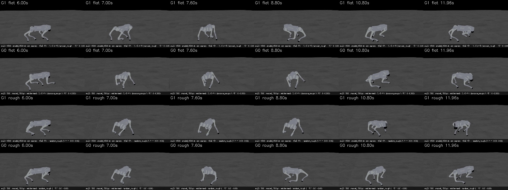
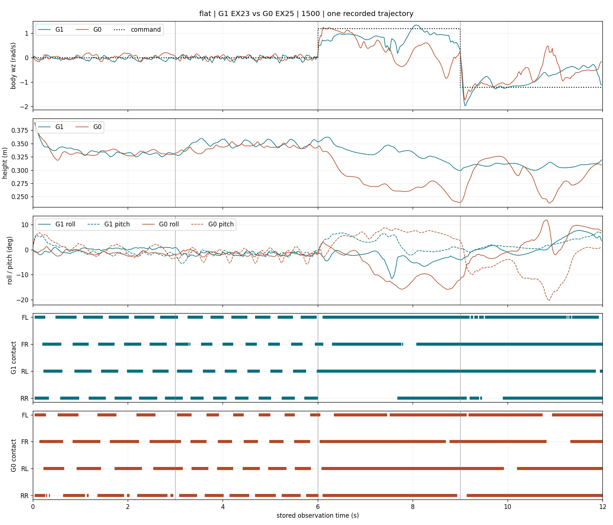
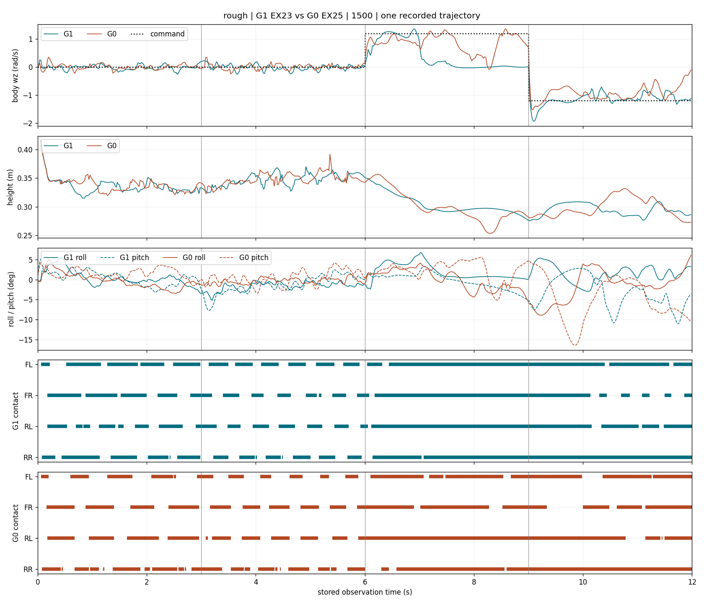

> 분류: A/평가 · 일반화 벤치마크 · 지표
> 작성: 오흥재 (ASTRA-23b) · 2026-10-23
> 근거: EX-23 G1·EX-25 G0 model_1500의 flat·rough 영상 및 발·자세·관절 NPZ · 23a 계산 재사용
> 요지: G1의 flat 회전 유지와 자세 안정 관찰은 뒷받침된다. rough 양의 회전에서는 G0가 우세한 반례가 있어 전 구간 우세로 묶을 수 없다.
> 상태: 기존 결과 관찰 분석 완료 · CPU만 사용 · 새 실험 설계·평가·학습 없음 · 성공률·인과효과 판정 아님

# G1·G0 1500회 보행과 회전의 전 구간 관찰

## 범위와 결론

본류는 1500회에도 낮게 걷던 기존 판을 이해하고, 실기 이전에 필요한 DR을 유지하면서 초기 부담 일부를 고정·완화한 EX-23·25의 보행 개선을 분석하는 것이다. 조기 중단 이야기나 다음 실험 설계로 넓히지 않는다. 23a의 est 혼입은 비교 한계로 유지하고 재검증하지 않았다.

팀장 관찰은 **flat 회전과 rough 음의 회전에서 뒷받침**된다. 전진은 지표별로 갈리고, **rough 양의 회전은 G1 우세 관찰을 반박**한다. 아래 판정은 같은 명령 시퀀스를 수행한 두 영상에서의 관찰이며 모델의 일반적 성능 순위가 아니다.

| 장면·시각 | 명령 | 「G1이 더 좋아 보인다」 판정 | 영상·접촉·자세 근거 |
|---|---|---|---|
| flat 0~3 s | vx=0.5 | 미확인·혼합 | 둘 다 걷고 높이 0.333/0.332 m. G1 pitch 변동은 작지만 vx는 G0 0.485가 G1 0.538보다 명령에 가깝다. G0는 앞발 들림이 더 크고 RR 접촉이 짧게 끊기는 장면이 있으나 지속 끌기로 단정할 수 없다 |
| flat 3~6 s | vx=1.0 | 추종·pitch 측면 뒷받침, 전체 우세 미확인 | G1 vx 1.017, G0 0.907. pitch 표준편차 1.11°/1.75°. 반면 두 발 접촉 중 대각 비율은 G0 0.966이 G1 0.891보다 높다. 두 판 모두 대각 교대 |
| flat 6~9 s | wz=+1.2 | 뒷받침 | 둘 다 즉시 돌기 시작. G1은 7.2→8.8 s 몸 방향을 계속 바꾸지만 G0는 7.2 s 이후 같은 방향 부근에서 기울고 되돌아감. G0 7.62~7.92, 8.56~8.86 s 역회전. G1 높이·roll 변동이 더 안정적 |
| flat 9~12 s | wz=-1.2 | 자세·회전 유지 측면 뒷받침 | G0 10.78~10.98 s 역회전과 10.86 s pitch -20.34°. G1은 이 역회전이 없고 pitch 최대 절댓값 7.15°. 다만 두 판 모두 후반 회전 속도가 명령보다 작음 |
| rough 0~3 s | vx=0.5 | 미확인·일부 반대 | 높이 G1 0.332, G0 0.339 m. vx 0.461/0.475, pitch 표준편차 1.76°/1.31°로 이 값들은 G0 쪽이 낫다. G1만 더 안정적이라는 영상 증거는 없음 |
| rough 3~6 s | vx=1.0 | 미확인·혼합 | vx는 G1 0.990, G0 0.973으로 둘 다 근접. roll/pitch 변동과 대각 비율은 G0 쪽이 낫다. 높이는 0.348/0.347 m로 비슷 |
| rough 6~9 s | wz=+1.2 | 반박 | G1도 6~7 s는 잘 돌지만 7 s 이후 감속, 7.5~9 s 거의 멈춤. G0는 7.2 s 정면 부근에서 8.8 s 반대 측면으로 계속 회전. G1의 정지 자세가 덜 흔들린다고 좋은 회전으로 판정할 수 없음 |
| rough 9~12 s | wz=-1.2 | 추종·자세 측면 뒷받침 | G1 후반 wz -1.104, G0 -0.839. G0 9.86 s pitch -16.44°, G1 최대 절댓값 11.10°. G1의 roll/pitch 변동이 작지만 두 판 모두 일부 발이 긴 시간 접촉한 채 돌며 깨끗한 발 교대 회전으로 확정하지 않음 |

표의 두 숫자 순서는 별도 표시가 없으면 G1/G0다. 높이는 23a와 같은 발 기준 중앙값, vx·wz는 해당 명령 뒤 절반의 평균이다. 「우세」에 새 합격선을 넣지 않고 항목별 관측만 적었다.

## 영상에서 가장 명확하게 갈리는 곳

행은 flat G1·G0, rough G1·G0 순서다. 7.6→8.8 s에서 flat은 G1이 더 회전하고 rough는 G0가 더 회전한다. 10.8 s flat G0의 앞쪽으로 숙인 모습은 NPZ의 10.86 s pitch 극값과 맞는다. 마지막 열은 11.96 s로 종료 직전까지 확인한 프레임이다. 카메라가 로봇을 따라가므로 세계 좌표 이동량·발 미끄러짐은 이 이미지에서 직접 재지 않았다.

네 영상은 각각 25 fps·300프레임이며 CPU로 1200프레임 전부 디코딩했다. 시각 검토는 0.00~11.80 s의 0.20 s 간격 240프레임과 종료 직전·핵심 시각 발췌로 전체 명령 구간을 덮었다. 모든 프레임을 눈으로 판독했다는 뜻은 아니다. 저장 관측은 50 Hz 전부 사용했다. 네 기록의 reset 0은 23a 결과를 재사용했다.

전체 시간표: [G1 flat](figs/astra-23b/G1_flat_overview.jpg), [G0 flat](figs/astra-23b/G0_flat_overview.jpg), [G1 rough](figs/astra-23b/G1_rough_overview.jpg), [G0 rough](figs/astra-23b/G0_rough_overview.jpg). 네 시간표에서 몸통이 지면에 눕거나 전복되는 표본은 없었다. 반대편 발의 가림은 있으므로 접촉 판정은 센서 배열로 보완했다.

## 회전 시작 지연과 유지 실패를 구분

측정 정의: 명령 부호 방향으로 `|wz|≥0.2 rad/s`가 10표본 연속인 첫 구간의 시작을 회전 반응 시점으로 삼았다. 50 Hz에서 0.20 s 유지다. 이는 관찰 위치를 찾기 위한 정의이며 합격선이 아니다. 0.1·0.4 rad/s에서도 계산해 evidence에 남겼다. 역회전은 명령 반대 방향 `|wz|>0.1`이 5표본 이상인 구간이다. 몸 좌표 wz이며 엄밀한 세계 yaw 미분이나 회전 각도가 아니다.

| 장면·방향 | G1 시작 지연 | G0 시작 지연 | 뒤 절반 wz G1/G0 | 역회전 근거 |
|---|---:|---:|---:|---|
| flat +, 6 s 시작 | 0.02 s | 0.02 s | +0.851/+0.008 | G0 7.62~7.92, 8.56~8.86 s |
| flat -, 9 s 시작 | 0.04 s | 0.04 s | -0.586/-0.461 | G0 10.78~10.98 s |
| rough +, 6 s 시작 | 0.02 s | 0.02 s | +0.005/+0.753 | 정의에 해당하는 지속 역회전 없음 |
| rough -, 9 s 시작 | 0.02 s | 0.02 s | -1.104/-0.839 | 정의에 해당하는 지속 역회전 없음 |

0.1~0.4 문턱에서 모든 첫 반응은 0.00~0.06 s다. 따라서 「G0만 회전 명령을 늦게 알아듣는다」는 해석은 뒷받침되지 않는다. `record_seq.py`는 step 이후 상태에 step 시작 시각을 붙이므로 이 지연에는 최대 한 step인 0.02 s의 표기 차이가 있다. 실제 센서·통신 반응 시간으로 해석하지 않는다.

0.5 s 묶음으로 보면 차이가 더 분명하다. rough G1의 +회전 wz는 6.5~7.0 s 1.173 → 7.0~7.5 s 0.210 → 7.5~8.0 s 0.008 rad/s다. 같은 G0는 0.956 → 1.091 → 0.753이다. flat G0도 6.0~6.5 s에는 1.050으로 먼저 잘 돌고, 7.5~8.0 s에는 -0.114로 되돌아간다. 실패 양상은 시작 지연보다 **시작한 회전을 유지하지 못함**이다.

## 몸 자세와 흔들림

표준편차는 각 3 s 전체의 각도 변동이다. 일정한 기울기 자체는 표준편차만으로 알 수 없어 주요 극값과 시각을 함께 적었다. 전진 첫 구간에는 reset 직후 가라앉는 과도기가 포함된다.

| 장면·구간 | roll 표준편차 G1/G0 | pitch 표준편차 G1/G0 | 중요한 시각·해석 |
|---|---:|---:|---|
| flat 0~3 | 0.75°/0.86° | 2.09°/2.49° | 높이의 10~90백분위 범위도 거의 같음: 0.327~0.344/0.327~0.343 m |
| flat 3~6 | 0.71°/0.67° | 1.11°/1.75° | G1 pitch 변동이 작음. G0가 모든 축에서 더 흔들리는 것은 아님 |
| flat 6~9 | 2.28°/5.98° | 2.82°/2.62° | G0 roll -15.85° @8.74 s, G1 -11.56° @7.56 s. G0 높이 중앙값 0.271, G1 0.334 m |
| flat 9~12 | 3.36°/5.65° | 2.00°/5.79° | G0 pitch -20.34° @10.86 s. G1 최대 절댓값 7.15° @11.92 s |
| rough 0~3 | 1.87°/1.84° | 1.76°/1.31° | G1만 더 안정적이라는 근거 없음 |
| rough 3~6 | 1.05°/0.71° | 2.21°/1.79° | G1 pitch -7.69° @3.14 s, G0 최대 절댓값 4.14° @5.44 s |
| rough 6~9 | 2.06°/2.43° | 1.90°/2.50° | G1의 작은 변동 일부는 후반 정지와 함께 발생. 좋은 회전과 동일시 금지 |
| rough 9~12 | 2.07°/3.81° | 3.93°/5.52° | G0 pitch -16.44° @9.86 s, G1 -11.10° @11.74 s |

윗줄은 wz, 다음은 높이, 셋째는 roll·pitch, 아래 두 줄은 네 발 접촉이다. 실선은 roll, 점선은 pitch다. contact 막대는 발 접촉이 켜진 시간이며 발의 세계 위치를 표시하는 선이 아니다.

## 다리 끌기·관절 움직임: 확인된 것과 아직 모르는 것

전진에서 G0의 앞발 들림과 앞 무릎 운동 폭이 더 크다. flat 3~6 s의 FL/FR calf 운동 폭(95백분위-5백분위)은 G1 0.47/0.67 rad, G0 0.73/0.81 rad다. rough 같은 구간도 G1 0.48/0.74, G0 0.85/0.87 rad다. 영상에서 G0의 앞다리가 크게 접히고 뻗는 모습과 맞는다. 그러나 더 큰 운동 폭 자체가 나쁜 보행이라는 기준은 없다.

| 관찰 | 판정 | 시각·수치·한계 |
|---|---|---|
| G0의 오른 뒷발이 0~3 s 내내 끌린다 | 반박 | flat RR은 0.36~0.64 s에 5.4 cm, 1.18~1.36 s에 2.9 cm, 2.04~2.20 s에 3.6 cm의 닫힌 스윙이 있음. rough도 0.46~0.68 s 7.9 cm, 1.22~1.38 s 5.1 cm 들림 |
| G0 RR의 낮은 스윙 중앙값은 주의할 신호다 | 뒷받침, 해석 제한 | flat 중앙값 약 2 mm, rough 약 3 mm. 0.02~0.08 s의 짧은 접촉 끊김이 섞인 결과. 발 전체가 계속 끌렸다는 뜻은 아니며 짧은 접촉 떨림과 작은 발 들림을 분리할 필요가 있음 |
| G1이 회전할 때도 네 발을 고르게 들어 디딘다 | 반박 | flat +회전에서 RL 6.00~9.00 s, FL 6.10~9.00 s 연속 접촉. -회전에서 FR 9.00~12.00 s 연속 접촉. 전진 trot의 접촉 교대가 회전까지 유지되는 것은 아님 |
| rough G1의 +회전 정체는 실제 관측과 맞는다 | 뒷받침 | 7.08~9.00 s는 네 발 모두 계속 접촉하고 wz도 거의 0. 영상의 반복 자세와 일치해 영상만 멈춘 경우와 구분됨 |
| G1/G0 중 누가 발을 더 미끄러뜨리며 도는가 | 미확인 | rough -회전은 두 판 모두 RR 9.00~12.00 s 연속 접촉. 몸은 회전하고 관절도 움직이나, NPZ에 발 XY·접촉 중 접선 속도가 없어 미끄러짐과 지지발 중심 회전을 분리할 수 없음 |

연속 접촉이 곧 관절 정지를 뜻하지도 않는다. flat G1 +회전 RL hip 운동 폭은 0.753 rad이며, -회전 FR hip은 1.014 rad다. 접촉을 유지하면서 자세를 바꾸는 동작이다. 이를 영상만으로 깨끗한 스텝 회전이나 끌기 회전 어느 한쪽으로 확정하지 않았다. foot_z 스윙은 양끝 접촉 발높이 평균 대비 최대 높이로, rough에서는 아래 지형 전체와의 최저 여유가 아니다.

## evidence와 재현

원자료는 `C:/Users/AI-WS01/s2_lab/videos/mid500_1022/{ex23r_1500,ex25_1500}/run_{flat,rough}.{mp4,json}` 및 `run_{flat,rough}_feet.npz`다. 원자료는 읽기만 했다. 전용 [evidence/astra-23b](evidence/astra-23b/)에 다음을 보존했다.

- `astra23a_metrics.py`, `astra23a_tb.py`, `metrics-23a.json`, `tb_cfg-23a.json`: 임시 영역에 있던 23a 계산·근거의 원본 복사. 이번에는 811·설정 차이·학습 곡선 검증을 다시 실행하지 않음.
- `visual_metrics.py`, `visual_metrics.json`: 이번 추가 계산, 구간별 자세·관절 운동 폭·접촉 지속시간·개별 스윙·회전 반응, MP4/JSON/NPZ SHA256. 23a의 기존 16개 구간 요약을 그대로 읽어 재사용.
- 답 아는 입력 4개 확인: 접촉 구간 양끝, 0.20 s 뒤 시작한 회전, 계속 역방향인 경우 시작 없음, 9표본씩만 나타나는 회전은 10표본 유지 조건 미달. 코드 변경 뒤 같은 계산을 재실행해 이미지와 JSON을 확인함.

CPU 재현: `CUDA_VISIBLE_DEVICES=-1` 설정 후 isaac311 Python으로 `evidence/astra-23b/visual_metrics.py` 실행. 출력은 해당 evidence와 전용 figs에만 기록한다. 기존 분석 스크립트 두 개는 당시 임시 출력 경로를 보존한 원본이므로 보관용이다.

**해석 한계**: 각 장면은 한 번의 연속 명령 시퀀스다. 앞 명령의 상태를 이어받으며 지형에서 지나간 위치도 다르다. 반복 성공률·인과효과·실기 성능으로 확대하지 않는다. 이번 자료가 뒷받침하는 관찰은 「G1의 flat 회전은 유지와 몸 자세가 더 낫고, rough의 음의 회전도 유리하다. 그러나 rough 양의 회전과 전진의 모든 항목까지 우세하지는 않다」다.
