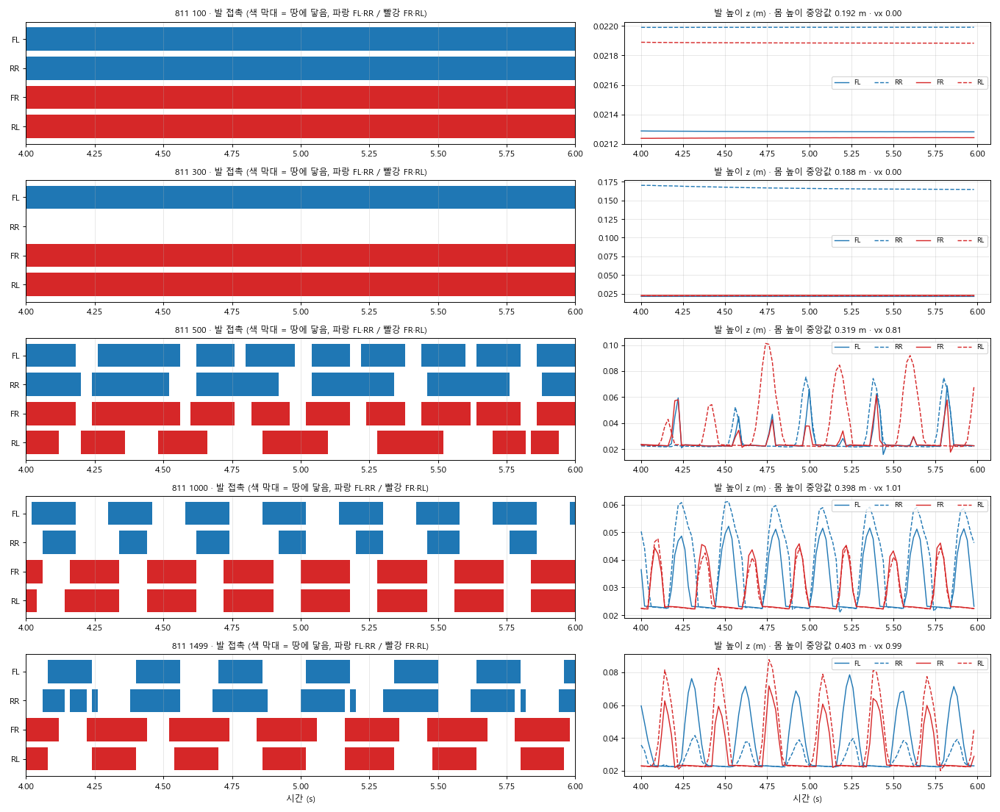
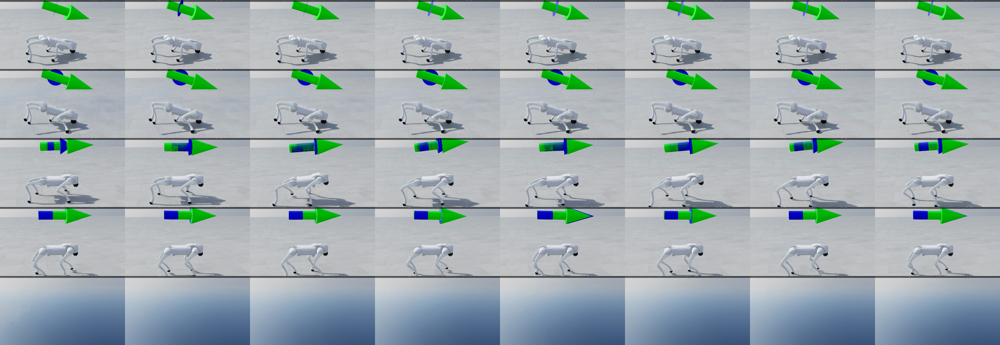

> 분류: 실험 기준선
> 작성: 오흥재 (lead 세션 정리) · 2026-10-22
> 근거: 8/11 처음부터 학습 판(`C:/isaac/IsaacLab/logs/rsl_rl/unitree_go2_rough/2026-08-11_20-32-58`, resume false) 체크포인트 100 · 300 · 500 · 1000 · 1499 · NVIDIA 배포판 · v1 · v2 를 같은 도구(record_seq · 같은 명령 열 · 시드 42 · 평지 근사)로 다시 재생해 측정
> 요지: 정상 설계를 처음부터 학습하면 300 회까지 몸을 낮추고 거의 움직이지 않다가 500 회에 일어나고 1000 회에 몸을 세운 대각 trot 가 된다. 정상 보행의 숫자는 몸 0.38~0.40 m · 대각 0.87~0.98.
> 상태: 확정(측정값) · 시드 하나 · 이후 모든 판정의 기준

# 811 기준선 · 정상 보행이 언제 어떻게 생기나

팀장 표기로 8/11 판을 「811」 이라 부른다. 811 은 NVIDIA Go2 rough 설정을 **처음부터**(사전학습 없이) 학습한 판이다. v1 · v2 는 NVIDIA 배포판(이미 1500 회)에서 이어 학습한 판이라 학습 속도 비교에는 쓰지 않고 최종 모양 비교에만 쓴다.

## 한눈에 (평지 · 전진 1.0 m/s 명령)

| 판 | 몸 높이(발 기준) | 두 발 접촉일 때 대각 비율 | 이륙/s | 실제 vx | 3 초 전진 | 모양 |
|---|---|---|---|---|---|---|
| 811 · 100 회 | 0.19 m | - | 0 | 0.00 | 0 m | 네 발 모두 땅, 몸 낮춤, 제자리 |
| 811 · 300 회 | 0.19 m | - | 0 | 0.00 | 0 m | 몸 낮춤, 오른 뒷발 하나를 든 채 제자리 |
| 811 · 500 회 | **0.32 m** | 0.21 | 3.2 | 0.82 | 2.07 m | 일어나서 걷기 시작, 위상은 아직 불규칙 |
| 811 · 1000 회 | **0.40 m** | **0.97** | 3.5 | 1.02 | 2.83 m | 몸을 세운 대각 trot |
| 811 · 1499 회 | 0.40 m | 0.98 | 3.5 | 1.00 | 2.88 m | 대각 trot |
| NVIDIA 배포판 | 0.38 m | 0.98 | 2.3 | 0.98 | 2.85 m | 대각 trot |
| v1 | 0.39 m | 0.89 | 2.8 | 1.00 | 2.92 m | 대각 trot |
| v2 | 0.38 m | 0.87 | 2.7 | 1.01 | 2.92 m | 대각 trot |

원표(네 구간 전부): [gait_table_baseline.md](figs/baseline-0811/gait_table_baseline.md)

## 걸음 위상 (811 시간표)

- 100 회: 네 줄이 끊기지 않음 = 네 발 모두 계속 땅(서 있음).
- 300 회: RR 줄이 비어 있음 = 오른 뒷발을 든 채 세 발로 서 있음(발 높이 0.17 m 에 고정).
- 500 회: 줄이 끊기기 시작, 짝이 아직 섞임.
- 1000 · 1499 회: 파랑(FL·RR)과 빨강(FR·RL)이 짝으로 번갈아 = 대각 trot.

배포판 · v1 · v2 위상: [phase_release_v1_v2.png](figs/baseline-0811/phase_release_v1_v2.png)

## 영상 프레임 (0.08 초 간격, 4.0 s 부터)

위에서부터 100 · 300 · 500 · 1000 · 1499 회. 100 · 300 회는 다리를 벌리고 몸을 낮춘 채 제자리, 500 회는 몸을 세우고 걷기 시작, 1000 회는 v2 와 같은 자세의 trot. **주의: 1499 회 띠의 이 구간은 카메라가 로봇을 놓쳐 하늘만 보인다**(숫자표 · 위상은 정상 · 영상 다시 찍기 필요). 배포판 · v1 · v2: [strips_release_v1_v2.png](figs/baseline-0811/strips_release_v1_v2.png). 비교 영상(3×2): [compare_0811.mp4](figs/baseline-0811/compare_0811.mp4) · [0.5 배](figs/baseline-0811/compare_0811_half.mp4).

## 학습 기록 (811 tensorboard)

| update | 50 | 100 | 150 | 300 | 500 | 1000 |
|---|---|---|---|---|---|---|
| track_lin | 0.27 | 0.32 | 0.42 | 0.75 | 1.06 | 1.13 |
| episode 길이 | 764 | 936 | 954 | 946 | 946 | 955 |
| 지형 단계 | 2.0 | 1.0 | 0.54 | 1.1 | 3.1 | 5.4 |

## 이 기준선이 말하는 것 (판정 규칙)

1. **300 회까지 몸이 낮은 것은 정상이다.** 이 시점의 몸 낮춤으로 실험을 멈추면 안 된다(10/22 EX-16~22 를 100~300 회에 멈춘 판정은 근거가 없었다).
2. **500 회에 몸이 약 0.3 m 로 올라오고 전진해야 한다.**
3. **1000 회에 몸 약 0.4 m · 대각 비율 0.9 이상**이어야 정상. 여기서 비정상이면 틀린 길.
4. **조기 경고 후보(가설)**: 811 은 몸이 낮을 때 **움직이지 않고 서 있다가** 일어난 뒤 걷는다. 우리 판들(EX-11 · EX-22)은 몸이 낮은 채로 **먼저 움직이기 시작**했고, EX-11 은 1500 회까지 기는 자세로 굳었다. 「몸을 세우기 전에 낮은 채로 이동부터 배운다」 가 기는 자세로 굳는 신호일 수 있다. EX-23 · 다음 판에서 확인.
5. 이 기준은 NVIDIA 학습기 · 시드 42 한 판에서 나왔다. START 구조(지각 모듈을 함께 배움)는 더 느릴 수 있다 → 판정 시점을 그대로 옮기기 전에 astra 검증.

원자료: `C:/Users/AI-WS01/s2_lab/videos/mid500_1022/scratch0811/` (각 클립 mp4 · json · `_feet.npz`(관절각 · roll/pitch 포함) · gait_table).
