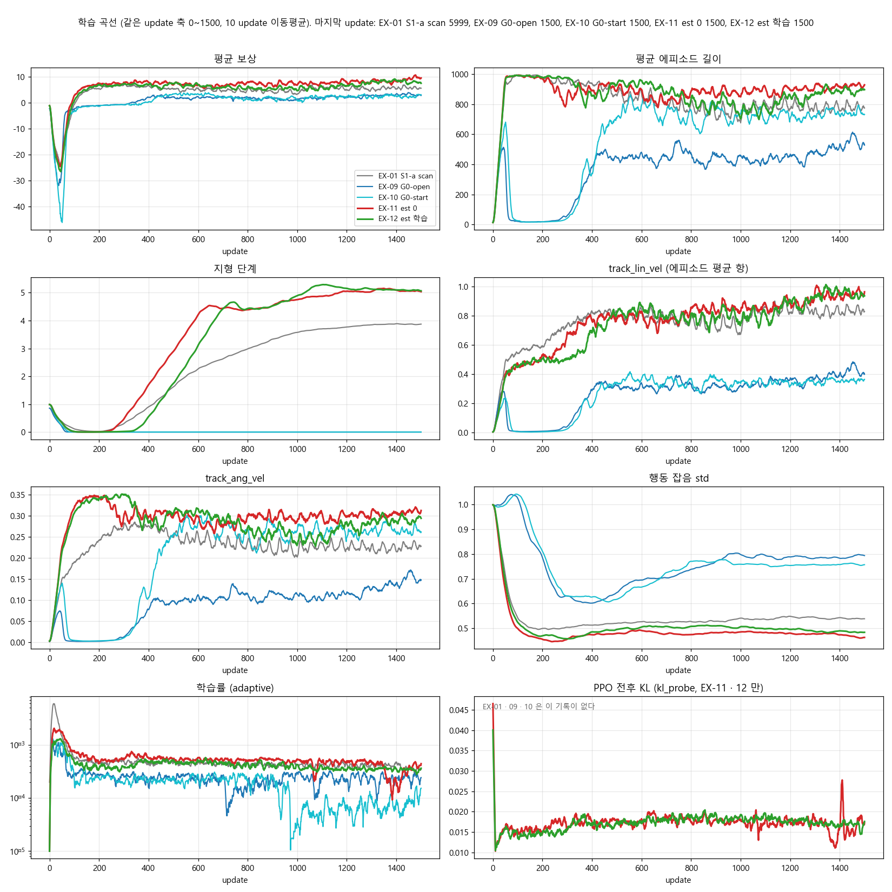
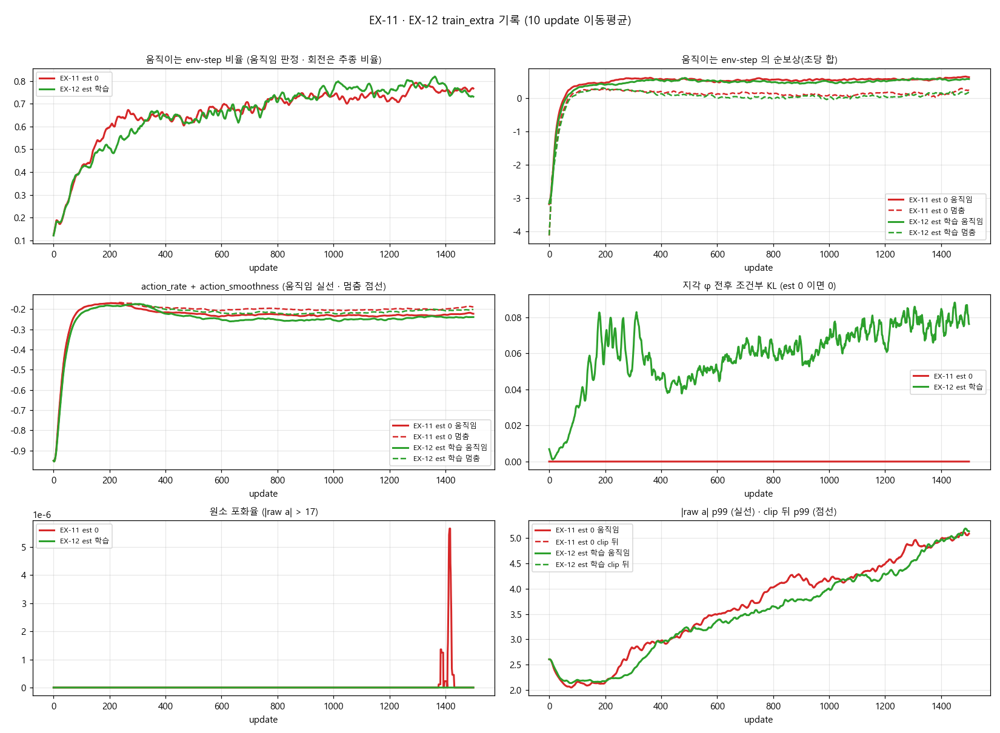
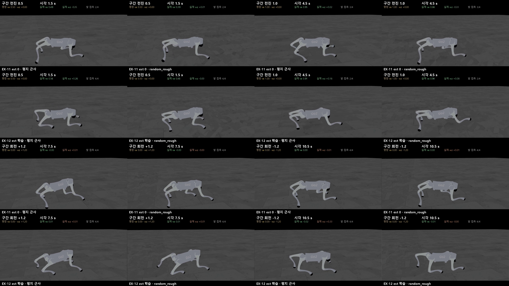
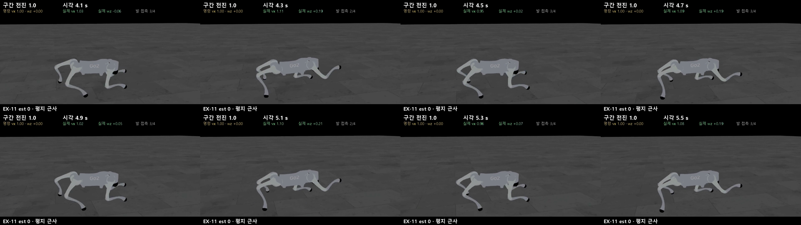

> 분류: 실험 결과
> 작성: 오흥재 (lead 세션 정리) · 2026-10-22
> 근거: sonnet 5e3ce25e 학습 로그 · manifest · train_extra · diag_z_action 500/1000/1500 · 2×2 영상 · ASTRA-X11/X12/X13 · #555
> 요지: 추정 입력(est)은 원인이 아니었다. 두 판 모두 전진 명령은 따라가지만 기는 자세로 가고, 제자리 회전은 배우지 못했다.
> 상태: 결과 확정 · 판정은 결과 전 등록 표 기준 · 다음 실험은 팀장 결정 대기

# EX-11 · EX-12 결과

## 한눈에

| 물음 | 답 | 근거 |
|---|---|---|
| est 를 actor 에서 빼면 걷나 | 빼든 넣든 거의 같다. **est 는 원인이 아니었다** | 두 판의 곡선 · 명령 반응 · 영상이 겹친다 |
| 서 있기에 갇히나 | **안 갇혔다.** 500 회 안에 앞으로 가기 시작 | 지형 단계 0 → 5, 전진 거리 목표의 91~93 % |
| 정상 보행인가 | **아니다.** 다리를 옆으로 벌린 낮은 자세로 기어간다 | 영상 · 몸 높이(발 기준) 0.17~0.29 m |
| 제자리 회전 | **못 한다.** 1500 회까지 0 | 회전 추종 0.00~0.05 (1 이면 명령대로) |

등록 판정(EXP-G0-zeroest · 결과 전 표): 「걸음」 = 정상 보행 + 전진 이동 + 회전. 두 판 모두 **「못 걸음」 줄**. 다만 EX-09/10 의 「서 있음」 과는 다른 실패라서, 표의 다음 한 걸음(보상 분해)은 이미 이번 기록으로 끝났다(아래 §해석).

용어: **est** = 속도 추정기와 지각 모듈이 actor 에 넣는 51 칸. **지형 단계** = S1 커리큘럼 레벨, 한 판 동안 일정 거리를 가야 오른다. **회전 추종** = 실제 회전 속도 ÷ 명령 회전 속도.

## 무엇을 했나

| | EX-11 | EX-12 |
|---|---|---|
| actor 입력 | 관측 45 + **0 × 51** | 관측 45 + **est 51** |
| 공통 | S1 이어진 지형 7종 · START 명령(전진 0~1.5, 0.3 미만이면 제자리 회전 ±1.2) · 깃발 없음 · 잡음 없는 critic 664 · clip 17 · 3072 env · 시드 42 · 1501 update | 같음 |
| 실행 | 10/22 01:33 → 04:22 · GPU 0 | 01:34 → 04:31 · GPU 1 |

- 두 판 rc 0, 실행 무효 0. manifest 비교에서 허용 칸(est 모드 · 이름 · 경로 · 장치) 밖 차이 **0**.
- 실행 전: ASTRA 검증 3 회(X11 설계 조건부 → X13 구현 높음 4 건 → X13b 띄움 가능). Kit 예행이 CPU 시험으로 못 잡은 결함 3 건을 잡음(장치 섞임 · 신경망이 GPU 0 에 남음 · 런처 속성). 자세한 것은 #555.
- EX-10(10/21)도 신경망이 GPU 0 에 있었다(params/agent.yaml). 결과 왜곡은 아니고 자원 배치 비대칭.

## 결과 1 · 학습 곡선 (EX-01 · 09 · 10 · 11 · 12 같은 update 축)

| update 1500 (직전 10 평균) | EX-01 S1-a | EX-09 G0-open | EX-10 G0-start | **EX-11** | **EX-12** |
|---|---|---|---|---|---|
| 평균 보상 | 5.62 | 2.82 | 3.12 | 9.54 | 7.51 |
| 에피소드 길이 (최대 1000) | 775 | 528 | 732 | 929 | 897 |
| 지형 단계 | 3.87 | 0.00 | 0.00 | 5.04 | 5.07 |
| track_lin | 0.83 | 0.40 | 0.36 | 0.96 | 0.94 |
| track_ang | 0.23 | 0.15 | 0.26 | 0.31 | 0.29 |
| 행동 잡음 std | 0.54 | 0.79 | 0.76 | 0.46 | 0.48 |

그림에서 읽는 것:
- **EX-09/10 은 50~350 update 동안 에피소드 길이가 0 근처로 무너졌다.** 시작하자마자 종료되는 구간이 300 update 이어졌고, 그 뒤 「움직이지 않고 버티기」 로 회복했다. EX-11/12 와 EX-01 은 이 붕괴가 없다. 두 묶음의 차이는 지형(50 열 · 듬성한 지형 포함 vs S1 7 종)과 critic(잡음 vs 깨끗) 이다.
- EX-11/12 의 곡선은 EX-01(S1-a) 과 같은 모양이고 더 높다.
- est 의 차이: EX-11 이 지형 단계를 약 100 update 먼저 올렸고 최종값은 같다. φ KL 은 EX-11 0(설계대로) · EX-12 0.076.

| train_extra (직전 10 평균) | EX-11 500 | EX-11 1500 | EX-12 500 | EX-12 1500 |
|---|---|---|---|---|
| 움직이는 env-step 비율 | 0.62 | 0.77 | 0.63 | 0.73 |
| 순보상/step 움직임 · 멈춤 | 0.57 · 0.14 | 0.63 · 0.23 | 0.54 · 0.09 | 0.57 · 0.17 |
| action_rate + smoothness 움직임 · 멈춤 | -0.22 · -0.20 | -0.22 · -0.19 | -0.24 · -0.21 | -0.24 · -0.20 |
| 행동 포화율 (clip 17) | 0 | 0 | 0 | 0 |

## 결과 2 · 명령 반응 (64 env · 6 초 · DR 끔 · z 평균 · 행동 평균)

| 체크포인트 | 전진 0.5 (목표 3 m) | 전진 1.0 (목표 6 m) | 회전 +1.2 추종 | 회전 -1.2 추종 |
|---|---|---|---|---|
| EX-10 1500 (참고) | 0.03 m | 0.03 m | 0.00 | 0.00 |
| EX-11 500 | 2.49 | 4.96 | 0.00 | 0.00 |
| EX-11 1000 | 2.66 | 5.53 | 0.02 | 0.03 |
| EX-11 1500 | **2.73 (91 %)** | **5.55 (93 %)** | 0.02 | 0.03 |
| EX-12 500 | 2.36 | 3.12 | 0.04 | 0.05 |
| EX-12 1000 | 2.58 | 5.21 | 0.03 | 0.03 |
| EX-12 1500 | **2.66 (89 %)** | **5.59 (93 %)** | 0.05 | 0.04 |

- z · 행동을 표집으로 바꾼 조합도 같은 결론(전진 2.4~2.8 m · 5.3~5.4 m, 회전 추종 0.09~0.14 (1500)). 평가 방식 때문이 아니다.
- 평가는 체크포인트에 저장된 모드를 복원했다: EX-11 `est_mode=zero`, EX-12 `learned` (ASTRA-X13 H1 수정 확인).
- EX-12 1500 의 회전 -1.2 에서 64 판 중 54 판만 끝까지 남음(평균 행동) · 43 판(표집). EX-11 은 64.
- 원자료: `C:/Users/AI-WS01/s2_lab/eval_new/x11_1022/ex1{1,2}_{500,1000,1500}/z_action.json`

## 결과 3 · 영상

[2×2 영상 (12 초, 1920×1080)](figs/ex11-12/x11_2x2_model1500.mp4) · 행 EX-11 / EX-12, 열 평지 근사 / random_rough, model_1500, 같은 시드 · 시작점 · 카메라. 명령 순서: 전진 0.5 → 1.0 → 회전 +1.2 → -1.2 (각 3 초).

lead 판독(접촉 시트 16 장 + 0.2 초 간격 8 장을 직접 봄, 전체 재생은 아님):
- **자세**: 몸통을 낮추고 다리를 옆 · 앞뒤로 크게 벌린 채 기어간다. S1-a(EX-01)와 같은 모양. 몸 높이(발 기준) EX-11 0.24~0.29 m · EX-12 0.17~0.24 m.
- **걸음**: 다리를 주기적으로 돌린다(발 접촉 2~3/4 반복). 네 발 교대 trot 로 보이지 않는다.
- **전진**: 명령대로 간다(영상 수치 0.46~0.48 / 0.92~1.01 m/s). 넘어짐 0 · 몸통 접촉 0.
- **회전**: 네 칸 모두 그 자리에 서 있다(실제 wz −0.01~0.01).
- 프레임 검사(sonnet): 검정 0 · 로봇 화면 밖 0 · 멈춘 화면 최대 2 프레임 · reset 0. ex11_rough 는 렌더 버퍼 밝기 0 두 번 뒤 세 번째 본 사용.

## 해석

**1. est 가설은 닫혔다.** 질문은 「est 연결이 걷기를 막는가」 였다. 0 으로 가려도, 넣어도 결과가 같다. 이 조건 · 시드 42 · 1500 update 에서 est 는 초기 보행의 필수 조건도 방해물도 아니다.

**2. EX-09/10 의 「바른 자세」 는 보행 자세가 아니었다.** 10/21 에 「START 구조가 자세를 바로잡았다」 고 보냈는데 이것은 틀린 해석이다. EX-09/10 은 움직이지 않고 기본 자세로 서 있었을 뿐이다. 이 보상 세트로 **이동을 배운 판은 셋(EX-01 · 11 · 12) 모두 기는 자세**다. 기는 자세는 지각 구조가 아니라 보상 · 환경 쪽 성질로 봐야 한다.

**3. EX-09/10 이 서 있던 까닭의 유력 후보는 초기 종료 붕괴다.** 50~350 update 에피소드 길이 0 근처 → 「버티기」 로 회복. EX-11/12 와의 차이는 지형(50 열 · 듬성한 지형)과 critic 둘이고 이 두 판으로는 둘을 가르지 못한다. 종료 원인 분해(bad_orientation · foot_below_ground)는 EX-09/10 로그에서 CPU 로 가능하다.

**4. 행동 변화 벌점은 걷기를 막지 않았다(X12 의 걱정 해소).** 움직임과 멈춤의 action_rate+smoothness 차이는 약 0.03, 움직이는 env 순보상이 멈춘 env 보다 0.3~0.5 크다.

**5. 회전을 못 배우는 까닭(가설).** 「멈춘 env」 는 거의 회전 명령 env 다(움직임 비율 0.73~0.77 ≈ 전진 명령 비율 0.8). 회전 명령에서 서 있기만 해도 track_lin 은 만점(명령 vx 0)이고 track_ang 은 평균 0.37. 완벽히 돌아도 더 받는 것은 0.5 × (1 − 0.37) ≈ 0.32/step, 전체 env 의 20 % 에서만. 기는 자세에서는 제자리 회전이 어렵다는 것과 겹친 것으로 본다. 미검증.

**아직 모르는 것**: 기는 자세가 어느 항 때문인지(자세 · 발 높이 · 다리 벌림을 묶는 항이 START 보상표에 없다는 점이 1 순위 후보) · v2 가 같은 Go2 에서 정상 보행을 낸 보상과의 차이 중 무엇이 결정적인지 · 다른 시드.

## 다음 (팀장 결정)

결과 전 표의 네 줄 어디에도 「전진은 되지만 기는 자세 · 회전 없음」 은 없다. 그래서 밤사이 다음 실험을 띄우지 않았다(GPU 0 · 1 04:4x 부터 대기).

| 후보 | 한 변수 | 노리는 것 | 비용 |
|---|---|---|---|
| A · 자세 항 추가 (권고) | EX-11 조건 + v2 의 자세 · 발 관련 보상 항만(DIFF-s1a-vs-nvidia-v2 의 45 줄 중 자세 · 발 항) | 기는 자세 해소. est 는 0 으로 둬도 된다는 것이 이번 결론 | 1 판 3 시간 |
| B · 회전 비중 | 회전 가지 비율 20 % → 40 % 또는 track_ang 가중치 | 제자리 회전 | 1 판 3 시간. A 와 동시 가능(GPU 둘) |
| C · EX-09/10 종료 분해 | 학습 없음 · CPU | 본선(S2 50 열) 이 왜 처음에 무너지는지 | 수십 분 |

권고: A 와 B 를 두 GPU 에 한 판씩, C 는 CPU 로 같이. A 의 항 목록은 DIFF 문서에서 고르고 ASTRA 확인(한도 고려해 짧게) 뒤 띄운다.

## 기록 위치

- 학습: `sonnet-code/logs/rsl_rl/foothold_s2_x11/2026-10-22_01-33-36_ex11-est-zero` · `…01-34-08_ex12-est-learned` (manifest.json · train_extra.jsonl · model_500/1000/1500.pt)
- 평가: `C:/Users/AI-WS01/s2_lab/eval_new/x11_1022/`
- 영상 · 그림 원본: `C:/Users/AI-WS01/s2_lab/videos/x11_1022/` (frame_check JSON · 칸별 clips)
- 이슈: [#555](https://github.com/foothold-project/foothold-lab/issues/555)
