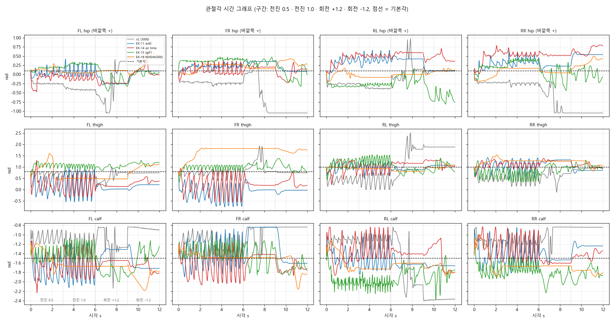
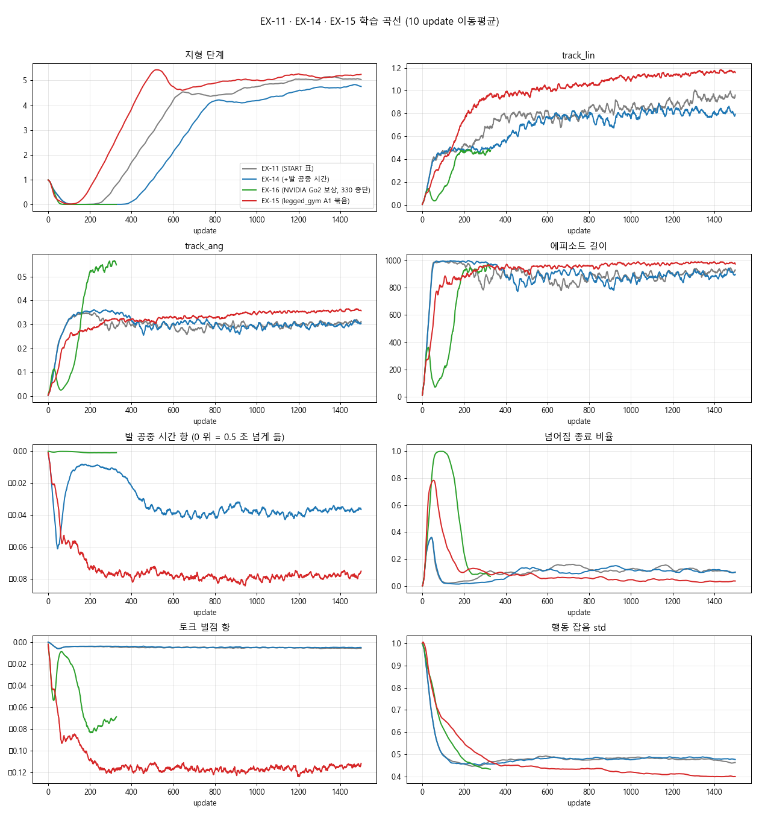

> 분류: 실험 결과
> 작성: 오흥재 (lead 세션 정리) · 2026-10-22
> 근거: sonnet cce2de44 · 2e0fa180 · 13d77863 학습 로그 · 걸음 위상도 · 관절각 기록(record_seq · joint_plot) · 영상 · ASTRA-X14 7f8e81e8 · #555
> 요지: 보상 묶음 셋 모두 대각 trot 를 만들지 못했다. 관절각으로 보면 v2 는 무릎을 펴고 hip 을 안으로 모은 키 큰 자세이고, 우리 판들은 무릎을 굽히고 hip 을 바깥으로 벌린 자세다.
> 상태: 결과 확정(EX-14 · 15 1501 회, EX-16 330 회 중단) · EX-13 은 결론 제외 · 다음 실험은 팀장 결정 대기

# EX-14 · EX-15 · EX-16 결과

10/24 원자료 재대조 정정: EX-15는 앞뒤 쌍 동조 도약이며 앞발과 뒷발의 이륙에 시차가 있다. 「네 발이 정확히 동시에 뜨고 착지」「500~1500 위상이 완전히 같음」은 과한 표현이라 아래를 고쳤다. 몸 높이 기준도 접촉 발 기준으로 바로잡았다. [재집계 근거](../20261023-experiments/NOTE-posture-causes-1024.md). 아래 중단·다음 실험 권고는10/22 당시 기록이며 현재 실행 지시가 아니다.

## 한눈에

| 판 | EX-11 대비 바꾼 것 | 걸음 위상 (평지 전진 1.0) | 몸 높이(발 기준) | 제자리 회전 | 판정 |
|---|---|---|---|---|---|
| v2 (기준) | NVIDIA 환경 · 보상 | **대각 trot** | **0.38~0.39 m** | 못 함(회전 구간에서 자세 붕괴) | 기준 |
| EX-11 | (START 보상표) | 앞발만 젓고 뒷발 하나를 끎 | 0.20~0.25 m | 못 함 | 못 걸음 |
| EX-14 | 발 공중 시간 +1.0 | 뒷발 하나(500) → 뒷발 둘(1500)을 끌고 앞발로 기어감 | 0.19~0.25 m | 못 함 | 못 걸음 |
| EX-15 | legged_gym A1 묶음(발 공중 시간 +1 · 음수 0 자르기 · 토크 -2e-4 · 관절 한계 -10 · calf 충돌) | **앞뒤 쌍 동조 도약**, 앞뒤 이륙 시차·네 발 공중 구간 있음. 500·1000·1500에서 도약 성향 유지 | 0.26~0.29 m | **됨** (+1.06 · -0.91 rad/s, 명령 1.2) | 정상 trot 미달 (자세 · 회전은 개선) |
| EX-16 | 보상만 NVIDIA Go2 세트로 통째 교체 | 300 회에 엎드려 다리를 벌린 채 거의 안 움직임 | 0.19 m | 못 함 | 틀린 길, 330 회에 중단 |

EX-13(MGDP 묶음)은 팀장 결정으로 14:19 약 230 회에 중단 · 결론에 쓰지 않는다.

**용어**: 걸음 위상 = 네 발이 언제 땅에 닿고 뜨는지의 순서. trot = 대각선 두 발(FL·RR / FR·RL)이 짝으로 번갈아 딛는 걸음. pronk = 네 발이 한꺼번에 뛰는 걸음이며 이번 EX-15를 순수 pronk로 단정하지 않는다. 발 기준 몸 높이 = root Z에서 접촉 중인 발 중심 평균 Z의0.022m 아래 기준면을 뺀 값. 접촉 발이 없으면 NaN이고 중앙값에서 제외한다. 배 밑 여유 높이가 아니다.

## 무엇을 했나

- 공통: EX-11 조건(est 0 · S1 이어진 지형 7 종 · START 명령 · 깨끗한 critic · clip 17 · 3072 env · 시드 42). 바꾼 것은 보상뿐.
- EX-14 GPU 1 13:43~16:4x · EX-15 GPU 0 14:21~17:2x 둘 다 1501 회 · rc 0 · 실행 무효 0.
- EX-16 GPU 1 17:00 시작, 300 회 점검에서 틀린 길로 판정해 17:38 중단(약 330 회).
- 점검: 500 · 1000 · 1500 회(EX-16 은 300) 체크포인트를 같은 도구 · 같은 명령 열(전진 0.5 → 1.0 → 회전 +1.2 → -1.2, 각 3 초) · 시드 42 · 평지 근사와 random_rough 로 찍고, 발 접촉 위상도 · 0.08 초 간격 프레임 · 관절각 · 몸 자세를 뽑아 v2 와 나란히 봤다.

## 결과 1 · 걸음 위상

- 위: v2 · 파랑(FL·RR) 막대와 빨강(FR·RL) 막대가 번갈아 나온다 = trot. 주기 약 0.45 초.
- EX-14 1500: RR · RL 막대가 끊기지 않음 = 뒷발 둘을 계속 땅에 붙이고 앞발만 번갈아 젓는다.
- EX-15 1500: 앞발 쌍·뒷발 쌍이 맞춰 움직이고 네 발 공중 구간이 있다. 앞뒤 이륙 시차가 있어 정확한 동시 도약은 아니다. 500·1000에서도 도약 성향이 보인다([500](figs/mid-1022/phase_ex15_500.png) · [1000](figs/mid-1022/phase_ex15_1000.png)).
- EX-16 300: [위상도](figs/mid-1022/phase_ex16_300.png) · 전진 명령에도 접촉이 거의 0 인 구간(엎드림) · [프레임](figs/mid-1022/strip_ex16_300.png).

**관찰한500·1000·1500회에서 대각 교대 trot로 바뀌지 않았다.** 평지 전진4~6초의 네 발 공중 표본은 각각17/100·18/100·16/100이다. 위상이 완전히 같거나 더 학습해도 절대 바뀌지 않는다는 결론은 아니다.

## 결과 2 · 관절각과 자세 (평지 전진 0.5, 구간 평균 rad)

| | v2 | EX-11 | EX-14 | EX-15 | EX-16(300) | 기본각 |
|---|---|---|---|---|---|---|
| hip (바깥쪽 +) 앞 · 뒤 | **-0.22 · -0.24 (안으로 모음)** | 0.11 · 0.25 | 0.00 · 0.40 | 0.26 · -0.07 | 0.12 · -0.03 | 0.10 |
| thigh 앞 · 뒤 | 0.74 · **0.48** | **0.05** · 1.01 | 0.29 · 1.04 | 1.02 · 0.93 | 1.17 · 1.12 | 0.8 · 1.0 |
| calf 앞 · 뒤 | **-1.09 · -1.13 (무릎을 폄)** | -1.60 · -1.45 | -1.66 · -1.31 | -1.43 · -1.86 | -1.43 · -1.48 | -1.5 |
| 몸 높이(발 기준) | 0.39 m | 0.25 | 0.24 | 0.28 | 0.19 | |
| pitch | 0.02 | 0.08 | -0.01 | -0.05 | 0.16 | |

원표: [joint_table.md](figs/mid-1022/joint_table.md) · 몸 자세: [body_attitude.png](figs/mid-1022/body_attitude.png).

읽는 법과 사실:
- **v2 는 네 다리 모두 hip 을 안쪽으로 약 0.3 rad 모으고, 무릎(calf)을 기본각보다 약 0.4 rad 펴서 몸을 세운다.** 뒷다리 thigh 도 기본(1.0)보다 0.5 rad 앞으로 둬서 뒷발이 몸 아래에 온다. 그래서 몸이 높고 앞뒤가 수평이다(pitch 0.02).
- **우리 판들은 hip 이 기본각 또는 바깥쪽이고, 무릎은 기본각(-1.5)이거나 더 굽혔다.** 몸이 낮다.
- EX-11 · 14: 앞다리 thigh 평균이 0.05~0.29 로 기본(0.8)보다 0.5~0.75 rad 뒤로 젖혀져 있고 -0.5~1.0 범위로 크게 휘두른다 = 앞다리로 노를 젓는 걸음.
- EX-15: thigh 는 기본 근처로 돌아왔지만 뒷다리 calf -1.86 으로 더 굽혔다.
- **v2 의 calf 는 soft 관절 한계(90 %) 바로 밖까지 편다**(여유 -0.04 ~ -0.09). EX-15 에 넣은 관절 한계 벌점(-10, soft 0.9)은 바로 이 「무릎을 편 자세」 에 벌점을 준다. EX-15 가 자세는 올라갔어도 v2 만큼 펴지 못한 까닭의 후보다(가설, 미검증).
- 팀장 관찰(「hip 이 너무 열려 있다」 「앞뒤 무릎 굽힘이 v2 는 고르다」)과 숫자가 일치한다.

## 결과 3 · 학습 곡선

- EX-15 가 가장 빨리 배웠다(track_lin 0.9 대 280 회, 지형 단계 200 회부터 상승). 50 회 무렵 넘어짐 종료가 78 % 까지 갔다가 회복.
- EX-14 는 EX-11 보다 100~200 회 늦다. 발 공중 시간 항은 끝까지 음수(발을 0.5 초 미만으로 짧게 듦).
- EX-16 은 50~100 회 넘어짐 종료 94~99 % → 엎드려 버티기로 회복, 지형 단계 0. EX-09/10 의 초기 붕괴와 같은 모양.

## 결과 4 · 영상

[중간 점검 비교 영상 (3×2, 12 초)](figs/mid-1022/compare_mid_1022.mp4) · [0.5 배속](figs/mid-1022/compare_mid_1022_half.mp4): 위 v2 · EX-11 500 · EX-14 500 / 아래 EX-15 500 · EX-15 1000 평지 · EX-15 1000 rough. 원본 클립과 1500 회 클립은 `C:/Users/AI-WS01/s2_lab/videos/mid500_1022/` · `joint_1022/`.

## 해석

1. **시험한 보상 묶음에서 trot가 나오지 않았다.** EX-15의 발 공중 시간 항은 발별 착지 값을 합산하며 대각 교대와 앞뒤 쌍 도약을 구별하지 않는다. 여러 보상을 동시에 바꿨으므로 이 항 하나가 도약을 만들었다고 확정할 수 없다. EX-15에는 MGDP motion_trot 항을 넣지 않았다(`s2_x15_cfg.py:9`).
2. **보상만 v2 와 같게 바꿔도(EX-16) 정상 보행이 나오지 않았다.** v2 와 우리 사이에는 보상 말고도 actor 관측(v2 는 실제 몸 선속도 · 높이 스캔, 우리는 est 0 이라 둘 다 없음) · 몸통 접촉 종료 · 명령 분포가 다르다. 보상 세트는 그 환경 · 관측과 짝으로 맞춰져 있어서 보상만 갈아 끼우면 통하지 않는다.
3. **자세 차이의 실체는 hip 벌림과 무릎 굽힘이다.** 「몸이 낮다」 를 관절 수준으로 내리면 hip 바깥 벌림 + 무릎 굽힘 + 앞다리 thigh 뒤로 젖힘이다. v2 는 그 반대다.
4. **EX-15 는 회전을 배웠다.** 제자리 회전을 한 유일한 판. 명령 계약(제자리 회전 20 %)은 학습 가능하다는 증거.

아직 모르는 것: hip · 무릎 자세를 무엇이 정하는지(보상인지, 관측의 속도 정보 부재인지, PD · 동작 크기인지) · 관절 한계 벌점이 무릎 펴기를 막았는지 · 다른 시드.

## 다음 (팀장 결정)

| 후보 | 내용 | 근거 · 한계 |
|---|---|---|
| A · 제3자 PIE-Go2 포트 보상 후보 | parkour_mjlab(제3자 포트)의 PIE 표 + Go2 추가 항: 접촉 위상 +0.5(주기 0.6 s · 대각 엇갈림) · hip -0.5 · 높이 +0.2 · 미끄럼 -0.25 · 자세 -5. PD(calf 40/2 · 나머지 20/1)도 포트와 같게 | 위상 식이 pronk 를 구별함은 CPU 로 확인. hip 항이 관찰된 hip 벌림을 직접 겨냥. 공식 PIE 원문에는 없는 항이고 포트의 actor 에는 phase 관측이 없어 재현성 미확인 |
| B · 관측 차이 확인 | EX-15 에서 est 0 대신 실제 선속도를 actor 에(오라클) | EX-16 이 보상 밖 차이를 가리킴. 걸음을 바꾸는지는 미확인 |
| C · 관절 한계 벌점 확인 | EX-15 에서 dof_pos_limits 만 끔 | v2 가 soft 한계 밖까지 무릎을 펴는 사실에서 나온 가설 |

권고: A 를 GPU 하나, B 를 다른 GPU 에. 둘 다 300 회 위상도 · 관절각 · 영상으로 먼저 판정하고 틀린 길이면 그 자리에서 멈춘다.

## 기록 위치

- 학습: `sonnet-code/logs/rsl_rl/foothold_s2_x13/*ex14-airtime` · `foothold_s2_x15/*ex15-lgA1` · `foothold_s2_x16n/*ex16-nvgo2`
- 영상 · 위상 · 관절: `C:/Users/AI-WS01/s2_lab/videos/mid500_1022/` · `joint_1022/` · 이 문서의 `figs/mid-1022/`
- 계보 조사: ASTRA-X14 `ANALYSIS-astra-gait-reward-lineage.md` (astra2-x14 worktree, 7f8e81e8)
- 이슈: [#555](https://github.com/foothold-project/foothold-lab/issues/555)
