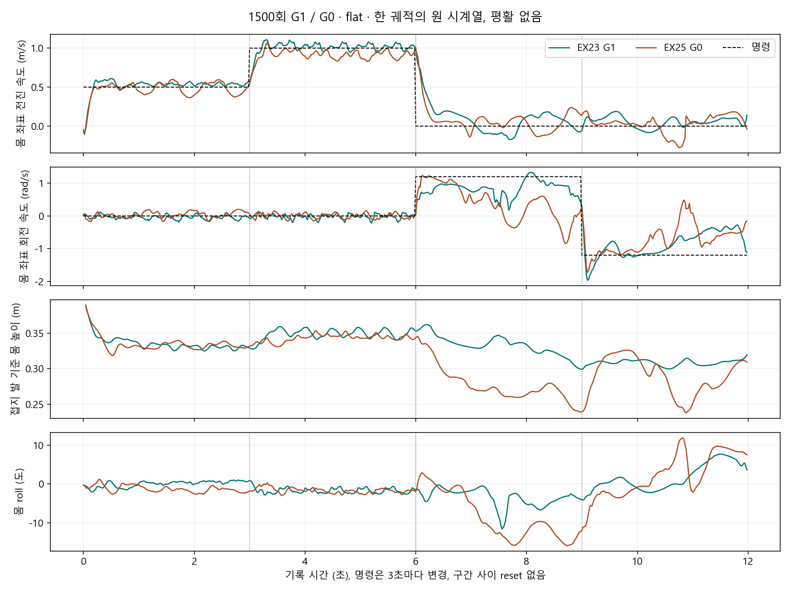
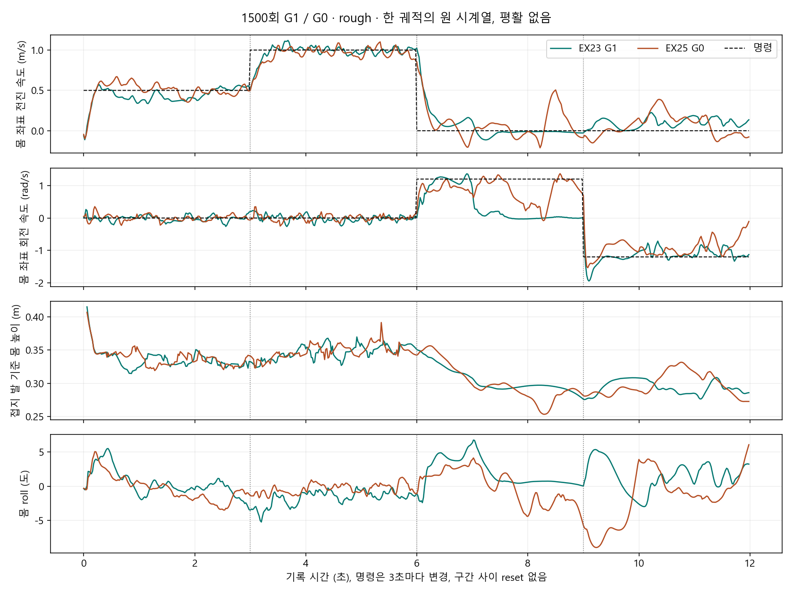
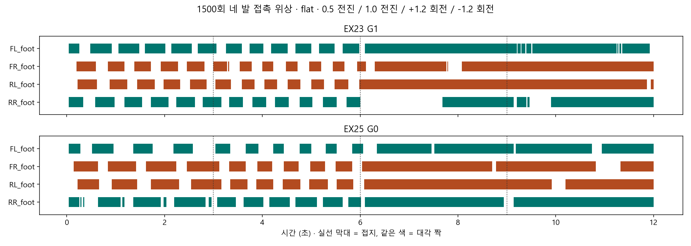
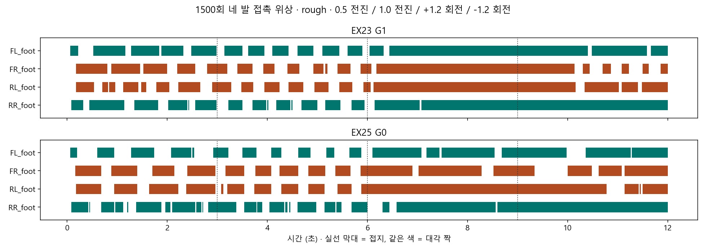
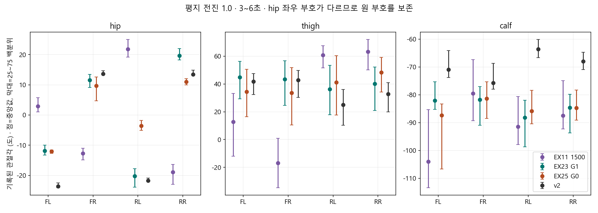
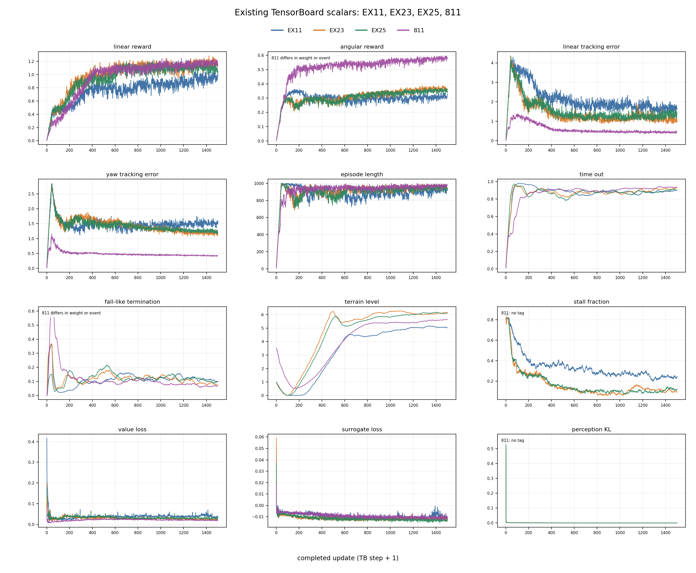

> 분류: A/평가 · 일반화 벤치마크 · 지표
> 작성: 오흥재 (lead_tmp 분석 취합) · 2026-10-23
> 근거: EXPERIMENT-FLOW-20261023 · 저장 cfg · 발/자세/관절 NPZ · TensorBoard · 기존 MP4 · ASTRA-23a/23b · SOL-23c · LUNA-23b
> 요지: 낮게 기던 전진의 개선은 확인했지만 회전 유지와 강한 무작위화 내성은 미완성이다. G1-GT의 평지 이점과 rough 반례를 함께 보존한다.
> 상태: 기존 자료 CPU 분석 취합 완료 · 한 시드·짧은 명령 시퀀스의 관측 · 새 학습/평가/Kit 없음 · 다음 학습은 팀장 논의

# EX-23·25 결과 · 얻은 보행과 남은 문제

## 한눈에

**EX-23 G1과 EX-25 G0는 1500회에서 몸을 세워 대각 짝을 번갈아 쓰며 전진한다. 기존 1500회 판의 낮게 기는 자세와 네 발 동시 도약을 해당 전진 구간에서 벗어났다. 그러나 회전까지 완성한 정책도, 실기에 바로 붙일 정책도 아니다.**

G1-GT는 평지 1.0 m/s 전진과 회전 유지에서 G0보다 낫다. rough 양의 회전에서는 G1이 먼저 돌다가 멈추고 G0가 더 잘 유지한다. 이 반례를 빼고 지도 효과를 일반화하지 않는다. 아래 표는 동일 명령 시퀀스의 한 번 관측이며 성공률 표가 아니다.

## 먼저 볼 영상과 그림

- 평지 1500회 좌 G1-GT·우 G0: [1배](C:/mai/wt/foothold-lab/luna-23b/inbox/jay/20261021-experiments/figs/ex23-25-luna-23b/ex23-ex25-flat-1500-1x.mp4) · [0.5배](C:/mai/wt/foothold-lab/luna-23b/inbox/jay/20261021-experiments/figs/ex23-25-luna-23b/ex23-ex25-flat-1500-0.5x.mp4)
- rough 1500회 좌 G1-GT·우 G0: [1배](C:/mai/wt/foothold-lab/luna-23b/inbox/jay/20261021-experiments/figs/ex23-25-luna-23b/ex23-ex25-rough-1500-1x.mp4) · [0.5배](C:/mai/wt/foothold-lab/luna-23b/inbox/jay/20261021-experiments/figs/ex23-25-luna-23b/ex23-ex25-rough-1500-0.5x.mp4)
- [ASTRA의 구간별 영상·접촉 판독](ANALYSIS-astra-ex23-25-visual.md) · [기준선·설정·원자료 검증](ANALYSIS-astra-ex23-25.md)
- [학습 곡선과 촬영 실패의 출처](../20261023-experiments/REPORT-sol-23c.md)

외부 열람: [평지 1배 MP4](https://github.com/foothold-project/foothold-lab/releases/download/research-ex23-25-20261023/ex23-ex25-flat-1500-1x.mp4) · [평지 0.5배 MP4](https://github.com/foothold-project/foothold-lab/releases/download/research-ex23-25-20261023/ex23-ex25-flat-1500-0.5x.mp4) · [rough 1배 MP4](https://github.com/foothold-project/foothold-lab/releases/download/research-ex23-25-20261023/ex23-ex25-rough-1500-1x.mp4) · [rough 0.5배 MP4](https://github.com/foothold-project/foothold-lab/releases/download/research-ex23-25-20261023/ex23-ex25-rough-1500-0.5x.mp4). [파일 목록·해시](../20261023-experiments/MEDIA-EX23-25.md).

영상은 기존 촬영의 CPU 재편집이다. 네 출력의 SHA·전 프레임 해독·길이·프레임 수를 lead_tmp가 재확인했다. 1배는 12초·300프레임, 0.5배는 24초·600프레임. 파일 검증은 사람이 모든 프레임을 눈으로 판독했다는 뜻이 아니다. ASTRA는 원본 네 영상의 0.2초 간격과 핵심 시각을 검토했고, lead_tmp는 전 구간 접촉 시트·회전 핵심 프레임·관측 배열을 대조했다. 원본·실패 기록 모두 보존했다. 영상은 현재 luna 작업 사본에 있고 git에는 경로·해시만 둔다.

## 무엇을 알아보던 실험인가

[흐름 정본](../20261019-design/EXPERIMENT-FLOW-20261023.md)이 옛 인수인계보다 우선한다. START 첫 학습에서 기는 자세가 나왔고, EX-11·14·15는 1500회까지 돌고도 낮게 걷거나 뛰었다. 보상 변경으로 해결되지 않아 환경을 v2 쪽으로 바꾸는 EX-17~22를 **처음부터 301회 선별 실험**으로 설계했다. 단순히 일찍 중단해서 생긴 실패 이야기로 바꾸지 않는다.

DR 약화는 초반 붕괴를 줄였다. 811의 같은 회차를 다시 보며 초기 낮은 자세만으로 성패를 판단할 수 없음을 확인했고, 본류 EX-23·25에서는 START 구조·보상·명령을 유지한 채 약한 DR 고정과 행동 지연 제거 상태에서 1501 update를 실행했다. 파일 model_1500은 0부터 붙은 번호다.

## 1500회 명령 반응 · 원자료 자동 추출

| 장면 | 명령 | G1-GT 실제 속도 | G0 실제 속도 | G1-GT/G0 몸 높이 m |
|---|---|---:|---:|---:|
| flat | 전진 1.0 m/s | 1.017 | 0.907 | 0.349 / 0.343 |
| flat | 회전 +1.2 rad/s | 0.851 | 0.008 | 0.334 / 0.271 |
| flat | 회전 -1.2 rad/s | -0.586 | -0.461 | 0.309 / 0.292 |
| rough | 전진 1.0 m/s | 0.990 | 0.973 | 0.348 / 0.347 |
| rough | 회전 +1.2 rad/s | 0.005 | 0.753 | 0.296 / 0.295 |
| rough | 회전 -1.2 rad/s | -1.104 | -0.839 | 0.292 / 0.293 |

높이는 각 3초 전체 중앙값, 실제 속도는 뒤 절반 1.5초 평균이다. 명령은 0~3초 전진 0.5, 3~6초 전진 1.0, 6~9초 회전 +1.2, 9~12초 회전 -1.2이며 중간 reset 없이 이어진다. 같은 시드·지형 생성·명령이지만 움직인 경로와 직전 자세는 달라진다. 네 1500회 기록은 reset 0이다. `flat`도 random_rough 높이 0~0.003 m인 평지 근사이고 rough는 0.01~0.06 m, difficulty 0.5의 한 장면이다.

[자동 추출 CSV](figs/ex23-25-lead-review/segments.csv) · [계산 스크립트](figs/ex23-25-lead-review/analyze_saved.py) · [출처 해시](figs/ex23-25-lead-review/provenance.json)

G0 평지 양의 회전은 처음부터 무반응이 아니다. 먼저 돌다가 기울고 일부 역회전하며 후반 평균이 거의 0이 된다. G1-GT rough 양의 회전도 6~7초는 돌다가 7.5~9초에 정체한다. **명령을 받는 속도보다 회전을 유지하는 능력이 남은 문제**다. G0 평지 음의 회전에서 앞쪽으로 크게 숙이는 프레임은 pitch 극값과 맞는다. 회전 시 몇 발이 오랫동안 접촉한 채 움직이므로 전진의 좋은 교대 걸음을 회전 전체로 넓히지 않는다.

## 얻은 것과 아직 채워야 할 것

| 항목 | 현재 확인한 것 | 남은 것 |
|---|---|---|
| 전진 자세 | EX-11 1500 높이 0.241 m에 비해 G1-GT/G0는 약 0.35/0.34 m. 전진에서 대각 짝 교대, 네 발 동시 공중 비율 0 | 811과 동일한 완성도라는 뜻은 아님. 지형 전체와 다양한 명령 확인 필요 |
| 회전 | G1-GT 평지 양방향과 rough 음방향에서 G0보다 회전 유지가 나음 | G1-GT rough 양방향의 비대칭, G0 평지 정체, 접촉 유지 회전의 발 미끄러짐 여부 |
| 환경 적응 | 약한 DR 묶음에서 기존보다 보행 형성이 개선됨 | 강한 마찰·질량·무게중심·모터 차이·지연에도 유지하는지 미측정 |
| 지각 | G1-GT는 정답 지도를 쓰고 G0는 지도 토큰 없이 동작 | DG1·DG3 깊이에서 복원한 지도로 같은 보행이 가능한지 미실행 |
| 신뢰 범위 | 저장한 네 시퀀스의 수치·영상·위상 일치 | 반복 성공률, 다른 시드, 열린 명령 전범위, 실기 성능은 미확인 |

대각 비율은 정확히 두 발이 닿은 표본 중 대각 짝의 비율이다. 전체 시간의 trot 성공률이 아니다. 대각 비율 1만으로 정상 자세라 할 수 없고 실제 교대와 높이를 함께 본다. 접촉이 계속된다고 관절도 멈춘 것은 아니다. 발 XY·접선 속도가 없어 미끄러짐은 미확인이다.

관절 비교는 EX-11 실제 model_1500 및 v2 원본 관절 NPZ를 썼다. EX-11의 앞뒤 다리 비대칭이 줄었으나 모든 무릎이 똑같이 펴진 변화는 아니다. 좌우 hip 부호도 다르므로 한 각도를 네 발 공통 정상값으로 강요하지 않는다.

### 관절 그림을 읽는 법과 보폭 재확인

hip은 다리를 옆으로 벌리는 축, thigh는 허벅지 회전, calf는 무릎에 해당한다. 점은 기록 각도의 중앙값, 막대는 가운데50%가 머문 범위다. **위에 있을수록 좋거나 막대가 길수록 좋은 그림이 아니다.** 좌우 부호도 달라 서로 반전되어 보일 수 있다. 특정 무릎각을 따라 하게 만드는 목표로 사용하지 않는다. 몸 자세·좌우 교대·명령 수행·관절 한계 여유와 함께 읽는다.

10/23 후속으로 같은 평지 전진1.0m/s 명령의 원본 네 NPZ를 다시 열었다. SOL-23e의16행×7수치와 원본SHA를 lead_tmp가 [독립 CPU 계산](../20261023-experiments/check_joint_evidence_1023.py)으로 재확인했다. ROM은95백분위−5백분위 각도 범위다. 실제 보폭은 아니다.

| 판 | 실제 전진속도, 후반1.5초 m/s | 허벅지 ROM 네 발 최소~최대, 도 | 재접촉 주기, FL/FR/RL/RR 초 |
|---|---:|---:|---|
| EX-11 model_1500 |1.014|36.1~77.4|.40/.40/.44/.80|
| v2 model_3000 |1.008|25.7~41.0|.26/.43/.44/.44|
| EX-23 G1-GT model_1500 |1.017|43.0~52.5|.48/.48/.48/.48|
| EX-25 G0 model_1500 |.907|40.7~64.3|.54/.54/.54/.54|

팀장이 본 ‘EX-23·25의 움직임이 더 크고 덜 총총거린다’는 인상과 일부 맞는 데이터가 있다. EX-23 허벅지 움직임은 v2보다 네 발 모두 넓고 재접촉 간격도 길다. 그러나 **큰 관절 움직임=좋은 보행은 아니다.** EX-11은 더 큰 각도 변화도 있지만 뒤 발의 접촉 비율이약89~90%이고 발z 변화폭이약4mm다. 그 판을 관절 ROM만으로 가장 좋다고 할 수 없다. 또 현재 그림의 `EX11 1500`은811 기준선의1500이 아니다. ‘model_1500’이라는 파일 번호만으로 서로 같은 모델이라 읽지 않는다.

접촉 주기는3초 안의 Boolean 접촉 전환에서 계산했으므로 미세 재접촉에 민감하다. v2 FL .26초를 전체 로봇의 걸음 주기라고 단정하지 않는다. EX-25는 실제 속도도 낮다. 발XY가 없으므로 **착지 간 거리로 측정한 실제 보폭과 미끄러짐은 여전히 미확인**이다. 다음 판에는 발 위치·접촉 중 상대 접선 속도·접촉점 한계를 기록한다. [상세 값과 코드 근거](../20261023-experiments/REPORT-sol-23e.md) · [발별 CSV](../20261023-experiments/ROM-contact-sol-23e.csv).

### 원본 관절 NPZ란

NPZ는 NumPy 숫자 배열 여러 개를 묶어 저장한 파일이다. 영상이나 학습 가중치가 아니다. 현재 파일은12초 동안20ms마다600표본을 기록했고, `joint_pos`는600×12 관절각(라디안), `joint_names`는순서, `default_joint_pos`·`joint_limits`는기준각·한계, `foot_contact`는600×4 접촉 여부, `t`는시각이다. 그림은 라디안을 도로 바꿔 그렸다. 원본에 발z는 있으나 발XY·세계좌표 위치 전체는 없다.

- EX-23: `C:/Users/AI-WS01/s2_lab/videos/mid500_1022/ex23r_1500/run_flat_feet.npz`
- EX-25: `C:/Users/AI-WS01/s2_lab/videos/mid500_1022/ex25_1500/run_flat_feet.npz`
- EX-11: `C:/Users/AI-WS01/s2_lab/videos/joint_1022/ex11_flat_feet.npz`
- v2: `C:/Users/AI-WS01/s2_lab/videos/joint_1022/v2_flat_feet.npz`

### zero·learned 추정기는 무엇인가

I-E Estimator는 몸 감각 이력과 지도(해당 모드에 있을 때)에서 **현재 몸 속도와 주변 지형을 요약한 정보**를 추정하는 신경망이다. 우리 구현은16칸 암묵표현+3칸 몸 선속도+16칸 발 주변 지도표현+16칸 몸 주변 지도표현=51칸을 만들어, 현재 몸 감각45칸과 합쳐 행동 정책에 준다.16칸 지도표현은16개의 실제 높이값이라는 뜻이 아니라 지도 복원으로 학습된 압축표현이다. 세부 폭은 우리 구현값이며 공식 START 코드의 공개 수치가 아니다.

`zero`는 이51칸을 actor에 넣는 순간 모두0으로 가린 처치다. 몸 감각45칸은 남고, 추정기 계산·보조 학습도 계속된다. `learned`는 학습된51칸을 그대로 넣는다. 추정기가 로봇의 불안감을 판단하는 별도 판단층이라는 뜻이 아니다. EX-12도learned인데 낮게 걸었으므로 추정기 전환 하나로 EX-23·25 개선을 설명하지 않는다.

## 왜 개선됐다고 보는가 · 원인과 관측 구분

환경 묶음이 유력하다는 해석은 유지한다. 다만 EX-11(zero 추정기)과 EX-25(learned)만 비교하면 추정기 변경이 섞인다. **EX-12는 이미 learned 추정기인데도 낮게 걸었다.** [EX-11·12 결과](RESULT-EX11-12.md)와 [EX-12→25 저장 설정 차이](figs/ex23-25-lead-review/ex12_ex25_saved_cfg_diff.json)를 함께 보면 추정기 하나로 해결됐다는 설명은 맞지 않는다.

EX-12→25에서도 마찰, 무게중심, 게인, 모터 세기, 지연, microbatch 등이 함께 바뀌었다. 추가 질량 범위는 -1~2 kg에서 -1~3 kg로 오히려 넓어졌다. 따라서 모든 DR을 제거했다거나, 미끄러움 하나가 원인이라고 확정하지 않는다. 몸을 낮추는 것이 어떤 보상·동역학 조합에서 유리했는지는 아직 개별 효과로 분리하지 않았다.

## 학습 곡선

[누적 transition 축](figs/ex23-25-sol-23c/tb_overlay_transitions.png) · [종료 항목과 KL](figs/ex23-25-sol-23c/tb_termination_update.png) · [원값 CSV](figs/ex23-25-sol-23c/tb_scalar_raw.csv)

EX-23·25는 EX-11보다 정체율과 추종 오차가 개선됐다. 다만 보상·명령·지형 분포가 다른 811의 곡선 절댓값을 그대로 성능 순위로 읽지 않는다. 811은 update당 4096×24, 이번 판은 3072×24의 경험을 수집하므로 회차 축과 경험 수 축을 함께 둔다. 학습 로그에 직접 몸 높이 곡선은 없으며 정확히 언제 일어섰는지 역산하지 않는다.

## DR·행동 지연·지도 입력의 뜻

**DR(Domain Randomization, 도메인 무작위화)**은 학습 중 마찰·질량·무게중심·모터 반응 같은 조건을 바꿔 특정 시뮬레이터 조건에만 익숙해지지 않게 하는 방법이다. 매 순간 바꾸는 것만 뜻하지 않는다. 이번 코드에는 환경 생성 때 고르는 항목도 있다.

**행동 지연**은 정책이 새 관절 목표를 계산했어도 모터에는 잠깐 이전 목표가 적용되는 시간차다. 기존 `delayed_action.py`는 reset 때 0~3개의 5 ms 하위 스텝, 즉 0~15 ms를 뽑는다. EX-23·25는 이 의도적 지연 경로를 끈다. 물리의 관성·제어 주기까지 없어진 것은 아니다. 관측 영상 지연과도 별개다.

이번 마찰은 정지 0.8·운동 0.6 고정, 무게중심·게인·모터 세기 무작위화는 끔, 추가 질량 난수는 남았다. **고정된 약한 설정이지 DR 커리큘럼은 아니다.** 실기 이전을 지향하므로 현실의 오차를 견디는 단계가 필요하고, 기본 걸음을 얻은 뒤 단계적으로 복원하는 것은 타당한 권고다. 그러나 START 저자도 실제 같은 순서로 했다는 사실은 확인하지 않았다. DR이 클수록 항상 좋다는 주장도 하지 않는다. [관련 원문](https://arxiv.org/abs/2011.02404) · [지연 무작위화 연구](https://mehooz.github.io/mmdr-wild/)

G1-GT의 지도는 시뮬레이터의 `gt_map_scan` RayCaster가 지면을 쏘아 얻은 **32×16=512칸, 5 cm 간격** 높이다. 몸체 기준 지면 높이 `z_hit-z_base`를 ±1 m로 자른다. 칸 중심 범위는 전후 1.55 m·좌우 0.75 m, 앞쪽으로 0.3 m 치우친 yaw 정렬이다. 예전 S1의 17×11=187점 입력과 다르다. `force_gt`로 정답 지도를 고르고, 지도 encoder와 몸 감각 추정기를 거쳐 정책에 준다. G0는 지도 토큰이 없지만 몸 감각·과거 관측·학습된 추정은 남는다. 학습용 정답·critic 정보가 전혀 없는 로봇이라는 뜻도 아니다.

코드 근거(sonnet-code `7cab5223`, 읽기만): `foothold_s2/sensors/start_obs.py:35~39,83~90`, `models/start_perception.py:135~165,301~327`, `tasks/s2_x23_cfg.py:24~35`, `tasks/delayed_action.py:1~39`. **이 문서의 EX-23은 G1-GT(정답 고정), EX-25는 G0다. 기존53의 복원 지도·AdaSmpl 본선은 DG1(옛 S2-G1), 거기에 발 가장자리 보상을 더한 판은 DG3(옛 S2-G3)로 부른다.** 과거 그림의 G1 라벨은 G1-GT의 옛 표시이며 원자료 이름은 보존한다. EX-23은 카메라 인식 성공이나 DG1 완료를 뜻하지 않는다. [최종 논의용 계획](../20261023-experiments/PLAN-friction-curriculum-1023.md)에 명칭·처치·본류 복귀를 연결했다.

지도를 주면 발을 딛기 전에 지형을 알 수 있어 유리할 **가능성**이 커진다. 그러나 정보가 있다고 정책이 잘 활용하는 것은 아니다. 평지에서는 몸 감각만으로도 걸을 수 있고, 추가 신경망은 학습을 더 해야 하며, 위치·높이 기준 오류나 입력 오류가 있으면 오히려 나빠질 수 있다. 현재 rough 반례가 있으므로 지도 우세를 결론으로 정해 놓지 않는다. [사전 지각의 이점과 한계를 함께 다룬 원문](https://leggedrobotics.github.io/rl-perceptiveloco/)

영상에 지도를 표현하려면 몸 주변 실제 샘플 위치·높이를 색 격자로, 옆에는 정책에 실제 전달한 지도와 G1-GT/G0 상태를 표시할 수 있다. 현재 저장 NPZ에는 동기화된 512칸 지도 원본이 없어 기존 영상 위에 임의 격자를 그려 실제 관측인 것처럼 보여주지 않는다. 라벨은 기존 metadata로 가능하고, 실제 동기화 지도는 별도 승인된 촬영 때 입력 텐서를 기록해야 한다. 격자가 보인다는 것만으로 그 정보를 행동에 이용했다는 증거가 되지도 않는다.

## 1500회 이후 · 권고이며 실행 결정 아님

1500은 학습 갱신 횟수이지 보행 숙련의 합격선이 아니다. 현재 증거는 **이어서 연구할 출발점 확보**까지다. DG3나 실기 준비 완료 판정은 아니다.

권고는 EX-23 1500 checkpoint를 보존하고, 현 약한 조건에서 짧게 이어 학습해 회전 유지·자세가 함께 나아지는지 먼저 보는 것이다. 고정 조건 연장도 자동으로 좋아진다는 보장은 없으므로 명령 반응·위상·프레임·관절을 같은 조건에서 다시 본다. 그다음 개선된 판에서 DR·지연을 단계적으로 복원한다. 일정상 DR 시작을 앞당기려면 동일 출발점의 고정 조건 연장 대조를 남겨, 추가 학습 효과와 DR 효과를 구분하는 것이 좋다. 구체 회차·증분·중단선은 아직 미정이며 결과를 본 뒤 합격선을 지어내지 않는다.

[최종 논의용 계획](../20261023-experiments/PLAN-friction-curriculum-1023.md)은 먼저 같은 초기화에서 마찰만 바꾸는 scratch 대조를 권고한다. 이어받기만으로 흐름을 고정하지 않는다. 현재 자료만으로 몇 회를 더 하면 충분한지, 마찰과 지연 중 무엇부터 올리는 것이 최선인지 확정할 수 없다. 다만 약한 조건에서도 남은 회전 정체를 두고 모든 DR을 동시에 최대로 되돌리는 것은 권하지 않는다. 다음 순서는 분석 → DR·지연 단계화 준비(필요시 현 조건 안정화부터) → 열린 명령 확인 → DG1·DG3이며, 팀장 직접 결정 뒤 실행한다.

## 결측·오류 정정

- 옛 회전표의 EX-11·v2 참고행이 EX-23·25로 섞인 것은 삭제·재계산했다. 원자료와 git 이력은 보존한다.
- 어두운 회색 바닥을 단색 영상 실패로 본 판단은 철회했다. v2 회전 중 넘어짐도 정책 결과이므로 숨길 이유가 아니다.
- EX-25 300 flat reset 64, EX-23/25 1000 rough reset 56/71은 기록에 존재한다. 현재 MP4와 JSON·NPZ가 같은 완결 시도가 아니므로 정상 보행 표에 넣지 않는다. reset을 낙하로 단정할 종료 항목 로그는 없다.
- EX-25 500 flat은 JSON·NPZ가 없고 MP4는 손상됐다. 이 회차의 자세는 미확인이다.
- G1-GT 정답 지도 복원 누락은 옛 촬영/평가 경로의 결함이었다. 본 분석은 `ex23r_1500`의 정답 지도 기록을 쓴다. SOL-23a/23b 수정과 실제 사슬 소비 연결은 별개이며 후자는 미완료다.

## 검증·기록 위치

lead_tmp의 답을 아는 입력 4개를 통과한 계산으로 16구간을 재집계했다. SOL-23c의 TensorBoard 4원본 해시 및 156개 시작·300·끝 표본을 독립 대조했다([재대조 기록](figs/ex23-25-lead-review/tb_recheck.json)). 영상 네 출력의 해독·해시는 [검증 기록](figs/ex23-25-lead-review/comparison_video_check.json)에 있다. ASTRA의 추가 반증·스윙·자세 증거는 [독립 보고서](ANALYSIS-astra-ex23-25-visual.md)에 있다.

원본 뿌리: `C:/Users/AI-WS01/s2_lab/videos/mid500_1022/`, 관절 대조 `C:/Users/AI-WS01/s2_lab/videos/joint_1022/`, 학습은 sonnet-code `logs/rsl_rl/foothold_s2_x23/`의 `2026-10-22_21-52-26_ex23-g1`와 `2026-10-22_23-00-45_ex25-g0`다. EX-12 설정은 `foothold_s2_x11`의 learnedest 판을 사용하며 정확 경로는 재현 스크립트에 있다.

옛 RESULT 초안은 git `4c5b87f0`에 보존된다. 이번 취합은 ASTRA `8ebc734b`·`51d78e72`, LUNA `589df259`, SOL `ab350fea`를 근거로 하며 sol 그림은 저장소 루트에서 inbox로 옮겨 링크를 고쳤다. [실험 맵](EXP-MAP.md) · [일정](../20261019-design/SCHEDULE-NOW.md) · [결정 동기화](../20261019-design/DECISION-SYNC.md).
