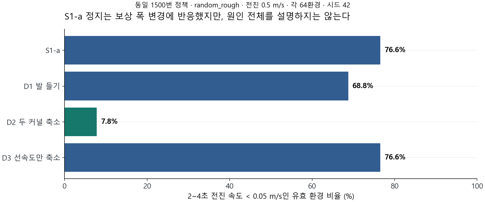
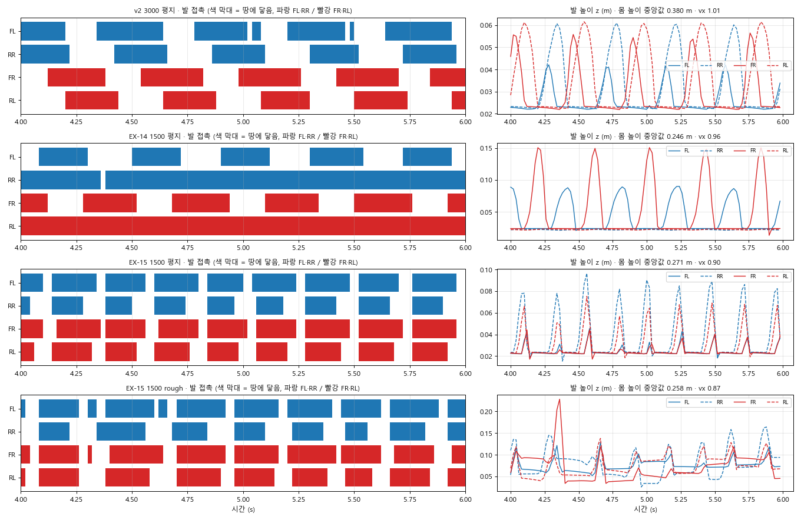
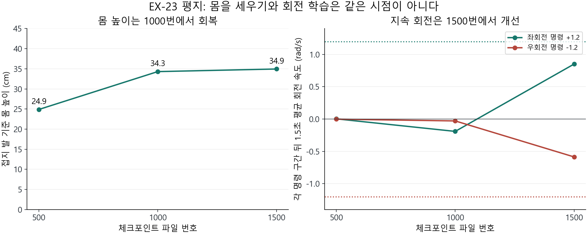
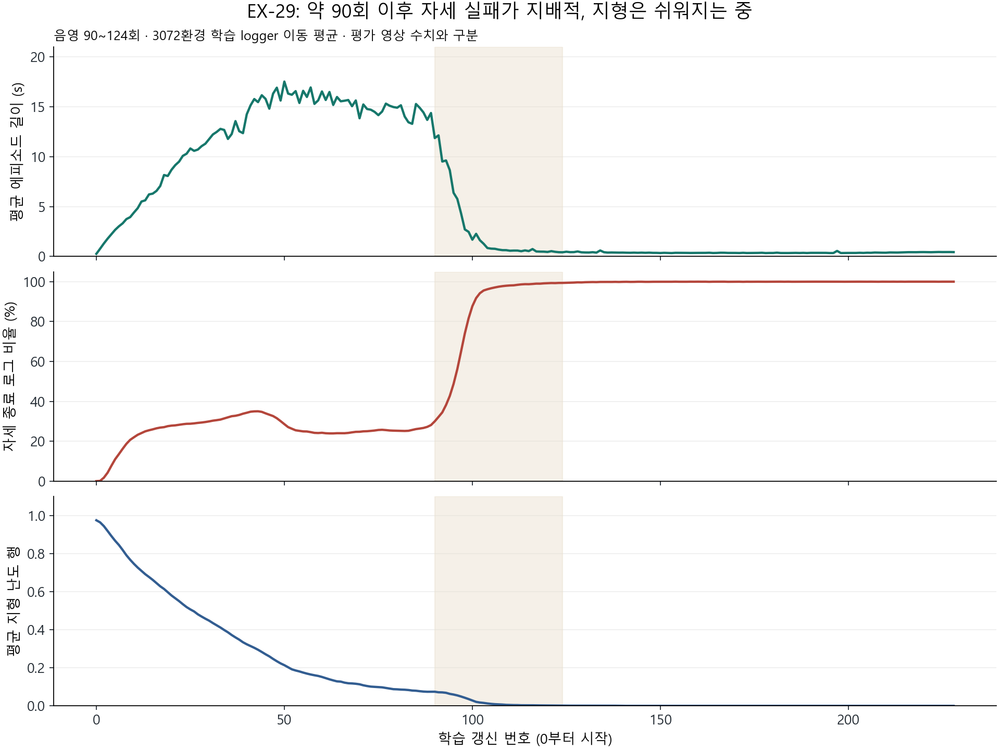

> 분류: 리서치
> 작성: 오흥재 (lead_tmp 원자료 대조 · sol·luna·ASTRA 분담) · 2026-10-24
> 근거: EX-01~29 저장 YAML·실행 로그·평가 JSON·관절/접촉 NPZ·프레임 · 설계 14·15·52·53 · 아래 근거 목록
> 요지: 정지·지속 포복·앞뒤 쌍 도약·EX-29의 측면 붕괴는 서로 다른 현상이며, 마찰 하나로 묶어 설명할 근거는 없다.
> 상태: 과거 조건·실패 분석 완료 · B1000 비교 뒤1500까지 학습 유지 · EX29 재개 보류 · 다음 실험 미결정
> 판: v1.1

# 과거 실험은 무엇이 달랐고, 왜 다른 실패가 나왔는가

`확인됨`: 저장 설정·원자료 재집계·표집 프레임. `가설`: 각 실패를 만든 최초 원인. `미측정`: B1000과 최종 일반화.

**결론부터 말하면, 과거 실패를 전부 ‘바닥이 미끄러워서’라고 설명한 것은 근거보다 앞선 해석이었다.** S1-a의 정지는 보상 폭 변경에 반응했다. EX-11·12의 포복은 추정기 출력을 0으로 해도 남았고, 보상 변경에 따라 EX-15에서는 앞뒤 발을 묶어 뛰는 형태로 바뀌었다. EX-23·25의 회복 때는 마찰뿐 아니라 지연·COM·PD·모터 조건과 질량 범위도 함께 바뀌었다. EX-29는 다시 여러 조건을 동시에 바꿨으며, 약90회 뒤 **옆으로 넘어지는 짧은 에피소드가 지배적인 상태**로 악화됐다.

따라서 지금의 답은 ‘원인은 아직 전혀 모른다’도, ‘마찰이 원인으로 확정됐다’도 아니다. **어떤 변화가 어떤 현상에 반응했는지는 좁혔지만, 포복을 만든 물리·제어 조건 하나와 EX-29를 무너뜨린 최초 원인은 아직 분리되지 않았다.** 아래에서는 확인한 값, 원인 후보, 확인하지 못한 부분을 구분한다.

팀장 최신 직접 결정은 B의 `model_1000`을 EX-23 같은 번호와 촬영·분석하고, 기존 `model_1500`까지 학습 후 자연 종료하는 것이다. [직접 답 기록](https://github.com/foothold-project/foothold-lab/issues/555#issuecomment-6379481102). EX-29는 `model_228`·완료229갱신을 보존하며 재개하지 않는다. 과거 분석과 요구 대조를 먼저 전달하고 다음 판을 정한다. B1000의 성공 여부와 새 실험 승인은 이 문서에 미리 넣지 않는다.

## 읽을 자료와 이번 확인 범위

| 목적 | 자료 |
|---|---|
| EX-23·25 종합 분석·영상 | [RESULT-EX23-25](../20261021-experiments/RESULT-EX23-25.md), [평지1500 비교 영상](https://github.com/foothold-project/foothold-lab/releases/download/research-ex23-25-20261023/ex23-ex25-flat-1500-1x.mp4) |
| 오늘 B500·EX29 200의 영상·위상·관절 | [RESULT-B500-EX29-200](RESULT-B500-EX29-200-1024.md) |
| EX-01~08 저장 설정·시작 코드·차이 | [S1 근거 JSON](figs/history-audit-1024/s1_saved_evidence.json), [CPU 추출기](audit_s1_history_1024.py) |
| EX-09~25 모든 항목의 설정·원본 SHA | [luna 조건 대조](../20261024-history-configs/REPORT-luna-24d-history-configs.md), [설정 JSON](../20261024-history-configs/history-configs.json) |
| EX-23 대 B·EX-29의 저장 설정 차이 | [세 판 YAML 전체와 차이](figs/history-audit-1024/ex23_b_ex29_saved_diff.json), [동일 조건 검사 코드](verify_config_triplet_1024.py) |
| EX-29 상세 조사와 재검 | [sol 조사](REPORT-sol-24e-ex29-collapse.md), [lead_tmp 독립 재계산](figs/history-audit-1024/ex29_independent_check.json), [재계산 코드](verify_ex29_history_1024.py) |
| 기존 요구가 현재 코드에서 실제 쓰이는가 | [ASTRA24f 독립 감사](VERIFY-astra-24f-requirements.md) |
| 피어슨 산점도·EX-23 물리 설정·보행 역학 해석 | [상관과 역학 보충](NOTE-correlation-mechanics-1024.md). 원시 관절 차이를 힘의 좌우 편향으로 읽지 않도록 정정 |
| 촬영 렌더의 한계와1000회 비교 준비 | [보호 렌더 검증](NOTE-capture-render-1024.md). 이전 검정 재시도의 물리 진행 여부는 미확인, 새 촬영은 실제 상태 불변 검사 |

이번에 저장 설정을 CPU로 읽고 파일 SHA를 남겼다. EX-29 학습 로그 229행, 전체 환경 종료 집계 229행, 선택 8환경 trace 75개 update, 평가 4건은 원자료에서 다시 계산해 sol의 표와 대조했다. EX-11·12 프레임 띠, EX-14·15 접촉 위상, EX-29 첫 실패의 연속 프레임을 직접 봤다. 기존 영상 전체 디코드 검사와 사람이 본 프레임 표집은 다르며, **모든 영상의 모든 프레임을 사람이 다시 판독했다는 뜻은 아니다.** S1-a 밤 진단에는 당시 영상이 없어 수치 근거로만 설명한다.

저장 YAML은 당시 선언된 설정이다. 과거 실행의 실제 모든 PhysX 물성·관절 목표·난수 상태가 보존돼 있지는 않다. 없는 값을 현재 코드의 기본값으로 채워 실측으로 부르지 않는다. 문서의 ‘1500’은 대체로 `model_1500` 파일 번호이고, 0번 갱신부터 수행했다면 완료1501갱신이다. 아래 설정 부모는 **코드 상속 관계**이며 체크포인트 이어받기를 뜻하지 않는다.

## 1. 조건을 나란히 놓은 표

### 공통 조건의 뜻

**넓은 물리 묶음:** 로봇 정적·동적 마찰 범위0.2~1.2, 동적≤정적 보정, 기본 몸체 추가 질량−1~+2kg, COM 각축±0.05m, PD gain·motor strength 각각0.9~1.1배. 물성은 startup에 적용한다. 명목 설정이 실제 접촉쌍의 마찰·토크를 전부 입증하지는 않는다. 행동 지연0~15ms는 별도 칸으로 구분한다.

**약화한 물리 묶음:** 정적0.8·동적0.6 고정, COM·gain·motor randomization 제외. 질량은 **−1~+3kg로 남아 있으므로 ‘DR 전체 끔’이 아니다.** EX-19·21·22·23·25에 해당한다. 행동 지연은 EX-19에서 남고 EX-21 이후 아래 표에 적힌 판에서는 꺼져 있다.

**기존 14항 보상:** 선속도 추종1.5·회전 추종0.5, z속도−2, roll/pitch각속도−0.05, 기울기−1, 토크−1e−5, 행동 변화−0.01, 행동2차 변화−0.01, 출력−2e−5, 관절가속도−2.5e−7, 기본각 편차−0.01, 몸 접촉−10, stumble−1, 가장자리0. 원문과 다른 **선속도 대칭 지수식인 B식**을 사용한다. ‘B식’은 EX-28의 이름 B와 별개다. EX-29는 원문 해석의 `min(v,cmd)` A식과 가장자리−1로 바뀐다.

**연속7종:** 위·아래 계단, 박스, random rough, 위·아래 경사, 고정 대표 계단. EX-23 저장 YAML의 활성 항목은7개다. ‘8종’이라는 sol 초안 문구는 키를 다시 세어7개로 정정했다. EX-09·10은 이7종에 듬성 지형·평지를 합친13개 설정 항목이고, EX-29는 낮은/높은 무작위 돌·평지·평균대·징검빔·gap의6개 항목이다. 종수는 실제 초기 환경 배정 수와 구분한다.

### S1 계열: 서 있기에서 출발한 진단

모두 시드42,4096환경,24step rollout이 기본이다. EX-04만 시드43이다. S1-a는 START의 지각망을 넣기 전 MLP 계열이며, scan187점과 blind 몸 관측 이력11프레임을 나눴다. 이 계열의 실패를 곧 START 전체 실패라고 부르면 안 된다.

| 실험 | 실제 설정의 핵심 변화 | 물리·지연·명령 | 실행 범위와 관찰 |
|---|---|---|---|
| EX-01 S1-a scan·blind | 14항, 선·회전 커널 std0.5, foot-below-ground 여유0.2 | 넓은 물리·지연15ms·열린 명령/깃발 | 둘 다 model5999까지. 거친 바닥에서 정지, 회전 미달. scan1500 진단의 정지49/64 |
| EX-02 D1 | EX-01 scan에 `feet_air_time +0.1` | 나머지 저장 설정 동일 | model1500. 정지44/64, 전진 개선 작음 |
| EX-03 D2 | EX-01 scan의 **선속도와 회전** 커널 모두0.25 | 동일 | model1500. 정지5/64로 줄지만 회전 약화 |
| EX-04 D2-s43 | D2와 같은 설정, 시드43 | 동일 | model1100까지 보존. 약1120 뒤 normal std 오류로 종료1. 1500회 재현 결과로 쓰지 않음 |
| EX-05 D3 | D2의 회전 커널만0.5로 복귀, 선속도0.25 유지 | 동일 | model1500. 정지49/64로 다시 큼 |
| EX-06 S1a-Rx1 | 양 커널0.25 + fbg0.25 + action clip17 묶음 | 동일. blind까지 확장 | scan3700·blind3400 번호 저장본 보존, 상태는각3780·3430. 팀장 중단,6000완주 아님. 변경별 효과는 분리 못 함 |
| EX-07 C1-scan | Rx1 대비 토크−2e−4와 **양 커널0.5 복귀** | 동일 | 상태180,번호100까지 보존. 토크 하나만의 대조가 아님 |
| EX-08 C2-blind | Rx1 대비 실제 선속도 관측과 **양 커널0.5 복귀** | 동일 | 상태150,번호100까지 보존. 진단 초반 중단, 장기 결과 아님 |

시작 코드와 파일은 S1 근거 JSON의 `launch_evidence`에 있다. EX-01 `0fb4c111`, D1 `e6541c99`, D2 `87d71df7`, D2-s43/D3 `2fbac752`, Rx1 `690dd194`, C1/C2 `3a2421a0`. D2 시작 때 평가 파일 `diag_feet.py`는 수정 상태였으므로 평가 바이트의 한계도 남긴다. D1 카드의 옛 c07fff1e 출처는 앞선 시도와 본 실행을 혼동한 것이어서 이번에 바로잡았다.

### START 계열: 포복·도약·환경 선별·회복

아래 저장 설정의 기본은 3072환경·24step·시드42·resume=false다. 다만 EX-09·10에는 시작 영수증이 없어 이 값만으로 실제 부모 체크포인트 유무를 확정하지 않는다. 각 소형 예행과 실패 재기동은 원자료 JSON에서 별개 run으로 남긴다. START 명령 판은 전진0.3~1.5 또는 제자리 회전±1.2이고, 후진·횡이동·전진 중 회전은 배우지 않는다.

| 실험 | 추정기·지도 | 보상과 환경 차이 | 지형·명령 | 관찰과 해석 범위 |
|---|---|---|---|---|
| EX-09 G0-open | 지도 없음, 초기 지각 경로 | 14항·넓은 물리·지연15ms | 13항목 혼합·열린 명령/깃발 | model1500 설정. 이번에는 저장 설정 확인, 영상 전체 재판독 미실시 |
| EX-10 G0-start | 지도 없음, 초기 지각 경로 | 위와 같은 묶음 | 13항목 혼합·START 명령 | model1500에서도 전진 거의0. z/행동 평균·표집4조합 모두 정지 지속 |
| EX-11 zero | 추정 출력을0, 지도 없음 | 14항·넓은 물리·지연15ms | 연속7종·START | model1500까지도 낮은 포복, 뒤 발 접촉 길고 회전 미달 |
| EX-12 learned | 학습된 추정 출력, 지도 없음 | EX-11 물리·보상과 같은 계열 | 연속7종·START | model1500까지 낮은 자세. 추정기 출력만0으로 바꾸면 해결된다는 설명에 반례 |
| EX-13 MGDP 묶음 | zero·지도 없음 | +airtime1·motion_trot−0.1·stand_still−0.1·합계 음수0자름 | 넓은 물리·지연15ms·연속7종·START | 약230회 중단 기록. 장기 효과 판정 제외 |
| EX-14 airtime | zero·지도 없음 | EX-11에 airtime1 | 같은 물리·지연·명령 | model1500에서도 포복/뒤 발 접촉. airtime만으로 도약이 생긴 것은 아님 |
| EX-15 A1 묶음 | zero·지도 없음 | airtime1,토크−2e−4,관절한계−10,calf접촉 벌점,음수0자름 | 같은 물리·지연·명령 | model1500에서 앞발 두 개와 뒷발 두 개를 묶는 도약 성향. 네 발의 정확한 동시 이륙과 다름 |
| EX-16 NVIDIA 보상 | zero·지도 없음 | NVIDIA10항으로 교체, 다른 구조는 유지 | 넓은 물리·지연15ms·연속7종·START | 501예산 중330무렵 중단. 보상 전반이 무관하다는 증거로 못 씀 |
| EX-17 몸 접촉 종료 | zero·지도 없음 | NVIDIA 보상·몸통 접촉 종료 변화 | 넓은 물리·지연15ms·연속7종·START | 처음부터301회 선별 판. 최종 보행 실패 판정 아님 |
| EX-18 실제 속도 | oracle_vel·지도 없음 | NVIDIA 보상, 실제 선속도 입력 | 넓은 물리·지연15ms·연속7종·START | 301회 선별. EX-19와 바로 비교하면 추정 입력도 달라짐 |
| EX-19 DR 약화 | zero·지도 없음 | NVIDIA 보상·약화한 물리 | **지연15ms 남음**, 연속7종·START | 301회 선별. 초기 뒤집힘 감소 기록은 물리 묶음의 단서, 마찰 단독 효과 아님 |
| EX-20 행동·종료 | zero·지도 없음 | NVIDIA 보상, 일반 action·종료 교체 | **넓은 물리 유지**, 지연0·연속7종·START | 301회 선별. DR 약화와 같은 판으로 합치지 않음 |
| EX-21 v2 묶음 | oracle_vel·지도 없음 | NVIDIA 보상·약화한 물리·행동/종료 교체 | 지연0·연속7종·START | 301회 선별. 오래 학습하면 실패라는 결론 불가 |
| EX-22 v2 명령 | oracle_vel·지도 없음 | EX-21 계열 | vx0.4~1.5,vy0,wz±1,heading·**terrain_levels_vel도 변경** | 301회 선별. 명령 하나만 바꾼 판 아님 |
| EX-23 G1-GT | learned·정답 지도 강제 | **기존14항으로 복귀**, 약화한 물리·지연0 | 연속7종·START | 1500번 완주. 500낮음→1000몸 상승→1500평지 회전 개선 |
| EX-24a·b | v2 계열 기준선/계획 | START 본류가 아닌 진단 | 별도 v2 설정 | EX-24a301종료 보고. 이번 전체 저장본 재감사 제외, 결과 미확인. 24b 계획을 실행으로 세지 않음 |
| EX-25 G0 | learned·지도 없음 | EX-23과 같은 물리·14항·지연0 | 연속7종·START | 최종23:00판1500번. 전진 정상화, 평지 회전은G1보다 약함, rough방향별 우열 혼재 |
| EX-26·27 | 보류 번호 | 보상 후보 계획 | 새 실행 없음 | 번호를 결과나 새 실험으로 세지 않음 |
| EX-28 B | learned·정답 지도 강제 | EX-23에서 **마찰 분포와 일관성 보정만 복원** | 연속7종·START·지연0 | 500전진·회전미달,1000비교 예정. 나중에 좋아질 것이라는 추정과 실제 결과를 구분 |
| EX-29 TD | learned·GT/PRED AdaSmpl | A식·edge−1,넓은 물리·지연15ms·초기관절0.5~1.5·yaw0·낙하판정 변경 | 8×4m6항목·START,종류전환1000~8000회 | 90회 뒤 측면 붕괴 급증,200영상4조건모두반복종료.229저장중단,재개보류 |

EX-17~22는 팀장이 ‘작게300회’라고 정해 진행한 선별이다. 실패 이야기를 ‘초기 자세를 보고 전부 너무 일찍 멈췄다’로 바꾸지 않는다. **EX-11·12·14·15는1500까지도 문제를 보였다.** 반대로301선별만으로 해당 조건은 끝까지 못 배운다고 단정하지 않는다. 811 기준선은 학습 시점 해석을 돕는 참고이지 모든 구조가 그 회차에 반드시 통과해야 하는 합격선이 아니다.

## 2. 처음에는 왜 서 있었나

S1-a의 실제 전진 명령0.5에서 로봇이 정지하면 선속도 항은 `1.5 × exp(−0.5² / 0.5²) = 0.552`다. **선속도 항 최대1.5의36.8%**이지 전체 보상의37%가 아니다. 움직이지 않으면 토크·관절가속도·행동 변화·접촉 벌점도 줄일 수 있어, 이 조합은 정지를 충분히 매력적인 해로 만들 수 있다. 저장 보상 표의 서 있는 집단/걷는 집단 차이와 D2가 이 설명을 지지하지만, 집단 간 비교 자체는 무작위 개입이 아니다.

| 같은 조건 진단 | 정지 분자/분모 | 6초 전진 중앙값 | 해석 |
|---|---:|---:|---|
| S1-a scan1500 |49/64|0.190m|전진 명령에도 정지|
| D1 1500 |44/64|0.267m|발 들기 항 하나로 해결 안 됨|
| D2 1500 |5/64|1.939m|두 추종 커널을 좁히면 전진 정지 크게 줄어듦|
| D3 1500 |49/64|0.558m|선속도 커널만 좁힌다고 같은 결과가 나오지 않음|

별도 회전 진단에서는 기준0.264→D2 0.039로 추종비가 약해졌다. **전진 개선만 보고 처방 전체 성공으로 부르면 안 된다.** 두 시드 근거는1500이 아닌1100에서 기준58/63=0.921, D2 시드42와43이각13/64=0.203이다. D2-s43은 그 뒤 std 오류로 끝났으므로 최종 안정성도 입증하지 못한다. 2초 회전 진단에서 ‘2~4초 생존 수0’인 칸은 애초에 그 구간을 촬영하지 않았기 때문이며 전부 죽었다는 뜻이 아니다.

EX-10의 정지는 별도다. `zact_1022/ex10/z_action.json`의 **추정 잠재변수 평균/표집 × 행동 평균/표집** 네 조합, 각64환경·300step·DR off에서도 전진 거리는약0.02~0.04m에 머물렀다. 따라서 ‘재생할 때 평균을 쓴 탓’ 하나로는 설명되지 않는다. EX-11·12로 갈 때는 추정기뿐 아니라13항목 혼합 지형에서 연속7종으로 바뀌어, EX-10→12를 추정기 하나의 효과로 볼 수 없다.

정지 현상은 ‘넘어지지 않는 것이 점수가 좋아 움직이지 않는 정책’이라는 후보와 일치한다. 로봇이 위험을 사람처럼 이해하거나 두려워했다는 증거는 아니다. 보상·환경·명령·구현을 함께 최적화한 결과이며, 어떤 벌점이 최초 원인인지는 이 기록만으로 완전히 분리되지 않았다.

## 3. 왜 낮게 기었고, 왜 EX-15는 앞뒤 발을 묶었나

**포복을 단순한 미학 문제로 보지 않는다.** 같은 전진 명령에서 몸 높이, 앞뒤 다리의 펼침, 접촉 시간, 실제 전진을 함께 봐야 한다. EX-11 평지1500의 전진1 구간 접지 발 기준 몸 높이는약24.1cm이고 뒤 발 접촉이약89~90%였다. EX-12도 기존 JSON에서약17.4cm로 낮았다. 숫자의 집계가 완전히 같은지 구분해 원자료 경로를 [자세 재집계](NOTE-posture-causes-1024.md)에 남겼다. 낮다고 모두 실패인 것이 아니라 **1500에서도 뒤 다리를 충분히 교대하며 펴지 않는 형태가 남은 것**이 문제다.

[EX-11·12 프레임 띠](../20261021-experiments/figs/ex11-12/x11_2x2_contact_1.5_4.5_7.5_10.5s.png)에서 앞다리와 뒷다리 자세 차이가 보인다. DR off 재생에서도 남았으므로 당시 평가 바닥이 미끄러워 그 순간만 낮춘 자세라는 설명만으로는 부족하다. 그러나 훈련 중 무엇이 그 자세를 만들었는지는 별도 문제다.

**현재 가장 강한 비교는 EX-12→EX-25다.** 둘 다 learned·지도 없음·같은14항·같은 START 명령·연속7종이다. 달라진 것은 고정 마찰, COM/gain/motor 제외, 행동 지연0, 질량−1~+2→−1~+3, 지각 microbatch256→64 등이다. EX-25에서 자세가 나아졌으므로 이 변경 묶음이 유력한 조사 범위다. **‘마찰만 고쳐서 해결’, ‘추정기는 아무 영향 없음’, ‘보상은 전혀 원인 아님’은 모두 지나친 결론이다.** zero에서도 포복이 남는다는 것은 learned 출력이 포복의 필요조건이 아니라는 뜻까지다.

EX-15는 앞발 두 개가 한 묶음, 뒤 발 두 개가 다른 묶음으로 움직이는 도약 성향이다. 전진1.0의4~6초100표본에서 앞발 접촉 일치94%, 뒷발90%, 네 발이 모두 떠 있는 표본16%였다. **이 값은 네 발이 정확히 동시에 이륙했다는 뜻이 아니다.** 4.06~4.08초에는 앞발 둘만 닿고4.10~4.12초에는 모두 뜬다.

발 공중 보상, 강해진 토크 벌점, 관절 한계 벌점, calf접촉 벌점, 음수 보상 자르기가 함께 바뀌었다. 여기에는 앞으로 움직이고 발을 들면서 비용을 줄이되 **대각 trot이어야 한다는 강제는 없다.** 앞뒤 쌍 도약이 그 조합의 한 해가 된다는 해석은 가능하다. 하지만 airtime만 더한 EX-14는 계속 포복이었으므로 ‘airtime1 때문에 뛰었다’ 하나로 확정할 수 없다. 관절 한계가 무릎 펼침을 막았는지, 토크 벌점이 동작을 묶었는지는 해당 항의 상태별 값과 개입이 없어서 미확인이다.

## 4. EX-23·25가 얻은 것과 B가 가르는 것

EX-23은500번에서 몸이 낮았고1000번에서 올라갔다. 다만 같은 평지 촬영의 회전은1000번에도약했으며1500번에서 개선됐다. 전진1.0 구간 몸 높이 중앙값24.9→34.3→34.9cm, 좌회전 명령+1.2의 각 구간 뒤1.5초 평균은+0.003→−0.191→+0.851rad/s다. 우회전−1.2는−0.002→−0.029→−0.586rad/s다. 세 점 사이의 정확한 변화 시점은 미측정이다.

따라서 B1000에서는 **몸이 섰는가**와 **회전이 지속되는가**를 각각 답한다. B1000이 몸을 세웠는데 회전이 아직 약해도 EX-23동회차가 실제로 어땠는지 같이 봐야 한다. 반대로 초기 방향 반응만 보이고 이후 멈춘 것을 회전 성공으로 세지 않는다. 평지/험지·좌/우를 합친 평균 하나로 판단하지 않는다.

B와 EX-23 저장 YAML을 직접 비교하면 환경 차이는 로그 경로와 마찰 범위4칸·`make_consistent=True`뿐이고, agent 차이는 실험 이름·run 이름뿐이다. 이는 B를 마찰 가설의 역사적 대조로 쓸 근거다. 다만 과거 초기 신경망·모든 물리 배열·난수 진행을 완전히 맞췄다는 증거는 없고 코드 시점도 다르므로 새 동일시점 짝 실험과 같은 인과 확신으로 표현하지 않는다. 팀장 결정대로 **새 A 재학습은 하지 않는다.**

- B1000이 EX-23처럼 회복하면: 이 조건에서 **마찰 분포만 복원해도 회복 가능**하다는 증거다. ‘넓은 마찰이면 반드시 포복/정지’ 설명은 약해진다. 지연·COM·gain·motor·초기 상태와의 상호작용은 남는다.
- B1000이 낮거나 잘 못 걸으면: 동회차 학습 지연의 증거다. 그 자체가1500에서도 영구 실패하거나 하한0.2 하나가 원인이라는 증거는 아니다. 팀장은1000회에서도 촬영·분석하며 최초1500번까지 계속하기로 직접 결정했다.
- 어느 경우든: B500만 보고1000·1500의 개선을 확정하지 않는다. 오늘 비교가 끝나기 전에 다른 원인 실험을 자동으로 연결하지 않는다.

## 5. EX-29는 왜 처음부터 넘어졌나

**‘처음부터 전혀 못 버텼다’와 ‘초기 실패를 극복하며 좋아졌다’ 모두 전체 기록과 다르다.** 선택8환경의 첫 상태는 z0.4m·기울기0이었고, 전체 첫 rollout 자세 종료는0건이었다. 그러나 둘째 update에18건, 첫10회739건이 이미 있었다. 평균 episode 길이는50회에17.53초까지 늘었다가 약90회 이후 급락해200회에는0.35초였다. 잠시 버티는 구간을 거친 뒤 학습이 한쪽으로 무너진 양상이다.

| 갱신 번호 | 학습 평균 episode 길이 | 자세 종료 로그 비율 | 의미 |
|---:|---:|---:|---|
|50|17.53초|28.57%|길게 유지하는 episode도 생겼지만 자세 실패는 남음|
|90|11.87초|29.98%|급격한 악화 직전|
|99|2.46초|81.63%|자세 실패가 지배적으로 변함|
|100|1.68초|87.71%|짧은 반복 종료|
|124|0.42초|99.38%|거의 자세 종료|
|200|0.35초|99.98%|200영상의 반복 넘어짐과 일치|

학습 logger의 이동 평균이며 고정 정책의 성공률이 아니다. 전체 종료 항목 집계도100~124회60,676건,175~199회105,201건을 확인했다. 여러 환경이 여러 번 끝난 횟수이지 독립 로봇 수가 아니다. 지형 평균 행은50회0.214→100회0.028→149회이후0이어서, **더 어려운 행으로 올라가다 갑자기 실패했다는 설명과 맞지 않는다.**

200번 고정 정책의 평지GT/PRED·낮은 돌GT/PRED 네 영상은 모두600제어step·12초이고 각각34번 reset했다. 영상이 짧게 잘린 것이 아니라 넘어짐과 reset을 반복한다. 첫 reset은step16, 전부`bad_orientation`이었다. 종료 직전 기록의 |roll|평균1.451~1.454rad, |pitch|0.057~0.061rad로 주된 모양은 **옆으로 기울어짐**이다. 기록은 env.step 전 상태, 종료 판단은 그다음 상태여서 이 각도를1.5rad 문턱과 그대로 비교하지 않는다. [연속 프레임](figs/ex29-u200-review/flat_pred_first_reset/grid_00.jpg).

### 지금 의심할 범위와 반례

| 후보 | 지지하는 자료 | 아직 못 말하는 것 |
|---|---|---|
| 관절 좌표상 오른쪽−왼쪽 출력 차이 | 8환경 표본의 hip 출력 차가 첫25회+0.061→100~124회+1.226. 같은 구간 평균 roll은+0.081→−0.261rad | 좌우 기본각부터 부호가 다르므로 이 차이를 물리적 비대칭이라고 부르지 않는다. clip·scale·지연 전 값이며 좌표·실제 목표·토크를 대조하기 전 원인 미확인. [상관·좌표 정정](NOTE-correlation-mechanics-1024.md) |
| 짧게 끝나면 음수 보상을 덜 받는 유인 | 50회 평균−50.24/876.48step,200회−1.06/17.37step. step당 단순 몫은약−0.057/−0.061. 명시적 자세 종료 벌점은 없음 | 평균끼리 나눈 값은 정확한 transition return이 아니다. 정책이 이 편법을 학습했다는 인과 증명은 아님. PPO value·timeout 처리를 함께 봐야 함 |
| 출발 관절·물리·행동 지연 조합 | EX-23과 달리 관절0.5~1.5배,COM/gain/motor·지연 복원. root XY만 지지 영역으로 보정, z는0.4 | 첫 표본은 직립. 출발부터 불법 자세라는 단정 불가. 특정 항 하나의 영향 미분리 |
| 지도 복원 또는 추정 경로 | GT/PRED를 섞어 학습하며 입력 경로가 EX-23과 다름 | GT만 강제한 평가도 같은 방향으로 넘어짐. ‘복원 지도만 나빠서’라는 설명은 부족. 학습 중 지도 영향까지 배제한 것은 아님 |
| 지형·보상·종료 변경 | 8×4듬성 지형, A형 추종,edge−1,지지평면 낙하 판정이 함께 변경 | 평지에서도 자세 종료이고 난도는 내려가는 중. gap 낙하가 현재 직접 종료 원인이라는 설명은 맞지 않음 |

EX-29가 시각적으로 나쁘니 계속하면 무조건 회복 불가능하다고 증명된 것은 아니다. 그러나 **이미 좋아지던 episode 길이가 무너져 거의 매번 옆으로 끝나는 상태**라서 단순히 ‘초기에는 원래 넘어지니500까지 기다린다’고 설명할 근거도 없다. 재개 전에 이 악화 경로와 요구 누락을 다루자는 팀장 판단에는 실측 근거가 있다. 오늘 이 보고서로 새 학습을 승인하지 않는다.

10회 smoke는 실행·유한 학습·저장을 확인했다. 그 로그에도9회 시점 자세 종료 비율0.2002가 있었다. 내가 이를 ‘문제 없이 통과’라고 넓게 표현했다면 성능까지 검증한 것처럼 들리는 잘못이다. **CPU 시험/짧은 Kit 실행 성공과 보행 성능 확인을 분리해서 보고해야 한다.**

## 6. 우리 본류 요구와 현재 구현의 차이

ASTRA는 다른 분석자의 결론을 읽지 않고 설계·고정 코드·실제 manifest를 대조했다. lead_tmp도 명령 생성, 실행 계약, 종류 전환 함수와 YAML을 직접 확인했다. 다음은 새 설계안이 아니라 **다음 설계가 반드시 다룰 요구 목록**이다.

| 팀장 요구 | EX-29 실제 소비 | 다음 설계에서 빠뜨리지 않을 것 |
|---|---|---|
| 전진·후진·횡이동·이동 중 회전 | 전진 또는 제자리 회전만. runner 계약도 다른 명령을 거절 | 생성기만 토글하지 말고 actor입력·유효성검사·승급·보상·평가까지 같은 명령 계약 |
| 정지·재출발·저속 | vx<0.3을 회전으로 바꿈,stand모드false | 회전 중 vx0과 완전 정지구간을 구분 |
| 연속7종과 듬성 지형의 연결 | 연속7종 없이 듬성·보조평지만 | 기본 보행의 유지와 새 지형 습득을 함께 확인 |
| 잘해지면 다음 종류로 진행 | 난도 행은 수행 기준, 종류 전환은회차1000~8000 | 두 커리큘럼을 구분하고 실제 성과와 전환 상태를 기록. 수치 문턱은 아직 미결정 |
| DR·지연 단계 복원 | 넓은 범위 startup/reset,단계 상태없음 | 설정 변경만이 아니라 실제 물성·지연 적용과 되돌림/기록 경로 |
| START 지각·보행 공동학습 | TR-Net·I-E·PPO·AdaSmpl 갱신 경로 있음 | 지도를 복원하는 오차와 정책이 복원 지도로 걷는 성능을 따로 확인 |
| 실기·HiPAN으로 연결 | 실기 EX29 전체 export 미완성,HiPAN은후속 | 현재 범위 미구현과 정당한 후속 단계를 구분. 큰 옆/후진 unseen확장은S4였지만 기본 열린 명령과1차물러나기까지 미루지 않음 |

현재 좁은 원문 기반 판을 승인했던 기록을 사용자의 최종 추가 요구 철회로 해석하지 않는다. 또한 현재 실패를 핑계로 열린 명령을 없애거나 START 구조를 축소하는 처방을 자동 채택하지 않는다. 다음 선택은 **성능을 앞으로 밀 실험과 필요한 원인 확인을 분리하되, 본류 요구에 돌아오는 조건을 미리 적는 것**이다. 구체 조합은 이 분석과 B1000을 본 뒤 정한다.

## 7. 이번 기록에서 바로잡은 것과 남은 한계

- D1 실제 본 실행 HEAD는e6541c99이며 앞선 시도의dirty상태와 혼동하지 않는다. 카드도 고쳤다.
- EX-09=open,EX-10=start다. 작업자 초안이 뒤집어 붙인 오류를 원장과 대조해 바로잡도록 했다.
- EX-12→25에서 DR 이벤트가 ‘전부 없어졌다’는 설명을 고쳤다. 함수와 실제 파라미터를 보면 고정 마찰과질량−1~+3이 남는다.
- EX-20~22에는 일반 action이어서 EX-09~22 전부15ms라는 일괄 설명은 틀렸다. EX-22는 명령뿐 아니라 지형 승급 함수도 바뀐다.
- EX-23 지형은 활성7항목이다. sol 초안의8종과 agent.yaml SHA 오기는 실제 YAML과 해시로 정정했다.
- ‘추정기는 원인 아님’ 대신 ‘zero에서도 포복이 남아 learned 출력이 필요조건은 아님’, ‘보상 바꿔도 안 됨’ 대신 ‘시험한 보상들만으로 원하는 trot이 완성되지 않음’으로 범위를 좁힌다.
- 명령/지형/보상/물리/알고리즘 모두 같은지 확인하기 전 서로 다른1500을 동등 대조군으로 부르지 않는다. 같은 시드도 같은 초기 물리·같은 경험 순서를 보장하지 않는다.

확인하지 못한 핵심은 과거 모든 판의 실제 물리 배열·적용 토크, 조건별 독립 효과, EX-29붕괴의 최초인과, B1000영상, 최종 다중시드 일반화다. 여러 시드는 팀장 방침대로 유용한 전체 경로를 고른 뒤 확인하며, 지금 모든 판을 재실행하지 않는다.

## 재현 근거와 이력

원자료 뿌리: `C:/Users/AI-WS01/orca/workspaces/foothold-lab/sonnet-code/logs/rsl_rl/`, `C:/Users/AI-WS01/s2_lab/eval_new/diag_s1a/`, `C:/Users/AI-WS01/s2_lab/videos/mid500_1022/`, `C:/Users/AI-WS01/s2_lab/run_20261024/`. EX-29 run은 `C:/mai/wt/foothold-lab/lead-tmp-start-b/logs/rsl_rl/foothold_s2_23f_topdown/2026-10-24_08-20-33_ex29-td-main/`이다. 실제 source SHA와 YAML line mapping은 위JSON에 있다.

EX-29 env SHA `d8a639c573a3202e26e6e96048f3b997d19fd63a05691811eb0e3a3d2cc5a7f7`, agent SHA `7a2ebf3d7a5910868d5e2a18530465ceb20b11bc64ecd2c8616211e92015cd1f`. 독립 재계산 결과는229로그·75trace·4평가 대조를 통과했다. plot은 [생성 코드](plot_history_audit_1024.py)로 재생성하며 출력3장을 직접 열어 축·단위·가독성을 확인했다. 학습·평가 GPU는 이 역사 분석 과정에서 새로 실행하지 않았다. B1000 촬영용 별도 계측 사본은 [SOL24g](REPORT-sol-24g.md)에 있으며 고정 학습 코드를 바꾸지 않는다. lead_tmp가 추가 계측의 알려진 높이·무접촉·종료 마스크·지도 선택·원본 SHA·plan-only CPU 시험 6개를 재실행해 통과했다. 실제 촬영은 model1000 도착 뒤 확인한다.

| 판 | 변경 |
|---|---|
|v1.0 ·10/24|S1정지부터EX29측면붕괴까지 저장 조건·반례·요구 누락 종합. B1000은 별도 후속 분석|
|v1.1 ·10/24|피어슨·보행 역학 보충 연결. hip 오른쪽−왼쪽 raw 출력 차이를 물리적 좌우 편향으로 부른 과한 해석 정정. 원래 측정값 보존|

원자료 대조 출처: luna `4ac383f6`의 수정 추출기로 29개 run을 다시 생성해 JSON 바이트가 일치했다. sol `0451ce65`의 CSV는 lead_tmp 재집계로 대조했고, ASTRA `578d5f55`는 요구 소비의 독립 감사다. 통합 본문은 세 보고를 그대로 합친 것이 아니라 서로 어긋난 매핑·지연·지형 종수·해시를 수정한 결과다.

검증: 변경 문서17개 review_inbox 통과, 결정·실험 지도 동기화53항목 누락0, 로컬 상대 링크 누락0, literal U+2014 0, git diff --check 통과. 검사기의 style 출력은 일반 하이픈까지 em dash로 세는 기존 동작이어서 실제 금지 문자 검사를 따로 했다. 이 검사는 문서 연결과 형식 확인이며 과학적 인과관계의 증명이 아니다.
