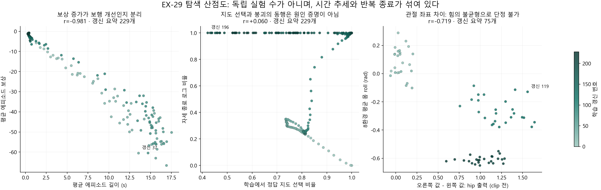

> 분류: 리서치
> 작성: 오흥재 (lead_tmp 원자료·코드 대조) · 2026-10-24
> 근거: EX-23 저장 설정 · EX-29 로그229행·8환경 기록75행 · S1 진단 원자료 · Rudin 2022 §3.2·4.2 · Biewener 1989 초록 · NIST 산점도 안내
> 요지: 상관계수는 원인 후보를 찾는 도구이며, 시간 추세·종료·관절 좌표를 확인하고 강화학습과 접촉 역학으로 해석해야 한다.
> 상태: CPU 재계산 확인됨 · 실패의 단일 인과 미확인 · 새 학습·물리 설정 변경 없음
> 판: v1.0

# 상관계수와 사족보행 역학으로 과거 실패를 다시 읽기

`확인됨`: 저장 설정·CPU 상관 계산·실행 코드. `추측`: 실패를 만든 최초 기전. `미측정`: 과거 전체 로봇의 적용 토크와 실제 접촉쌍 물성.

[전체 실험 조건과 실패 분석](ANALYSIS-experiment-failures-1024.md)의 보충이다. 결론은 **보상·마찰·COM·구동기·지연 중 하나를 느낌으로 범인으로 고르지 말고, 실제 소비 조건과 시간 순서, 접촉 중 힘과 움직임을 함께 보자**는 것이다. 모든 실험 번호를 숫자로 바꾸어 성공률과 상관을 구하는 방식은 의미가 없다. EX-23의 고정 COM 설정처럼 한 판 안에서 변하지 않는 항목도 그 판의 피어슨 상관으로 효과를 추정할 수 없다.

## 1. EX-23에서 실제로 고정하거나 끈 것

아래는 당시 `params/env.yaml`과 `s2_x23_cfg.py`를 직접 읽어 확인한 **설정**이다. 저장되지 않은 과거 모든 로봇의 실제 PhysX 배열까지 측정했다는 뜻은 아니다.

| 항목 | EX-23 G1-GT | 정확한 의미 |
|---|---|---|
| 마찰 | 정적0.8, 동적0.6 고정 | 로봇 재질 startup 범위가 같은 값. 지면 기본 재질은1.0이며 실제 접촉쌍 적용과 미끄러짐은 별도 확인 대상 |
| COM 오프셋 | `base_com=None` | 몸체 내부 질량중심 위치를 임의로 흔드는 이벤트를 끔. 걷는 동안 로봇 전체 질량중심이 공간에서 움직이지 않는다는 뜻이 아님 |
| 제어 게인 | `actuator_gains=None`, Kp25·Kd0.5 | 위치 오차를 토크로 바꾸는 계수의 무작위 배율을 끔 |
| 구동기 세기 | `motor_strength=None` | 모터 강도0.9~1.1배 무작위화를 끔. 명목 effort limit은 hip/thigh23.5, calf45.43 N·m. 실제 토크는 자세·속도·목표 오차·모터 한계에 따라 계속 달라짐 |
| 행동 지연 | 일반 `JointPositionAction`, 추가 지연0 | 과거 관절 명령을 늦게 적용하는 별도 버퍼를 안 씀. 깊이 카메라 주기·지각 지연까지0이라는 뜻은 아님 |
| 몸체 추가 질량 | **−1~+3kg 유지** | DR 전체를 끈 것이 아님. 추가 질량은 필요한 지지력·가속·회전 관성에 영향을 줄 수 있음 |
| 초기 관절 | 기본 관절각의1.0배 | EX-29의0.5~1.5배 초기 관절 무작위화와 다름 |

근거: `C:/Users/AI-WS01/orca/workspaces/foothold-lab/sonnet-code/logs/rsl_rl/foothold_s2_x23/2026-10-22_21-52-26_ex23-g1/params/env.yaml:306~351,1280~1368`; 같은 사본의 `foothold_s2/tasks/s2_x23_cfg.py:22~30`. 파일 SHA와 다른 실험의 차이는 [설정 대조 JSON](figs/history-audit-1024/ex23_b_ex29_saved_diff.json)에 있다. 질량 무작위화로 전체 질량중심과 관성이 달라질 가능성까지 ‘COM 고정’이라는 말로 지우지 않는다.

따라서 EX-12→EX-25의 개선은 **마찰 고정 하나의 효과가 아니다.** 여러 물리·제어 조건을 함께 바꾼 결과다. B는 이 묶음에서 마찰 분포만 복원해 그 가설을 좁히는 역사적 대조다. B1000 촬영 뒤1500까지 계속한다는 팀장 결정은 유지한다.

## 2. 실제 피어슨 계산과, 그 숫자로 말할 수 없는 것

피어슨 r은 두 값이 함께 직선에 가깝게 증가·감소하는 정도다. +1은 같은 방향, −1은 반대 방향의 완전한 직선 관계이고0 부근은 **선형 관계가 약하다**는 뜻이다. 비선형 관계나 조건별 관계까지 없다는 뜻은 아니다. 산점도는 이상점·곡선·집단 차이를 함께 봐야 하며, 그 자체가 인과 증명은 아니다. [NIST 산점도 안내](https://www.itl.nist.gov/div898/handbook/eda/section3/scatterp.htm).

먼저 원자료가 연결된 EX-29를 계산했다. 229개의 행은 **한 학습의 연속 갱신 요약229개**다. 독립 실험229회가 아니다. 자세·행동 표본75개는 같은8환경에서 갱신0~24·100~124·200~224를 모은 것이다. 서로 다른 시점·실험을 무조건 합치지 않고 다음을 함께 확인했다.

- 원래 r, 인접 갱신 간 변화량의 r, 25갱신 구간별 평균을 뺀 r을 함께 계산했다. 구간25는 결과를 탐색하는 민감도 확인용 선택이며 사전 등록된 인과 보정법이 아니다.
- 누락 구간24→100·124→200을 바로 이은 차분은 만들지 않았다. 결측·상수·중복 번호를 검사했다.
- 점을 하나씩 뺐을 때 r이 얼마나 달라지는지 계산했다. **실제 결과에서 점은 삭제하지 않았다.** 가장 민감한 점은 원자료 이웃과 함께 JSON에 남겼다.
- 이 자료로 독립 표본을 전제한 p값·신뢰구간·원인 효과는 제시하지 않는다. 보상과 길이는 최근 종료100건의 겹치는 창이며 시간 의존성이 크다.

| 같은 학습 안에서 비교한 두 값 | 요약 행 수 | 전체 r | 인접 변화량 r | 25갱신 구간 평균 제거 r | 판독 |
|---|---:|---:|---:|---:|---|
| 에피소드 길이 ↔ 누적 보상 |229|−0.981|−0.384|−0.864|짧아져서 음수 누적량이 줄어든 효과를 보행 개선과 분리해야 함|
| 실제 GT 사용 비율 ↔ 자세 종료 로그 비율 |229|+0.060|+0.015|−0.080|전체 선형 관계는 약함. 지도 효과 없음이라는 결론은 아님|
| clip 전 hip의 오른쪽−왼쪽 출력 ↔ 몸 roll |75|−0.719|+0.209|−0.170|시점 집단 차이가 큼. 좌우 힘 불균형 지표로 해석할 수 없음|

### 보상이 좋아지는데 보행은 나빠지는 경우

EX-29에서 에피소드가 길수록 누적 보상은 더 음수였고, 일찍 끝나며 보상은0에 가까워졌다. 실제 코드도 각 에피소드의 보상을 합산해 종료 때 로그 버퍼에 넣는다. 따라서 **로그의 보상 상승만 보고 정책이 잘 배운다고 할 수 없다.** 200~224 구간에서는 이 상관이+0.660으로 바뀌므로 전체 r을 모든 학습 단계의 법칙처럼 쓰지도 않는다.

이것이 곧 ‘정책이 일부러 넘어지는 편법을 배웠다’의 증명은 아니다. PPO는 표시된 평균 보상 숫자가 아니라 시간별 보상·가치 추정·advantage로 갱신한다. 그 가설은 종료 때 bootstrap, 실제 항별 보상과 가치 오차, 넘어지기 전 행동 경로까지 봐야 한다. 지금은 **조기 종료와 음수 누적의 연결을 확인했고, 편법 학습은 후보**라고 적는다. 근거: 고정 코드 `d9517fb9`의 `foothold_s2/runners/start_runner.py:247,309~318,639`.

### GT 비율과 붕괴는 단순한 일방향 관계가 아님

GT 비율과 자세 종료의 전체 r은+0.060이지만, 갱신50~74에서는−0.918,75~99에서는+0.895다. 학습 시점·정책 변화·종료 길이·AdaSmpl 보상 되먹임이 같이 움직인다. 지도 선택은 독립적인 무작위 처치 비율도 아니다. **r이0에 가까우므로 지도가 무관하다**, 또는 특정 구간 r만 골라 **GT가 붕괴를 일으켰다**고 말할 수 없다. EX-29 model200의 GT 전용 평가도 넘어졌다는 별도 증거와 함께 해석한다.

### 관절 출력의 좌우 차이를 잘못 읽지 않기

기존 보고서의 ‘정책 행동의 좌우 편향’은 과한 이름이라 **‘관절 좌표상 오른쪽−왼쪽 출력 차이’로 정정**했다. 저장 기본 자세부터 왼 hip은+0.1, 오른 hip은−0.1이다. 거울 대칭 움직임이 같은 부호일 필요가 없으므로 `오른쪽−왼쪽=0`이 정상이라는 전제부터 맞지 않을 수 있다.

로컬 참고 Go2 URDF는 네 hip의 축이 모두x이고 좌우 원점이 거울 위치다(`C:/isaac/ext/go2_rl_robotlab/resources/go2/urdf/go2.urdf:79~84,246~251,413~418,580~585`). 하지만 이것을 당시 원격 USD의 실제 관절 프레임과 동일하다고 검증한 것은 아니다. 원자료 차이는 남기되 **물리적 불균형·액추에이터 고장·관절 매핑 오류를 이 숫자로 확정하지 않는다.** 좌표 변환을 확인한 관절 목표·실제 토크·발 위치·접촉력을 함께 비교해야 한다.

원래 r=−0.719도 세 시간 구간 안의 관계는−0.138,−0.338,+0.246이다. 시간 집단이 섞여 강해 보인 관계이며, 원시 출력 차이를 원인으로 읽을 근거가 더 약해졌다.

### 이상점은 어떻게 다뤘나

점 하나를 뺀 r 범위는 길이/보상−0.982~−0.981, GT/종료+0.055~+0.072, hip/roll−0.740~−0.710이었다. 한 점 삭제로 결론이 뒤집히는 모양은 아니다. 그렇다고 모든 행이 계측상 옳다는 증명은 아니다. 그림에 표기한 갱신37·196·119는 **오류 판정된 점이 아니라 r에 가장 영향을 주는 점**이다. 원본의 단위·리셋·시점·입력 모드가 다르면 이유를 먼저 찾고, 제거가 필요하면 원본 포함 결과도 함께 보존한다.

## 3. 보행 역학으로 합리적으로 의심할 것

**‘불안해서 웅크린다’는 사람의 설명을 곧바로 정책 내부의 판단으로 옮기지는 않는다.** 강화학습은 주어진 보상·종료·접촉·구동기 조건에서 행동을 찾는다. 사람이 보기에는 불편한 자세여도 점수가 높거나 학습하기 쉬우면 그 자세가 남을 수 있다. 반대로 낮은 자세가 항상 안정적이거나 힘이 덜 드는 것도 아니다.

| 관찰된 현상 | 역학·학습에 맞는 후보 설명 | 이를 지지하거나 반박할 기록 |
|---|---|---|
| 명령에도 서 있음 | 움직여 얻는 추가 추종 보상보다 토크·가속·행동 변화·충돌 비용이 클 수 있음 | 같은 명령·지형에서 항별 보상과 실제 이동. D2는 이 균형에 개입한 증거 |
| 1500에도 지속 포복·뒤가 낮음 | 지지 발을 오래 유지하는 전략, 앞뒤 하중 배분, 다리 펼침 토크·속도 한계, 지연된 목표 추종이 함께 작용할 수 있음 | 앞뒤 접촉 듀티와 수직 충격량, 몸 pitch, 관절 목표−실제 오차, 실제 토크 포화. 몸 높이만으로 원인 확정 불가 |
| 앞발 한 쌍 뒤에 뒷발 한 쌍이 뜀 | 발 들기·추종·접촉 비용을 만족하는 다른 주기 동작을 찾았을 수 있음. 대각 trot을 보상이 직접 요구하지 않으면 앞뒤 쌍 동작도 가능 | 네 발 접촉 위상·동시 부양 구간·앞뒤 충격량·pitch. EX-14 airtime만으로는 같은 현상이 안 나왔으므로 airtime 하나가 원인이라는 단정도 불가 |
| EX-29 옆으로 반복 종료 | 행동·초기 자세·접촉·지연이 roll 방향으로 증폭되는 폐루프와 조기 종료 학습이 후보 | 좌표를 맞춘 좌우 관절·지지력·기울기 시간 순서. GT 전용에서도 발생하므로 PRED 오류만으로 설명 불가 |

**몸을 낮추는 것과 모터 부담은 같은 방향이 아닐 수 있다.** 관절이 굽으면 지면 반력의 작용선과 관절 사이 거리, 즉 모멘트 팔이 달라진다. 필요한 관절 힘은 높이 하나가 아니라 이 거리·접촉력·가속에 달렸다. 포유류 연구도 더 곧은 다리가 지면 반력과 정렬되면 지지에 필요한 근육 힘을 줄일 수 있다고 보고한다. 다만 이는 생물의 크기·형태 비교이며 Go2의 최적 높이를 정해 주는 자료는 아니다. 이번 확인 범위는 [Biewener 1989 원논문 초록](https://pubmed.ncbi.nlm.nih.gov/2740914/)이다.

**마찰이 작으면 발이 미끄러질 수 있지만, 낮게 걷는다는 사실 자체가 미끄러짐 측정은 아니다.** 마찰 한계와 발이 실제로 지면에 대해 움직이는지를 확인해야 한다. 접촉 중 발의 접선 속도를 보고, 공중 스윙과 reset 순간은 분리한다. 거친 면에서는 월드XY 속도가 진짜 지면 접선과 다르므로 면 법선이 없으면 ‘XY 미끄러짐 대용 지표’라고 적는다. 접촉·이륙·충돌에 따라 운동 방정식이 바뀌는 보행의 특성은 [MIT 접촉 역학 강의](https://underactuated.mit.edu/contact.html)에 근거한다.

**지연은 낮은 자세를 직접 명령하지 않는다.** 몸 상태가 변한 뒤 옛 목표를 적용하게 만들어 늦은 보정·과보정을 낳을 수 있다. 정책이 이를 견디려고 느린 동작·긴 접지·다른 자세를 배우는 것은 가능한 가설이다. 현재 자료만으로 그 적응이 실제 포복의 원인이었다고 확정하지 않는다.

외부 선행 연구도 낮은/높은 몸 높이나 발 끌기가 학습에서 나타나 보상 조정이 필요했다고 명시한다. 같은 방법을 A1에 옮길 때는 모터 모델·PD·토크 벌점·기본 관절 자세를 바꿨다. **논문 구조가 맞다는 사실만으로 다른 로봇의 보상·구동기 조합까지 자동으로 맞아지지는 않는다.** [Rudin 등, Learning to Walk in Minutes §3.2·4.2](https://arxiv.org/html/2109.11978v3#S4.SS2). 이것은 우리의 특정 원인을 확인한 증거가 아니라 검토해야 할 변수의 근거다.

## 4. D1·D2·D3는 영향이 없었나

**아니다. 원하는 최종 보행을 못 얻은 것과 행동에 영향이 없었던 것은 다르다.** 같은1500 진단에서 기준 정지49/64, D1 44/64, D2 5/64, D3 49/64였다. D2는 선속도·회전 추종 커널을 함께 좁혔고, 전진 정지가 줄었으나 회전 추종비는0.264→0.039로 악화했다. 선속도만 좁히고 회전 폭을 되돌린 D3도 같은 전진 개선을 유지하지 못했다. 보상 항의 상호작용을 봐야 하는 결과다.

이 결과를 EX-11~15 포복·앞뒤 쌍 도약의 직접 원인으로 옮길 수는 없다. S1과 START는 관측·지각·지형·종료와 정책이 다르다. 또한 검토한 기록의 **D4는 3000회 회전 미달 때 준비할 계획**이다. 독립적으로 확인한 실제 D4 실행 결과는 없으므로 D1~D4가 모두 실행돼 같은 결론을 냈다고 적지 않는다. 근거: [밤 보고](../20261019-design/NIGHT-REPORT-1021.md), [설계52](../20261019-design/52-S1-OPEN-COMMAND.md), [S1 재집계 JSON](figs/history-audit-1024/s1_saved_evidence.json).

## 5. 다음 분석에 이어 붙일 기준

기존 영상·위상·학습곡선에 다음 정보를 **기록 가능한 범위부터** 함께 붙인다. 이것은 새 학습 합격선이나 추가 승인 절차가 아니다.

- 같은 모델 번호·지형·명령 구간·지도 모드를 맞춘 뒤 몸 높이, 회전 추종, 발 접촉 위상과 실제 이동을 비교한다. 다른 회차를 섞어 마찰 효과로 읽지 않는다.
- 발 미끄러짐은 접촉 상태의 지면 상대 속도로, 모터 부담은 실제 적용 토크와 그 시점의 한계로 본다. 정책 raw 출력·nominal effort limit·실제 토크는 서로 다르다.
- 앞뒤 쌍 도약은 대각/동측/앞뒤 접촉 관계와 부양을 구분한다. ‘네 발 동시 점프’라는 말로 합치지 않는다.
- 학습 보상은 episode 길이·종료 원인·명령 분포·지형 난도와 나란히 본다. 보상만 오른 것을 성능 향상으로 보고하지 않는다.
- 기록이 없는 과거 항목은 미확인으로 두고, 없는 토크·물리값을 지금의 설정에서 추정해 실측 칸에 채우지 않는다.

## 재현과 검증

계산: [analyze_correlations_1024.py](analyze_correlations_1024.py). 결과와 원CSV SHA: [pearson_checks.json](figs/correlation-mechanics-1024/pearson_checks.json). 원CSV는 [전체 환경 로그](EVIDENCE-sol-24e-ex29-runlog.csv), [선택8환경 trace](EVIDENCE-sol-24e-ex29-trace8.csv)다. +1·−1·상수·NaN·누락 구간 차분 반례로 계산기를 먼저 확인했다. 원자료는 수정하지 않았고 GPU·Isaac을 실행하지 않았다. 새 촬영 자료가 나오면 별도 기록으로 연결하며 이 탐색값을 새 실험 결과처럼 덮어쓰지 않는다.

| 판 | 변경 |
|---|---|
| v1.0 ·10/24 | EX-23 물리 설정, EX-29 상관 민감도, 관절 좌표 해석 정정, RL·접촉 역학과 D1~D4 근거 범위 정리 |
