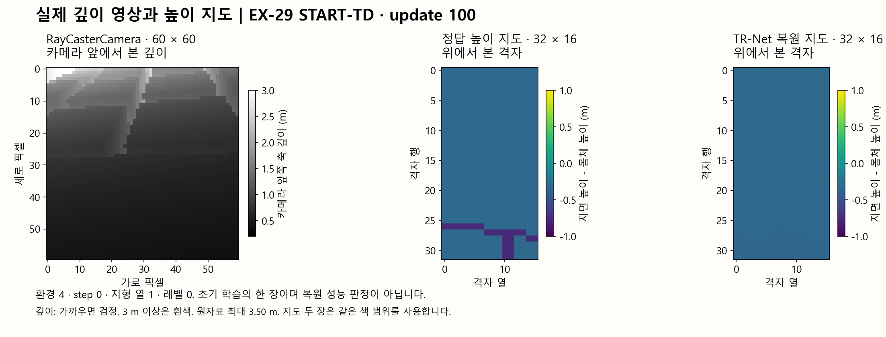

> 분류: 리서치
> 작성: 오흥재 (lead_tmp 원문·코드 대조) · 2026-10-23
> 근거: 팀장 10/23~10/24 직접 질문·기록 지시 · START v1 · PIE v3 · 실행 코드 d9517fb9 · EX-29 실제 manifest·학습 NPZ · NVIDIA·PyTorch 공식 문서
> 요지: 팀장이 질문한 보행·지도·센서·학습 용어를 이 문서 한곳에 모으고, 논문 원리와 현재 실행·최종 요구를 구분한다.
> 상태: 10/24 실제 실행·깊이 원자료 대조 확인됨 · 후진·횡이동 요구 보존, 현 실행 미포함 · 실기·최종 성능 미확인
> 판: v2.3 · 2026-10-24

# START와 보행 학습 개념 · 팀장 질문 단일 기록

**앞으로 개념 질문과 답·정정은 이 파일에 이어 쓴다.** 새 용어 문서를 따로 늘리지 않는다. 약어 원문·쉬운 뜻·현재 코드에서의 의미·근거·미확인을 함께 남긴다. 현재 두 판의 실행 설계는 [B·START TopDown 계획](PLAN-B-START-TOPDOWN-1023.md), 실제 기동과 진행은 [실행 기록](RUN-EX28-29-1024.md)이다. 아래 방법 설명을 아직 얻지 않은 성과로 읽지 않는다.

찾을 곳: 지도·TR-Net·AdaSmpl·PIE·CV는 아래 기존 절, `force_gt`는 「정확한 의미와 정정」, `start_mode`와 지형은 「현재 명령과 지형」, Warp·카메라는 「깊이 영상과 정답 스캔」, DR·지연·추정기·DDP 등은 「다른 질문의 용어 모음」에 있다. PRED·GT·FLAT·LOW STONES와 영상 반복은 바로 아래 절이다.

`확인됨`: 아래 현 설정은 실행 manifest·cfg와 대조했고, 그림은 저장 원자료에서 직접 꺼냈다. `미측정`: 실기 성능·Linux 분산 성능·후진/횡이동 최종 성능. 원리 설명과 현재 검증 결과를 구분한다.

## 비교 영상의 PRED·GT·지형 이름 · 10/24 추가

- **PRED**는 predicted의 줄임말이다. 여기서는 깊이 영상에서 TR-Net이 만든 복원 높이 지도를 정책에 주었다는 뜻이다. 미래 동작 예측이라는 뜻이 아니다.
- **GT**는 Ground Truth다. 시뮬레이터 정답 높이 지도를 정책에 준다. 두 영상은 같은 EX-29 `model_200`을 다른 지도 입력으로 검사한 것이며, 별도로 다시 학습한 두 판이 아니다. 이번 촬영은 PRED에서 실제 GT사용0/600tick, GT에서600/600tick을 확인했다.
- **FLAT**은 평지, **LOW STONES**는 낮은 징검돌 level0다. 각 지형에서 위 두 입력을 검사해 네 칸으로 보여 준다. EX-29는 시작 발판에서 넘어지는 방향으로 크게 기울어져 초기화되므로, 이 영상은 징검돌을 건너는 능력을 보여 준 것이 아니다.
- **reset**은 종료 조건에 걸려 시작 자세로 돌아가는 것이다. EX-29 네 조건 모두12초 영상 안에서34회 발생했다. 영상 파일이0.35초로 잘린 것이 아니라 약0.35초짜리 실패를 반복한 것이다. 완전히 바닥에 누운 장면까지 기다리지 않고 초기화한다.
- **실험 번호와 모델 번호는 다르다.** 잘 걷던 G1-GT는 EX-23 `model_1500`, B500 비교에 사용한 판은 같은 EX-23 `model_500`이다. 초반 낮은 자세와 후반까지 남는 포복을 같은 결과로 읽지 않는다.

원자료·정정·몸 높이와 회전의 시간 변화는 [저자세·도약 판독](NOTE-posture-causes-1024.md), 영상과 촬영 계약은 [B500·EX29 결과](RESULT-B500-EX29-200-1024.md)에 있다. EX-29의 큰 기울기 종료와 EX-11·12의 낮은 자세를 유지한 전진은 서로 다른 실패다.

## 상관계수와 물리 고정의 뜻 · 10/24 추가

**피어슨 상관계수(Pearson correlation coefficient)**는 두 값이 직선적으로 함께 움직이는 정도다. +1은 같은 방향, −1은 반대 방향이며0 부근이라고 모든 관계가 없는 것은 아니다. 학습이 진행되며 함께 변한 두 값은 원인·결과가 아닐 수 있다. 갱신229개는 독립 실험229회가 아니고, 이상해 보이는 점도 오류·reset·다른 조건 중 무엇인지 먼저 확인한다. 실제 산점도와 민감도 계산은 [상관·역학 보충](NOTE-correlation-mechanics-1024.md)에 있다.

**COM 고정**은 EX-23에서는 몸체 내부 질량중심 오프셋을 임의로 바꾸는 이벤트를 껐다는 뜻이다. 로봇 전체 질량중심이 걸을 때 움직이지 않는다는 뜻은 아니다. **구동기 세기 고정**도 모터의 무작위 강도 배율을 끈 것이며 실제 출력 토크를 일정하게 만든 것이 아니다. **행동 지연0**은 관절 명령에 추가 지연을 주지 않았다는 뜻이다. 카메라·지각 처리까지 지연0은 아니다. EX-23에는 몸체 추가 질량−1~+3kg이 남았으므로 DR 전체 끔으로 부르면 틀리다.

**접촉 중 발 접선 속도**는 발이 지면을 짚는 동안 지면을 따라 미끄러지는 속도다. 공중에서 다리를 휘두르는 속도와 분리해야 한다. 거친 지면 법선을 모르고 월드XY만 재면 접선 속도의 대용 지표일 뿐이다. 몸 높이·관절각 하나로 미끄러짐이나 안정성을 판정하지 않는다.

## 현재 명령과 지형 · 10/24 실행 확인

| 구분 | EX-28 B · 원인 비교 | EX-29 START-TD · 본류 구현 확인 |
|---|---|---|
| 지도 선택 | `force_gt=True`, 정책에 정답 고정 | `force_gt=False`, AdaSmpl이 정답/복원 선택 |
| 명령 | `start_mode=True`, 전진 또는 제자리 회전 | 동일. 후진·횡이동·전진과 회전의 동시 명령 없음 |
| 지형 | 기존 연속 지형 7종 | START의 듬성한 4종과 보조 평지 |
| 최종 요구 충족 여부 | 원인 진단이며 최종 정책 아님 | 깊이 본류 일부 확인. 열린 명령·연속 지형까지 갖춘 최종 정책 아님 |

`start_mode=True`는 **우리 명령 생성기의 분기 이름**이다. START 신경망 전체나 센서를 켜는 스위치가 아니다. `vx`를 0~1.5 m/s에서 뽑고 0.3 미만이면 `vx=0`, 회전 `wz`를 -1.2~1.2 rad/s에서 뽑는다. 나머지는 전진 명령과 `wz=0`. `vy`는 항상 0이다. 연속 균등 추출이므로 기대 비율은 전진 약80%, 제자리 회전 약20%이며 실제 경험 비율은 종료·재추출의 영향도 받는다. 명령을 제한하는 것이지 물리적으로 옆이나 뒤로 움직이지 못하게 잠그는 것은 아니다.

**후진·옆걸음은 팀장 최종 요구에서 삭제되지 않았다.** [명령 설계 14](../20261019-design/14-COMMAND-GENERATOR.md)의 열린 명령·깃발·제한적 물러나기 계약과 [작업 방식](../20261019-design/LEAD-STYLE-AGENTS.md)의 전후·좌우·회전 목표는 보존한다. 해당 일반 생성기 코드가 있어도 이번 `start_mode` 분기에서는 사용하지 않는다. 계획서에 제외가 적혀 있었다는 이유로 팀장이 이를 명확히 알고 승인했다고 간주하지 않는다. lead_tmp가 기동 전에 최종 요구와 현 실행의 차이를 충분히 설명하지 못했다. 현재 실행을 열린 명령 학습 완료로 표시하지 않으며, 전환 시점·명령 분포·뒤쪽 관측의 한계는 후속 설계에서 명시한다. 이 기록으로 실행 중 cfg를 변경하지 않는다.

START §II-D1은 전진 범위·횡속도0·저속 시 제자리 회전 추출을 적는다. 같은 절의 동시 전진/회전 설명만으로 미기재 전진 중 yaw 분포를 확정할 수는 없다. 우리 구현은 그 분포를0으로 골랐다(`commands/mixed_core.py:141~150`). 이 구체 선택까지 저자 코드와 동일하다고 주장하지 않는다.

지형의 쉬운 이름과 현재 차이:

- B의 7종: 피라미드 계단, 역방향 피라미드 계단, 상자형 요철, 무작위 거친 바닥, 피라미드 경사, 역방향 피라미드 경사, 고정 높이 무대 계단. 칸은8×8m다.
- 본류의 4종: 징검돌(`stepping_stones`), 좁은 평균대(`balance_beams`), 띄엄띄엄 놓인 보(`stepping_beams`), 틈(`gaps`). 보조 평지를 더하고 징검돌을 낮은/높은 무작위성 두 설정으로 나눠, 구현 목록은6개다. 칸은8×4m다.
- 본류는 처음 낮은 무작위성 징검돌·보조 평지에서 시작해 어려운 종류에 점차 배정한다. 틈은 이 종류 전환에서 제외된다. 현재 설정은 전환 시작1000회·끝8000회·최대확률0.9다. **이 숫자와 지형 배정 비율은 논문 미기재 부분을 채운 우리 값**이다. 지형의 난이도 행 승급과 종류 전환은 서로 다른 과정이다. Windows 총1001갱신은 어려운 종류로 진행하는 전체 과정을 검증하는 길이가 아니다.

근거: 고정 코드 `d9517fb9929f23e2bf5c0b51fe46a1b2df20f237`의 `tasks/s2_23f_topdown_cfg.py:43~60`, `terrains/sol23f_topdown.py:14~36`, `terrains/rough_go2_cfg.py:16~38`, `terrains/progression.py:13~34`; [START §II-D](https://arxiv.org/html/2512.13153v1#S2.SS4). 실제 EX-29 `params/env.yaml`의 `commands.base_velocity.params.start_mode=true`와 지형6개, `params/agent.yaml:67` 및 `manifest.json/modes.force_gt=false`를 직접 대조했다.

### 처음부터 어려운 지형을 모두 넣는가 · 10/24 직접 질문

**아니다. 그러나 평지만 배우고 보행을 숙달한 뒤 다른 종류를 여는 방식도 아니다.** 최초 배정에서 틈을 제외한 환경을 낮은 무작위성 징검돌·평지로 옮긴다. `model_100.pt`에 저장된 전체3072환경을 CPU로 직접 세면 다음과 같다. 일부 영상 표본의 추정이 아니다.

| 지형 | 100회 저장본의 환경 수 |
|---|---:|
| 낮은 무작위성 징검돌 | 1625 |
| 평지 | 1140 |
| 틈 | 307 |
| 높은 무작위성 징검돌 | 0 |
| 평균대 | 0 |
| 띄엄띄엄 놓인 보 | 0 |

시작 로그도 틈307·나머지2765로 일치한다. 낮은 무작위성 징검돌에는 여전히 발판 사이 빈 곳이 있으며, 틈은 처음부터 들어간다. 따라서 이름이 쉬운 집합이라는 이유만으로 초기 보행에 충분히 쉽다고 확정하지 않는다. 이 표는 **배정 확인**이며 보행 성공 확인이 아니다.

현재 커리큘럼은 두 축이다. **종류 전환**은 학습 회차에 따라1000회 이후부터 어려운 종류를 뽑을 확률을 늘리고8000회에최대0.9로 둔다. 보행을 잘하게 됐는지 기다리는 조건은 아니다. **같은 종류 안의 난이도 행**은 이동 거리와 명령에 대한 수행을 기준으로 올리거나 내린다. 시작 시 최대 행은2이며, 100회 저장본은0행3003·1행63·2행5·3행1이었다. 두 축을 합쳐 「잘 걸으면 자동으로 어려운 지형을 연다」고 설명하면 틀리다.1000·8000·0.9는 논문 미기재 부분을 채운 우리 선택이고, 충분한 값인지 아직 검증되지 않았다.

팀장의 Top-Down 요구는 START를 기반으로 기존 논의와 최종 보행 요구를 함께 구현하라는 것이다. lead_tmp는 논문 구성의 동시 구현을 우선하면서 후진·횡이동·연속 지형 확장을 현재 판 밖으로 미뤘고 그 범위 선택을 충분히 설명하지 않았다. **현재 EX-29를 최종 요구 전체가 반영된 정책으로 보고하지 않는다.** 이 정정은 실행 중인 설정 변경이나 새 학습 승인도 아니다. 현재 배정·실제 보행을 분석하고, 종류 전환의 조건과 열린 명령·연속 지형을 연결할 자리를 기존 본류 계획에 명시해야 한다. 논의되지 않은 숫자나 새 승인 절차를 이 기록으로 만들지 않는다.

근거: `tasks/s2_23f_topdown_env.py:19~47` 최초 재배정, `terrains/s2_layout.py:11~12` 집합, `terrains/progression.py:13~34` 회차별 확률, `curriculum/terrain_levels_mixed.py:106~126` 난이도와 종류 갱신의 연결. [전체 환경 집계·체크포인트 해시](figs/depth-concepts-1024/terrain-check-u100.json). 원본·GPU·Isaac를 변경하지 않고 읽었다.

## 깊이 영상과 정답 스캔 · Warp는 무엇인가

**Warp는 NVIDIA가 제공하는 GPU 병렬 계산 프레임워크**다. Python으로 작성한 계산을 CPU/GPU용 코드로 바꿔 물리·기하·로봇 계산에 쓸 수 있다. 우리 실행에서 관절·접촉·마찰을 진행시키는 물리 엔진은 PhysX이며, 센서가 지형과 광선의 교차점을 찾을 때 Warp를 쓴다. Warp를 사용하는 물리 시뮬레이터를 만들 수도 있지만 여기서 Warp와 PhysX를 같은 구성요소로 부르면 틀리다. [NVIDIA Warp 공식 설명](https://nvidia.github.io/warp/stable/).

| 이름 | 일반적인 뜻 | 현재 우리 사용 |
|---|---|---|
| RayCaster | 지정한 위치·방향의 광선과 메시 교차점 계산 | 가상 광선 시작점을 몸체보다20m 위로 옮겨 아래로 쏘고, 정답 높이32×16칸을 얻음 |
| RayCasterCamera | 카메라 시야 모양의 광선으로 픽셀별 깊이를 계산하는 센서 | 몸체 앞쪽 시점의60×60 깊이 영상,0.1초마다 갱신 |
| Warp | 위 광선 계산을 빠르게 실행하는 기반 도구 | RayCaster와 RayCasterCamera 모두 사용 |
| D435i | 실제 로봇에 장착할 스테레오 깊이 카메라 | 실물 두 시점의 영상으로 깊이를 구함. 시뮬의 메시 교차 계산과 실제 측정 원리가 다름 |

따라서 「START는 Warp, 우리는 RayCasterCamera라 다른 방식」이라는 설명은 잘못된 대비다. RayCasterCamera가 **내부적으로 Warp를 사용한다**. 다만 해상도·시야·장착 자세·잡음·미검출이 저자 장치 또는 실제 D435i와 모두 같다는 뜻은 아니다. 현재 내부 파라미터와 장착 위치에는 우리 가정이 포함된다. [Isaac Lab Ray-Cast Camera](https://isaac-sim.github.io/IsaacLab/v2.3.0/source/api/lab/isaaclab.sensors.html#ray-cast-camera), 로컬 `C:/isaac/IsaacLab/source/isaaclab/isaaclab/sensors/ray_caster/ray_caster_camera.py:18,30~38,293` 직접 확인.

20m는 실제 카메라가 놓인 높이가 아니라 **정답 생성용 광선의 출발 오프셋**이다. RayCaster라는 클래스가 원래 정답 지도만 만드는 전용 장치인 것은 아니다. 우리 설정이 그 용도로 쓰는 것이다. 현재 깊이 카메라는 전방 시점이고, 정답 지도 광선과 서로 별개다(`sensors/start_obs.py`, `sensors/depth_cam_cfg.py`).

### 실제 영상은 이렇게 생긴다

왼쪽은 **새로 만든 예시가 아니라 실제 EX-29 학습 기록**이다. update100·step0·환경4의 센서 깊이를 CPU로 표시했다. 각 픽셀은 RGB 색이 아니라 카메라 앞쪽 축 방향 거리(m)다. 여기서는 가까우면 검정, 멀면 흰색으로 표시했다. 원자료 최대3.50m 중3m 이상은 표시만 흰색으로 포화시켰고 원자료는 바꾸지 않았다. 가운데와 오른쪽은 같은 기록에 저장된 정답 지도와 TR-Net 복원 지도이며, 높이 기준과 색 범위를 같게 했다. 몸체보다 낮은 지면은 음수다. 카메라 영상은 정면 투영, 지도는 위에서 보는 격자이므로 같은 방향의 사진 두 장처럼 해석하면 안 된다.

이는 초기 학습의 한 장이다. 이 장면에서 정답의 낮은 부분을 복원 지도가 충분히 표현하지 못하는 모습이 보이지만, 전체 복원 성능은 여러 환경·회차의 오차로 별도 판정한다. 설명하기 쉬운 자세의 환경을 골랐으며 성공률 표본으로 쓰지 않는다. 원시 센서는10Hz라 현재 센서 프레임과 정책에 유지된 직전 입력 프레임의 시각이 다를 수 있다. 이 그림을 RGB와 픽셀 단위로 정렬한 영상이라고도 부르지 않는다.

원자료: `C:/mai/wt/foothold-lab/lead-tmp-start-b/logs/rsl_rl/foothold_s2_23f_topdown/2026-10-24_08-20-33_ex29-td-main/training_trace/update_000100.npz`. SHA256 `fdd92d58c0deffadd1839c67504ddef697415313fa4805d3d4326514c7c4cd5a`. [추출 코드](figs/depth-concepts-1024/render_depth_example.py) · [선택 위치·표시 범위·해시](figs/depth-concepts-1024/source.json). 원자료의 그림 생성 전후 해시 일치를 확인했다. GPU·Isaac·학습 상태를 건드리지 않았다.

### force_gt=False의 실제 예

EX-29 update100의 `map_stats.jsonl`에서 실제 GT 사용 비중(`use_gt_frac`)은0.9241807933, 약92.4%다. 즉 **False여도 이 회차는 GT를 자주 썼다**. 강제를 푼 뒤 AdaSmpl이 고른 결과이며, 설정이 무시됐다는 뜻이 아니다. 이 비중은 실제 사용량이고, AdaSmpl의 선택 확률값 자체와 동일한 수치라고 해석하지 않는다. 이 값만으로 복원 전용 보행을 잘한다고도 말할 수 없다. 초기 확률·보상 통계·복원 손실·실제 선택을 함께 본다.

## 다른 질문의 용어 모음

| 용어 | 원어와 쉬운 설명 | 우리 실험에서 주의할 점 |
|---|---|---|
| DR | Domain Randomization, 도메인 무작위화. 시뮬의 마찰·질량·모터 특성 등을 바꿔 다양한 실제 조건을 겪게 함 | DR 자체와 점차 범위를 늘리는 커리큘럼은 다름. EX-23의 약한 고정 조건을 DR 커리큘럼 완료라고 부르지 않음 |
| 행동 지연 | 명령을 계산한 시점과 모터가 적용하는 시점 사이의 시간 차 | 최신 보정이 늦게 도착하면 흔들림·과보정이 생길 수 있음. 실제 지연은 짧고 일정할수록 제어에 유리하지만, 학습에서는 실물 지연 범위를 견디게 연습. 현재 본류는0~15ms를5ms 물리 substep 단위로 구현. 깊이 영상의10Hz 갱신과 별개 |
| 추정기 | I-E estimator, implicit-explicit estimator. 과거 몸 감각과 지도에서 몸 선속도·발 주변 지형 및 내부 특징을 추정 | 높이 지도만으로 마찰계수를 직접 아는 것은 아님. 몸이 미끄러진 반응에 마찰 정보가 간접 포함될 수 있지만, 마찰을 정확히 추정한다고 검증한 것은 아님 |
| learned / zero | learned는 학습한 추정값을 정책에 전달, zero는 해당 경로를0으로 둔 진단 조건 | 학습 자체가 전부 꺼지는 스위치가 아님. 이번 두 판은 learned이고, 추가zero 실험은 팀장 결정으로 제외 |
| Actuator | 액추에이터, 구동기. 제어 신호를 실제 관절의 힘·움직임으로 바꾸는 모터·기구 계통 | 정책의12개 행동 값과 실제 토크는 같지 않음. 목표 관절각·PD 제어·지연·토크 한계가 사이에 있음 |
| COM | Center of Mass, 질량중심 | 몸의 질량이 평균적으로 모인 위치. 화면상 몸체 중심과 반드시 같지 않음 |
| 고유수용감각 | Proprioception. 관절각·관절속도·몸 회전 등 자기 몸의 상태에 관한 감각 | 앞을 직접 보는 깊이 영상과 구분. 과거 관측은 이미 지나온 땅의 단서를 남길 수 있지만 보지 않은 뒤쪽 지형의 정답은 아님 |
| env | 병렬 시뮬레이션 환경 하나 | 3072는 동시에 경험을 모으는 로봇 수. 한 로봇의 관측 해상도가 아님 |
| PPO iteration/update | Proximal Policy Optimization의 한 학습 갱신 | 현재3072환경×24step=73,728개 경험 뒤 갱신. 환경 수가 달라지면 같은1000회라도 경험량이 달라짐 |
| 체크포인트와 이어받기 | 신경망·optimizer·학습 카운터 등 저장 상태를 읽어 계속 학습 | 설정만 바꿔도 저장된force_gt 등이 되살아날 수 있음. 새 시뮬의 물리 상태가 전과 완전히 동일한 것은 아님 |
| DDP | Distributed Data Parallel, 분산 데이터 병렬 학습 | 각 GPU에 모델을 복제하고 다른 경험에서 계산한 gradient를 합침.16GB 두 장이 자동32GB 한 장이 되지 않음 |
| FSDP | Fully Sharded Data Parallel, 완전 분할 데이터 병렬 학습 | 모델 가중치·gradient·optimizer 상태를 나눠 보관. Isaac의 물리·깊이 버퍼까지 자동 분할하는 기능은 아님. 현재 적용·효과 미확인 |
| 깊이 Range | 거리값의 표시 범위 또는 모델 입력 전처리 범위 | 표시용 계조만 조정하면 로봇이 받는 정보는 그대로. 모델에 더 먼 거리·별도 특징을 전달하면 새 입력 설계이며 실제 보임·원래3m clip·잡음·시야를 먼저 확인 |
| 보이는 표면과 지지면 | 눈·수풀의 겉표면과 발의 체중을 받치는 표면은 다를 수 있음 | 깊이 지도만으로 눌림·마찰·지지력을 확정할 수 없음. 접촉 반응·기억·재질 정보의 활용은 추가 연구 아이디어이며 현재 단단한 메시 학습의 검증 결과가 아님 |
| 국소 최적점 | 일부 조건에서는 보상이 높지만 더 나은 행동으로 옮겨가기 어려운 학습 상태 | 낮은 자세가 보상·동역학의 절충으로 굳었을 가능성은 가설. 영상 하나로 원인을 마찰이나 추정기로 확정하지 않음 |

DDP·FSDP 출처: [PyTorch DDP](https://docs.pytorch.org/docs/stable/generated/torch.nn.parallel.DistributedDataParallel.html), [PyTorch FSDP](https://docs.pytorch.org/docs/stable/fsdp.html). 실측과 Linux에서 할 시험은 [카메라·분산 계산 기록](NOTE-camera-ddp-linux-1024.md)에 연결한다. 이 용어 설명이 새 실험·분산 실행 승인이나 구현 완료를 뜻하지 않는다.

## 직접 결정과 목표

팀장: 원인 규명은 B만 새로 학습하고 기존 EX-23과 비교한다. 새 A 학습은 제외한다. 코드·학습 설정·초기화 경로의 차이는 먼저 확인하고, 원자료가 없어 확인 못 하는 초기 물리 실현값은 미확인으로 남긴다. 기존 EX-23을 같은 평가기로 다시 평가할 수 있으며 이는 재학습이 아니다. zero 대조는 추가하지 않고 learned를 유지한다.

팀장의 원칙은 원인 분석과 절차에 매몰되어 최종적으로 잘 걷는 정책을 만드는 목표를 놓치지 않는 것이다. 실패를 숨기거나 성공하도록 판정 기준을 바꾸라는 뜻으로 해석하지 않는다. 원인 비교와 성능 개선은 병행 가능한 서로 다른 질문이다. 후속 직접 지시에 따라 GPU 0 B·GPU 1은 처음부터 START 주요 구성을 함께 학습하는 본류로 설계했다. 10/23 준비 당시 [고정 구현·CPU 확인](READINESS-B-START-1023.md)을 기록했고, 10/24에는 두 판이 실제 기동했다. 실행 시각·현재 구간은 [실행 기록](RUN-EX28-29-1024.md)을 따른다.

이 결정은 PLAN-friction-curriculum-1023.md의 새 A/B 우선 권고와 순차 두 판 ETA를 대체한다. 옛 본문은 제안 이력이며 그대로 실행하지 않는다. B 학습 시간은 과거 처리량 가정 약9.7~10.7h이며 준비·평가·분석 및 동시 작업 부하는 별도 미측정이다.

## 논문에 근거한 설명

- TR-Net: Terrain Reconstruction Network, 지형 복원 신경망. TR은 Terrain Reconstruction이다.
- AdaSmpl: Adaptive Sampling, 적응형 표집. 여기서는 정책 입력에 사용할 지도를 확률적으로 선택한다.
- GT: Ground Truth, 시뮬레이터에서 얻는 정답 지도.
- PIE: Parkour with Implicit-Explicit Learning Framework for Legged Robots. 몸 감각과 시각을 함께 사용해 로봇 상태·주변을 추정하는 START의 선행 연구다. `Implicit`은 신경망 내부 특징으로 배우는 표현, `Explicit`은 속도·발 높이처럼 정답과 직접 비교할 수 있는 양을 뜻한다. PIE 자체가 특정 추정기 스위치의 이름은 아니다. START는 여기서 발 높이만 예측하는 대신 발 주변 지형까지 추정하며 TR-Net과 AdaSmpl을 결합한다. [PIE §III-A·III-B](https://arxiv.org/html/2408.13740v3#S3.SS2), START §II-A.

TR-Net은 깊이 영상과 몸 감각 특징으로 지도를 만들고 정답과 비교해 배운다. 거친 지도는 MSE, 정제 지도는 L1 손실이다. AdaSmpl은 아직 부정확한 복원 지도가 보행 학습을 방해하는 것을 줄이기 위해 정책 쪽 입력을 정답 지도 또는 복원 지도 중에서 선택한다. 두 지도를 칸별 가중 평균하는 뜻이 아니다.

논문 식(5)은 p_GT=tanh(CV(R))이다. CV는 에피소드 보상의 평균 대비 산포를 나타내는 변동계수다. 학습 중 보상이 들쭉날쭉하면 정답 지도를 더 자주 제공하고, 상대적 산포가 작아지면 복원 지도를 더 자주 제공한다. 회차만으로 정해지는 단조 감소 스케줄도, 지도 복원 오차를 직접 넣는 식도 아니다. 다시 불안정해지면 확률이 커질 수 있다. 보상이 일정하게 낮아도 CV가 작을 수 있으므로 확률 하나를 보행 성공이나 지도 정확도의 증거로 쓰지 않는다.

### CV와 정답 도움을 쉬운 말로

CV는 Coefficient of Variation, 변동계수다. “평소 받은 점수 크기에 비해 매 시도 점수가 얼마나 들쭉날쭉한가”를 나타낸다. tanh는 그 비율을0~1 사이 확률로 바꾸는 함수다. 우리 구현은 음수·0 평균 문제를 다루려고 표준편차를 `절댓값 평균+eps`로 나눈다. 그 구체 방식은 공개 원문의 확정값이 아니다.

| 설명용 두 시도의 보상 | 평균 | 표준편차(모분산 기준) | CV | 정답 지도 선택 확률 |
|---|---:|---:|---:|---:|
| 9점,11점 | 10 | 1 | 0.1 | tanh(0.1) ≈10% |
| 2점,18점 | 10 | 8 | 0.8 | tanh(0.8) ≈66% |
| 1점,1점 | 1 | 0 | 0 | 0% |

위 숫자는 설명을 위한 가상 값이며 실험 측정이 아니다. 첫 두 경우 평균은 같지만 두 번째는 결과가 크게 흔들린다. 논문의 의도는 이럴 때 정확한 지형 정보를 더 자주 줘서, 부정확한 복원 지도 때문에 보행 학습까지 흔들리는 부담을 줄이는 것이다. 확률66%는 여러 번 지도를 선택할 때 정답을 약66% 비중으로 고른다는 뜻이며, 매100번 정확히66번이라는 뜻은 아니다. 에피소드 길이가 달라지면 선택 횟수 비중과 실제 사용 시간 비중도 다르다.

변동이 줄었다고 “이미 잘 걷는다”고 확정하는 것은 틀리다. 세 번째처럼 계속 못해서 같은 낮은 점수를 받아도 변동은0이다. AdaSmpl은 학습을 돕는 규칙이며 성공 판정기가 아니다. 그래서 실제 보행·복원 오차·지도 사용 비율을 따로 기록한다. 복원 지도를 더 자주 쓰며 그 오차를 겪어 보는 경험은 실기에 필요하지만, 잘 견뎠는지는 영상과 평가로 확인해야 한다.

START는 복원망과 정책을 한 단계에서 함께 학습한다. 보행 학습이 끝난 다음에야 복원망을 켜는 방식은 원문 방식이 아니다. GT는 학습 시 복원 오차의 정답으로 계속 필요하지만, 배포 시 정책 입력에는 복원 지도만 쓴다.

출처: [START v1 §II-B·식(4), §II-C·식(5)](https://arxiv.org/html/2512.13153v1#S2.SS2). 수치 창 길이·초기 선택 확률·평균0 처리 등 원문에 명시되지 않은 구현 세부를 저자 확정값으로 포장하지 않는다.

## force_gt의 정확한 의미와 정정

force_gt는 우리 구현의 강제 선택 스위치다. True이면 AdaSmpl이 계산할 확률과 관계없이 항상 GT를 선택한다. False이면 AdaSmpl을 허용하는 것이며, 복원 지도를 항상 선택한다는 뜻이 아니다. 실제 use_gt와 확률을 함께 봐야 한다.

| 상황 | 정책이 실제 받는 지도 | 복원망의 학습/검사 |
|---|---|---|
| force_gt=True | 정답 지도만 | 복원망은 계속 배울 수 있고 정답과의 오차도 잴 수 있음 |
| force_gt=False인 학습 | AdaSmpl이 정답 또는 복원 지도 선택 | 복원망·추정기·정책을 함께 학습 |
| 복원 전용 평가·실기 | 복원 지도만, 첫 순간과 reset 뒤에도 동일 | 시뮬 평가에서는 GT를 오차 계산에만 사용 가능. 실기에는 이 시뮬 GT가 없음 |

“실제 선택 경로 확인”은 메뉴에 False라고 적힌지만 보는 것이 아니라, 행동을 계산하기 직전에 들어간 지도가 무엇인지 확인한다는 뜻이다. 우리 코드는 checkpoint에서 옛 force_gt를 불러올 수 있고, False여도 AdaSmpl이 GT를 고를 수 있다. 그래서 복원 전용 추론은 GT 선택을 별도로 막는다. `GT 보행`의 GT도 Ground Truth이며, 정답 지도를 보고 걷는 진단 조건이라는 뜻이다.

중요한 정정: force_gt=True여도 TR-Net 출력과 GT를 비교하면 복원 오차와 그 감소를 측정할 수 있다. 확인하지 못하는 것은 정책이 복원 지도를 실제로 사용했을 때의 보행과 복원 오차 내성이다. 이전 채팅에서 둘을 함께 확인 불가처럼 읽히게 한 설명은 이 문장으로 바로잡는다.

원문 충실 본선은 강제 GT를 처음부터 풀고 복원·추정·정책을 함께 학습하며 AdaSmpl이 입력을 고르게 한다. 현재 EX-23의 GT 보행을 먼저 이어받고 나중에 강제를 푸는 방안은 가능한 우리 전이학습 변형이지만 START 원문 학습 절차 그 자체는 아니다. 효과를 미리 보장하지 않으며 이번 턴에서 전환 시점을 정하지 않는다. 진단용 EX-23이나 B에는 GT 고정을 끝까지 유지할 수 있다. 문제는 이를 깊이 기반 실기 정책 완성으로 부르는 것이다.

## 실제 코드에서 확인한 것과 남은 것

읽은 코드: `C:/Users/AI-WS01/orca/workspaces/foothold-lab/sonnet-code/foothold_s2/models/start_perception.py`, git HEAD `7cab5223e0990533d51d46b4d498693213b99f73`. 이번 확인은 읽기 전용이며 새 학습 측정이 아니다.

| 위치 | 정적 코드 확인 | 해석 |
|---|---|---|
| 190~225 AdaSmpl | p_init 기본1, CV=표준편차/(절댓값 평균+eps), force_gt이면p1·선택True | 초기p1과 force_gt True는 다름. 원문의 미기재 세부는 우리 선택 |
| 213~232 update/load | 에피소드2개 미만이면p유지, load가저장force_gt복원 | 설정만 False로 써도 checkpoint True가 다시 들어올 수 있음 |
| 303~315 _advance | TR-Net이rough/refined를 계산하고 use_gt로지도선택 | GT선택과 복원출력계산은 별개 |
| 346~386 sequence_loss | TR-Net존재시rough/refined대GT손실계산 | GT를 정책에 주어도 복원손실 계산 가능. 실제 실행의optimizer 갱신·곡선은 별도 검증 |

배포/복원 전용 평가에서는 force_gt=False만 보고 끝내지 않고 실제 use_gt가모든환경·reset뒤False인지 확인한다. 학습에서는 설정확률과 실제GT선택비율, 복원오차, 복원지도소비시명령추종·위상·실패를 분리 기록한다. 이는 다음 실험 명세에 연결할 점검 항목이다.

## 발표에 쓸 짧은 설명

“로봇은 깊이 영상으로 주변 지형을 복원하고, 시뮬레이터의 정답과 비교하며 지도를 더 정확하게 만듭니다. 동시에 보행 정책도 학습합니다. 초기에 부정확한 지도 때문에 보행 학습이 흔들리지 않도록 정답 지도를 확률적으로 도와주고, 복원 지도에서도 걷는 경험을 쌓게 합니다. 실제 로봇에서는 이 정답 지도 도움 없이 복원 지도만으로 걸어야 합니다.”

이 문장은 방법 설명이다. 우리 실기 성공이나 복원 전용 보행 완성을 이미 달성했다는 실험 결과로 쓰지 않는다.

## 이력

| 날짜 | 변경 |
|---|---|
| 2026-10-23 | TR-Net·AdaSmpl·PIE·CV·force_gt 설명과 기존 잘못된 설명 정정, B 단독 비교 결정 |
| 2026-10-24 | 개념 질문의 단일 기록으로 확장. 현재 명령·지형·False 실소비 대조, 실제 깊이 그림, Warp·DR·지연·DDP·FSDP 등을 추가. 후진·횡이동 요구와 현 실행 차이 명시 |
| 2026-10-24 | v2.1. 전체3072환경의100회 지형 배정을 직접 확인. 종류 전환은 회차 기준이며 난이도 행의 수행 기준과 다름을 정정. Top-Down 범위를 충분히 설명하지 않은 책임과 최종 요구 보존을 기록 |
| 2026-10-24 | v2.2. PRED·GT·FLAT·LOW STONES·reset 설명, 같은 EX-23의500/1500 구분, 포복·도약 판독 근거 연결 |
| 2026-10-24 | v2.3. 피어슨·COM/구동기 고정·접촉 발 접선 속도 설명. EX-23의 남은 질량 DR와 상관·역학 분석 연결 |
