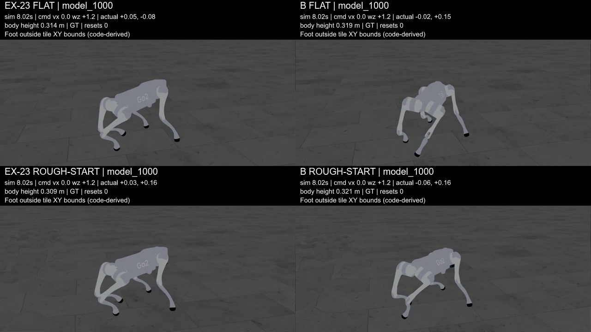
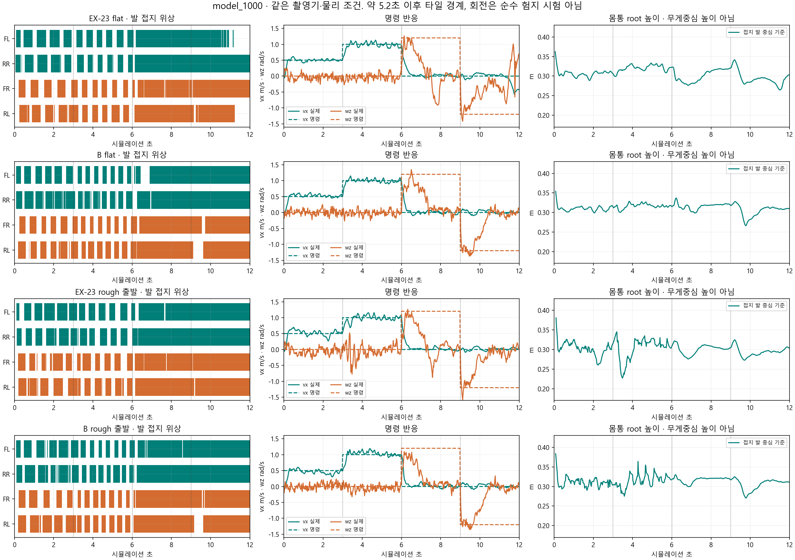
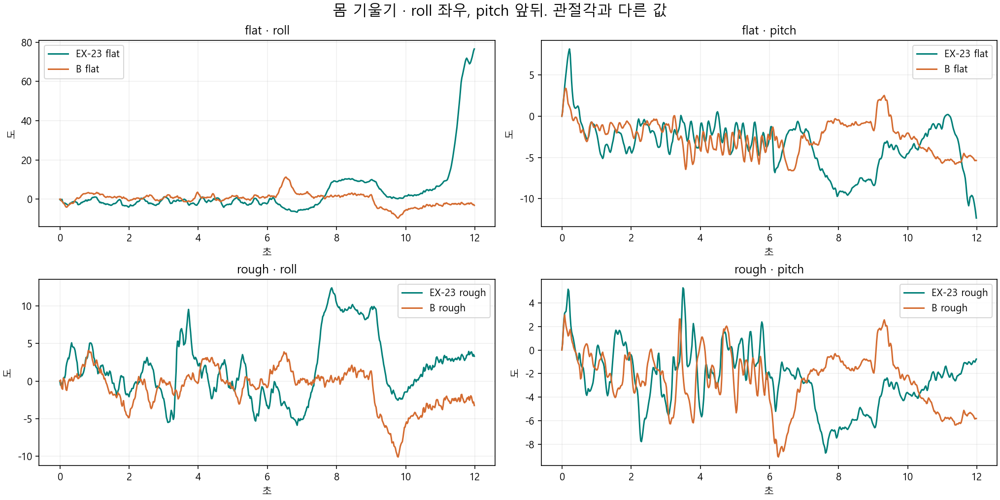
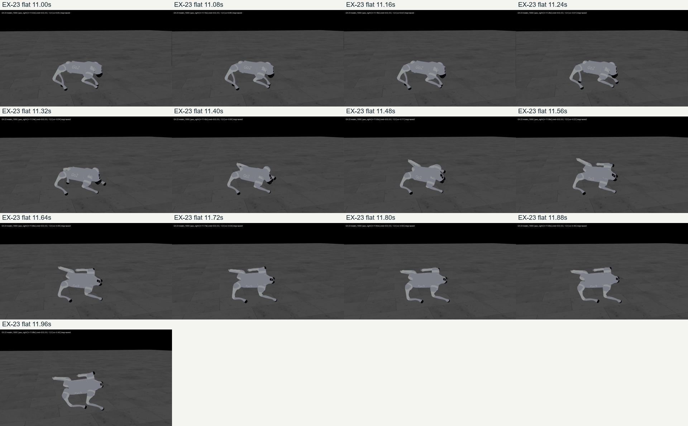
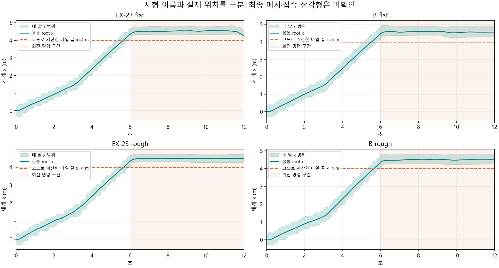
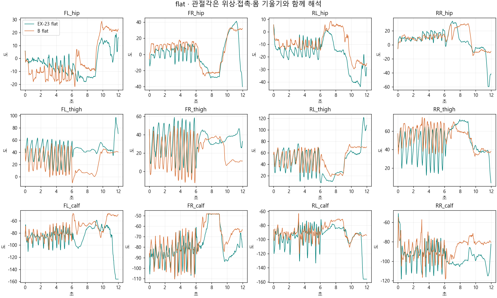
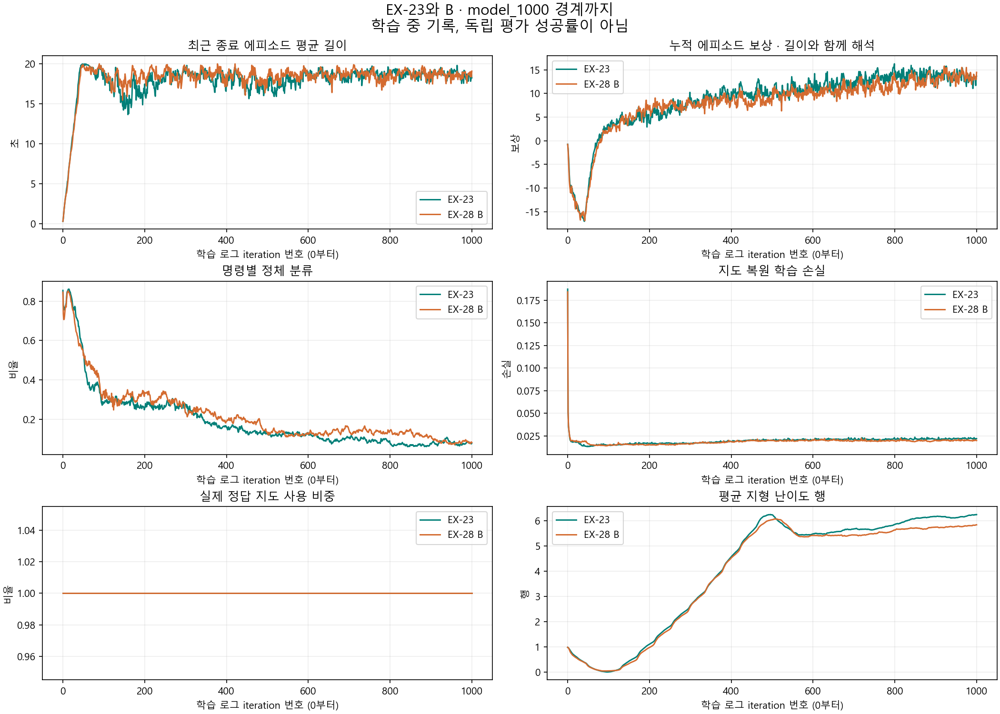

> 분류: 실험
> 작성: 오흥재 (lead_tmp 직접 촬영·집계) · 2026-10-24
> 근거: B·EX-23 model_1000 원본 JSON·NPZ·MP4 · TensorBoard · 촬영 소스 · ASTRA24g 독립 집계
> 요지: B도 몸을 세우고 전진한다. 마찰 단독 포복설은 약해졌고, 지속 회전은 미완성이다. 회전 구간은 거친 타일 밖으로 나가므로 순수 험지 시험이 아니다.
> 상태: 1000번 중간 분석 확인됨 · B는 1500번까지 계속 · EX-29 재개 보류
> 판: v1.0

# EX-28 B 1000번 · EX-23 같은 회차와의 비교

**B는 넓은 마찰 분포로 학습했어도 몸을 세우고 전진한다. 회전은 처음 반응한 뒤 속도가 크게 줄어든다.** EX-23도 1000번에서는 지속 회전이 미숙하고, 이번 평지 촬영 마지막에는 옆으로 크게 기울어진다. 따라서 「마찰을 고정해야만 전진을 배운다」는 강한 설명은 지지되지 않는다. 마찰이 무관하다거나 다른 DR 하나가 원인이라는 뜻은 아니다.

**촬영 한계도 발견했다.** 코드와 세계좌표를 대조하면 약 5.2초부터 발이 8 m 타일 밖으로 나간다. 전진 0.5 m/s 구간은 타일 내부지만, 이후 1.0 m/s 구간은 내부와 경계를 섞고 회전은 순수 험지 구간이 아니다. 이 한계를 영상 자막·표·그림에 함께 표시했다. 최종 메시의 접촉 삼각형은 미확인이다.

실행은 [팀장 직접 결정](https://github.com/foothold-project/foothold-lab/issues/555#issuecomment-6379481102)대로 **1000번 촬영·분석 후 1500번까지 학습하고 자연 종료**한다. model_1000은 0번부터 센 완료 1001갱신, model_1500은 완료 1501갱신이다. 새 실험이나 EX-29 재개를 승인한 기록이 아니다.

## 1. 영상과 원자료

- [2행 2열 비교 영상 1배속](https://github.com/foothold-project/foothold-lab/releases/download/research-ex28-1000-20261024/ex23-b1000-comparison-1x.mp4), [0.5배속](https://github.com/foothold-project/foothold-lab/releases/download/research-ex28-1000-20261024/ex23-b1000-comparison-05x.mp4). 열은 EX-23 / B, 행은 flat / rough 출발이다. 네 판 모두 model_1000이다.
- 로컬: `C:/Users/AI-WS01/s2_lab/run_20261024/b1000_matched_review/comparison_1x.mp4`, `comparison_05x.mp4`.
- [수치와 원본 SHA](figs/ex28-u1000-review/matched_metrics.json), [영상 목록·SHA](figs/ex28-u1000-review/video_manifest.json), [CPU 분석 코드](analyze_b1000_1024.py), [원자료 묶음](https://github.com/foothold-project/foothold-lab/releases/download/research-ex28-1000-20261024/ex23-b1000-evidence.zip).

명령은 0~3초 전진 0.5 m/s, 3~6초 전진 1.0 m/s, 6~9초 좌회전 +1.2 rad/s, 9~12초 우회전 −1.2 rad/s다. 평균 표는 각 구간 마지막 2초, 즉 100개 제어행이다. **100개 독립 실험이 아니다.** 회전 표는 처음 1초와 마지막 1초를 따로 보여 준다. HUD는 실제 `video_sample_step_indices`로 원자료와 맞췄다.

## 2. 전진 · 몸 높이 · 보행 위상

아래 `rough`는 출발 지형 이름이다. 0.5 명령의 집계 구간은 코드상 타일 내부이고, 1.0 명령의 집계 구간은 타일 끝을 포함한다.

| 자료 | 0.5 명령 속도(m/s) | 그때 몸 높이(m) | 1.0 명령 속도(m/s) · 경계 포함 | 그때 몸 높이(m) | 대각 / 두 발 접지 표본 · 1.0 구간 |
|---|---:|---:|---:|---:|---:|
| EX-23 flat | 0.496 | 0.305 | 0.986 | 0.322 | 75/77 (97.4%) |
| B flat | 0.526 | 0.310 | 0.992 | 0.318 | 68/71 (95.8%) |
| EX-23 rough | 0.497 | 0.296 | 1.007 | 0.316 | 64/66 (97.0%) |
| B rough | 0.440 | 0.309 | 1.029 | 0.320 | 62/63 (98.4%) |

몸 높이는 **몸통 root의 z에서 접촉 중인 발 링크 중심 z의 평균을 뺀 값**이다. 무게중심(COM) 높이나 발바닥 접촉면 높이가 아니다. 발 반지름을 더하지 않았다. 정의가 다른 과거 높이와 숫자만 빼서 비교하지 않는다. 회전 끝에 기울어진 몸의 높이도 정상 자세의 증거로 쓰지 않는다.

대각 접지는 FL(앞왼쪽)+RR(뒤오른쪽), 또는 FR(앞오른쪽)+RL(뒤왼쪽) 두 발만 접지한 상태다. 표의 분모는 두 발 접지 표본이다. 전체 100행 중 대각 두 발은 EX-23 flat 75행, B flat 68행, EX-23 rough 64행, B rough 62행이다. 모든 발을 붙인 정지는 대각 접지 100%가 되지 않도록 분모 없음으로 처리한다. 답을 아는 네 발 서기·대각 쌍·앞뒤 쌍 입력으로 함수를 먼저 확인했다.

전진의 위상과 0.08초 프레임 띠에서 대각 쌍이 반복 교대한다. B의 1.0 명령 구간에서 앞 두 발 또는 뒤 두 발만 접지한 비율은 flat 3%, rough 출발 1%다. 순간 접촉만으로 앞뒤 쌍 도약(bounding)이라고 부르지 않는다. 이번 구간에는 EX-15처럼 앞뒤 쌍 도약이 지속되는 모습이 확인되지 않았다. 대각 분율 하나만으로 보행 전체의 안정성이나 완성도를 인증하지도 않는다.

## 3. 회전은 처음 반응과 지속 능력을 나눠 본다

| 자료 | 좌회전 처음 1초 → 마지막 1초(rad/s) | 우회전 처음 1초 → 마지막 1초(rad/s) | 좌/우 마지막 2초 네 발 접지율 |
|---|---:|---:|---:|
| EX-23 flat | +0.844 → -0.015 | -0.818 → -0.011 | 97% / 45% |
| B flat | +0.845 → +0.037 | -1.048 → -0.045 | 100% / 100% |
| EX-23 rough | +0.828 → +0.078 | -0.851 → -0.068 | 96% / 100% |
| B rough | +0.769 → +0.041 | -1.041 → -0.051 | 99% / 100% |

명령은 끝까지 ±1.2 rad/s인데 속도가 유지되지 않는다. B는 처음 요구한 방향으로 돌고, 이후 발을 거의 계속 붙인 채 각속도가 0에 가까워진다. 관절도 전진 중의 주기적 굽힘·폄에서 거의 고정된 자세로 바뀐다. **처음부터 명령을 무시했다는 설명은 틀리다. 몸을 비튼 뒤 발을 바꾸며 회전을 이어가는 동작이 미완성인 패턴**이다. 이는 관찰에 맞는 해석이며 보상·관절 한계·학습량 중 어느 것이 원인인지는 분리하지 않았다.

EX-23 flat은 예외를 따로 남긴다. 11초 이후 roll(몸 좌우 기울기)이 최대 **76.6°**로 커지고 영상에서도 옆으로 무너지는 진행이 보인다. 그때도 reset은 0이다. **reset 0은 넘어지지 않았다는 증거가 아니다.** 크게 기울어진 몸의 z축 각속도는 지면 기준 순수 회전 속도와도 다르다. B의 네 발 유지 관찰을 EX-23의 이 구간까지 일반화하지 않는다.

### 타일 경계에 관한 추가 제한

촬영기 [512~520행](measurement-sol24i/record_sol24i.py#L512)은 random_rough 한 타일을 만든다. 소비 소스 `lead-tmp-start-b/foothold_s2/eval/terrain_sets.py:111,139~143`, `sim/eval/generalization_env_cfg.py:32`와 설치 Isaac Lab `terrain_generator.py:181~187`을 직접 읽었다. 8×8 m 타일을 중심 정렬하므로 x·y는 −4~4 m다. 20 m border는 주변 바닥을 늘리며 거친 타일을 늘리지 않는다.

| 자료 | 첫 발이 타일 범위 밖인 시각(s) | root가 밖인 시각(s) | 회전 구간 root x 최솟값(m) |
|---|---:|---:|---:|
| EX-23 flat | 5.34 | 5.64 | 4.278 |
| B flat | 5.18 | 5.54 | 4.457 |
| EX-23 rough | 5.28 | 5.68 | 4.324 |
| B rough | 5.22 | 5.68 | 4.331 |

ASTRA가 먼저 지적했고 lead_tmp도 생성 코드와 NPZ를 별도로 대조했다. **6~12초를 순수 험지 회전 성능으로 보고하지 않는다.** 최종 생성 메시·발의 접촉 삼각형 ID는 저장 자료에서 확인하지 못했다. 따라서 좌표와 코드에 근거한 제한으로 적으며 실제 삼각형 접촉까지 재구성했다고 주장하지 않는다. `physics.applied_config`는 생성기 교체 전에 저장되어 그 안의 10행·23열도 최종 평가 지형이 아니다. 현재 실행 파일은 고치지 않았고, 다음 촬영에서 경계 내 명령 구간을 확보해야 한다는 점을 기록했다.

## 4. 관절각 · 발 XY 기록의 의미

[rough 출발 관절각](figs/ex28-u1000-review/joint_angles_rough.png). hip은 좌우 벌림, thigh·calf는 허벅지·종아리 관절이다. 각도가 크거나 보폭이 커 보인다는 사실만으로 좋은 보행은 아니다. 교대 시점·접촉·몸 기울기·속도 추종을 함께 읽는다. 좌우 hip 원시 각도 차이를 그대로 해부학적 비대칭으로 부르지 않는다.

접지한 두 연속 제어행 사이 발 링크 중심 XY 이동을 0.02초로 나누고 reset 경계를 제외했다.

| 자료 | 1.0 명령 구간 접지 발 중심 XY 속력 평균(m/s) · 경계 포함 |
|---|---:|
| EX-23 flat | 0.122 |
| B flat | 0.109 |
| EX-23 rough | 0.139 |
| B rough | 0.143 |

이것은 **미끄러짐 참고값**이다. 발 중심은 접촉점과 다르고 발이 굴러도 이동한다. 실제 표면 법선·접촉점 접선 속도가 없으므로 미끄럼 속도로 확정하지 않는다. joint target·torque는 마지막 물리 substep 값이며, substep 전체 최대 토크나 에너지 자료는 아니다. 저장 NPZ는 발·관절·몸·명령·지도 배열을 담은 압축 NumPy 원자료다.

## 5. 학습 곡선과 마찰 가설

| 976~1000 로그 평균 | EX-23 | B |
|---|---:|---:|
| 최근 종료 에피소드 길이(s) | 18.3960 | 18.6357 |
| 누적 에피소드 보상 | 13.0093 | 13.4045 |
| 전진 보상 항 | 1.1103 | 1.1116 |
| 회전 보상 항 | 0.3303 | 0.3315 |
| 정체 분류 비율 | 0.0781 | 0.0855 |
| 평균 지형 난이도 행 | 6.2136 | 5.8051 |
| 실제 GT 선택 비율 | 1.0000 | 1.0000 |

전진·회전 보상과 에피소드 길이는 비슷한 흐름이고 B의 평균 지형 행은 조금 낮다. 이 값들은 다른 마찰 표본·학습 경로에서 나온 훈련 기록이다. 독립 성공률이나 통계적 동등성 검정이 아니다. 특히 회전 보상이 남아 있다는 사실만으로 지속 회전이 가능하다고 말하면 영상과 어긋난다. 같은 학습 시계에 따라 함께 오르는 곡선의 피어슨 상관으로 인과를 증명하지 않는다. [상관·산점도 원칙](NOTE-correlation-mechanics-1024.md)을 따른다.

처치는 EX-23의 정적 마찰 0.8·동적 0.6 고정을 B에서 각각 0.2~1.2, 64 buckets로 바꾸고 동적≤정적으로 보정한 것이다. 모든 환경이 항상 0.2였던 것은 아니다. COM·PD gain·motor strength 무작위화는 끄고 행동 지연은 0인 EX-23 설정을 유지했으며, 몸통 질량 추가 −1~3 kg는 양쪽 모두 남아 있다.

이번 평가에서는 두 정책 모두 로봇 재질 정적 약 0.8·동적 약 0.6으로 고정했다. **넓은 마찰로 학습한 B도 이 고정 평가에서 전진할 수 있다**는 결과다. 가장 미끄러운 학습 조건에서의 평가 성능, 마찰 효과의 완전한 부재, 다른 DR 하나가 과거 포복의 원인이라는 주장은 미확인이다. 한 시드·역사 대조이며 같은 시드를 썼어도 학습 난수 소비 경로가 완전히 같다는 보장은 없다. [과거 실험 전체 조건표](ANALYSIS-experiment-failures-1024.md)와 연결해 해석한다.

B는 model_1500까지 계속한다. 회전이 그때 살아날지 예단하지 않는다. EX-29는 정지 상태를 보존한다. 후진·횡이동·성과 기반 지형 전환·DR 복원을 포함한 다음 본류 설계는 별도 논의이며 이 중간 결과가 누락된 요구를 해소하지 않는다.

## 6. 검증 범위와 실패 보존

`확인됨`: 네 성공 원본 각각 300프레임 전체 CPU 해독, 영수증 SHA 일치, 600개 제어행, 실제 정책 지도 입력 GT 600/600, 같은 seed 42·평가 물리값·mean latent/mean action·명령이다. 실제 질량·COM·재질·기록된 PD readback도 짝끼리 같다. PD readback은 첫 actuator의 8관절이라 전체 12관절 실측으로 확대하지 않는다. `step_contract.physics_dt_s=.02`는 필드 이름과 달리 제어 간격이다. 실제 물리 dt는 .005초, decimation은 4다.

정확히 같은 순차 명령을 한 episode에서 수행했으므로 독립 좌/우 회전 성공률이 아니다. 앞선 전진·좌회전의 몸 상태와 지도·GRU 이력이 뒤 구간에 남는다. 실제 지도 선택은 설정만이 아니라 `_advance(use_gt)` 입력에서 기록했다. 따라서 이 촬영은 복원 지도만 쓰는 실기 검증이 아니다.

기존 consumer의 B1000 자동 rough는 `dark_or_missing_brightness`로 실패했다. 성공 영수증이 없으며 원본은 보존했다. 별도 보호 촬영으로 B rough 13:32:06~13:33:16, flat 13:33:34~13:34:39에 rc0·300프레임·600행을 확인했다. 네 성공 원본의 렌더 재시도는 0이고 정상 렌더 전후 물리 상태 불변 검사를 통과했다. EX-23 flat의 앞선 검정 지속 실패도 보존했다. 기술 검사에 실패한 원본과 재시도를 구분했으며 보행이 좋은 시도를 골라 바꾼 것이 아니다. [촬영 검증 기록](NOTE-capture-render-1024.md).

lead_tmp의 시각 판독은 각 원본 0·1·3·4·6·7·9·11초, 전진 4~4.88초 0.08초 간격, EX-23 flat 끝 11~11.96초 0.08초 간격이다. 300프레임을 모두 개별 시각 판독했다는 뜻은 아니다. NPZ 600행 전체를 도표화해 이상 구간을 더 촘촘히 봤다. 1배속 300프레임·0.5배속 600프레임을 전체 해독했고, 0.5배속은 원프레임을 반복한 재생용 영상이다.

ASTRA24g는 별도 집계로 4개 자료×4개 구간의 속도·높이·접지 개수를 대조해 일치를 확인했고, 타일 경계 문제를 찾아냈다. lead_tmp도 해당 코드·세계좌표·수치를 다시 확인했다. LUNA24e의 영상 의견과 별개로 이 보고서는 직접 확인한 범위만 결론에 썼다. 검토 보고서 원본은 각 세션 worktree에 보존한다.

원자료 뿌리: `C:/Users/AI-WS01/s2_lab/run_20261024/`.

| 자료 | 하위 폴더 |
|---|---|
| EX-23 flat | ex23_model1000_flat_guarded24i_r2 |
| EX-23 rough | ex23_model1000_rough_guarded24i |
| B flat | b_model1000_flat_guarded24i |
| B rough | b_model1000_rough_guarded24i |

각 폴더의 `review.mp4`·`review.json`·`review_feet.npz`·`review.done`을 묶음으로 보존했다.

| 판 | 체크포인트 SHA-256 |
|---|---|
| EX-23 model_1000 | `043e95e06aa42fd83e5299dfc3e1cda3063a733d2fc3f899523a7e8eaf0e818e` |
| B model_1000 | `2d2886652bce378e4e7aaa71922183a863d5039e76c45065c852049086d69d24` |

B 실행 고정 커밋은 `d9517fb9929f23e2bf5c0b51fe46a1b2df20f237`, 보호 촬영기 원작업 커밋은 `90c5c2425860d00e28f5d3ab8fa897b64efbc38e`다. [보존 촬영 소스](measurement-sol24i/record_sol24i.py), [실행 원장](RUN-EX28-29-1024.md), [실험 지도](../20261021-experiments/EXP-MAP.md).

| 판 | 변경 |
|---|---|
| v1.0 · 10/24 | model1000 짝 비교·전진·지속 회전·끝 기울기·타일 경계·촬영 실패 보존 |
