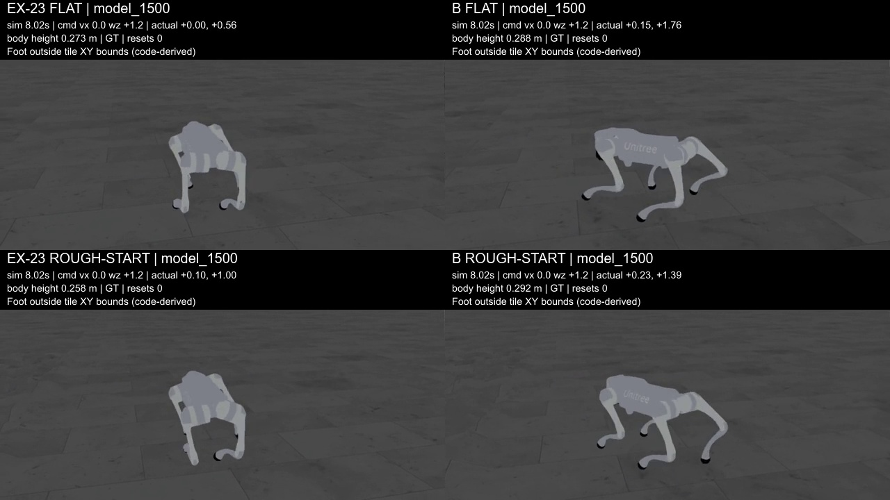
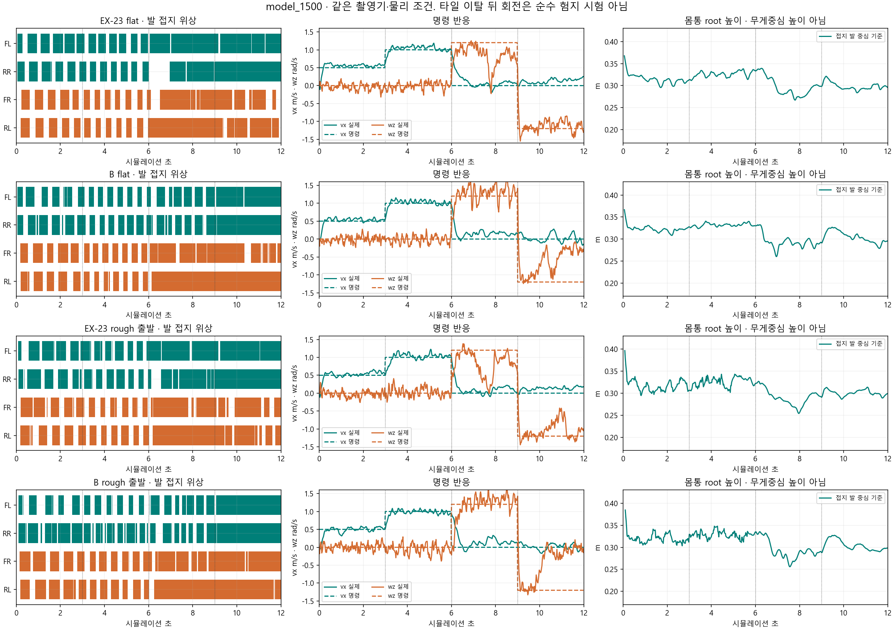
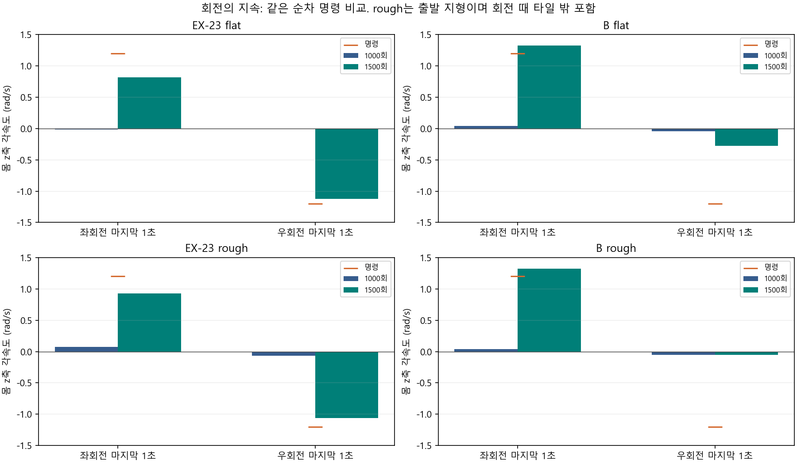
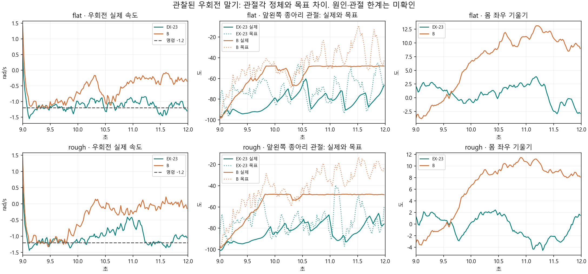
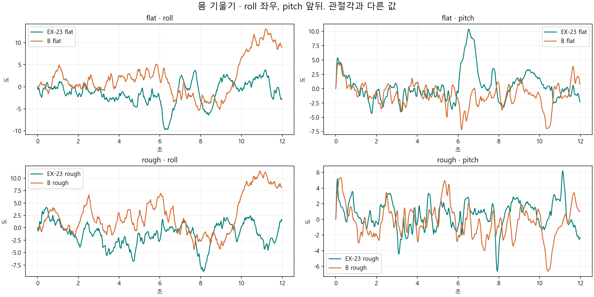
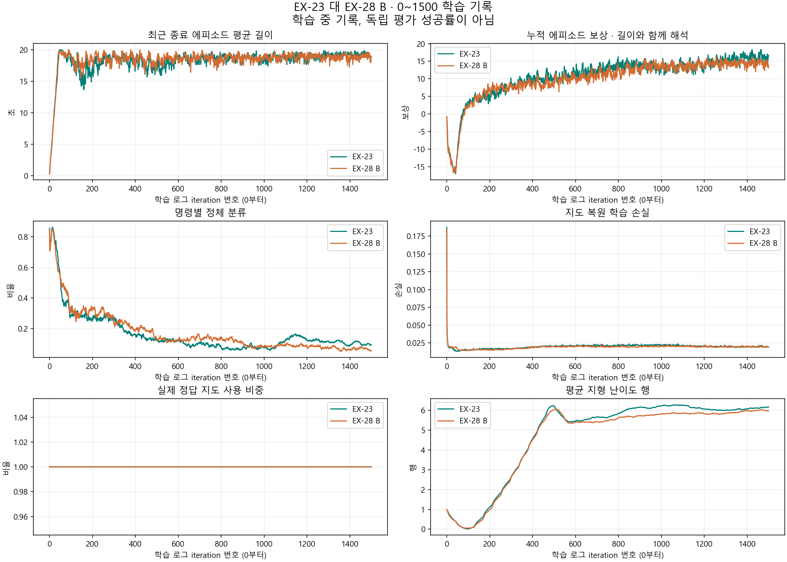
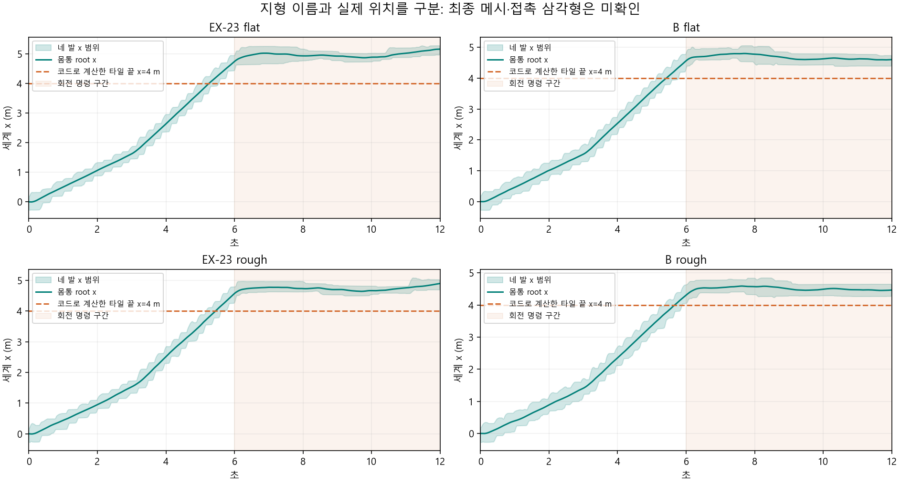

> 분류: 실험
> 작성: 오흥재 (lead_tmp 직접 촬영·집계) · 2026-10-24
> 근거: EX-23·EX-28 model_1500 보호 촬영 원본 · TensorBoard · 실제 소비 코드 · ASTRA24i 독립 재계산
> 요지: 두 판 모두 전진 보행을 배웠고 B의 좌회전은 늦게 개선됐다. 우회전은 EX-23이 낫다. 마찰 고정이 보행의 필수 조건이라는 전제는 지지되지 않는다.
> 상태: 1501갱신 완료·최종 저장·촬영·CPU 분석 확인됨 · 다음 학습은 미결정 · EX-29 재개 보류
> 판: v1.0

# EX-28 B 1500번 · EX-23 같은 회차 최종 비교

`확인됨` 표기는 아래 원자료·영상·코드 대조 범위에 한정한다. 원인과 범위 밖 성능은 `미확인`으로 남긴다.

**EX-28(B)은 마찰을 무작위화한 상태로도 몸을 세우고 대각으로 발을 교대하며 전진했다. 1000번에서 약했던 좌회전도 1500번에서는 유지됐다. 반면 우회전은 뒤로 갈수록 느려지고, 같은 1500번의 EX-23이 더 잘 유지한다.** 어느 판이 모든 동작에서 우수하다고 고를 결과는 아니다.

이번에 달라진 이해는 두 가지다. **마찰을 고정해야만 보행을 배운다는 전제는 버려야 한다. 또 1000번의 회전 정체를 영구 실패로 볼 수 없다.** 그러나 마찰이 전혀 무관하다거나 계속 학습하면 모든 문제가 해결된다는 결론도 근거가 없다. 넓은 마찰 이외의 DR(물리 조건 무작위화)과 행동 지연까지 한 번에 최대로 복원할 근거는 이 실험에 없다.

## 1. 같은 1500번 영상부터 보기

- [비교 영상 1배속](https://github.com/foothold-project/foothold-lab/releases/download/research-ex28-1500-20261024/ex23-b1500-comparison-1x.mp4) · [0.5배속](https://github.com/foothold-project/foothold-lab/releases/download/research-ex28-1500-20261024/ex23-b1500-comparison-05x.mp4).
- 왼쪽 EX-23, 오른쪽 EX-28 B. 위는 flat, 아래는 rough 출발. 모두 같은 `model_1500`이다.
- 로컬: `C:/Users/AI-WS01/s2_lab/run_20261024/b1500_matched_review/comparison_1x.mp4` · 같은 폴더 `comparison_05x.mp4`.
- [원자료 묶음](https://github.com/foothold-project/foothold-lab/releases/download/research-ex28-1500-20261024/ex23-b1500-evidence.zip) · [수치·원본 SHA](figs/ex28-u1500-review/matched_metrics.json) · [영상 SHA](figs/ex28-u1500-review/video_manifest.json).

0~3초는 전진 0.5 m/s, 3~6초는 전진 1.0 m/s, 6~9초는 좌회전 +1.2 rad/s, 9~12초는 우회전 −1.2 rad/s다. 각 명령은 앞 명령에 이어진다. 회전마다 새 자세로 리셋한 독립 시험이 아니다. **아래 화면의 회전은 거친 타일을 벗어난 뒤다. 순수 험지 회전이라고 부르지 않는다.** 이 제한은 HUD에도 넣었다.

## 2. 무엇이 같고 무엇이 다른가

| 항목 | EX-23 | EX-28 B |
|---|---|---|
| 학습 마찰 | 정지 0.8 · 동마찰 0.6 고정 | 각각 U(0.2,1.2), 64 bucket, 동마찰≤정지마찰 보정 |
| 학습 시작 | scratch, seed42 | scratch, seed42. EX-23을 이어받지 않음 |
| 경험량 | 3072환경 × 24step × 1501갱신 | 동일, 110,665,728 env-step |
| actor가 실제 쓰는 지도 | force_gt=True, 정답 지도 | 동일 |
| 추정기 | learned | 동일 |
| 다른 물리 조건 | COM·구동 이득·모터 세기 추가 DR 없음, 행동 지연 0, 질량 추가 −1~3 kg은 유지 | 동일 |
| 명령 | START 전진·제자리 회전, 횡 0, 후진 없음 | 동일 |
| 촬영 | 같은 recorder, seed42, mean 추론, fixed 평가 물리, GT 600/600 | 동일 |

마찰 이외 설정을 맞춘 **한 시드의 과거 학습 대조**다. 동일 시드 번호가 모든 난수 소비와 학습 경로를 같게 만들지는 않는다. 이번 결과는 강한 가설의 반례를 보지만 마찰 효과 크기의 일반적 추정은 아니다. 평가 마찰은 두 판 모두 0.8/0.6이다. 따라서 낮은 마찰 전체에서의 강건성을 확인했다고 하지 않는다. 설정 근거는 [조건 감사](ANALYSIS-experiment-failures-1024.md)와 고정 코드 `d9517fb9`의 `s2_23f_b_cfg.py:9~20`이다.

## 3. 전진 · 높이 · 발 교대

평균은 각 명령 마지막 2초의 100개 제어행이다. **독립 100회 시험이 아니다.** 0.5 m/s 구간은 타일 내부이고, 1.0 m/s 구간은 경계 통과를 포함한다.

| 자료 | 0.5 명령 실제 속도(m/s) | 그때 높이(m) | 1.0 명령 실제 속도(m/s) | 그때 높이(m) | 대각 접지 / 두 발 접지 · 1.0 구간 |
|---|---:|---:|---:|---:|---:|
| EX-23 flat | 0.560 | 0.310 | 1.054 | 0.327 | 62/66 · 전체 62/100 |
| EX-28 flat | 0.541 | 0.321 | 1.024 | 0.332 | 62/66 · 전체 62/100 |
| EX-23 rough 출발 | 0.547 | 0.315 | 1.037 | 0.328 | 55/63 · 전체 55/100 |
| EX-28 rough 출발 | 0.509 | 0.319 | 0.991 | 0.329 | 54/56 · 전체 54/100 |

높이는 **몸통 root z − 접지 중 발 링크 중심 z의 평균**이다. COM 높이나 발바닥 접촉면 기준이 아니며 발 반지름을 더하지 않았다. 대각 접지는 FL(앞왼쪽)+RR(뒤오른쪽), 또는 FR(앞오른쪽)+RL(뒤왼쪽) 두 발만 접지한 상태다. 비율은 보행 전체 합격률이 아니다. 네 발 서기·대각 교대·앞뒤 쌍의 답을 아는 입력으로 집계 함수를 먼저 확인했다.

전진의 위상과 4.00~4.88초의 0.08초 프레임 띠를 함께 보면, 두 판 모두 대각 쌍이 반복 교대한다. 관찰한 구간에서 EX-11식 지속 포복이나 EX-15식 앞뒤 쌍 도약이 이어지는 모습은 확인되지 않았다. 단, 1500번의 대각 두 발 비율이 모든 구간에서 1000번보다 커진 것은 아니다. 높이·속도 상승을 「모든 지표 개선」으로 바꾸지 않는다.

프레임 띠: [EX-23 flat](figs/ex28-u1500-review/ex-23_flat_stride.jpg) · [B flat](figs/ex28-u1500-review/b_flat_stride.jpg) · [EX-23 rough 출발](figs/ex28-u1500-review/ex-23_rough_stride.jpg) · [B rough 출발](figs/ex28-u1500-review/b_rough_stride.jpg).

## 4. 좌회전은 B, 우회전은 EX-23이 더 잘 유지한다

처음 1초와 마지막 1초를 나눠 본다. 목표는 좌 +1.2, 우 −1.2 rad/s다.

| 자료 | 좌회전 처음 1초 → 마지막 1초 | 우회전 처음 1초 → 마지막 1초 | 마지막 2초 네 발 접지율 · 좌/우 |
|---|---:|---:|---:|
| EX-23 flat | +0.968 → +0.816 | -1.155 → -1.122 | 90% / 59% |
| EX-28 flat | +1.170 → +1.321 | -0.928 → -0.279 | 57% / 73% |
| EX-23 rough 출발 | +1.024 → +0.928 | -1.129 → -1.062 | 78% / 71% |
| EX-28 rough 출발 | +0.908 → +1.323 | -0.988 → -0.051 | 47% / 94% |

B의 좌회전은 끝까지 이어지지만 전진 방향 속도도 약 0.15~0.16 m/s 남는다. 회전속도만으로 제자리 유지까지 성공했다고 할 수 없다. EX-23의 우회전은 목표에 더 가깝게 유지된다. B는 우회전에 처음 반응한 후 느려진다. **회전 명령을 아예 못 읽는 것과, 반응한 뒤 발을 바꿔 회전을 이어가지 못하는 것은 다르다.** 후자는 이번 관찰에 맞는 행동 설명이며 원인 확정은 아니다.

네 발 접지율이 높다고 무조건 정지는 아니다. EX-23 flat 좌회전은 네 발 접지 90%여도 돈다. 발을 구르거나 비틀거나 미끄러지는 양상은 접촉점의 접선 속도로 더 구별해야 한다. 저장한 발 링크 중심 XY 속력은 접촉점 slip과 같지 않다.

| 자료 | 좌회전 마지막 1초: 1000 → 1500 | 우회전 마지막 1초: 1000 → 1500 |
|---|---:|---:|
| EX-23 flat | -0.015 → +0.816 | -0.011 → -1.122 |
| EX-28 flat | +0.037 → +1.321 | -0.045 → -0.279 |
| EX-23 rough 출발 | +0.078 → +0.928 | -0.068 → -1.062 |
| EX-28 rough 출발 | +0.041 → +1.323 | -0.051 → -0.051 |

1000번에서 끊었다면 이 좌회전 개선을 놓쳤다. 반대로 B rough 출발의 우회전 끝은 거의 그대로다. **더 학습하면 나아질 수 있다는 증거와 모든 문제가 더 학습하면 해결된다는 주장은 다르다.** EX-29의 초반 반복 붕괴에도 그대로 외삽하지 않는다. 입력·지형·물리 조건이 다르기 때문이다.

## 5. 우회전이 약한 구간을 관절·기울기로 좁혔다

11~12초의 앞왼쪽 종아리 관절이다. 목표는 마지막 물리 substep에서 저장한 값이다.

| 자료 | 실제 각도 범위(도) | 목표 각도 범위(도) |
|---|---:|---:|
| EX-23 flat | -90.47 ~ -66.72 | -93.59 ~ -44.88 |
| EX-28 flat | -48.73 ~ -47.91 | -51.69 ~ -9.14 |
| EX-23 rough 출발 | -92.84 ~ -66.03 | -96.93 ~ -39.52 |
| EX-28 rough 출발 | -48.51 ~ -47.90 | -40.80 ~ -13.37 |

**B는 좌우로 기울어지면서 앞왼쪽 종아리 각도가 약 −48도에 머물고, 목표는 더 변한다.** EX-23은 같은 구간에 실제 관절각도 계속 변한다. B의 우회전 후반 정체는 속도 숫자 하나뿐 아니라 접지 유지·관절 응답·몸 기울기에서 함께 보이는 현상이다. 다음 분석의 구체적인 위치를 찾았다는 의미다.

현재 자료에는 실제 hard joint limit과 접촉점 힘 분포가 없다. 관절 한계, 토크 제한, 접촉 배치, 정책이 고른 목표 중 어느 것이 원인인지 **미확인**이다. 마지막 substep 토크만 저장되어 전체 최대 토크·에너지로 해석하지 않는다. 이 패턴만으로 새 자세 보상이나 관절 제한 완화를 정하지 않는다.

[flat 전체 관절각](figs/ex28-u1500-review/joint_angles_flat.png) · [rough 출발 전체 관절각](figs/ex28-u1500-review/joint_angles_rough.png). 관절각의 크고 작음 자체가 좋고 나쁨을 뜻하지 않는다. 교대·추종·접촉·몸 기울기와 함께 본다. 우회전 말기 프레임: [EX-23 flat](figs/ex28-u1500-review/ex-23_flat_right_end.jpg) · [B flat](figs/ex28-u1500-review/b_flat_right_end.jpg) · [EX-23 rough](figs/ex28-u1500-review/ex-23_rough_right_end.jpg) · [B rough](figs/ex28-u1500-review/b_rough_right_end.jpg).

## 6. 학습 곡선도 한 지표만 고르면 결론이 뒤집힌다

아래는 1476~1500의 25개 update 기록 평균이다. 에피소드 이동 평균과 촬영 한 편의 물리량은 분모가 다르다.

| 학습 기록 | EX-23 | EX-28 B |
|---|---:|---:|
| 학습 중 기록된 에피소드 길이(s) | 19.0546 | 18.8892 |
| 누적 에피소드 보상 | 15.8600 | 14.1315 |
| 선속도 추종 보상 항 | 1.1725 | 1.1380 |
| 회전 추종 보상 항 | 0.3651 | 0.3464 |
| 정체 분류 비율 | 0.0987 | 0.0626 |
| 평균 지형 난이도 행 | 6.1620 | 5.9898 |
| TR-Net 학습 손실 | 0.0194 | 0.0194 |
| 실제 GT 선택 비율 | 1.0000 | 1.0000 |

B의 정체 분류 비율은 낮지만 보상·속도 추종·지형 단계는 EX-23보다 낮다. 「움직임 비율이 높아졌으니 전반적으로 우수하다」는 결론은 틀리다. 움직임은 명령 방향으로 아주 조금 움직여도 포함하는 계측 정의이며 성공률이 아니다(`reward_split.py:19~53`).

TR-Net 손실은 비슷하고 두 판 모두 실제 GT를 썼다. **복원망이 오차를 줄이는 것과 정책이 그 복원 지도를 사용해 잘 걷는 것은 별도 문제**다. 이번 두 판으로 복원 지도 적응·AdaSmpl 효과를 판정하지 않는다. 정지·재출발, 후진, 횡이동, 이동 중 회전도 이번 학습·촬영에 없다.

## 7. 촬영 범위와 증거의 한계

| 자료 | 첫 발이 타일 밖인 시각(s) | root가 밖인 시각(s) |
|---|---:|---:|
| EX-23 flat | 4.94 | 5.26 |
| EX-28 flat | 5.12 | 5.44 |
| EX-23 rough 출발 | 5.18 | 5.46 |
| EX-28 rough 출발 | 5.38 | 5.68 |

같은 촬영기로 기존 1000번과 연결하기 위해 순차 명령을 유지했다. 단일 8×8 m 타일, 중심 기준 x·y ±4 m이며 주변 border는 rough 타일 확장이 아니다. 6~12초는 네 발 모두 x>4다. 최종 메시의 실제 접촉 삼각형 ID는 미확인이다. **순수 험지 회전의 다음 자료는 타일 중앙에서 좌·우 명령을 따로 시작하고 발의 위치를 함께 저장해야 한다.** 이 수정은 다음 분석의 유효성을 위한 것으로 새 성능 합격선을 추가하는 것이 아니다.

네 원본 MP4는 각각 300프레임·12초를 끝까지 CPU 해독했다. JSON·NPZ는 각 600제어행, GT 600/600, reset 0이다. 성공본 네 편 모두 수집 중 렌더 전후 상태 불변 검사를 통과했고 내부 render retry는 0이다. B flat 첫 촬영은 검정 화면으로 실패했으며 try01 파일을 보존하고 try02 성공본을 사용했다. 실패 원인은 촬영 결함이고 나쁜 보행을 골라 뺀 것이 아니다.

lead_tmp는 네 overview(0·1·3·4·6·7·9·11초), 전진 4.00~4.88초를 0.08초 간격, 우회전 말기 11.00~11.88초를 0.08초 간격으로 직접 판독했다. 전체 프레임 해독과 모든 프레임의 시각 판독은 구별한다. luna의 전구간 0.08초 보조 판독과 ASTRA24i의 숫자·조건 독립 대조를 참고했다. ASTRA는 주요 평균·분모·조건을 다시 계산했으며 모든 관절·토크 파생 지표의 전수 검증을 주장하지 않았다.

피어슨 상관계수로 서로 다른 실험 몇 개를 하나의 인과 그래프로 묶지 않았다. 체크포인트의 학습 시간과 명령 구간이 동시에 바뀌고, 각 시계열은 자기상관이 있다. 이후 같은 명령·지형 안의 시간 구간을 나누어 탐색할 수 있지만 마찰·보상의 원인 증명으로 쓰지 않는다.

## 8. 이 결과로 다음 설계에서 무엇을 바꾸는가

| 판단 | 지금 권고 | 이번 자료로 아직 못 정하는 것 |
|---|---|---|
| 마찰 원인 지류 | B는 계획한 1500번으로 닫고 본류 설계에 결과를 넘긴다. 마찰 고정을 필수 조건으로 두지 않는다 | 다른 DR과 상호작용, 저마찰 전 범위 강건성 |
| 다음 두 판의 질문 | 과거 실패의 모든 원인 분리보다 START+우리 요구로 전진하는 대조를 우선한다. 두 판은 공통 몸·명령·지형 조건에서 지도 선택 방식 등 핵심 질문을 구분한다 | GT 대 AdaSmpl 짝 또는 DR 노출 대조 중 최종 선택은 팀장과 결정 전 |
| 계보와 기준 | EX-23과 B 둘 다 같은 회차 비교 기준으로 보존한다. B만 유일한 정답 기준으로 올리지 않는다 | 이어받기 또는 scratch의 최종 선택 |
| 복원 입력 | learned 추정기·TR-Net·AdaSmpl 실제 선택 기록, PRED 전용 보행 확인을 본류에서 다룬다 | 이번 GT 촬영은 PRED 보행 증거가 아님 |
| 우리 요구 | 제한된 후진·횡 명령, 정지·재출발·이동 중 회전, 쉬운 지형에서 시작해 성과에 따른 듬성한 지형 노출, DR·지연 확대를 코드 소비까지 표로 고정한다 | 구체 범위·비율·성과 조건을 결과를 보고 임의로 만들지 않음 |
| 중간 분석 | 같은 회차 전진·좌/우 회전·정지/재출발·GT/PRED, 실제 물리값·접촉·관절 목표/실제·지도 오차를 함께 기록한다 | 500·1000이라는 숫자 하나로 영구 실패·완성 판정 불가 |
| 남은 회전 | 타일 중앙에서 좌/우를 각각 시작하는 짧은 진단과 실제 관절 한계·토크·접촉 기록으로 현재 순차 명령의 자세 영향을 가른다 | 지금 영상만으로 보상이나 마찰을 원인 확정하지 않음 |

**기존 목표는 그대로다.** 몸 감각으로 기본 보행을 지키고, 지형을 보고 발을 놓으며, 복원 지도의 오차에도 버티고, 필요한 명령과 어려운 지형으로 넓혀 HiPAN의 하위 정책으로 연결한다. B가 잘 걸었다는 이유로 그 목표를 GT 전진 정책으로 줄이지 않는다. EX-29는 완료229갱신 `model_228`을 보존한 채 재개 보류이며, model_200 분석의 붕괴 원인은 아직 분리되지 않았다. 이번 보고는 새 학습 승인이나 자동 재개 지시가 아니다.

## 9. 실제 완료와 재현 경로

- B 시작: 2026-10-24 06:52:45, GPU0, PID94332. 학습 폴더 이름 시각은 06:52:56이다.
- 완료 상태: 16:41:38 `train_start_status.json`의 done · iter1500, 별도 manifest와 로그의 완료1501갱신. 로그 마지막은 `TRAIN_START_STATUS done`, 누적 110,665,728 step, 표시 학습시간 09:46:50, Traceback 0. 최종 checkpoint SHA를 직접 계산했다. 16:57과 17:20:31 조회에서 해당 PID가 없었다. 별도 OS 종료 코드 파일은 없어 rc0까지 확인했다고 쓰지 않는다. [완료 확인 영수증](figs/ex28-u1500-review/completion_receipt.json).
- 보호 촬영: GPU1에서 B flat → EX-23 flat → B rough → EX-23 rough 순서로 17:00:20~17:05:22. 네 wrapper 종료0·영수증 검증0, 실패 시도는 보존.
- EX-23 checkpoint SHA: `4775fd35a4af9a6109c8b503e0d6f871152856c36223a17fa261a9a2648eafd1`.
- B checkpoint SHA: `cb65ba5641ac7265664a02110c51f9a57b1427ecee74356870fcd462907c43b8`.
- B checkpoint: `C:/mai/wt/foothold-lab/lead-tmp-start-b/logs/rsl_rl/foothold_s2_23f_b/2026-10-24_06-52-56_ex28-b-main/model_1500.pt`.
- 원자료 뿌리: `C:/Users/AI-WS01/s2_lab/run_20261024/`. 네 `ex23_model1500_{flat,rough}_guarded24i` · `b_model1500_{flat,rough}_guarded24i` 폴더의 `review.mp4/json`, `review_feet.npz`, `review.done`.
- 자동 consumer B1500 rough는 별도 이력이다. 이번 최종 표는 보호 촬영본만 사용한다.
- [촬영 실행 코드](capture_b1500_1024.py) · [집계·그림·영상 코드](analyze_b1500_1024.py) · [보고서 생성 코드](report_b1500_1024.py) · [학습 원자료 집계](figs/ex28-u1500-review/training_data.json) · [관절 말기 집계](figs/ex28-u1500-review/right_turn_detail.json).
- 학습·촬영 코드 고정본 `d9517fb9929f23e2bf5c0b51fe46a1b2df20f237`, 보호 recorder SHA `7316a9309b1d0aba8b3ec11f4e2164340f96e885885a6739abdaf4856b9a0dfa`.
- [1000번 중간 보고](RESULT-B1000-1024.md) · [500번·EX-29 200번 보고](RESULT-B500-EX29-200-1024.md) · [실험 계보](../20261021-experiments/EXP-MAP.md) · [실행 원장](RUN-EX28-29-1024.md).

| 판 | 변경 |
|---|---|
| v1.0 · 2026-10-24 | 1500 같은 회차 보호 촬영 비교, 1000 이후 회전 변화, 실제 경계·관절 응답·학습 기록과 다음 설계의 함의 |
