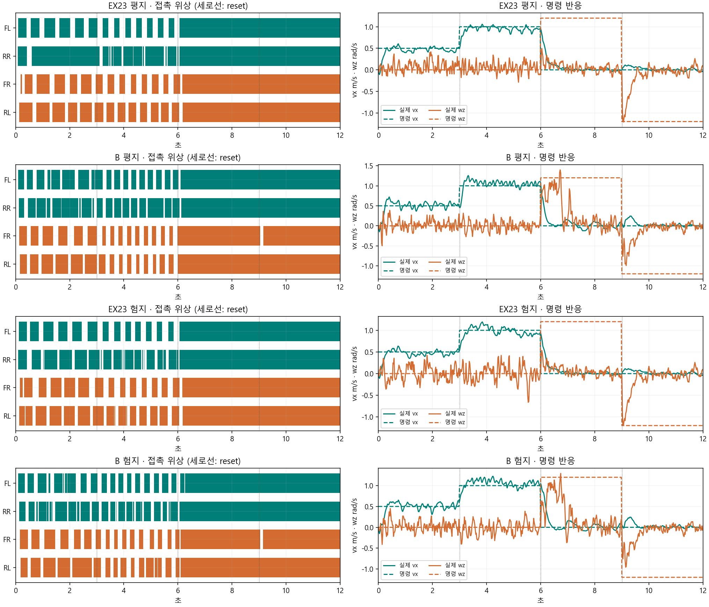
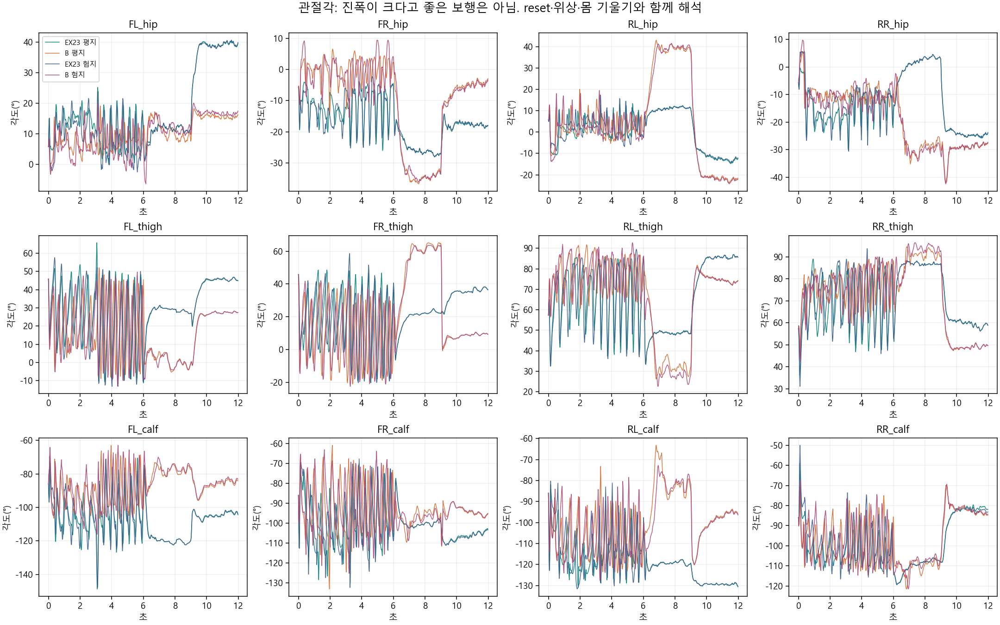
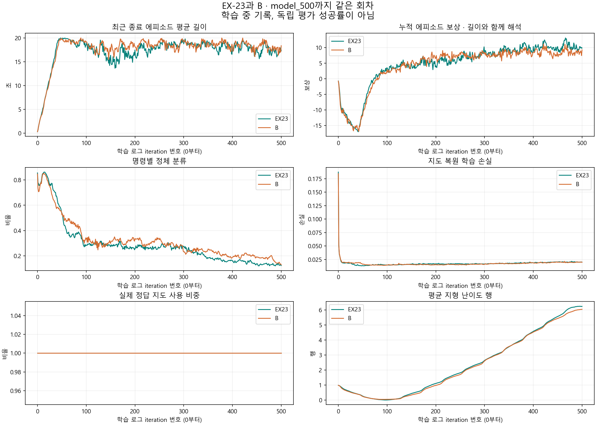
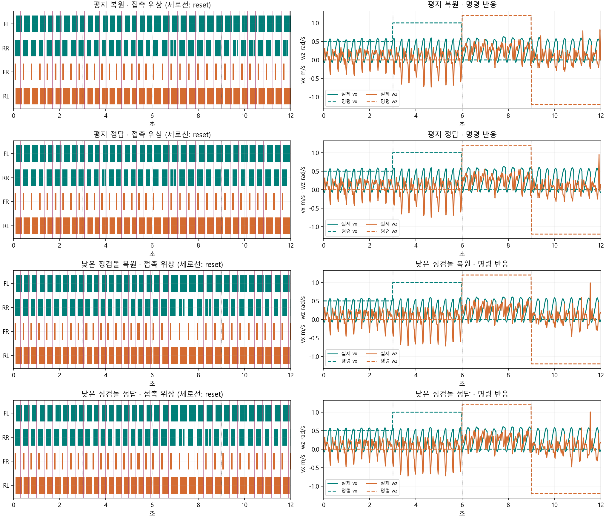
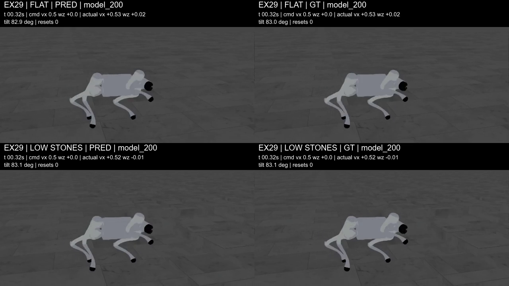
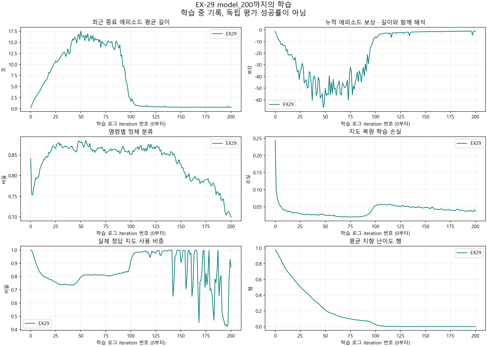
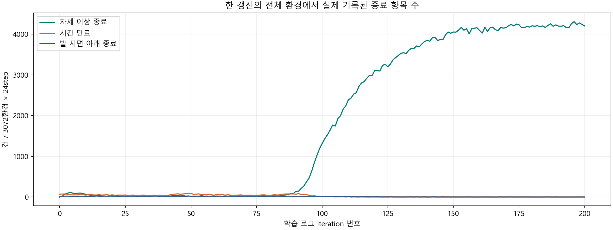
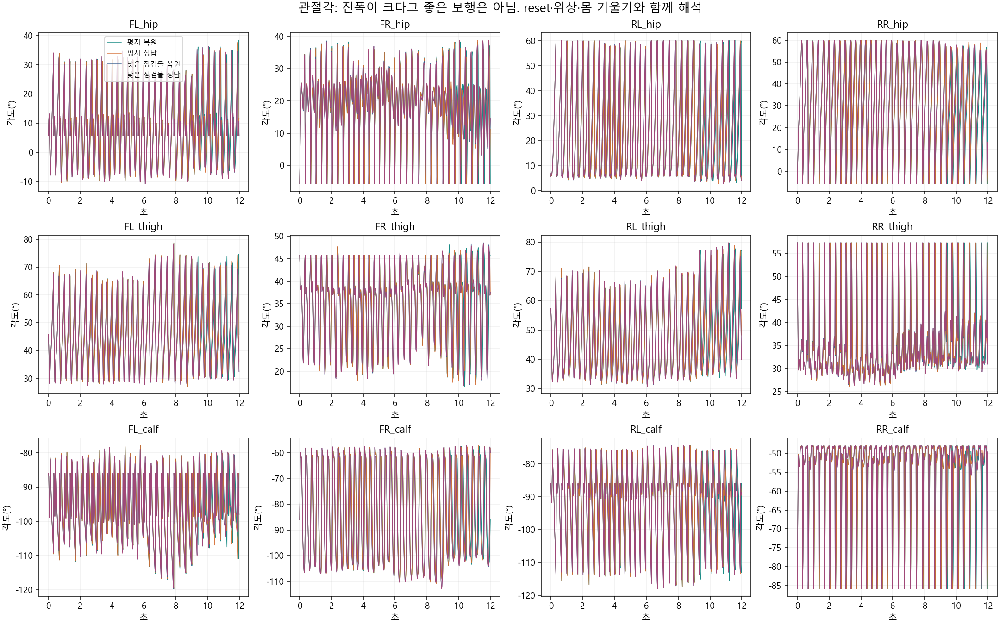
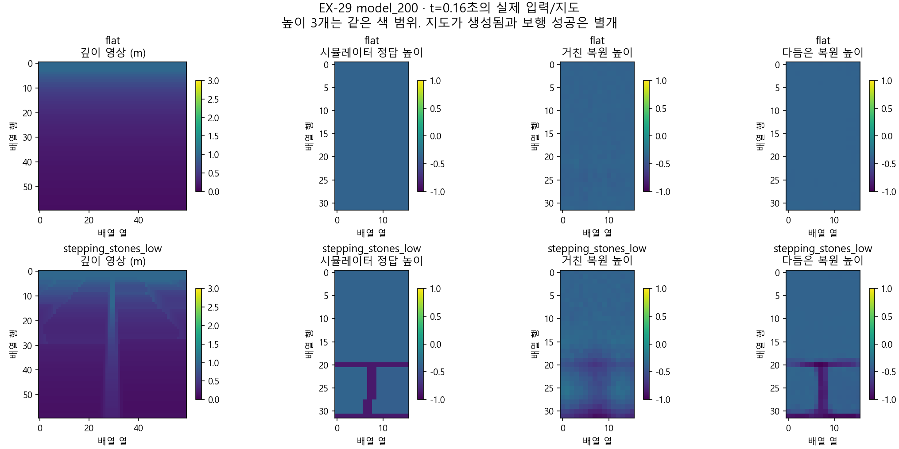

> 분류: 실험
> 작성: 오흥재 (lead_tmp 원자료·영상 대조) · 2026-10-24
> 근거: EX-23/B model_500, EX-29 model_200, d9517fb9 촬영 원자료·영수증, TensorBoard·step_evidence, 팀장 직접 지시
> 요지: B는 500회 고정 평가에서 전진을 유지한다. EX-29는 200회에 큰 기울기 종료를 반복하며 요구 범위도 어긋나 그대로 재개하지 않는다.
> 상태: 확인됨은 아래 관측 범위에 한함. EX-29 재개 보류, B 기존 승인 범위 학습 계속. 최종 수렴·원인 단독 확정은 미확인
> 판: v1.1

# B 500회와 EX-29 200회 종합 판독

## 먼저 볼 것

10/24 후속 질문: [PRED·GT, EX-23의500→1500 변화, 과거 포복·도약 원인 후보](NOTE-posture-causes-1024.md)를 추가했다. EX-29는 짧게 잘린 영상이 아니라12초 안에 종료·초기화를 반복한 것이다. 이전에 잘 걷던 G1은 EX-23 model_1500이며 아래 비교의 EX-23은 model_500이다.

`확인됨`: 아래 값은 원자료와 촬영 영수증을 직접 대조했다. 결정·공유 원장은 [프로젝트 #555 댓글 6378262843](https://github.com/foothold-project/foothold-lab/issues/555#issuecomment-6378262843)다.

**B는 마찰 분포를 넓혀도 이번 고정 조건에서 전진한다. EX-29는 200회에서 지속 보행을 만들지 못했고, 정답 지도로 바꿔도 회복되지 않았다. EX-29를 그대로 더 돌리는 권고는 보류한다.** 200회의 실패를 START 방법 전체의 실패나 장기 회복 불가능으로 확대하지 않는다.

| 자료 | 1배 | 0.5배 | 배치 |
|---|---|---|---|
| EX-23 500 대 B 500 | [비교 영상](figs/ex28-u500-review/comparison_1x.mp4) | [느린 영상](figs/ex28-u500-review/comparison_05x.mp4) | 위 평지·아래 고정 험지, 왼쪽 EX-23·오른쪽 B |
| EX-29 200 지도 선택 비교 | [비교 영상](figs/ex29-u200-review/comparison_1x.mp4) | [느린 영상](figs/ex29-u200-review/comparison_05x.mp4) | 위 평지·아래 낮은 징검돌, 왼쪽 복원·오른쪽 정답 |

로컬 자료 폴더: `C:/mai/wt/foothold-lab/lead_tmp-20261023/inbox/jay/20261023-experiments/figs/`. 영상 위에 명령/실제 vx·wz, 몸 기울기, 누적 재설정 수를 원자료 시각에 맞춰 넣었다. `vx`는 몸 앞쪽 속도(m/s), `wz`는 좌우 회전 속도(rad/s), reset은 종료 뒤 초기 상태로 돌려놓는 것이다. 0.5배 영상의 시간 표시는 원래 시뮬레이션 시간이다.

## 무엇을 같은 조건으로 비교했나

B와 EX-23은 모두 `model_500.pt`, 3072환경×24step, 같은 학습 시드42다. 모델 번호가 0부터여서 완료 갱신은 501회다. 둘 다 정답 지도 강제 사용이고, B만 학습 마찰 분포를 넓혔다. 이번 촬영은 같은 고정 마찰 정적0.8/동적0.6, 나머지 물리 무작위화 해제·행동 지연0, 같은 시드·카메라·평균 행동/잠재값, 12초 연속 명령으로 맞췄다. 깊이 지연은 두 판 모두 checkpoint의 1 tick을 유지했다. 비교 도구가 지형·물리 readback·시드·명령·지도 선택·체크포인트를 대조했다.

EX-29는 `model_200.pt`(201갱신 완료)를 같은 고정 물리 조건에서 평지/낮은 징검돌 level0, 복원지도 전용/정답지도 전용으로 나눴다. 깊이 지연은 이 판 계약대로0이다. 실제 지도 선택을 600개 정책 tick 모두 확인했다. 학습의 AdaSmpl 혼합을 그대로 재생한 영상은 아니다. 지형·보상·명령·DR 등 여러 조건이 B와 달라 **B 대 EX-29 결과 차이를 마찰이나 지도 하나의 효과로 해석할 수 없다.**

각 영상은 전진0.5(0~3초), 전진1.0(3~6초), 좌회전+1.2(6~9초), 우회전−1.2(9~12초)다. 명령이 연속되므로 앞 구간 상태가 뒤 구간에 영향을 준다. 한 시드·한 경로의 짧은 진단이며 독립 성공률 평가가 아니다.

## B 500회: 전진은 유지, 회전은 지속하지 못함

| 촬영 조건 | 전진 명령 0.5 → 실제 m/s | 전진 명령 1.0 → 실제 m/s | 좌회전 명령 +1.2 → 실제 rad/s | 우회전 명령 −1.2 → 실제 rad/s | 재설정 |
|---|---:|---:|---:|---:|---:|
| EX23 평지 | 0.447 | 0.944 | +0.055 | -0.123 | 0 |
| B 평지 | 0.491 | 1.049 | +0.294 | -0.124 | 0 |
| EX23 험지 | 0.449 | 0.977 | +0.061 | -0.123 | 0 |
| B 험지 | 0.477 | 1.057 | +0.259 | -0.122 | 0 |

숫자는 각 3초 전체 평균이다. B의 평지 좌회전 마지막2초는 **+0.075rad/s**, 우회전 마지막2초는 **−0.013rad/s**다. 초기 반응을 포함한 전체 평균보다 더 작다. 회전 구간에서 네 발이 모두 접촉한 시간도 각각96.7%,96.0%다. 즉 B가 처음 잠깐 방향을 틀고 멈추는 현상이며, 회전을 완성했다고 보고하면 틀린다. EX-23도 같은 회차에서는 회전을 지속하지 못한다. [독립 재집계 값](figs/ex28-u500-review/turn_persistence.json).

위상 그림의 색 막대는 발 접촉, 빈칸은 비접촉이다. 앞6초에는 주기적 발 움직임과 전진이 있지만, 뒤6초는 접촉이 거의 연속이다. 오른쪽 뒷발의 지지가 길고 네 발의 주기가 완전히 대칭이라고 할 수 없다. 접촉만으로 발 끌기나 미끄러짐을 단정하지 않는다.

관절각은 앞6초 주기 운동에서 뒤6초 비교적 고정된 자세로 바뀐다. 크거나 일정한 진폭 자체가 좋은 보행의 기준은 아니다. 현재 그림은 12개 관절의 각도이며 보폭 길이의 직접 측정이 아니다. FL/FR/RL/RR은 앞왼/앞오른/뒤왼/뒤오른, hip/thigh/calf는 다리의 세 관절이다.

| 학습 로그 476~500번 평균 | EX-23 | B |
|---|---:|---:|
| 최근 종료 에피소드 길이, 초 | 17.0557 | 17.6736 |
| 누적 에피소드 보상 | 9.8998 | 8.4052 |
| 정체로 분류된 비율 | 0.1295 | 0.1611 |
| 평균 지형 난이도 행 | 6.2005 | 5.9616 |
| 지도 복원 학습 손실 | 0.0204 | 0.0198 |

B의 학습 에피소드 길이는 EX-23과 비슷하다. 정체 분류는 조금 높고 누적 보상·평균 지형 행은 낮지만 이 한 시드·한 시점으로 유의한 우열을 확정하지 않는다. 영상과 수치 모두, 500회까지 전진 자체가 무너졌다는 주장은 지지하지 않는다.

**가설에 대한 판정:** 「다른 EX-23 조건을 유지해도 이 마찰 분포만 넣으면 500회에 전진하지 못한다」는 강한 예상에는 반례가 나왔다. 「마찰은 아무 영향이 없다」, 「모든 미끄러운 바닥에서 성공한다」, 「과거 실패의 원인을 찾았다」는 결론은 아니다. 현재 촬영은 고정 마찰이다. B를 조기에 중단할 실패 근거는 이번 자료에서 찾지 못했다. 기존 상한 안에서 다음 동회차 비교를 유지하되 새 원인 실험을 자동으로 추가하지 않는다.

## EX-29 200회: 지도 선택을 바꿔도 큰 기울기 종료 반복

| EX-29 고정 평가 | 정답 지도 사용 | 12초 재설정 | 실제 종료 항 |
|---|---:|---:|---|
| 평지 복원 | 0/600 | 34 | 큰 기울기 `bad_orientation` |
| 평지 정답 | 600/600 | 34 | 큰 기울기 `bad_orientation` |
| 낮은 징검돌 복원 | 0/600 | 34 | 큰 기울기 `bad_orientation` |
| 낮은 징검돌 정답 | 600/600 | 34 | 큰 기울기 `bad_orientation` |

세로 자주색 선이 reset이다. 막대가 반복된다고 정상 trot의 주기라고 읽으면 안 된다. 여기서는 큰 기울기 종료와 초기 상태 복귀가 거의 같은 간격으로 반복된다. 명령 속도를 높여도 지속적인 전진으로 연결되지 않고, 우회전 명령에서도 평균 회전 부호가 맞지 않는다. reset을 포함한 순간 평균 속도를 이동 거리나 성공률로 쓰지 않는다.

첫 평지 복원 지도 주기의 몸 기울기는0.20초45.75° →0.28초69.81° →0.32초82.89°다. 다음 물리 스텝에서 종료 조건을 넘고0.34초에는 초기 자세로 돌아온다. 촬영은 **현재 프레임·상태 기록 → 물리 스텝 → 종료·즉시 reset** 순서라 바닥에 완전히 누운 후속 장면은 남지 않는다. 몸통의 길이 방향이 수평으로 보이더라도 그 축을 중심으로 구르는 움직임이 있을 수 있다. 2fps만의 착시라고 단정하지 않았으며 첫0.8초는25fps 전 프레임을 확인했다. 카메라는 몸 위치를 따라갈 뿐 roll을 보정하지 않는다. 렌더 각도와 센서 각도의 완전한 정량 일치는 별도로 검증하지 않았다.

[첫0.8초 전체 프레임](figs/ex29-u200-review/flat_pred_first_reset/grid_00.jpg). bad_orientation은 몸 기울기1.5rad(약85.94°) 기준이며 저자세만으로 발동하는 항이 아니다. 근거: 실행본 `foothold_s2/tasks/s1_env_cfg.py`의 해당 termination 설정, `record_sol23f.py:513~558`, 원자료 `termination_terms`.

| EX-29 로그 표시번호 | 50 | 100 | 150 | 200 |
|---|---:|---:|---:|---:|
| 최근 종료 에피소드 평균 길이, 초 | 17.5296 | 1.6766 | 0.3398 | 0.3474 |
| 누적 에피소드 보상 | -50.2350 | -6.1448 | -1.5738 | -1.0555 |
| 로그 선속도 오차 값 | 3.7072 | 0.5266 | 0.0819 | 0.0718 |
| 실제 정답 지도 사용 비율 | 0.7958 | 0.9242 | 0.9048 | 0.8712 |
| 지도 복원 학습 손실 | 0.0255 | 0.0529 | 0.0470 | 0.0373 |

176~200번의25갱신을 직접 합산한 실제 종료 항목은 큰 기울기 **105,172**, 시간 만료 **11**, 발 지면 아래 **5**다. 전체3072환경×24step에서 생긴 사건 수로, 독립 평가105,172판의 실패율이 아니다. 이 창의 최근 종료 에피소드 평균 길이는 약0.356초다. 독립 검토자가 센175~199 창의105,201/10/5와 집계 창이 다르므로 섞지 않는다.

보상이 −50에서 −1로 올랐다는 것만으로 개선이라 해석하면 틀린다. 누적 음수 보상은 에피소드가 짧아지면 덜 쌓일 수 있다. 로그 선속도 오차도 매 스텝 오차를 고정4초에 해당하는200step으로 나눠 누적하므로, 약17step에 끝나는 지금 작은 값이 되는 편향이 있다. 근거: `runners/start_runner.py:247,309~317`, `commands/mixed_command.py:206~211`. TensorBoard의 종료 항 비율은 각 환경의 마지막 플래그 평균이라 여기서는 실제 `step_evidence.jsonl` 사건 수를 따로 셌다.

지도가 달라도 네 곡선이 거의 겹친다. 특히 엉덩이 관절의 큰 움직임이 reset과 반복되는 구간은 건강한 보폭 확장이 아니다. 관절 부호·순서·출력과 몸 기울기의 연결은 다음 원인 점검 대상이지, 이 그림만으로 특정 코드 결함을 확정한 것은 아니다.

깊이 영상과 지도 복원 경로는 실제로 있다. 높이는 몸 기준 상대 높이이며 32×16 배열이다. 미검출은−1, 표시 범위는 높이3개 모두−1~+1m, 깊이는0~3m다. 그림의 계조는 표시용이고 학습 입력을 바꾸지 않았다. t=0.16초 한 장의 유사성은 지도 일반화나 보행 성공의 증거가 아니다. 낮은 징검돌은 출발 발판에서 반복 종료돼 이 영상으로 장애물 통과를 평가할 수 없다.

**해석:** 정답 지도 전용으로 바꿔도 동일하게 반복 종료되므로, 현재 고정 평가의 실패가 복원 지도 오차 하나만 바꾸면 해결된다는 가설은 지지되지 않는다. 학습 때 지도 오차가 정책 형성에 미친 영향까지 배제한 것은 아니다. 마찰·행동 지연·구동기·보상 등 여러 변경이 묶인 판이므로 아직 어느 하나를 원인으로 확정하지 않는다.

## EX-29를 계속할 의미에 대한 판단

**현재 코드를 그대로 장기 재개하는 것은 권하지 않는다.** 이유는200회 실패만이 아니라, 본류 요구와 구현의 차이를 설명·합의하지 않은 채 진행한 점이다.

| 팀장 요구 | 현 EX-29의 실제 구현 | 판정 |
|---|---|---|
| 깊이→TR-Net·추정기·정책·AdaSmpl 동시 학습 | 깊이60×60·10Hz, 학습 중 GT/복원 혼합과 실제 업데이트 기록 있음 | 포함. 아무것도 구현되지 않은 것은 아님 |
| 후진·횡이동 포함 열린 명령 | `start_mode=True`: 전진 또는 제자리 회전, 후진·횡이동0 | 미포함 |
| 기존 연속 지형 기반과 듬성한 지형 연결 | START 듬성한 계열+보조평지로 별도 교체 | 기존 본류 연결이 미완성 |
| 성과를 보고 다음 지형 종류로 | 난이도 행은 이동 수행 기준이나 종류 전환은1000~8000회 기준 | 요구와 다름 |
| 현재 성과에서 DR·지연을 어떻게 복원할지 명시 | DR와 지연을 강한 범위로 처음부터 넣는 별도 scratch판 | 앞서 논의한 단계 복원안과 다름 |
| 깨끗한 회차에서 촬영을 위해 잠시 정지 | 09:55 마감이 남아 model228·완료229에서 종료 | lead_tmp 운영 오류 |

실제 코드 근거: `tasks/s2_23f_topdown_cfg.py:42~79`, `commands/mixed_command.py`, `curriculum/terrain_levels_mixed.py`. model200 전체3072환경은 낮은 징검돌1545·평지1220·gap307이고 모두level0이다. 어려운 종류가 아직0개라는 사실도 보존한다. 처음부터 모든 어려운 지형을 넣어서 망했다는 설명 역시 현재 자료와 맞지 않는다.

이 판은 버릴 데이터가 아니라 공동 학습과 실제 실패를 확인한 개발 실험이다. **사용자가 요구한 하위 보행의 완성판이나 정상적으로 이어지는 본류라고 포장하지 않는다.** 다음 설계는 위 차이를 먼저 명시하고 실제 소비 경로와 실패를 확인한 뒤 팀장과 정한다. 이 보고서는 새 학습·중단·재시작 지시가 아니다. model228 상태는 보존했고200으로 되감지 않았다.

## 자료 범위와 빠진 것

- 새 촬영6편은 B2편·EX-29 4편이며 기존 EX-23 2편을 함께 썼다. 전부12초·25fps·300프레임,600개 정책 tick, MP4/JSON/NPZ 해시와 완전 해독을 확인했다. 2×2 두 영상과0.5배 파생본도300/600프레임을 확인했다.
- 사람이 판독한 범위: 두 비교의0~11.5초를0.5초 간격, B3.00~4.84초를0.08초 간격, EX-29 평지 복원0~0.76초를0.04초 간격. 300프레임을 모두 해독한 것과 모든 프레임을 눈으로 본 것은 구별한다.
- 발 XY 속도는 기록되어 있다. 접촉 힘1N 초과 발 링크 중심의 월드 수평 속도다. reset 전후를 제외했어도 경사면 접선·구르는 접촉점의 실제 미끄러짐 속도와 같지 않다. 낮은 숫자만으로 접지를 잘한다고 판정하지 않는다.
- 관절·발 이름은 동일 자산의 학습 `coordinate_metadata.json`과 촬영 코드의 배열 순서를 대조했다. 촬영 NPZ 자체에는 이름 배열이 없다. 촬영에는 몸의 지면 대비 높이가 따로 저장되지 않아 이번에 숫자로 저자세 개선을 확정하지 않는다.
- 학습 trace는8환경 표본이다. EX-29의 표본8개가 낮은 징검돌·평지 그룹에 있고gap은 포함하지 않는다. 전체3072환경을 대표하는 균형 표본이라고 부르지 않는다. update200 trace는 해당 갱신 전 rollout이며, 갱신 뒤 model200 평가와 다른 자료다.
- 학습·평가 모두 한 시드다. 최종 좋은 과정이 나온 뒤 시드 재현한다는 기존 원칙을 유지한다. 200회 이후 장기 회복, 저마찰 평가 전범위, 미경험 지형 일반화는 미확인이다.

## 원자료와 재현 경로

| 자료 | 위치/해시 |
|---|---|
| EX-23 model500 | `343bb15665abf76a2e58b96d274b74d8703f84c779b2667028bee8a39d93511e` |
| B model500 | `fa7d1b765c0d54b42b8fad563c1492d0f204bae1969eb94345c6e81b6038b6a3` |
| EX-29 model200 | `5977e6519d3d588a05822d9cba23f592139529fabb2bf357b485fb7fa0d3687b` |
| 보존한 EX-29 model228 | `763fb80a116472b03951d40beec9b26a64c2c4ed71bce61836fc433ce7d86d72` |
| 실행 코드 | `C:/mai/wt/foothold-lab/lead-tmp-start-b/`, `d9517fb9929f23e2bf5c0b51fe46a1b2df20f237` |
| B 학습 | 위 코드의 `logs/rsl_rl/foothold_s2_23f_b/2026-10-24_06-52-56_ex28-b-main/` |
| EX-29 학습 | 위 코드의 `logs/rsl_rl/foothold_s2_23f_topdown/2026-10-24_08-20-33_ex29-td-main/` |
| EX-23 학습 | `C:/Users/AI-WS01/orca/workspaces/foothold-lab/sonnet-code/logs/rsl_rl/foothold_s2_x23/2026-10-22_21-52-26_ex23-g1/` |
| B rough | `C:/Users/AI-WS01/s2_lab/run_20261024/consumer/captures/f42e9a8963c89047e21452c3fabea68e8f3617c6d196df8a896e81c3cf6d3136/review.*` |
| B flat/EX-23 | 같은 실행 뿌리의 `b_model500_flat/`, `ex23_model500_flat/`, `ex23_model500_rough/` |
| EX-29 촬영 | 같은 실행 뿌리의 `ex29_model200_{flat,stepping_stones_low}_{pred,gt}/review.*` |

[B 캡처 자동 집계](figs/ex28-u500-review/capture_metrics.json) · [B 학습 추출](figs/ex28-u500-review/training_data.json) · [B 영상 출처](figs/ex28-u500-review/video_manifest.json) · [EX-29 캡처 집계](figs/ex29-u200-review/capture_metrics.json) · [EX-29 학습 추출](figs/ex29-u200-review/training_data.json) · [EX-29 영상 출처](figs/ex29-u200-review/video_manifest.json).

CPU 재현 도구는 이 폴더의 `analyze_review_1024.py`(원자료 집계·그림), `video_review_grids_1024.py`(프레임), `build_review_artifacts_1024.py`(영수증 확인·비교/HUD), 기존 `foothold_s2/eval/compare_ex23_b500.py`(동등 조건 검사)다. 실행 중 학습 코드와 원자료는 고치지 않았다. 숫자는 NPZ/로그 추출이며 판정은 영상과 코드 대조에 근거한다. 원문 실험 흐름은 [실험 지도](../20261021-experiments/EXP-MAP.md), 현 운영 상태는 [실행 기록](RUN-EX28-29-1024.md)에 연결한다.

## 이력

| 판 | 날짜 | 변경 |
|---|---|---|
| v1.0 | 2026-10-24 | B500·EX29 200 촬영, 실제 지도 선택·위상·관절·학습 곡선, 범위 어긋남과 재개 보류 판독 |
