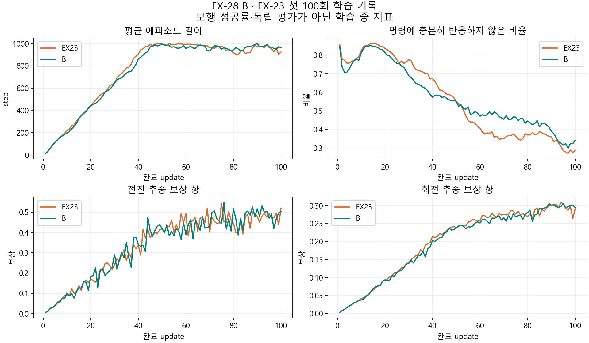

> 분류: 실험
> 작성: 오흥재 (lead_tmp 직접 확인) · 2026-10-24
> 근거: 팀장 이 창 직접 지시 · 최초 ea664f1e · 수정 5bb3fde9 · 본판 d9517fb9 · 아래 실제 실행 로그
> 요지: EX-28 B와 EX-29 START-TD의 기동, 발견한 결함, 재시도와 기록 계획을 보존한다.
> 상태: B 학습·500회 분석 진행, EX-29 229갱신 저장 종료·재개 보류. 200회 영상 분석 먼저

# EX-28·29 실제 실행 기록

## 10/24 10시 최신 지시 · EX-29 재개 보류

[완료한 영상·위상·관절·학습 곡선 분석](RESULT-B500-EX29-200-1024.md): B500은 전진 유지·회전 미달, EX-29 200은 네 촬영 조건 모두 큰 기울기 종료34회/12초.

팀장은 B model_500과 EX-29 model_200의 영상·위상·관절·학습 곡선을 먼저 보고, EX-29를 계속할 의미부터 다시 검토하라고 직접 지시했다. 따라서 아래의 촬영 뒤 자동 재개 문구는 이전 계획이다. **EX-29는 model_228·완료229갱신을 보존한 채 재개 보류**다. 200은 분석용 저장본이며 재개 지점을 되감지 않는다. B 학습은 기존 승인 범위에서 계속하고, GPU1에서는 승인된 촬영을 한 편씩 진행한다.

후진·횡이동, 연속 지형과 듬성한 지형의 연결, 성과를 근거로 한 지형 종류 전환은 팀장 요구지만 현 EX-29에 모두 구현되지 않았다. START 구성요소가 있다는 이유로 요구 전체가 반영됐다고 보지 않는다. 09:55 시각 마감을 유지해 229갱신에서 멈춘 것은, 팀장의 가까운 50/100회 경계 요청을 실행에 반영하지 못한 lead_tmp 운영 오류다. 다음 계획은 분석 뒤 논의하며 이번 문서 변경으로 새 학습을 승인하지 않는다.

## 현재 실행 범위

표기: `확인됨`은 아래 로그·원자료를 직접 읽은 결과, 시간 환산은 `추측`, 장기 수렴과 아직 하지 않은 비교는 `미측정`이다.

**최신 직접 결정:** 팀장이 이 창에서 「본류 시작, 촬영 때 저장 후 재개」를 선택했다. EX-29를 GPU1·3072환경·총1001갱신(model_1000까지)으로 08:20:21 기동했다. 첫 구간은09:55 갱신 경계 저장 종료, B500 비교 촬영 뒤 저장한 지점부터 이어간다. 후속 요청은 촬영 전에 본류 회차를 먼저 보고하고 가까운50/100회 경계를 고려하는 것이다. 현재 기동 argv에는 stop-file이 없어 회차 종료를 나중에 지정할 수 없다. 이번 구간은09:55까지 보존하고, 다음 구간부터 총 목표 회차를 지정한다. 자세한 근거는 아래08시 절과 [sol 확인](REPORT-sol-24f.md).

**06:46 결정 이력:** 당시에는 B만 본 학습, TD는 소형 실측까지였고 위 직접 선택으로 TD 범위가 확대됐다. pipeline이 Linux 이전 준비를 맡는다. Claude 재개 안내는 오늘20시경으로 환산되지만 실제 한도 해제와 설치 시작은 미확정이다. 기존22:30은 B 실행기에 넣은 협조적 저장 상한이며 강제 종료나 OS 설치 승인이 아니다.

실행 코드 자리: `C:/mai/wt/foothold-lab/lead-tmp-start-b`. 원래 고정본 ea664f1e의 소스 292개 SHA를 06:27 직접 대조했다. 실행 기록은 `C:/Users/AI-WS01/s2_lab/run_20261024/`에 보존한다. 프로세스 감독기는 `run_process_1024.py`이며 종료 권한 없이 자식 PID·시각·종료값·하트비트만 기록한다. 알려진 입력의 출력 `known-output`과 종료값 7을 실제 확인했다.

## 첫 실제 점검

| 판 | 시각·장치·PID | 직접 확인 결과 |
|---|---|---|
| B smoke10 | 06:28:20 시작, GPU0, child115428 | 초기 모델·실제 material·첫 rollout 생성. 첫 지각망 갱신 Transformer FFN에서 774 MiB 추가 할당 OOM. 06:29:10 rc1 자연 종료 |
| TD smoke10 | 06:29:22 시작, GPU1, child25244 | agent cfg 생성 중 `S2X23PPORunnerCfg.perception` class attribute 접근 실패. 06:29:37 rc1 자연 종료 |

근거: 각 `b_smoke10/`·`td_smoke10/`의 `process.json`·`run.log`. TD 상세 예외는 실행 코드 자리의 `train_start_status.json`에 남았다. 이를 실행 폴더에 따로 복사해 보존한다. B는 Hydra가 예외를 SystemExit로 바꿔 run 상태가 starting에 남으므로 프로세스 종료값과 로그를 함께 읽어야 한다. state만으로 학습 중이라 판단하지 않는다.

B 기본 cfg에는 microbatch256이 남았지만, 성공한 EX-23 실제 agent.yaml은64다. 총 환경3072·rollout24·유효 minibatch·optimizer 갱신 수를 유지한 채 메모리 계산 조각을64로 복원한다. TD는 실제 configclass가 dict class attribute를 지우는 경로를 반영한다. CPU 모의 cfg 통과가 실제 Kit cfg 생성을 대신하지 못한 사례다. 이 두 실패에서 보행·마찰·START 효과에 관한 결론은 없다.

## 수정 후 확인과 실제 본판

| 판 | 실측 시각·결과 | 범위 |
|---|---|---|
| B 점검2 | 06:43:13~06:47:53, rc0,10 update | 메모리 조각64, 실제 cfg 및 체크포인트 저장 성공 |
| TD 점검2 | 06:43:52~06:48:37, rc0,10 update | 실제 cfg·환경·공동 학습 갱신. 장기 수렴 검증 아님 |
| B 본판 | 06:52:45 시작, GPU0, PID94332, 감독 PID104192 | 06:54 첫 update 완료·실제 학습 원자료 shard 확인. 최대1501 update, 끝 번호1500 |

기동 수정은 `5bb3fde9`, 원학습 기록 연결은 `d9517fb9`다. `4ee32203`은 SHA 목록만 먼저 커밋된 이력이고 코드 수정 봉인으로 사용하지 않는다. 실제 설치 configclass·RSL cfg CPU 확인, trace10개 및 pre/post reset·raw depth·RNG 불변 입력 검사를 수행했다. 본판 원자료 `training_trace/update_000000.npz`를 직접 열어 24 step×8환경의 발 XYZ/XY속도·raw depth·정규화 두 프레임·GT/refined·reward 배열, 실제 GT 비율1.0, 해시 일치를 확인했다. 새 보행 성공 판정은 아직 없다.

본판 폴더: `C:/mai/wt/foothold-lab/lead-tmp-start-b/logs/rsl_rl/foothold_s2_23f_b/2026-10-24_06-52-56_ex28-b-main/`. 기동·프로세스 기록: `C:/Users/AI-WS01/s2_lab/run_20261024/b_main/`. TD 점검 폴더는 같은 코드 자리의 `logs/rsl_rl/foothold_s2_23f_topdown/` 아래 smoke10_attempt2다.

초기 점검의 안정 구간 약24초/update를 그대로 유지하면 B1501회 약10시간, TD1000회 약6시간40분이다. 준비·기록·촬영·온도와 후반 부하를 포함한 ETA는 아직 잠정이다. B 첫 update는28.12초였다. B 종료는 오늘17~18시를 계획 범위로 두고100회에서 다시 계산한다. TD1000회를 자동 시작하지 않는다.

## 기록 구분과 추가 계획

- 매 update: 종료 사유, 보상 성분, 속도 추종, episode 길이, 손실·KL, 실제 GT 선택 비율, 접촉 중 발 XY 속력·적분 길이·시간 등 가벼운 수치.
- 실제 학습 표본: 고정 표본8환경을 지형 열별로 분산해 첫25 update와 이후100 update 간격마다25 update를 보존한다. 24 step×25 update×0.02 s =12 s. raw meter depth·실제 지각 depth2·rough/refined·GT·실제 선택·몸 pose·발 XYZ/속도/접촉·관절·명령·지형 열/레벨·reset·종료/timeout·reward를 함께 저장한다. 첫 shard를 열어 확인했고 07:21에는 첫25회 창이 누락 없이 complete인 manifest와 NPZ50개(조건·단계 각각25개)를 확인했다. 100회 다음 창은 아직 미확인이다.
- 재생 평가: 고정 checkpoint를 별도 실행해 500/1000/1500 및 시간 경계의 촬영 요청을 소비한다. 200회 간격 영상은 아직 자동 연결되지 않았으며 100회 수치 기록과 구별한다. 현재 GPU1에서 한 번에 하나, 여유 VRAM 6000 MiB 이상일 때만 촬영한다. 둘째 학습을 기동하면 촬영 자원 배정을 다시 확인한다.
- 모델 checkpoint는 기존50회 저장을 유지한다. 학습 당시 표본은 전체3072환경의 전수 이력이 아니며 선택한 환경 밖의 장면은 복구할 수 없다.

좌표·단위·깊이 전처리 의미는 `training_trace/coordinate_metadata.json`, 표본 선택과 NPZ 해시는 `training_trace/manifest.json`에 남는다. raw depth의 inf는 미검출이고 정규화 입력을 역변환한 원본으로 속이지 않는다. 각 표본 update 시작의 카메라 내부/장착값·질량·COM·구동기·지연은 별도 conditions NPZ로 저장한다. reset마다 바뀐 값을 전수 저장하는 것은 아니다.

발 XY는 발 강체 중심의 월드 수평 속도다. 경사면 접선·구르는 접촉점을 보정한 실제 접촉점 미끄러짐과 같다고 부르지 않는다. 복원 지도는 몸 주변32×16 국소 높이 지도이며 SLAM 전역 누적 지도가 아니다. 깊이 카메라는 ray casting 기반60×60·10Hz이며 실제 D435i의 모든 광학 결함을 재현했다는 뜻은 아니다.

## 로컬·클라우드 계획

먼저 로컬의 실제 update시간·수집/학습 시간·VRAM·기록 오버헤드를 잰다. Linux 공식 다중 GPU 지원과 현재 전용 실행기의 분산 금지는 별개다. 현 실행기는 한 GPU당 한 실험이다. 두 GPU로 한 학습을 돌리는 판은 동기화·전체 batch·재개 계약을 확인한 뒤 별도로 준비한다.

팀장 정보: Runpod 저장소를 이미 사용 중이고 S3 API로 AI-NAS01에 백업한다. pipeline의 NAS 읽기 실측 보고로 정시 백업은 03/09/18시 KST다. root는 NAS 원자료를 독립 조회하지 않았다. 보고상 10/24 06:50 복사 중이나 마지막 COPY_VERIFIED는 9/21이고 최신 실험 복원은 미확인이다. 예약 생존과 최신 자료 보존을 같다고 하지 않는다. 기존 저장소·백업을 재사용하는 계획이며 새 Pod를 결제하거나 생성하지 않았다.

pipeline 의뢰 범위에는 VLC·Flameshot 설치와 실제 사용 확인, Windows 예약/배경 작업·세션/브랜치/미커밋·백업·서비스·GPU/Isaac/NCCL·마운트·재개/복구 및 인계가 들어간다. 지금은 조사와 문서이며 OS 설치·삭제·설정 변경·기존 프로세스 종료는 하지 않는다. 시스템 인계는 super, 실험 코드·checkpoint·평가와 미확인은 lead에게 나눠 전달한다. 실험이 성공해야만 이전할 수 있다는 조건은 만들지 않는다.

관련 정본: [실험 계획](PLAN-B-START-TOPDOWN-1023.md) · [이전 준비 기록](READINESS-B-START-1023.md) · [실험 지도](../20261021-experiments/EXP-MAP.md).

## 중간 촬영과 감시 확인

첫 촬영 점검은 sparse checkout에 `sim/eval` 지형 정의가 없어 종료1이었다. 같은 커밋에 추적된 평가 정의를 복원했으며 기존 학습 코드 바이트와 HEAD는 바꾸지 않았다. 두 번째는 07:07:09~07:08:19 종료0, `capture_probe2/probe.done`의 MP4·JSON·NPZ 세 해시, 300프레임·12초와 전체 해독을 직접 확인했다. 이는 별도 smoke model_9의 촬영 경로 확인이며 본판 보행 판정이 아니다.

sol 소비기 `c6563524`를 문서 worktree `9c3b180a`로 받고 pytest17개를 직접 통과시켰다. unittest discover0개는 통과 근거로 쓰지 않는다. B 학습 GPU0·촬영 GPU1을 분리했다. `--once`는 07:04 연결 확인 뒤 정상 종료한 것이고 상시 실행이 아니다. 상시 소비기는 07:12 별도 감독 PID120164로 기동했다. 상태는 `C:/Users/AI-WS01/s2_lab/run_20261024/consumer/consumer_status.json`에 남긴다.

기존 mai_resume send의 W24B-0705가 이 창에 실제 도착했음을 root가 확인했다. 경계별 깨우기는 sol의 `bea29146`을 문서 worktree `0d051613`으로 받아 CPU 시험 14개를 직접 통과시킨 뒤 07:25:42 기동했다. 감독 PID114920, watcher PID87124이며 `watch_sol24c_b/state.json`의 신선한 관측·실제 B 실행 이름·완료 51회·불일치 없음까지 확인했다. 이 51회는 50회 간격으로 갱신되는 manifest 기준이며 실시간 로그의 회차보다 늦다. 100/200/500/1000/1500회와 종료를 이 창에 알리고, 22:30 뒤에는 새 알림을 보내지 않는다. 100회 경계 알림은07:33에 이 창에 실제 도착했으며 아래 중간 확인으로 이어졌다. 전송이 불확실하면 중복 재발송하지 않고 상태 파일에 남긴다. 학습 중단이나 재실행 권한은 없다.

표본 8환경은 지형 열 ID를 분산한 것으로 7종 균형 표집을 뜻하지 않는다.

## 07시 추가 논의

B의 1501회는 상한이다. 조기 중단은 같은 회차 EX-23의 영상·위상·몸 높이·명령 추종·회복 추세를 함께 보고 판단하며 결론을 그 회차까지로 제한한다. 같은 횟수에 뒤지는 것과 끝내 학습할 수 없는 것은 다르다. 본류 1000회 병행은 중간 촬영 메모리까지 확보해야 한다. START 3072와 HiPAN 상위 1024·하위 teacher 4096은 병렬 환경 수로 정책 연결 규격이 아니다. 본류 4096 소형 비교는 아래 실제 측정으로 판단한다.

연산 근거는 [ASTRA24a](REPORT-astra-24a-compute-recording.md), 시스템 인계는 [pipeline 이전 준비](https://github.com/vfxpedia/mai-os/blob/2980d0bd20b905ba851c797472d767a8cc09e060/os/linux-readiness-20261024.md)에 있다.

## 본류 환경 수 처리량 비교

팀장의 4096 소형 시험 제안에 따라 GPU1에서 같은 `d9517fb9` 코드·기록 조건으로 3072환경10회 → 4096환경10회를 순서대로 측정했다. 3072는 07:18:12~07:22:58, 4096은 07:22:58~07:29:35에 각각 종료0이었다. 각 실행은 별도 `td_perf3072_10`·`td_perf4096_10` 폴더이며 장기1000회 본판은 아니다. `measure_perf_1024.py`는 감독기별 종료값과 1초 간격 nvidia-smi 표본을 보존하고 프로세스를 종료하지 않는다. print known-1·known-2 두 입력을 순서대로 실행해 로그와 종료0을 먼저 확인했다. 측정 폴더는 `C:/Users/AI-WS01/s2_lab/run_20261024/td_perf_compare/`다.

실제 params의 rollout24, PPO epoch5·minibatch4·학습률0.001, 지각 계산 조각64, 지도 reconstruction·force_gt=False를 두 판에서 직접 대조했다. 각 판 0~9회 중 초기 0~2회를 제외한 3~9회의 중앙값이다. GPU0에서는 같은 B 학습이 계속 돌았다.

| 병렬 환경 | 회당 시간 | 초당 환경 step | 수집 / 학습 시간 중앙값 | GPU1 사용량 표본 최대 | 여유 표본 최소 |
|---|---:|---:|---:|---:|---:|
| 3072 | 24.31 s | 3032.8 | 4.982 / 19.296 s | 14507 MiB | 1473 MiB |
| 4096 | 35.32 s | 2783.2 | 7.373 / 28.400 s | 15467 MiB | 513 MiB |

환경 step은 `환경 수 × 24 / 회당 시간`이다. 수집·학습은 각각의 중앙값이므로 둘의 합이 회당 중앙값과 정확히 같지는 않다. 메모리는 프로세스 단독 PyTorch 할당량이 아니라 해당 GPU 전체 사용량의 1초 표본이며, 표본 사이 더 높은 순간값을 배제하지 못한다. 표본 수는 각각264·365개다.

**권고: 현 Windows 실행은 3072 유지.** 4096도 10회는 OOM 없이 끝났지만 처리량은 약8.2% 낮고 메모리 여유가 약0.5 GiB까지 줄었다. 같은 경험량에 걸리는 시간은 이 속도 유지 시 약9.0% 늘어난다. 1000회 산술은3072 약6시간45분, 4096 약9시간49분으로 준비·평가·후반 부하는 제외했다. 이는 짧은 단일 순서 시험이며, 장기 안정성·보행 성과·Linux 성능은 미측정이다. 현재 한계의 원인이 메모리 압박인지 커널 효율인지까지 분리하지 않았다.

4096은 회당 경험량이33.3% 많다. 따라서3072의1000회와4096의750회는 환경 step 수만 같으며, optimizer 갱신 수나 회차 기준 커리큘럼 진행은 같지 않다. 4096을 채택한다면 이 차이를 기록해야 한다. [START II-D1](https://arxiv.org/html/2512.13153v1#S2.SS4)은3072와 RTX A6000 사용을 밝히지만3072를 선택한 이유는 적지 않았다. 저자 선택 이유를 우리 장비 시험으로 역추정하지 않는다. HiPAN 연결을 위해 반드시4096으로 맞출 이유도 없다.

문서 확인: exp_sync_check 51확인·누락 0·종료 0. review_inbox의 필수 검사는 통과. 같은 검사기의 em dash 표시는 실제로 가운뎃점 `·`을 세는 88·187행 오류이며, 이 문서의 U+2014는 직접 0개로 확인했다. 검사기 수정은 이번 범위가 아니다.

## B 첫100회 중간 확인 · 2026-10-24 07:41 KST

**계속 학습한다. 첫100회 수치에서 B가 EX-23보다 크게 무너졌다는 근거는 없고, 보행 자세의 성패는 아직 판정하지 않는다.** SOL24c의 `update_100` 알림이 이 창에 실제 도착했다. manifest 완료101은 `model_100.pt` 번호가0부터 붙기 때문이며, 아래 대조는 양쪽 모두0~99번의 첫100 update로 고정했다. 두 판 모두3072환경×24step·seed42, 경험량은7,372,800환경 step이다.

| 마지막 10회 평균 | EX-23 | B |
|---|---:|---:|
| 에피소드 길이(step) | 953.817 | 968.136 |
| 전진 추종 보상 | 0.479 | 0.486 |
| 회전 추종 보상 | 0.295 | 0.298 |
| 정체 분류 비율(%) | 30.021 | 33.243 |
| 직전 종료 원인 중 자세 기준 지표(%) | 5.589 | 3.910 |
| 평균 지형 단계 | 0.016 | 0.056 |
| 정답 지도 선택 비율(%) | 100.000 | 100.000 |

표는 `check_ex28_100.py`가 원 TensorBoard에서 자동 추출한 마지막10회(90~99번) 평균이다. 같은 시드의 과거 대조이며 독립 평가나 통계적 일반화 검증은 아니다. 전진·회전 보상은 이 구간에서 비슷하다. B의 정체 분류 비율이 조금 높지만 초기보다 줄고 있어 이 값 하나로 실패 판정을 하지 않는다. 두 판 모두 평균 지형 단계가 초반의 가장 쉬운 구간에 가깝다. 험지 극복을 확인한 결과가 아니다.

그림을 직접 열어 축·범례·한글 표시와 두 곡선의 대응을 확인했다. 에피소드가 길다는 것은 오래 버틴다는 뜻이며 trot나 명령 추종 합격을 뜻하지 않는다. 정체 분류는 `reward_split.py`의 기존 정의대로 전진 명령에서 몸 선속도 지수평균0.05m/s 미만, 제자리 회전 명령에서 부호를 맞춘 회전 추종 비율0.1 미만인 env-step이다. 정지 명령은 따로 분류한다. 자세 종료 지표는 `TerminationManager.reset()`의 환경별 직전 에피소드 종료 표식을 평균한 학습 로그이며 독립 평가 낙상률이 아니다.

**실제 소비와 원자료:** 두 판의 첫100회 GT 선택 비율은 모두1이다. B의 실제 로봇 material 배열을 직접 읽고 해시를 대조했다. 정적 마찰 범위는0.216203~1.181125, 동적은0.216203~1.103655이고 전 shape에서 동적≤정적이었다. 바닥 material의 PhysX 재조회는 미확인으로 남는다. 첫100회의 기록된 손실은 모두 유한값이고, `completed_100.json` 자동 산출물도 존재한다. 소비기의 `metrics_published=[]`는 이번 scan에 새로 쓴 파일이 없다는 뜻이며 이미 발행한100회 결과의 부재가 아니다.

**몸·발·깊이:** 별도 `update_000100.npz`는101번째 rollout의8환경×0.48초 표본이다. 접촉한 발 강체 중심 평균 대비 몸 높이는0.181m, 네 발 접촉 비율은78.1%, 96.4%, 89.6%, 79.2%(FL·FR·RL·RR)다. 몸이 낮고 발 접촉이 길다는 관찰이지만 지면 clearance와 같지 않고, 짧은8환경 표본으로 trot·끌기·포복을 분류하지 않는다. 이 시점의 비교 영상·프레임 판독·완결된12초 위상 분석은 미실시다. 정규화된 depth는 유한값, raw depth의 미검출 비율은0.00260%이며 미검출 inf를 오류로 바꾸지 않는다. 발 XY 속도 기록은 생성 중이며 실제 접촉점 미끄러짐과 구별한다.

**시간과 다음:** 실제 update 종료 시각 차이의 후반 평균은23.60초다. 같은 속도가 유지된다는 가정에서 model_500은10:10, model_1000은13:27, model_1500은16:43 KST다. 촬영·후반 부하·중단을 포함한 확정 시각은 아니다. 다음200회 수치 알림과500회 영상·위상·관절·몸 자세·명령 반응 비교를 유지한다. GPU0는 B 학습, GPU1은07:29:35 소형 시험 종료 뒤 본류 장기 실행 결정과 B 상세 촬영을 위해 비어 있다. 본류1000회를 새로 시작하지 않았다.

원자료와 재현: [100회 추출 JSON](figs/ex28-checks/check_100.json), [추출 코드](check_ex28_100.py). 원 이벤트 경로는 JSON에 있다. 실행 중 이벤트 파일 전체를 동결했다고 주장하지 않고,0~99번 추출값을 이 JSON에 보존했다. material SHA256 `17c207ef3666ae0652ed188e9589bf190f7adf036dab11c6502235c85fe7e018`, trace100 SHA256 `1a7ffeb351104d2c3c3fdeeda33fe4e9a621cb7d610bcc4a2fc78c4ff579536b`. 자동 snapshot은 `C:/Users/AI-WS01/s2_lab/run_20261024/consumer/metrics/B/completed_100.json`이다. 원자료·학습 파일은 수정하지 않았다.

## 08시 본류 준비와 500회 비교 촬영

**해석:** B가 같은 회차에 정상 보행을 얻는다면, 현재의 나머지 조건에서 마찰 분포 변경만으로 이전 실패를 재현한다는 가설은 지지받지 못한다. 과거 실패가 없었다거나 DR 전체가 무관하다는 결론은 아니다. 다른 무작위화·행동 지연·학습 조건과의 상호작용은 별개다. 반대로 B가 뒤처져도 해당 회차·단일 시드의 차이와 끝내 학습할 수 없다는 주장은 구별한다. 0.181m는 8환경·0.48초의 발 강체 중심 기준 표본이고 포복 판정이 아니다.

팀장은 500회(100회 시점 ETA 10:10)에 B와 EX-23의 같은 model 번호·조건 영상을 나란히 보기를 요청했다. EX-23 `model_500.pt`의 SHA는 `343bb15665abf76a2e58b96d274b74d8703f84c779b2667028bee8a39d93511e`다. 과거 파일의 느슨한 done 표식에 의존하지 않고, 현재 고정 촬영기에서 이 체크포인트를 flat·rough로 다시 촬영했다. 경로는 `C:/Users/AI-WS01/s2_lab/run_20261024/ex23_model500_flat/`와 `ex23_model500_rough/`의 `review.mp4`, `review.json`, `review_feet.npz`, `review.done`이다. 새 촬영은 08:00:49~08:03:11에 순서대로 종료0이었다.

두 영수증을 별도 검증기로 되읽어 세 파일 SHA·300프레임·25fps·12초를 확인했다. 두 판 모두 checkpoint의 GT 선택을 600/600 정책 틱에서 유지했고 latent/action mean·depth 지연1틱·고정 물리·seed42를 기록했다. 같은 촬영기로 B를 찍어야 한다. 평지 프레임 띠를 root가 직접 열어 로봇과 명령 구간의 가시성을 확인했다. 아직 B500은 없어 실제 비교·보행 판정은 하지 않았다. 완료 번호500은 첫 회차0을 포함한501갱신이다. 10:10은 체크포인트 도착의 추정이고 촬영·분석 완료 시각은 그 뒤다.

비교 도구는 [luna 보고](REPORT-luna-24d.md)와 `foothold_s2/eval/compare_ex23_b500.py`다. 초기 도구가 EX-23 정책과 B 평가환경을 같은 식별자로 취급해 실제 JSON을 거절한 것을 수정했다. 두 정책 모두 B 평가환경을 사용하되 정책은 label·checkpoint SHA로 구분한다. root도 새 EX-23 실제 두 입력 검사와 알려진 입력/불일치 CPU 시험3개를 통과시켰다. 위쪽 flat·아래 rough, 왼쪽 EX-23·오른쪽 B로 합친다. B rough는 기존 소비기, flat은 `b_model500_flat_ready.json`으로 준비했고 아직 실행하지 않았다. 두 녹화는 한 번에 하나씩 하며 소비기의 진행 중 자식과 겹치지 않는다.

### 본류 10회와 이어받기

[sol 읽기 검토](REPORT-sol-24d.md)는 수정 뒤 두 환경 수의 10회 완주·손실·저장을 대조했다. root는 추가로 3072환경의 `model_9.pt`를 실제 Kit에서 이어받아 총12회, 즉10·11번 두 갱신만 실행했다. 08:04:05~08:05:35 종료0, 최종 `model_11.pt` SHA `65cac20c941dd357f9dece87bf8b952bc728616544fac9220ba5558aa11571f5`가 상태 파일과 일치했다. manifest 완료12, force_gt=false·reconstruction·learned·seed42·3072환경이 유지되었다. 이는 소형 이어받기 확인이며 장기1001회, 마감 직후 실제 재개, 장기 수렴 검증은 아니다.

부모는 `td_perf3072_10` 실행의 `model_9.pt` SHA `8402732d077b4bd26d00761e3f83cd439fd6e06cf433ad4cd975783e9b87f9d8`다. 재개 폴더는 코드 자리 `logs/rsl_rl/foothold_s2_23f_topdown/2026-10-24_07-18-24_ex29-td-perf3072_10_resume_20261024_080417_117896/`이고 감독 기록은 `run_20261024/td_resume2/`다. 학습 상태를 이어받지만 새 시뮬의 자세·진행 중 에피소드·활성 GRU 이력은 초기화된다. 따라서 같은 물리 궤적이나 중단 영향0으로 쓰지 않는다.

### 두 학습 중 촬영의 메모리

팀장은 이전에 양쪽 학습 중에도 한 편씩 촬영했다고 정정했다. 그 사실을 부정하거나 이번에는 원천 불가라고 일반화하지 않는다. [과거/현재 도구 대조](REPORT-sol-24e.md)상 두 도구 모두 1환경·1타일·960×540이며 과거 동시 학습의 VRAM 원자료는 미확인이다. 현재 원자료는 다음과 같다. 수치는 장치 전체의1초 표본이며 프로세스별 정확한 할당·표본 사이 피크를 보장하지 않는다.

| 측정 | GPU1 사용량 최소~최대(MiB) | 차이(MiB) | 해석 |
|---|---:|---:|---|
| EX-23 model500 flat 기본 촬영 | 2507~8807 | 6300 | 현재 촬영 경로 |
| 같은 rough 기본 촬영 | 2521~8730 | 6209 | 현재 촬영 경로 |
| flat 화면640×360·performance preset | 2472~7961 | 5489 | 영상 처리만 바꾼 별도 소형 시험 |

B 학습 GPU0의 여유는 관측 시 약3680MiB, TD3072 10회 중 GPU1 최소 여유는1473MiB였다. 낮춘 촬영도 이 여유를 넘으므로 현재 둘과 겹쳐도 안전하다고 확인하지 못했다. 이 합산은 동시 실행 실패를 실제 재현한 결과가 아니다. 학습 중에 OOM을 유발해 시험하지 않았다.

저메모리 촬영 시험은 08:10:07~08:11:28 종료0이다. 실행 중 고정 소스는 그대로 두고 [별도 wrapper](record_rgb_performance_1024.py)에서 RGB 출력 크기와 설치 IsaacLab의 performance preset만 바꿨다. 원 촬영과 NPZ의 command·map_use_gt·depth·GT·vx·wz·관절각·발XY·done 배열이 같은 모양과 값임을 root가 직접 대조했다. 이는 이 한 체크포인트·지형의 결과이며 모든 장면의 동등성 증명은 아니다. `ex23_rgb_performance_measure/`에 GPU 표본, `ex23_model500_rgb_performance/`에 결과를 보존했다. 공식500회 비교 입력은 원래960×540을 유지한다.

초안 `run_20261024/td_main_segment1_draft.json`을 보존하고, 직접 선택 뒤 별도 `td_main_segment1.json`을 사용했다. 감독 PID117160·학습 PID130816, GPU1,08:20:21 시작이다. 실제 run은 코드 자리의 `logs/rsl_rl/foothold_s2_23f_topdown/2026-10-24_08-20-33_ex29-td-main/`이다. 08:30:33 직접 읽은 run.log는 iteration22, 즉23갱신까지 출력했고 최근10회는23.83~25.16초였다. B는 같은 시각 iteration244, 즉245갱신이었다. 두 로그 Traceback은0이었다. 이는 초기 실행 확인이며 완주·보행 성공은 아니다. manifest는 저장 시점에 갱신되므로 로그의 실시간 진행보다 뒤일 수 있다.

TD 실제 manifest는3072환경·24step·seed42·learned·force_gt=false·reconstruction·추가 depth 지연0을 기록한다. 깊이 센서는 실제 env.yaml에서도60×60·0.1초 주기의 RayCasterCamera이고, 신경망은 두 깊이 프레임을 받는다. [카메라와 Linux DDP 검토](NOTE-camera-ddp-linux-1024.md)에 근거·미확인·이전 후 시험 순서를 분리했다. Windows3072 유지, Linux 단일3072/4096 재측정, 이후 분산1536×2/2048×2/3072×2 검토는 구분한다.

**촬영 전후 운영:**09:40 사전 알림으로 B 도착 예상·TD 실제 회차·저장 상태를 먼저 팀장에게 보고한다. 현 속도 유지 가정에서 TD200번은09:42 전후,09:55에는230회 안팎이지만 확정 회차가 아니다. 현재 프로세스의 deadline은 기동 때 고정됐고 stop-file은None이다. 숫자를 맞추려고 코드·프로세스를 조작하거나 model200으로 되돌아가 최근 학습을 버리지 않는다.09:55 뒤 `stopped_saved`·checkpoint SHA·자식 종료0을 확인한 다음 B500 rough/flat을 한 번에 한 편씩 촬영한다. EX-23 같은 번호의 flat/rough는 이미 준비됐다. 촬영 영수증·실제 파일과 GPU 반환을 확인하고 마지막 저장 체크포인트에서 재개한다. 재개 때 optimizer·지각망·AdaSmpl·난수·커리큘럼·회차를 대조하고 물리 에피소드 초기화는 기록한다. 재개 뒤 첫 갱신을 확인하기 전에는 「재개 완료」라고 쓰지 않는다.

**깨우기 보완:** 기존 B100 알림은 실제 도착했지만200은 `sender_exit_1`·uncertain이었다. 원인 미확인으로 두고 중복 발송하지 않았다. 별도 PIPELINE24c `W24C-0829` 시험 문장은 이 세션의 실제 user 입력으로 도착해 회신했다.09:40 알림은 독립 CPU 프로세스PID86928,만료09:50,상태 파일 `C:/mai/wt/mai-os/pipeline/_tmp/pipeline24c-wake/reminder-0940-state.json`의waiting·heartbeat를08:35 직접 확인했다.대상 세션 incarnation을 고정하며 접수·불확실 상태를 자동 재전송하지 않는다. 알려진 입력2시험을 root도 재실행해 통과했다.미래09:40 실제 도착은 아직 미확인이다. 코드·보고서는 mai-os의`c5d2e60c6026725e96c5660c48a21093ef095595`와`os/pipeline24c-wake-20261024.md`에 있다. 기존 실행 중 watcher와 학습 소스는 수정하지 않았다.

같은 검증된 한시 송신기로09:56 저장 상태 확인(PID132484,만료10:05)과10:15 B500 촬영 진행 확인(PID69292,만료10:25)을 별도 등록했다. 설정·waiting heartbeat는 `C:/Users/AI-WS01/s2_lab/run_20261024/lead_capture_wakes/0956.json`·`1015.json` 및각`-state.json`에 보존한다. 이 알림은 새 학습 승인이나 자동 판정이 아니라 기존 직접 선택의 후속 점검이다. 미래 도착은 미확인이며 실제 상태·출력과 대조한다.

### 09:40 알림 실제 도착과 촬영 전 회차 확인

`PIPELINE24c W24C-0940` 문장이 이 세션의 user 입력에 실제 도착했다.09:41:53 원 로그·manifest·저장 파일·프로세스를 직접 대조한 값은 다음과 같다. 로그의 iteration 번호는0부터이므로 완료 갱신 수와1차이가 난다.

| 판 | 로그 완료 갱신 수 | 로그 iteration 번호 | 마지막 저장본 | manifest 완료 갱신 수 | 최근 한 회 소요 |
|---|---:|---:|---|---:|---:|
| EX-28 B | 423 | 422 | model_400.pt | 401 | 24.24초 |
| EX-29 START-TD | 197 | 196 | model_150.pt | 151 | 25.26초 |

manifest는 저장 때 갱신돼 뒤처진다. 이를 학습 정지로 읽지 않는다. 감독·자식 네 프로세스가 존재하고 TD 감독 heartbeat는09:42:24에도running이었다. TD 기동 설정은 여전히 `--end-by 2026-10-24T09:55:00+09:00`다. 이때 정상 저장·종료가 실제 완료됐는지는 아직 미래 점검이며,200이라는 번호를 맞추려고 최신 진행을 버리지 않는다.09:56 알림 상태는waiting·heartbeat09:42:26. B500 도착은 현재 속도 유지 시10:13 전후라는 추정이며 실제 체크포인트·영수증으로 판단한다. 기존200 불확실 알림은 재전송하지 않았다.

본류 iteration191의 학습 로그에서 평균 에피소드 길이17.93step, `Episode_Termination/bad_orientation=1.0`이 관측됐다. 이는 해당 학습 로그 집계에서 자세 종료가 매우 많다는 경고이며 독립 평가 낙상률이나 최종 실패 판정이 아니다. 아직 같은 시점 영상 판독이 없으며 원인을 지형이나DR 하나로 확정하지 않는다. 쉬운 지형 배정이 확인됐다는 사실과 보행에 충분히 쉽다는 판단을 분리한다. 지형 종류별 배정은 [100회 전체 환경 집계](figs/depth-concepts-1024/terrain-check-u100.json), 종류·난이도 두 커리큘럼의 차이와 최종 요구 범위는 [개념 기록](NOTE-start-learning-gt-1023.md)에 정정했다.

### 09:55 정상 저장 종료 확인 · 촬영 대기

09:56 저장 점검 알림`W24-0956`이 이 세션의 user 입력에 실제 도착했다.09:56~09:57에 원자료를 직접 읽었다. **TD는229갱신을 완료하고 `model_228.pt`에 저장,09:55:04 종료 코드0으로 끝났다.** 번호0부터 시작하므로 파일 번호228과 갱신 수229를 구분한다.200번으로 되돌리거나229번째 갱신을 버리지 않았다.

- 체크포인트: `C:/mai/wt/foothold-lab/lead-tmp-start-b/logs/rsl_rl/foothold_s2_23f_topdown/2026-10-24_08-20-33_ex29-td-main/model_228.pt`
- 직접 계산한 SHA256: `763fb80a116472b03951d40beec9b26a64c2c4ed71bce61836fc433ce7d86d72`. `train_start_status.json`과`TRAIN_SOL23F_STATUS stopped_saved` 로그 값에 일치.
- run 상태: `stopped_saved`, reason=`deadline`, iter=228. manifest `completed_updates=229`, `total_env_steps=16883712`.
- 감독 기록: `run_20261024/td_main_segment1/process.json`의`state=exited`, `returncode=0`, 종료09:55:04.624727. PID117160·130816은 프로세스 목록에서 사라졌고 B PID94332는 계속 존재했다.
- CPU 로드 확인: 모델·PPO optimizer·지각망·지각 optimizer·AdaSmpl·환경 난이도/종류·난수 상태 키가 존재한다. `map_location=cpu`, CUDA 초기화False. 이는 읽기·저장 확인이며 촬영 뒤 실제 재개 완료를 뜻하지 않는다.

09:56:33 B는iteration459, 즉460갱신 완료, 마지막 저장은`model_450.pt`였다. 최근 한 회23.30초를 유지하면`model_500` 도착은10:12 전후라는 추정이다. 실제 파일과manifest의 SHA가 맞을 때만 촬영한다. B 학습·감독은running이며 불확실200 알림을 재전송하지 않았다.

GPU 1 조회값은 사용 2508MiB·여유 13472MiB였다. 소비기는 `observing`, `active_capture=null`, pending 0·failed 0·scan_errors 없음이고 500번 촬영은 아직 시작하지 않았다. `last_requested_iteration=1500`은 초기 검토 기준점의 기본값이다. 코드가 500·1000·1500을 별도 목록으로 처리하므로 500번 누락을 뜻하지 않으며 상태를 임의 수정하지 않았다. 10:15 재개 알림의 waiting·heartbeat 09:57:03을 확인했다. 다음은 기존 승인대로 B500 rough 촬영, 겹치지 않게 flat 촬영, 영수증·GPU 반환 확인, TD228 저장본에서 이어받기다. 새 설정·새 실험을 이 알림으로 승인하지 않는다.

## 10/24 정오 직접 지시 · B1000 비교 후 판단

**12시 원자료 분석 취합:** [EX-01~29 조건·실패 분석](ANALYSIS-experiment-failures-1024.md), [기존 요구의 실제 소비 감사](VERIFY-astra-24f-requirements.md). 정지·지속 포복·앞뒤 쌍 도약·EX29 측면 붕괴를 구분한다. B1000 결과와 다음 실험 설계는 아직 미결정이다.

팀장은 식사 전 이 창에서 B가 계속 실행 중임을 확인하고 **model_1000까지 유지한 뒤 EX-23의 같은 회차와 영상을 비교**하라고 했다. 몸 높이·앞뒤 다리 자세·대각 보행 위상·양방향 회전의 지속을 따로 본다. B500만으로 마찰 효과가 없다고 확정하지 않으며, B1000이 회복해도 어느 다른 물리·제어 조건이 원인인지는 아직 미확인이다. EX-29는 model_228·완료229갱신을 보존하고 재개 보류한다. 300/500 추가 실행은 의견을 물은 단계이며 새 기동 지시로 기록하지 않는다.

과거 EX-01~29의 실제 저장 설정·실패 형태·반례를 먼저 대조하고, 기존 설계의 후진·횡이동·성과 기반 지형 전환 등 추가 요구를 현 구현과 비교한 뒤 다음 판을 설계한다. 소스·원자료·실행 중 설정은 바꾸지 않는다. 11:58 B run.log의 누적경험56,991,744는3072×24 기준773갱신이며, 최근23.63초/갱신이 유지될 때 model_1000 저장 예상은 약13:28이다(추정). 1000은 파일 번호이며 처음0번 갱신을 포함해완료1001갱신이다. 기존 watcher의1000 알림과 촬영 소비 경로를 읽어 확인했다. 정확한 도착·촬영 완료는 별도 기록한다.

## 10/24 최신 직접 결정 · B1000 촬영 후1500까지 완료

팀장 직접 답: **「1000회 촬영분석 하고 계속 학습해서 처음 설계 처럼1500까지 학습하고 종료하자.」** B(EX-28)는 model_1000 저장본으로 EX-23 같은 번호와 촬영·비교하고, 학습은 기존 max_iterations=1501을 유지해 model_1500 저장 후 자연 종료한다. 1000은 중간 판독 지점이며 중단 요청이 아니다. 임의 종료·STOP 추가·실행 중 설정 변경은 하지 않는다. EX-29는 model_228·완료229갱신을 보존한 채 재개 보류한다.

근거: [팀장 직접 답 기록](https://github.com/foothold-project/foothold-lab/issues/555#issuecomment-6379481102). 이 답으로 이전1000회 종료 여부 질문은 닫혔다. model_1000은 완료1001갱신, model_1500은 완료1501갱신이다. 최종 저장·해시·자식 종료는 실제 도착 뒤 확인한다. B1000·1500의 성능 결과나 다음 실험 승인은 미리 확정하지 않는다.
