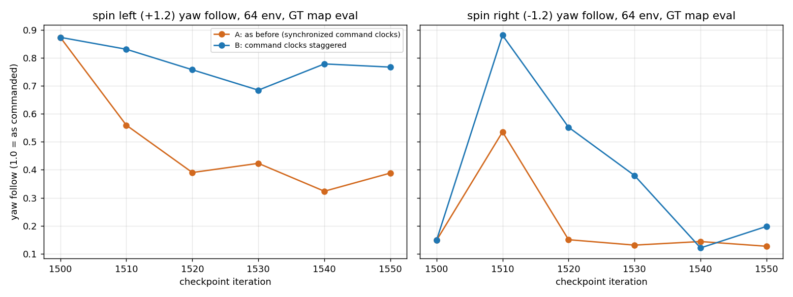
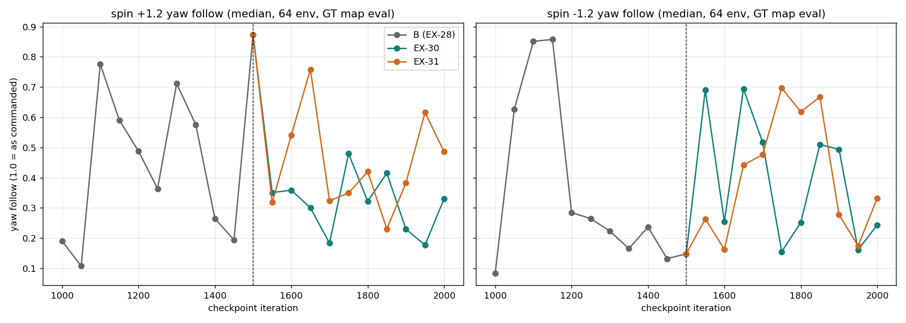
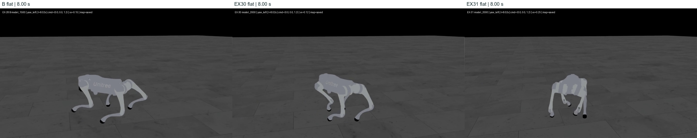
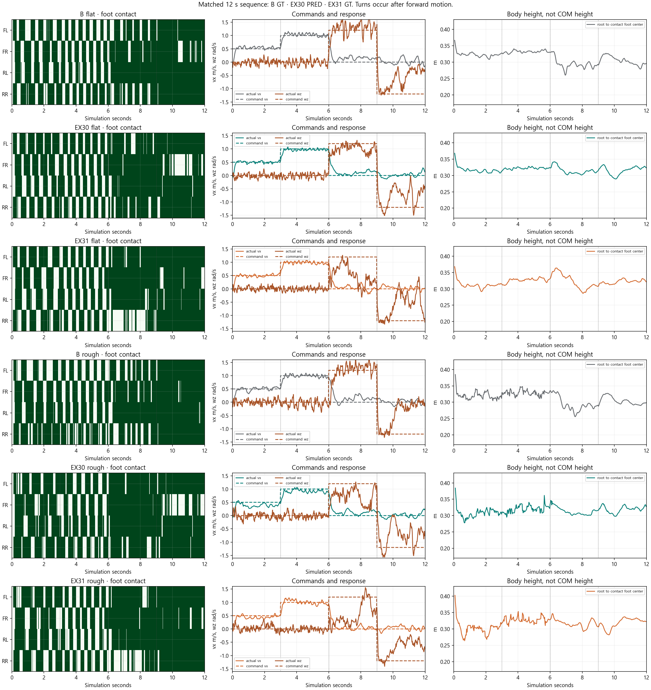
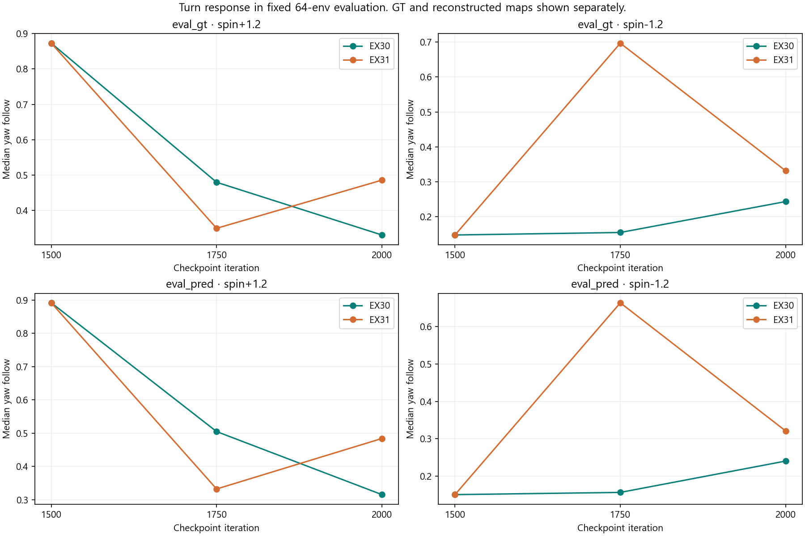
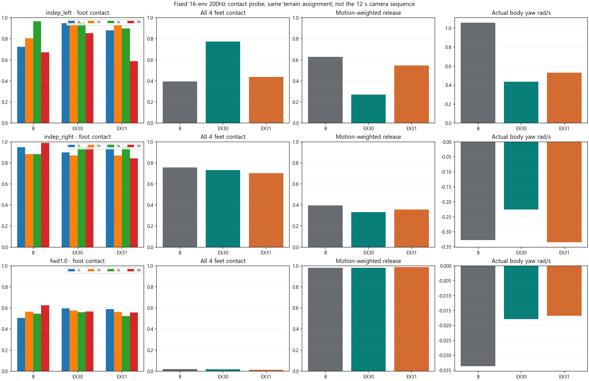
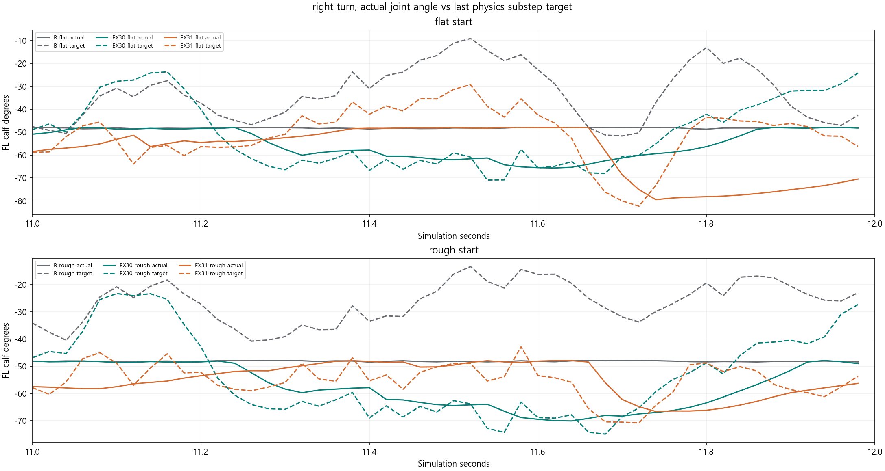
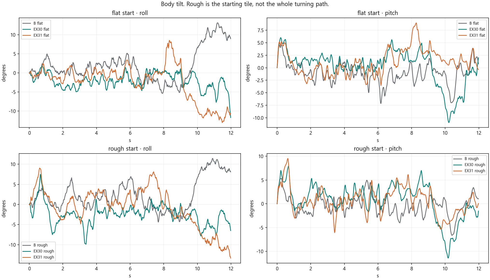
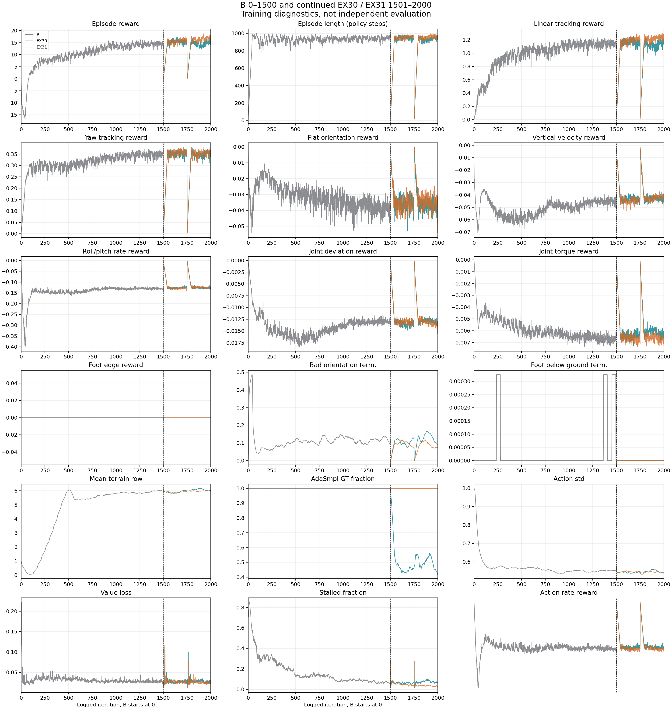

> 분류: 실험
> 작성: 오흥재 (lead 정리 · scripter 그림 · 측정 · analyst 독립 검토 진행 중) · 2026-10-25
> 근거: 그림 세트와 생성 코드 `figs/ex30-31-w2-review/` (REPORT-sol-25c.md · SHA256SUMS.txt) · 접촉 진단 `C:/mai/wt/foothold-lab/impl-t5/logs/sol25b/` · 64 env 평가 `C:/mai/wt/foothold-lab/impl-w2/logs_gate/gate.out` · `C:/mai/wt/foothold-lab/impl-t5/logs/w3p2_branch_20261025_082838/` · 창 2 판정 `impl-w2/logs_gate/window2_decision.json` · 촬영 `C:/Users/AI-WS01/s2_lab/run_20261025/` · 영상 release `research-ex30-31-2000-20261025`
> 요지: (v2.1 정정) 저장본 31 개를 50 회 간격으로 평가하니 **B 자신도 회전 추종이 학습 내내 크게 오르내렸다** (좌 0.11~0.87, 우 0.08~0.86, B1450 좌 0.19 → B1500 0.87). B1500 의 좋은 좌회전은 한 순간 값이었고, EX-30 · 31 은 그 범위 안에서 같이 오르내렸다. 「이어 가기가 좌회전을 망가뜨렸다」 는 해석은 철회. 전진은 내내 안정 (5.2~6.0 m). 회전이 자리 잡지 못하는 것이 문제다.
> 상태: v2.0 · RESULT-B1500-1024 형식으로 다시 씀 · 한 시드 · analyst ASTRA-25b (이어 가기 충실도 · 다음 출발) 대기
> 판: v2.3

# EX-30 · 31 창 1 · 2 (B1500 → 2000) 결과

## 0c. v2.3 (10/25 22시): 회전 여섯 경우를 한 실행에서 (전진 → 좌 추가)

팀장 「전진 -> 좌는 왜 뺐어?」 에 따라 probe 경우 표에 전진 → 좌 (전진 0.5 m/s 4 초 → 좌 +1.2 rad/s 8 초) 를 더했다 (impl-turncases 1f48d2ea · a54be625, reviewer 막음 0). reviewer 고침 1 (짝이 같은 실행 안에 있어야 한다) 을 받아 네 저장본을 여섯 경우 모두 한 실행 (`--cases all`) 으로 다시 쟀다. 16 env · eval_pred · 고정 칸 (해시 7f49a1e9) · 시드 42, 경우마다 reset. 값 = 기록 8 초 동안 살아 있는 step 의 실제 몸 요 평균 (rad/s) / 네 발 동시 접촉 비율 (발 링크 접촉력 > 1 N). 괄호 = 끝까지 산 env 수 (없으면 16/16).

원자료 `C:/mai/wt/foothold-lab/impl-turncases/logs/six_cases/<판>/arrays_<경우>.npz` (rc 0 · TURNPROBE_DONE · Traceback 0, 체크포인트 SHA cb65ba56 · 2a391afa · 6d7cfa08 · 1a1866d5, 코드 a54be625). 표는 스크립트가 원자료에서 만든다 (`figs/six-cases/six_table.py` · `six_md.py` · `six_repro.py`, 재측정 실행기 `run_six_cases.sh`, 재현 쌍 전부 `repro.txt`).

| 경우 | B1500 | 흩기 b50 m1510 | 흩기 b50 m1550 | 안 흩기 a50 m1550 |
|---|---|---|---|---|
| 좌 독립 | +1.01 / 0.40 | +0.95 / 0.39 | +0.87 / 0.38 | +0.41 / 0.63 |
| 우 독립 | −0.25 / 0.80 (15/16) | −0.95 / 0.38 | −0.28 / 0.62 | −0.17 / 0.92 |
| 전진 → 좌 | +0.89 / 0.44 | +0.97 / 0.37 | +0.90 / 0.39 | +0.38 / 0.62 |
| 전진 → 우 | −0.49 / 0.61 | −0.96 / 0.36 | −0.58 / 0.56 | −0.27 / 0.81 |
| 우 → 좌 | +1.04 / 0.46 | +0.91 / 0.42 | +0.84 / 0.42 | +0.35 / 0.74 (15/16) |
| 좌 → 우 | −0.23 / 0.90 | −0.65 / 0.62 | −0.24 / 0.76 | −0.25 / 0.91 |
| min(좌, 우) 독립 요 크기 | 0.25 | 0.95 | 0.28 | 0.17 |

- 명령은 ±1.2 rad/s. 네 발 동시 접촉이 낮을수록 (0.4 안팎) 발을 들며 돌고, 높을수록 (0.8~0.9) 네 발을 딛고 비튼다 (4 절과 같은 정의).
- **전진 → 좌는 문제가 아니다.** 네 판 모두 좌 독립과 0.1 rad/s 안에서 같다 (B1500 +1.01 → +0.89, m1510 +0.95 → +0.97). 좌회전 약점이 「전진 뒤」 에서 생기지 않는다.
- **약한 쪽은 우회전, 그중에서도 좌 → 우 전환이다.** 우회전을 발을 들며 하는 판은 m1510 하나 (우 독립 −0.95 / 0.38, 전진 → 우 −0.96 / 0.36). m1510 도 좌 → 우 전환에서는 −0.65 / 0.62 로 떨어진다 (영상 `s50m1510` 전체 순서 편의 「좌회전 뒤 우회전이 1 초 안에 약해짐」 과 일치). 나머지 셋은 좌 → 우 −0.23~−0.25 / 0.76~0.91 로 비튼다.
- 그래서 회전 판정에 전환 경우 (좌 → 우 · 우 → 좌) 를 넣어야 한다는 verifier 막음 D4 를 실측이 뒷받침한다. 독립 시작만 보면 m1510 을 「양쪽 다 잘 돈다」 로 잘못 읽는다 (R12).

**같은 저장본 재측정 잡음 (계산):** 같은 경우를 다른 실행에서 두 번 잰 24 쌍 (B1500 은 w3p1 16 env 판 `impl-t5/logs/w3p1_b1500_20261025_063715/`, a50 · b50 은 `onset_sweep/probe_*`, 전진 → 좌는 단독 실행 `impl-turncases/logs/fwd_then_left/`) 의 차이 |요| 최소 0.006 · 최대 0.115 · 평균 0.039 rad/s, |네 발 동시 접촉| 최소 0.001 · 최대 0.068 · 평균 0.020. 그래서 같은 조건에서 저장본 사이 요 차이가 0.12 rad/s 이하면 잡음 안이다. 판정 문턱을 정할 때 이 값을 쓴다.

**통계량에 따라 잡음 크기가 다르다 (reviewer ff43ddfb 고침 1, lead 재계산):** 위 표는 16 env **평균**이다. 같은 B1500 을 두 번 잰 (w3p1 대 six_cases) env 별 yaw 추종 비로 보면, 경우별 **중앙값**은 최대 0.23 흔들린다 (전진 → 우 0.435 → 0.203). **평균**은 최대 0.11 (우 → 좌 0.759 → 0.865), **env 하나**는 최대 0.60 다르다. 16 env 의 추종이 「도는 env · 못 도는 env」 로 갈리는 경우가 있어서, 중앙값이 그 경계에서 크게 뛴다. 그래서 (1) 판정은 16 env 평균으로 한다. (2) 문턱은 재측정 폭 (평균 0.11) 보다 크게 둔다. (3) 판을 비교하는 차이가 0.2 안팎이면 같은 저장본을 두 번 재서 폭을 함께 적는다. 원인 (PhysX 비결정 · 장치) 은 미확인.

- 정정 이력: lead 는 21:4x 채팅에서 reviewer 지적을 받아 「이전 표의 B1500 열은 4 env 였다」 고 말했으나 틀렸다. 이전 B1500 열은 w3p1 16 env 판 (같은 지형 해시) 이었고, 다시 재니 위 잡음 안에서 같다.
- 해석 미완: 학습 곡선 (방향별 회전 보상 기록 없음) · 보행 위상 · 영상 판독은 m1510 한 편만. 한 시드.

## 0b. v2.2 (10/25 20시): 이어 가기 직후 급락은 명령 시계 흩기로 막힌다

B1500 에서 EX-31 조건 (정답 지도만, B 설정) 으로 50 회씩, 10 회마다 저장. 두 판 차이는 하나: B 는 이어 가기 시작 때 env 마다 명령 시계 (time_left) 를 U(0, 4 초) 로 다시 뽑는다 (impl-stagger 0873927b, reviewer 막음 0, 학습 로그 `EX31R_COMMAND_CLOCK` A 고유값 1 · B 3072). 64 env 고정 칸 정답 지도 평가, 원자료 `C:/mai/wt/foothold-lab/impl-t5/logs/onset_sweep/{a50,b50}_m15*/map_modes.json`.

| 회차 | A 좌 | B 좌 | A 우 | B 우 | A 전진 m | B 전진 m |
|---|---|---|---|---|---|---|
| 1500 (B1500) | 0.873 | 0.873 | 0.148 | 0.148 | 5.65 | 5.65 |
| 1510 | 0.559 | 0.830 | 0.535 | 0.880 | 5.35 | 5.50 |
| 1520 | 0.390 | 0.757 | 0.150 | 0.552 | 5.49 | 5.40 |
| 1530 | 0.423 | 0.684 | 0.131 | 0.380 | 5.50 | 5.60 |
| 1540 | 0.323 | 0.778 | 0.144 | 0.121 | 5.52 | 5.39 |
| 1550 | 0.388 | 0.767 | 0.127 | 0.198 | 5.63 | 5.78 |

16 env 접촉 진단 (B1500 과 같은 방식, eval_pred, `onset_sweep/probe_{a50,b50}_m1550/`):

| 판 · 명령 | 살아남은 env | 네 발 동시 접촉 | 움직일 때 발 풀림 | 실제 몸 요 rad/s |
|---|---|---|---|---|
| B1500 좌 | 16/16 | 0.394 | 0.629 | +1.057 |
| A m1550 좌 | 16/16 | 0.623 | 0.492 | +0.397 |
| B m1550 좌 | 16/16 | 0.364 | 0.715 | +0.909 |
| B1500 우 | 15/16 | 0.778 | 0.386 | −0.298 |
| A m1550 우 | 16/16 | 0.931 | 0.219 | −0.141 |
| B m1550 우 | 14/16 | 0.595 | 0.396 | −0.304 |

- A 는 창 1 을 재현 (m1550 좌 0.39, 창 1 EX-31 m1550 0.32), 좌회전에서 네 발을 딛고 비튼다. B 는 다섯 저장본 모두 좌 0.68~0.83 이고 m1550 좌회전은 B1500 처럼 발을 들며 돈다. B 의 최저 (0.684) 가 A 의 최고 (0.559) 보다 높다.
- 우회전은 두 판 모두 다시 약해진다. 흩기는 이어 가기 직후의 급락만 막고, 긴 학습의 오르내림 (0 절) 은 못 막는다.
- 0 절에서 철회한 「재시작이 원인」 은 「이어 가기 직후의 급락」 에 대해서만 다시 지지된다. 한 시드 · 판마다 한 번 (팀장: 다른 시드 검증은 전체 과정이 끝난 뒤 한 번).

## 0. v2.1 정정 (10/25 19시): 회전은 B 자신도 흔들렸다

64 env 고정 칸, 정답 지도 평가, 회전 추종 중앙값 (1.0 = 명령대로). 표 전체 [onset_table.md](figs/onset-sweep/onset_table.md) · 생성 [summarize.py](figs/onset-sweep/summarize.py) · 원자료 `C:/mai/wt/foothold-lab/impl-t5/logs/onset_sweep/<판>_m<회차>/map_modes.json`.

| B 회차 | 1000 | 1050 | 1100 | 1150 | 1200 | 1250 | 1300 | 1350 | 1400 | 1450 | 1500 |
|---|---|---|---|---|---|---|---|---|---|---|---|
| 좌 | 0.19 | 0.11 | 0.78 | 0.59 | 0.49 | 0.36 | 0.71 | 0.58 | 0.27 | 0.19 | 0.87 |
| 우 | 0.08 | 0.63 | 0.85 | 0.86 | 0.29 | 0.27 | 0.22 | 0.17 | 0.24 | 0.13 | 0.15 |
| 전진 1.0 m | 5.67 | 5.85 | 6.01 | 5.79 | 5.70 | 5.52 | 5.60 | 5.25 | 5.66 | 5.35 | 5.65 |

EX-31 1550~2000: 좌 0.23~0.76 · 우 0.16~0.70. EX-30: 좌 0.18~0.48 · 우 0.15~0.69. 전진 5.22~5.92 m.

- **B1500 의 좋은 좌회전은 한 순간 값이었다** (50 회 전 B1450 은 0.19). 아래 1~9 절의 「EX-30 · 31 이 B1500 의 좌회전을 잃었다」 는 「B 가 원래 오르내리던 범위 안에서 같이 오르내렸다」 로 고쳐 읽는다. 「재시작이 1 순위 원인」 (analyst · lead 중간 해석) 도 약해졌다: B 는 재시작 없이도 같은 폭으로 흔들렸다.
- 아래 4 절의 보행 위상 (B1500 좌회전만 발을 들며 돈다, 우회전은 비틀기) 은 그 저장본에 대해서는 그대로 맞다.
- 좌우 둘 다 높았던 저장본: B m1100 (0.78 · 0.85) · m1150 (0.59 · 0.86). 발을 들며 돌았는지는 미확인 (16 env 접촉 · 영상 예정).
- 그래서 250 회마다 저장본 하나로 회전을 판정하면 안 된다. 창 1 · 2 판정이 그 함정이었다.
- 진행 중: 명령 시계 흩기 확인 50 회 두 판 (A 18:55 시작, B 뒤이어), 결과 뒤 이 절에 더한다.

**복원 지도로 바꿔도 전진은 무너지지 않았다 (부모의 0.93~0.96 배). 그러나 두 판 모두 B1500 의 좋은 좌회전 보행을 잃었다. B1500 은 좌회전 때 발을 들었다 놓으며 몸을 돌렸는데 (네 발 동시 접촉 0.39 · 실제 요 +1.06 rad/s), EX-30 은 네 발을 딛고 비틀며 덜 돈다 (0.77 · +0.44). 우회전은 세 판 모두 네 발을 딛고 비튼다 (0.70~0.76). 앞 판 (v1.x) 의 「EX-30 · 31 우회전이 나아졌다」 는 철회한다.** 정답 지도로 배운 EX-31 도 같이 나빠졌으므로 원인은 지도가 아니다.

## 1. 영상부터 보기

부모 B1500 · EX-30 m2000 · EX-31 m2000 을 같은 seed 42 · 같은 지형 · 같은 명령 (전진 0.5 → 1.0 → 좌 +1.2 → 우 −1.2, 각 3 초) 으로 나란히. 판정 근거가 아니라 「무슨 일이 일어났나」 를 보는 자료다. 전 프레임 검사 (각 300 프레임, 검정 · 단색 0, reset 0, `figs/ex30-31-w2-review/video_evidence.json`).

- flat: [1 배속](https://github.com/foothold-project/foothold-lab/releases/download/research-ex30-31-2000-20261025/ex28-ex30-ex31-flat-m2000-seq-1x.mp4) · [0.5 배속](https://github.com/foothold-project/foothold-lab/releases/download/research-ex30-31-2000-20261025/ex28-ex30-ex31-flat-m2000-seq-05x.mp4) · rough 출발: [1 배속](https://github.com/foothold-project/foothold-lab/releases/download/research-ex30-31-2000-20261025/ex28-ex30-ex31-rough-m2000-seq-1x.mp4) · [0.5 배속](https://github.com/foothold-project/foothold-lab/releases/download/research-ex30-31-2000-20261025/ex28-ex30-ex31-rough-m2000-seq-05x.mp4) · [원자료 묶음](https://github.com/foothold-project/foothold-lab/releases/download/research-ex30-31-2000-20261025/ex30-31-m2000-evidence.zip)
- 로컬: `C:\Users\AI-WS01\s2_lab\run_20261025\compare\ex28-ex30-ex31-flat-m2000-seq-1x.mp4` · 같은 폴더 `ex28-ex30-ex31-flat-m2000-seq-05x.mp4` · `ex28-ex30-ex31-rough-m2000-seq-1x.mp4` · `ex28-ex30-ex31-rough-m2000-seq-05x.mp4`
- 왼쪽 B1500 · 가운데 EX-30 · 오른쪽 EX-31.
- **영상 규칙 미달 (RULES-HUB 4 절)**: 명령 · 실제 속도 화살표, 구간 타임라인 띠, 바닥 지도 표시 (정답 · 복원 · 실제 쓴 지도), 발 궤적, ×0.25 · ×2 배속, 회전 구간 단독 영상이 없다. 그리는 도구를 만든 뒤 다시 렌더한다.

[rough 출발 같은 시각](figs/ex30-31-w2-review/comparison_frame_8s_rough.jpg) · 판별 프레임 띠: [B flat](figs/ex30-31-w2-review/b_flat_stride.jpg) · [EX-30 flat](figs/ex30-31-w2-review/ex30_flat_stride.jpg) · [EX-31 flat](figs/ex30-31-w2-review/ex31_flat_stride.jpg) · 좌회전 끝 [B](figs/ex30-31-w2-review/b_flat_left_end.jpg) · [EX-30](figs/ex30-31-w2-review/ex30_flat_left_end.jpg) · [EX-31](figs/ex30-31-w2-review/ex31_flat_left_end.jpg) · 우회전 끝 [B](figs/ex30-31-w2-review/b_flat_right_end.jpg) · [EX-30](figs/ex30-31-w2-review/ex30_flat_right_end.jpg) · [EX-31](figs/ex30-31-w2-review/ex31_flat_right_end.jpg)

## 2. 무엇이 같고 무엇이 다른가

| | 부모 B1500 (EX-28) | EX-30 | EX-31 |
|---|---|---|---|
| 학습 | EX-23 에서 마찰만 0.2~1.2 로 넓혀 처음부터 1500 회 | B1500 에서 이어 500 회 (창 1 · 2) | B1500 에서 이어 500 회 (창 1 · 2) |
| 학습 때 지도 | 정답만 (force_gt=True) | AdaSmpl: 정답 지도 비율 1.00 → 50 회째 0.53 → 1750 회 0.46, 창 2 0.47 에서 이어 → 2000 회 0.43 | 정답만 |
| 보상 · 명령 · DR · PPO | START 계약 (전진 또는 제자리 회전) | B 와 같음 (cfg 짝 대조 빈 값, 짧은 Kit 03:08) | B 와 같음 |
| 촬영 때 지도 | 정답 600/600 | 복원 600/600 | 정답 600/600 |
| 64 env 평가 | 정답 · 복원 · 가림 세 모드 | 같음 | 같음 |

한 시드다. 촬영은 한 env 의 연속 명령이고, 64 env 평가는 고정 칸 (레벨 0~2, 학습 분포의 8.2 %) 의 독립 시행이다. 두 측정을 섞지 않는다.

## 3. 전진 · 높이 · 발 교대

| 측정 | B1500 | EX-30 | EX-31 | 출처 |
|---|---|---|---|---|
| 64 env 6 초 전진 거리 fwd1.0 (복원 지도 평가) | 5.65 m (정답) | 5.40 m (m1750) | 5.26 m (m1750) | gate.out · window2_decision.json |
| 창 2 판정 전진 비율 (부모 정답 대비, fwd0.5 · fwd1.0) | 1 | 0.963 · 0.955 | 0.960 · 0.930 | window2_decision.json |
| 촬영 flat 전진 vx · 높이 · 대각 단독 접촉 | 0.541 · 0.321 m · 0.52 | 0.499 · 0.313 · 0.28 | 0.501 · 0.309 · 0.50 | matched_metrics.json (1~3 초) |
| 촬영 rough 출발 같은 값 | 0.509 · 0.319 · 0.35 | 0.373 · 0.309 · 0.15 | 0.441 · 0.300 · 0.35 | 같음 |

- 전진은 세 판 모두 대각으로 발을 교대한다 (16 env 진단 fwd1.0 네 발 동시 접촉 0.013~0.021, 움직일 때 발 풀림 0.98~0.99).
- EX-30 은 대각 단독 접촉 비율이 B 의 절반 수준 (flat 0.28 대 0.52) 이고 rough 출발에서 전진이 느리다 (0.373 m/s). 복원 지도로 걸을 때 교대가 덜 깔끔하다.
- B 는 좌회전 동안 몸 높이가 0.33 m → 약 0.28 m 로 내려간다 (그림 셋째 열 6~9 초).

## 4. 회전: B1500 의 좌회전을 잃었고 우회전은 셋 다 비튼다

64 env 회전 추종 중앙값 (1.0 = 명령대로, 복원 지도 평가):

| 판 | 좌 +1.2 | 우 −1.2 | 출처 |
|---|---|---|---|
| B1500 | 0.89 | 0.15 | gate.out eval_pred |
| EX-30 m1750 → m2000 | 0.50 → 0.31 | 0.16 → 0.24 | gate.out · branch_table_v2.md |
| EX-31 m1750 → m2000 | 0.33 → 0.48 | 0.66 → 0.32 | 같음 |

숫자는 「얼마나 돌았나」 만 말한다. **어떻게 돌았나** 는 발 접촉으로 가른다 (16 env 고정 칸, 200 Hz 발 접촉력, `impl-t5/logs/sol25b/gait_summary.json`):

| 판 · 명령 | 네 발 동시 접촉 | 움직일 때 발 풀림 | 실제 몸 요 rad/s |
|---|---|---|---|
| B1500 좌 | 0.394 | 0.629 | +1.057 |
| EX-30 좌 | 0.773 | 0.271 | +0.435 |
| EX-31 좌 | 0.439 | 0.546 | +0.531 |
| B1500 우 | 0.757 | 0.397 | −0.328 |
| EX-30 우 | 0.731 | 0.332 | −0.225 |
| EX-31 우 | 0.702 | 0.357 | −0.334 |

「움직일 때 발 풀림」 = 몸이 도는 동안 적어도 한 발이 떠 있던 비율. 1 에 가까우면 발을 들며 돌고, 0 에 가까우면 네 발을 딛고 비튼다. lead 가 같은 npz 로 몸 요를 다시 계산: 좌 1.057 · 0.435 · 0.540, 우 −0.298 · −0.230 · −0.334 (우 B 0.03 차이는 표본 거르기 정의 차).

- **발을 들며 제대로 도는 것은 B1500 좌회전 하나다.** 팀장 영상 판독 「요축 회전 명령에 맞춰 발을 들었다 놓으며 몸을 잘 회전」 과 일치.
- **EX-30 · 31 의 우회전 수치 상승은 보행 개선이 아니다.** 세 판 모두 우회전에서 네 발 동시 접촉 0.70~0.76, 발 풀림 0.33~0.40. 팀장 판독 「몸을 비트는 정도」 와 일치.
- 촬영 한 편에서는 EX-30 우회전 추종이 B 보다 높게 나온다 (flat 0.56 대 0.37, matched_metrics.json). 한 env · 연속 명령 (전진 뒤 회전) 의 값이고, 16 env 접촉으로 보면 비틀기다. 한 지표만으로 판을 고르지 않는다.

## 5. 관절 · 몸 기울기: 우회전에서 정책이 종아리를 한계 너머로 민다

- B 우회전 (11~12 초) 에서 앞왼 종아리 실제각은 약 −48° 에 붙어 움직이지 않는데, 정책 목표는 −10° ~ −50° 로 크게 흔들린다. −48° 는 calf hard 상한 −0.8378 rad (= −48.0°) 다. **관절이 못 움직이는 것이 아니라 정책이 한계 너머를 계속 명령해 한계에 눌린 것**이다. EX-31 도 11.3~11.65 초에 같은 모양.
- 그래서 팀장 판단 「단순히 관절의 문제로 보이지 않는다 (그랬다면 좌회전도 영향)」 이 맞다. 좌회전에서는 같은 관절이 움직인다 ([좌회전 관절 반응](figs/ex30-31-w2-review/left_turn_joint_response.png)). 종아리 고착은 「우회전을 할 줄 모를 때 정책이 내는 자세」 (결과) 로 읽는다. 원인 확정은 아님.

- 우회전 구간 (9~12 초) 에서 B 는 roll 이 +10° 까지, EX-30 · 31 은 −10° 근처까지 기운다. 몸을 옆으로 기울여 비튼다.
- [flat 전체 관절각](figs/ex30-31-w2-review/joint_angles_flat.png) · [rough 출발 전체 관절각](figs/ex30-31-w2-review/joint_angles_rough.png).

## 6. 학습 곡선: 학습 중 숫자로는 나빠진 것이 안 보인다

끝 25 회 평균 (B 1476~1500, EX-30 · 31 1976~2000, `training_last25_and_restart.json`):

| 지표 | B1500 | EX-30 | EX-31 |
|---|---|---|---|
| 에피소드 보상 | 14.13 | 15.56 | 16.74 |
| 에피소드 길이 (정책 step) | 944.5 | 949.3 | 962.6 |
| 선속도 추종 항 | 1.138 | 1.167 | 1.240 |
| 요 추종 항 | 0.346 | 0.356 | 0.354 |
| 지형 레벨 평균 | 5.99 | 6.03 | 5.98 |
| 정답 지도 비율 | 1.00 | 0.44 | 1.00 |

- 학습 중 보상 · 요 추종 항 · 지형 레벨은 B 와 같거나 조금 높다. 그런데 평가에서는 좌회전이 무너졌다. **학습 중 요 추종 항의 합으로는 「좌 잘함 · 우 못함」 과 「둘 다 어중간함」 이 같은 값으로 보인다** (추정). 지금 보상에는 양쪽을 다 잘 돌게 끌어당기는 힘이 없다.
- 1500 · 1750 의 0 근처 급락은 새 프로세스가 에피소드 통계를 처음부터 모은 기록상 모양이다. value loss 는 재시작 뒤 튄다. analyst 중간 보고: B1500 가중치와 두 optimizer 상태 해시가 이어 가기 뒤에도 같고 같은 입력의 actor 출력 차이 0, 재시작 뒤 9 번째 갱신의 value loss 급등은 실재. 원인은 검토 중.
- 학습 중 회전 명령은 START 계약상 전진 명령이 0.3 미만일 때만 나와 에피소드의 약 20 %, 한 방향 약 10 % 다 (계산). 회전 능력이 학습 중 보상에 작게 반영되는 까닭 후보.

## 7. 지도를 가리면: 세 판 모두 지도 없이 못 걷는다

| 판 | 가림 6 초 전진 거리 fwd0.5 · fwd1.0 | 생존 /64 |
|---|---|---|
| B1500 | 0.00 · 0.62 m | 48 · 45 |
| EX-30 m1750 | 0.43 · 0.47 m | 22 · 2 |
| EX-31 m1750 | 0.54 · 0.94 m | 59 · 38 |
| EX-25 (지도 없이 학습) | 2.99 · 5.82 m | 64 · 64 |

지도가 있으면 2.7~2.9 · 5.3~5.7 m 다 (gate.out · fixed_table_b1500_vs_ex25.md). 생존은 걸어서 산 것이 아니라 서 있거나 비틀거린 것이다. 몸 감각만으로 걷는 기반은 EX-25 에만 있다.

## 8. 증거의 한계

- 한 시드. 평가 칸은 학습 분포의 8.2 % (레벨 0~2). 촬영은 한 env 연속 명령, 16 env 진단과 64 env 평가는 서로 다른 측정.
- 접촉은 발 링크 합력 (1 N 기준), 접촉점 미끄럼은 없다. 「평지」 는 hf_pyramid_slope 최저 행 가운데 판.
- 창 2 자동 판정의 「0.10」 을 lead 가 비율 (부모의 0.90 배) 로 읽었다. 거리 0.10 m 로 읽으면 네 값 모두 넘어서 창 2 는 띄우지 않았어야 한다. 팀장 확인 대기.
- 영상은 RULES-HUB 4 절 규칙 미달 (1 절).

## 9. 다음 설계에서 바꿀 것 (analyst 판정 뒤 확정)

- **창 3 띠 벌점 (planner 권고 B) 은 보류.** 종아리 고착은 결과로 읽힌다. 벌점만 주면 비트는 다른 자세로 옮겨 갈 수 있다.
- **EX-30 · 31 m2000 에서 이어 가지 않는 쪽으로 기운다.** 좋은 좌회전을 잃은 정책에서 출발할 까닭이 없다. 출발선 후보는 B1500 (마찰 무작위, 좌회전 보행) 과 EX-23 (마찰 고정, 우회전이 B 보다 나음). 두 판 모두 한쪽으로만 잘 돌아 부모를 바꿔도 회전 문제가 풀리지 않을 가능성이 높다. EX-23 우회전이 발을 드는 보행인지 같은 16 env 접촉 진단으로 먼저 잰다 (팀장 승인 대기).
- 어느 출발이든 먼저 고칠 것 두 가지: (1) 회전 보상 · 명령이 좌우를 둘 다 요구하게 (방향별 추종을 따로 보는 보상이나 회전 명령 비중, 좌우 반전 데이터. START 계약에서 벗어나는 것은 팀장 결정), (2) 이어 가기 재시작 뒤 value loss 급등의 원인 (analyst Q5).
- 영상 도구 (화살표 · 타임라인 · 지도 표시 · 발 궤적) 를 만든 뒤 회전 구간을 4 배속으로 다시 렌더.

## 10. 재현 경로

- 그림 · 측정 생성: `figs/ex30-31-w2-review/analyze_ex3031_w2_1025.py` (CPU, 원자료 SHA 는 SHA256SUMS.txt · 각 json 머리), 보고 `REPORT-sol-25c.md`.
- 여섯 경우 표 · 재현 잡음: `figs/six-cases/` (CPU, 원자료 `C:/mai/wt/foothold-lab/impl-turncases/logs/six_cases/`).
- 접촉 진단 재계산: `C:/mai/wt/foothold-lab/impl-t5/logs/sol25b/analyze_sol25b.py`.
- 학습: 창 1 `C:/mai/wt/foothold-lab/impl-ex30-31/logs/ex3031_w1_20261025_041534/EX-30` · `ex3031_w1_ex31_relaunch_20261025_055526` (중단된 첫 EX-31 은 ABORTED.txt), 창 2 `C:/mai/wt/foothold-lab/impl-w2/logs_gate/window2_ex-3*_*`, 네 판 rc 0 · Traceback 0 · DONE.
- 코드: `feature/ex30-31-impl-jay` (impl-ex30-31) · `feature/t5-turn-probe-jay` (impl-t5), 로컬 커밋, push 는 팀장 확인 뒤. 리뷰 `C:/Users/AI-WS01/orca/workspaces/foothold-lab/sonnet-code/_out/review/`.

| 판 | 날짜 | 내용 |
|---|---|---|
| v2.3 | 2026-10-25 | 0c 절: 여섯 경우 한 실행 (전진 → 좌 추가), 같은 저장본 재측정 잡음 |
| v2.2 | 2026-10-25 | 0b 절: 명령 시계 흩기 50 회 A · B, 접촉 진단 |
| v2.1 | 2026-10-25 | 0 절: 저장본 31 개 평가, B 자신도 회전이 흔들렸음. 「좌회전을 잃었다」 · 「재시작 원인」 해석 철회 |
| v2.0 | 2026-10-25 | RESULT-B1500-1024 형식으로 다시 씀: 영상 (release) · 같은 것 다른 것 · 위상 · 회전 회차 변화 · 관절 · 학습 곡선 · 가림 · 한계 · 다음 · 재현. 종아리 고착을 「정책이 한계 너머를 명령한 결과」 로 고침 |
| v1.2 | 2026-10-25 | 보행 위상 · 학습 곡선 (sol SOL-25b) 추가, 우회전 개선 철회 |
| v1.1 | 2026-10-25 | 지도 가림 생존을 거리 · 멈춤으로 폄 |
| v1.0 | 2026-10-25 | 첫 판 |
