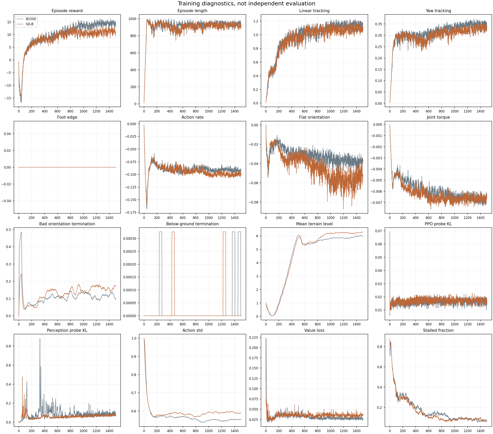
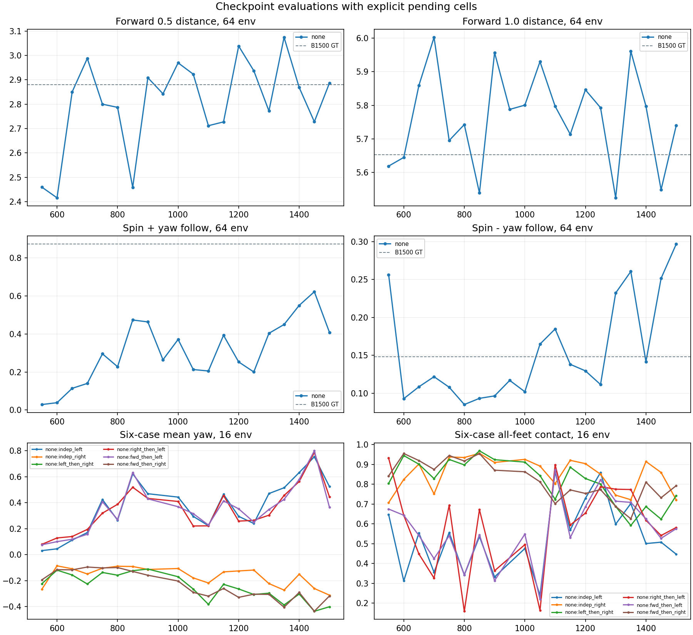

> 분류: 실험
> 작성: 오흥재 (lead 정리 · scripter 표 · 그림 생성기 SOL-26a) · 2026-10-26
> 근거: 학습 `C:/mai/wt/foothold-lab/impl-g0b/logs_gate/g0b_main_20261025_203729/` · 저장본 평가 `C:/mai/wt/foothold-lab/impl-turncases/logs/g0b_eval/m<N>/` · 그림 · 표 `figs/ex32-g0b/` (generate_result26a.py, SHA256SUMS) · 카드 `../20261021-experiments/EXP-EX32-G0B-friction.md`
> 요지: 지도 없이 B 와 같은 마찰 무작위로 처음부터 1501 회 배운 G0-B 는 m1500 에서 6 초 전진 2.89 · 5.74 m (64 env, 64/64 생존) 로 지도 켬 B1500 (2.88 · 5.65 m) 과 같은 거리를 걷는다. 회전은 약하고 (좌 추종 0.41 · 우 0.30), 고정 칸 회전 진단에서 16 대 중 9~16 대만 끝까지 섰다. 출발선이 아니라 S-B 판정의 「지도 없이 걷기」 기준선이다.
> 상태: v0.1 초안 · 영상 없음 (10:13 이후 GPU1 촬영 뒤 추가) · 해석 미완 (영상 판독 전) · 한 시드
> 판: v0.1

# EX-32 G0-B 결과 (지도 없음 + 마찰 0.2~1.2, 처음부터 1501 회)

## 1. 영상부터 보기

영상 없음 · 미확인. G0-B 와 S-B50 · S-B10 이 GPU 두 장을 쓰는 동안 화면 GPU (GPU1) 가 학습 중이라 촬영을 못 했다. S-B50 학습이 끝나는 10시 전후 runner-26a 녹화기로 G0-B m1500 한 편을 먼저 찍고 (팀장 「한 편 먼저」), 회전 구간이 거친 땅 위인지 (R17) 확인한 뒤 이 절에 경로를 넣는다.

## 2. 무엇이 같고 무엇이 다른가

| 항목 | G0-B (EX-32) | B1500 (EX-28) |
|---|---|---|
| 지도 입력 | 없음 (map_input none, 지도 토큰 0 확인) | 정답 지도 |
| 마찰 | 0.2~1.2 무작위 | 0.2~1.2 무작위 |
| 그 밖 | EX-25 설정 그대로, 3072 env, 시드 42, START 명령 계약, 1501 회 | 같음 |
| 학습 속도 | 9.4~11.5 초/회 (같은 GPU 에서 평가를 같이 돌린 뒤 11.5) | 23.5 초/회 |
| 끝 | 10/26 00:50:32 rc 0 · Traceback 0 | 10/24 |

## 3. 전진 · 높이 · 발 교대

64 env 고정 칸 (c3884d68) 6 초, m1500 (`m1500/map64/map_modes.json`):

| 명령 | G0-B 거리 m | 생존 /64 | B1500 지도 켬 거리 m |
|---|---|---|---|
| 전진 0.5 | 2.89 | 64 | 2.88 |
| 전진 1.0 | 5.74 | 64 | 5.65 |

저장본 20 개 (m550~m1500, 50 회 간격) 의 전진 1.0 거리는 최소 5.52 m (m1300) · 최대 6.00 m (m700). 지도가 없어도 이 고정 칸 (레벨 0~2) 에서는 전진 거리가 B1500 과 같다.

보행 위상 (16 env, m1500, `figs/ex32-g0b/gait_by_env.csv`, 중앙값과 범위): 전진 0.5 네 발 동시 접촉 0.051 (0.032~0.084) · 발 풀림 0.947 · 대각 쌍 위상 176° (148~239°), 전진 1.0 네 발 동시 0.021 (0.016~0.027) · 발 풀림 0.978 · 위상 175° (162~191°). 대각 두 쌍이 반 주기 (180° 근처) 로 번갈아 딛는 걸음이다.

## 4. 회전

64 env 제자리 회전 m1500: 좌 추종 0.41 (생존 55/64) · 우 0.30 (55/64). 저장본 20 개 범위: 좌 0.03 (m550) ~ 0.62 (m1450), 우 0.09 (m800) ~ 0.30 (m1500). 학습 후반에 좌회전이 오르고 우회전은 낮게 머문다.

16 env 고정 칸 (7f49a1e9) 회전 여섯 경우 m1500 (회전 속도 rad/s 평균 / 네 발 동시 접촉, 괄호 = 끝까지 선 env /16, `figs/six-cases/six_table.py` 로 lead 재계산):

| 경우 | G0-B m1500 | G0-B m1000 | B1500 (eval_pred, 같은 칸) |
|---|---|---|---|
| 좌 독립 | +0.52 / 0.45 (9) | +0.44 / 0.48 (16) | +1.01 / 0.40 |
| 우 독립 | −0.31 / 0.72 (11) | −0.11 / 0.93 (16) | −0.25 / 0.80 (15) |
| 좌 → 우 | −0.40 / 0.74 (13) | −0.17 / 0.91 (16) | −0.23 / 0.90 |
| 우 → 좌 | +0.44 / 0.58 (15) | +0.41 / 0.49 (16) | +1.04 / 0.46 |
| 전진 → 좌 | +0.36 / 0.58 (16) | +0.37 / 0.55 (16) | +0.89 / 0.44 |
| 전진 → 우 | −0.32 / 0.79 (14) | −0.20 / 0.86 (15) | −0.49 / 0.61 |

- 지도 없이 배운 정책은 좌회전을 B1500 의 절반 정도 속도로 하고, 우회전은 네 발을 딛고 비튼다 (네 발 동시 0.72~0.79).
- **m1500 은 고정 칸 회전에서 넘어진다.** 좌 독립 16 대 중 9 대, 우 독립 11 대만 끝까지 섰다 (m1000 은 거의 16/16). 경사 피라미드 · random_rough 칸에서 지도 없이 제자리를 돌다 넘어진 것으로 보인다 (추정, 영상 판독 전).
- B1500 열은 지도 모드가 eval_pred 라서 G0-B (지도 없음) 와 「지도 효과」 를 가르는 짝이 아니다 (reviewer 26716fb8 고침 1). B1500 세 모드 두 번 재기는 S-B50 이 끝난 뒤 GPU1 에서 (baseline_b1500.sh).

## 5. 관절 · 몸 기울기

64 env 전진 중 평균 기울기는 생성기 표 (`figs/ex32-g0b/map64_by_checkpoint.csv` 의 tilt_rad_mean_alive) 에 있다. 관절 한계 · 종아리 고착 분석은 아직 안 했다 (영상과 같이).

## 6. 학습 곡선

원자료 `figs/ex32-g0b/training_raw.csv` (tfevents 전체). 그림 읽기 (보상 항목 · 지형 레벨 · KL · std) 는 영상 판독과 같이 v0.2 에서.

## 7. 지도를 가리면

해당 없음. G0-B 는 처음부터 지도 입력이 없다. 이 판의 전진 거리 (m1500 5.74 m) 가 S-B 두 판의 「지도 가림」 판정 분모다 (카드 판정: 가림 전진 1.0 이 이 값의 0.8 배 = 4.59 m 이상).

## 8. 증거의 한계

- 한 시드. 평가 칸은 레벨 0~2.
- 영상이 없어 회전 중 넘어지는 모습 · 발 위치를 아직 못 봤다. 넘어짐의 원인은 추정이다.
- m950 의 회전 여섯 경우는 lead 가 23:22 평가를 끊어 비어 있다 (나중에 m950_redo).
- 같은 저장본 재측정 폭: 16 env 평균 최대 0.11 (B1500 기준, 결과 v2.3 0c). G0-B 자체 재측정은 안 했다.
- 학습 중 같은 GPU 에서 평가를 돌려 학습 속도가 9.8 → 11.5 초/회로 바뀌었다 (결과에는 영향 없음으로 봄, 추정).

## 9. 다음

- 출발선 후보가 아니다 (팀장 10/26 00:2x). S-B50 · S-B10 의 지도 가림 판정 기준선으로 쓴다.
- 10시 뒤: G0-B m1500 영상 (회전 구간 지형 확인), m950 재측정, 영상 판독으로 v0.2.

## 10. 재현 경로

- 학습: `C:/mai/wt/foothold-lab/impl-g0b/logs_gate/g0b_main_20261025_203729/run.log`, 체크포인트 `impl-g0b/logs/rsl_rl/foothold_s2_g0b/2026-10-25_20-37-41_g0b-main/model_*.pt`, 코드 impl-g0b c151db40 · 727d4773.
- 평가: impl-turncases ff43ddfb `foothold_s2/eval/run_g0b_eval.sh`, 결과 `impl-turncases/logs/g0b_eval/m<N>/{turn16,map64}`.
- 표 · 그림: `figs/ex32-g0b/generate_result26a.py` (CPU, `rerun_g0b26a.ps1`), 여섯 경우 재계산 `../20261025-experiments/figs/six-cases/six_table.py`.

| 판 | 날짜 | 내용 |
|---|---|---|
| v0.1 | 2026-10-26 | 초안: 전진 · 위상 · 회전 · 학습 곡선, 영상 전 |
