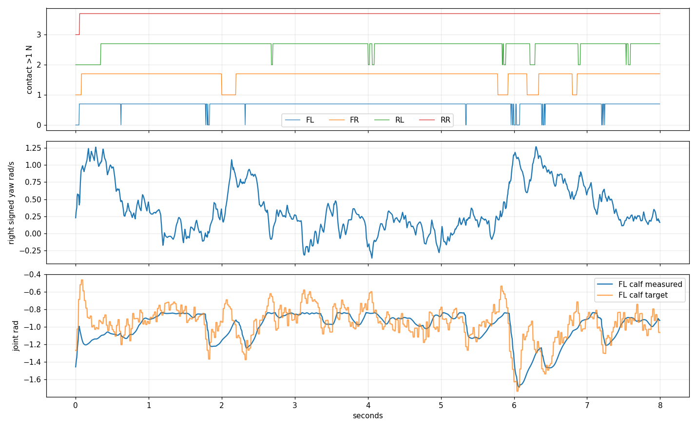
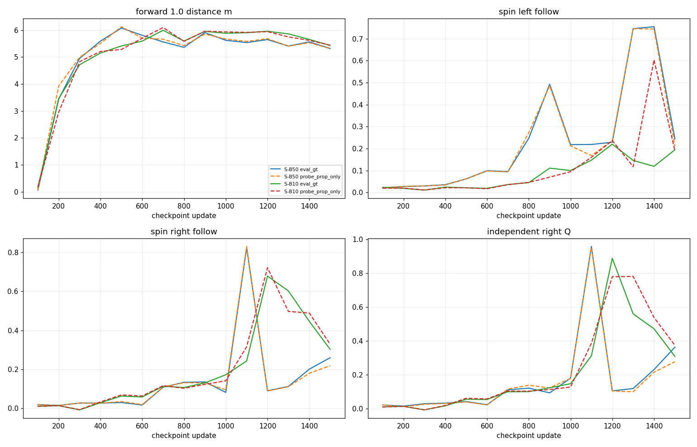
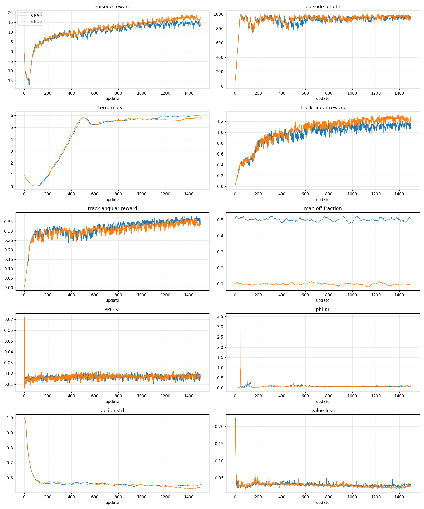
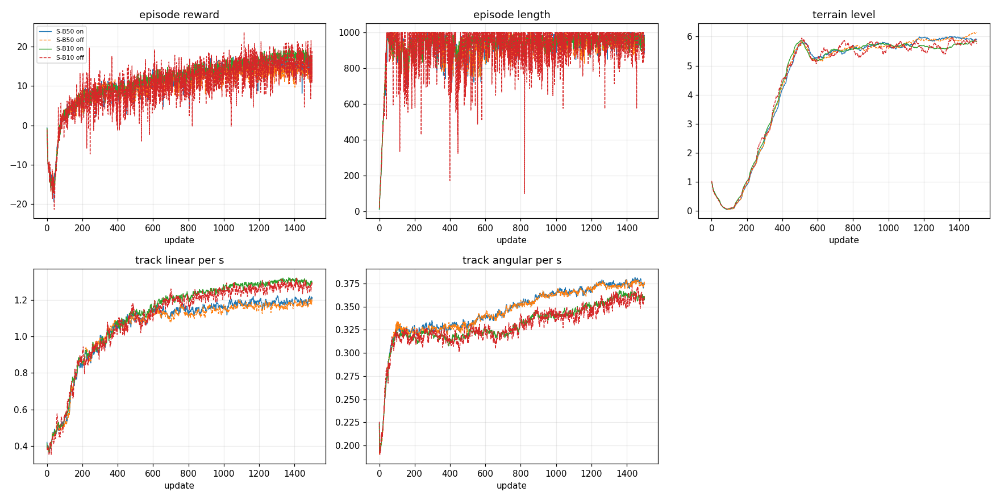

> 분류: 실험
> 작성: 오흥재 (lead · scripter 반영) · 2026-10-26
> 근거: EXP-EX33 결과 전 고정 판정 · TensorBoard · map_switch.jsonl · 고정 64/16환경 평가 원본 · 영상 SHA
> 요지: S-B50의 학습·저장본별 평가·영상 원본을 자동 집계하고 판정의 해석은 lead가 마친다
> 상태: CPU 원자료 수치 집계 · lead 8·9절 반영
> 판: v0.1

# EX33 S-B50 결과 · 원자료 생성본

원자료 수치는 `figs/ex33-34/gen_result.py`가 생성했다. 괄호 안 숫자는 생존 환경 수다. 훈련 기록은 독립 평가가 아니다. 회전 수치만으로 개선을 주장하지 않는다.

## 1. 영상

로컬 폴더: `C:\Users\AI-WS01\s2_lab\video_25e\final\runner-26a_1026_final`. 영상 릴리스: https://github.com/foothold-project/foothold-lab/releases/tag/research-sb-1500-20261026. 영상 SHA는 같은 폴더의 `SHA256SUMS.txt`와 바이트 대조했다. 아래 길이·프레임 수는 ffprobe가 실제 파일에서 읽었다.

| 파일 | 길이(s) | 프레임 | SHA256 |
|---|---:|---:|---|
| compare_mapon_rough_seq_05x.mp4 | 24.00 | 600 | `53c2e59facd3fb2747c2643e2975255ac65e1463f96e6cf6fd5b3cd9b9f91068` |
| compare_mapon_rough_seq_1x.mp4 | 12.00 | 300 | `115e05180276a266a7e2989fb6ab432ada7ed12517395bad65fc911de2a74e2c` |
| compare_masked_rough_seq_05x.mp4 | 24.00 | 600 | `9d67c83a1a3ebf0ab1c3bcce17d40f6d76b0faecf39ea6a5f96ff032797d568a` |
| compare_masked_rough_seq_1x.mp4 | 12.00 | 300 | `be0438c69e5ffa088034b48f6367807104ab05cef972fce58711562fe3d5df8f` |
| sb50_1500_eval_gt_rough_seq_05x.mp4 | 24.00 | 600 | `29e83f770d0437bdd81342d0470598a3b6dcf975f4d79402806db94b5694ad05` |
| sb50_1500_eval_gt_rough_seq_1x.mp4 | 12.00 | 300 | `bac4765fd389ef8acff6cd9df18c3369ebcdd12a196a009490b6017758c2e0d0` |
| sb50_1500_probe_prop_only_rough_seq_05x.mp4 | 24.00 | 600 | `953c0d02a29bf7ec298bffe053612b85aaaff5e060b345b415ae01d30a0382a7` |
| sb50_1500_probe_prop_only_rough_seq_1x.mp4 | 12.00 | 300 | `bbda81456a69269f2e20419892261c250d4955b9aa6c3e76e5d68c9b8ced7f72` |

단일 영상 네 편과 비교 영상 네 편이다. 영상 속 보행·발 위상·거친 타일 경계는 lead 판독 전이다.

## 2. 같은 것과 다른 것

| 항목 | S-B50 | 비교 |
|---|---|---|
| 학습 | scratch, seed42, 3072환경 × 24step × 1501갱신 | B1500 · G0-B와 동일 판정 칸 |
| 지도 끔 설정 | reset 때 p=0.5, 에피소드 동안 고정 | S-B10은 p=0.1 |
| 실제 끔 비율 | 전체 갱신별 off_frac_steps 평균 0.5015 | 설정 확률과 실현 비율은 구별 |
| 학습 지도 선택 | 켬 · 끔을 한 정책에서 훈련 | 평가 eval_gt · probe_prop_only · eval_pred 분리 |
| 평가 칸 | 64환경 SHA `c3884d686592596ee6ac7b2cdfc94e0b1d3f6d84dbca66c52ad20a0400e2358f` · 16환경 SHA `7f49a1e935ea1dd741b0db47fe6da965eaa772c03f30c94f9fa976125db33506` | lead startline 동일 칸 |

학습 설정의 나머지 동등성은 이 문서만으로 확정하지 않는다. GPU 차이 등 물리적 재현성은 미확인이다.

## 3. 전진 · 높이 · 발 교대

최종 m1500, 64환경 6초 평가 원본 `map_modes.json`의 중앙 전진 거리와 생존 수다.

| 지도 모드 | 전진 0.5 m (생존) | 전진 1.0 m (생존) | 좌 제자리 추종 | 우 제자리 추종 |
|---|---:|---:|---:|---:|
| eval_gt | 2.47 (64/64) | 5.32 (64/64) | 0.24 | 0.26 |
| probe_prop_only | 2.52 (63/64) | 5.31 (63/64) | 0.21 | 0.22 |
| eval_pred | 2.50 (63/64) | 5.32 (64/64) | 0.26 | 0.27 |

몸 높이와 접촉점의 미끄럼은 해당 평가 요약에서 미측정이다. 첫 kept 환경의 네 발 접촉·요속도·앞왼쪽 종아리 실제/목표 위상 원자료 그림:

이 그림은 대표 예시 한 환경이며 전체 보행의 성공률이 아니다. 영상 대조 전 해석 미완.

## 4. 회전의 회차별 변화

| 저장본 | 지도 켬 전진 1.0 | 지도 가림 전진 1.0 | 켬 독립 좌 Q | 켬 독립 우 Q |
|---:|---:|---:|---:|---:|
| 100 | 0.06 | 0.06 | 0.02 | 0.02 |
| 200 | 3.44 | 3.92 | 0.02 | 0.01 |
| 300 | 4.95 | 4.99 | 0.03 | 0.03 |
| 400 | 5.59 | 5.51 | 0.03 | 0.03 |
| 500 | 6.08 | 6.13 | 0.06 | 0.04 |
| 600 | 5.81 | 5.70 | 0.08 | 0.02 |
| 700 | 5.56 | 5.66 | 0.09 | 0.11 |
| 800 | 5.36 | 5.43 | 0.26 | 0.12 |
| 900 | 5.91 | 5.85 | 0.43 | 0.09 |
| 1000 | 5.62 | 5.67 | 0.20 | 0.18 |
| 1100 | 5.54 | 5.58 | 0.24 | 0.96 |
| 1200 | 5.65 | 5.68 | 0.24 | 0.10 |
| 1300 | 5.41 | 5.40 | 0.79 | 0.12 |
| 1400 | 5.56 | 5.53 | 0.87 | 0.23 |
| 1500 | 5.32 | 5.31 | 0.33 | 0.36 |

m1500의 16환경 Q는 명령 부호를 맞춘 kept 환경별 살아 있는 표본 평균 요속도를 환경별 같은 무게로 평균했다. C는 네 발 링크 접촉력 >1 N 동시 비율이다.

| 모드 | 경우 | Q rad/s | C | kept | 끝 생존 |
|---|---|---:|---:|---:|---:|
| eval_gt | indep_left | 0.33 | 0.75 | 16/16 | 16/16 |
| eval_gt | indep_right | 0.36 | 0.81 | 16/16 | 16/16 |
| eval_gt | fwd_then_left | 0.32 | 0.79 | 16/16 | 16/16 |
| eval_gt | fwd_then_right | 0.34 | 0.80 | 16/16 | 16/16 |
| eval_gt | right_then_left | 0.35 | 0.82 | 16/16 | 16/16 |
| eval_gt | left_then_right | 0.46 | 0.72 | 16/16 | 16/16 |
| probe_prop_only | indep_left | 0.29 | 0.76 | 16/16 | 16/16 |
| probe_prop_only | indep_right | 0.28 | 0.86 | 16/16 | 16/16 |
| probe_prop_only | fwd_then_left | 0.24 | 0.82 | 16/16 | 16/16 |
| probe_prop_only | fwd_then_right | 0.26 | 0.84 | 16/16 | 16/16 |
| probe_prop_only | right_then_left | 0.31 | 0.80 | 16/16 | 16/16 |
| probe_prop_only | left_then_right | 0.34 | 0.80 | 16/16 | 16/16 |
| eval_pred | indep_left | 0.32 | 0.76 | 16/16 | 16/16 |
| eval_pred | indep_right | 0.42 | 0.76 | 16/16 | 16/16 |
| eval_pred | fwd_then_left | 0.32 | 0.78 | 16/16 | 16/16 |
| eval_pred | fwd_then_right | 0.31 | 0.82 | 16/16 | 16/16 |
| eval_pred | right_then_left | 0.37 | 0.80 | 16/16 | 16/16 |
| eval_pred | left_then_right | 0.41 | 0.75 | 16/16 | 16/16 |

독립 회전 8등분 시간 열 (kept 환경, alive 표본만):

| 모드 | 경우 | 1 | 2 | 3 | 4 | 5 | 6 | 7 | 8 |
|---|---|---:|---:|---:|---:|---:|---:|---:|---:|
| eval_gt | indep_left | 0.85 | 0.27 | 0.24 | 0.20 | 0.30 | 0.21 | 0.29 | 0.24 |
| eval_gt | indep_right | 0.73 | 0.28 | 0.41 | 0.35 | 0.22 | 0.25 | 0.35 | 0.31 |
| probe_prop_only | indep_left | 0.80 | 0.22 | 0.19 | 0.27 | 0.30 | 0.25 | 0.16 | 0.14 |
| probe_prop_only | indep_right | 0.74 | 0.28 | 0.38 | 0.19 | 0.13 | 0.17 | 0.19 | 0.13 |

## 5. 관절 · 기울기

첫 kept 환경의 앞왼쪽 종아리 실제/목표 각도는 3절 그림에 있다. 이는 물리 한계·전체 토크를 재는 값이 아니다. 몸 기울기와 접촉점 마찰 속도는 이 생성기의 판정 항목에 없어 미측정이며 lead 영상 판독 전 원인 추정은 보류한다.

## 6. 학습 곡선

1476~1500 갱신 기록의 산술평균. 에피소드별 표본 수는 서로 다를 수 있어 독립 평가와 직접 순위 비교하지 않는다.

| TensorBoard 태그 | 평균 |
|---|---:|
| Train/mean_reward | 14.1142 |
| Train/mean_episode_length | 953.1748 |
| Curriculum/terrain_levels | 6.0120 |
| Episode_Reward/track_lin_vel | 1.1245 |
| Episode_Reward/track_ang_vel | 0.3583 |
| Episode_Reward/foot_edge | 0.0000 |
| Loss/kl_probe/ppo_mean | 0.0181 |
| Loss/kl_probe/phi_mean | 0.0961 |
| Policy/mean_noise_std | 0.5523 |
| Loss/value_function | 0.0294 |
| map_switch 마지막25 on 에피소드 보상 평균 | 14.5567 |
| map_switch 마지막25 off 에피소드 보상 평균 | 13.5842 |

학습 원본: `C:\mai\wt\foothold-lab\impl-sb\logs\rsl_rl\foothold_s2_sb\2026-10-25_23-45-04_sb-main`. 전체 갱신별 숫자는 `training_scalars.csv`와 `map_switch_rows.csv`에 있다.

## 7. 증거의 한계

같은 평가 칸과 seed만으로 지도 끔 비율의 일반화 효과를 확정하지 않는다. 16환경 여섯 경우와 64환경은 다른 표본이다. 회전 Q의 재측정 폭과 영상 속 실제 험지 위치를 고려해야 한다. planner `JUDGE-SPEC v0.6`은 참고 판정 체계이며 아래의 결과 전 고정 카드 문턱을 대체하지 않는다.

카드의 최종 저장본 수치 판정. 생성기는 결과 전 고정 카드의 0.9배·0.8배를 그대로 사용했다:

| 조건 | 실제 거리 | 고정 문턱 | 수치 판정 |
|---|---:|---:|---|
| 지도 켬 유지 · B1500 eval_gt ×0.9 | 5.3167 | 5.0965 | PASS |
| 지도 없이 걷기 있음 · G0-B none ×0.8 | 5.3149 | 4.5920 | PASS |

생존: 켬 64/64, 가림 63/64. 회전 Q의 켬·가림 차이가 0.12 rad/s 안이면 「같음」, 넘으면 「다름」으로 표시한다. 경우별 indep_left 같음 (0.0326) · indep_right 같음 (0.0857) · fwd_then_left 같음 (0.0793) · fwd_then_right 같음 (0.0770) · right_then_left 같음 (0.0412) · left_then_right 다름 (0.1209). 합계 같음 5 · 다름 1. 16환경 Q 재측정 폭은 최대 0.115 · 평균 0.039 rad/s (lead 실측)이다. 이 표시는 판정 관문이나 두 회전 방향의 절대 추종 성공을 뜻하지 않는다.

원본·코드·영상 SHA 목록은 `figs/ex33-34/SHA256SUMS.txt`, 고정 표 대조 횟수는 `figs/ex33-34/summary.json`에 남겼다.

## 8. 이 결과로 다음 설계에서 무엇을 바꾸는가

- **S-B50 은 출발선이 아니다.** 출발선은 S-B10 m1500 (팀장 「우선 승인」, 원장 bba2fe52). S-B50 은 m1400 에서 좌회전 세 경우가 넘어져 (kept 10 · 11 · 11) 「연속 두 저장본 통과」 가 끊겼다 (planner OPINION v0.2). 규칙대로 고르면 m1300 이다.
- **끔 비율을 0.5 로 올릴 까닭은 없다.** S-B50 m1500 과 S-B10 m1500 은 모두 지도 가림에서 64/64 로 걷는다 (전진 1.0: 5.31 m · 5.44 m). 끔을 다섯 배 늘려도 「지도 없이 걷기」 는 더 나아지지 않았고, 켬 전진은 S-B10 이 길다 (5.43 대 5.32 m). 그래서 0.1 을 유지한다 (팀장 13:3x).
- **오래 도는 회전은 S-B50 이 더 고르게 유지한다.** m1500 독립 우회전 8 등분은 0.22~0.41 rad/s 로 끝까지 남고, S-B10 은 첫 1/4 뒤 0.05~0.22 로 떨어진다 (#555 6409865094). 이것은 출발선 고르는 점수가 아니라 회전 명령 과정 (다음 설계 둘째 단계) 의 비교 자료로 쓴다.
- 지도 쓰임은 S-B10 과 같이 연속 지형에서는 켬 − 가림 ≈ 0 이라 못 잰다. 듬성 지형 고정 칸 평가는 S-B10 다음으로 같은 칸에서 진행 중 (impl-eval-ef8c).
- 카드 4 절의 회전 「같음」 문턱 0.12 rad/s 는 한 경우가 0.1209 로 문턱 밖이다. 16 env Q 재측정 폭 (최대 0.115) 과 같은 크기라 「다름」 으로 읽지 않는다 (추정). 해석은 영상 · 위상 판독 전까지 미완.

## 9. 실제 완료와 재현 경로

- 학습: `C:\mai\wt\foothold-lab\impl-sb\logs\rsl_rl\foothold_s2_sb\2026-10-25_23-45-04_sb-main`, 10/25 23:44 GPU1 기동 · 10/26 09:54:42 rc 0, model_1500.pt (sha256 e6d8ba631f24e816). 코드 impl-sb 6309f67e.
- 평가: impl-turncases 7996823f 의 `foothold_s2/eval/post_train_eval2.sh` 사슬, 원자료 `C:\mai\wt\foothold-lab\impl-turncases\logs\sb50_eval\m*`. lead 표 `figs/startline/`.
- 이 문서의 숫자: `figs/ex33-34/gen_result.py` (isaac311 python, CPU), 시험 5 통과 (lead 재실행), 대조 16,012 건, 두 사본 바이트 같음.
- 영상: 릴리스 https://github.com/foothold-project/foothold-lab/releases/tag/research-sb-1500-20261026 · 로컬 `C:\Users\AI-WS01\s2_lab\video_25e\final\runner-26a_1026_final\`.
