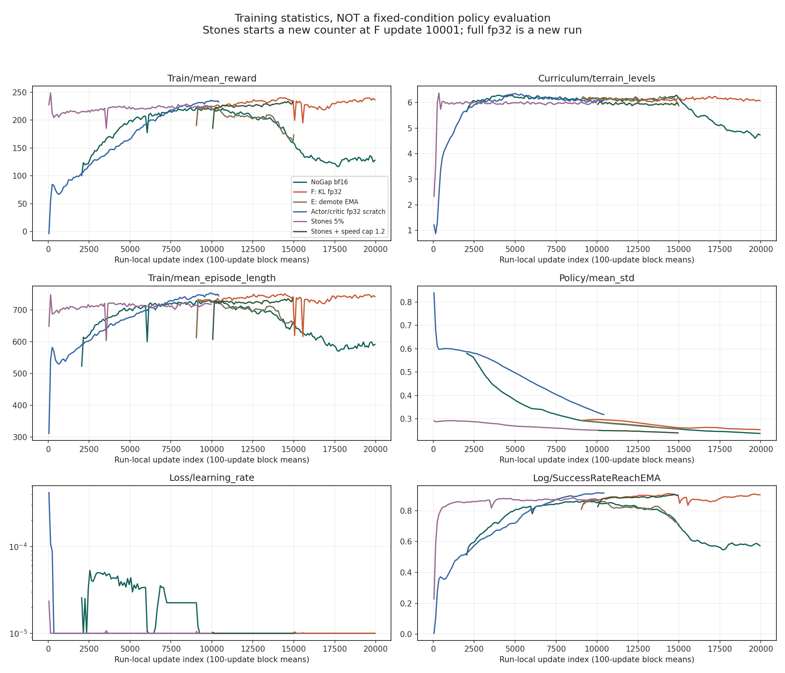
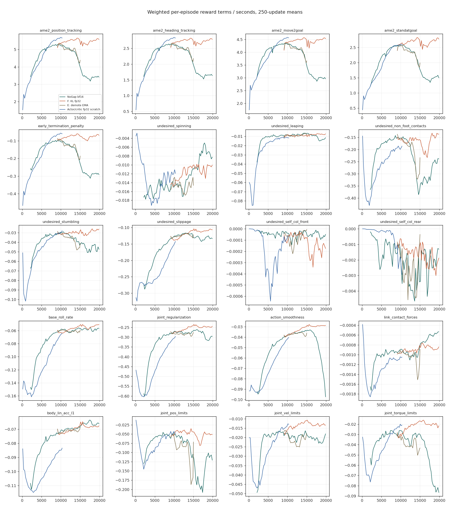

> 분류: A/평가 · 일반화 벤치마크 · 지표
> 작성: 오흥재 (analyst 분석) · 2026-10-28
> 근거: RunPod limseokheon 설정·소스·TensorBoard·고정 평가 원자료 재계산, ame2_minimal 8beb9a688d67882828019583f7d5a78e3517f233
> 요지: NoGap 후반 저하는 고정 평가에서도 실재하며, KL fp32 재계산 판과 처음부터 학습한 fp32 판, 징검돌 추가 판을 구분해야 한다.
> 상태: 카드 A CPU 분석 완료 · 저장본 바이트·실기 배포·영상 판독은 미확인

# AME-2 Go2 학습 원자료 분석

**결론: 참고할 성과는 있으나, 이를 ‘fp32로 바꾸어 해결한 깊이 카메라 보행’이라고 설명하면 틀린다.** 이번 주요 저장본은 정답 높이 지도를 쓰는 teacher다. 실제로 확인한 것은 NoGap 후반 성능 저하, KL 계산을 바꾼 이어 학습 판의 회복, 징검돌을 일부 섞은 후속 학습이다. 원인 하나를 확정한 실험도, 카메라 복원 지도만으로 실기 보행을 검증한 결과도 아니다.

## 1. 자료 범위와 읽는 법

- 원자료: `s3://rzklpc35sl/limseokheon/`, 로컬 사본 `D:/mai-data/ame2/raw/`. 아래 `N`, `F`, `ST` 등은 이 사본 안의 경로를 줄여 쓴 이름이다.
- 10개 주 폴더의 선택 자료 4,228파일을 확보했다. 파일 선택은 설정·소스·로그·평가 기록·events다. 453개 저장본은 이름·크기·수정 시각만 목록화했다. 추가로 고정 평가용 작은 `.pt` 결과 4개를 받았으며 모델 저장본은 받지 않았다.
- `D:/mai-data/ame2/download_manifest.csv`, `live_snapshots.json`, `eval_download_manifest.json`에 원자료 SHA256과 시점을 남겼다. fp32 학습 중 변경된 파일 3개는 최초 조건부 읽기가 실패했고, 10월 28일 19:51 KST 무렵 별도 스냅샷을 만들었다. 그 시점 fp32 events는 **0~10,427**, 완료 10,428회다. 현재 실시간 진행률을 뜻하지 않는다.
- 전체 events 39개 실행 디렉터리를 CPU로 읽었다. 모의 시험 `pre/`는 제외했다. 같은 실행 안에 중복 step이 있으면 마지막 wall time을 채택했다. 이어받기 분기에서 겹친 15,501~15,507 등은 후속 실행 값을 쓰되 원본은 보존했다.
- [전체 39판 설정 목록](figs/ame2-analysis/run_catalog.csv), [선택 구간 수치](figs/ame2-analysis/key_windows.csv), [고정 평가 재계산](figs/ame2-analysis/fixed_eval_comparison.csv), [소스 차이 전수 목록](figs/ame2-analysis/source_diff_inventory.csv).
- `model_N`과 완료 횟수는 다르다. 이 계열 `model_9000`은 완료 9,001회다. `start_from`은 회차를 0부터 다시 센다. 누적 학습량과 파일 번호를 아래에서 구별한다.

## 2. 구두 계보를 실제 기록으로 바로잡기

| 전해진 설명 | 확인 | 원자료와 정정 |
|---|---|---|
| NoGap으로 시작 | 부분 확인 | 그 전에 12종 지형·easy-start·EMA·crop 비교가 있다. 주요 NoGap 본류의 0~1,999 events는 이번 목록에 없고, `params/agent.yaml`과 후속 load 기록으로 부모를 확인했다. 현재 `ame2` 코드가 과거 실행 때 코드와 같다고 가정하지 않는다. |
| 약 9,000회 최고점 뒤 하락 | 확인, 지표를 구별 | N의 500회 블록 평균 보상 최고는 9,000~9,499의 219.823. 지형 레벨 최고는 14,500~14,999의 6.239다. ‘모든 지표가 9,000에서 최고’는 아니다. |
| 9,000에서 fp32로 이어가니 상승 | 표현 수정 | F는 **KL 계산만 fp32 forward로 다시 계산**한다. PPO actor·critic 손실의 bf16은 유지한다. 별도 `ame2_fp32`는 처음부터 시작했고 yaw·goal·map noise ramp도 4,000회다. 9,000 이어받기 선택지는 실행기에서 거절된다. |
| 20,000까지 학습 | 확인, 판을 구별 | N도 20,000, F도 20,000 완료. 별도 actor·critic fp32 판은 스냅샷에서 10,428 완료로 아직 20,000 완료 증거가 없다. |
| 그 뒤 stones 5%를 넣고 5,000회 더 | 다름 | ST는 **F의 model_10000**에서 새 카운터로 **10,000회** 학습. 이어 SPD가 속도 보상 상한 2→1.2 m/s를 바꾸며 **5,000회** 추가한다. F의 20,000 최종본에서 곧바로 stones 5,000을 한 계보가 아니다. |

근거: 각 폴더 `README.txt`; `ame2_br/run/queue_br.sh`; `ame2_fp32/run/queue_fp32.sh:3,23,35,38,155`; `ame2_st/.../2026-10-26_08-23-55_nogapst5_f10k_to10000/start_record.json`; `ame2_spd/out/q/final_check.log:4` 및 `out/queue_status.txt:8`. README보다 실행 인자·저장된 설정·events를 우선했다.

### 주요 판의 설정

공통은 Go2, seed 42, 4,096 env, rollout 24, PPO epoch 5, minibatch 8, Muon, 초기 lr 0.001·adaptive KL, desired KL 0.01, gamma 0.99, lambda 0.95, clip 0.2, action scale 0.25다. 최종 lr가 초기 lr와 같다는 뜻은 아니다. F·ST·SPD 대부분 구간은 1e-5다. 공식 G1 기본 PPO의 minibatch는 4다.

| 판·별칭 | events 회차 | 출발·변경 | 정밀도 | 지형 |
|---|---:|---|---|---|
| N · `ame2_nogap20k/.../2026-10-16_19-16-42_nogap2_c12_s42_to20000` | 6,000~19,999 | `ame2/.../2026-10-15_14-40-29_nogap2_c12_s42_to6000/model_5999` 이어받기 | PPO bf16 | NoGap 8종 |
| E · `ame2_br/.../2026-10-24_19-13-56_nogap9k_emademote_to15001` | 9,001~15,000 | N9000, 성공 EMA<0.2 강등 추가 | PPO bf16 | 같은 8종 |
| F · `ame2_br/.../2026-10-25_07-46-45_nogap9k_klfp32_to15001`, 이후 10/26 두 실행 | 9,001~19,999 | N9000, KL fp32 재계산 | PPO bf16·KL fp32 | 같은 8종 |
| M035 · `ame2_m035/.../2026-10-21_07-27-45_nogap2_c12_s42_m035_to15001` | 9,001~15,000 | N9000, ROI margin 0.45→0.35 | PPO bf16 | 같은 8종 |
| DH1 · `ame2_dh1/.../dh1_9000`, `dh1_14000` | 9,001~9,030 / 14,001~14,030 | 짧은 진단, 장기 성과로 사용하지 않음 | PPO bf16 | 같은 8종 |
| ES20 · `ame2_es20/.../2026-10-22_10-10-38_es20_c12_s42_m035` | 0~19,999 | 처음부터, 쉬운 stones, ROI 0.35, ramp 4,000 | PPO bf16 | 실행별 비율은 전체 목록 |
| FP · `ame2_fp32/.../2026-10-27_07-38-27_nogap_fp32_s42_to20000` | 0~10,427 | 처음부터, ramp 4,000 | actor·critic 갱신 fp32, Muon 내부 bf16·TF32 유지 | NoGap 8종 |
| ST · `ame2_st/.../2026-10-26_08-23-55_nogapst5_f10k_to10000` 및 `17-36-47_..._r2` | 새 0~9,999 | F10000 가중치·optimizer·lr·entropy 계승. 지형 레벨·성공 EMA·ramp 상태는 새로 시작 | PPO bf16·KL fp32 | 8종 + stones 5% |
| SPD · `ame2_spd/.../2026-10-27_15-57-27_nogapst5_vmax12_to15000` | 10,000~14,999 | ST9999 이어받기, move2goal 보상 v_max 1.2 | PPO bf16·KL fp32 | ST와 같음 |

각 `...`는 `logs/rsl_rl/go2_gaze_teacher`다. `ame2` 초기 18개 실행 및 짧은 검사판까지 포함한 모든 행의 부모·설정 원문 위치는 `run_catalog.csv`에 있다. ‘G1’ 로봇인 초기 256 env 검사 2건을 Go2 4,096 실험으로 세지 않았다.

NoGap 지형 비율은 rough 10%, stair_down 15%, stair_up 15%, boxes_j 10%, discrete_j 10%, climb_up 20%, climb_down 10%, steps_j 10%다. ST/SPD는 rough를 5%로 줄이고 stones를 5% 넣는다. 실제 env 배정은 열 수와 정수 배분을 따르므로 4,096의 정확히 5%인 204.8대를 만들지는 않는다. ST 첫 기록의 stones는 204대, 전부 레벨 0이다. 나머지는 0~5에 분포한다.

명령은 vx·vy·wz를 독립 샘플하는 우리 속도 추종 과제가 아니다. 목표 위치와 도착 heading을 받는 goal-reaching이다. 재추출 16.01초, 에피소드 16초, heading 범위 ±π/3, goal cone은 10→45도 ramp다. `start_from` 때 ramp를 1회로 설정했으므로 새로 2,000회 쉽게 시작한 ST라고 해석하면 안 된다.

## 3. 하락은 실제인가

그림은 100회 블록 평균이다. **가로축은 실행 자체의 회차**다. ST 0은 무학습이 아니라 F 10,001회에서 전이한 상태다. 세로축 보상은 서로 다른 과제·분포의 성적이므로 판 사이 순위표로 쓰지 않는다. 세로 급락 중에는 재시작 때 에피소드 통계가 다시 쌓이는 구간도 있다.

| 판·구간 | 보상 | 평균 지형 레벨 | 에피소드 step | 정책 std |
|---|---:|---:|---:|---:|
| N 9,001~9,500 | 219.785 | 6.135 | 724.793 | 0.2906 |
| N 14,501~15,000 | 165.729 | 6.238 | 647.893 | 0.2572 |
| N 19,500~19,999 | 130.202 | 4.695 | 592.021 | 0.2379 |
| E 14,501~15,000 | 167.747 | 6.096 | 660.194 | 0.2582 |
| F 14,501~15,000 | 236.220 | 6.115 | 742.466 | 0.2633 |
| F 19,500~19,999 | 238.055 | 6.083 | 744.766 | 0.2541 |
| FP 9,500~9,999 | 233.017 | 6.055 | 749.076 | 0.3352 |
| ST 9,500~9,999 | 225.396 | 5.984 | 719.616 | 0.2514 |

출처: `key_windows.csv`의 branch·lo·hi와 `Train/mean_reward`, `Curriculum/terrain_levels`, `Train/mean_episode_length`, `Policy/mean_std`. N·E·F는 비교 가능한 구간을 나란히 두었지만, 재시작 여부·장치·환경 버전까지 완전한 통제 실험은 아니다.

### 같은 시험지의 결과

N9000과 N19999의 고정 평가 결과 `.pt` 4개를 직접 다시 셌다. 각각 2,400 env, 12종×10레벨, 칸당 20 env, 첫 에피소드를 버리고 5회씩, 평가 시드 42·1001이다. 시드 안에서 지형·초기 위치·물성 digest가 같았다. 두 시드 평균은 다음과 같다. 학습 시드를 두 번 반복한 실험은 아니다.

| 지형 | N9000 성공률 | N19999 성공률 | 차이 |
|---|---:|---:|---:|
| rough | 99.60% | 91.70% | -7.90%p |
| stair_down | 97.90% | 12.75% | -85.15%p |
| stair_up | 95.35% | 50.60% | -44.75%p |
| boxes_j | 95.70% | 88.30% | -7.40%p |
| discrete_j | 96.50% | 92.60% | -3.90%p |
| climb_up | 92.80% | 87.25% | -5.55%p |
| climb_down | 95.45% | 39.10% | -56.35%p |
| steps_j | 75.30% | 10.35% | -64.95%p |
| stones | 0.50% | 0.00% | -0.50%p |
| gap | 23.20% | 8.20% | -15.00%p |
| pallets | 6.15% | 0.60% | -5.55%p |
| beam | 12.80% | 1.10% | -11.70%p |
| 12종 동일 가중 평균 | **65.94%** | **40.21%** | **-25.73%p** |

원자료: `ame2/go2/_runs/vid_v1/20261019T024708Z_22894_v1/eval/eval5_m9000_b{42,1001}.pt` 및 `ame2/go2/_runs/n20k_eval5/eval5_n20k_b{42,1001}.pt`. 정확한 SHA·분모·조건은 `fixed_eval_comparison.csv`, 집계법은 원래 `go2/scripts/gap12_eval_tables.py:67` 이후와 대조했다. 첫 회 제외·비실행 reset 제외는 답을 아는 작은 입력으로 확인했다.

**N은 단순히 더 어려운 지형을 만났기 때문에 학습 보상이 낮아진 것만은 아니다.** 고정 시험지에서 기존 8종까지 떨어졌다. 다만 이 자료에 F 최종본을 같은 시험지로 잰 결과는 없으므로 F가 고정 평가에서도 위 감소를 모두 회복했다고는 아직 말하지 않는다.

### 보상 항목과 KL에서 얻는 범위

N의 9,000~9,499→19,500~19,999에서 position 항 5.273→3.438, heading 2.630→1.656, move2goal 4.330→2.988로 함께 낮아진다. early termination 항 -0.099→-0.288, action smoothness -0.039→-0.091, torque limit -0.031→-0.084도 악화한다. `Episode_Reward/*` 태그의 가중된 초당 정규화 항이다. ‘회전을 버리고 다른 목표를 잘하게 된 교환’만으로 설명하기 어렵다. 이 수치로 관절 기전이나 시각적 보행 형태까지 확정할 수는 없다.

F의 9,001~15,000에서 같은 갱신의 KL 평균은 fp32 0.018867, bf16 0.023461이며 **6,000/6,000 갱신에서 bf16 쪽이 컸다**. ST 두 번째 실행도 6,499/6,499다. 원자료 `Loss/kl_fp32`, `Loss/kl_bf16`. KL 수치가 같지 않다는 증거는 강하다.

그러나 **‘KL 차이 때문에 lr가 작아져서 N이 망했다’는 설명은 아직 성립하지 않는다.** F도 6,000회 중 마지막으로 기록된 lr가 하한 1e-5보다 큰 갱신은 4회뿐이다. N도 후반 하한이다. 갱신 내부 minibatch별 lr 경로는 마지막 lr 태그만으로 복원할 수 없다. F와 E의 차이는 KL 처방을 지지하지만, 숫자 편향의 인과·재시작 효과·다른 장치 환경을 분리한 최종 증거로 과장하면 안 된다.

## 4. 공식 코드와 다른 점

공식 비교 대상은 [ame2_minimal 8beb9a68](https://github.com/leggedrobotics/ame2_minimal/tree/8beb9a688d67882828019583f7d5a78e3517f233)이다. 공식 `PPORunnerCfg` dense 판과 비교할 때, RunPod은 공식 저장소 안에 이미 있는 **Gaze 판**을 택했다는 것을 먼저 구별해야 한다. Gaze crop·ROI 벌점 자체를 Go2 이식자가 새로 발명한 것으로 적으면 틀린다.

아래 `G`는 `D:/mai-data/ame2/raw/ame2_st/go2/ame2_go2/`, `U`는 공식 clone 루트다. 주요 후속 폴더 7개 각각 69개 Python 파일을 경로 대응해 비교했다. 판마다 동일 39·변경 14·추가 16이다. G1 환경을 Go2 환경에 대응한 비교이므로 새 파일 전체가 기능적으로 검증됐다는 뜻은 아니다. 전체 파일 상태·해시가 CSV에 있고, 전체 차이 본문은 `D:/mai-data/ame2/derived/official_vs_stones.diff`에 있다.

| 항목 | 공식 G1 → RunPod Go2 | 근거 |
|---|---|---|
| 신경망·PPO 본체 | 다운로드한 `rsl_rl/rsl_rl`의 대응 Python은 공식과 바이트 동일. Gaze·MoE를 유지하고 외부 runner에서 KL 계산·복원 상태를 보강 | `source_diff_inventory.csv`; `G/algorithms/go2_runner.py:163,667,769` |
| PPO | epoch 5·lr 1e-3 유지, minibatch 4→8. 초기 lr와 복원된 현재 lr를 구분 | `U/ame2/ame2/tasks/agents/rsl_rl_ppo_cfg.py:164`; `G/tasks/agents/rsl_rl_ppo_cfg_go2.py:45`와 각 agent.yaml |
| 지도 | Go2 29×13=377점, 6 cm, x[-0.42,1.26]·y[-0.36,0.36] m, 기준 높이 0.27 m. 정답 ray scan에 noise/drift | `G/tasks/go2_env_cfg.py:54,78,115,203` |
| Gaze 경계 벌점 | r이 지도 중심 0.5에서 margin 0.45를 벗어날 때 `0.01 * mean(clamp(abs(r-.5)-.45,0)^2)`의 보조 손실. 발이 지형 가장자리에 닿는 벌점이 아님. M035는 margin만 .35 | 공식과 같은 `rsl_rl/rsl_rl/models/AME2_models.py:521`; 실행 agent.yaml |
| 공중·비발 접촉 | 각각 -1→-5. 공중은 1N 기준 history 중 모든 발이 떨어진 시점 + scan 높이 범위<0.3 m 조건. 비발 접촉에는 정강이·허벅지 등이 포함 | `U/.../ame2_env_cfg.py:450,461`; `G/tasks/go2_env_cfg.py:347,358`; `G/tasks/mdp/rewards.py:368` |
| 과회전 | 공식 실행 cfg 3.0→Go2 2.0 rad/s, 가중치 -1. 회전 추종 목표와 별개 | `U/.../ame2_env_cfg.py:445`; `G/tasks/go2_env_cfg.py:339` |
| 다른 보상 | 위치100, heading50, 이동5, 정지5, 조기 종료-500 유지. 인간 상체·발 shaping 제거, 자가 충돌은 Go2 앞·뒤 축별 실제 링크 접촉으로 교체 | `G/tasks/go2_env_cfg.py:311`부터 전체; 공식 409절 이후 |
| 발·몸 질량 | critic 접촉에서 G1 질량 0.1kg 필터를 그대로 쓰지 않음. Go2 발0.04kg도 남기도록 19몸 전부 포함. 접촉 힘 정규화 중량은 15.019×9.81 N | `G/tasks/go2_env_cfg.py:170,186,407`; `G/assets/unitree_go2.py:92` |
| 구동기·자세 | Go2HV 토크·속도 곡선, 종아리 감속비 적용. Kp25·Kd0.5, armature.01. 자가충돌 켬. 처음 자세와 joint-limit 기준도 로봇에 맞춤 | `G/assets/unitree_go2.py:19,37,45,58`; `go2_actuator.py`; `tasks/mdp/rewards.py:530` |
| DR·지연 | 마찰 .3~1, base mass -1~3kg, gain .85~1.15는 startup 적용. COM z ±.04→±.02m. 지연 cfg 0~1→0~4 substep, Go2에서 0/5/10/15/20ms | `U/.../ame2_env_cfg.py:169,326`; `G/tasks/go2_env_cfg.py:156,239` |
| 초기 상태 | 관절 pose배수 .5~1.5→.9~1.1. Go2의 실제 발 위치에 맞춰 root reset. 허벅지 수직 가속 60m/s²와 발 접촉 조합 종료 도입 | `G/tasks/go2_env_cfg.py:285,302,436`; `tasks/mdp/events.py:365` |
| 지형·빈 ray | Go2 지형 생성기·크기·쉬운 stones. 빈 scan은 per-episode 가상 바닥 -1~-.4m로 채움. 근접 얕은 구멍 처리 등이 추가되어 공식 G1 지형 그대로가 아님 | `G/tasks/terrains_go2.py`; `tasks/mdp/observations.py:89,109,142,160`; `events.py:800` |
| 관측·대칭 | 12관절·Go2몸 이름 기반 좌우 대칭, critic만 augmentation. delayed action은 applied action과 commanded action을 구별. 명령 2m clipping·높이 스캔 규격 수정 | `G/tasks/mdp/actions.py:20`; `observations.py:276,296`; `symmetry.py:29,76,100` |
| 커리큘럼 | goal 거리 .5m 안 승급,4m 밖 강등 기본. 지형 노출 시간·episode-start 계측, E의 EMA 강등 분기. yaw·goal cone·지도 noise는 시간 ramp | `G/tasks/mdp/curriculums.py:293,336`; `go2_env_cfg.py:470`; E 실행기 |
| 이어받기 | actor·critic만이 아니라 optimizer·lr·entropy·curriculum 저장/복원. `start_from`은 지형과 성공 이력 초기화. `--kl_fp32`는 저장본에 자동 저장되지 않아 다시 명시해야 함 | `G/algorithms/go2_runner.py:259,667,769` |
| 배포 준비 코드 | range sensor·mapper·fusion·LSIO 학생 환경·student PPO 코드가 추가되어 있으나 **이번 주요 학습이 그 경로를 썼다는 뜻은 아님** | CSV의 added 16개와 `G/tasks/agents/rsl_rl_ppo_cfg_go2.py:172` |

주요 20개 Go2 보상항 중 위 변경 외의 가중치는 공식 그대로다. 예를 들어 action rate -0.01, joint position limit -1000이다. 이러한 계수는 단위·정규화·샘플링 주기·로봇 구동기까지 함께 봐야 하며 우리 START 판에 숫자만 옮기지 않는다.

## 5. 앱에 넘길 후보와 계약

**시뮬 teacher 비교용 후보**는 아래 ST 마지막 저장본이다. 실기용 정책이나 앱 기존 속도 명령 정책에 바로 꽂을 파일이라고 승인하지 않는다.

- 원본: `s3://rzklpc35sl/limseokheon/ame2_st/logs/rsl_rl/go2_gaze_teacher/2026-10-26_17-36-47_nogapst5_f10k_to10000_r2/model_9999.pt`
- 등록 SHA256: `3f5459501960afd573b9ea88c13f8e9b1b6dc3cba8e123f8435d8f001d89e9c8`.
- SHA 출처: `ame2_spd/out/inputs.txt`. **저장본 바이트를 직접 해시한 것은 아니다.** 전송 담당이 이 값과 실제 파일을 대조해야 한다.
- 학습량: ST 자체10,000회, 출발 F10,001회를 합쳐 해당 계보20,001회. F의 다른 지류20,000을 또 더하지 않는다.
- 그 뒤 SPD의 `.../2026-10-27_15-57-27_nogapst5_vmax12_to15000/model_14999.pt`도 있다. 10월28일12:37 KST 종료 기록, 크기100,274,078 bytes. S3 HEAD에 SHA256 checksum·metadata가 없고 이번 자료에서 최종 SHA를 찾지 못했다. ETag를 SHA256이라고 바꾸어 쓰지 않는다. 성능 우열도 고정 평가 미확인이다.

| 계약 | ST teacher |
|---|---|
| 입력 | `teacher_prop` 49 = 선속도3·각속도3·중력3·관절위치12·속도12·이전행동12·목표명령4, `teacher_mapping` 377점×xyz3 |
| 지도 좌표 | yaw 정렬, 29×13,6cm. x 바깥 루프 `ordering=yx`. 높이는 hit_z-base_z+0.27. 시뮬 정답과 drift/noise를 이용한 teacher 입력 |
| 출력 | 12관절 위치 residual. `q_target=q_default+0.25*action`, 학습에0~20ms지연. actor 평균 행동 사용 여부도 export/test에서 맞춤 |
| 주기 | 물리200Hz, 정책50Hz. 4 substep마다 정책 갱신 |
| 명령 | 목표 위치·heading 계약. 기존 앱의 `(vx,vy,wz)`와 같지 않음 |
| 필수 별도 확인 | JIT export 출력 tuple 순서, USD 실제 joint_names 순서, 기본 각도, mapper/학생 입력 교체. 정규화·map sentinel·goal 표현을 덧씌우지 않고 export 계약과 일치시켜야 함 |

근거: `G/tasks/go2_env_cfg.py:156,170,203,218,515`, `G/tasks/mdp/observations.py:142,160,296`, `go2/scripts/export_teacher.py:3,63`. critic의 특권 입력과 actor 입력을 섞지 않는다. 현재 teacher는 몸 선속도도 입력받으므로 실기 추정 없이 동일 입력을 제공할 수 있다는 보장이 없다.

## 6. 우리 bf16 비교는 무엇이 실제로 돌았나

**짧은 메모리·속도 측정은 실행됐다. 장기 보행 품질 A/B는 조사한 사슬에서 실행되지 않았다.** 둘을 합쳐 ‘안 돌았다’고 하면 틀린다.

| 10월20일 JSON | 완료 갱신 | 학습 s/update | 수집 s/update | 계측 peak GiB |
|---|---:|---:|---:|---:|
| G1_1536_bf16kl_mb256 | 3 | 5.016 | 3.219 | 6.970 |
| G1_3072_bf16kl_mb128 | 3 | 10.789 | 5.024 | 5.301 |
| G1_3072_bf16kl_mb256 | 3 | 9.485 | 5.072 | 8.138 |
| G1_3072_fp32_mb128 | 3 | 17.594 | 5.129 | 7.210 |
| G1_3072_fp32_mb256 | 0 | 미측정 | 미측정 | OOM, 실패 시 allocated10.305 |

원자료: `C:/mai/wt/foothold-lab/astra2-n1/foothold_s2/scripts/start_s2m_<위 이름>_20261020.json`, 학습·수집 시간은 초기 갱신을 뺀 iter1·2 평균이다. peak는 JSON 계측의 allocator값이며 전체 GPU 점유가 아니다. 이는 당시 G1 메모리 probe의 자료이지 현재 depth-camera 본류의 장기 보행 품질·현재 처리시간을 보장하지 않는다.

`C:/Users/AI-WS01/s2_lab/chain/chain_state.json` 및 당시 백업에서 `snapshot_bf16`만 done, `bf16_B_bf16kl_mb256`, `bf16_A_fp32_mb128`, `bf16_A2_fp32_mb128_seed43`, `bf16_stamp`, `bf16_compare`는 pending·attempt0이다. J4의 예정 결과와 이미 나온3회 측정을 구별한다. 이번 검색 범위 밖 임의 실행까지 전혀 없었다고 단정하지 않는다.

또 여기의 `bf16kl`은 START 지각망 I-E의 VAE KL 계산 경로다. RunPod F의 **PPO 정책 분포 KL**과 다른 KL이다. 같은 이름만으로 동일한 버그나 같은 해결책이라고 연결하지 않는다.

## 7. 우리 다음 판단에 주는 것

1. **학습 보상과 고정 능력 평가를 함께 남겨야 한다.** NoGap은 고정 평가까지 저하했다. 쉬운 지형 비중이나 episode 길이가 변하면 보상 하나로 기존 능력 유지를 읽을 수 없다. 현재 EX-35 판정 문턱을 이 결과에 맞춰 소급 변경할 근거는 없다.
2. **‘회전이 약하다’도 경우를 나눠야 한다.** 우리 `RESULT-EX35-1027.md:64,243`은 독립 좌회전과 전진 후 좌회전·반대 회전 후 좌회전을 구분하고, m2000 반복에서 두 사유가 유지됨을 적었다. 목표 도달 AME-2의 heading 보상 회복을 우리 제자리 좌회전 해결로 곧바로 해석하지 않는다.
3. **정밀도는 후보 진단이지 즉시 처방이 아니다.** 비교 가능한 동일 minibatch에서 old/new mean·std·KL, optimizer가 실제 소비한 lr를 함께 남기는 것은 유용하다. 현재 조사만으로 EX-35의 넘어짐이 bf16 때문이라고 단정하지 않는다. 우리 짧은 precision probe의 KL과 PPO KL도 구별한다.
4. **상태를 무엇까지 잇는지가 과제의 일부다.** ST는 optimizer를 잇고 지형·성공 이력은 초기화했다. 새 지형을 넣는 데 필요한 변화지만 ‘같은 조건으로 그대로 이어간 판’은 아니다. 우리 카드도 네트워크·optimizer·정규화·명령/episode 진행·지형 레벨·지도 선택·noise 상태의 복원을 따로 기록해야 한다.
5. **그들이 보상도 바꾸었다는 사실은 확인되지만, -5가 최적이라는 증거는 없다.** 공중·비발 접촉 강화, 실제 self-contact, 토크 속도 곡선은 참고할 수 있다. 우리 회전 발걸음을 막는 원인이 공중 벌점인지·한계각인지·발 하중인지 먼저 계측해야 한다. 공중 벌점을 늘려 정지로 회피시키는 부작용도 있다.
6. **연속 지형의 성공으로 듬성 지형 성공을 대신하지 않는다.** N9000은 연속 지형은 높고 stones는0.5%였다. ST의5% 도입은 그 간극을 겨냥한 설계지만 이번 자료에는 ST 최종본의 같은 고정평가가 없다. 학습 중 성공 EMA를 독립 검증 성공률로 바꾸어 쓰지 않는다.

| 참고할 구체 설정 | 가치 | 그대로 복사하지 않을 이유 |
|---|---|---|
| KL 양 경로 동시 기록 | 정밀도 차이·adaptive lr 소비를 관찰 | PPO 분포와 VAE KL은 다른 대상 |
| 비발 접촉·실제 자가충돌·관절한계·토크 한계 항 | 앞뒤 다리·정강이 접촉을 분리해 실패 원인 후보 확보 | 로봇 actuator·정규화가 다르면 가중치 의미가 달라짐 |
| stones5%와 level0 시작, 기존8종95% 유지 | 새 과제 노출과 이전 과제 보존을 함께 구현 | 5%는 실측 최적비율이 아님 |
| full resume와 start_from 분리 | 재학습 시 상태 단절을 명시 | env 자체 물리 진행까지 완벽 재현하는 것은 별도 문제 |
| 목표 거리 기반 승급 + 시간 ramp 구별 | 지형 성과와 노출 변화의 역할을 분리 | 우리 성과 기반 승급 요구를 시간 ramp로 대체할 근거 없음 |

## 8. 한계·재현

- GPU·Isaac·학습을 실행하지 않았다. 영상 파일은 이 카드의 읽기 범위에 포함되지 않았고 보행의 모양을 눈으로 판정하지 않았다. fixed eval4파일과 events 숫자까지만 직접 검증했다.
- fixed eval은 두 **평가** 시드다. 훈련 시드 반복, 실제 Go2·앱 연결, 현재 저장본 SHA 직접 검증은 미확인이다.
- F가 N보다 학습 지표가 좋은 것은 확인했으나, 같은 고정평가·같은 환경 버전·재시작 대조가 완비된 인과 판정은 아니다. ST 재시작 때 환경 패키지 목록도 달라졌다. 완전 동일 환경이라고 쓰지 않는다.
- 분석 코드: `C:/mai/wt/foothold-lab/analyst-ame2/_out/ame2/{summarize,analyze,eval_audit}.py`. events 전체 파생 배열은 `D:/mai-data/ame2/derived/<run_id>.npz`, 전체500회 태그표는 `tag_windows500.csv`다. `runs.json`이 id와 원자료 파일 SHA를 잇는다.
- 원문: [공식 구현](https://github.com/leggedrobotics/ame2_minimal/tree/8beb9a688d67882828019583f7d5a78e3517f233), [AME-2 v3](https://arxiv.org/abs/2601.08485v3). 이번 판정은 논문 수치를 이식한 것이 아니라 실행 설정·코드·원자료를 우선했다.
- 다음 대기열은 **W32 부모 S-B10 전진 내림세 → W29 EX-35 연장 분석**이다. 이 문서는 두 작업의 완료 보고가 아니다.
