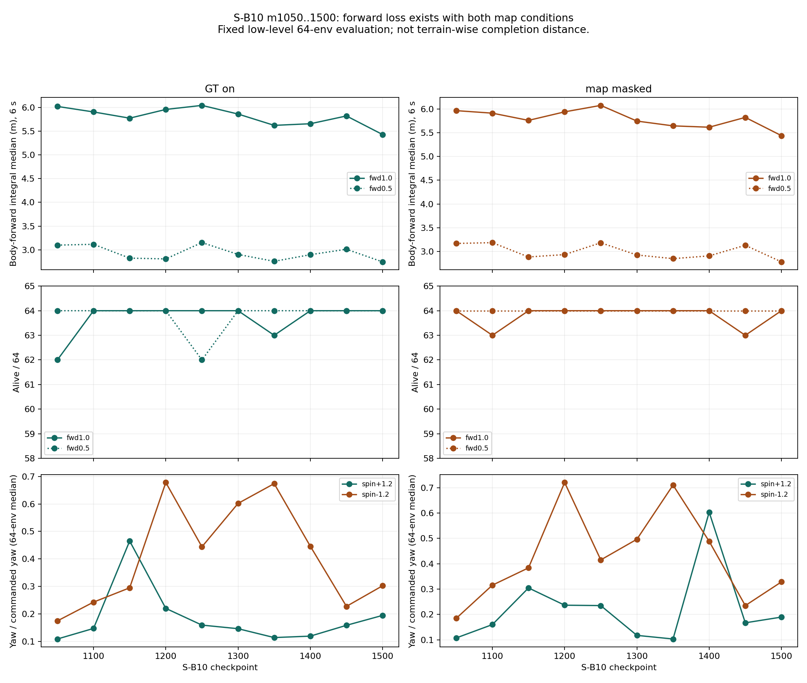
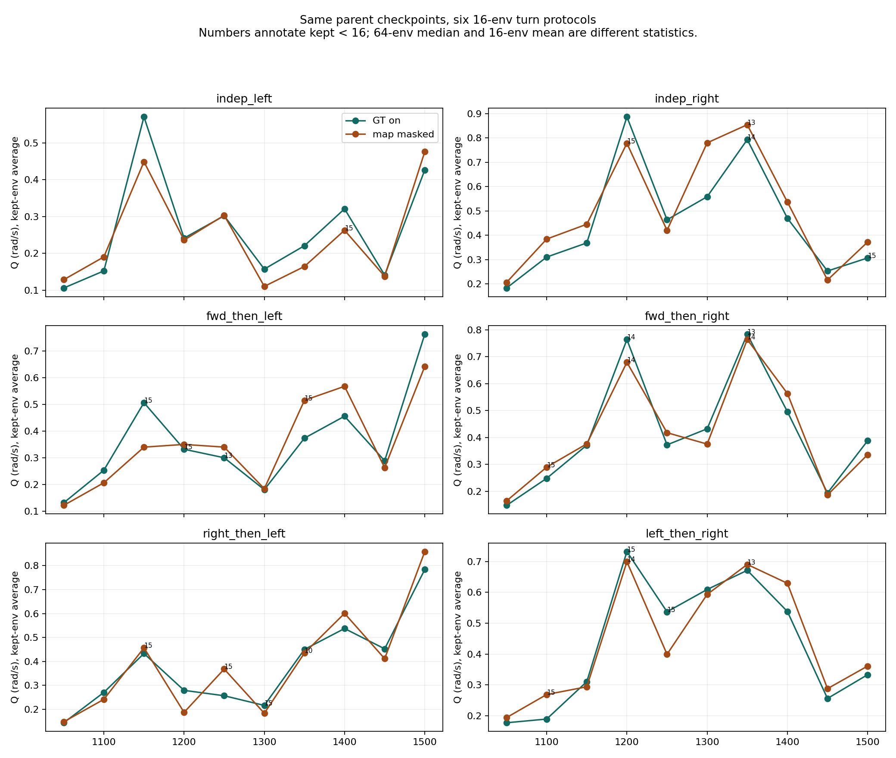
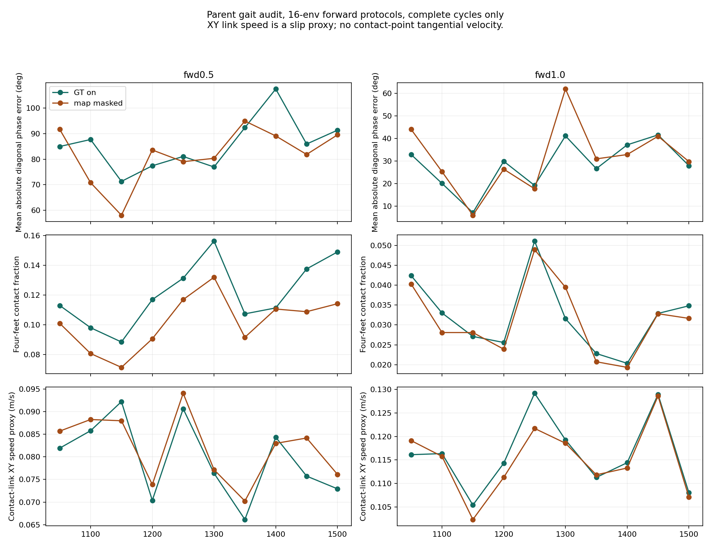

> 분류: A/평가 · 일반화 벤치마크 · 지표
> 작성: analyst · 2026-10-28
> 근거: S-B10 m1050~m1500 map64 · turn16 NPZ · TensorBoard · train_extra · map_switch 원자료 직접 재계산
> 요지: 전진 추종 감소는 실재하며 일부 좌회전 증가와 동반되지만, 전반적인 회전 향상과의 교환으로 단정할 수 없다.
> 상태: W32 CPU 분석 완료 · 새 평가·영상 재판독 없음 · 원인과 전 지형 일반화 미확인
# W32 · S-B10 부모의 전진 내림세와 출발선 기록

**판정: m1500을 개발 부모로 보존하되, 전진이 이미 내림세였다는 사실을 정본 기록에 남겨야 한다. 이후 자식의 감소를 전부 새 과제 탓으로 돌리거나 부모 내림세를 근거로 자동 면제하면 둘 다 틀린다.**

## 1. 실제로 무엇이 낮아졌나

같은 낮은 레벨 고정 64칸에서 m1050→m1500 전진 1.0 명령의 몸 앞 방향 속도 적분 중앙값은 GT 켬 6.020→5.428 m(−9.83%), 지도 가림 5.968→5.441 m(−8.83%)다. 전진 0.5도 각각 −11.39%, −12.27%다. GT fwd1.0 생존은 62→64, 가림은 64→64이므로 마지막 값이 낮은 것을 낙상 증가만으로 설명할 수 없다. 전체 보행 붕괴라는 판정도 아니다.

이 거리는 **6초간 몸 좌표계 vx의 적분**이다. 세계 좌표 순변위나 지형 끝까지 통과한 거리가 아니다. 전진에서는 0.5 m/s의 3 m, 1.0 m/s의 6 m가 설명용 기준값이다. 초기 가속·실제 궤적을 무시한 이 값으로 새 합격 문턱을 만들지 않는다. 근거: `impl-turncases/foothold_s2/eval/eval_map_modes.py:163~177`.

| 저장본 | GT 0.5 거리 m | 가림 0.5 m | GT 1.0 m | 가림 1.0 m | GT 1.0 생존 | 가림 1.0 생존 |
|---|---:|---:|---:|---:|---:|---:|
| 1050 | 3.099 | 3.167 | 6.020 | 5.968 | 62/64 | 64/64 |
| 1100 | 3.116 | 3.184 | 5.903 | 5.914 | 64/64 | 63/64 |
| 1150 | 2.825 | 2.882 | 5.772 | 5.762 | 64/64 | 64/64 |
| 1200 | 2.809 | 2.932 | 5.956 | 5.942 | 64/64 | 64/64 |
| 1250 | 3.153 | 3.181 | 6.042 | 6.078 | 64/64 | 64/64 |
| 1300 | 2.903 | 2.924 | 5.859 | 5.748 | 64/64 | 64/64 |
| 1350 | 2.758 | 2.847 | 5.621 | 5.647 | 63/64 | 64/64 |
| 1400 | 2.898 | 2.905 | 5.655 | 5.618 | 64/64 | 64/64 |
| 1450 | 3.012 | 3.128 | 5.819 | 5.825 | 64/64 | 63/64 |
| 1500 | 2.746 | 2.779 | 5.428 | 5.441 | 64/64 | 64/64 |

처음 다섯 저장본과 마지막 다섯의 평균도 GT 1.0은 5.939→5.676 m, 가림은 5.933→5.656 m로 내려간다. 끝점 한 개만 고른 결론은 아니다. 다만 모든 50회 구간이 단조 감소한 것은 아니다.

B1500 반복 평가에서 양쪽 생존이 60/64 이상인 7칸의 거리 차 최대는 0.009580 m다. 이번 감소는 그 관측 폭보다 크다. 이 두 반복을 S-B10의 신뢰구간이나 모든 지형의 오차 상한으로 쓰지는 않는다. `repeat_noise_B.csv`에 생존이 적은 칸까지 포함한 12칸을 보존했다.

## 2. 회전과 맞바꿈인가

**일부 좌회전 경우와는 반대 방향으로 변했다. 모든 회전과 맞바꿨다는 주장은 반례가 있다.** 특히 m1200→m1500에는 64칸 좌회전 추종비도 0.220→0.195, 우회전도 0.678→0.302로 전진과 함께 낮아졌다. 16칸에서는 전진 뒤 좌회전과 우→좌 전환은 올라가지만 우회전 계열은 내려갔다.

| 지도 | 회전 경우 | Q m1050 | Q m1200 | Q m1500 | m1500 kept | m1200→1500 C |
|---|---|---:|---:|---:|---:|---:|
| GT | indep_left | 0.106 | 0.241 | 0.427 | 16/16 | 0.828→0.702 |
| GT | indep_right | 0.184 | 0.886 | 0.307 | 15/16 | 0.337→0.600 |
| GT | fwd_then_left | 0.131 | 0.332 | 0.763 | 16/16 | 0.759→0.463 |
| GT | fwd_then_right | 0.147 | 0.764 | 0.387 | 16/16 | 0.464→0.573 |
| GT | right_then_left | 0.144 | 0.279 | 0.784 | 16/16 | 0.802→0.417 |
| GT | left_then_right | 0.177 | 0.732 | 0.333 | 16/16 | 0.499→0.542 |
| 가림 | indep_left | 0.128 | 0.236 | 0.476 | 16/16 | 0.754→0.658 |
| 가림 | indep_right | 0.207 | 0.778 | 0.372 | 16/16 | 0.373→0.583 |
| 가림 | fwd_then_left | 0.122 | 0.350 | 0.642 | 16/16 | 0.694→0.473 |
| 가림 | fwd_then_right | 0.164 | 0.679 | 0.336 | 16/16 | 0.468→0.622 |
| 가림 | right_then_left | 0.148 | 0.187 | 0.859 | 16/16 | 0.831→0.343 |
| 가림 | left_then_right | 0.194 | 0.699 | 0.361 | 16/16 | 0.537→0.574 |

Q는 각 유효 env에서 살아 있던 표본의 명령 방향 요 각속도를 평균한 뒤, kept env끼리 같은 비중으로 평균한 rad/s다. C는 네 발이 모두 1 N 넘게 접촉한 시간 비율이다. 64칸 추종비 중앙값과는 분모·단위·지형 배치가 다르므로 서로 바꾸어 쓰지 않는다. 이전 동작은 NPZ 기록 전 수행된다. 근거: `turn_probe.py:153~168,191~201,240~245`.

10 저장본의 GT 1.0 거리와 Q의 Pearson r은 전진→좌 −0.827, 우→좌 −0.925지만, 독립 우 −0.021이다. 인접 변화량끼리도 각각 −0.812, −0.860, −0.211이다. 함께 변한다는 증거이며 원인 증거는 아니다. 같은 시드의 연속 저장본은 독립 표본이 아니므로 p값으로 확정하지 않았다. 전체 12쌍과 변화량은 `correlations.csv`다. 회전 손실을 제거한 대조나 과제별 gradient 간섭을 재지 않아 인과적 교환은 미확인이다.

## 3. 더 느려진 대신 위상·안정이 좋아졌나

m1050→m1500 GT fwd1.0의 대각 쌍 사이 위상 오차 평균은 32.87→27.92°, 네 발 동시 접촉 비율 0.0424→0.0348, 주기 평균 0.459→0.455 s다. 발 접촉 중 링크 중심 XY 속도 대용치는 0.116→0.108 m/s다. 전진 0.5는 위상 오차 84.98→91.37°, C 0.113→0.149로 방향이 다르다. 따라서 모든 속도에서 보행 질이 일관되게 좋아진 대가라고도 할 수 없다.

완전한 착지 주기만 계산하고 단절된 alive 구간은 제외했다. phase의 R은 각 env 평균 위상 사이 원형 집중도다. R이 높다는 사실만으로 180° 대각 교대나 정상 trot를 뜻하지 않는다. 낮은 속도에서 두 대각쌍의 동시 접촉 시작이 여러 번 생길 수 있어 이 식 하나로 포복·도약을 판정하지 않는다. XY 링크 속도는 접촉점의 접선 slip이 아니다(`probe_result.json/static/slip_note`). 영상 1x 재판독과 지지면 대비 몸 높이를 이번 W32에 새로 포함하지 않았으므로 보행 전체의 우열 주장은 하지 않는다.

## 4. 학습 보상은 올라갔는데 고정 평가가 낮아졌다

| 학습 구간 | 총 보상 평균 | GT 선속도 추종 항/초 | GT 요 추종 항/초 | 학습 지형 레벨 | 정책 std | 업데이트 끝 lr |
|---|---:|---:|---:|---:|---:|---:|
| 1001~1100 | 14.990 | 1.277 | 0.342 | 5.701 | 0.550 | 0.0003439 |
| 1101~1200 | 15.831 | 1.284 | 0.348 | 5.672 | 0.543 | 0.0003268 |
| 1201~1300 | 16.567 | 1.292 | 0.353 | 5.618 | 0.539 | 0.0003347 |
| 1301~1400 | 17.435 | 1.306 | 0.362 | 5.654 | 0.531 | 0.0003283 |
| 1401~1500 | 17.323 | 1.299 | 0.361 | 5.788 | 0.530 | 0.0003234 |

추종 항·레벨은 `map_switch.jsonl`의 env-step 가중 평균, 나머지는 업데이트 평균이다. 학습에서는 다양한 명령·레벨, 확률 정책과 잡음이 섞인다. 고정 평가는 특정 명령·시작 상태의 평균 행동이다. 따라서 학습 보상 상승은 고정 평가 저하의 반증이 아니다. 이 결과만으로 보상 해킹이나 관측 오류를 확정할 수도 없다. lr·PPO KL·std의 전체 궤적과 계산 정밀도는 W29 추가 요청에서 EX-35와 함께 대조한다.

## 5. 부모에게도 단독 문턱을 걸면

GATE-v3 v0.5에서 논의한 Q < 0.12와 kept ≥14를 같은 원자료에 각각 적용했다. 전체 판정기를 다시 승인한 결과는 아니며, 두 조건의 자가 점검이다.

| 조건 | 실제 걸리는 부모 칸 | 해석 |
|---|---|---|
| Q <0.12, GT만 | m1050 독립 좌 0.105873 | 10저장본 중 1개 |
| Q <0.12, GT·가림 모두 | 위 칸 + m1300 가림 독립 좌 0.110281 | 10저장본 중 2개. “1/10”은 GT만 셌을 때 |
| kept <14, GT | m1250 전진→좌 13, m1350 전진→우 13 | 10저장본 중 2개 |
| kept <14, 가림 | m1350 독립 우 13, 우→좌 10, 좌→우 13 | 같은 저장본의 여러 경우를 중복 저장본으로 세지 않음 |
| m1500 단독 | 두 지도·여섯 경우 모두 Q≥0.12, kept≥14 | 최신 한 점 통과가 이전 500회 안정의 뜻은 아님 |

해당 문서 `C:/mai/wt/foothold-lab/fable-25a/inbox/jay/20261028-design/GATE-v3-maintenance-redesign.md:425`의 1/10 표기는 GT 범위로 한정해야 한다. 지금 결과를 보고 문턱을 바꾸자는 뜻은 아니다.

## 6. W27 정본 기록부에 남길 항목

| 항목 | S-B10 m1500에 남길 값 또는 상태 |
|---|---|
| 역할 | 팀장이 선택한 개발 출발선. 모든 축이 수렴했다는 성능 인증과 구분 |
| 저장본 SHA256 | 4d987818c7e25b89e77b7541feca3ddabedd444c5b20651eb29f3681da040d9d |
| 기준 구간 | m1050~m1500 10저장본. 이 구간 자체가 전진 내림세이며 정지 분포가 아님 |
| 내림세 축 | GT·가림 fwd0.5/1.0. 끝점 차와 처음/나중 5개 평균 차 모두 보존 |
| 증가·불안정 축 | 일부 좌 전환 Q 증가, 우회전 변동. 여섯 경우를 분리 |
| 단독 문턱 자가 점검 | §5 원자료 결과와 조건 범위. 과거의 미달을 최신 저장본으로 덮지 않음 |
| 생존·보행 한계 | 낮은 고정 칸의 결과. 전 지형·고레벨·실기 성능을 인증하지 않음 |
| 다음 자식 비교 | 부모 분포와 부모 최신값 둘 다 제시. 부모 하락 추세의 외삽을 합격 하한으로 쓰지 않음 |

권고는 **S-B10 m1500의 기존 출발선 결정을 유지하고, 불안정한 축을 명시한 채 다음 판을 평가하는 것**이다. 현 결과만으로 m1200으로 소급 교체하지 않는다. m1200은 전진·우회전이 낫고 m1500은 특정 좌 전환이 나아 단일 최적 저장본이 아니다. 어느 능력을 더 중요하게 볼지는 결과를 고른 뒤 만들 기준이 아니라 다음 설계의 목적에 남겨야 한다.

## 7. 완료·한계·재현

- 확인됨: 10저장본 × 2지도 × 4명령의 map64 80행, 회전 120행, 위상 120행을 다시 계산했다. NPZ kept/생존과 명령 조건을 직접 읽었고, 답을 아는 입력 7개를 통과했다. 입력 195파일의 전후 해시가 같다.
- 세 그림을 생성하고 전진·위상 그림을 직접 열어 축·범례·잘림을 확인했다. 소스·표·계산은 [자료 폴더](figs/w32-parent-audit/)에 있다. 모든 수치는 CSV에서 문서 표로 생성했다.
- 고레벨 L6/L9는 m1500 자료만 있어 같은 구간의 변화 추세를 판단할 수 없다. 옛 map64에 지형별 env 원자료가 없어 각 7종의 저하를 분해할 수 없다. 새 W03 자료를 옛 10저장본 시계열로 간주하지 않는다.
- 이번은 W32의 수치 반박이다. 학습·GPU·코드·정본 기록부를 변경하지 않았다. 영상 전체 판독·실기 판정은 미완료다.
- 실행: `C:/Users/AI-WS01/anaconda3/envs/isaac311-moects/python.exe figs/w32-parent-audit/recompute.py`, 이어서 `write_report.py`. SHA 목록은 `SHA256SUMS.txt`다.
- 원자료: `C:/mai/wt/foothold-lab/impl-turncases/logs/sb10_eval/m<N>/{map64/map_modes.json,turn16_<mode>/arrays_<case>.npz,probe_result.json}`. 학습: `C:/mai/wt/foothold-lab/impl-sb/logs/rsl_rl/foothold_s2_sb/2026-10-26_01-17-47_sb-main/`.
- 소스: [eval_map_modes.py](C:/mai/wt/foothold-lab/impl-turncases/foothold_s2/eval/eval_map_modes.py:163) · [turn_probe.py](C:/mai/wt/foothold-lab/impl-turncases/foothold_s2/eval/turn_probe.py:191). 절차 맥락은 [#555](https://github.com/foothold-project/foothold-lab/issues/555).
