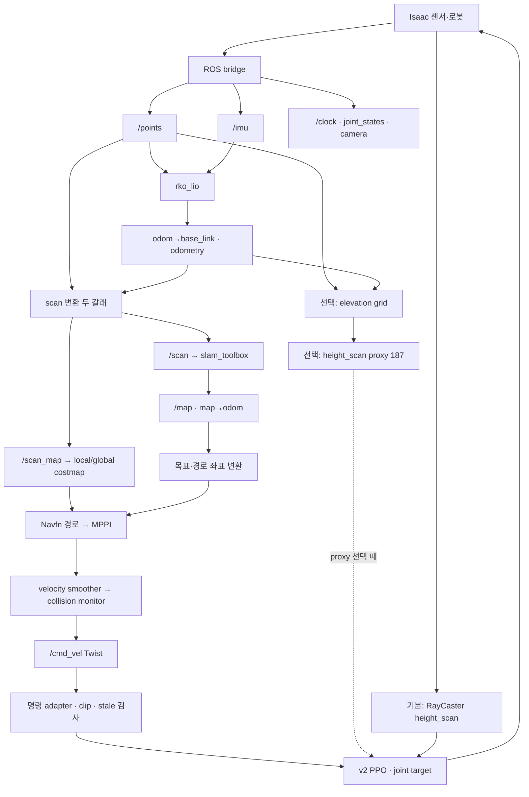

> 분류: B/항법 · 민우 SLAM·Nav2·보행 연결 조사
> 작성: verifier · 2026-10-28
> 근거: 원격 main 502eeda9 · RunPod leeminwoo 저장 소스·설정 · CPU 관측 선택 확인 · 카드 B 조사
> 요지: ROS 항법은 존재하나 최근 실행 스크립트의 보행 입력은 기본 RayCaster이며, START·HiPAN·앱 통합은 별도 계약이 필요하다.
> 상태: 읽기·CPU 조사 완료 · 현재 Pod 실행 상태와 실기 성능 미확인 · 실행·통합 승인 아님

# 민우 전체 스택과 통합 접점

**민우 자료에는 서로 다른 두 항법 경로가 있다.** `foothold-go2-experiments/code/nav`는 시뮬 정답 위치를 쓰던 자체 경로 계획기이고, `go2-slam-nav2`와 `ros2_ws`는 ROS 2·rko_lio·slam_toolbox·Nav2 경로다. 최근 `scripts/run_nav_L14A.sh`는 후자를 사용하면서 전자의 씬·라이다·보행 자산을 재사용한다. 옛 문서의 「SLAM/Nav2 미구현」을 현재 전체 자료의 상태로 읽어도 틀리고, ROS 항법이 있다는 이유로 보행까지 센서 기반 실기 경로라고 읽어도 틀린다.

## 1. 확인 범위와 근거 자리

원격 `foothold-project/foothold-lab` main SHA는 `502eeda9f0d0086a24f6fcce677cce8684525017`이다. [inbox/lee 원문](https://github.com/foothold-project/foothold-lab/tree/502eeda9f0d0086a24f6fcce677cce8684525017/inbox/lee)의 전체 목록·본문을 확인했다. `.gitkeep`, README, 9/2 브레인스토밍 두 파일, 9/8 진단 문서이며 현재 Nav2 구현은 이 폴더에 없다. 9월의 역할·상용 보행 방침을 최신 START 설계의 대체 승인으로 쓰지 않았다.

RunPod는 기존 S3 접근으로 `s3://rzklpc35sl/leeminwoo/` 저장 파일만 읽었다. 유료 Pod 기동, SSH 접속, 프로세스 조회·변경, ROS·Kit·GPU 실행을 하지 않았다. 다음 약어는 S3 키의 상대경로다. 행 번호는 UTF-8 읽기 사본 기준이다.

| 약어 | S3 경로 | 읽은 범위 |
|---|---|---|
| T | `leeminwoo/go2-slam-nav2/` | ch00~16 README 전체, 공용 정책 runner·ROS bridge·명령 adapter·높이 proxy·전체 실행 파일 |
| W | `leeminwoo/ros2_ws/src/go2_tutorial/` | nav2/rko_lio/SLAM/scan YAML, launch 전체, gravity_frame·elevation_grid·elevation_map |
| S | `leeminwoo/scripts/` | run_nav_L14A·run_all_L14A·cmdvel_ppo_adapter_frames·course_goal_L12·IMU 확인 스크립트 |
| E | `leeminwoo/foothold-go2-experiments/` | README, CODE-MAP·NAVIGATION·PROVENANCE, code/nav 목록. 옛 자체 항법 Python 전체 재검은 아님 |

읽기 사본: `C:/mai/wt/foothold-lab/verifier-27c-window/_out/minwoo_stack_1028/`. `lab-main-tree.json`, `lab-main/inbox/lee/`, `s3/leeminwoo/`, `sha256.json`, `cpu_receipt.json`을 보존했다. S3 수정 시각은 배포·실행 증거가 아니다. 설치 share의 YAML을 읽는 launch와 source YAML을 구분했고, 살아 있는 노드의 parameter dump는 받지 않았다.

## 2. 자료의 전체 구조

| 묶음 | 역할 | 연결 여부·근거 |
|---|---|---|
| 원격 main inbox/lee | 초기 구상·진단 기록 | 최신 실행 정본 아님. 최신 ROS 자료는 S3에 별도로 존재 |
| E/code/stopft, eval | 기존 정책 학습·평가 및 씬 자산 | `E/docs/CODE-MAP.md:8`~31. 학습·평가·항법 설정은 자동 전파되지 않음(:52) |
| E/code/nav | 자체 지도·A*·추종·사람 인지·씬·RTX LiDAR | `E/docs/NAVIGATION.md:8`~28. 옛 항법은 root_state_w·world 점군 사용. 새 ROS 실행은 그중 씬·센서 재사용 |
| T/ch00~04 | 환경, 정책 실행, ROS 기초, 센서 bridge, TF | 각 장 README와 공용 `ch01-ppo-runner/go2_sim_common.py`, `ch03-isaac-ros2-bridge/ros_bridge.py` |
| T/ch05~11 | LIO, SLAM, RViz, Nav2, 목표, cmd_vel→PPO, 전체 실행 | 각 장 README. 복사·수정된 W와 S가 실제 적용 경로인지 별도 확인 필요 |
| T/ch12 | 카메라 사람 검출·속도 중재 | README:3~8의 별도 person launch와 `/cmd_vel_safe`. L14A 기본 사슬에 자동 포함되지 않음 |
| T/ch13~15 | LiDAR 높이 격자, 187칸 proxy, env/proxy/zero/noise 소거 | `ch14-height-scan-proxy/README.md:5`~8, `ch15-ablation/README.md:5` 이후 |
| T/ch16 | 정적·실동작 점검 구분 | README:1~8. 소스 존재만으로 동작 PASS가 되지 않음을 명시 |
| W·S | 수정된 ROS 패키지·실행 wrapper | `S/run_all_L14A.sh:455,468,473,478`은 TF→odom→SLAM→Nav2 개별 launch. T의 full_stack 기본 구성과 다름 |
| models·runs·logs | 체크포인트와 실행 기록 | v1/v2 경로가 wrapper에 있고 결과는 Git 외부. 성능·통과율은 재평가하지 않음 |

## 3. 소비 경로

SLAM `/map`은 전역 비용지도와 같은 객체가 아니다. 현재 `W/config/nav2_params.yaml:270`의 global plugins는 obstacle_layer·inflation_layer이며 static_layer는 활성 목록에 없다. `/map` 점유 셀이 전역 경로 계획에 자동 반영된다고 단정할 수 없다. global frame은 map(:242), rolling window가 켜져 있고(:262), 장애물 입력은 `/scan_map`(:278)이다. `full_stack.launch.py:31`의 「정적층」 주석은 현재 YAML의 활성 목록보다 약한 근거다.

| 경계 | 값·형식 | 원문 근거 |
|---|---|---|
| 센서→ROS | `/points` PointCloud2, `/imu`, `/joint_states`, RGB·depth·camera_info, `/clock`. static TF는 bridge 기본 off | `T/ch03-isaac-ros2-bridge/ros_bridge.py:89`~99 및 초기화부. IMU 없을 때 GT로 대체하지 않는다고 명시(:11) |
| LIO | LiDAR+IMU→odom→base_link. `/rko_lio/odom`, IMU 주기 출력 선택 `/rko_lio/odom_at_imu_rate` | `W/config/rko_lio.yaml:9`~19, `launch/odometry.launch.py:40`~48 |
| TF·scan | base_stabilized는 base_link 원점에서 roll/pitch를 제거한 yaw 프레임. 점군을 `/scan`과 `/scan_map`으로 분리 | `W/go2_tutorial/gravity_frame.py:44`~53, `launch/slam.launch.py:30`~46 |
| SLAM | slam_toolbox mapping, map/odom/base_stabilized, `/scan`; 해상도 .05m | `W/config/slam_toolbox.yaml:10`~20, `launch/slam.launch.py:48`~59 |
| 높이 지도 | odom의 8m·.1m 격자, 같은 셀의 높은 점 유지·오래된 셀 제거. `/elevation/points`와 별도 grid | `W/go2_tutorial/elevation_map.py:43`~61, `elevation_grid.py:21`~33 |
| 항법 | Navfn(use_astar false) 경로, MPPI DiffDrive. vx 0~1.0, vy 0, wz ±.6 설정 | `W/config/nav2_params.yaml:86`~111, :313~320. 정책 자체의 전체 능력 범위와 다름 |
| 명령 후처리 | smoother 최소 [0,0,−.6], 최대 [1,0,.6]; collision monitor는 cmd_vel_smoothed→cmd_vel. unstamped Twist | `W/config/nav2_params.yaml:396`~418 |
| 명령→정책 | body vx/vy/wz. adapter clip은 양음 대칭, L14A는 [1,0,.6]. 명령 나이 .5s 초과 또는 초기 settle 동안 0, 새 명령이면 자동 복귀 | `S/cmdvel_ppo_adapter_frames.py:119`~126; `S/run_nav_L14A.sh:84`~85 |
| 정책 소비 | vel_command_b 기록→관측 재획득·명령 일치 검사→선택 height hook→추론→env.step→policy.reset(dones) | `T/ch01-ppo-runner/go2_sim_common.py:167`~184 |
| 스크립트 정책 | 기본 v2, `/data/leeminwoo/models/foothold-v2-cuda0.pt`; 표준 OnPolicyRunner | `S/run_nav_L14A.sh:41,49,75`~87; `T/ch01-ppo-runner/go2_sim_common.py:122`~128 |

**보행 센서 경로 제한.** `S/cmdvel_ppo_adapter_frames.py:36`에서 `--obs_scan` 기본은 env다. `run_nav_L14A.sh:75`~87에는 이 옵션이 없다. 이 스크립트를 그대로 실행하면 LIO·SLAM과 별개로 보행 height_scan은 시뮬 RayCaster다. proxy는 :134~146의 선택 분기이며 GT 비교 옵션 eval_proxy와도 다르다. 「GT pose는 초기 정렬·평가 전용」이라는 wrapper 문구(:70)는 높이 관측에도 GT가 없다는 뜻이 아니다. AST로 default와 override 부재를 재확인했다.

## 4. START·HiPAN·앱 통합에서 문제 될 접점

| 접점 | 확인한 차이 | 닫아야 할 계약 |
|---|---|---|
| START 실행기 | 현재 235 관측 표준 PPO 계열. START는 o45+est51 actor와 history·depth·GRU·복원 경로 | weight만 교체 불가. 관측 순서·정규화·주기·상태 reset·joint order·action scale·PD·포화를 export에 결속. 카드 B §2~3 및 `T/ch01-ppo-runner/go2_sim_common.py:132`~148 |
| 187 proxy와 START 지도 | proxy는 x±.8, y±.5의 17×11, base_z−height−.5와 miss 규약. START의 32×16 지도·depth와 다름 | 격자 방향·원점·해상도·높이 부호·결측·시각·외참 필요. reshape만으로 같아지지 않음. `T/ch14-height-scan-proxy/height_scan_proxy.py:23,46`~52 |
| 실기 PRED-only | proxy조차 L14A 기본이 아님. 정책 관측은 환경 observation manager에서 생성 | GT height뿐 아니라 속도·중력·관절·depth 각각의 실제 공급원 추적 필요. force_gt=False나 proxy 선택만으로 실기 입력 완성 아님 |
| 지도 네 종류 | SLAM map, Nav2 costmap, elevation, START map은 목적이 다름 | elevation/grid는 z×100을 int8로 넣음(`W/go2_tutorial/elevation_map.py:61`). 일반 점유확률 0~100/-1로 소비하면 의미가 깨짐. 타입·scale 계약 필요 |
| 프레임·시각 | Nav2는 odom_at_imu_rate, gravity_frame 기본과 proxy는 `/rko_lio/odom`. elevation은 msg 시각 대신 최신 TF `Time()` | TF 발행권과 timestamp 계약 필요. 실제 오차·주기는 미측정. `W/launch/slam.launch.py:66`, `T/ch14-height-scan-proxy/height_scan_proxy.py:108`, `W/go2_tutorial/elevation_map.py:51` |
| Nav2·HiPAN | 민우 MPPI는 이미 최종 속도 출력. 우리 HiPAN 우선/Nav2 대체 문서와 Nav2 전역→HiPAN 국소 구상은 다른 구성 | path/waypoint 또는 velocity 중 인계 형식, 최종 발행권·취소·fallback·실패 상태 필요. MPPI와 HiPAN을 동시에 cmd_vel writer로 연결 불가. 카드 B §4 대조 유지 |
| 열린 명령 | MPPI·smoother는 후진/횡이동 제한. adapter는 vx 음수 허용. backup behavior도 등록(:340~344) | 정책 capability와 항법 허용 범위 구분. START 뒤/옆 허용이 상류에서 소실되거나 recovery가 미검증 명령을 내지 않게 계약 필요. 실제 recovery 동작 미확인 |
| 앱·정지 | 앱 서버 agent는 0·전진·전진회전으로 양자화. 민우는 .5s sim-time 뒤 0, latch 없음. 설계 44의 .3s STOP latch와 다름 | manual/Nav2/HiPAN/안전층 우선권·lease·timeout·명시 재개 공통화. 0 명령과 물리 정지는 다름. 카드 B §2·§4 및 `Adapter.command` |
| 통신·시계 정지 | unstamped Twist 나이는 수신 당시 sess.t. proxy도 sim-time 기준 hold→miss | 지연·stale 명령 재전송·clock 정지와 실기 wall clock 구분. real-time watchdog 완성 증거 없음. `S/cmdvel_ppo_adapter_frames.py:119`~124 |
| 지도 목표·GT | L12 course_goal은 초기 GT로 course 좌표를 map으로 정렬 | 실기 앱 목표는 map frame·지도 identity·goal id·취소 결과와 연결. 초기 GT 정렬은 실기 localization이 아님. `S/course_goal_L12.py:14`~19, :107~158 |
| 선택 인지 | 사람 게이트는 별도 `/cmd_vel_safe`, proxy는 옵션. L14A는 elevation/person launch 없음 | 파일 존재와 현재 소비를 따로 기록. `T/ch12-camera-person/README.md:3`~8; `S/run_all_L14A.sh:455`~478 |
| reset | env done 뒤 policy reset은 존재. ROS map·odom·명령 cache·START 상태 공동 reset 증거 없음 | 동일 run identity와 좌표 재초기화 계약 필요. 시뮬 자동 reset은 실기 recovery가 아님. `T/ch01-ppo-runner/go2_sim_common.py:181` |
| 적용본 | launch는 install share 설정 사용. run_all은 install YAML 해시부터 기록 | source·교재·설치본·노드 dump 분리 보존. `W/launch/nav2.launch.py:12`~19, `S/run_all_L14A.sh:401`~426. 라이브 적용값 미확인 |

이 목록은 턱 통과 실패의 원인 분석이 아니다. 비용지도 문턱·보행 보상·스캔 띠를 바꾸는 처방도 하지 않는다. 민우의 해당 분석과 분리해 통합 경계만 정리했다.

## 5. 확인 결과와 한계

확인됨: 소스의 ROS 항법 사슬, 서로 다른 지도와 frame, L14A의 v2·env 높이 관측 기본 선택, 명령 부호·clip·timeout 경로. CPU에서 `elevation_grid` selftest로 같은 셀 최고점·decay·recenter를 확인했고, adapter argparse를 AST로 읽어 env 기본값과 wrapper 옵션 부재를 확인했다. stdout은 `elevation_grid selftest OK`, 영수증은 `cpu_receipt.json`이다.

미확인: 현재 Pod 프로세스·실행 파라미터, TF 지연·drop·제어 주기, v2/START 물리 성능, 실기 입력 완성, HiPAN·앱과의 전체 연결. 옛 자체 항법 성능과 턱 문제는 다시 분석하지 않았다. 설정과 CPU selftest를 항법 성공 또는 실기 준비 완료로 확대하지 않는다.

우리 쪽 기존 직접 대조는 [ANALYSIS-app-nav-interface.md](ANALYSIS-app-nav-interface.md)에 보존했다. 고정 앱 SHA·START 496e0cfe·설계 9e650a28 기준을 그대로 인용했으며 앱과 START 전체를 다시 검증한 것은 아니다. 통합의 핵심은 기존 ROS 항법을 버리는 것이 아니라, 정책·지도·시간·제어권 경계에 실제 공급원과 소비 계약을 붙이는 것이다.
