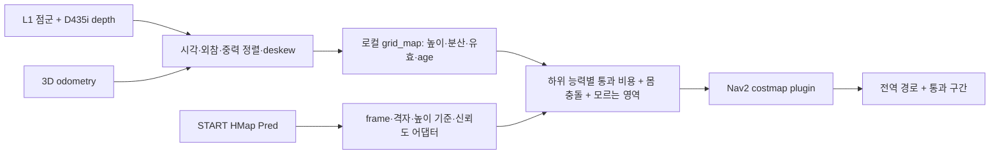
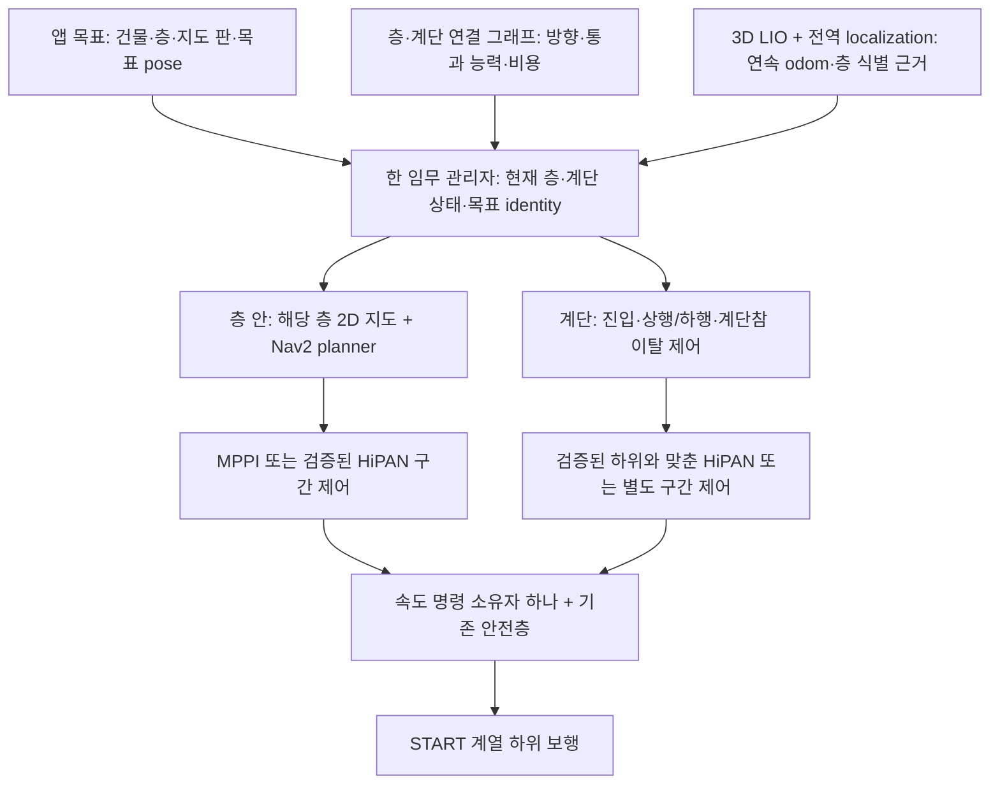

> 분류: 리서치
> 작성: analyst · 2026-10-29
> 근거: Nav2 Jazzy 고정 소스, RTAB-Map·FAR·CMU Go2·PCT 원문, L1·D435i 사양, HiPAN·민우·설계 21·23·54 대조
> 요지: 복층·계단을 첫 통합 범위로 바꾸며, 3D 위치 추정 + 층·계단 연결 그래프 + 층별 Nav2 + 계단 구간 제어를 권고한다. 단일 2D 지도와 기본 XY 도착 판정만으로는 부족하다.
> 상태: v0.3 · 복층 우선 독립 의견 완료 · 팀장 선택 전 · 소스·원문·식 대입 확인됨 · 실기·GPU·Kit·ROS 실행 없음

# 상위 항법 구성에 대한 의견

**복층·계단 이동이 첫 요구이므로 v0.2의 “단층부터 통합” 권고를 철회한다. 권고는 3D 위치 추정과 층·계단 연결 그래프를 먼저 두고, 층 안에서는 Nav2, 계단에서는 검증된 하위 보행과 구간 제어를 쓰는 구성이다.** 첫 통합 결과도 두 층 사이 계단 왕복과 각 층의 목표 도달로 잡는다(§11). 민우의 NavFn·MPPI는 층 안의 비교 기준으로 보존하며, `slam_toolbox` 한 장을 건물 전체 정본으로 쓰지는 않는다. 3D backend는 RTAB-Map을 첫 비교 후보로 앞당긴다. star의 CMU Go2·FAR와 비star의 PCT Planner도 비교하되, 3D 경로가 나온다는 사실과 Go2가 그 경로를 걸을 수 있다는 증거를 구분한다.

이번 요청의 “Nav2 전역 경로 + HiPAN 구간 주행”에는 **조건부 찬성**이다. 기존 설계의 “HiPAN 본 경로, Nav2 대체”와는 다른 우리 통합안이다. “HiPAN이 막히면 무조건 MPPI”에는 반대한다. 막힌 이유가 위치 추정 실패, 낭떠러지, 하위 보행 한계라면 제어기 교체로 해결되지 않는다. 최종 속도 명령의 소유권은 하나여야 한다.

읽기 자료에서 결론을 낼 수 있는 범위는 알고리즘의 역할·입출력·구현 제약이다. **우리 L1·D435i에서의 정확도, 연산 시간, 계단·듬성 지형 성공률은 미측정**이다. 아래 “우선”은 실측 성능 순위가 아니라 현재 자산과 실패 비용을 고려한 권고다. 새 실행 승인이나 설계 정본 변경은 하지 않았다.

## 1. 현재 자료와 이번 선택의 차이

내부 문서 기준은 읽을 때 공유 작업 공간 HEAD `a63242ecdc9e1103c3df396f28ba318ccd390375`이다. 문서 내용의 바이트 해시는 조사 사본에 따로 보존했다. 민우 자료는 verifier 보고만 인용하지 않고, 그 보고가 보존한 원본 사본의 관련 코드·YAML을 다시 읽었다. 살아 있는 Pod·ROS 노드의 적용값은 확인하지 않았다.

| 대상 | 직접 확인한 내용 | 이번 의견에 주는 제약 |
|---|---|---|
| [21-HIPAN-HIGH](../20261019-design/21-HIPAN-HIGH.md):15~43, 67~75, 93~117 | HiPAN student는 depth·몸 상태·상대 목표를 받아 명령 출력. 우리 안은 자세 두 칸을 빼고 `vx, vy, wz` 세 칸. 아래 35° 카메라도 원문과 다른 접목 | 기존 하위 정책과 카메라 조건에 맞춰 상위를 학습해야 한다. HiPAN 논문의 몸 낮춤 통과 성능을 우리 세 칸 판에 그대로 귀속하지 않는다 |
| [23-NAV2-FALLBACK](../20261019-design/23-NAV2-FALLBACK.md):17~28, 34~52 | HiPAN과 Nav2+깃발 추종기 중 하나를 선택하는 구조. 깃발 1 m, 속도 0.5 m/s는 가정. Nav2 대체의 듬성 지형 목표는 제외 | 새 결합안은 단순 구현 보완이 아니라 경로 공급 방식 변경. 기존 깃발 추종기의 0.5 m/s와 HiPAN의 속도 출력을 동시에 적용하지 않는다 |
| 같은 문서:54~66, 78~81 | STOP은 목표 취소·잠금·사람 해제, 통신 끊김도 별도 처리 | 진행 정체에 대한 자동 재계획과 안전 STOP을 구분한다. HiPAN timeout을 일반 막힘으로 바꿔 자동 재개하면 기존 계약과 충돌 |
| [54-S3-NAV](../20261019-design/54-S3-NAV.md):38~49, 61~69 | 하위 고정·실제 전이에 포함, 하위 능력으로 통과 등급 지정, 늦으면 Nav2 대체 | 새 통합판도 하위 hash·명령 가능 범위를 묶어야 한다. 옛 날짜·S1-blind 후보·관문 후보 숫자를 현재 승인값으로 재사용하지 않는다 |
| [ANALYSIS-minwoo-stack](../20261028-plan/ANALYSIS-minwoo-stack.md) §3~4와 소스 | NavFn Dijkstra, MPPI `DiffDrive`, `vx∈[0,1]`, `vy=0`, `|wz|≤0.6`. 전역 지도는 24 m 이동창, 활성 층은 obstacle+inflation. static_layer 비활성 | 이 설정은 현재 명령 제한을 가진 비교 기준이다. 전역 `/map`이 경로 비용에 이미 들어간다고 해석하면 틀림. 지도 기반 장거리 경로에는 지도 소비를 별도로 연결해야 함 |
| 민우 L14A 실행 경로 | `--obs_scan` 기본 `env`, wrapper에 override 없음. 187칸 높이 입력은 기본 시뮬 RayCaster. timeout .5 s 뒤 명령 0, 새 명령이면 복귀 | LiDAR SLAM 성공과 실기 센서 기반 보행 성공은 다른 증거. START 가중치만 교체할 수 없고, 현재 timeout은 우리 STOP 래치와 같지 않음 |

민우 근거 사본 루트는 `C:/mai/wt/foothold-lab/verifier-27c-window/_out/minwoo_stack_1028/s3/leeminwoo/`다. 이 문서의 **W**는 `ros2_ws/src/go2_tutorial/`, **S**는 `scripts/`, **T**는 `go2-slam-nav2/`를 뜻한다. 구체 근거: `W/config/nav2_params.yaml:86~111,242~290,310~321,394~418`, `S/run_nav_L14A.sh:75~87`, `S/cmdvel_ppo_adapter_frames.py:34~37,119~126`. `T/README.md:8`은 Ubuntu 24.04·ROS 2 Jazzy를 명시한다. 따라서 Rolling 기능 목록을 설치된 기능이라고 간주하지 않고 Jazzy 문서·코드를 기준으로 삼았다.

## 2. 전역 경로 planner 비교

이 절의 전역 planner 비교는 **한 층 또는 한 지지면의 2D 비용지도 안**에서 유효하다. 건물 전체 층 선택은 §11의 연결 그래프가 맡는다. 전역 planner는 “어느 통로로 갈까”를 정한다. **몸의 경로와 발 네 개의 착지 계획은 다르다.** 아래 기본 planner들은 지지면 강도·미끄럼·보행 위상·발끝 걸림을 자체적으로 계산하는 사족 동역학 계획기가 아니다. 높이 정보는 우선 통과 비용 또는 방향 제약으로 바꿔야 한다.

| 후보 | 공식 방식과 장점 | 4족·높이 지도에서의 한계 | 권고 |
|---|---|---|---|
| **NavFn** | 2D 비용지도에서 Dijkstra 또는 A*. 현재 민우 판의 비교 기준 | 방향을 포함한 몸 형상·발 디딤 제약을 경로 검색에 직접 넣지 않음. 높이 의미는 비용층이 공급해야 함 | 기존 기준선 보존. 적은 변경으로 연결 상태를 가르는 데 유리. [공식 설정](https://docs.nav2.org/jazzy/configuration_and_development/configuration_guide/planners_plugins/configuring_navfn/) |
| **Smac 2D** | 비용을 반영하는 2D A*, 평활화. 통과하기 편한 영역에 비용을 주는 구조와 잘 맞음 | 역시 방향별 몸 형상 검사가 있는 SE(2) 계획과 다름. 좁은 출입구·방향이 중요한 계단에서 원형 근사로는 한계 | **첫 교체 비교 후보**. 넓은 통로의 연속 지형에서 통과 비용층과 함께 비교. [공식 설정](https://docs.nav2.org/jazzy/configuration_and_development/configuration_guide/planners_plugins/smac/smac_2d/configuring_smac_2d/) |
| **Smac Hybrid-A*** | `(x,y,yaw)` 검색, Dubins/Reeds-Shepp 곡선, 방향별 footprint 검사 | 기본 곡률·차량식 이동 모델은 Go2의 제자리 회전·횡이동을 다 쓰지 못함. “4족 지원”과 “우리 능력에 가장 맞음”은 다름 | 전진 곡선 이동에 제한한 판에는 가능. 사족이라는 이유만으로 우선 선택하지 않음. [공식 설정](https://docs.nav2.org/jazzy/configuration_and_development/configuration_guide/planners_plugins/smac/smac_hybrid/configuring_smac_hybrid/) |
| **Smac State Lattice** | 미리 만든 이동 조각으로 검색. 제자리 회전·횡이동을 포함한 사용자 control set과 방향별 footprint 검사 가능 | control set을 실제 하위 능력·지도 해상도와 맞춰야 함. stock primitive는 계단 방향별 성공률이나 발 배치를 증명하지 않음 | **좁은 통로·옆걸음·방향 제약이 핵심일 때 가장 자연스러운 확장 후보**. 초기 통합 비용은 더 듦. [공식 설정](https://docs.nav2.org/jazzy/configuration_and_development/configuration_guide/planners_plugins/smac/smac_lattice/configuring_smac_lattice/) |
| **Theta*** | 가시선 연결을 이용하는 임의 각도 경로. 열린 공간에서 격자 방향에 덜 묶임 | 직선 연결이 실제 지지면 연속성이나 정면 진입 가능성을 보장하지 않음. 방향 없는 셀 비용으로 표현되지 않는 위험은 놓침 | 열린 평지 경로 길이 비교에 적합. 험지 본선의 우선 교체 사유는 약함. [공식 설정](https://docs.nav2.org/jazzy/configuration_and_development/configuration_guide/planners_plugins/thetastar/configuring_thetastar/) |

**Smac 2D를 고른다고 사각형 Go2 문제가 해결되지는 않는다.** 공식 Tuning Guide는 NavFn·Theta*·Smac 2D의 입자 근사와 Hybrid/Lattice의 SE(2) footprint 검사를 구분한다. 전자는 보수적인 팽창과 국소 footprint 검사로 넓은 길을 다루는 선택이다. 긴 몸을 돌려 통과해야 하는 좁은 길이 목표면 Lattice를 앞으로 당기는 편이 맞다. 그때도 몸 충돌 여유와 발을 놓을 수 있는 면적은 따로 검사해야 한다. [Nav2 Tuning Guide · Robot Footprint/Planner Selection](https://docs.nav2.org/jazzy/configuration_and_development/tuning_guide/)

## 3. 지역 controller 비교

controller는 “현재 경로를 따라 지금 어떤 속도를 줄까”를 정한다. `vx, vy, wz`는 하위 정책의 목표값이다. 바퀴가 없는 Go2에서도 이 인터페이스를 쓸 수 있지만, 명령한 속도를 곧바로 실현한다고 가정하면 회전 지연·미끄럼·방향 비대칭을 놓친다.

| 후보 | 장점 | 우리 조건의 약점·주의 | 권고 |
|---|---|---|---|
| **MPPI** | Model Predictive Path Integral. 여러 미래 속도열을 샘플링·평가. DiffDrive/Omni/Ackermann 모델, 장애물·경로·명령 제한 critic | 기본 rollout은 사족 동역학·지지면을 풀지 않음. 실제 추종 지연·가감속·방향별 범위와 맞춰야 함. CPU 비용도 현 장비에서 미측정 | **국소 기준선·실용 본 후보**. 옆걸음을 사용할 때 Omni와 `vy` 범위를 같이 열어야 함. 민우 DiffDrive 유지 판과 변경 판 구분. [공식 MPPI](https://docs.nav2.org/jazzy/configuration_and_development/configuration_guide/controller_plugins/mppi_controller/configuring_mppic/) |
| **DWB** | Dynamic Window 기반 속도 후보와 critic. vx/vy/wz 샘플링이 드러나 원인 설명이 쉬움 | 후보 수·sim horizon·critic 가중치에 민감. 낮은 회전 추종 능력을 좋은 명령 후보만으로 고치지 못함 | MPPI와 다른 단순 비교 기준 또는 구현 비용 제한 때 대안. “무조건 더 가볍고 빠름”은 미측정. [공식 DWB](https://docs.nav2.org/jazzy/configuration_and_development/configuration_guide/controller_plugins/dwb_controller/dwb_params/controller/) |
| **Regulated Pure Pursuit(RPP)** | 기하학적 경로 추종, 곡률·장애물 근접 시 감속, 전방 충돌 확인. 단순한 경로 추종에 적합 | 새로운 우회 궤적을 최적화하는 역할은 아님. Jazzy 출력은 `linear.x`와 `angular.z`, 횡속도 없음 | **전진·회전만 쓰는 평지 예비**로 유용. 옆걸음을 쓰려는 본판에는 부족. [공식 설정](https://docs.nav2.org/jazzy/configuration_and_development/configuration_guide/controller_plugins/configuring_regulated_pp/) · [소스 290~291행](https://github.com/ros-navigation/navigation2/blob/d5d768b7b38a05e7cfd2b6c693b786b402161bed/nav2_regulated_pure_pursuit_controller/src/regulated_pure_pursuit_controller.cpp#L290) |
| **Graceful** | 목표 pose를 향해 곡률과 속도를 부드럽게 바꾸는 제어법. 급격한 방향 변화 완화 목적에 맞음 | 공식 목록에 Omni·Legged가 있어도 Jazzy 일반 속도 함수는 `linear.x`, `angular.z`만 설정. 이름의 “부드러움”이 실제 보행의 충격 감소를 입증하지 않음 | 전진 곡선 경로 비교 후보. **순수 횡이동 후보로 추천하지 않음**. [공식 설명](https://docs.nav2.org/jazzy/configuration_and_development/configuration_guide/controller_plugins/configuring_graceful_motion_controller/) · [소스 55~108행](https://github.com/ros-navigation/navigation2/blob/d5d768b7b38a05e7cfd2b6c693b786b402161bed/nav2_graceful_controller/src/smooth_control_law.cpp#L55) |

MPPI를 쓰면 GPU를 별도로 써야 한다는 전제는 없다. 공식 구현은 CPU 실행을 설명한다. 다만 문서의 다른 CPU 성능을 우리 전체 센서·SLAM·정책 동시 실행 시간으로 옮길 수 없다. 민우의 `56 × 0.05 = 2.8 s` 예측 구간, `vx_max=1.0`, `prune_distance=1.7`은 소스 값이다. 주석은 0.5로 낮췄다고 적지만 실제 값은 1.0이다. 비용지도의 관측 범위·prune·최대 속도를 **실제 값 기준으로** 함께 검토해야 한다(`W/config/nav2_params.yaml:87~108`).

## 4. L1·D435i에서 위치 추정과 SLAM 후보

**Odometry는 짧은 구간에서 매끄러운 움직임 추정, SLAM은 지도와 누적 오차 보정까지 포함한다.** 앱에서 이전에 저장한 목표로 돌아가려면 지도 identity와 재위치 추정도 필요하다. 이동 중 오차가 작다는 것만으로 다음 실행의 같은 지도 좌표가 보장되지는 않는다.

### 센서에서 먼저 구분할 것

- **L1**: 공식 매뉴얼은 FOV 360°×90°, 유효 21,600점/s, 둘레 스캔 11 Hz, 수직 스캔 180 Hz, 가속도·자이로와 IMU 보고 250 Hz를 기재한다. 이는 360° 전체가 한 순간에 얻어진다는 뜻이 아니다. 이동 중 각 점을 찍은 시각으로 자세를 맞추는 deskew가 중요하다. [Unitree 공식 매뉴얼, 사양표 14쪽](https://oss-global-cdn.unitree.com/static/36d7f810f3b646638f54d7a4fb333658.pdf)
- **“L1에는 점별 시각이나 ring이 없다”는 주장은 틀리다.** 공식 SDK `PointUnitree`에 `time`, `ring`, cloud `stamp`가 있다. 다만 현재 Go2의 `rt/utlidar/cloud`에서 그 필드가 보존되는지, time 단위·기준점·IMU와의 동기화가 무엇인지는 실제 메시지를 받지 않아 미확인이다. SDK에 필드가 있다는 것과 사용 중 드라이버의 출력 계약은 구분한다. [SDK 47~87행](https://github.com/unitreerobotics/unilidar_sdk/blob/1bd7d95d8ab7ce7a22058d2bb07e39fd62612aa6/unitree_lidar_sdk/include/unitree_lidar_sdk.h#L47)
- **D435i**: 능동 스테레오 깊이·RGB·6축 IMU 센서다. 센서 자체가 완성된 위치 추정기를 주는 것은 아니다. 공식 사양의 깊이 FOV 87°×58°와 약 0.3~3 m 운용 범위는 선택한 stream·후처리·환경에서의 성능 보장이 아니다. START의 60×60 입력과 항법 RGB-D 원본을 동일 해상도로 강제할 이유도 없다. 같은 원본에서 각 소비자의 보정·시각·crop 계약을 유지한다. [Intel 사양](https://www.intel.com/content/www/us/en/products/sku/190004/intel-realsense-depth-camera-d435i/specifications.html) · [공식 IMU 설명](https://github.com/realsenseai/librealsense/blob/master/doc/d435i.md)
- L1 IMU, 몸체 IMU, D435i IMU는 다른 위치에 있다. 축·외참·시간을 맞추지 않고 하나의 IMU처럼 섞지 않는다. 특히 발 충격과 카메라 지연을 포함한 실기 자료는 아직 이 조사에 없다. L1 SDK는 LiDAR와 내부 IMU 원점 차이도 명시한다. [SDK 좌표 정의](https://github.com/unitreerobotics/unilidar_sdk#coordinate-system-definition)

| 후보 | 실제 역할·필요 입력 | L1·D435i와의 적합성·비용 | 판단 |
|---|---|---|---|
| **slam_toolbox** | 2D LaserScan+odom TF, pose graph SLAM, 지도 직렬화·localization 모드 | L1 3D 점군을 중력 정렬 후 일정 높이 띠로 투영하면 단층 실내 경로에 활용 가능. 원래 수평 레이저와 같지는 않으며 몸 높이·계단·다층 변화로 같은 벽의 관측 단면이 달라짐 | **층 안의 비교 기준으로 한정**. 복층 전체 정본으로 선택하지 않는다. 계단을 포함한 3D 위치 추정 자체를 이것 하나에 맡기지 않는다. [공식 README · Localization/Topics](https://github.com/SteveMacenski/slam_toolbox) |
| **Cartographer 2D/3D** | local submap + 전역 loop closure. 3D는 IMU 필요, 2D는 선택 | 지형이 3D라고 구현 불가능한 도구는 아님. 다만 upstream은 적극 유지보수 종료를 명시, ROS fork도 제한된 유지보수. Jazzy 포트·L1 전처리 인수 비용을 별도로 부담 | 신규 주력으로는 후순위. 이미 검증된 L1 자료·담당자가 있을 때 비교 가치. [공식 유지보수 상태](https://github.com/cartographer-project/cartographer) · [알고리즘 설명](https://github.com/cartographer-project/cartographer_ros/blob/master/docs/source/algo_walkthrough.rst) |
| **RTAB-Map** | RGB-D·stereo·LiDAR 입력의 graph SLAM, loop closure, 외부 odometry 사용 가능, 3D 지도·점유 지도 출력 | D435i RGB-D를 활용하고 rko_lio odom을 그대로 넣는 확장 가능. 색 영상 단서가 적거나 재방문 장면이 달라질 때의 성능·CPU·메모리는 실측 필요 | **복층이 필수이므로 첫 3D backend 비교 후보로 앞당김**. 층 identity·계단 연결·잘못된 loop closure 차단은 별도로 남는다(§11). slam_toolbox와 map→odom을 동시에 발행시키지 않음. [공식 ROS 2 README](https://github.com/introlab/rtabmap_ros/blob/f04a52d255ded6396dc11a54bfe01079ec0b0023/README.md) |
| **FAST-LIO2** | LiDAR+IMU, raw point scan-to-map와 필터 기반 odometry·증분 지도 | spinning·solid-state를 다루지만 Unitree L1 그대로의 검증 증거는 아님. timestamp·IMU 동기화·외참·센서 전처리 필요. 공식 main은 ROS1 안내 중심이므로 Jazzy 포트 출처를 정해야 함 | **rko_lio가 실제 자료에서 실패할 때 비교할 강한 LIO 후보**. 원 저장소만으로 loop closure·재위치 추정 완성이라 부르지 않음. [공식 README](https://github.com/hku-mars/FAST_LIO) |
| **LIO-SAM** | IMU 결합 factor graph, point time·ring, loop closure 예제·GPS factor | 공식 README는 9축 자세 제공 IMU를 요구하고, 일반 기계식 라이다 투영을 기본으로 한다. L1의 ring 존재만으로 투영 가정이 맞지 않으며 내부 6축을 9축처럼 취급할 수 없음. solid-state 확장은 제한적 시험이라고 명시 | **현재 장비의 첫 선택으로 비추천**. 사용할 경우 6축 초기화·L1 투영을 해결한 정확한 fork를 별도 판으로 봄. “L1은 절대 불가”라는 뜻은 아님. [공식 데이터·IMU 조건](https://github.com/TixiaoShan/LIO-SAM#prepare-lidar-data) |
| **KISS-ICP** | LiDAR만 사용하는 ICP odometry. ROS2 wrapper, 간단한 비교 기준 | IMU 결합·전역 loop closure를 기본 기능으로 기대하면 안 됨. L1의 희소한 관측과 빠른 몸 회전에서 불리할 가능성은 추정이며, 같은 bag에서 확인 필요 | IMU·외참 경로의 문제를 가르는 **LiDAR-only 대조군**. 주력 전체 SLAM의 대체는 아님. [공식 코드·논문 연결](https://github.com/PRBonn/kiss-icp) |
| **rko_lio** | LiDAR+IMU odometry, 센서별 모델 의존을 줄인 방식. 공식 ROS 문서는 Jazzy 지원과 점별 timestamp 설정 제공 | 민우가 이미 연결한 자산. 외참·점별 시각·입력 프레임 확인이 여전히 필요. 별도의 rko_slam을 두는 것처럼 odometry와 SLAM은 다름 | **현재 LIO 우선 유지**. L1에서 우수하다는 판정은 아직 못 함. [공식 코드](https://github.com/PRBonn/rko_lio/blob/04566e598f700bc7d5efcfcf3a83327ce842f4f7/README.md) · [ROS 입력 설명](https://prbonn.github.io/rko_lio/pages/ros.html) · [논문](https://arxiv.org/abs/2509.06593) |

복층 우선 조합은 **rko_lio를 초기 odometry 후보로 보존하고 RTAB-Map 같은 3D backend와 층·계단 연결 관리를 붙이는 안**이다. rko_lio+slam_toolbox는 층 안 비교판으로 남긴다. 3D 점유 지도를 2D로 내보낸다고 층간 경로 선택까지 해결되지는 않는다. 현재 건물의 계단 위치를 아는 첫 통합에는 층별 지도와 명시된 연결 그래프가 현실적이다. 미지의 계단 연결을 스스로 발견하는 것은 더 큰 별도 범위다.

TF 소유권은 `map→odom`에 전역 localization 한 곳, `odom→base_link`에 연속 odometry 한 곳으로 정한다. 로컬 높이 지도는 연속인 odom에서 다루고, 전역 loop closure의 순간 이동을 무시한 채 과거 높이 셀에 덧칠하지 않는다. 계단에서 필요한 z·roll·pitch는 유지하되, 2D planner용 평면 pose와 별도로 변환한다. [REP-105 원문 · odom/map/Frame Authorities](https://github.com/ros-infrastructure/rep/blob/master/rep-0105.rst)

## 5. 우리 높이 지도를 Nav2 비용지도로 연결하는 방법

### 네 지도를 한 이름으로 부르지 않는다

| 지도 | 담긴 의미 | 직접 소비자 |
|---|---|---|
| START HMap Pred | 로봇 주변 지지 높이의 학습된 추정값. GT 대비 오차는 시뮬에서 측정 가능 | 보행 정책. 복원값 자체가 통과 확률 또는 관측 신뢰도는 아님 |
| 센서 elevation map | 측정 높이·분산·관측 시각·유효 여부 등 | 통과 가능성 계산, 시각화, 보행 입력을 만들 별도 어댑터 |
| SLAM map | 전역 배치와 위치 추정을 위한 지도 | localization·전체 경로 계획의 환경 정보 |
| Nav2 costmap | 경로·궤적의 비용, 장애물, 모르는 영역 | planner·controller |

**grid_map은 다층 배열과 변환 도구이지 자동 SLAM이나 사족 통과 판정기가 아니다.** elevation·variance·normal·traversability 등을 같은 격자에 저장할 수 있고 ROS2 branch가 있다. `elevation_mapping`은 pose 불확실도를 반영해 높이와 분산을 만드는 참고 구현이지만 원 저장소는 적극 유지보수 종료를 명시한다. `traversability_estimation`은 slope·roughness·step 필터를 제공하나 원본은 ROS Noetic 연구 코드다. 이 세 이름을 적는 것만으로 Jazzy plugin을 설치해 연결한 상태가 되지 않는다. [grid_map ROS2](https://github.com/ANYbotics/grid_map/tree/ros2) · [elevation_mapping](https://github.com/ANYbotics/elevation_mapping) · [traversability_estimation](https://github.com/leggedrobotics/traversability_estimation)

**권고 연결은 아래 순서다. 구현 제안이며 아직 구현·구동한 것이 아니다.**

1. **표현 맞추기.** HMap의 body/yaw frame, 셀 순서, m 단위, 높이 기준, 관측 시각과 odom 변환을 고정한다. 매 update의 로봇 자세로 과거 depth를 옮기지 않고 촬영 시각을 사용한다. TR-Net 지도와 센서 지도를 같은 관측의 독립된 두 표처럼 가중 평균하지 않는다. 공통 depth에서 왔다면 오차가 상관될 수 있다.
2. **기하와 능력 분리.** 지면 높이로 기울기·턱·거칠기·음의 단차를 구하고, 머리 위 여유는 별도 3D 점유 관측으로 확인한다. 한 셀에 높이 하나인 지도만으로 상판과 그 아래 바닥을 동시에 복원할 수는 없다. 현재 하위의 방향·속도·지도 모드별 검증 범위로 통과 비용을 만든다. 높이가 같아도 눈·풀과 단단한 발판은 지지 성질이 다르다. 센서나 TR-Net이 안 준 마찰·지지 강도를 높이에서 안다고 쓰지 않는다.
3. **미관측은 미관측으로.** no-return은 구멍, 가림, 반사 실패 중 무엇인지 확정할 수 없다. “반환점 없음=자유 공간”도 “모두 실제 구멍”도 틀리다. 미확인 지지면은 비용/속도/진입 범위에서 별도 취급한다. 학습 지도 보간을 안전한 지지면 관측으로 승격하지 않는다.
4. **Nav2 층으로 변환.** `grid_map`의 의미 있는 레이어를 custom Costmap2D layer로 옮겨 기존 장애물·inflation 층과 결합한다. 벽·기둥 같은 몸 충돌과 지나갈 수 있는 지면 굴곡을 분리한다. 높은 지면을 전부 lethal로 만들면 계단 학습의 의미가 사라지고, 전부 free로 만들면 실제 턱을 놓친다. `updateBounds/updateCosts`, 초기화·시간 만료·결합 순서를 구현해야 한다. [공식 Costmap2D plugin 안내](https://docs.nav2.org/jazzy/tutorials/plugin_tutorials/writing_new_costmap2d_plugin/writing_new_costmap2d_plugin/)
5. **2D의 한계 남기기.** 같은 셀도 계단 정면과 옆 접근, 오르기와 내리기가 다르다. 단일 스칼라 비용만으로 모두 표현할 수 없다. 초기에는 방향 제한이 필요한 구간을 진입 pose와 묶어 처리하고, 확장 시 Lattice의 이동 조각 비용·별도 skill 구간으로 표현한다. 머리 위 물체와 그 아래 바닥은 하나의 최고 높이로 합치지 않는다. Nav2 voxel layer도 사족 지지면 판정의 대체는 아니다.

### 민우 높이 격자를 그대로 연결하면 안 되는 구체 이유

`W/go2_tutorial/elevation_map.py:51`은 메시지 시각 대신 최신 TF를 쓰고, :61은 `height × 100`을 int8 `OccupancyGrid`에 담는다. 알려지지 않은 셀은 최종적으로 −127이 된다. 이 값을 Nav2 static layer에 그대로 넣는 것은 높이 해석이 아니다.

**답을 아는 식 대입**: Nav2 `StaticLayer::interpretValue`, `lethal_threshold=100`, `unknown_cost_value=255`, `trinary_costmap=true`를 가정하면 아래와 같다. 실제 Nav2를 실행한 시험은 아니며, 현재 민우 active plugins에 static_layer도 없다. 위험은 향후 이 높이 topic을 그대로 연결할 때 발생한다. [Jazzy 소스 269~283행](https://github.com/ros-navigation/navigation2/blob/d5d768b7b38a05e7cfd2b6c693b786b402161bed/nav2_costmap_2d/plugins/static_layer.cpp#L269)

| 입력 높이 | 민우 int8 값 | Nav2 unsigned 해석 | 위 설정의 비용 해석 |
|---|---:|---:|---|
| 0 m | 0 | 0 | free |
| +0.30 m | 30 | 30 | free |
| +1.00 m | 100 | 100 | lethal |
| −0.20 m | −20 | 236 | lethal |
| 미관측 | −127 | 129 | lethal, unknown이 아님 |

이 표는 “30 cm 턱이 안전하다”는 뜻이 아니다. **표현을 잘못 이어서 안전 여부와 다른 결과가 나온다는 반례**다. 높이는 float 레이어로 보존하고, 변환기가 별도로 비용과 unknown을 만들어야 한다.

## 6. Nav2 전역 + HiPAN 구간 주행에 대한 판단

HiPAN 원문은 student가 depth 외에 **상대 목표 위치와 추정 몸 상태**도 받는다(§IV-C.3, 로컬 txt 530~535행). “depth-only”는 지도 없는 시각 입력의 성격이지 목표 좌표 공급원이 없어도 된다는 뜻이 아니다. 실기 위치 추정의 구체 공급 방법은 읽은 원문의 해당 실험 설명에서 확인되지 않는다. 따라서 우리 LIO/SLAM은 HiPAN을 쓰더라도 남는다. [HiPAN 원문](https://arxiv.org/html/2604.26504v1)

또 PGCL은 학습 초기에 경로상의 부목표를 주고 점차 없애 최종 목표로 가게 한다(Fig.4, §IV-C.2, txt 279,341~368행). 실기에서 Nav2가 짧은 부목표를 계속 주는 구성이 논문 최종 배포 방식과 같다고 말하면 틀리다. **합리적인 우리 추가**로 비교해야 한다. 고정 1 m나 2 m는 검증된 HiPAN 최적 간격이 아니다. 지각 범위·제동 거리·회전 공간·연결 구간을 고려해 부목표를 고르고, 부목표 변경 때 GRU 기억과 방문 기록을 어떻게 유지할지도 정해야 한다.

| 제안 요소 | 의견 | 필요한 계약 또는 대안 |
|---|---|---|
| Nav2가 큰 길, HiPAN이 구간을 주행 | 조건부 찬성 | Nav2는 통과 가능한 경로 띠와 진입 목표를 공급. HiPAN의 우회·되돌아가기 자유를 지나치게 좁히지 않음. 기존 HiPAN 단독 목표 판과 따로 성능 기록 |
| HiPAN이 막히면 Nav2 재계획 | 찬성하되 이유 분리 | 장애물/통과 불가라면 비용지도·구간 상태를 갱신해야 같은 길이 반복되지 않음. 의도적 후퇴도 있으므로 목표까지 직선거리 감소만으로 정체를 판정하지 않음. 저속 성공 주행 자료에서 진행 관측 창을 정함 |
| 평지는 MPPI 예비 | 가능 | 평지·명령 범위가 하위의 검증 범위이고 위치·센서가 정상일 때 선택. 평지라는 이유만으로 더 안전하다고 단정하지 않음. HiPAN 미완성 동안 MPPI를 기본으로 쓰는 순서가 현 자산상 더 현실적 |
| HiPAN 불안정·센서 결측·통신 끊김에도 자동 교체 | 반대 | 서로 다른 실패. 전역 경로가 맞아도 상태 추정이 망가지면 MPPI도 잘못된 명령을 냄. 안전 STOP은 설계 23의 래치·명시 해제 유지 |
| 속도 명령 하나 | 필수 | 선택되지 않은 controller의 출력·예약 goal·늦게 도착한 명령까지 무효화. 마지막에 도착한 Twist를 무조건 쓰는 mux는 불충분 |
| 듬성한 지형은 HiPAN이면 통과 | 근거 부족 | 원문은 복잡한 장애물·낮은 통로·막다른 길을 다룬다. 우리 좁은 발판·틈의 통과는 하위와 상위의 별도 능력이다. 기존 23:52의 Nav2 대체 제외는 이를 반영한 우리 범위 제한이지 Nav2의 수학적 불가능 정리가 아님 |

**속도 소유권 권고**: 앱 goal → 한 임무 관리자 → `MPPI 또는 HiPAN` 선택 → 한 명령 중재기 → 검증된 하위 명령 제한·안전층 → 정책 노드. 각 명령에는 owner, goal/run identity, 생성 시각, 유효기간이 대응되어야 한다. Jazzy의 unstamped Twist 연결을 유지한다면 이 정보는 중재기 내부에서 관리해야 하며, 단순 Twist만으로 보장했다고 쓰지 않는다.

전환은 “이전 goal 취소·이전 소유권 폐기 → 하위가 감당할 정지/연속 전환 → 새 소유권 부여”로 명시한다. STOP이면 양쪽 goal 취소·래치가 우선이다. 0 명령이 실제로 몸을 멈추고 지지하는지는 하위 정책의 능력이며 별도다. Nav2의 기본 BackUp·Spin·ClearCostmap recovery도 우리 하위가 못 하는 후진·회전이나 구멍 위험 정보를 지우는 동작을 자동으로 만들 수 있으므로 그대로 복사하지 않는다. [Nav2 behavior 목록](https://docs.nav2.org/jazzy/configuration_and_development/navigation_plugins/#behaviors) · 설계 23:54~66.

대안 세 가지를 구분한다.

| 구성 | 얻는 것 | 포기·비용 | 현재 권고 |
|---|---|---|---|
| Nav2 경로 + MPPI + 우리 보행 | 기존 민우 자산 재사용, 경로와 명령 근거 추적 쉬움 | 2D 통과 비용의 한계, 몸 자세 조정·발 디딤은 하위에 의존 | **통합 비교 기준선** |
| LIO/목표 좌표 + HiPAN + 우리 보행 | 원문 최종 목표 학습 방식에 더 가까움, 비탐욕적 우회 능력 자체 평가 | 전역 업무 경로·지도 제한과 연결이 약함. 상대 목표 위치 공급은 여전히 필요 | **학습 연구 비교판** |
| Nav2 경로 띠 + HiPAN 구간 + MPPI 선택 | 앱 임무와 학습 주행을 함께 활용 | 부목표 전환 분포, 실패 복구, 제어권·기억 상태 계약이 늘어남 | **검증 후 통합 목표**. 조합만으로 앞 두 판보다 낫다고 결론 내리지 않음 |

## 7. 무엇을 비교하면 선택할 수 있는가

이것은 새 학습을 막는 승인 절차가 아니라 후보 선택에 필요한 증거 목록이다. 이번에는 실행하지 않았다.

| 비교 | 같은 것으로 고정 | 읽을 지표·구체 반례 |
|---|---|---|
| LIO 비교 | 같은 L1·IMU bag, 같은 외참·시각 정의, 같은 평가 구간 | 위치·yaw drift, loop 복귀 오차, reset 횟수, 발행 지연 p95/p99. 계단·제자리 회전·긴 평면벽·특징 부족 구간. 정답 궤적이 없으면 절대 정확도는 미확인, 단순 왕복 복귀만으로 전 구간 정확하다고 못 함 |
| 전역 planner | 같은 costs·footprint·start/goal·unknown 정책 | 경로 길이·최소 여유·방향 제약 위반·계산 시간. 좁은 문, 계단 정면/옆 접근, 없는 다리, 상판 아래 공간을 답 아는 입력으로 사용 |
| controller | 같은 하위 hash·명령 한계·경로·관측 | 목표 성공·충돌·몸 안정·속도 추종 오차·주기 지연·명령 포화. 경로 길이만 짧아지고 보행이 나빠지는 판을 배제 |
| HiPAN 결합 | 같은 하위·장면·목표, 상위 입력 모드와 subgoal 정책만 명시 | SR·SPL·충돌, 정체 후 회복, 제어권 전환 횟수, 같은 실패 경로 반복, 안전 STOP 이후 자동 재개 여부. 막다른 길에서 정상 후퇴를 실패로 오인하는 반례 포함 |
| 높이→costmap | 평면·턱·구멍·미관측·머리 위 물체의 알려진 기하 | 높이 단위·부호·시각·좌표·unknown, 방향별 통과 등급. 몸체 장애물과 발의 지지면을 서로 대체하지 않는지 |

HiPAN의 SR·SPL은 원문 §V-A의 지표이며, 우리 비교의 충돌·안정·전환·센서 지연 항목은 운영 목적의 추가다. 논문의 Go1·5~30 m 목표 배치와 우리 짧은 구간 실험을 같은 성공률 표로 합치지 않는다. HiPAN 하위 교체 시 분포 이동과 충돌 증가는 원문 §V-C에서도 지적한다(txt 882~886행). 우리 하위 교체도 weight 교환만으로 끝낼 수 없다. [HiPAN §V](https://arxiv.org/html/2604.26504v1#S5)

## 8. 팀장이 정할 것과 권고안

1. **첫 항법 범위**: 두 층·한 계단 연결에서 아래층 목표 → 위층 목표 → 아래층 복귀를 권고한다. 상행만 성공한 것을 왕복 성공으로 쓰지 않는다. 단층 통합 완료를 복층 요구 충족으로 바꾸지 않는다(§11.5).
2. **우선 조합**: 건물 전체는 층·계단 연결 그래프와 3D localization, 층 안은 기존 NavFn+MPPI를 기준으로 둔다. Smac 2D·Lattice는 층 안의 후속 선택이다. rko_lio와 L1 전용 Point-LIO를 비교하고, RTAB-Map을 첫 3D backend 후보로 둔다. 로컬 지지면 지도에는 `elevation_mapping_cupy/ros2`를 검토하되 이것 한 장으로 모든 층을 저장하지 않는다.
3. **HiPAN의 자리**: 학습 연구판은 최종 목표 기반을 보존하고, Nav2 부목표를 받는 판은 별도 “우리 통합판”으로 명명한다. 평지 MPPI와의 선택은 가능하나 HiPAN의 모든 실패를 MPPI로 덮지 않는다.

설계 반영이 결정되면 **21은 입력 목표·부목표 변경·기억 유지**, **23은 경로/제어권/전환/STOP**, **54는 독립판과 통합판의 평가 조건·하위 hash**를 함께 고쳐야 한다. 지금은 의견만 작성했으며 세 문서는 바꾸지 않았다.

## 9. 조사 재현 정보와 한계

- 산출물: `C:/mai/wt/foothold-lab/analyst-ame2/inbox/jay/20261029-plan/OPINION-nav-stack.md`.
- 공식 자료 읽기 사본: `C:/mai/wt/foothold-lab/analyst-ame2/_out/nav_stack/`. `sources.json`, `sources2.json`, `sources3.json`에 URL·다운로드 SHA, `commits.json`에 소스 commit, `local_sources.json`에 내부 문서 SHA를 보존. 온라인 문서는 2026-10-29 열람 기준이며 운영 설치본과 같다는 뜻은 아님.
- Nav2 Jazzy 소스 기준 `d5d768b7b38a05e7cfd2b6c693b786b402161bed`, Unitree L1 SDK `1bd7d95d8ab7ce7a22058d2bb07e39fd62612aa6`, rko_lio `04566e598f700bc7d5efcfcf3a83327ce842f4f7`, rtabmap_ros `f04a52d255ded6396dc11a54bfe01079ec0b0023`.
- HiPAN 로컬 원문: `C:/Users/AI-WS01/s2_lab/_papers/2604.26504.txt`. 이번 행 번호는 이 파일을 다시 읽은 값이다. 설계 21·54 머리의 옛 행 번호와 달라 논문 절·현재 행을 함께 썼다.
- `확인됨`: 민우 해당 YAML·소스 분기, Jazzy RPP/Graceful 출력 성분, L1 SDK 필드, 문서별 알고리즘 계약, 높이→비용 잘못 연결의 식 대입 반례.
- `미확인`: 현재 Pod 적용 파라미터·ROS 상태, 실기 L1 메시지·시간·외참, 센서 및 지도 정확도, 모든 후보의 우리 장비 처리 시간·성공률, HiPAN과 START의 실제 통합. 영상·GPU·Kit·ROS를 실행하지 않았다.

## 10. 실제 starred 저장소와 추가 후보

2026-10-29 `gh api user/starred?per_page=100 --paginate --slurp`로 **333개**를 읽었다. 이름·설명·topics와 전체 이름 목록을 확인하고, 항법·위치 추정·지도에 직접 관련된 아래 저장소의 README를 현재 commit에 고정해 다시 읽었다. star는 팀장의 채택 결정이나 검증 성공을 뜻하지 않는다. 목록은 `_out/nav_stack/stars.json`, 읽은 원문·commit·SHA는 `repo_reads/index.json`과 `index_extra.json`에 있다. 아래 행 번호는 각 링크의 README 기준이다. 실기·bag 재생·ROS 빌드는 하지 않았다.

### 10.1 star에 실제 있는 것

| 저장소 · 확인 판 | 원문에서 확인한 것 | 우리 활용 가능성 · 한계 |
|---|---|---|
| [jizhang-cmu/autonomy_stack_go2](https://github.com/jizhang-cmu/autonomy_stack_go2/blob/43d5f54b389b251713f0097893c30fa76c870d54/README.md#L1) · `43d5f54b` | Go2 EDU 내장 L1·IMU만 사용하는 항법, Point-LIO·지형 통과 분석·FAR·waypoint 연결. :11 Foxy/Humble, :150~183 보정·bag 예시, :200~208 지연·낮은 장애물·drift 한계 | **가장 직접적인 장비 맞춤 참고**. 특히 L1 입력과 IMU 보정 경로를 rko_lio와 비교. README는 낮은 장애물 구분이 어려워 장애물이 0.3 m보다 높아야 한다고 경고한다. 우리 작은 턱·구멍·발 디딤을 해결한 증거가 아니다. Jazzy·START 제어 연결도 미확인 |
| [MichaelFYang/far_planner](https://github.com/MichaelFYang/far_planner/blob/3776b83bd4c4e41e4296bdc9579e4f7e510b8162/README.md#L1) · `3776b83b` | 동적으로 갱신하는 가시성 그래프, 이미 아는 공간과 모르는 공간에서 경로 시도, :13 Humble/Jazzy 지원 표기, :79 IROS 2022 원 논문 | **미탐색 공간의 장거리 경로 후보**. Nav2 planner plugin과 같은 교체 단위라고 볼 근거는 없다. terrain·waypoint 인터페이스를 옮기는 비용이 있고, L1 낮은 장애물 누락을 경로 알고리즘이 보완하지는 못함 |
| [hku-mars/Point-LIO](https://github.com/hku-mars/Point-LIO/blob/4b86a469eb5572e70ed575af25b5f15dd06e8e3c/README.md#L13) · `4b86a469` | 고주파 LiDAR·IMU 추정, 진동·빠른 운동을 다루는 연구. :64~80 Noetic·Livox 입력 안내 | **보행 충격이 있는 LIO 비교 후보**. 원 저자의 고주파 수치를 우리 L1 처리 속도로 옮기지 않음. 기본 branch 이름에 grid-map이 있어도 발 디딤용 height map 생성기로 곧바로 인정하지 않음. 아래 Unitree 전용 이식본과 구분 |
| [Sayantani-Bhattacharya/unitree_go2_nav](https://github.com/Sayantani-Bhattacharya/unitree_go2_nav/blob/be496f657311915d750e7d681c8b9314ee9105cd/README.md#L4) · `be496f65` | Jazzy·RTAB-Map·Nav2·Go2 4D LiDAR, Unitree high-level API 경유 | TF·RTAB-Map·goal 연결 예시. **순정 high-level API 보행과 우리 START 정책은 다른 소비자**다. 이 항법 예시가 우리 하위 성공을 보증하지 않음 |
| [Multi-Hetero-Agent-Exploration-on-UnitreeGOs](https://github.com/Sayantani-Bhattacharya/Multi-Hetero-Agent-Exploration-on-UnitreeGOs/blob/eb7f95e0399f9a6ea2a7a629a3d4b5dbd0ee5564/README.md#L37) · `eb7f95e0` | Go1/Go2, ZED 2i·내장 LiDAR, ROS2·RTAB-Map·Nav2를 묶는 다중 로봇 예시 | 단일 로봇의 지도·목표 좌표 계약 참고. 다중 로봇 지도 병합은 현재 요구 밖이며 D435i 설정의 직접 근거도 아님 |
| [Unitree-Go2-Robot/go2_robot](https://github.com/Unitree-Go2-Robot/go2_robot/blob/6340ee5cf4bbc80a0556e4a818d2b39ebc6db0c3/README.md#L15) · `6340ee5c` | odom·TF·SLAM·Nav2, Humble; :68 이후 Hesai·D435i 연결 안내 | ROS 통합과 camera bringup 참고. 이름이 Unitree라고 제조사 공식 전체 항법이라 부르지 않는다. Hesai 예제를 L1과 같은 센서로 취급하지 않음 |
| [abizovnuralem/go2_ros2_sdk](https://github.com/abizovnuralem/go2_ros2_sdk/blob/b440609591a249e7bdd4bbc88e056a3660575447/README.md#L16) · `b4406095` | 비공식 WebRTC/CycloneDDS 연결, Nav2·지도 저장·시각화, :75~96 지원 환경 제약 | 센서·통신·ROS adapter 참고. 새 SDK를 겹쳐 띄우기보다 민우 현재 드라이버와 기능·시간 계약을 대조. START 교체와 Jazzy 운용 검증은 별도 |
| [Zhefan-Xu/isaac-go2-ros2](https://github.com/Zhefan-Xu/isaac-go2-ros2/blob/f201692a5519e6e6ed058637ce93a2f603f016f2/README.md#L1) · `f201692a` | Isaac Sim 4.5·Lab 2.1·Humble, camera/LiDAR/odom ROS 시뮬 bridge | 항법 예행의 topic·장면 참고. 우리 버전·START 관측 계약에 그대로 맞는 설치본은 아님 |
| [hku-mars/loam_livox](https://github.com/hku-mars/loam_livox/blob/10778e4a4e22aa67913a20ba2249c67a67d83ef1/README.md) · `10778e4a` | Livox용 LOAM 연구 구현 | 희소 점군 추정 참고. **L1은 Livox가 아니며**, 현재 rko_lio나 L1 Point-LIO보다 먼저 이식할 근거는 약함 |
| [ankitdhall/lidar_camera_calibration](https://github.com/ankitdhall/lidar_camera_calibration/blob/b8e70cb8b26bedf997be8d38396c389f4dd803b0/README.md) · `b8e70cb8` | 3D 대응점으로 LiDAR-camera 강체 변환 추정 | L1+D435i 외참 검증 후보. L1 희소점에서 표적 추출이 되는지, ROS 포트·시간 보정은 미확인. 공간 보정이 시간 동기화까지 해결하지는 않음 |
| [AprilRobotics/apriltag](https://github.com/AprilRobotics/apriltag/blob/b7c0ebe9aa20f82ec7a828579004f9e706bfecd9/README.md#L172) · `b7c0ebe9` | 알려진 tag 크기와 camera 내부 파라미터로 pose 추정 | 행사장의 알려진 위치에서 **LIO drift 확인용 외부 기준 후보**. 배치 좌표·크기·camera 외참 오차를 함께 재야 하며 보이지 않는 동안의 연속 위치 추정을 대체하지 못함 |
| [4DGS-SLAM](https://github.com/yanyan-li/4DGS-SLAM/blob/d2c725605a49aa63ef843237b6bfb03911214c7a/README.md), [ABot-Recon](https://github.com/amap-cvlab/ABot-Recon/blob/6e3b2e1257464a74dfceff22eb33190bd228276e/README.md), [LingBot-Map](https://github.com/Robbyant/lingbot-map/blob/b9dd1b1de535e6d36e777fb42b8433c781bfd783/README.md) | RGB-D 또는 영상 기반 SLAM·3D 복원 연구 자료 | 장면 재구성과 독립 pose 비교의 연구 후보. 현재 README만으로 우리 실시간 Nav2 TF·미터 단위 오차·L1+D435i 결합을 검증하지 못함. 보기 좋은 복원 영상이 주행용 지지면의 정확도를 입증하지 않음 |
| [AtsushiSakai/PythonRobotics](https://github.com/AtsushiSakai/PythonRobotics/blob/8c392897c7f41a6e4d9aab9cb2e9737a7a6fa031/README.md) · `8c392897` | 경로·추정 알고리즘 교육용 예제 | 답을 아는 입력과 동작 설명에 유용. 실기 항법 전체 구현으로 교체할 후보는 아님 |
| [ASIG-X/JEPLO](https://github.com/ASIG-X/JEPLO/blob/460e2272907af053d6e66b57fec71fdbe6ca1774/README.md) · `460e2272` | 지도 없이 LiDAR를 쓰는 지각 보행 | L1 학습·관측 연구의 참고. SLAM·높이 지도·Nav2 global planner의 구현은 아님. 이미 보유한 보행 연구와 항법 위치 추정을 혼동하지 않음 |

`unitreerobotics/unitree_ros2`, `unitree_sdk2`, `legion1581/unitree_webrtc_connect`도 목록에 있다. 이번 표에서는 통신 계층의 전체 코드를 새로 감사하지 않았으며 사용 중 센서 출처와 맞출 참고로만 둔다. 깊이 추론·일반 영상 복원 저장소는 별도의 깊이 품질 연구이고, 상위 항법의 바로 쓸 수 있는 후보라는 뜻으로 세지 않았다.

### 10.2 star 여부와 무관하게 추가할 후보

| 후보 · 확인 판 | 추가 가치 | 지금의 한계·권고 |
|---|---|---|
| [Unitree point_lio_unilidar](https://github.com/unitreerobotics/point_lio_unilidar/blob/18ed5976d8fab2bd8a5148c26a40692bd3c0dc91/README.md#L5) · `18ed5976`, star 없음 | **제조사가 L1/L2에 맞춘 Point-LIO**. :137~155 L1 bag 제공 | rko_lio의 첫 비교군으로 FAST-LIO2보다 장비 직접 근거가 강하다. 다만 README 설치는 Noetic. CMU ROS2 이식과 Jazzy 이식을 구분해야 하며 L1 demo 성공이 우리 보행 진동·loop closure까지 보장하지 않음 |
| [elevation_mapping_cupy 공식 ros2](https://github.com/leggedrobotics/elevation_mapping_cupy/blob/d9e1c9fe42ea3d463519333a443da99f680adde8/README.md#L16) · `d9e1c9fe`, star 없음 | geometry·semantic·feature GridMap, 통과성 필터. **공식 ros2 branch가 Jazzy+CUDA12**를 명시, main은 ROS1 legacy(:35~45) | 오래된 ROS1 elevation 패키지 포팅만 선택지는 아니다. L1/D435i와 GPU를 함께 쓰는 지도 생성 후보로 우선 검토. GPU 비용·TF·unknown·age·TR-Net과 겹친 정보의 처리는 실측 필요. [IROS 2022 논문](https://arxiv.org/abs/2204.12876) |
| [Spatio-Temporal Voxel Layer](https://github.com/SteveMacenski/spatio_temporal_voxel_layer/blob/16cdf3b823e0b14886eb7571cd5f559b97fea19d/README.md#L1) · `16cdf3b8`, star 없음 | depth·LiDAR의 3D 장애물과 시간 소멸을 Nav2 비용층에 연결할 후보 | 몸 충돌·동적 장애물 관측의 대안. 지지면의 통과성·낙하 위험을 계산하는 height/traversability layer의 대체는 아님. 오래된 예시 수치를 우리 CPU 성능으로 옮기지 않음 |
| [FAST-LIVO2](https://github.com/hku-mars/FAST-LIVO2/blob/0d2c0346107b75b59934975adec9a6eeeb913c64/README.md#L15) · `0d2c0346`, star 없음 | LiDAR+IMU+영상 결합 odometry. LiDAR 기하가 불리한 장면에서 영상 단서를 쓰는 후보 | D435i가 있다고 즉시 우수한 것은 아님. L1과 image의 시각·외참, 영상 노출과 흔들림, ROS 포트가 추가 일. 원문 장비 동기화 안내와 우리 입력은 구분. [논문](https://arxiv.org/abs/2408.14035) |
| [Wild Visual Navigation](https://github.com/leggedrobotics/wild_visual_navigation/blob/3d6d9d95d3b322956de4e9294e04639cfe30b3cd/README.md#L28) · `3d6d9d95`, star 없음 | 영상과 몸 반응으로 통과성을 온라인 학습. 팀장의 풀·눈·지지면 구분 아이디어에 직접 관련 | 높이만으로 재질을 안다고 할 수 없는 문제의 연구 확장. Noetic·GPU 기반이며 현재 Nav2/START에 바로 꽂는 모듈은 아님. 첫 항법 통합 뒤 별도 학습 효과를 비교. [저자 논문](https://arxiv.org/abs/2404.07110) |

v0.2에서 얻은 L1 전용 Point-LIO와 공식 ROS2 CuPy 후보는 유지한다. **복층 우선 정정으로 실제 선택 순서는 §11로 바뀐다.** FAR는 CMU Go2에 포함됐다는 이유만으로 층간 계단용 주력으로 채택하지 않는다. 기존 단층 Nav2 자산도 재사용 범위를 층 안으로 한정한다. 이 문서는 의견이며 실행 지시가 아니다.

## 11. v0.3: 복층·계단을 첫 조건으로 다시 판단

### 11.1 단일 2D 지도 대신 무엇을 정본으로 둘 것인가

**복층은 높낮이가 있는 한 층과 다른 문제다.** 같은 `(x,y)`에 아래층 바닥·위층 바닥·계단참이 동시에 존재한다. 이들을 하나의 점유 셀 또는 높이 한 값으로 합치면 서로 없는 길이 연결되거나 실제 길이 막힌다. `slam_toolbox`는 2D scan matching 기반이다. 층마다 따로 사용 가능하지만, 단일 pose graph와 점유 지도에 모든 층을 평면 투영하는 것은 이번 건물 정본으로 맞지 않는다. [공식 README · Lifelong Mapping](https://github.com/SteveMacenski/slam_toolbox#lifelong-mapping)

| 방식 | 복층에서 보존하는 것 | 부족한 것 | 이번 권고 |
|---|---|---|---|
| **3D LIO 점군 지도** | 연속 `x,y,z,roll,pitch,yaw`, 위아래 구조 | odometry 누적 오차·재시작 재위치 추정·잘못된 재방문 대응. 점군이 있다고 통과할 계단 연결까지 생기지는 않음 | 위치 추정의 바탕. 단독으로 건물 임무 정본이 완성됐다고 하지 않음 |
| **RTAB-Map 3D graph SLAM** | 외부 LIO와 RGB-D/LiDAR로 3D 배치·재방문 보정. 층별 2D 출력도 가능 | 비슷하게 생긴 층의 잘못된 loop closure, 계단 통과성·층 전환 업무는 별도 | **첫 3D backend 비교 후보**. rko_lio를 곧바로 교체하기보다 odom 입력으로 연결하는 안부터 |
| **층별 2D 지도 + 전환 관리자** | 각 층의 Nav2 자산, 층 identity, 계단 진입·이탈점 | 계단 위의 6DoF 위치는 별도로 유지해야 함. 층 전환 시 map·pose·costmap·goal 일관성 구현 필요 | **첫 복층 통합의 경로·임무 표현으로 권고**. 3D localization과 함께 쓰는 구성 |
| **3D 통과 그래프 / 다중 지지면 지도** | 같은 XY의 다른 바닥과 그 사이 실제 연결, 계단 방향·통과 비용 | 지도 구축·표면 연결·로봇 능력별 비용이 추가. 실시간 업데이트·Jazzy 연결 비용 미측정 | 알려진 층·계단 그래프부터 시작하고, 자동 생성은 PCT/평면 그래프 등과 비교 |

RTAB-Map의 `GridGlobal/AltitudeDelta`는 **현재 높이에 가까운 노드로 2D 점유 지도를 조립하는 범위**다. 층 identity 판정기나 loop closure의 층 제한이 아니다. 유지관리자의 이슈 답변과 현재 `Parameters.h:947`이 일치한다. `Reg/Force3DoF`를 켜면 z·roll·pitch가 0이 된다(:743). 2D 예제를 복사해 이 옵션을 켠 채 계단용 3D 추정을 한다고 쓰면 안 된다. `RGBD/OptimizeMaxError`는 링크 불확실도 대비 그래프 오차를 검사하며(:411), 층 오인식이 절대 없다는 보장은 아니다. [현재 파라미터 소스](https://github.com/introlab/rtabmap/blob/89a4cb59340297860381ccb7073d86a1e0932245/corelib/include/rtabmap/core/Parameters.h#L743) · [AltitudeDelta](https://github.com/introlab/rtabmap/blob/89a4cb59340297860381ccb7073d86a1e0932245/corelib/include/rtabmap/core/Parameters.h#L947) · [유지관리자 설명](https://github.com/introlab/rtabmap_ros/issues/996#issuecomment-1636072158)

**한 층을 한 session으로 나누는 것도 층 구별의 충분조건은 아니다.** 처음 통합은 계단을 포함해 연결 관계를 보존한 3D 지도와 명시한 `floor_id`를 함께 쓴다. 서로 끊어진 층별 지도만 저장했다면, 그 사이 변환과 연결을 별도로 제공해야 한다. `floor_id`는 단순 z 반올림 대신 현재 구간·계단 진행·착지한 계단참 위치와 함께 갱신한다. 이는 **우리 설계 제안**이며 RTAB-Map 기본 기능으로 확인한 것이 아니다.

### 11.2 Nav2의 공식 지원과 우리가 만들어야 할 부분

**공식 지원은 있다. 다만 “복층용 완성 로봇”이 아니라 이를 조합할 기능과 예시 구조를 제공한다.** 이번에 읽은 Jazzy commit `d5d768b7`에는 `nav2_route`가 실제로 있다. 최신 Rolling의 기능을 Jazzy에 있다고 추정한 것이 아니다. 운영 설치 패키지에 이 commit의 기능이 들어 있는지는 `미확인`이다.

| 기능 | 공식 문서·고정 소스에서 확인 | 자동으로 되지 않는 것 |
|---|---|---|
| 지도 교체 | map server `load_map`, 여러 map server 인스턴스. 현재 지원 출력은 `OccupancyGrid` | 위치 추정기의 층 전환, 앱 목표의 층 identity, 옛 장애물 관측·경로의 폐기 |
| Waypoint | `NavigateToPose` 연속 호출과 도착 때 실행할 task plugin | z가 있는 waypoint를 넣는 것만으로 계단 이동·올바른 층 도착을 보장하지 않음 |
| Route Server | node ID, 방향 있는 edge, metadata, edge cost·operation plugin. README :69~70에 층 안 자유 공간 계획과 계단/승강기 연결 행동을 결합하는 복층 구조 명시 | 계단 행동·층 판별·SLAM 재위치 추정·동작 완료 확인은 우리 연결 코드 필요 |
| Smac 2D·Lattice·NavFn | 현재 층 비용지도 안의 경로 | Lattice의 SE(2)는 x,y,yaw이며, 건물 전체의 여러 z 지지면 표현을 대체하지 않음 |

근거: [Jazzy map server README:3~4,78~99,111~113](https://github.com/ros-navigation/navigation2/blob/d5d768b7b38a05e7cfd2b6c693b786b402161bed/nav2_map_server/README.md#L78) · [Waypoint Follower 공식 문서](https://docs.nav2.org/jazzy/configuration_and_development/configuration_guide/core_servers/waypoint_follower/) · [Route Server README:25~70](https://github.com/ros-navigation/navigation2/blob/d5d768b7b38a05e7cfd2b6c693b786b402161bed/nav2_route/README.md#L25) · [공식 Route Server 설정](https://docs.nav2.org/jazzy/configuration_and_development/configuration_guide/core_servers/route_server/configuring_route_server/).

**놓치기 쉬운 실제 코드 반례가 있다.**

| 코드 | 읽은 동작 | 복층 반례와 처리 |
|---|---|---|
| `geojson_graph_file_loader.cpp:132~144` | 좌표 배열에서 x,y만 읽음 | `coordinates:[x,y,z]`의 세 번째 값을 넣었다고 3D 연결이 됐다고 할 수 없음. 층·z·계단 속성은 별도 metadata와 소비 코드 필요 |
| `node_spatial_tree.cpp:61~67` | 최근접 후보 검색 질의가 x,y 두 값 | 같은 XY의 위·아래 노드가 공간상 동점. 현재 층으로 결정한 **node ID**를 사용하거나 층 조건을 포함한 검색 필요 |
| `route_tracker.cpp:60~85` | 노드 도달을 XY 거리와 반경 진입/이탈로 판단 | 위층 목표와 같은 XY에 아래층 로봇이 서 있으면 `dist=0`으로 true가 될 수 있음. node ID만 정확히 골라도 이 도착 문제는 별개로 남음 |
| `simple_goal_checker.cpp:103~135` | 목표 도달은 XY와 yaw. z 검사 없음 | 아래층 `(1,2,0)`와 위층 `(1,2,3)`에 같은 yaw를 넣으면 XY 오차 0. 높이 3 m는 **설명용 가상 입력**이며, 소스 식 대입상 다른 층을 구별하지 못함 |

소스: [좌표 loader](https://github.com/ros-navigation/navigation2/blob/d5d768b7b38a05e7cfd2b6c693b786b402161bed/nav2_route/src/plugins/graph_file_loaders/geojson_graph_file_loader.cpp#L132) · [최근접 노드](https://github.com/ros-navigation/navigation2/blob/d5d768b7b38a05e7cfd2b6c693b786b402161bed/nav2_route/src/node_spatial_tree.cpp#L61) · [Route 도착](https://github.com/ros-navigation/navigation2/blob/d5d768b7b38a05e7cfd2b6c693b786b402161bed/nav2_route/src/route_tracker.cpp#L60) · [Goal checker](https://github.com/ros-navigation/navigation2/blob/d5d768b7b38a05e7cfd2b6c693b786b402161bed/nav2_controller/plugins/simple_goal_checker.cpp#L103). 위 표는 **소스 분기·식 대입 확인이며 실제 ROS 통합 재현은 아니다.**

따라서 첫 통합에서는 **건물 Route를 node ID로 계산하고, 층간 edge의 실행·완료는 임무 관리자가 소유**하는 편이 명확하다. `ComputeAndTrackRoute`의 기본 XY 완료 사건을 계단 통과 완료로 쓰지 않는다. 해당 기능을 쓴다면 층·계단 상태까지 반영하는 완료 연결을 먼저 구현해야 한다. 계단 edge에는 오르기/내리기 방향과 하위 능력을 반영한 비용을 주며, 위아래 XY가 같다는 이유로 이동 비용 0을 주지 않는다. Route가 내놓는 dense 2D Path를 MPPI에 통째로 보내 위층까지 따라가게 하지 않는다.

층 교체도 `LoadMap` 호출 하나로 끝내지 않는다. **계단참 이탈 확인 → 목적 층 map identity·pose frame 맞춤 → 해당 층의 관측/비용지도 준비 확인 → 층 안 goal 재개**가 한 전환이다. 3D odometry를 층마다 초기화하지 않으며, map→odom을 RTAB-Map과 slam_toolbox/AMCL이 동시에 소유하게 하지 않는다. 앱 목표에는 floor ID와 지도 판이 필요하다. 이 전환 순서는 공식 완성 예제가 아니라 우리 구현 제안이다.

### 11.3 FAR·CMU·3D 통과 그래프 비교

star 여부는 §10의 **333개 목록 스냅샷**으로 직접 대조했다. 새 후보를 star에 있었다고 쓰지 않는다.

| 후보 | 복층에 직접 쓸 수 있는 근거 | 이번 판단 |
|---|---|---|
| **FAR Planner**, star 있음 · `3776b83b` | 원문 §III-D의 3D multi-layer 가시성 그래프는 **비행체 확장**. 지상 실험은 지형 분석과 로컬 planner를 별도로 사용(§III-A·IV) | 빠른 경로 재탐색 연구로 유용. 가시선이 열렸어도 아래 지지면이 없으면 Go2는 못 감. `is_multi_layer=true`만으로 계단용 사족 통과 그래프가 된다고 할 근거 없음. 현재 기본 yaml :13은 false |
| **CMU autonomy_stack_go2**, star 있음 · `43d5f54b` | L1+Point-LIO+지형 분석+FAR의 실제 Go2 연결 예제. `terrainAnalysis.cpp:543~580`은 XY 셀별 고도 하나를 선택, :606~615는 그 기준의 상대 높이를 출력. 포함된 FAR 기본 yaml :13도 `is_multi_layer:false` | **L1 입출력·local terrain 처리의 가장 가까운 참고**. 지형 분석 경로가 건물 전체의 중첩된 지지면을 보존하는 그래프라는 증거는 아님. 원문 스스로 낮은 장애물·지연·SLAM drift 한계를 적음 |
| **PCT Planner**, star 없음 · `35cd73fd` | 점군을 바닥·천장 높이의 여러 단면으로 표현하고 단면 사이 경로 검색. 원문 §III-B~E, §IV-D Fig.9에 Jueying Mini의 아래층→위층 굽은 계단 주행 | **복층 3D 경로 대안 중 이번 요구에 가장 직접적인 비교 후보**. ROS1 예제·CUDA/CuPy, 사전 pcd→tomogram 구성. L1 온라인 지도·Jazzy·Go2/START 연결은 추가 구현이며 우리 성공률 미측정 |
| **Traversable plane graph**, star 여부와 무관한 추가 문헌 | Zhang 등 ICRA 2025 §III는 바닥·경사·계단 면 연결, §IV-D는 이동 제약, §V-C는 FAST-LIO2+CubeTrack 실험 | 층·계단·진입 방향을 연결하는 설계 근거. 실험 로봇은 궤도형이며 Go2의 보행 제약과 다름. 읽은 저자 페이지·원문에 바로 쓸 코드 링크는 확인하지 못함 |

근거: [FAR §III-D·IV](https://arxiv.org/html/2110.09460v2#S3.SS4) · [FAR 기본 설정](https://github.com/MichaelFYang/far_planner/blob/3776b83bd4c4e41e4296bdc9579e4f7e510b8162/src/far_planner/config/default.yaml#L13) · [CMU terrain 소스](https://github.com/jizhang-cmu/autonomy_stack_go2/blob/43d5f54b389b251713f0097893c30fa76c870d54/src/base_autonomy/terrain_analysis/src/terrainAnalysis.cpp#L543) · [CMU FAR 설정](https://github.com/jizhang-cmu/autonomy_stack_go2/blob/43d5f54b389b251713f0097893c30fa76c870d54/src/route_planner/far_planner/config/default.yaml#L13) · [CMU 관측 한계 README:200~208](https://github.com/jizhang-cmu/autonomy_stack_go2/blob/43d5f54b389b251713f0097893c30fa76c870d54/README.md#L200) · [PCT 논문 §III·IV](https://arxiv.org/html/2403.07631v1) · [PCT 코드 README:30~41,63~89](https://github.com/byangw/PCT_planner/blob/35cd73fd82bcd51bc538429294af7646b2a09815/README.md#L30) · [평면 그래프 원문](https://arxiv.org/html/2503.08076v1) · [저자 페이지](https://fast-fire.github.io/publication/conference-paper/icra2025-zmk-3dplanner/).

**3D 점유 공간에서 충돌 없는 선을 찾는 것과, 지지면을 따라 걸을 경로를 찾는 것은 다르다.** 이번 Go2의 그래프 edge에는 지지면 연결·머리 위 여유·계단 방향·하위 정책의 계단 크기/명령 범위가 들어가야 한다. 처음에는 사람이 아는 계단 연결을 등록하는 것이 과장 없는 통합이다. 자동 지지면 연결과 미지 복층 탐색은 PCT 등과 비교할 다음 연구 범위로 남긴다. PCT 논문의 성능 배수를 우리 장비 ETA나 L1 정확도로 옮기지 않는다.

### 11.4 계단에서 L1·D435i 위치 추정은 버티는가

**가능한 구성은 있지만, 우리 센서·장착·하위 정책의 계단 bag을 재지 않았으므로 “버틴다”는 결론은 미확인이다.** 계단의 여러 방향 면은 위치 구속에 유리할 수 있고, 반복되는 단·흰 벽·가림은 불리할 수 있다. 계단이라는 이름만으로 LIO가 반드시 좋아지거나 나빠지지는 않는다. 기하·영상 특징 부족 때의 추정 약화는 상태 추정 원문에 근거하며, 아래 L1/D435i 영향은 그 원리를 적용한 **위험 추론**이다. [Zhang·Kaess·Singh ICRA 2016, §I·III](https://www.cs.cmu.edu/~kaess/pub/Zhang16icra.html)

| 구간·위험 | 왜 계단에서 중요한가 | 실제로 남길 자료와 구별할 것 |
|---|---|---|
| 보행 진동·pitch 변화와 L1 순차 스캔 | 한 프레임의 점들이 같은 순간에 찍히지 않음. 시각·외참이 틀리면 계단 모서리가 움직인 것처럼 누적될 수 있음 | raw 점별 time/ring, IMU, deskew 사용 여부, 센서→추정→명령 age, residual·유효 대응점. L1 전체 점 수만으로 정확도를 판단하지 않음 |
| 계단·벽 기하의 반복 | 층/계단참 모양이 비슷해 잘못된 정합 또는 loop closure 가능 | 연속 z 변화, 층 상태, loop closure 전후 pose jump와 잔차. 같은 층으로 돌아왔다는 결과만으로 중간 경로가 정확했다고 못 함 |
| D435i 전방·하향 시야 | 올라갈 때 단 앞면, 내려갈 때 첫 발 앞의 낙차·가림을 서로 다르게 봄. 35° 장착은 현재 우리 설계값이며 실물 보정은 미확인 | 상·하행 각각 유효 depth 비율, 계단참/첫 단 가시 범위, RGB 특징·노출, IMU/영상 동기화. SLAM용 영상이 START의 60×60이어야 할 이유는 없음 |
| 착지 충격·발 미끄럼 | 명령 속도/관절 추정만으로 실제 몸 이동을 대체할 수 없음 | LIO pose·접촉·정책 명령·몸 반응을 같은 시각에 기록. HiPAN이 속도를 잘 골랐다는 것과 위치 추정이 정확한 것은 별개 |
| 층 교체·재시작 | 같은 XY에서도 다른 목적지. 옛 층의 map·목표·장애물 관측이 남으면 경로가 틀림 | floor ID, map/graph 판, TF 소유자, 입구/출구 사건, 재시작 후 초기 위치. 층 혼동 횟수·중단 원인을 분리 |

L1 SDK 시각 필드와 D435i 사양은 §4 근거를 따른다. CMU Go2 README:208은 **그 stack의 영상 시각이 LiDAR/IMU와 동기화되지 않음**을 적는다. 이것을 별도 장착한 우리 D435i의 현재 상태로 단정하지 않으며, D435i를 보태면 자동으로 LIO가 좋아진다는 주장도 하지 않는다. 두 센서 정보를 합칠 때에는 장착 외참과 실제 발행 시각부터 확인해야 한다.

HiPAN 원문은 하위가 stairs 등을 학습한다고 적는다(§IV-D Implementation Details). 그러나 §V-A·V-D의 평가·실기는 복잡한 방·좁은 통로·장애물·경사지 등이며 **서로 다른 층을 선택해 계단을 왕복한 평가를 확인하지 못했다**. 실기 localization의 구체 공급 방법도 해당 설명에서 미기재다. 따라서 HiPAN의 SR/SPL을 복층 임무 성공률이나 L1 계단 위치 정확도로 사용하지 않는다. **하위의 계단 보행 능력, 상위의 계단 진입 판단, 3D 위치 추정은 세 개의 별도 확인 대상**이다. [HiPAN 원문 §IV-D·V](https://arxiv.org/html/2604.26504v1)

선택은 다음처럼 나눈다. rko_lio를 현재 입력 경로의 첫 후보로 유지하되, 같은 **상행·하행·계단참 회전·복귀** 자료에서 L1 전용 Point-LIO와 비교한다. RTAB-Map은 전역 재방문·재위치 추정 역할이다. D435i RGB-D 단서를 더 쓰는 효과는 별도로 잰다. 일정상 알려진 계단참 표식이 필요하면 §10의 AprilTag를 보조 기준으로 쓸 수 있으나, 표식을 쓴 복층 항법으로 명시하고 표식 없는 성공이라고 발표하지 않는다.

### 11.5 첫 통합 범위와 바뀌는 결정

**첫 목표는 알려진 건물의 두 층·한 계단을 포함한 목표 왕복이다.** 계단은 실제로 연결하는 구간이어야 하며, 층마다 별도 평지 영상만 찍어 복층 결과로 대신하지 않는다. 처음부터 건물 전체 미지 탐색·계단 자동 발견·모든 듬성 지형까지 한 번에 해결하겠다는 범위도 권하지 않는다.

그림은 **우리 통합 제안**이다. 계단 구간 제어를 넣었다는 사실만으로 학습된 HiPAN이라고 부르지 않는다. HiPAN이 준비되지 않았다면 알려진 계단 입구·출구와 허용 명령을 쓰는 임시 구간 제어로 배관을 먼저 확인할 수 있다. 단, 하위가 해당 계단의 오르기·내리기를 실제로 수행할 능력이 있어야 하며, 이 배관 결과는 HiPAN 성능 결과와 구분한다. 계단에서 MPPI 자동 대체를 기본값으로 두지 않는다.

| 범위 | 첫 통합에 넣을 것 | 완료 근거·아직 미정인 값 |
|---|---|---|
| 건물 표현 | 두 층 지도와 하나의 실제 계단 연결, 같은 XY의 다른 층 goal, 상행/하행 방향 edge | 층·지도 판·연결을 보고 목표를 구별. 층 ID와 계단 완료를 빼면 안 됨 |
| 위치 추정 | 층 안과 계단을 통틀어 6DoF 연속 추정, 전역 재방문 보정, 계단참 재확인 | z·yaw·수평 오차, 지연, 재위치 추정과 잘못된 층 대응 기록. 허용 오차는 실제 계단 폭·발판 여유·하위 추종 오차를 재서 결정하며 지금 cm값을 만들지 않음 |
| 주행 | 아래층 출발→위층 목표→아래층 복귀, 상·하행·계단참 회전 분리 | 각 구간 영상·위치 궤적·층 사건·명령 소유권·하위 상태. 중간 수동 재위치 추정/개입은 자동 성공에서 분리 |
| 실패 처리 | 계단 입구의 진행 불가, 다른 층 목표 혼동, 재시작 위치 불확실, 통신·pose 결측 | 실패 원인이 경로/위치/보행 중 무엇인지 남김. 위치 불확실을 경로만 바꿔 감추지 않음. 안전 STOP 뒤 자동 재개는 기존 설계 23과 같게 제한 |
| 재현 | 지도·그래프·센서 보정·하위 checkpoint·route/controller 설정의 판 고정 | 성공 한 번으로 일반화하지 않음. 반복 수·시간 예산·계단 사양은 팀장이 범위를 고를 때 수치화할 항목이며 이번 조사에서는 미측정 |

| v0.2의 선택 | v0.3의 권고 | 바꾸는 이유 |
|---|---|---|
| 단층 실내가 첫 통합 범위 | **두 층 사이 실제 계단 왕복이 첫 범위** | 팀장 확정 요구가 복층이며 단층 성공은 핵심 문제를 확인하지 않음 |
| slam_toolbox 전체 기준선, RTAB-Map은 나중 | **3D localization·RTAB-Map 후보를 처음부터**, slam_toolbox는 층 안 비교용 | z·겹친 바닥·재위치 추정이 처음부터 필요 |
| Nav2 global path를 HiPAN에 공급 | **건물 Route → 층 안 Nav2 / 계단 행동**으로 한 층을 더 명시 | 평면 비용지도 하나로 층간 연결을 표현하지 못함 |
| FAR를 미지 탐색 확장으로만 소개 | CMU local terrain은 재사용 참고, **복층 3D 비교에는 PCT 추가** | FAR aerial 3D와 지상 계단은 다른 제약. PCT는 사족 층간 계단 실험이 직접 존재 |

설계 21·23·54의 보행 지형에 “계단”이 들어 있는 것만으로 위의 층 identity·층간 route·map 전환 계약까지 정의됐다고 할 수 없다. 채택하면 **21: 상위 목표에 층/구간과 기억 전환**, **23: 계단 edge·제어권·map 전환·STOP**, **54: 복층 왕복 평가와 고정 하위**를 함께 구체화해야 한다. 이번 요청은 의견 작성이며 이 정본 파일들은 수정하지 않았다.

### 11.6 확인한 범위와 재현 자리

- `확인됨`: Nav2 Jazzy 고정 소스의 LoadMap·Route 기능, XY 최근접/도착 분기, RTAB-Map 현 파라미터, FAR의 aerial 3D 원문, CMU 고도 선택·기본 설정, PCT 사족 복층 원문·ROS1/CUDA 요구. 위의 가상 동일-XY 반례는 식 대입 결과다.
- `미확인`: 설치된 Nav2 binary 버전, L1+D435i 계단 오차·지연·가림, 실제 3D SLAM 재위치 추정, 우리 HiPAN/START 계단 왕복, 모든 후보의 통합 시간·메모리·성공률. **GPU·Kit·ROS·실기·학습 실행 0**. 영상 시청 결과로 쓴 문장은 없다.
- 원문·코드 사본: `C:/mai/wt/foothold-lab/analyst-ame2/_out/nav_stack/multifloor/`. `sources.json`, `sources_extra.json`, `sources_final.json`에 URL·SHA256. `rtab_996.json`은 유지관리자 답변, `pct_commit.json`은 고정 판, `known_input_xy.json`은 가상 입력 식 대입. 내부 문서와 HiPAN 재독 해시는 `local_v03.json`.
- 새 고정 판: RTAB-Map core `89a4cb59340297860381ccb7073d86a1e0932245`, PCT `35cd73fd82bcd51bc538429294af7646b2a09815`. Nav2·CMU·FAR는 §9·§10의 판 그대로. 실제 star 여부는 같은 날 보존한 목록과 재대조했다.

| 판 | 날짜 | 내용 |
|---|---|---|
| v0.1 | 2026-10-29 | 후보 비교, 민우·21/23/54 대조, 높이 비용 변환 반례, Nav2·HiPAN 역할과 전환 권고 |
| v0.2 | 2026-10-29 | 실제 star 333개 대조, 관련 저장소 활용 표, L1 Point-LIO·ROS2 CuPy·STVL·FAST-LIVO2·WVN 후보 추가. HiPAN 절 번호 정정 |
| v0.3 | 2026-10-29 | 복층·계단을 첫 요구로 정정. 단층 우선 권고 철회, Jazzy Route의 공식 복층 구성과 XY 도착 한계, RTAB-Map·CMU·FAR·PCT 비교, 계단 위치 추정 위험과 두 층 왕복 범위 추가 |
