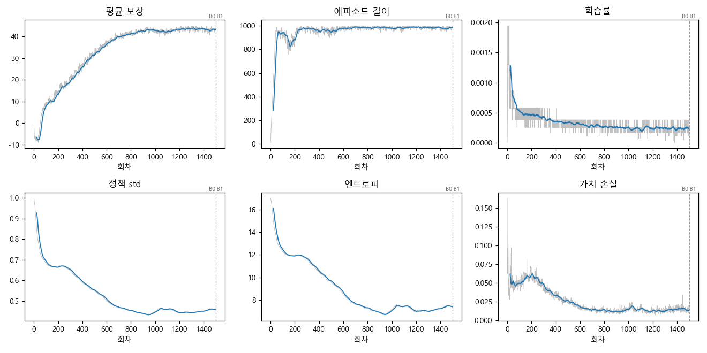
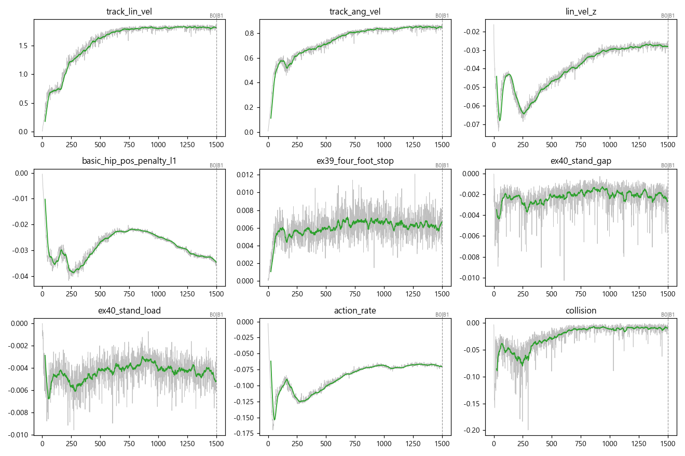
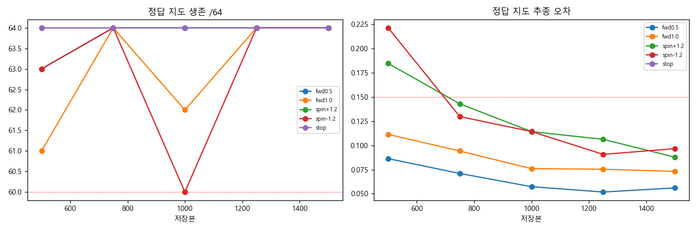
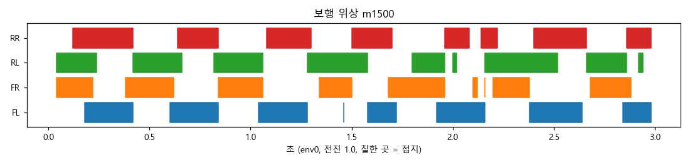

> 분류: 실험 단계 보고 · EX-40 B0 끝
> 작성: lead · 2026-10-31 20:1x
> 근거: TensorBoard(학습 폴더 events) · 별도 그림자 원장 scores-b(m500~m1500) · W57 retry axis_v2(m1500) · stage_figs.json(이 폴더) · 해석 ANALYSIS-EX40-B0-m1500.md
> 요지: B0 1500 회에 보상 수렴(약 43) · 트롯 보행(대각 짝 동기 0.87) · RR 하중 회복 · 직진 yaw 2.4° 이하. 남은 약점은 오른쪽 30° 정지와 RR 접지 비율이 RL 보다 조금 짧은 것.
> 상태: 그래프 · 위상 완료 · CMP 영상은 GPU1 평가 사이에 찍어 이 문서에 경로 추가 예정

# EX-40 B0 끝(m1500) 단계 보고

## 핵심 (먼저 읽을 것)

| 무엇 | 숫자 | 의미 |
|---|---|---|
| 평균 보상 | −6.4 → **43.0** (m900 부터 평평) | B0 과제는 m900 쯤 다 배움. 남은 600 회는 다듬기 |
| 에피소드 길이 | 284 → **984**/1000 | 거의 넘어지지 않음 |
| 정책 std | 0.93 → **0.46** · 엔트로피 16.1 → 7.4 | 탐색이 충분히 줄었고 무너지지 않음(0 근처로 붕괴 아님) |
| 학습률 | 0.0012 → **0.00025** (적응 KL) | 정상 감소 |
| 회전 ±1.2 오차 | 0.18~0.22 → **0.088 · 0.097** | 기준 0.15 안 |
| 보행 위상 | 대각 짝 동기 FL–RR **0.87** · FR–RL **0.87**, 좌우 짝 0.18 | 전형적인 트롯 |
| 발별 접지 비율(전진 1.0) | FL 0.575 · FR 0.576 · RL **0.605** · RR **0.549** | 뒷발 좌우 차 0.056: RR 이 조금 덜 딛음(오른쪽 약점의 흔적) |
| 직진 yaw 누적 | 0.5 m/s 0.9° · 1.0 m/s 2.4° | EX-39B 최종(3.9° · 7.2°)보다 곧음 |
| 정지 시 RR 하중(m1000) | 0.28 mg | S-B10 0.02 · EX-38 0 에서 회복 |

## 그림

- 학습 곡선: 
- 보상 항목: 
- 그림자 평가 추이(정답 지도, 별도 원장): 
- 보행 위상(env0, 전진 1.0, 3 초): 

## 해석

1. **B0 은 m900 에서 이미 수렴**했다. 보상 · 에피소드 길이 · 가치 손실이 모두 평평하다. 회차로 넘기는 결정(D72)상 B1 은 m1501 에 시작했지만, 다음 판에서 성과 방식을 쓴다면 B0 는 약 m1000 에 넘길 수 있었다는 근거가 된다(그림자 기록의 목적).
2. **트롯이 자리 잡았다.** 대각 짝 동기 0.87, 접지 비율 0.55~0.60 은 1.0 m/s 트롯의 정상 범위다.
3. **오른쪽 약점이 작게 남아 있다.** RR 접지 비율이 RL 보다 0.056 짧고, 오른쪽 30° 목표 정지 오차가 0.157 rad 로 왼쪽(0.041)보다 크다. 지난 판들의 우측 고관절 문제의 잔흔으로 보이며 크기는 크게 줄었다. B1 · B2 에서 같은 두 숫자를 추적한다.
4. 숫자는 시드 42 한 판이다. 다른 시드는 모든 단계가 끝난 뒤 맨 마지막(규칙).

## 경로

- 학습: `C:/Users/AI-WS01/s2_lab/ex40_main_20261031_041313/main/EX-40-B-main_20261031_041337_26240/`
- 그림자 점수(별도 원장): `C:/Users/AI-WS01/s2_lab/ex40_main_20261031_041313/scores-b/`
- W57 원자료: `C:/Users/AI-WS01/s2_lab/ex40_w57_retry_separate_20261031/w57_retry_model_1500_m1500-20261031_153711/axis_v2/`
- 그림 생성 스크립트: lead 잡 폴더 `ex40_stage_figs.py`(같은 스크립트로 m3000 부터 반복)
- 영상: (추가 예정)
