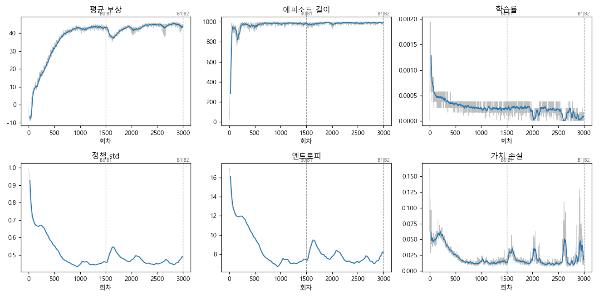
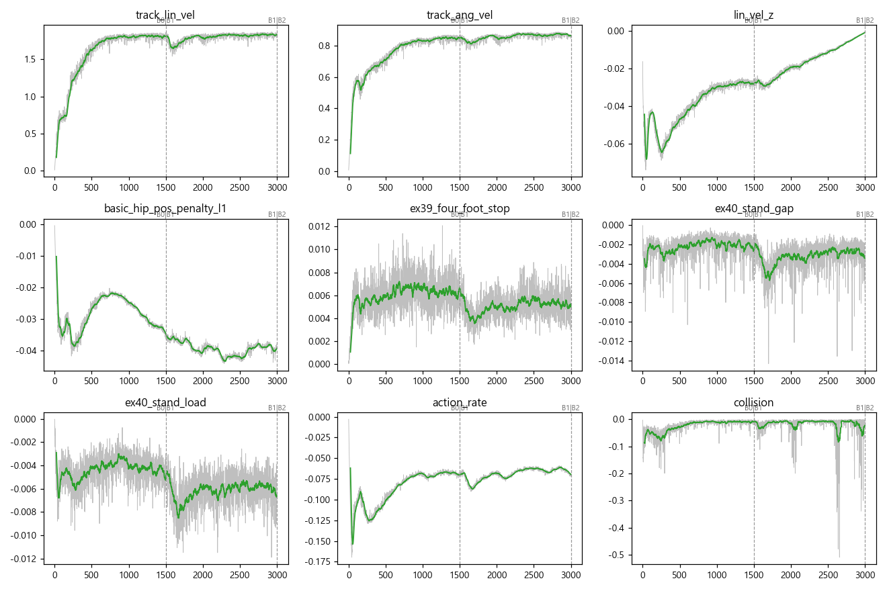
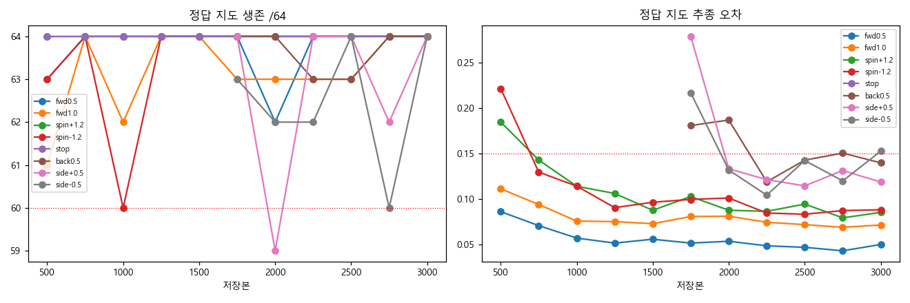
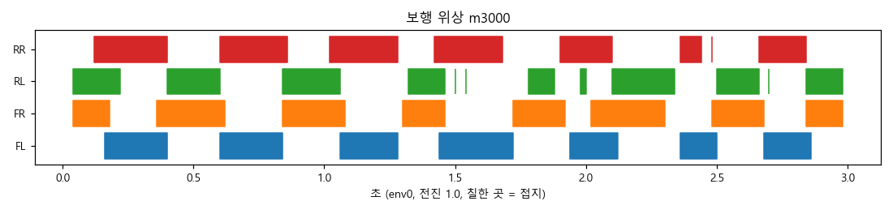

> 분류: 실험 단계 보고 · EX-40 B1 끝
> 작성: lead · 2026-11-01 02:5x
> 근거: TensorBoard(학습 폴더 events) · 그림자 원장 scores-b 와 고친 채점기로 다시 매긴 scores-b-rejudge(38ee51df) · 단계 끝 W57 retry axis_v2(m1500 · m3000) · 250 회 W57(axis250/summary.jsonl) · 서 있기 원자료 stand.json · A층 영상 26편(전 프레임 검사) · stage_figs.json(이 폴더)
> 요지: B1(후진 · 옆 · 걸으며 돌기)을 배웠고 보상 · 보행 위상은 안정. 그러나 지도 끔 평지 서 있기가 64 → 27/64 로 떨어졌고(몸 흔들림 · 대각 하중 쏠림), 옆 −0.5 추종 오차가 기준을 조금 넘는다. 오른쪽 30° 정지 약점은 사라지고 왼쪽 60 · 90° 정지가 나빠졌다.
> 상태: 해석 v1 · 단일 시드(42) · B2 진행 중 같은 칸을 추적

# EX-40 B1 끝(m3000) 단계 보고

## 핵심 (먼저 읽을 것)

| 무엇 | m1500(B0 끝) | m3000(B1 끝) | 의미 |
|---|---|---|---|
| 평균 보상 · 에피소드 길이 | 43.0 · 984 | **43.8 · 992** | B1 에서 명령이 넓어졌는데도 유지 |
| 정책 std · 학습률 | 0.46 · 0.00025 | **0.49 · 0.00009** | 탐색 폭은 조금 늘고 학습률은 더 내려감(적응 KL) |
| 보행 위상(전진 1.0) | 대각 동기 0.87 · 0.87 | **0.87 · 0.85** | 트롯 유지 |
| 발별 접지 비율 FL · FR · RL · RR | 0.575 · 0.576 · 0.605 · 0.549 | **0.552 · 0.596 · 0.568 · 0.605** | RR 이 짧던 것이 사라지고 FL 이 가장 짧음 |
| 평지 서 있기 통과(정답 · 끔 · 복원) /64 | 64 · 64 · 64 | **63 · 27 · 62** | 지도 끔에서 크게 떨어짐(아래 해석 1) |
| 서 있기 발 하중 FL · FR · RL · RR (mg, 정답 지도) | 0.25 · 0.27 · 0.23 · 0.25 | **0.42 · 0.20 · 0.10 · 0.29** | 대각(FL · RR)으로 쏠리고 RL 이 가벼움 |
| 서 있기 몸 속도 중앙값(정답 · 끔) | 0.007 m/s | **0.043 · 0.052 m/s** | 기준 0.05 언저리. 끔은 37/64 env 가 넘음 |
| 후진 0.5 속도 오차(정답) | (B0 미판정) | **0.140** | 기준 0.15 안. m1750~2750 은 0.12~0.19 로 오르내림 |
| 옆 −0.5 속도 오차(정답 · 끔) | (B0 미판정) | **0.153 · 0.162** | 기준을 조금 넘음 → FAIL 두 칸 |
| 회전 ±1.2 오차(정답) | 0.088 · 0.097 | **0.086 · 0.088** | 좋음 |
| 전진 yaw 누적 0.5 · 1.0 m/s | +0.9° · +2.4° | **−2.1° · +2.2°** | 작고 방향이 일정하지 않음(m2500 −1.1 · −1.0, m2750 +1.2 · +2.5) |
| 목표 방향 돌고 정지 오차 rad (오른쪽 30 · 왼쪽 60 · 왼쪽 90°) | 0.157 · 0.047 · 0.023 | **0.057 · 0.122 · 0.123** | 오른쪽 약점은 사라지고 왼쪽 큰 각도가 나빠짐(기준 0.15 안) |
| 그림자 판정(고친 채점기) | HOLD(W57 사슬) | **HOLD**(axis_v2 파일 없음 · W57 retry 로 측정 완료) + FAIL 3 | FAIL = 옆 −0.5 정답 · 끔, 끔 서 있기 |

판정 원문(m3000): FAIL `eval_gt/side-0.5` 속도 오차 · FAIL `probe_prop_only/side-0.5` 속도 오차 · FAIL `probe_prop_only/flat_stand` 60/64 미만 · HOLD 단계 끝 axis_v2 증거 파일 없음(같은 저장본의 W57 retry 는 측정 끝 child_rc 0).

## B1 동안 판정 흐름 (고친 채점기로 다시 매김)

| 저장본 | 옛 판정 | 다시 매김 | 원인 |
|---|---|---|---|
| m1750 | HOLD | FAIL | 후진 0.5 오차 0.181 · 옆 +0.5 오차 0.279 |
| m2000 | HOLD | HOLD + FAIL | 후진 0.5 오차 0.187 · 옆 +0.5 생존 59 |
| m2250 | HOLD | HOLD + FAIL | 끔 옆 −0.5 생존 58 |
| m2500 | HOLD | PASS | |
| m2750 | HOLD | FAIL | 후진 0.5 오차 0.151 |
| m3000 | HOLD | HOLD + FAIL 3 | 위 표 |

옛 판정의 HOLD 는 채점기 칸 이름 문제(W15 연속 명령 「덜 채워짐」)였고 진짜 약점을 가렸다. 11/01 00:14 부터 그림자 루프는 고친 채점기(38ee51df, 독립 검토 막음 0)로 돈다.

## 그림

- 학습 곡선: 
- 보상 항목: 
- 그림자 평가 추이(정답 지도, 고친 채점기 값 우선): 
- 보행 위상(env0, 전진 1.0, 3 초): 

## 해석

1. **지도 끔 서 있기가 m2750 → m3000 사이에 무너졌다(64 → 27).** 네 발은 모두 바닥에 붙어 있다(접촉 비율 1.0). 떨어진 까닭은 몸이 흔들리는 속도(0.052 m/s, 기준 0.05)다. 정답 지도에서도 몸 속도가 0.007 → 0.043 으로 7 배 늘었고 하중이 대각(FL 0.42 · RR 0.29)으로 쏠렸다. 트롯 자세가 멈춘 채 남는 모양으로 보인다(추정, 영상으로 확인할 것). 한 저장본만의 일인지 B2 첫 저장본(m3250 · m3500)에서 다시 본다.
2. **옆 −0.5 오차가 기준을 조금 넘는다**(0.153 · 0.162). 옆 +0.5 는 0.119 라 좌우가 다르다. 후진 0.5 는 0.14 로 기준 안이지만 B1 내내 기준 언저리였다.
3. **회전 좌우가 뒤바뀌었다.** B0 끝의 약점이던 오른쪽 30° 정지 오차는 0.157 → 0.057 로 줄었고, 왼쪽 60 · 90° 가 0.047 · 0.023 → 0.122 · 0.123 으로 늘었다(기준 0.15 안). 한쪽 쏠림이 남은 것이 아니라 흔들리는 것으로 본다.
4. **직진은 곧다.** 전진 yaw 누적이 저장본마다 ±2.5° 안에서 부호가 바뀐다.
5. 숫자는 시드 42 한 판이다. 다른 시드는 모든 단계가 끝난 뒤 맨 마지막(규칙).

## 영상 (A층 · D51 정본 촬영기 · 지도 모드 셋 · 이름은 D48 영상 안 결과)

- EX-40 m3000 10편: 성공 8 · 실패 2. 실패는 **옆 · 대각 세트의 정답 · 복원 지도**(env23 계단 L1), 「대각 후진 + 왼쪽」 구간에서 리셋(기록의 위치 점프로 확인). 같은 세트의 지도 끔은 성공.
- 비교 정책 EX-38 m3001 도 같은 옆 · 대각 정답 · 복원 두 편이 실패. 나머지 8 편은 둘 다 성공.
- 전 프레임 검사(프레임 수 · 해상도 · 검정 · 단색 · 지도 칸 · 검은 띠 · 멈춘 화면): 단독 영상 26편 문제 0(m3000 의 EX-40 10 · EX-38 지도 끔 3, m1500 의 EX-40 10 · 부모 지도 끔 3). 비교 영상 10편은 검정 · 멈춤 검사 0.
- 위치: `C:/Users/AI-WS01/s2_lab/ex40_main_20261031_041313/video_a/final/CMP_ex40_m3000/` (비교) · `.../final/ex40_m3000/` (단독)

## B2(m3001~4500)에서 볼 것

- 지도 끔 서 있기 통과 수와 서 있기 몸 속도 · 대각 하중. m3500 에서도 끔 서 있기가 50/64 아래면 팀장에게 처치 여부를 묻는다(lead 권고 기준, 결정 아님).
- 옆 ±0.5 오차 좌우 차, 후진 0.5 오차.
- 왼쪽 60 · 90° 목표 정지 오차.
- 250 회 전진 yaw 누적(axis250).

## 경로

- 학습: `C:/Users/AI-WS01/s2_lab/ex40_main_20261031_041313/main/EX-40-B-main_20261031_041337_26240/`
- 그림자 점수: `.../scores-b/` · 다시 매긴 점수: `.../scores-b-rejudge/`
- W57 원자료: `C:/Users/AI-WS01/s2_lab/ex40_w57_retry_separate_20261031/w57_retry_model_3000_m3000-20261101_020738/axis_v2/`
- 250 회 yaw: `.../axis250/summary.jsonl`
- 그림 생성: lead 잡 폴더 `ex40_stage_figs.py`(다시 매긴 점수 우선)
