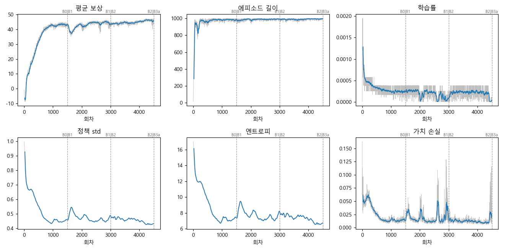
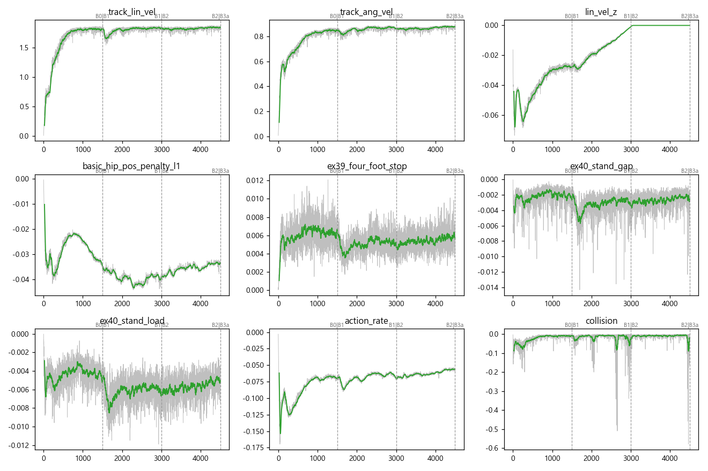
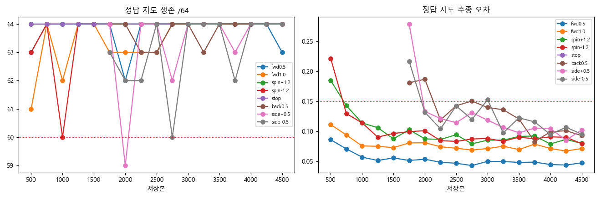
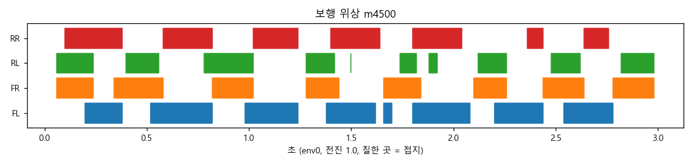

> 분류: 실험 단계 보고 · EX-40 B2 끝
> 작성: lead · 2026-11-01 13:5x
> 근거: TensorBoard · 그림자 원장 scores-b(고친 채점기 38ee51df) · 단계 끝 W57 retry axis_v2(m4500) · 250 회 W57(axis250/summary.jsonl) · W78 지형 기술 평가(m4500, 5fad769e · aa353ee1) · 서 있기 원자료 · A층 영상 10편(재촬영 1 회) · stage_figs.json(이 폴더)
> 요지: B2 끝에서 판정 대상 26 칸이 모두 기준 안(생존 62~64/64, 추종 오차 0.05~0.12), 서 있기 정답 · 끔 64/64, 목표 방향 정지 오차 0.06 rad 이하로 지금까지 가장 좋다. 남은 결함은 heading 보정을 끈 1.0 m/s 직진의 회전 치우침(최대 8°)이고, 보정을 켜면 2° 안. 계단(레벨 2)에서 옆 · 뒤 · 돌아 내려오기를 모두 해내며 오른쪽 옆으로 오르기가 가장 약하다.
> 상태: 해석 v1 · 단일 시드(42) · B3a 진행 중

# EX-40 B2 끝(m4500) 단계 보고

## 핵심

| 무엇 | m3000(B1 끝) | m4500(B2 끝) | 의미 |
|---|---|---|---|
| 평균 보상 · 에피소드 길이 | 43.8 · 992 | **45.9 · 995** | 계속 오름 |
| 정책 std · 학습률 | 0.49 · 0.00009 | **0.43 · 0.00003** | 탐색이 줄고 학습률이 더 낮아짐 |
| 보행 위상(전진 1.0) 대각 동기 | 0.87 · 0.85 | **0.84 · 0.86** | 트롯 유지 |
| 판정 칸(정답 · 끔 각 13) | FAIL 3 | **FAIL 0**(생존 62~64, 추종 오차 0.05~0.12) | 후진 1.0 · 대각 후진 포함 모두 기준 안 |
| 서 있기 통과(정답 · 끔) | 63 · 27 | **64 · 64** | m3000 하락은 한 저장본만의 흔들림 |
| 서 있기 몸 속도 · 발 하중 FL FR RL RR | 0.043 m/s · 0.42 0.20 0.10 0.29 | **0.008 m/s · 0.23 0.33 0.19 0.25** | 거의 정지, 하중 고름 |
| 목표 방향 정지 오차 최대(0~90°, 좌우) | 0.123 rad | **0.060 rad** | 지금까지 가장 좋음 |
| 전진 yaw(heading 끔, W57) 0.5 · 1.0 | −2.1° · +2.2° | **+2.7° · +4.8°** | 아래 해석 1 |
| 그림자 판정 | HOLD + FAIL 3 | **HOLD**(평가 안 W57 사슬 결함만) | 측정 경로 문제, 실제 약점 아님 |

## 1. 전진 1.0 m/s 회전 치우침

- 250 회 W57(heading 끔): m2500 −1.0 · m2750 +2.5 · m3000 +2.2 · m3250 +4.0 · m3500 −1.6 · m3750 −7.1 · m4000 +8.2 · m4250 +7.1 · m4500 +4.8°(1.0 m/s, 6 초).
- 64 env 를 펴 보면 저장본마다 95 % 가 같은 쪽으로 돈다. 지형 다섯 종류 · 지도 세 모드 모두 같은 쪽이라 정책 전체의 치우침이다. 부호가 저장본마다 바뀌므로 강화된 버릇이 아니라 보상 사각지대에서 떠다니는 값이다.
- 원인(기제 확인, 원인 분리 실험 아님): 학습 전진의 절반이 heading 보정(`ex40.yaml:10`, forward_fraction 0.5)이라 그 절반에서는 치우침이 벌을 받지 않고, 나머지 절반의 회전 추종 보상 `exp(−e²/0.5²)` 은 0.02 rad/s 치우침에 0.2 % 만 반응한다.
- **heading 보정을 켜면 사라진다**(W78, m4500, 6 초 1.0 m/s): 보정 끔 2.4 · 4.8° → 켬 1.5 · 0.8°(정답, 거친 바닥 · 박스), 지도 끔 3.1 · 5.3° → 0.3 · 1.3°. 실기는 이 보정을 켜고 쓴다.
- 지형 판 시작 때 「회전 명령 0 일 때 회전 오차 L1」 항을 더해 고친다(팀장 승인 필요). 치우침이 250 회마다 ±8° 씩 움직일 만큼 가중치가 아직 움직이므로, 압력을 주면 고쳐질 것으로 본다(추정).

## 2. 지형 기술 (W78, 계단 · 경사 레벨 2, m4500)

높이 변화는 리셋 직후 가라앉음(약 −0.10 m)을 뺀 추정값. 오르기 = 오목 계단, 내려가기 = 볼록 계단, 각 15 env, 6 초.

| 경우 | 오르기 | 내려가기 | 생존 |
|---|---|---|---|
| 앞 0.5 | +0.49 m | −0.46 m | 15 · 15 |
| 옆 왼쪽 0.5 | +0.28 m | −0.24 m | 15 · 15 |
| 옆 오른쪽 0.5 | **+0.17 m** | −0.30 m | 15 · 15 |
| 뒤 0.5 | +0.41 m | −0.25 m | 15 · 15 |
| 오르다 180° 돌아 내려오기 | +0.25 → 돌기 173° → 출발 높이 | | 15/15 |
| 오르다 뒷걸음으로 내려오기 | +0.25 → 출발 높이 | | 15/15 |
| 경사 1.0 m/s | 4/4 · 4/4 | | |

- 오른쪽 옆으로 오르기가 왼쪽의 60 % 수준. B1 · B2 의 오른쪽 옆걸음 오차와 같은 쪽.
- 지도 끔에서는 오르는 높이가 준다(앞 +0.41 m, 돌아 내려오기 구간 +0.16 m). 지도가 계단 오르기에 쓰인다.
- 레벨 2(단 높이 약 9 cm)만 쟀다. 높은 레벨은 지형 판 범위이고 W78 로 따로 잰다.

## 그림

- 학습 곡선: 
- 보상 항목: 
- 그림자 평가 추이(고친 채점기 값 우선): 
- 보행 위상: 

## 영상

- 단독 영상(이번 실험만) 10편 모두 success. m3000 에서 리셋되던 옆 · 대각 세트의 「대각 후진 + 왼쪽」 구간도 이번에는 계단 위에서 명령을 따라간다(정답 지도 12.4 초 장면 직접 확인).
- 첫 촬영에서 「회전 → 정지 → 재출발」 정답 지도 한 편이 렌더 화면 검정(`render_still_dark`)으로 멈췄고, 단계 끝 루프가 이를 done 으로 잘못 찍었다. 실패 폴더는 보관하고 다시 찍었으며, 루프는 실패 시 재시도 · done 금지로 고쳤다(stage_loop2).
- 전 프레임 검사: m4500 단독 10편 문제 0(누적 36편 0). 비교 10편 검정 · 멈춤 0.
- 위치: `C:/Users/AI-WS01/s2_lab/ex40_main_20261031_041313/video_a/final/ex40_m4500/`(단독) · `.../final/CMP_ex40_m4500/`(참고용 비교)

## 다음(B3a~B3c, m4501~6000)

- 걸으며 돌기(B3a) · 제자리 회전 하한(B3b) · 저속 직진(B3c)이 열린다. 판정 칸이 기준 안을 유지하는지, heading 끈 yaw 가 더 커지는지(250 회 표).
- D 단계(m6001~7500)에서 DR 이 전체 범위로 열릴 때 서 있기 · yaw 를 다시 본다.
- 11/2 실기 저장본은 판정 통과 저장본 중 yaw 가 가장 작은 것으로 고른다.

## 경로

- W78 원자료: `C:/Users/AI-WS01/s2_lab/ex40_w78_terrain_skill/m4500/terrain_skill.json`
- W57 원자료: `C:/Users/AI-WS01/s2_lab/ex40_w57_retry_separate_20261031/w57_retry_model_4500_m4500-20261101_124707/axis_v2/`
- 250 회 yaw: `C:/Users/AI-WS01/s2_lab/ex40_main_20261031_041313/axis250/summary.jsonl`
