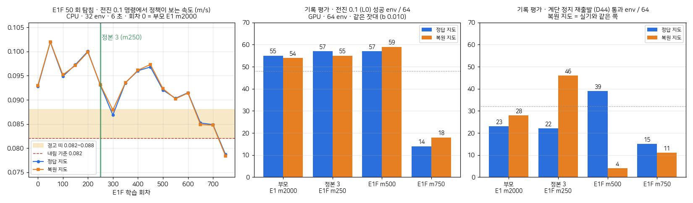

# 정본 3 · EX-42 E1F m250 (지형 학습 전 기본 보행)

> 분류: A/정책학습 · 정본 기록 (저장본 하나가 무엇인지 · 어떻게 만들어졌는지 · 무엇이 되고 안 되는지)
> 작성: Claude 세션 (오흥재 지시, planner-lx) · 2026-11-17 02:37 · lead 02:3x 의뢰 (팀장 11/17 02:27 지시 요지: 정본 3 을 정본답게 남긴다)
> 근거: 원장 11/17 01:13 · 01:16 · 01:41 (정본 3 결정 · 첫 창 보류 넘김) · 저장본 파일과 각 실행의 `startup_receipt.json` · `manifest.json` 을 직접 읽고 sha256 을 다시 잼 (11/17 02:3x) · 공식 점수 `eval/scores/m250` · 기록 평가 · 깃발 · 거울 D44 원자료 (GPU 실행은 lead · 렌더와 거울 D44 는 planner) · 내 50 회 탐침
> 요지: 정본 3 은 Go2 기본 보행 정책 (속도 명령 · depth 로 지도를 복원해 걷는 START 계열) 의 저장본이다. 처음부터 누적 15,500 회 학습했고 평탄 · 연속 지형에서 전진 · 옆 · 뒤 · 회전 · 정지 · 깃발 따라가기를 한다. 느린 전진 0.1 m/s 는 64 env 가운데 55~57 이 기준 안이고, 계단을 올라 멈췄다 다시 가는 과제는 복원 지도에서 46 / 64 다 (실패 18 은 전부 왼쪽으로 틀어진다). 듬성한 지형 (징검돌 · 틈) 은 아직 배우지 않았다.
> 상태: 기록 v1.1 (11/17 02:5x ONNX 묶음 더함 · 5 절) · 이 문서는 판정을 바꾸지 않는다

## 0. 쉬운 요약

로봇 개 Go2 가 「앞으로 얼마 · 옆으로 얼마 · 돌기 얼마」 라는 명령을 받아 걷는 정책을 단계별로 배우고 있다. 정본 3 은 그 가운데 「지형을 본격적으로 배우기 직전」 의 저장본이다. 여기까지는 평평하거나 완만한 바닥에서 여러 방향으로 걷고, 느리게 걷고, 멈추고, 깃발을 따라가는 것을 배웠다.

「정본」 이라고 부르는 까닭은 뒤 단계 (지형 · 미션) 가 모두 이 저장본에서 갈라져 나가기 때문이다. 뒤에서 무엇이 좋아지고 나빠졌는지는 늘 이 저장본의 숫자와 견준다. 그래서 이 문서에 그 숫자와 영상, 만들어진 경로를 한곳에 적는다.

## 1. 무엇인가

| 항목 | 값 |
|---|---|
| 이름 | 정본 3 = EX-42 E1F m250 |
| 파일 | `/mnt/win-d/mai/data/foothold/s2_lab/ex42_main_20261116_190816/main/EX-42-B-E1F_20261116_190817/model_250.pt` (`/home/jay/data` 는 같은 자리의 링크) |
| sha256 | `13caeb4ae52dd41ab3c2d23f9e6e34801a2414aa811c3efd4b38895e9ce29df6` (30,361,227 바이트 · 02:33 에 다시 잼) |
| 누적 학습 | 15,500 회 (4 절 사슬) · EX-42 E1F 단계의 250 회째 |
| 과제 · 로봇 | `FootholdS2-Go2-S2-SB-v0` · Unitree Go2 · Isaac Lab 2.3.2 · 제어 50 Hz |
| 입력 | 고유감각 45 칸 + 지각 추정 51 칸 (잠재 16 · 몸 속도 3 · 발 주변 16 · 몸 주변 16) + 자세 명령 2 칸 (0 고정) = 98 |
| 지각 | 전방 depth 60 × 60 (아래로 35 도) 로 높이 지도 32 × 16 을 복원. 평가 · 배포는 저장본 안의 **평균 지각 가중치** (`perception_ema`) 를 쓴다 |
| 속도 추정 보정 | 전진 추정 0~0.3 m/s 구간에서 b 0.010 을 뺀다 (학습 때 값 · m250 에서 다시 잰 영점은 0.0086 · E2 는 0.009 로 띄움) |
| 학습 코드 | 사본 `ex42-launch-e1f8-v29-14d` · git `dbff218f13eee78a8e934562aaff951bbff9f925` |
| plan · 승인 | plan sha `270a4187…` · 승인 파일 sha `d9c099e7…` |
| 정한 근거 | 원장 11/17 01:41 (정본 3 결정) · 01:13 · 01:16 (E2 부모 · 첫 창 보류 넘김 승인 줄) |

## 2. 어떻게 배웠나 (E1F 단계 · 부모 E1 m2000 에서 250 회)

| 칸 | 값 | 출처 |
|---|---|---|
| 규모 | 3,072 env × GPU 두 장 = 6,144 env · 회당 24 스텝 · 약 23 초 / 회 | 기동 로그 |
| 지형 | 연속 7 종 (피라미드 계단 · 역계단 · 상자 · 거친 바닥 · 경사 · 역경사 · 단 계단) · 깃발 env 몫 0.10 | plan E1F 행 |
| 명령 몫 | 전진 0.17 · 옆 0.09 + 0.09 · 뒤 0.10 · 정지 0.10 · 걸으며 돌기 0.06 + 0.06 · 제자리 회전 0.07 + 0.07 · 대각 넷 0.09 · 깃발 0.10 | `EX42_SEGMENT_COMMANDS` |
| 명령 범위 | 전진 0.1~1.5 · 뒤 0.2~1.3 · 옆 0.1~0.8 · 제자리 회전 0.15~1.5 · 걸으며 돌기 0.3~1.2 + 0.1~1.0 · 대각 0.3~0.6 + 0.2~0.5 | 같은 줄 |
| 저속 장치 | 느린 전진 몫 0.5 · 느린 옆 몫 0.4 · 느린 명령 유지 6~8 초 | `EX42_COMMAND_CELLS` · `EX42_SLOW_HOLD` |
| 보상 (E1 과 다른 곳) | slow_progress 0.4 · slow_track 0.3 (sigma 0.35 · heading 포함) · track_lin_vel std 0.35 · zero_yaw −1.25 · foot_slip −0.15 · feet_air_time 0 | `EX42_SEGMENT_REWARDS_READBACK` |
| 탐색 · 보폭 | 행동 std 상한 0.48 (매 회 상한에 붙음) · desired_kl 0.01 · policy 학습률 중앙 1.14e-4 · 지각 학습률 2.5e-4 · 지각 평균 decay 0.98 | 로그 · ppo_kl_audit |
| 대칭 | critic 거울 손실만 · actor 대칭 없음 | 로그 `value_mirror loss` |

E1F 는 750 회까지 돌았다. 그 가운데 m250 을 고른 까닭은 3 절의 표다: 저속 전진은 m250 · m500 이 같고, 계단 정지 재출발의 복원 지도가 m250 에서만 좋다 (46 / 64 · m500 은 4 / 64 · m750 은 11 / 64 이고 m750 은 저속 전진도 14 | 18 로 내렸다).

그림 읽는 법: 왼쪽은 50 회마다 「전진 0.1 을 시켰을 때 정책이 보는 속도」 다. 초록 세로줄이 정본 3 이다. m450 뒤로 계속 내려 m750 은 내림 기준 (0.082) 아래다. 가운데와 오른쪽은 같은 잣대로 잰 네 저장본이다. 주황 (복원 지도) 이 실기와 같은 쪽이다.

## 3. 무엇이 되고 안 되나 (모두 64 env · 시드 42 · 정답 지도 | 복원 지도 | 지도 끔)

### 3.1 공식 평가 (E1F m250 · 판정 HOLD)

- 판정 칸 26 개 (13 명령 × 정답 · 복원 지도) 전부 PASS · 생존 전부 64 · 깃발 하나 · 넷 64 | 64.
- 전체 판정이 HOLD 인 까닭은 **첫 창이라 직전 창이 없어서** 다. E1F 판정은 지금 창과 직전 창을 같이 보는데 m250 은 직전 칸 다섯이 「직전 창 없음」 으로 비어 있다. 실패한 칸은 없다. 그래서 E2 로 넘길 때 「첫 창 보류 넘김」 영수증 (`eval/scores/m250/first_window_handoff.json` · 원장 11/17 01:16 승인 줄 · reviewer PASS) 을 썼다.
- 속도 오차 중앙 (m/s · 정답 | 복원 · 괄호는 부모 E1 m2000): 전진 0.5 0.041 | 0.042 (0.072) · 전진 1.0 0.076 | 0.076 (0.107) · 옆 +0.5 0.047 | 0.050 (0.157) · 옆 −0.5 0.048 | 0.047 (0.141) · 뒤 0.5 0.054 | 0.054 (0.126) · 정지 0.016 | 0.016 (0.021).

### 3.2 기록 평가 (GPU · b 0.010 · 판정에 안 들어감)

| 칸 | 부모 E1 m2000 | **정본 3 (m250)** | m500 | m750 |
|---|---|---|---|---|
| 전진 0.1 · L0 성공 | 55 \| 54 \| 62 | **57 \| 55 \| 59** | 57 \| 59 \| 60 | 14 \| 18 \| 32 |
| 전진 0.1 · L5 성공 | 55 \| 51 \| 56 | **54 \| 56 \| 54** | 55 \| 58 \| 59 | 14 \| 13 \| 31 |
| 전진 0.2 · L0 | 63 \| 63 \| 64 | **63 \| 63 \| 64** | 64 \| 64 \| 64 | 64 \| 64 \| 64 |
| 옆 +0.2 · L5 | 57 \| 56 \| 60 | **60 \| 59 \| 60** | 61 \| 59 \| 59 | 59 \| 59 \| 58 |
| 옆 −0.2 · L5 | 53 \| 55 \| 55 | **57 \| 57 \| 53** | 56 \| 54 \| 52 | 49 \| 47 \| 40 |
| 옆 +0.4 · −0.4 · L5 | 52 \| 52 · 51 \| 52 | **52 \| 53 · 55 \| 56** | 52 \| 51 · 56 \| 55 | 52 \| 51 · 55 \| 56 |
| 계단 층계참 제자리 회전 좌 · 우 | 64 \| 64 \| 64 | **64 \| 64 \| 64** | 64 \| 64 \| 64 | 64 \| 64 \| 64 |
| 계단 정지 재출발 통과 | 23 \| 28 \| 20 | **22 \| 46 \| 5** | 39 \| 4 \| 44 | 15 \| 11 \| 23 |
| 재출발 끝 yaw (rad) | +0.03 \| −0.135 \| +0.39 | **+0.30 \| +0.107 \| +0.76** | −0.20 \| −0.592 \| +0.21 | −0.20 \| −0.272 \| +0.47 |

성공 = 명령의 0.8~1.2 배로 가고 0.5 초 창 오차가 명령의 20 % 안이며 끝까지 생존. L0 · L5 는 지형 레벨. 계단 정지 재출발 = 단 높이 0.16 m 계단을 올라 중간에 2 초 멈췄다 다시 출발해 깊이 1.2 m 층계참에 서기.

### 3.3 깃발 따라가기 (출발 방향을 90 · 180 도 틀어서)

- 정본 3: 성공 64 | 64 | 64 · 90 도 출발에서 몸이 깃발 쪽으로 맞는 데 1.86~1.96 초 · 깃발 넷 (3.5 m) 을 3.4~3.5 초에 지남 · 걸은 길이는 최단 거리의 1.00~1.01 배.
- 깃발 명령은 「먼저 돌고 직진」 이 아니라 깃발 쪽으로 곧장 가면서 몸을 돌리는 식이다 (E2 부터는 방향 차가 0.5 rad 를 넘으면 먼저 제자리에서 돈다).

### 3.4 알고 가는 약점

| 약점 | 값 | 뜻 |
|---|---|---|
| 계단 위에서 방향이 틀어진다 (복원 지도) | 실패 18 / 64 는 전부 반시계 (왼쪽) 로 평균 +35 도 (접근 +11 · 정지 2 초 동안 +2 · 재출발 +21). 통과 46 은 평균 −6 도 | 실기에서 방향 명령 없이 계단을 직진시키면 일부는 층계참을 벗어난다 |
| 그 방향은 정책의 좌우 버릇이다 | 정책에 좌우로 뒤집은 세계를 보여 주면 (거울 D44) 실패 15 가운데 14 가 시계 (오른쪽) −33 도로 뒤집힌다. 실패하는 env 는 두 판에서 13 개가 같다 | 어느 로봇이 실패할지는 그 env 의 조건이 정하고, 실패할 때 어느 쪽으로 돌지는 정책이 정한다. 지형은 좌우 대칭이다 |
| 정답 지도와 복원 지도가 다르게 걷는다 | 계단 정지 재출발 22 대 46 · 끝 yaw +0.30 대 +0.107 | 평가 · 보고는 늘 두 열 |
| 느린 전진이 흔들린다 | m250 은 좋지만 (57 \| 55) 같은 설정으로 500 회 더 돌린 m750 은 14 \| 18 | 뒤 단계에서 50 회 탐침으로 계속 본다 |
| 안 배운 것 | 듬성한 지형 (징검돌 · 외나무 · 틈) · 높은 턱 · 낮은 통로 · 자세 명령 | E2 부터 |

## 4. 계보 (처음부터 정본 3 까지)

각 줄의 저장본은 다음 줄 실행의 부모다. sha256 은 11/17 02:33 에 파일에서 다시 쟀고, 부모 경로 · sha · 누적 회차는 각 실행의 `startup_receipt.json` (EX-42) · `manifest.json` (EX-41) 과 맞는 것을 확인했다.

| # | 단계 | 실행 폴더 (`/mnt/win-d/mai/data/foothold/s2_lab/` 아래) | 저장본 | 이 단계 회차 | 누적 | sha256 | 학습 코드 git |
|---|---|---|---|---|---|---|---|
| 1 | EX-40 본선 (부모 인자 없이 시작) | `ex40_main_20261031_041313/main/EX-40-B-main_20261031_041337_26240` | `model_6000.pt` | 6,000 (실행은 8,001 까지 감) | 6,000 | `d5e9ec400f33d74d97e7c69d4ab2092d4980195141bb8b30e683730eecd6b6f5` | 미확인 |
| 2 | EX-41 본선 | `ex41_main_20261104_235522/main/EX-41-B-main_20261104_235522` | `model_6000.pt` | 6,000 | 12,000 | `1c6af6319c823c718af4965064f1c312b0d25177f5223a49c323aab3b6f1e613` | `2b01df9a` |
| 3 | EX-42 0 단계 | `ex42_main_20261108_123914/main/EX-42-B-stagezero_20261108_123914` | `model_1000.pt` | 1,000 | 13,000 | `20365a2c6d70f94f65f1114471f7df198e56d86db6d02d89cea43c666b95e768` | `eae0bed7` |
| 4 | EX-42 E0 | `ex42_main_20261111_072218/main/EX-42-B-E0_20261111_072218` | `model_250.pt` | 250 | 13,250 | `680c820b73646d9c11f62f184fd35e6cc096ffd04681951d542b2b4b472d779e` | `187777e7` |
| 5 | EX-42 E1 (v29c) | `ex42_main_20261115_135412/main/EX-42-B-E1-v29c_20261115_135412` | `model_2000.pt` | 2,000 (실행은 2,300 까지 감 · 상한 넘김으로 m2000 을 넘김) | 15,250 | `8f47bc30c26f819292db8b793514fad413764a9df009bb7963643fdf3d3c23e1` | `4e8a3e38` |
| 6 | **EX-42 E1F = 정본 3** | `ex42_main_20261116_190816/main/EX-42-B-E1F_20261116_190817` | `model_250.pt` | 250 (실행은 750 까지 감 · 첫 창 보류 넘김으로 m250 을 넘김) | **15,500** | `13caeb4ae52dd41ab3c2d23f9e6e34801a2414aa811c3efd4b38895e9ce29df6` | `dbff218f` |

- 앞서 채택된 저장본은 2 번 (누적 m12000 · 11/07) 과 3 번 (m13000 · 11/08) 이다. 정본 3 은 그 뒤 E0 · E1 · E1F 를 거친 것이다.
- 1 번이 정말 「맨 처음」 인지: EX-40 실행의 manifest 에 부모 저장본 인자가 없다는 것까지만 확인했다. 그 실행이 다른 경로로 가중치를 물려받았는지는 열어 보지 않았다 = 미확인. EX-40 의 학습 코드 git 도 이번에 읽지 않았다.
- 5 번과 6 번은 단계의 마지막 저장본이 아니다. 둘 다 원장 승인 줄과 영수증으로 넘긴 것이다 (E1: 상한 넘김 · 원장 11/16 18:05 / E1F: 첫 창 보류 넘김 · 원장 11/17 01:16).
- 같은 표의 기계용 사본: `assets/canon3/CANON3-LINEAGE.tsv`.

## 5. ONNX 묶음 (`assets/canon3/start-m15500-app/` · 11/17 02:50 만듦)

이름은 앞 판 규칙 (`start-m<누적 update>`) 대로 `start-m15500` 이다. 꼴은 `start-m13000-app` 과 같다 (ONNX 둘 · `CONTRACT.md` · `contract.json` · `parity.json` · 시험 벡터 · `SHA256SUMS`). 앱이 할 일과 앞 판과 다른 것은 그 폴더의 `CONTRACT.md` 에 있다.

| 파일 | sha256 |
|---|---|
| `start-m15500_map_on.onnx` (지도 켬) | `df91c2d772c7d054e33c74fca479e79550cfd228d7682402f7eef4a0865e279f` |
| `start-m15500_map_off.onnx` (지도 끔) | `be6c8b103d3b39503447ee71076ec199e5ed0688c3540ccfe449a96d6e2a9a41` |

기존 절차 (`inbox/jay/20261103-policy-handoff/make_start_app_bundle.py` · m13000 까지 쓴 것) 를 그대로 돌리면 정본 3 과 **다른 정책** 이 나온다. 그래서 그 스크립트의 사본 (`assets/canon3/make_canon3_app_bundle.py`) 에서 두 곳을 고쳐 만들었다.

| 고친 곳 | 앞 절차 | 정본 3 묶음 |
|---|---|---|
| 지각 가중치 | 저장본의 학습 중 가중치 | 학습 평균 판 (`perception_ema.shadow`). 평가 · 영상이 쓰는 것과 같은 함수로 읽는다. 텐서 105 개가 모두 학습 중 가중치와 다르다 (같으면 멈추게 했다) |
| 전진 속도 추정 보정 | 없음 | actor 앞에서 추정 16 번 칸을 고치는 식 (b 0.010 · 0~0.3 구간 · 0.05 까지 오름) 을 **ONNX 안에** 넣었다. b 0.010 은 이 저장본의 평가 · 영상이 쓴 값이다 (E2 는 0.009 로 돌지만 그것은 E2 의 값이다) |

확인한 것 (CPU 만 · GPU · Kit 안 씀)

| 확인 | 결과 |
|---|---|
| 같은 출력 (PyTorch 대 onnxruntime) · 합성 입력 12 경우 | 최대 차이 1.05e-5 (기준 3e-5) |
| 같은 출력 · Kit 기록 입력 9 경우 × 20 스텝 (GRU 되먹임) | 최대 차이 7.48e-6 (기준 1e-4) |
| 보정이 ONNX 안에 들었나 | 보정을 뺀 PyTorch 와의 행동 차이가 아홉 경우 모두 0.013~0.017 (기준의 100 배 넘음) 인데 ONNX 는 보정 넣은 PyTorch 와 같다 |
| 보정식이 학습 코드와 같은가 | 학습 함수 `correct_est_vx` 와 격자 1,601 점 대조 · 최대 차이 0 |
| ONNX 입출력이 앞 판과 같은가 | 같다 (입력 9 · 출력 4 · m6000 계약과 한 칸씩 대조) |
| 다시 만들면 같은가 | 두 번 더 돌려 폴더 전체 `diff -r` 빈 것 · `sha256sum -c` 13 줄 OK |
| 학습 소스 | manifest 의 커밋 `dbff218f` · 바뀐 소스 0 바이트라 그대로 꺼냄 |

- PyTorch 쪽 답은 평균 지각 + 보정 + 자세 명령 0 의 길 (평가와 같은 길) 로 냈다.
- 기록 입력은 m6000 이 로봇을 몰 때 Kit 이 남긴 것이다. 정본 3 이 스스로 걸은 궤적이 아니므로 「ONNX 가 PyTorch 와 같은 답을 낸다」 까지만 말한다. 걸음 성적은 3 절이 근거다.
- 실행 환경: onnxruntime 1.32.0 · onnx 1.22.0 · torch 2.7.0 (이 기기에 onnxruntime 이 없어 내 폴더 venv 에 깔았다 · lead 02:45 승인).
- 다시 만드는 명령: `python make_canon3_app_bundle.py all --checkpoint <model_250.pt> --sha256 13caeb4a… --name start-m15500 --label "…" --contract-md <CONTRACT.md> --out <새 폴더> --repo <lab 작업 사본> --vx-corr-b 0.010`.

## 6. 영상 (같은 폴더 `assets/canon3/` · git LFS)

| 파일 | 내용 |
|---|---|
| `EX42-B-E1F-slow_fwd0p1_gt_L0-m250-seq-1x-survive.mp4` | 느린 전진 0.1 m/s · 정답 지도 · 6 초 · 평균 0.094 m/s |
| `EX42-B-E1F-slow_fwd0p1_pred_L0-m250-seq-1x-survive.mp4` | 같은 장면 · 복원 지도 · 평균 0.087 m/s |
| `EX42-B-E1F-slow_sideL0p2_pred_L0-m250-seq-1x-survive.mp4` | 옆 왼쪽 0.2 m/s · 복원 지도 |
| `EX42-B-E1F-slow_sideR0p2_pred_L0-m250-seq-1x-survive.mp4` | 옆 오른쪽 0.2 m/s · 복원 지도 |
| `EX42-B-E1F-d44_stop_restart_pred_L0-m250-seq-1x-success_env0.mp4` | 계단 정지 재출발 · 복원 지도 · 통과한 로봇 (13 초) |
| `EX42-B-E1F-d44_stop_restart_pred_L0-m250-seq-1x-fail_env2.mp4` | 같은 과제 · 실패한 로봇 (왼쪽으로 약 40 도 틀어져 층계참을 벗어남) |
| `flagturn_parent_vs_m250_pred.mp4` | 깃발 따라가기를 위에서 본 그림 (렌더 아님) · 왼쪽 부모 · 오른쪽 정본 3 · 출발 90 · 180 도 |

- 렌더 여섯 편은 1920 × 1080 · 25 fps · 영상 규칙 v3.5 합성이고 전 프레임 검사 (검정 · 로봇 화면 밖 · 한 대만 보임) 지적 0 건이다. 계단 두 편은 64 env 판정과 대조해 일치했다.
- 느린 전진 · 옆걸음 편의 바닥은 촬영 도구가 쓰는 평지 생성 지형이라 3.2 의 표 (A23 메시) 와 다른 바닥이다. 보여 주는 용이다.
- 원본 자리: `/home/jay/data/foothold/s2_lab/ex42_record/E1F-m250-video/` (촬영 원본 · 덧씌운 코드 포함) · `ex42_record/E1F-flagturn/`.

## 7. 원자료 자리

| 무엇 | 경로 (`/home/jay/data/foothold/s2_lab/` 아래) |
|---|---|
| 공식 점수 · 첫 창 보류 넘김 영수증 | `ex42_main_20261116_190816/main/EX-42-B-E1F_20261116_190817/eval/scores/m250/` |
| 기록 평가 (부모 · m250 · m500 · m750) | `ex42_record/E1-v29c-m2000-b010` · `ex42_record/E1F-m2000-m{250,500,750}-b010` |
| 깃발 돌려 재기 | `ex42_record/E1F-flagturn/{parent,m250,m500}` |
| 거울 D44 | `ex42_record/E1F-mirror-d44/{m250_mirror,m500_mirror}` |
| 50 회 탐침 | `/home/jay/mai/tmp/planner/again/noise_probe/out_est/e{0..750}` (저장소 밖) |
| 표를 다시 뽑는 도구 | `/home/jay/mai/tmp/planner/e1f_record.sh all 250 500 750` · `flag/e1f_flag.sh table parent m250 m500` (저장소 밖) |

## 8. 안 한 것 · 미확인

- ONNX 묶음을 앱 · 브라우저 ORT · 실기에서 돌려 보는 것 (5 절은 CPU 같은 출력 확인까지).
- 정본 3 이 Kit 에서 스스로 걸을 때의 입력으로 한 ONNX 같은 출력 확인.
- EX-40 보다 앞 계보 · EX-40 의 학습 코드 커밋.
- 반복 시드: 모든 숫자는 시드 42 한 번이다. 반복 폭을 재지 않았다.
- 계단 방향별 평가 (EX-41 의 W78: 출발 각 0 · 30 · 60 · 90 도) 는 정본 3 에 돌리지 않았다.
- 실패하는 env 13 개가 왜 그 env 인지 (몸 조건 무작위 값인지) 는 열어 보지 않았다.
