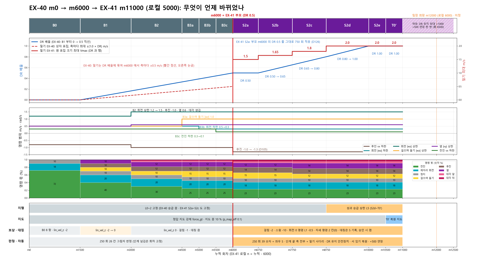
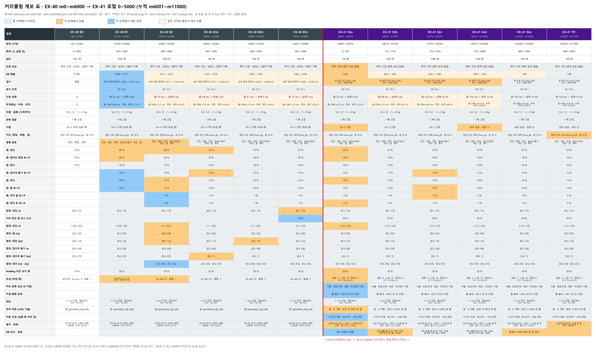
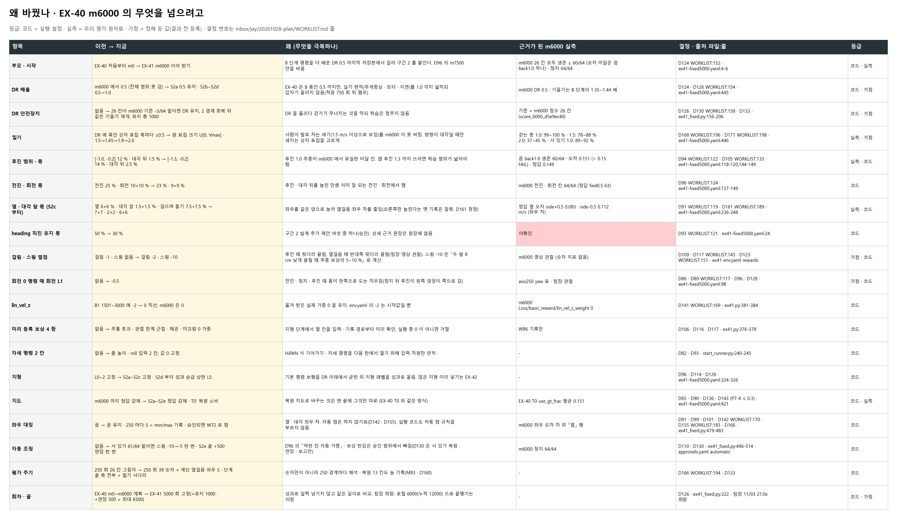
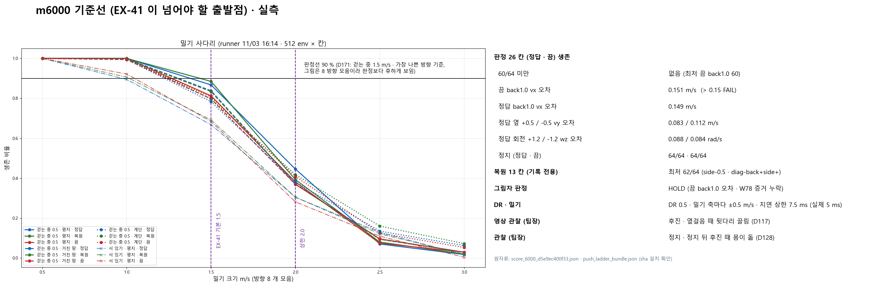
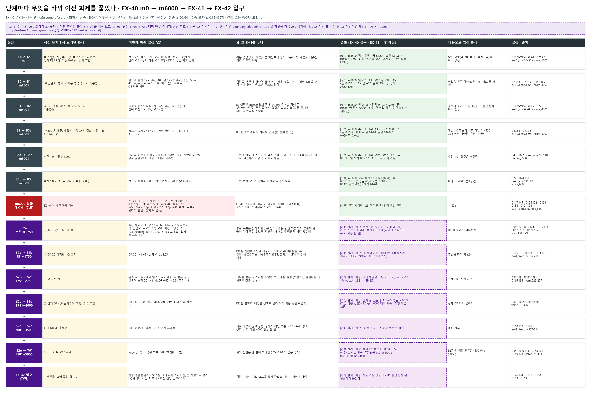
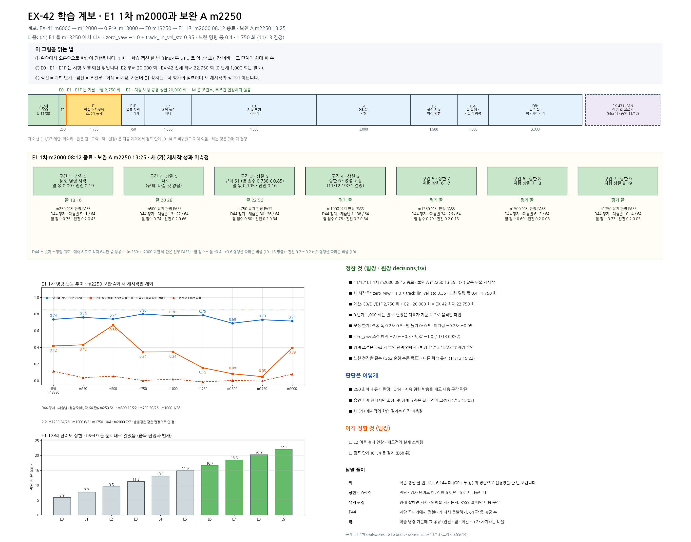

# 커리큘럼 계보 정본 · EX-40 m0~m6000 → EX-41 로컬 0~5000

> 분류: 실험 설계 정본 (계보)
> 작성: lead · 2026-11-03 21:xx
> 근거: ex40.yaml(sha 66a519b2, EX-40 실행 그대로) · ex41-fixed5000.yaml(sha 5f471936, 고정 사본 2ee5dc00) · 두 실행의 params/env.yaml · agent.yaml · ex40_dr.py · ex41.py · ex41_fixed.py · start_runner.py · m6000 점수 score_6000_d5e9ec40 · 밀기 사다리 push_ladder_bundle.json · WORKLIST.md 결정 D57~D173
> 요지: 단계마다 무엇이 이어지고 무엇이 바뀌었는지, 왜 바꿨는지(m6000 의 무엇을 넘으려고)를 그림 넷과 표로 한 곳에 모은다
> 상태: 초안 v1 · 11/11 §7 EX-42 단계 표 덧붙임 (planner-lx) · 11/13 21:1x §7 그림 6 v6 · E1 행 · (가) E1 다시 (scribe-lx) · 그림은 make_lineage.py 가 원자료에서 다시 만든다 · 표 밖 문장 칸은 이 문서가 정본

## 어떻게 읽나

- 그림 1 은 흐름(언제 무엇이 오르고 바뀌나), 그림 2 는 단계 × 항목 전부, 그림 3 은 바꾼 이유, 그림 4 는 출발점 m6000 실측, 그림 5 는 단계 전환마다 「직전 과제 → 바꾼 설정 → 왜 푸나 → 결과 → 넘긴 과제」 흐름이다(EX-40 결과는 실측, EX-41 이후는 가정 설계의 예상, 보라 점선).
- 그림 2 색: 회색 = 앞 단계에서 이어짐 · 주황 = 이 단계에서 바뀜 · 파랑 = 이 단계에서 새로 생김 · 연한 주황 = 같은 규칙의 램프가 계속 오름(새 결정 아님).
- 회차는 두 가지로 적는다. 누적 회차 m(EX-40 m0 부터)과 EX-41 안의 로컬 회차 n(= 누적 − 6000).
- 숫자 등급: 표 안 설정값은 모두 「코드」(실행 설정 파일 · 코드 공식). m6000 숫자는 「실측」. 문턱값(61/64 · −3/64 · 0.8 · 90 %)과 스윙 −10 은 「가정」(결과 전에 정해 둔 값).











## 1. 한 줄 흐름

EX-40 은 m0 부터 기본 명령을 하나씩 쌓으며(B0 → B3c) DR 을 0 에서 0.5 까지 천천히 올렸다. EX-41 은 그 마지막 저장본 m6000 에서 갈라져, DR 을 0.5 → 1.0 으로 끝까지 올리고 밀기를 1.5 → 2.0 m/s 로 세게 하면서 m6000 에서 약했던 후진 · 좌우 차 · 발 끌림 · 몸 돌기를 고치고, 마지막 500 회(T0′)에 복원 지도로 바꾼다.

## 2. EX-40 단계 (m0~m6000)

| 단계 | 누적 회차 | 새로 넣은 것 · 바뀐 것 | 이유 | 결정 · 출처 |
|---|---|---|---|---|
| B0 | m0~m1500 | 처음부터(부모 없음). 명령 전진 72 % · 제자리 회전 9+9 % · 정지 10 %. 범위 전진 [0.3, 1.5] · 회전 [0.5, 1.2]. 보상 B0 8 항(추종 2.0/1.0 · 관절 가속 −1e−7 · hip L1 −0.05 · thigh · calf L1 −0.01 · 네 발 정지 0.1 · 정지 간격 −0.2 · 정지 하중 −0.1). DR 0(마찰 0.2~1.2 · 질량 −1~+3 kg 만 시작부터). 지형 L0~2 고정. 정답 지도 강제 · 지도 끔 10 %. heading 직진 유지 50 % | S-B10 START 의 전진 80 · 회전 20 에 정지 10 % 를 끼워 72 · 18 · 10. 서 있기를 m0 부터 배우게(부모 m1500 도 정지 RR 0.63 이었음) | D68 WORKLIST:94 · D70:96 · D71:97 · ex40.yaml:34-50 |
| B1 | m1501~m3000 | 걸으며 돌기 5+5 · 후진 10 · 옆 5+5 % 생김, 전진 40 · 회전 10+10. lin_vel_z −2 → 0 (1501~3000 직선). DR 0 → 0.5 직선 램프 시작(m6000 에 0.5): 무게중심 · 이득 · 모터 · 지연 · 밀기 | 명령을 하나씩 쌓는 방식. DR 을 「맨 뒤」 가 아니라 기본 보행 안으로 당김 | D72:98 · D73:99 · D74:100 · D141:169 · ex40.yaml:51-64 · ex40_dr.py:32-40 |
| B2 | m3001~m4500 | 대각 4 종 1.5 % 씩 생김. 전진 30 · 후진 12 · 옆 6+6. 범위 회전 상한 1.2 → 1.5 · 후진 −0.8 → −1.0 · 옆 0.5 → 0.6 | EX-39B 설정이 W15 13 명령 모두 ≥ 63/64 · 정지 좌우 고름 | D69:95 · ex40.yaml:65-80 |
| B3a | m4501~m5000 | 걸으며 돌기 7.5+7.5 %, 전진 25. 걸으며 돌기 \|wz\| 0.5 → 1.0 | B3 를 셋으로 나눠 순서대로 연다 | D59:85 · D72:98 · ex40.yaml:81-95 |
| B3b | m5001~m5500 | 제자리 회전 하한 0.5 → 0.3 | 느린 회전 | D72 · ex40.yaml:96-110 |
| B3c | m5501~m6000 | 전진 하한 0.3 → 0.1 · 저속 전진(0.1~0.3) 몫 20 % | 느린 전진 | D72 · D74 · ex40.yaml:111-126 |

DR 은 m6000 에서 0.5 였다(ex40_dr.py:38). 이때 밀기는 상자 표집으로 x · y 축마다 ±0.5 m/s(±1.0 × 0.5), 간격 10~15 s, 지연 상한 7.5 ms(물리 5 ms 단위 내림이라 실제 5 ms), 무게중심 ±2.5 cm, 이득 · 모터 ±5 % (D75 WORKLIST:101 · D76:102). EX-40 은 이 뒤 m6001~m7500 D(DR 1.0) · m7501~m8000 T0(복원 지도)까지 갔지만, EX-41 의 부모는 m6000 이다(D124 WORKLIST:152). 그래서 그림과 표에는 m6000 까지만 싣는다.

단계 넘김은 회차 고정이고, 성과(250 회마다 26 칸 · 생존 ≥ 60/64 · 오차 ≤ 0.15)는 그림자 기록만 했다(D57:83 · D72:98).

## 3. EX-41 단계 (로컬 0~5000 · 누적 m6001~m11000)

| 단계 | 로컬 · 누적 | DR | 밀기 최대 | 지형 · 지도 | 명령 몫 · 범위 | 이유 | 결정 · 출처 |
|---|---|---|---|---|---|---|---|
| S2a | 0~750 · m6001~6750 | 0.5 그대로 | 1.5 | L0~2 고정 · 정답 강제 | 전진 25 → 23 · 회전 10+10 → 9+9 · 후진 12 → 14 · 대각 뒤 1.5 → 2.5 씩 · 후진 범위 −1.0 → −1.3. heading 50 → 30 %. 보상 걸림 −1 → −2 · 스윙 −10 · 회전 0 명령 L1 −0.5 새로. 자세 명령 2 칸(0). 미리 등록 보상 4 항(0) | 옮겨 온 정책이 새 보상 · 범위에 적응하는 750 회. DR 은 올리지 않음 | D96:124 · D105:133 · D123:151 · D126:154 · ex41-fixed5000.yaml:131-179 |
| S2b | 751~1750 · m6751~7750 | 0.5 → 0.65 | 1.65 | 같음 | S2a 와 같음 | DR 램프 시작. 26 칸 안전장치 | D126 · D130:158 · yaml:180-228 |
| S2c | 1751~2750 · m7751~8750 | 0.65 → 0.8 | 1.8 | 같음 | 옆 6 → 7 씩 · 대각 앞 1.5 → 2 씩 · 걸으며 돌기 7.5 → 6 씩 | 좌우를 같은 양으로 늘려 옆걸음 좌우 차를 줄임 | D91:119 · D161:189 · yaml:229-277 |
| S2d | 2751~4000 · m8751~10000 | 0.8 → 1.0 | 2.0 | 성과 승급 · 상한 L5 | S2c 와 같음 | DR 을 끝까지. 지형 레벨을 성과로 | D96 · D126 · yaml:278-326 |
| S2e | 4001~4500 · m10001~10500 | 1.0 | 2.0 | 같음 | 같음 | 전체 DR 에서 굳힘. 끝에서 +500 연장 한 번 판단 | D110:138 · D126 · ex41_fixed.py:507-514 · yaml:327-375 |
| T0′ | 4501~5000 · m10501~11000 | 1.0 | 2.0 | 같음 · **복원 지도 소비**(force_gt 끔) | 같음 | 지도를 바꾸는 것은 맨 끝에 그것만 | D65 · D90:118 · D143:171 · yaml:376-424 |

밀기는 원 표집이다. 크기 U[0, Vmax] × 방향 U[0, 360°), 간격 10~15 s, 단계 Vmax 는 DR 배율과 뗐다(ex40_dr_runtime.py:199-233 · ex41_fixed.py:236-246 · ex41.py:749).

전 구간 이어지는 것: 명령 범위 나머지(전진 [0.1, 1.5] · 옆 [0.2, 0.6] · 회전 [0.3, 1.5] · 걸으며 돌기 vx [0.3, 0.8] · |wz| [0.2, 1.0] · 대각 |vx| [0.3, 0.6] · |vy| [0.2, 0.5]) · 정지 10 % · 저속 전진 몫 20 %(ex41.py:136) · 마찰 · 질량 · 관측 잡음 1 배 · 지도 끔 10 %(p_map_off 0.1, 부모에서 옮김 ex41_startup.py:679-685) · PPO(lr 1e-3 적응 · 엔트로피 0.01 · 목표 KL 0.01 · 512-256-128 elu, 두 실행 agent.yaml 동일) · lin_vel_z 0(ex41.py:381-384, env.yaml 의 −2 는 시작값일 뿐) · 기존 보상 항(충돌 −10 · 부드러움 −0.01 · 에너지 −2e−5 등).

## 4. 바꾼 이유 · m6000 의 무엇을 넘나

그림 3 과 같은 내용이다. 문장 칸의 정본은 이 표다.

| 항목 | 이전 → 지금 | 왜 (무엇을 극복하나) | 근거가 된 m6000 실측 | 결정 · 출처 | 등급 |
|---|---|---|---|---|---|
| 부모 · 시작 | EX-40 처음부터 m0 → EX-41 m6000 이어 받기 | B 단계 명령을 다 배운 DR 0.5 마지막 저장본에서 갈라 구간 2 를 붙인다. D96 의 m7500 안을 바꿈 | 26 칸 모두 생존 ≥ 60/64 (오차 미달은 끔 back1.0 하나) · 정지 64/64 | D124 WORKLIST:152 · ex41-fixed5000.yaml:4-6 | 코드 · 실측 |
| DR 배율 | m6000 0.5 → S2a 0.5 유지 · S2b~S2d 0.5→1.0 | EX-40 은 B 동안 0.5 까지만. 실기 편차를 1.0 까지 넓히되 적응 750 회 뒤 램프 | 기울기는 B 단계의 1.35~1.44 배 | D124 · D126 WORKLIST:154 · yaml:445 | 코드 · 가정 |
| DR 안전장치 | 없음 → 26 칸이 m6000 기준 −3/64 밑이면 DR 유지, 2 경계 회복 뒤 같은 기울기 재개, 유지 총 1000 · 다 쓰면 현재 배율로 계속 + 보고 | DR 을 올리다 걷기가 무너지는 것을 막되 학습은 멈추지 않음 | 기준 = m6000 점수 26 칸 | D126 · D130:158 · D133:161 · ex41_fixed.py:156-206 | 코드 · 가정 |
| 밀기 | 상자 표집 축마다 ±0.5 → 원 표집 1.5 → 1.65 → 1.8 → 2.0 | 사람 발차기(1.5 m/s 이상으로 보임, SLR kickdog)를 m6000 이 못 버팀. 대각일 때만 세지는 상자 표집을 고르게 | 걷는 중 1.0: 99~100 % · 1.5: 78~88 % · 2.0: 37~45 % · 서 있기 1.0: 89~92 % | D168:196 · D171:198 · yaml:446 | 실측 · 가정 |
| 후진 범위 · 몫 | [−1.0, −0.2] 12 % · 대각 뒤 1.5 % → [−1.3, −0.2] 14 % · 대각 뒤 2.5 % | 후진 1.0 추종이 m6000 의 유일한 미달 칸. 앱 후진 1.3 을 쓰려면 학습 범위가 넓어야 | 끔 back1.0 생존 60/64 · 오차 0.151 (> 0.15) · 정답 0.149 | D94:122 · D105:133 · yaml:118-120 · 144-149 | 실측 · 코드 |
| 전진 · 회전 몫 | 25 % · 10+10 % → 23 % · 9+9 % | 후진 · 대각 뒤를 늘린 만큼 이미 잘 되는 쪽에서 뗌 | 전진 · 회전 칸 64/64 (정답 fwd0.5 63) | D96:124 · yaml:137-149 | 코드 |
| 옆 · 대각 앞 (S2c) | 옆 6+6 · 대각 앞 1.5+1.5 · 걸으며 돌기 7.5+7.5 → 7+7 · 2+2 · 6+6 | 좌우 같은 양으로 늘려 옆걸음 좌우 차를 줄임(오른쪽만 늘린다는 옛 기록은 잘못, D161) | 정답 side+0.5 vy 오차 0.083 · side−0.5 0.112 m/s | D91:119 · D161:189 · yaml:236-248 | 실측 · 코드 |
| heading 직진 유지 몫 | 50 → 30 % | 구간 2 추가 제안 여섯 중 하나(승인) | **미확인** (상세 근거 문장이 원장에 없음) | D93:121 · yaml:24 | 코드 |
| 걸림 · 스윙 벌점 | 걸림 −1 · 스윙 없음 → 걸림 −2 · 스윙 −10 | 후진 때 뒷다리 끌림, 옆걸음 때 반대쪽 뒷다리 끌림(팀장 영상 관찰). 스윙 −10 은 「두 발 8 cm 낮게 끌릴 때 추종 보상의 5~10 %」 로 계산 | 영상 관찰 (숫자 지표는 EX-41 W86 부터) | D109:137 · D117:145 · D123:151 · EX-41 env.yaml | 가정 · 코드 |
| 회전 0 명령 때 회전 L1 | 없음 → −0.5 | 전진 · 정지 · 후진 때 몸이 한쪽으로 도는 치우침(정지 뒤 후진이 왼쪽 엉덩이 쪽) | axis250 yaw 표 · 팀장 관찰 | D86:113 · D89:117 · D96 · D128 · yaml:98 | 가정 · 코드 |
| lin_vel_z | B1 에 −2 → 0, m6000 은 0 | 옮겨 받은 실제 가중 0 유지 | m6000 lin_vel_z_weight 0 | D141:169 · ex41.py:381-384 | 코드 |
| 미리 등록 보상 4 항 | 없음 → 무릎 토크 · 관절 한계 근접 · 체공 · 미끄럼 0 가중 | 지형 단계에서 켤 칸의 입력 · 기록 경로를 미리 확인. 실행 중 0 이 아니면 거절 | W86 기록만 | D106 · D116 · D117 · ex41.py:376-378 | 코드 |
| 자세 명령 2 칸 | 없음 → 몸 높이 · roll 입력 2 칸, 0 고정 | HiPAN 식 기어가기 · 자세 명령을 다음 판에서 열기 위해 입력 차원만 먼저 | - | D82 · D93 · start_runner.py:240-245 | 코드 |
| 지형 | L0~2 고정 → S2a~S2c 고정 · S2d 부터 성과 승급 상한 L5 | 기본 명령 보행을 DR 아래에서 굳힌 뒤 레벨을 성과로. 많은 지형 미리 넣기는 EX-42 | - | D96 · D114 · D126 · yaml:324-326 | 코드 |
| 지도 | 정답 강제 → S2a~S2e 정답 강제 · T0′ 복원 소비 | 복원 지도 전환은 맨 끝에 그것만 (EX-40 T0 와 같은 방식) | EX-40 T0 use_gt_frac 평균 0.151 | D65 · D90 · D136 · D143(P7-4 ≤ 0.3) · yaml:421 | 코드 · 실측 |
| 좌우 대칭 | 끔 → 끔 유지 · 250 마다 S = min/max 기록 · 승인되면 W72 로 켬 | 옆 · 대각 좌우 차. 자동 켬은 하지 않기로(D142 · D155). 실행 코드도 자동 켬 규칙을 부르지 않는다(ex41_fixed.py 는 _record_mirror_observation 만) | m6000 옆 좌우 오차 차 | D91 · D99 · D101 · D142:170 · D155:183 · D166:194 · ex41_fixed.py:479-483 | 코드 |
| 자동 조정 | 없음 → 서 있기 61/64 밑이면 스윙 −10 → −5 한 번 · S2e 끝 +500 연장 한 번 | D96 의 「약한 칸 자동 가중」 · 보상 반감은 승인 범위에서 빠짐(D130 은 서 있기 복원 · 연장 · 보고만) | m6000 정지 64/64 | D110 · D130 · ex41_fixed.py:496-514 · approvals.yaml automatic | 코드 |
| 평가 주기 | 250 회 26 칸 그림자 → 250 회 39 숫자 + 계단 옆걸음 좌우 S · 단계 끝 축 전부 + 밀기 사다리 · 판정 걷는 중 1.5 ≥ 90 %(가장 나쁜 방향) | 숫자만이 아니라 250 경계마다 해석. 복원 13 칸도 늘 기록(M83 · D160) | - | D133 · D166:194 · D171 | 코드 |
| 회차 · 끝 | EX-40 m0~m8000 계획 → EX-41 5000 회 고정(+유지 1000 · +연장 500 = 최대 6500) | 성과로 일찍 넘기지 않고 같은 길이로 비교 | - | D126 · ex41_fixed.py:222 | 코드 |

## 5. m6000 기준선 (실측)

- 판정 26 칸(정답 · 끔): 모두 생존 ≥ 60/64. 최저는 끔 back1.0 60/64. 그림자 판정 HOLD: 끔 back1.0 vx 오차 0.151 m/s(> 0.15) · W78 증거 파일 누락. 정답 back1.0 0.149.
- 좌우: 정답 옆 +0.5 vy 오차 0.083 · −0.5 0.112 m/s. 회전 +1.2 / −1.2 wz 오차 0.088 / 0.084 rad/s.
- 정지: 정답 · 끔 64/64.
- 복원 13 칸(기록 전용): 최저 62/64 (side−0.5 · diag-back+side+).
- 밀기 사다리(512 env × 칸, 방향 8 개 모음): 걷는 중 0.5 m/s 명령에서 1.0 m/s 99~100 % · 1.5 m/s 78~88 % · 2.0 m/s 37~45 % · 2.5 m/s 7~16 %. 서 있기 1.0 m/s 89~92 % · 1.5 m/s 67~69 %. 「버틴 최대(90 % 이상)」 는 걷는 중 모두 1.0, 서 있기 정답 0.5 · 복원 · 끔 1.0. 판정은 가장 나쁜 방향 기준이라 그림의 모음 값보다 낮다(2.0 m/s 가장 나쁜 방향 22~33 %, ex41-push-m6000-baseline.json).
- 영상 · 관찰(팀장): 후진 · 옆걸음 때 뒷다리 끌림(D117), 정지 · 정지 뒤 후진 때 몸이 돎(D128).

## 6. 열린 것 (팀장 결정 · 확인 필요)

- **EX-41 을 로컬 6000(누적 m12000)에서 끝맺기**: 팀장 희망(11/03 21:0x, 「가능하면」). 지금 설계는 5000 회 고정, tot_iter 6500 은 「유지 최대 1000 + 연장 500」 여유일 뿐 정해진 6000 이 아니다(ex41_fixed.py:222). 6000 으로 하려면 일정표(단계 길이)를 바꿔야 하고, 단계 길이는 W72 승인 칸이 아니라서 학습 중에는 못 바꾼다. 미결정.
- **heading 50 → 30 % 의 근거 문장**: 원장(D93)에 이유가 없다. 미확인.
- **좌우 대칭 켜기 (D174)**: 실행 코드 안에는 자동 켬이 없다. base 클래스(ex41.py:608-612)의 「w78_min_lr_ratio < 0.8 두 번이면 켬」 규칙은 고정 일정 실행(ex41_fixed.py)에서 불리지 않고, 점수 감시기도 그 스칼라를 내지 않는다(VERIFY-D174-auto-mirror.md). 그래서 lead 가 바깥 감시기를 둔다(D:/mai-tmp/lead/ex41_mirror_guard.py): 250 회 점수마다 정답 지도 S 평균을 재고, 0.8 미만이 두 번 연속이면 boundary critic_mirror true 를 커밋해 다음 250 경계에 켜고, 0.85 미만이거나 한 쌍이 0.6 미만이면 제안만 적는다. 승인 칸(approvals fields.critic_mirror, D174)이 같은 사본에 커밋돼 있어야 한다. 실측(lead 11/03 22:4x · 23:0x): 승인 칸은 실행 사본 1ba84e8f 에 커밋, 학습이 n=251 경계에서 그 커밋을 읽고 `applied` 로 기록(대칭 false 유지). 감시기는 숨은 프로세스 PID 77916 로 돌고, 250 점수에서 정답 S 평균 0.951 · action none 을 기록했다.
- **250 회마다 해석 보고**: 39 숫자 + 계단 옆걸음 좌우 S 에 한 줄 해석을 붙여 보고한다(D166 · 팀장 11/03 21:0x).
- 그림 2 · 그림 3 의 대칭 칸 문구(「승인 시 W72 로 켬」)는 팀장 확인(21:4x)대로 그대로 두었다. D174 내용은 그림 1 · 그림 5 와 이 절이 정본이다.
- EX-41 실행 상태(이 문서 작성 때): 로컬 n 150 · DR 0.5 · 회당 27.4 s (train_start_status.json, 11/03 21:09).

## 7. EX-42 단계 (E0 → E6b · 부모 m13000) · 그림 6

> 덧붙임: planner-lx · 2026-11-11 20:0x · 근거: `foothold_s2/curriculum/ex42-prep.yaml` (통합 dd453688 · 단계 상한 · 연장) · 정본 CURRICULUM-GATES.md §E (CG:186~195 단계 표) · 원장 decisions.tsv 7121e018 (팀장 13:07 전체 승인 · 19:38 상한 재조정) · 계보 4 `docs/research/20261108-lineage-4-ex42-stage0.md` (0 단계 m12000 → m13000 실측)



그림 6 은 v6 (11/13 · scripter-lx · #778 병합 15:55) 이다. E1 1 차 (일곱 구간 · 끝 m2000 08:12) 와 보완 A (m2250 13:25) 의 경계 결과, 11/13 결정 (예산 구간 · (가) 다시 · 시작 짝) 을 그렸다. 새 (가) E1 다시의 결과는 v6 에 없다 (그림 안 「미측정」). scripter-lx 가 v7 을 그리고 있고, 나오면 이 줄과 그림을 v7 로 바꾼다. 옛 판: v3 (11/07 제안판 · 「40,000 회 · 앞 20,000 지형 · 뒤 20,000 미션」) · v5 (11/12 23:50). 예산은 원장 11/13 15:17 로 바뀌었다: 기본 보행 (0 단계 · E0 · E1 · E1F) 은 예산 밖 · 지형 보행 (E2 ~) 20,000 · 전체 최대 22,750 · 연장은 지표가 움직일 때만. 아래 표의 「팀장 19:38 상한」 · 「읽는 법」 의 20,000 셈은 11/11 기준이라 이 구간 셈과 다르다.

| 단계 | 무엇을 배우나 (정본 CG) | 바꾸는 축 | 상한 (prep dd453688) | 팀장 19:38 상한 | 연장 | 출구 판정기 (코드) | 상태 (11/11 20:0x · E1 · J 행은 11/12 00:2x scribe-lx 갱신) |
|---|---|---|---|---|---|---|---|
| 0 단계 | 복원 지도 1,000 회 (m12000 → m13000) | 지도 소비 | 1,000 | 밖 | 0 | 계보 4 실측 | 끝 (11/08) |
| E0 | 점검 250 회 · 부모 m13000 · 평가 기준선 | 없음 (이어받기) | 250 | 밖 | 0 | `map39_e0` | 끝 · PASS (CPU 재판정 · verifier #639) |
| E1 | 익숙한 연속 지형 다지기 · D44 계단참 과제 · 느린 전진 필수 (원장 11/13 15:22) | 연속 상한 L5 → L9 (1 ~ 3 구간 상한 5 유지 · 4 구간부터 경계마다 +1 · 6, 7, 8, 9) · 명령 보강 · 보상 경계 조정 | 1,750 (11/12) | 예산 밖 (11/13 15:17) | 지표가 움직일 때만 (11/13 15:17) | 졸업 기준 v2 (`e1_v2` · #771 · 원장 11/13 11:50 · D44 정지 → 재출발은 기록 칸) | 1 차 일곱 구간 · 손 연장 · 보완 A 모두 관문 FAIL (m1250 ~ m2250 · 정지 → 재출발 GT/PRED 34/26 · 6/3 · 10/4 · 7/7 · 1/2) → **(가) E1 다시 진행 중** (아래 「(가) E1 다시」) |
| E1F | 깃발 계약 확인 (직선 4 개 · 도달 ≥ 52/64 두 창) | 명령 몫 깃발 0 → 10 % | 750 | 같음 | 500 × 1 | `flag_two_window` | 승인 (팀장 12:02) · 기동 대기 |
| E2 | 새 듬성 종류 하나 (`stepping_stones_low` L0 · 5 %) | 노출 벡터 K | 1,500 | 같음 | 500 × 2 | 없음 (#686 초안) | 승인 (13:07) · 판정기 · 입구 어댑터 빈칸 |
| E3 | 종류별 치수 · 불규칙성 확대 · 연속 L9 · 깃발 15 % | D · K · L+ | 3,000 | **4,000** | 1,000 × 2 | 없음 | 승인 · 빈칸 |
| E4 | 고난도 종류 (climb · gap · stones · beam · 확장 E) · 쉬움 1.5 % | K · D | 2,000 | **3,000** | 1,000 × 2 | 없음 | 승인 · 빈칸 |
| E5 | 혼합 · 방향 일반화 · 지형 너머 깃발 · 10 / 70 / 20 | K · C | 1,500 | 같음 | 500 × 2 | 없음 | 승인 · 빈칸 |
| M (조건부) | 지도 끔 연속 가지 · 들어간 단계로 복귀 | p_map_off | 500 | 같음 (1,000 회 못 나가면 알림 + 원 단계) | 500 × 1 | 없음 | 승인 (조건부) · `enabled: false` |
| E6a | 자세 명령 (몸 높이 · 기울기) 켜기 | 명령 집합 | 1,000 | 같음 | 500 × 1 | 없음 | 승인 · 빈칸 |
| E6b | 지형 묶음 D (높은 턱 · 벽 · 기어가기) · 쉬움 1.5 % | 노출 K | 2,000 | **3,000** | 1,000 × 2 | 없음 | 승인 · 빈칸 |
| J0~J4 | 점프 | 없음 | 자리표시 (팀장 결정 전 · prep 250/250 · 250/1000 · 250/2000 · 250/2000 · 250/3000) | 범위 밖 (팀장 13:07) | 없음 | 없음 | 정본 행 없음 · prep 행 있음 (#711 · 승인 칸 approved false · enabled false) |

읽는 법: 상한 합 (prep · M 제외) 은 13,000 · 팀장 19:38 값으로 바꾸면 16,000 (계산) 이고 연장은 20,000 안에서 쓴다. 「출구 판정기」 가 「없음」 인 단계는 관문 PASS 를 낼 수 없어 자동 사슬이 멈춘다 (planner REVIEW-EX42-SKELETON-AUDIT-1111.md §1). 단계 정의 원문은 CG §E 가 정본이고 이 표는 계보용 요약이다.

### (가) E1 다시 (원장 11/13 14:29 · 17:45 · 20:25 · 20:28 · scribe-lx 11/13 21:1x)

- 출발: 부모 m13250 (E0 끝) 에서 1,750 회 (누적 13,250 → 15,000) · 시작 짝 `zero_yaw` −1.0 + `track_lin_vel_std` 0.35 · 느린 명령 몫 0.4 · 기동 사본 v19 · 17:44 기동 (원장 17:45).
- 경계 규칙: 결과 전에 고정 (CG §E.3.3 · 원장 15:03 · 17:31 · 18:41 · 19:24 · 19:45). 판정과 보고는 정답 지도 (GT) 와 복원 지도 (PRED) 둘 다 · 지도 끔은 기록.
- 1 구간 (0 → 250): 19:16 끝. m250 경계 판정 KEEP (원장 20:25): 유지 GT · PRED PASS · R6 · R2 안 걸림 · 졸업 기준 v2 판정은 두 창이 필요해 FAIL (점수 파일). 느린 전진 추종 비율 (졸업 기준 v2 정의 · env 별 「간 거리 ÷ (명령 × 6 초)」 의 중앙값 · 서기 원자료 계산): 전진 0.1 GT/PRED L0 0.45/0.41 · L5 0.42/0.41 · 전진 0.2 0.82/0.81 · 0.78/0.81. 같은 v2 정의의 부모 m13250 (v2 평가 예행 · reviewer 21:12 대조): 전진 0.1 L0 0.119/0.114 · L5 0.112/0.108 · 전진 0.2 0.401/0.400 · 0.392/0.395. 원장 20:25 의 「0.1 R ×3.8 · 0.2 R ×2」 도 이 v2 값 기준이다 (원장 15:03 R1 의 0.417 은 옛 G1b 정의라 섞지 않는다). 기록 칸: 옆 −0.2 R 0.52 대 +0.2 0.70 · D44 정지 → 재출발 32/42 (lead 판독).
- 2 구간 (250 → 500): 같은 설정 · 조정 없음 · 사본 v22. 20:26 첫 시도는 런처 단위가 끝나며 학습까지 꺼짐 (학습 0 회 · FAILURE-LOG M103) → 20:27 다시 (원장 20:28).

## 다시 만들기

```
C:/Users/AI-WS01/anaconda3/python.exe inbox/jay/20261103-curriculum-lineage/make_lineage.py
```

EX-40 yaml sha 가 실행 때와 다르면 멈춘다. 밀기 사다리 · m6000 점수 · EX-41 부모 sha 셋이 같은지도 확인한다.
