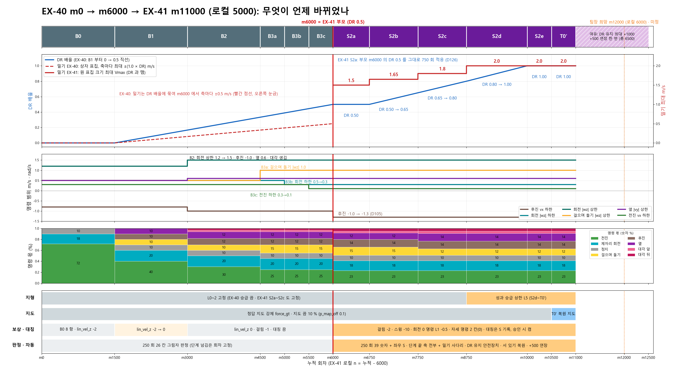
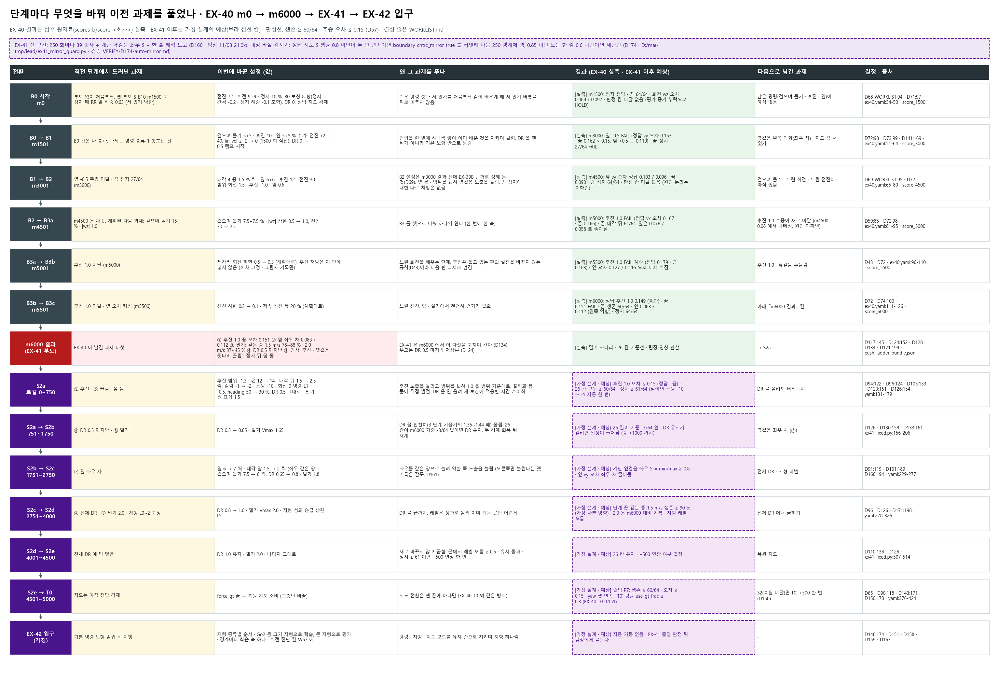
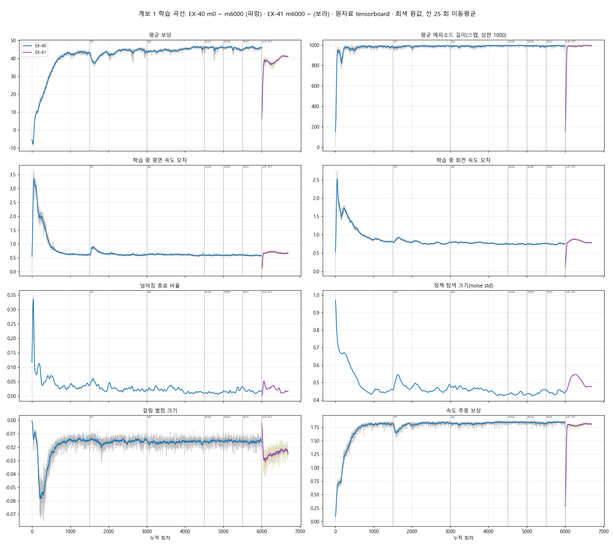
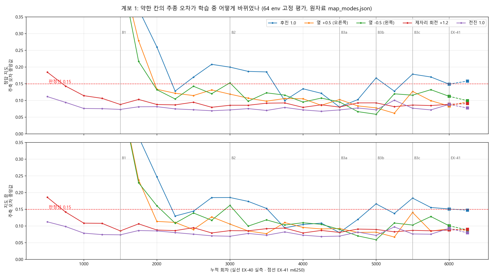
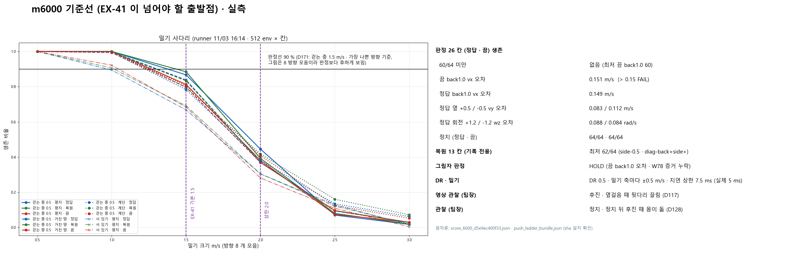
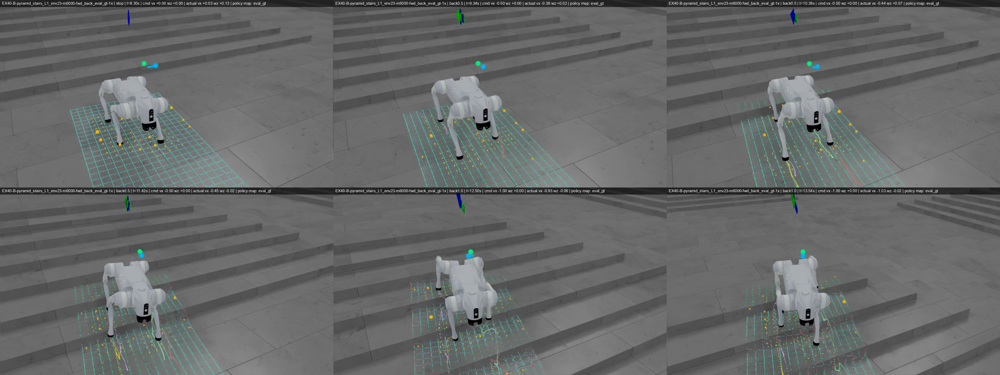
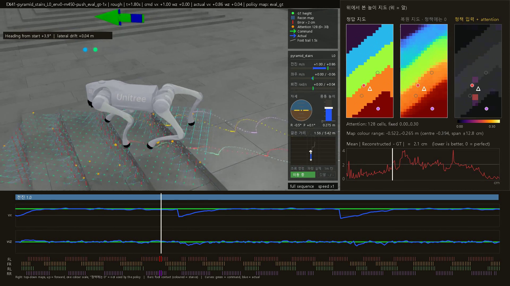
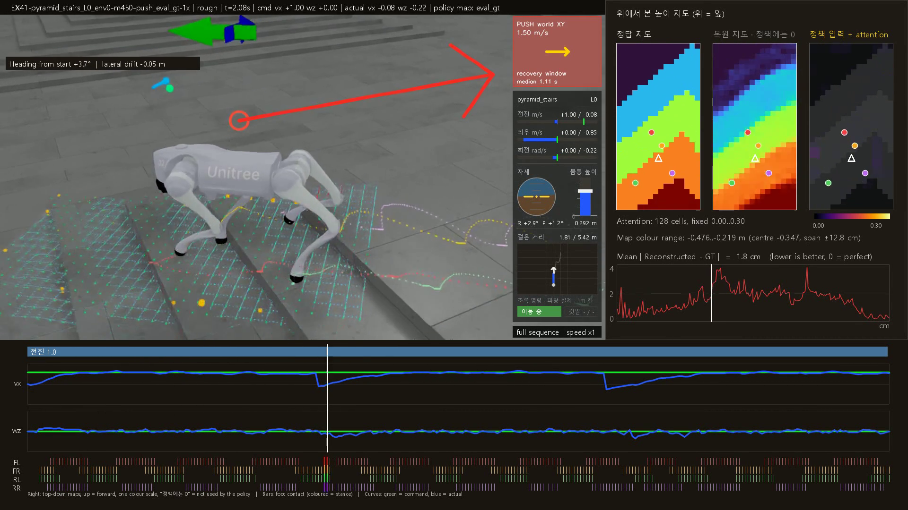
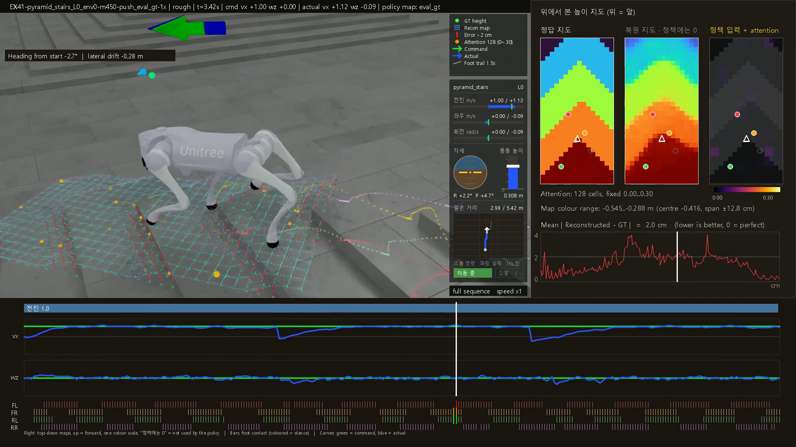
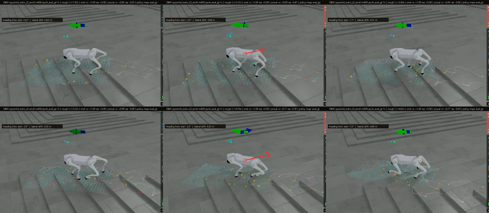

# 계보 1 m6000 종합 분석

> 분류: A/정책학습 · 실험 분석
> 작성: 오흥재 · lead 세션 · 2026-11-04 00:0x
> 근거: EX-40 실행 ex40_main_20261031_041313 · m6000 점수 score-watch-b/model_6000_d5e9ec400f33/map64/map_modes.json(그림 1 은 make_m6000.py 가 원자료에서 그림) · 밀기 사다리 D:/mai-tmp/runner/ex41_push_ladder_m6000_20261103_161418/ · 커리큘럼 정본 ../20261103-curriculum-lineage/CURRICULUM-LINEAGE.md · 팀장 영상 관찰(D117) · EX-41 250 기록 ../20261101-ex41/EX41-250-LOG.md
> 요지: m6000 은 평지 기본 명령 13 개를 지도 셋 모두에서 거의 다 살아서 해낸다. 남은 약점은 후진 1.0 추종(판정선 경계), 옆걸음 좌우 차, 밀기 1.5 m/s 이상, 뒷다리 끌림 넷이고, EX-41 은 이 넷을 겨냥해 짰다
> 상태: v0.3 (11/04 01:4x) · 학습 곡선 · 지형 종류별 분해 · 밀기 사다리 · 후진 장면 · 발 끌림 기준선 · 논문 대조 · 화살표 고친 밀기 영상 추가 · v0.2 (11/04 00:2x) · 학습 중 추이 그림 · 커리큘럼 그림 · 밀기 영상 셋 추가 · EX-41 결과가 쌓이면 §5 를 채운다

## 1. 계보 1 이 무엇인가

계보 1 은 EX-40 한 줄기다. 부모 없이 처음부터(m0) 평지 · 낮은 지형(L0~2)에서 기본 보행을 배우고, 단계 B0 → B1 → B2 → B3a → B3b → B3c 를 거쳐 m6000 에서 끝났다. m6000 이 EX-41 의 부모이고, EX-41 은 그 위에 누적 m6001 부터 이어진다. 단계마다 무엇을 바꿨는지는 커리큘럼 정본 그림에 있다(아래 두 장).

**그림 A.** 누적 회차 위의 DR · 밀기 상한 · 명령 범위 · 명령 몫 · 지형 · 지도 · 보상 · 판정. 실선 EX-40, 오른쪽 보라 EX-41(가정 설계).

**그림 B.** 단계 전환마다 「직전 과제 → 바꾼 설정 → 왜 푸나 → 결과 → 넘긴 과제」. 초록 칸 실측, 보라 점선 칸 EX-41 이후 가정.

- DR(무작위화 세기)은 B1 부터 0 → 0.5 로 곧게 올렸다. m6000 은 DR 0.5 에서 끝났다.
- 밀기는 DR 에 묶여 m6000 에서 축마다 ±0.5 m/s 였다. 1.5 m/s 이상은 배운 적이 없다.
- 지도는 정답 지도를 강제로 넣고 10 % 만 끔으로 학습했다(force_gt · p_map_off 0.1). 복원 지도로는 학습하지 않았다.

## 1-1. 학습 곡선

**그림 C.** EX-40 m0 ~ m6000(파랑) 과 EX-41 m6000 ~(보라)의 학습 지표. 원자료 tensorboard(`make_curves.py`), 회색 원값 · 선 25 회 이동평균. EX-41 끝의 급락은 01:13 학습 중단 직전 마지막 기록이다.

- **보상 · 에피소드 길이**: m1500 까지 빠르게 올라 평평해졌고(보상 약 43 → 46, 길이 거의 1000 = 20 초 끝까지 생존), B1 진입(m1500, DR 켜짐 · 명령 늘어남)에서 한 번 내려갔다가 회복했다.
- **학습 중 속도 오차**: 평면 0.6 · 회전 0.75 근처에서 m2000 이후 거의 안 줄었다. 평가 39 칸 오차가 경계마다 흔들린 것(그림 2)과 같은 그림이다: 평균은 이미 바닥이고 약한 칸만 오르내린다.
- **정책 탐색 크기(noise std)**: 0.45 근처로 낮게 유지. EX-41 에서 새 보상을 받자 0.55 까지 올랐다가(다시 탐색) 0.48 로 내려오는 중.
- **걸림 벌점**: EX-41 에서 가중치를 −1 → −2 로 올려 크기가 두 배가 된 뒤 점점 줄고 있다(발끝 걸림이 줄어든다).

## 2. m6000 이 하는 것 (39 칸 실측)

**그림 1.** 칸마다 위 숫자는 명령 주축 추종 오차의 중앙값(전후는 vx, 옆은 vy, 회전은 wz, 단위 m/s · rad/s), 아래는 20 초 끝까지 살아 있는 로봇 수(64 대 중). 빨간 테두리는 판정선 0.15 를 넘은 칸.

- **생존은 거의 다 된다.** 39 칸 중 64/64 가 아닌 칸은 아홉이고, 가장 낮은 칸은 지도 끔 후진 1.0 의 60/64 다.
- **오차가 판정선을 넘는 칸은 후진 1.0 하나다.** 정답 0.149(판정선 바로 안) · 복원 0.157 · 끔 0.151. 셋 다 0.15 근처라 「후진 1.0 을 다 배웠다」 고 할 수 없다.
- **옆걸음은 좌우가 다르다.** 정답 지도에서 오른쪽(+0.5) 0.083, 왼쪽(−0.5) 0.112. 대각 뒤 왼쪽(diag-back+side−)도 0.099 ~ 0.110 으로 오른쪽(0.069 ~ 0.072)보다 크다. 한쪽 발 배치가 덜 배워졌다는 뜻이다.
- **지도 셋의 차이는 작다.** 평지라 지도가 하는 일이 적다. 지도가 진짜 쓸모 있는지는 지형 단계(EX-42)에서 판가름 난다.
- 전진 · 대각 앞 · 제자리 회전 · 정지는 잘 된다(오차 0.015 ~ 0.093).

## 2-1. 지형 종류별로 나눠 보면 (m6000 · 정답 지도 · 주축 오차 중앙값 (끝까지 생존/env))

| 지형 종류 | env 수 | 전진 1.0 | 후진 1.0 | 옆 +0.5 | 옆 −0.5 | 회전 +1.2 | 정지 |
|---|---|---|---|---|---|---|---|
| boxes | 12 | 0.093 (12/12) | 0.144 (12/12) | 0.078 (12/12) | 0.110 (12/12) | 0.084 (12/12) | 0.015 (12/12) |
| 경사 오르막 | 4 | 0.080 (4/4) | 0.145 (4/4) | 0.063 (4/4) | 0.098 (4/4) | 0.091 (4/4) | 0.015 (4/4) |
| 경사 내리막 | 4 | 0.075 (4/4) | 0.144 (4/4) | 0.065 (4/4) | 0.091 (4/4) | 0.084 (4/4) | 0.014 (4/4) |
| 계단 오르막 | 15 | 0.090 (15/15) | **0.154** (15/15) | 0.111 (15/15) | 0.135 (15/15) | 0.089 (15/15) | 0.016 (15/15) |
| 계단 내리막 | 15 | 0.086 (15/15) | 0.132 (15/15) | 0.097 (15/15) | 0.114 (15/15) | 0.086 (15/15) | 0.015 (15/15) |
| 거친 바닥 | 12 | 0.085 (12/12) | **0.158** (12/12) | 0.069 (12/12) | 0.101 (12/12) | 0.096 (12/12) | 0.017 (12/12) |
| 무대 계단 | 2 | 0.103 (2/2) | **0.175** (2/2) | **0.269** (2/2) | **0.160** (2/2) | 0.088 (2/2) | 0.016 (2/2) |

- **후진 1.0 이 안 되는 곳은 계단 오르막 · 거친 바닥 · 무대 계단**이다. 평평한 곳(boxes · 경사)에서는 0.144 로 판정선 안.
- **옆걸음은 계단에서 왼쪽(−0.5)이 늘 더 나쁘다**(계단 오르막 0.135, 내리막 0.114). 무대 계단은 env 2 대라 숫자가 거칠다.
- 모든 지형에서 생존은 끝까지 다 됐다. 남은 문제는 「살아남기」가 아니라 「명령을 정확히 따라가기」다.

## 2-2. 학습 중 추이: 한 경계의 숫자를 믿으면 안 되는 이유

**그림 2.** 250 회마다 같은 64 env 고정 평가로 잰 주축 오차 중앙값(위 정답 지도 · 아래 지도 끔). 실선 EX-40 m500 ~ m6000, 점선 EX-41 m6250. 빨간 점선 판정선 0.15. `make_trend.py` 가 원자료에서 그림.

- **후진 1.0 은 경계마다 크게 흔들린다.** B3 구간(m4500 ~ m6000) 정답 지도 값: 0.080 · 0.102 · 0.167 · 0.128 · 0.179 · 0.170 · 0.149. 이웃한 두 경계 사이에 0.04 ~ 0.07 씩 오르내린다. m4500 에 한 번 0.08 까지 내려갔지만 유지하지 못했다.
- **옆 −0.5(왼쪽)도 0.058 ~ 0.132 사이를 오간다.** 오른쪽(+0.5)은 0.062 ~ 0.127.
- **전진 1.0 · 제자리 회전은 m1500 이후 0.07 ~ 0.10 에서 안정**이다. 이 둘이 「이미 배운 칸」 이다(EX-42 몫 공여 후보, D176 ④).
- **그래서 EX-41 m6250 의 후진 0.158 은 EX-40 마지막 1500 회의 흔들림 폭(0.128 ~ 0.179) 안이다.** 한 번의 경계 숫자로 「나빠졌다」 고 읽으면 안 되고, 두세 경계의 추이로 본다. 250 회 기록(EX41-250-LOG)의 판단도 이 기준으로 읽는다.
- 후진은 몇 번이나 판정선 아래로 내려갔다가 다시 올라왔다. 「배웠다가 잊는다」 인지 「평가 표본 흔들림」 인지는 같은 저장본을 두 번 재 봐야 가를 수 있다(미확인, GPU1 빈칸 채우기 후보).

## 3. m6000 이 아직 못 하는 것

| 약점 | 실측 | 등급 | 왜 그럴까(가설) |
|---|---|---|---|
| 후진 1.0 추종 | 오차 0.149 · 0.157 · 0.151, 끔 생존 60/64 | 실측 | 후진 1.0 몫이 작았고(B 단계 후진 12 %), 범위 끝값(−1.0)이 학습 범위 끝이라 표본이 적다 · 가정 |
| 옆걸음 좌우 차 | 오른쪽 0.083 대 왼쪽 0.112 | 실측 | 정책이 한쪽 발 순서를 덜 배움. 좌우 대칭을 강제하는 장치가 없었다 · 가정 |
| 밀기 | 걷는 중 1.0 m/s 약 100 % · 1.5 m/s 78 ~ 88 % · 2.0 m/s 약 40 % 생존, 서 있을 때 1.0 m/s 89 ~ 92 % | 실측(사다리) | 학습 밀기가 ±0.5 m/s 까지였다 · 코드 |
| 뒷다리 끌림 | 후진 때 뒷다리, 옆걸음 때 반대쪽 뒷다리가 끌림 | 팀장 영상 관찰(숫자 없음) | 발 들기를 직접 보상하는 항이 없었다 · 코드 |

EX-40 도중의 흐름(그림 05 의 실측 칸): m3000 에 옆 −0.5 와 지도 끔 정지가 실패했다가 m4500 에 풀렸고, m5000 · m5500 에 후진 1.0 이 실패, m6000 에 정답만 겨우 통과했다. 즉 **후진 1.0 은 m5000 부터 끝까지 남은 과제**다. m4500 에서 옆걸음이 왜 풀렸는지, m5000 에서 후진이 왜 나빠졌는지는 원인을 분리하지 못했다(미확인).

## 3-1. 밀기 사다리 (m6000)

**그림 D.** m6000 밀기 사다리(밀기 세기별 생존, 지형 · 지도 모드 · 서기/걷기). 걷는 중 1.0 m/s 거의 100 %, 1.5 m/s 78 ~ 88 %, 2.0 m/s 약 40 %. EX-41 판정(D171)은 걷는 중 1.5 m/s 가장 나쁜 방향 생존 ≥ 90 %. 250 회마다 잰 값: 평지 82.8 %(m6000) → 95.3 %(m6250, 통과), 계단 70.3 → 76.6 %.

## 3-2. 후진 장면 (m6000 · 계단 오르막 L1 · 정답 지도)

**그림 E.** 위 왼쪽부터 8.3 초(정지) · 9.3 · 10.4 · 11.4 초(후진 0.5) · 12.5 · 13.5 초(후진 1.0). 뒷다리가 계단 모서리에 닿으며 내려가고, 바닥에 남은 발 궤적(색 선)이 길게 끌린다. 팀장이 m6000 영상에서 본 「후진 때 뒷다리 끌림」(D117) 이 이 장면이다. 영상 원본: `C:/Users/AI-WS01/s2_lab/ex40_main_20261031_041313/video_a/ex40_m6000/EX40-B-pyramid_stairs_L1_env23-m6000-fwd_back_eval_gt-1x/review.mp4`.

## 3-3. 발 끌림 숫자 기준선 (계단 옆걸음 · 정답 지도 · 접지 중 발이 끌린 비율 · 발 들림 높이 중앙값)

| | m6000 | m6250 | m6500 |
|---|---|---|---|
| 왼쪽 옆걸음 끌림 | 10.1 % | 7.1 % | 7.0 % |
| 오른쪽 옆걸음 끌림 | 12.6 % | 8.9 % | 7.2 % |
| 왼쪽 발 들림 | 3.4 cm | 5.8 cm | 6.5 cm |
| 오른쪽 발 들림 | 2.1 cm | 4.5 cm | 5.9 cm |

m6000 기준선은 11/04 00:0x GPU1 에서 m6250 과 같은 W78 칸(계단 L2 · L5, 시작 각 0 · 30 · 60 · 90°, 64 env)으로 쟀다(`D:/mai-tmp/lead/w78_m6000_baseline`). **EX-41 의 발 들기 보상(−10)이 끌림을 30 ~ 43 % 줄이고 발을 두세 배 높이 들게 했다.**

## 3-4. 참고 논문이 넘은 지형과 m6000 의 위치

| 논문 · 로봇 | 실기로 넘은 것 | m6000 이 한 것 |
|---|---|---|
| MOVE · Lite3 | 턱 0.60 m · 틈 0.90 m · 계단 0.25 m(60 %) · 후진 계단 0.10 m 100 % | 계단 L0 ~ 2(낮은 단) 전 방향 생존 · 후진 계단은 오차 0.154 |
| PIE · Lite3 | 턱 0.75 m · 틈 1.00 m · 계단 0.25 m · 경사 30° | 경사 21.8° 까지 · 턱 · 틈 · 점프 학습 안 함 |
| START · Lite3 | 평균대 0.20 m · 틈 0.70 m · 디딤돌 | 듬성 지형 학습 안 함 |
| MARG · Go2 | 외줄 0.18 m · 빔 0.09 m | 학습 안 함 |
| JEPLO · Go2 | 계단 0.15 m 위 전 방향 · 회전, 상자 0.53 m | 낮은 계단 위 전 방향 · 회전은 됨 |

출처: analyst `D:/mai-tmp/analyst/ADVICE-EX42-1103.md` §3(원문 링크 포함). **m6000 은 평지 · 낮은 지형의 전 방향 보행까지다.** 논문들이 넘은 높은 턱 · 넓은 틈 점프 · 30° 넘는 경사 · 듬성 지형은 EX-42 이후의 몫이고, 그 목표치는 EX-42 정본 v0.15 §E.8 대조표에 있다(목표는 논문 이상, D176).

## 4. EX-41 은 이 넷을 어떻게 겨냥했나

| m6000 약점 | EX-41 설정 | 결정 |
|---|---|---|
| 후진 1.0 | 후진 범위 −1.0 → −1.3(1.0 이 범위 가운데로) · 후진 몫 12 → 14 % | D105 · D96 |
| 옆걸음 좌우 | 좌우 몫을 같게 · 250 회마다 좌우 대칭 S 를 재고 0.8 미만 두 번이면 대칭 켬(바깥 감시기) | D161 · D174 |
| 밀기 | 원 표집 크기 0 ~ Vmax, Vmax 1.5 → 1.65 → 1.8 → 2.0, 판정 걷는 중 1.5 m/s 생존 ≥ 90 % | D171 |
| 뒷다리 끌림 | 발 들기 벌점 −10 · 발끝 걸림 −2.0(EX-40 −1.0) · 회전 0 명령 때 회전 벌점 −0.5 | D109 · D117 · D123 · D96 |

DR 은 S2a 750 회 동안 0.5 그대로 두고(새 보상에 먼저 적응), 751 부터 0.65 → 0.8 → 1.0 으로 올린다. 유지 칸이 기준 −3/64 밑이면 DR 을 멈춘다(D126).

## 5. EX-41 에서 어떻게 됐나 (경계마다 채움)

| 약점 | m6000 | m6250 | m6500 | 읽기 |
|---|---|---|---|---|
| 후진 1.0 오차(정답 · 복원 · 끔) | 0.149 · 0.157 · 0.151 | 0.158 · 0.170 · 0.147 | 0.118 · 0.119 · 0.114 | 판정선 안으로 · 흔들림 폭(그림 2) 감안해 추이로 본다 |
| 끔 후진 1.0 생존 | 60/64 | 64/64 | 64/64 | 해결 |
| 옆 왼 / 오 오차(정답) | 0.112 / 0.083 | 0.099 / 0.097 | 0.088 / 0.121 | 왼쪽 좋아짐 · 오른쪽 나빠짐(차 뒤집힘) |
| 계단 옆 90° 대칭 S(정답 평균 · 최저) | 미측 | 0.951 · 0.850 | 0.899 · 0.771 | 내려감 · 지켜봄(D177 b) |
| 계단 옆걸음 발 끌림 왼 / 오 | 10.1 / 12.6 % | 7.1 / 8.9 % | 7.0 / 7.2 % | **해결 방향** |
| 발 들림 높이 왼 / 오 | 3.4 / 2.1 cm | 5.8 / 4.5 cm | 6.5 / 5.9 cm | **좋아짐** |
| 밀기 걷는 중 1.5 m/s 가장 나쁜 방향(평지 · 계단) | 82.8 · 70.3 % | 95.3 · 76.6 % | 측정 중 | 평지 통과 · 계단 배우는 중 |
| 제자리 회전 중 앞뒤 흔들림(+1.2 / −1.2) | 0.046 / 0.032 | 0.072 / 0.074 | 0.044 / 0.083 | −1.2 남음 |

경계별 전체 기록과 판단: [EX41-250-LOG](../20261101-ex41/EX41-250-LOG.md)

## 6. 아직 모르는 것

- 후진 1.0 이 나빠진 원인(발 들기 벌점 · 범위 확대 · 몫 변화 중 무엇인지)은 분리하지 않았다. 경계 추이와 영상으로 본다.
- 지도가 진짜 쓸모 있는지는 평지 39 칸으로 알 수 없다. EX-42 지형 칸에서 정답 · 복원 · 끔을 비교한다.
- 같은 저장본 평가 흔들림(시드 43 · 44 재평가)은 11/04 01:20 GPU1 에서 재는 중이다. 결과가 나오면 그림 2 의 흔들림이 학습 탓인지 표본 탓인지 이 칸에 적는다.

## 7. 밀기 영상 (EX-41 m6450 · 세 지도 모드)

같은 시드 · 같은 지형(pyramid_stairs L0) · 전진 1.0 m/s 걷는 중에 두 번 민다(2.08 초 1.5 m/s, 약 4 초 2.0 m/s). 세 모드 모두 두 번 다 회복했고, 회복 시간 중앙값은 정답 1.11 · 1.22 초, 복원 1.12 · 1.34 초. 영상 하나 6 초 · 150 프레임 전부 검사 통과(scripter 보고 REPORT-ex41-a-push-m6450.md). 시연 자료이고 판정 숫자가 아니다. 판정은 밀기 사다리 · 250 밀기 확인(D171, 걷는 중 1.5 m/s 생존 ≥ 90 %)으로 한다.

| 밀기 직전 1.8 초 | 밀기 2.08 초 | 회복 뒤 3.4 초 |
|---|---|---|
|  |  |  |

- **화살표(11/04 01:1x 고친 판):** 밀기가 들어간 순간에만, 몸통 위에서 힘 방향으로 짧게(2.0 m/s 가 1.5 m/s 보다 조금 길게), 범례 화살표도 같은 방향 · 같은 순간에만. 처음 판은 화면 고정 점에서 범례까지 긋는 큰 선이고 범례가 늘 → 였다(팀장 00:2x 지적). 아래 그림은 lead 가 영상에서 직접 뽑은 1.92 · 2.12 · 2.60 · 3.22 · 4.14 · 4.62 초: 밀기 순간(2.12 · 4.14 초)에만 화살표가 있다.

- 밀린 순간 명령 전진 1.0 대 실제 전진 −0.08 · 옆 −0.85 m/s, 아래 그래프의 파란 실제 속도가 꺾였다가 초록 명령선으로 돌아온다.
- 영상: [정답 지도](push-m6450-eval_gt.mp4) · [복원 지도](push-m6450-eval_pred.mp4) · [지도 끔](push-m6450-probe_prop_only.mp4)
