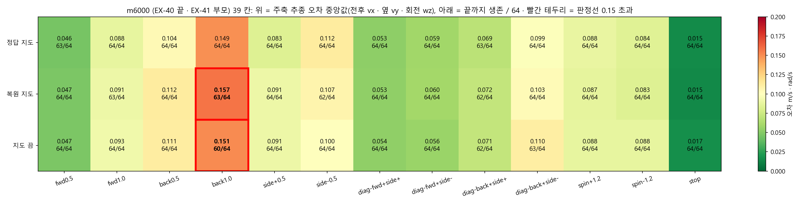

# 계보 1 m6000 종합 분석

> 분류: A/정책학습 · 실험 분석
> 작성: 오흥재 · lead 세션 · 2026-11-04 00:0x
> 근거: EX-40 실행 ex40_main_20261031_041313 · m6000 점수 score-watch-b/model_6000_d5e9ec400f33/map64/map_modes.json(그림 1 은 make_m6000.py 가 원자료에서 그림) · 밀기 사다리 D:/mai-tmp/runner/ex41_push_ladder_m6000_20261103_161418/ · 커리큘럼 정본 ../20261103-curriculum-lineage/CURRICULUM-LINEAGE.md · 팀장 영상 관찰(D117) · EX-41 250 기록 ../20261101-ex41/EX41-250-LOG.md
> 요지: m6000 은 평지 기본 명령 13 개를 지도 셋 모두에서 거의 다 살아서 해낸다. 남은 약점은 후진 1.0 추종(판정선 경계), 옆걸음 좌우 차, 밀기 1.5 m/s 이상, 뒷다리 끌림 넷이고, EX-41 은 이 넷을 겨냥해 짰다
> 상태: 초안 · EX-41 결과가 쌓이면 「EX-41 에서 어떻게 됐나」 칸을 채운다

## 1. 계보 1 이 무엇인가

계보 1 은 EX-40 한 줄기다. 부모 없이 처음부터(m0) 평지 · 낮은 지형(L0~2)에서 기본 보행을 배우고, 단계 B0 → B1 → B2 → B3a → B3b → B3c 를 거쳐 m6000 에서 끝났다. m6000 이 EX-41 의 부모이고, EX-41 은 그 위에 누적 m6001 부터 이어진다. 단계마다 무엇을 바꿨는지는 커리큘럼 정본 그림 01 · 02 · 05 에 있다.

- DR(무작위화 세기)은 B1 부터 0 → 0.5 로 곧게 올렸다. m6000 은 DR 0.5 에서 끝났다.
- 밀기는 DR 에 묶여 m6000 에서 축마다 ±0.5 m/s 였다. 1.5 m/s 이상은 배운 적이 없다.
- 지도는 정답 지도를 강제로 넣고 10 % 만 끔으로 학습했다(force_gt · p_map_off 0.1). 복원 지도로는 학습하지 않았다.

## 2. m6000 이 하는 것 (39 칸 실측)

**그림 1.** 칸마다 위 숫자는 명령 주축 추종 오차의 중앙값(전후는 vx, 옆은 vy, 회전은 wz, 단위 m/s · rad/s), 아래는 20 초 끝까지 살아 있는 로봇 수(64 대 중). 빨간 테두리는 판정선 0.15 를 넘은 칸.

- **생존은 거의 다 된다.** 39 칸 중 64/64 가 아닌 칸은 아홉이고, 가장 낮은 칸은 지도 끔 후진 1.0 의 60/64 다.
- **오차가 판정선을 넘는 칸은 후진 1.0 하나다.** 정답 0.149(판정선 바로 안) · 복원 0.157 · 끔 0.151. 셋 다 0.15 근처라 「후진 1.0 을 다 배웠다」 고 할 수 없다.
- **옆걸음은 좌우가 다르다.** 정답 지도에서 오른쪽(+0.5) 0.083, 왼쪽(−0.5) 0.112. 대각 뒤 왼쪽(diag-back+side−)도 0.099 ~ 0.110 으로 오른쪽(0.069 ~ 0.072)보다 크다. 한쪽 발 배치가 덜 배워졌다는 뜻이다.
- **지도 셋의 차이는 작다.** 평지라 지도가 하는 일이 적다. 지도가 진짜 쓸모 있는지는 지형 단계(EX-42)에서 판가름 난다.
- 전진 · 대각 앞 · 제자리 회전 · 정지는 잘 된다(오차 0.015 ~ 0.093).

## 3. m6000 이 아직 못 하는 것

| 약점 | 실측 | 등급 | 왜 그럴까(가설) |
|---|---|---|---|
| 후진 1.0 추종 | 오차 0.149 · 0.157 · 0.151, 끔 생존 60/64 | 실측 | 후진 1.0 몫이 작았고(B 단계 후진 12 %), 범위 끝값(−1.0)이 학습 범위 끝이라 표본이 적다 · 가정 |
| 옆걸음 좌우 차 | 오른쪽 0.083 대 왼쪽 0.112 | 실측 | 정책이 한쪽 발 순서를 덜 배움. 좌우 대칭을 강제하는 장치가 없었다 · 가정 |
| 밀기 | 걷는 중 1.0 m/s 약 100 % · 1.5 m/s 78 ~ 88 % · 2.0 m/s 약 40 % 생존, 서 있을 때 1.0 m/s 89 ~ 92 % | 실측(사다리) | 학습 밀기가 ±0.5 m/s 까지였다 · 코드 |
| 뒷다리 끌림 | 후진 때 뒷다리, 옆걸음 때 반대쪽 뒷다리가 끌림 | 팀장 영상 관찰(숫자 없음) | 발 들기를 직접 보상하는 항이 없었다 · 코드 |

EX-40 도중의 흐름(그림 05 의 실측 칸): m3000 에 옆 −0.5 와 지도 끔 정지가 실패했다가 m4500 에 풀렸고, m5000 · m5500 에 후진 1.0 이 실패, m6000 에 정답만 겨우 통과했다. 즉 **후진 1.0 은 m5000 부터 끝까지 남은 과제**다. m4500 에서 옆걸음이 왜 풀렸는지, m5000 에서 후진이 왜 나빠졌는지는 원인을 분리하지 못했다(미확인).

## 4. EX-41 은 이 넷을 어떻게 겨냥했나

| m6000 약점 | EX-41 설정 | 결정 |
|---|---|---|
| 후진 1.0 | 후진 범위 −1.0 → −1.3(1.0 이 범위 가운데로) · 후진 몫 12 → 14 % | D105 · D96 |
| 옆걸음 좌우 | 좌우 몫을 같게 · 250 회마다 좌우 대칭 S 를 재고 0.8 미만 두 번이면 대칭 켬(바깥 감시기) | D161 · D174 |
| 밀기 | 원 표집 크기 0 ~ Vmax, Vmax 1.5 → 1.65 → 1.8 → 2.0, 판정 걷는 중 1.5 m/s 생존 ≥ 90 % | D171 |
| 뒷다리 끌림 | 발 들기 벌점 −10 · 발끝 걸림 −2.0(EX-40 −1.0) · 회전 0 명령 때 회전 벌점 −0.5 | D109 · D117 · D123 · D96 |

DR 은 S2a 750 회 동안 0.5 그대로 두고(새 보상에 먼저 적응), 751 부터 0.65 → 0.8 → 1.0 으로 올린다. 유지 칸이 기준 −3/64 밑이면 DR 을 멈춘다(D126).

## 5. EX-41 에서 어떻게 됐나 (경계마다 채움)

| 약점 | m6000 | m6250 | 다음 |
|---|---|---|---|
| 후진 1.0 오차(정답 · 복원 · 끔) | 0.149 · 0.157 · 0.151 | 0.158 · 0.170 · 0.147 | 정답 · 복원은 나빠짐, 끔은 판정선 안. 500 에서 추이 확인 |
| 끔 후진 1.0 생존 | 60/64 | 64/64 | 해결 |
| 옆 좌 / 우 오차(정답) | 0.083 / 0.112 | 0.097 / 0.099 | 좌우 차 줄어듦 |
| 계단 옆 90° 대칭 S(정답 평균) | 미측 | 0.951 | 대칭 문제 없음 |
| 계단 옆걸음 발 끌림 | 미측 | 왼 6 ~ 8 % · 오른 8 ~ 9 % | 첫 측정이 기준선 |
| 밀기 걷는 중 1.5 m/s | 78 ~ 88 % | 미측(500 부터 250 마다) | 판정 ≥ 90 % |
| 새로 생긴 것: 제자리 회전 중 앞뒤 흔들림 | 0.046 / 0.032 | 0.072 / 0.074 | 나빠짐. 원인 미확인, 영상으로 본다 |

## 6. 아직 모르는 것

- 후진 1.0 이 나빠진 원인(발 들기 벌점 · 범위 확대 · 몫 변화 중 무엇인지)은 분리하지 않았다. 경계 추이와 영상으로 본다.
- 지도가 진짜 쓸모 있는지는 평지 39 칸으로 알 수 없다. EX-42 지형 칸에서 정답 · 복원 · 끔을 비교한다.
- m6000 의 발 끌림 숫자 기준선이 없다. 같은 W78 칸을 m6000 에 돌려 재면 기준선이 생긴다(GPU1 빌 때 할 일).
