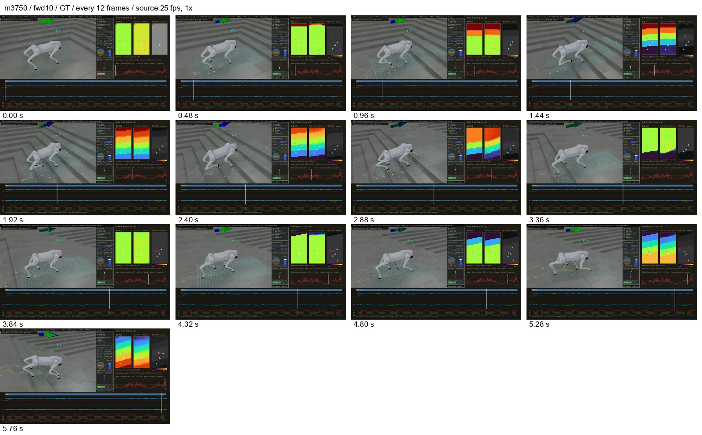
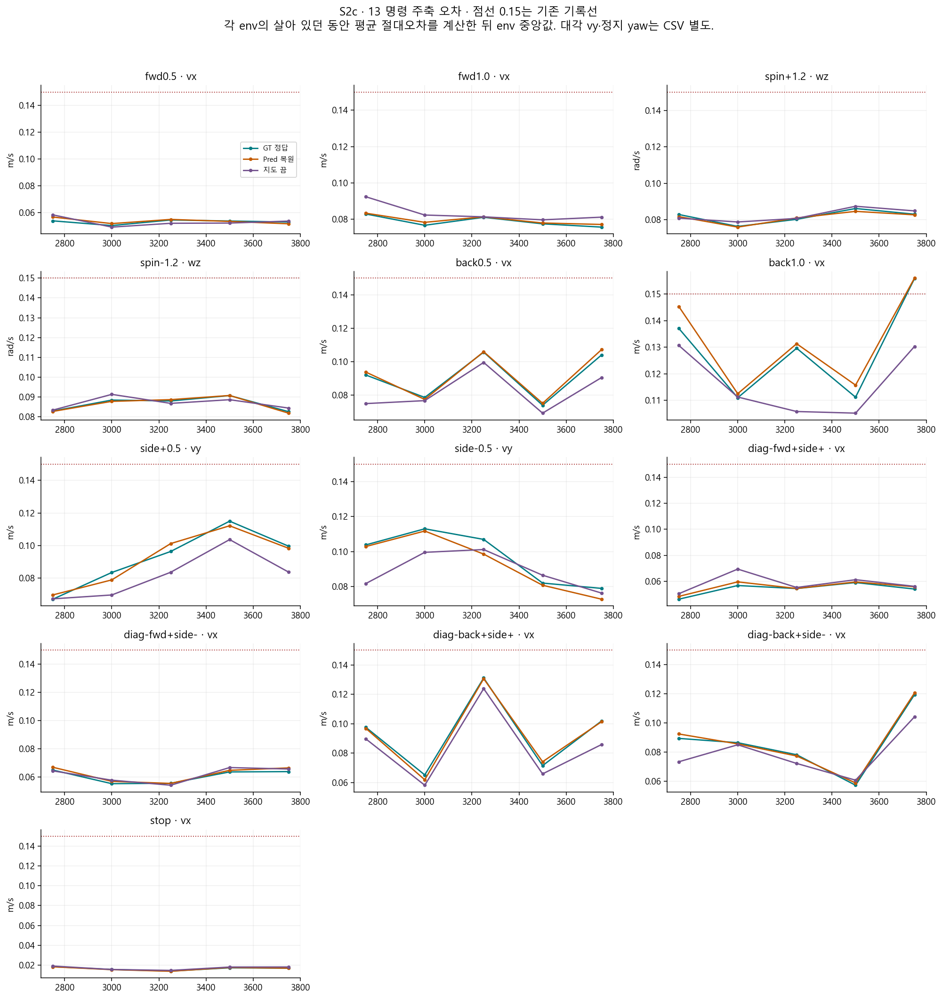
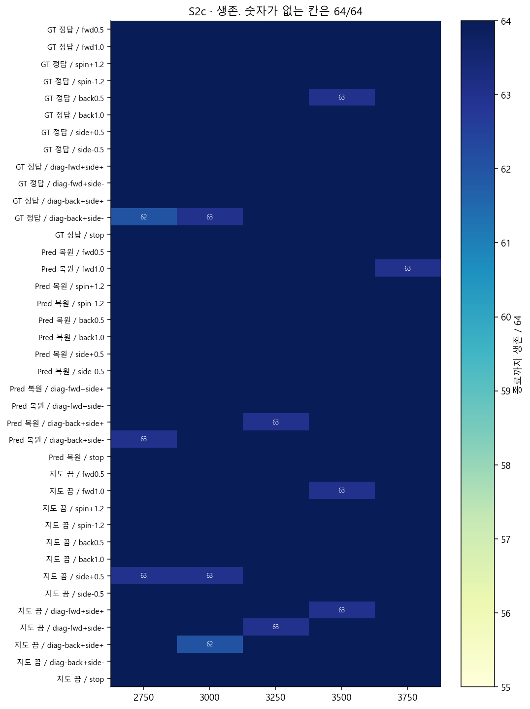
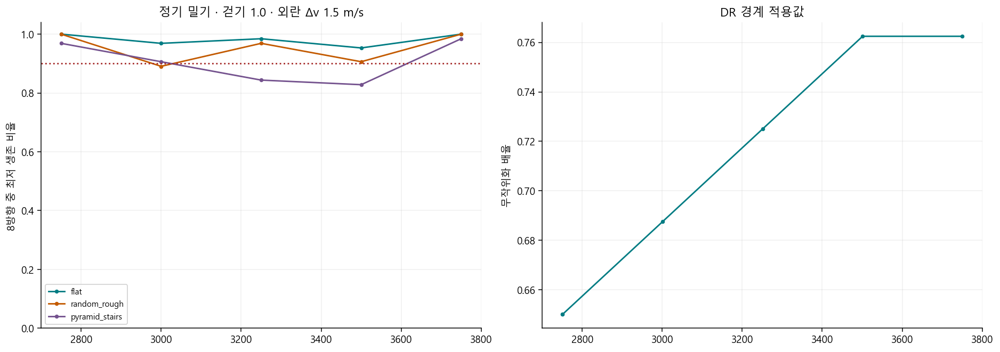
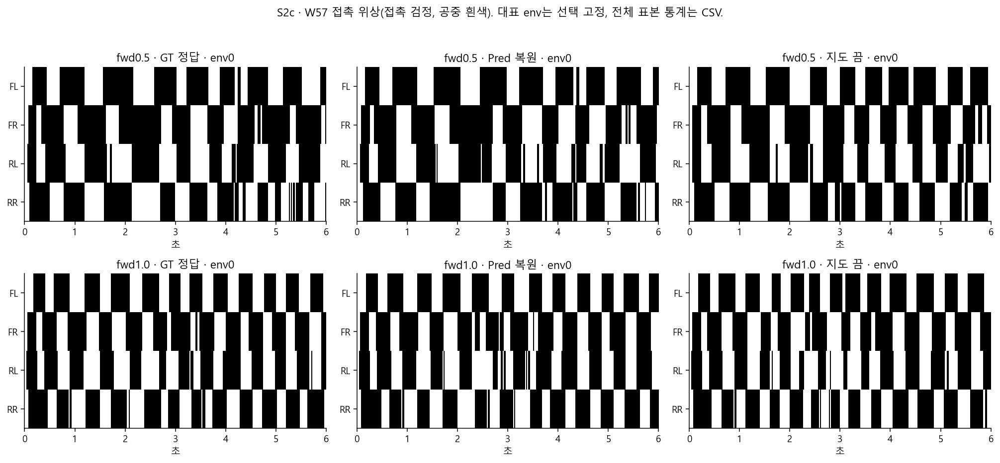
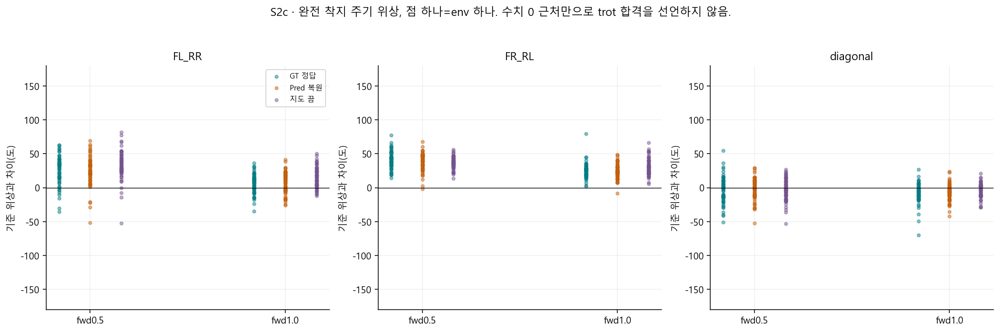
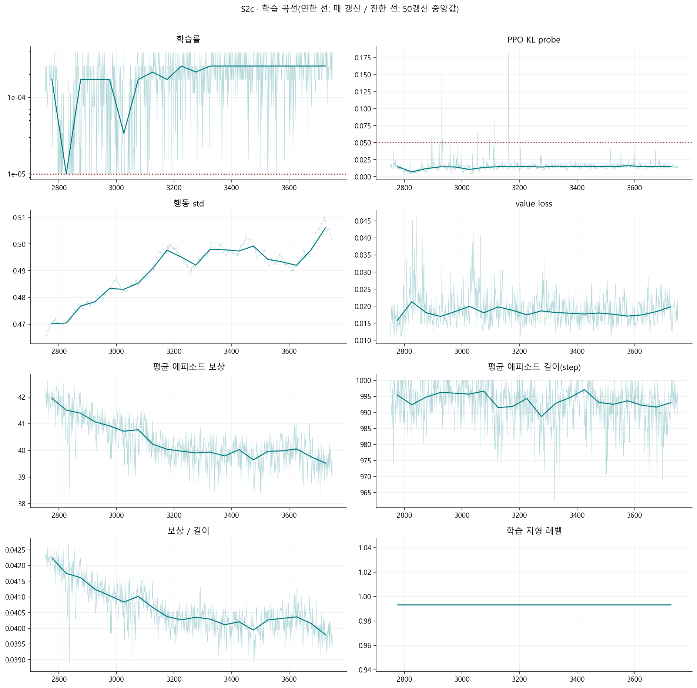
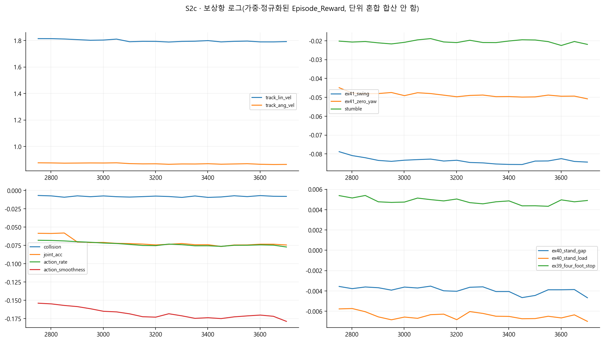
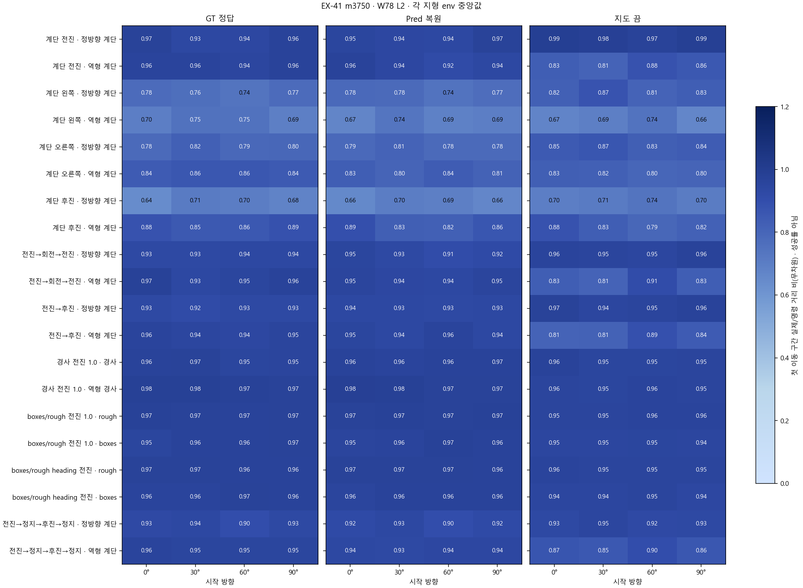
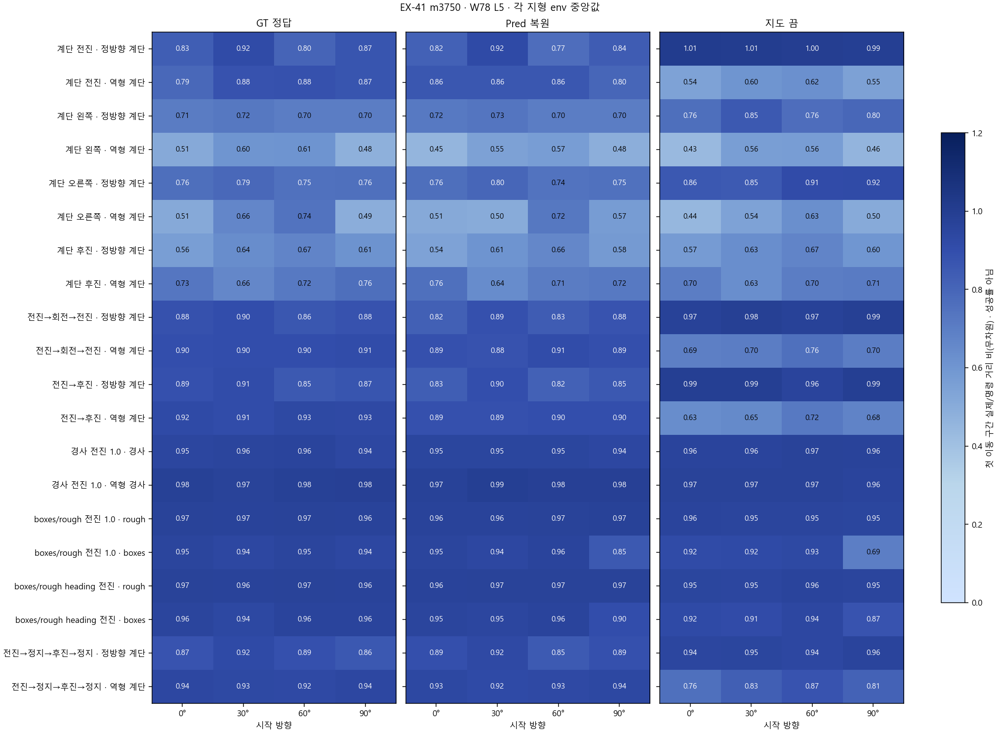

> 분류: A/평가 · EX-41 단계 분석
> 작성: analyst · 2026-11-06 17:18 대한민국 표준시
> 근거: 운영 원자료 스크립트 재계산 · OVERNIGHT-CONTRACT §2 · #555
> 요지: 생존과 밀기 기준을 유지했지만, 전진 방향과 발 교대가 다시 흔들렸다.
> 상태: 정식 단계 보고 v1.1 · W78 v2 최종 수치 대조 완료 · 영상 판독 범위 제한

# EX-41 S2c · 로컬 2751~3750회 단계 보고

생존과 밀기 기준을 유지했지만, 전진 방향과 발 교대가 다시 흔들렸다.

**무엇을 배웠나.** 더 큰 무작위화 조건을 경험하면서도 핵심 생존과 단계 끝 밀기 기준을 지켰다. 이는 버티는 능력의 증거이며 모든 명령을 더 정확히 배웠다는 뜻은 아니다.

**무너진 기술은 무엇인가.** 전진의 signed yaw는 방향까지 뒤집혔고 절댓값도 커졌다. 평균 속도가 맞더라도 곧게 갔다는 보장은 없다. 접촉 위상도 이전 단계보다 벌어졌다.

**다음 단계에 준 영향.** 다음 단계의 지형 난이도 확대에서는 생존뿐 아니라 전진 방향·접촉 위상을 유지 축으로 남겨야 한다. 지도나 DR 하나를 원인으로 확정할 수 없다.

이 문서는 완료된 단계의 근거를 정리한다. 학습 승인이나 졸업 판정을 새로 만들지 않는다. 아래 수치는 원자료를 읽어 생성한 **실측**이다. 인과 설명과 다음 단계 권고는 **해석**이며 단일 시드의 결론이다.

## 영상과 비교 자료

공용 재생 목록: `C:\Users\AI-WS01\s2_lab\_playlists\EX41-ALL-stages-1106.m3u8`. 보고 시점의 이 저장본 항목은 54편이다. 전편을 사람이 재생 확인한 수가 아니다.

| 명령(정답 지도) | 원본 프레임/초 | 완전 해독·검정 | 대표 프레임과 원본 |
| --- | --- | --- | --- |
| fwd10 | 150 / 25 | 150 해독 · 검정 0 | [프레임](figs\m3750-fwd10-frames.jpg) · `D:\mai-tmp\runner\ex41_stage_video\model_3750_9e98514cb2d3\EX41-pyramid_stairs_inv_L1-m3750-w57_fwd10_eval_gt-1x-success.mp4` |
| back10 | 150 / 25 | 150 해독 · 검정 0 | [프레임](figs\m3750-back10-frames.jpg) · `D:\mai-tmp\runner\ex41_stage_video\model_3750_9e98514cb2d3\EX41-pyramid_stairs_inv_L1-m3750-w57_back10_eval_gt-1x-success.mp4` |
| sidem05 | 150 / 25 | 150 해독 · 검정 0 | [프레임](figs\m3750-sidem05-frames.jpg) · `D:\mai-tmp\runner\ex41_stage_video\model_3750_9e98514cb2d3\EX41-pyramid_stairs_inv_L1-m3750-w57_sidem05_eval_gt-1x-success.mp4` |

대표 전진·후진·오른쪽 옆걸음을 고정 선택했다. 프레임 띠에서 몸을 지지하며 이동하는 모습은 확인된다. 옆걸음 후반에는 몸 방향·높이 변화가 보이므로 균일한 trot나 끌림 해소를 영상만으로 선언하지 않는다. 전 프레임 해독은 파일 검증이며 시각 판독은 아래 표본 프레임에 한정한다. 1x 실시간 전편 판독은 별도 확인 사항이다.



CPU로 기존 영상 두 편을 나란히 놓은 1x CMP. 새 시뮬레이션 촬영이 아니다. 같은 이름의 지형·레벨·명령·지도 모드지만 궤적이 같은 통계적 짝 표본은 아니다.

| 비교 | 명령 | 로컬 경로 |
| --- | --- | --- |
| m2750 대 m3750 | fwd10 | `D:\mai-tmp\analyst\ex41-stage-reports-1106\media\CMP-EX41-m2750-m3750-fwd10-GT-1x.mp4` |
| m2750 대 m3750 | back10 | `D:\mai-tmp\analyst\ex41-stage-reports-1106\media\CMP-EX41-m2750-m3750-back10-GT-1x.mp4` |
| m2750 대 m3750 | sidem05 | `D:\mai-tmp\analyst\ex41-stage-reports-1106\media\CMP-EX41-m2750-m3750-sidem05-GT-1x.mp4` |

## 무엇을 같은 조건으로 재었나

| 항목 | 조건·단위 | 출처/한계 |
| --- | --- | --- |
| 로컬/누적 회차 | 로컬 2751\~3750, 부모 학습에 이어 누적 8751\~9750 | 회차는 보고용 합산. 처음부터 학습한 새 시드가 아님 |
| 학습 출발 | EX-40 m6000 · d5e9ec400f33d74d97e7c69d4ab2092d4980195141bb8b30e683730eecd6b6f5 | ex41_application.jsonl:1 |
| 고정 명령 평가 | 64 env × 13명령 × 지도 3모드 · 300 step × 0.02초 | map_modes.json. 같은 배치 해시·시드·명령·env 수 코드 단언 |
| 지도 모드 | GT=정답, Pred=복원, 지도 끔=지도 입력 가림 | 지도 끔은 별도 G0 학습 정책이 아님 |
| 오차 집계 | env마다 살아 있던 구간의 평균 절대오차, 그 64개 중앙값 | 종료 뒤 리셋 구간 제외. 짧게 산 env도 포함하므로 생존과 함께 읽음 |
| 표의 주축 | 전후·대각 vx, 옆 vy, 회전 wz, 정지 vx | 단위: vx/vy m/s, wz rad/s. 대각 vy와 정지 wz도 전체 표에 남김 |
| 보행 위상·W57 | 고정 L2, 64 env, 발 접촉 >1 N, dt=0.02초 | 고정 명령 map64 L0\~2와 다른 평가. 직접 값을 섞지 않음 |
| 평가 DR | 핵심 map64는 dr_off 기록을 가진 유지 평가 | 학습 DR 상승과 다른 조건. 강건성은 별도 밀기 표에서 확인 |

## 실제 적용한 학습 조건

| 원장 행 | 로컬 경계 | 단계 | DR 경계값 | 지형 정책/상한 | 이유 |
| --- | --- | --- | --- | --- | --- |
| 13 | 2751 | S2c | 0.6500 | fixed_l02 / L2 | schedule_continue |
| 14 | 3001 | S2c | 0.6875 | fixed_l02 / L2 | schedule_continue |
| 15 | 3251 | S2c | 0.7250 | fixed_l02 / L2 | schedule_continue |
| 16 | 3501 | S2c | 0.7625 | fixed_l02 / L2 | schedule_continue |

DR은 마찰·질량·구동기 등 학습 조건을 흔드는 강도를 뜻한다. 위 값은 경계에서 적용한 값이다. 경계 사이 물리값 분포 전수 측정으로 오해하지 않는다.

| 명령 슬롯 | 학습 몫 % |
| --- | --- |
| diag_back_left | 2.5 |
| diag_back_right | 2.5 |
| diag_fwd_left | 2.0 |
| diag_fwd_right | 2.0 |
| forward | 23.0 |
| reverse | 14.0 |
| side_left | 7.0 |
| side_right | 7.0 |
| spin_left | 9.0 |
| spin_right | 9.0 |
| stand | 10.0 |
| walk_left | 6.0 |
| walk_right | 6.0 |

| 설정 | 실제 마지막 적용값 |
| --- | --- |
| ranges | {"diag_vx_abs": [0.3, 0.6], "diag_vy_abs": [0.2, 0.5], "forward_vx": [0.1, 1.5], "reverse_vx": [-1.3, -0.2], "side_vy_abs": [0.2, 0.6], "spin_wz_abs": [0.3, 1.5], "walk_vx": [0.3, 0.8], "walk_wz_abs": [0.2, 1.0]} |
| heading | {"forward_fraction": 0.3, "forward_wz_limit": 0.5, "gain": 0.5, "spin_target_fraction": 0.3, "target_wz_limit": 1.5} |
| reward_weights | {"feet_air_time": 0.0, "foot_slip": 0.0, "four_foot_contact_at_stop": 0.1, "hip_pos_penalty": -0.05, "joint_acc": -1e-07, "joint_limit_margin": 0.0, "knee_effort_margin": 0.0, "stand_gap": -0.2, "stand_load": -0.1, "stumble": -2.0, "swing": -10.0, "thigh_calf_pos_l1": -0.01, "track_ang_vel": 1.0, "track_lin_vel": 2.0, "zero_yaw": -0.5} |
| ppo | {"desired_kl": 0.01, "entropy_coef": 0.01} |
| force_gt | true |
| critic_mirror | false |
| episode_length_s | 20.0 |

명령 몫은 환경이 뽑을 확률이고 실제 방문 빈도와 같다고 단정하지 않는다. force_gt는 지도 켠 갈래의 정답 지도 강제 설정이며 지도 끔 표본 비율과 함께 해석해야 한다. 새 처방과 DR·지형 변화가 섞여 있으므로 보상항 하나의 효과로 귀속할 수 없다.

## 명령 추종과 생존



점선은 기존 경계 보고의 0.15 기록선이다. 새 합격선을 만든 것이 아니다. 값이 넘으면 어떤 명령·모드인지 확인한다. 이 선을 생존 관문의 통과/실패와 혼동하지 않는다.

| 명령 | 주축 | 직전 끝 GT | 이번 끝 GT | 차이(이번−이전) | Pred | 지도 끔 |
| --- | --- | --- | --- | --- | --- | --- |
| fwd0.5 | vx | 0.054 | 0.053 | -0.001 | 0.052 | 0.054 |
| fwd1.0 | vx | 0.083 | 0.076 | -0.007 | 0.077 | 0.081 |
| spin+1.2 | wz | 0.083 | 0.083 | 0.000 | 0.083 | 0.085 |
| spin-1.2 | wz | 0.083 | 0.083 | -0.000 | 0.082 | 0.084 |
| back0.5 | vx | 0.092 | 0.104 | 0.012 | 0.107 | 0.091 |
| back1.0 | vx | 0.137 | 0.156 | 0.019 | 0.156 | 0.130 |
| side+0.5 | vy | 0.067 | 0.100 | 0.033 | 0.098 | 0.084 |
| side-0.5 | vy | 0.104 | 0.079 | -0.025 | 0.073 | 0.076 |
| diag-fwd+side+ | vx | 0.046 | 0.054 | 0.008 | 0.056 | 0.056 |
| diag-fwd+side- | vx | 0.065 | 0.064 | -0.001 | 0.067 | 0.066 |
| diag-back+side+ | vx | 0.098 | 0.102 | 0.004 | 0.101 | 0.086 |
| diag-back+side- | vx | 0.089 | 0.119 | 0.030 | 0.121 | 0.104 |
| stop | vx | 0.018 | 0.017 | -0.002 | 0.017 | 0.018 |



단계 중 모든 핵심 평가 칸의 최저 생존은 62/64이다. 생존은 종료까지 안 넘어진 개수이고, 명령대로 잘 이동했는지의 점수는 아니다.

### 단계 끝 전체 오차 표

| 지도 | 명령 | vx m/s | vy m/s | wz rad/s | 생존/64 |
| --- | --- | --- | --- | --- | --- |
| GT 정답 | fwd0.5 | 0.053 | 0.041 | 0.078 | 64 |
| GT 정답 | fwd1.0 | 0.076 | 0.037 | 0.081 | 64 |
| GT 정답 | spin+1.2 | 0.056 | 0.033 | 0.083 | 64 |
| GT 정답 | spin-1.2 | 0.064 | 0.045 | 0.083 | 64 |
| GT 정답 | back0.5 | 0.104 | 0.035 | 0.078 | 64 |
| GT 정답 | back1.0 | 0.156 | 0.046 | 0.087 | 64 |
| GT 정답 | side+0.5 | 0.035 | 0.100 | 0.076 | 64 |
| GT 정답 | side-0.5 | 0.058 | 0.079 | 0.083 | 64 |
| GT 정답 | diag-fwd+side+ | 0.054 | 0.101 | 0.081 | 64 |
| GT 정답 | diag-fwd+side- | 0.064 | 0.097 | 0.086 | 64 |
| GT 정답 | diag-back+side+ | 0.102 | 0.091 | 0.080 | 64 |
| GT 정답 | diag-back+side- | 0.119 | 0.059 | 0.100 | 64 |
| GT 정답 | stop | 0.017 | 0.014 | 0.075 | 64 |
| Pred 복원 | fwd0.5 | 0.052 | 0.041 | 0.077 | 64 |
| Pred 복원 | fwd1.0 | 0.077 | 0.038 | 0.083 | 63 |
| Pred 복원 | spin+1.2 | 0.057 | 0.032 | 0.083 | 64 |
| Pred 복원 | spin-1.2 | 0.064 | 0.044 | 0.082 | 64 |
| Pred 복원 | back0.5 | 0.107 | 0.036 | 0.078 | 64 |
| Pred 복원 | back1.0 | 0.156 | 0.048 | 0.089 | 64 |
| Pred 복원 | side+0.5 | 0.035 | 0.098 | 0.076 | 64 |
| Pred 복원 | side-0.5 | 0.058 | 0.073 | 0.086 | 64 |
| Pred 복원 | diag-fwd+side+ | 0.056 | 0.093 | 0.081 | 64 |
| Pred 복원 | diag-fwd+side- | 0.067 | 0.093 | 0.088 | 64 |
| Pred 복원 | diag-back+side+ | 0.101 | 0.090 | 0.083 | 64 |
| Pred 복원 | diag-back+side- | 0.121 | 0.061 | 0.101 | 64 |
| Pred 복원 | stop | 0.017 | 0.014 | 0.075 | 64 |
| 지도 끔 | fwd0.5 | 0.054 | 0.041 | 0.078 | 64 |
| 지도 끔 | fwd1.0 | 0.081 | 0.040 | 0.080 | 64 |
| 지도 끔 | spin+1.2 | 0.059 | 0.033 | 0.085 | 64 |
| 지도 끔 | spin-1.2 | 0.052 | 0.047 | 0.084 | 64 |
| 지도 끔 | back0.5 | 0.091 | 0.034 | 0.078 | 64 |
| 지도 끔 | back1.0 | 0.130 | 0.045 | 0.089 | 64 |
| 지도 끔 | side+0.5 | 0.036 | 0.084 | 0.077 | 64 |
| 지도 끔 | side-0.5 | 0.058 | 0.076 | 0.085 | 64 |
| 지도 끔 | diag-fwd+side+ | 0.056 | 0.091 | 0.081 | 64 |
| 지도 끔 | diag-fwd+side- | 0.066 | 0.099 | 0.087 | 64 |
| 지도 끔 | diag-back+side+ | 0.086 | 0.072 | 0.081 | 64 |
| 지도 끔 | diag-back+side- | 0.104 | 0.058 | 0.099 | 64 |
| 지도 끔 | stop | 0.018 | 0.015 | 0.075 | 64 |

원자료별 경로와 JSON 위치는 [command_cells.csv](data/command_cells.csv)의 source·pointer 열. 모든 경계가 들어 있어 좋은 저장본만 골라 낸 표가 아니다.

## 밀렸을 때 버티는가



밀기는 속도를 순간적으로 바꾸는 시뮬 외란이다. 아래 숫자는 변위(m)가 아니라 **생존 비율**이다. 정기 검사는 걷기 명령 1.0에서, 단계 끝 판정은 걷기 명령 1.5에서 외란 1.5 m/s를 준다. 서로 같은 조건의 반복으로 합치지 않았다.

| 단계 끝 지형/지도 | 가장 약한 방향 생존 | 기존 기준 | 통과 |
| --- | --- | --- | --- |
| flat/eval_gt | 1.0000 | 0.90 | True |
| flat/eval_pred | 1.0000 | 0.90 | True |
| flat/probe_prop_only | 0.9844 | 0.90 | True |
| pyramid_stairs/eval_gt | 0.9219 | 0.90 | True |
| pyramid_stairs/eval_pred | 0.9531 | 0.90 | True |
| pyramid_stairs/probe_prop_only | 0.9062 | 0.90 | True |
| random_rough/eval_gt | 0.9844 | 0.90 | True |
| random_rough/eval_pred | 0.9844 | 0.90 | True |
| random_rough/probe_prop_only | 0.9531 | 0.90 | True |

단계 끝 등록 칸 9개 중 9개가 기존 기준을 넘었다. 반복 시드 검증 없이 차이를 확정적 일반화 성과로 부르지 않는다. [정기 전체 값](data/push250.csv) · [단계 끝 전체 값](data/push_stage_end.csv).

기록 전용 외란 2.0 m/s는 걷기 0.5 조건이다. 부모 m6000과의 차이는 [별도 표](data/push2_record.csv)에 보존했다. 이것을 걷기 1.5 판정의 개선율로 대신 쓰지 않는다.

## W57: 직진 중 방향과 돌고 멈추기

| 지도 | 명령/목표각 | 생존/64 | 시작 대비 마지막 yaw(도) | 목표 정지 오차(도) | 정지 후 wz 절댓값(rad/s) |
| --- | --- | --- | --- | --- | --- |
| GT 정답 | fwd0.5 | 64 | -6.49 | 미측정 | 미측정 |
| GT 정답 | fwd1.0 | 64 | -13.53 | 미측정 | 미측정 |
| GT 정답 | goal_left_delta000 | 64 | -3.18 | 3.18 | 0.076 |
| GT 정답 | goal_right_delta000 | 64 | -3.18 | 3.18 | 0.076 |
| GT 정답 | goal_left_delta030 | 64 | 22.91 | 7.09 | 0.079 |
| GT 정답 | goal_right_delta030 | 64 | -27.44 | 2.78 | 0.077 |
| GT 정답 | goal_left_delta060 | 64 | 53.63 | 6.37 | 0.078 |
| GT 정답 | goal_right_delta060 | 64 | -58.81 | 2.92 | 0.077 |
| GT 정답 | goal_left_delta090 | 64 | 85.21 | 4.79 | 0.077 |
| GT 정답 | goal_right_delta090 | 64 | -93.11 | 3.39 | 0.080 |
| 지도 끔 | fwd0.5 | 63 | -4.81 | 미측정 | 미측정 |
| 지도 끔 | fwd1.0 | 62 | -10.58 | 미측정 | 미측정 |
| 지도 끔 | goal_left_delta000 | 64 | -2.20 | 2.24 | 0.075 |
| 지도 끔 | goal_right_delta000 | 64 | -2.20 | 2.24 | 0.075 |
| 지도 끔 | goal_left_delta030 | 64 | 23.42 | 6.58 | 0.079 |
| 지도 끔 | goal_right_delta030 | 64 | -28.14 | 2.42 | 0.078 |
| 지도 끔 | goal_left_delta060 | 64 | 53.18 | 6.82 | 0.079 |
| 지도 끔 | goal_right_delta060 | 64 | -59.12 | 2.88 | 0.078 |
| 지도 끔 | goal_left_delta090 | 64 | 85.65 | 4.35 | 0.077 |
| 지도 끔 | goal_right_delta090 | 64 | -90.56 | 2.23 | 0.079 |
| Pred 복원 | fwd0.5 | 64 | -7.85 | 미측정 | 미측정 |
| Pred 복원 | fwd1.0 | 64 | -13.66 | 미측정 | 미측정 |
| Pred 복원 | goal_left_delta000 | 64 | -3.20 | 3.20 | 0.076 |
| Pred 복원 | goal_right_delta000 | 64 | -3.20 | 3.20 | 0.076 |
| Pred 복원 | goal_left_delta030 | 64 | 22.96 | 7.04 | 0.079 |
| Pred 복원 | goal_right_delta030 | 64 | -27.39 | 3.10 | 0.077 |
| Pred 복원 | goal_left_delta060 | 64 | 53.39 | 6.61 | 0.078 |
| Pred 복원 | goal_right_delta060 | 64 | -58.62 | 3.38 | 0.079 |
| Pred 복원 | goal_left_delta090 | 64 | 85.37 | 4.63 | 0.078 |
| Pred 복원 | goal_right_delta090 | 64 | -92.83 | 3.32 | 0.079 |

yaw는 몸이 수평으로 돌아간 각도다. 전진의 부호 있는 중앙값은 좌·우 오차가 상쇄될 수 있으므로 전원 정확하다는 뜻이 아니다. 목표 회전은 속도만 맞추는 spin 평가와 달리 목표 각도로 돌고 멈추는 검사다.

## 보행 위상과 발 기록





| 모드/전진 | FL↔RR 오차° | FR↔RL 오차° | 대각 쌍간 오차° | R 중앙 | 주기 s | 유효 env/주기 수 | 네 발 접촉 C |
| --- | --- | --- | --- | --- | --- | --- | --- |
| GT 정답/fwd0.5 | 32.2 | 42.1 | 12.5 | 0.812 | 0.695 | 64 / 493 | 0.071 |
| GT 정답/fwd1.0 | 11.3 | 24.9 | 10.1 | 0.820 | 0.480 | 64 / 740 | 0.065 |
| Pred 복원/fwd0.5 | 27.1 | 40.2 | 10.9 | 0.820 | 0.680 | 64 / 500 | 0.074 |
| Pred 복원/fwd1.0 | 14.9 | 23.9 | 8.2 | 0.847 | 0.480 | 64 / 745 | 0.062 |
| 지도 끔/fwd0.5 | 32.6 | 37.7 | 11.1 | 0.769 | 0.700 | 64 / 498 | 0.073 |
| 지도 끔/fwd1.0 | 14.9 | 29.4 | 6.5 | 0.814 | 0.480 | 64 / 727 | 0.061 |

| 모드/전진 | FL duty | FR duty | RL duty | RR duty |
| --- | --- | --- | --- | --- |
| GT 정답/fwd0.5 | 0.607 | 0.664 | 0.546 | 0.596 |
| GT 정답/fwd1.0 | 0.549 | 0.596 | 0.555 | 0.584 |
| Pred 복원/fwd0.5 | 0.608 | 0.658 | 0.553 | 0.600 |
| Pred 복원/fwd1.0 | 0.555 | 0.589 | 0.554 | 0.578 |
| 지도 끔/fwd0.5 | 0.621 | 0.656 | 0.548 | 0.591 |
| 지도 끔/fwd1.0 | 0.578 | 0.586 | 0.540 | 0.578 |

풀이: 대각 발 쌍 안은 동시에 딛는 0°, 쌍 사이는 번갈아 딛는 180°에서 얼마나 벗어났는지 본다. 표는 env별 원형 평균의 절대 오차 중앙값이다. R은 한 env 안의 주기들이 같은 위상으로 모이는 정도이며 1에 가까울수록 일정하다. duty는 각 발이 바닥을 딛은 시간 비율, C는 네 발이 동시에 딛은 시간 비율이다. 완전한 두 착지 사이만 세며 죽거나 기록이 끊긴 주기는 제외한다. C가 낮다는 것만으로 좋은 보행이라 할 수 없다.

식은 과거 ex35-final-audit/recompute.py의 완전 주기식을 재사용하되, 고정 200 Hz 대신 각 NPZ의 실제 dt를 썼다. 동시·반대 위상·주기 결손을 답을 아는 입력으로 확인했다. [env별 원수치](data/phase_env.csv) · [집계](data/gait_summary.json).

발 끌림·스윙 높이·무릎 부하의 학습 중 시계열도 [w86_training.csv](data/w86_training.csv)에 남겼다. 이것은 변화하는 학습 분포의 기록이므로 고정 지형 평가와 동일시하지 않는다. 발자국 XY 원자료는 이번 W57 NPZ에 없고 root_xy만 있어 새 발자국 평면도를 만들지 않았다.

## 학습 곡선: 아직 배우는가





| 지표 | 단계 첫 50갱신 중앙값 | 마지막 50갱신 중앙값 |
| --- | --- | --- |
| Train/mean_reward | 41.946301 | 39.525785 |
| Train/mean_episode_length | 995.385010 | 993.014984 |
| Policy/mean_noise_std | 0.470104 | 0.506060 |
| Loss/value_function | 0.015771 | 0.019812 |
| Loss/learning_rate | 0.000171 | 0.000256 |

학습률 ≤1.00001e-5는 92/1000갱신, PPO KL probe >0.05는 11/1000갱신이다. KL probe는 정책 변화의 로그값이지 실기 안정성을 직접 뜻하지 않는다. 이 횟수는 기존 경계 보고와 같은 모니터 항목이며 새 중단 기준이 아니다.

학습률(lr)은 한 번에 정책을 바꾸는 크기, std는 행동 표본의 퍼짐, value loss는 예상 보상과 실제 학습 목표의 차이다. 보상/길이는 두 평균의 비이며 모든 전이의 보상을 다시 평균한 정확한 step 보상이 아니다. 시작 직후에는 에피소드 통계가 채워지는 영향이 있으므로 초기 상승을 새 보행 습득으로 곧바로 해석하지 않는다.

보상이 내려갈 때는 과제가 어려워졌는지와 같은 고정 평가도 나빠졌는지를 같이 본다. 이 판은 DR·지형과 명령 분포가 바뀌어 보상만으로 망각을 판정할 수 없다.

## W78 v2와 남은 확인

**v1.1 보충 · m3750(누적 9750) 최종 W78 확인.** L2/L5 × 시작 방향 0/30/60/90° × 명령 10가지 × 지도 셋 = 240조합이다. 조합당 64 env, 원시 NPZ 240개와 저장본 SHA를 대조했다. 981,666개 수치 대조의 최대 부동소수 차는 9.4e-07이며 비교 허용 오차 이내다. 이번 검사는 완료·수치의 검증이며 새 졸업 판정이 아니다.

### 수치를 읽는 법

- 이동 비 R은 몸 기준 명령 방향 속도를 살아 있는 시간 동안 적분한 거리 ÷ 예정된 전체 명령 거리다. 무차원이며 m/s 오차나 세계 좌표의 목표 도착률이 아니다. 죽은 뒤 시간도 분모에 남고, 여러 이동 구간은 따로 표시한다. 회전·정지 구간을 이동 비로 채점하지 않는다.
- 아래 표는 지정된 지형 두 종류와 시작 방향 네 가지의 env를 합친 중앙값이다. 같은 정책·같은 시드의 반복 환경 기록이며 독립 학습 반복시험의 표본 수가 아니다. 그림·CSV는 종류와 방향을 분리해 평균에 가려지는 차이를 남긴다.
- flat이라는 case 이름은 실제 boxes·random_rough 열을 뜻한다. 순수 평지가 아니다. 계단 열은 pyramid_stairs·pyramid_stairs_inv, 경사는 hf_pyramid_slope·역형이다. 지형 배치와 레벨은 각 조합 원자료에 기록되어 있다.
- 끌림은 접촉 힘 >1 N인 발 표본 중 수평 발 속도 >0.15 m/s 비율이다. 발걸림 횟수나 지면 상대 미끄럼을 전부 설명하지 않는다. 스윙 높이는 완결된 비접촉 구간의 최고 발 z에서 앞뒤 접지 z 평균을 뺀 값이다. 발 앞 장애물 여유 높이나 지형 관통 검사가 아니다.
- dr_off는 원문에 열거된 physics_material·add_base_mass이다. 모든 외란·지연·관측 잡음이 꺼졌다고 확대 해석하지 않는다.

### 명령별 이동과 생존

칸 형식: 각 이동 구간 R(시간 순서) · 끝 생존/해당 지형 env 기록 수.

| 레벨 | 과제 | GT 정답 | Pred 복원 | 지도 끔 |
| --- | --- | --- | --- | --- |
| L2 | 계단 전진 | 0.958 · 120/120 | 0.942 · 120/120 | 0.926 · 120/120 |
| L2 | 계단 왼쪽 | 0.747 · 120/120 | 0.738 · 119/120 | 0.783 · 120/120 |
| L2 | 계단 오른쪽 | 0.820 · 120/120 | 0.802 · 116/120 | 0.830 · 115/120 |
| L2 | 계단 후진 | 0.774 · 120/120 | 0.754 · 120/120 | 0.769 · 120/120 |
| L2 | 전진→회전→전진 | 0.940 → 0.937 · 120/120 | 0.937 → 0.932 · 120/120 | 0.922 → 0.935 · 119/120 |
| L2 | 전진→후진 | 0.939 → 0.718 · 120/120 | 0.936 → 0.746 · 120/120 | 0.927 → 0.776 · 119/120 |
| L2 | 경사 전진 1.0 | 0.968 · 32/32 | 0.967 · 32/32 | 0.952 · 32/32 |
| L2 | boxes/rough 전진 1.0 | 0.965 · 96/96 | 0.966 · 96/96 | 0.953 · 96/96 |
| L2 | boxes/rough heading 전진 | 0.964 · 96/96 | 0.964 · 96/96 | 0.949 · 96/96 |
| L2 | 전진→정지→후진→정지 | 0.936 → 0.801 · 120/120 | 0.931 → 0.818 · 120/120 | 0.915 → 0.846 · 120/120 |
| L5 | 계단 전진 | 0.869 · 120/120 | 0.850 · 120/120 | 0.927 · 120/120 |
| L5 | 계단 왼쪽 | 0.647 · 120/120 | 0.633 · 120/120 | 0.678 · 120/120 |
| L5 | 계단 오른쪽 | 0.720 · 117/120 | 0.707 · 120/120 | 0.715 · 117/120 |
| L5 | 계단 후진 | 0.668 · 120/120 | 0.652 · 120/120 | 0.659 · 120/120 |
| L5 | 전진→회전→전진 | 0.895 → 0.872 · 119/120 | 0.879 → 0.878 · 119/120 | 0.898 → 0.787 · 120/120 |
| L5 | 전진→후진 | 0.898 → 0.655 · 120/120 | 0.872 → 0.631 · 119/120 | 0.908 → 0.723 · 120/120 |
| L5 | 경사 전진 1.0 | 0.964 · 32/32 | 0.962 · 32/32 | 0.962 · 32/32 |
| L5 | boxes/rough 전진 1.0 | 0.959 · 91/96 | 0.960 · 91/96 | 0.940 · 89/96 |
| L5 | boxes/rough heading 전진 | 0.962 · 94/96 | 0.959 · 92/96 | 0.944 · 91/96 |
| L5 | 전진→정지→후진→정지 | 0.916 → 0.741 · 120/120 | 0.908 → 0.730 · 119/120 | 0.918 → 0.806 · 120/120 |





### 발과 정지 후 후진

각 행은 계단 과제 7종·두 계단 열·네 방향을 모은 기술 통계다. 정지→후진 세 지표는 stairs_fwd_stop_back만 따로 계산한다. 부호 상쇄를 막기 위해 절댓값 중앙값을 사용하고, rad와 m를 섞어 평균하지 않는다.

| 레벨 | 지도 | 끌림 비율 | 스윙 p50 m | 완결 스윙 수 | 정지 방향 변화° | 정지 회전 누적° | 후진 횡이탈 m | 유효/전체 |
| --- | --- | --- | --- | --- | --- | --- | --- | --- |
| L2 | GT 정답 | 0.057 | 0.066 | 43722 | 4.03 | 9.68 | 0.078 | 120/120 |
| L2 | Pred 복원 | 0.057 | 0.066 | 43672 | 4.72 | 9.79 | 0.074 | 120/120 |
| L2 | 지도 끔 | 0.056 | 0.064 | 45627 | 3.92 | 9.76 | 0.051 | 120/120 |
| L5 | GT 정답 | 0.069 | 0.065 | 44368 | 4.20 | 10.27 | 0.081 | 120/120 |
| L5 | Pred 복원 | 0.068 | 0.064 | 44691 | 4.03 | 10.49 | 0.074 | 120/120 |
| L5 | 지도 끔 | 0.069 | 0.061 | 47434 | 4.17 | 10.49 | 0.060 | 120/120 |

### 좌우 대칭과 해석 범위

원자료 w78_min_lr_ratio는 min(왼쪽 이동 비, 오른쪽 이동 비)다. 대칭 S=min/max와는 다르므로 별도로 재계산했다. 음수·1 초과를 자르지 않았고, 분모 ≤0이면 계산 불가다. 아래 <0.8 수는 기존 P3 관찰선의 기술 통계이며 단계 승급·회복 판정으로 사용하지 않는다.

| 레벨 | 지도 | S 중앙값 | S 최저 | S<0.8/유효 쌍 | 계산 불가 |
| --- | --- | --- | --- | --- | --- |
| L2 | GT 정답 | 0.899 | 0.820 | 0/8 | 0 |
| L2 | Pred 복원 | 0.933 | 0.807 | 0/8 | 0 |
| L2 | 지도 끔 | 0.952 | 0.814 | 0/8 | 0 |
| L5 | GT 정답 | 0.925 | 0.817 | 0/8 | 0 |
| L5 | Pred 복원 | 0.914 | 0.785 | 1/8 | 0 |
| L5 | 지도 끔 | 0.903 | 0.837 | 0/8 | 0 |

**합친 숫자를 그대로 믿으면 놓치는 차이.** L5 계단 전진의 이동 비를 두 계단 종류로 나누면 아래와 같다. 각 칸은 네 시작 방향에서 계산한 지형별 중앙값의 최솟값~최댓값이다. 지도 끔의 합친 중앙값이 높다는 이유만으로 두 종류에서 모두 우수하다고 해석할 수 없다.

| L5 계단 전진 지형 | GT 정답 | Pred 복원 | 지도 끔 |
| --- | --- | --- | --- |
| 정방향 계단 | 0.803~0.918 | 0.768~0.923 | 0.992~1.011 |
| 역형 계단 | 0.790~0.884 | 0.800~0.862 | 0.539~0.620 |

**해석.** 이 저장본에서 각 과제의 수행 정도와 방향 차이를 확인했다. 다른 저장본과 같은 W78 프로토콜로 재측정하기 전에는 이 단계에서 얼마나 새로 배웠거나 잊었는지 분리할 수 없다. 생존이 높아도 요구 거리·회전·발 여유를 달성했다는 뜻이 아니고, 이동 비가 비슷해도 보행 모양이 같다는 뜻은 아니다. 영상 전체 1x 판독·지형별 성공선·반복 폭은 별도 확인 사항이다.

[원자료·해시·대조 영수증](data/w78_m3750_audit.json) · [전체 지형별 수치](data/w78_m3750_kinds.csv) · [env별 수치](data/w78_m3750_env.csv) · [재계산기](update_w78.py). 원자료: `C:\Users\AI-WS01\s2_lab\ex41_main_20261104_235522\eval\score-watch\model_3750_9e98514cb2d3\stage_end_auxiliary_eval\w78_v2\w78_v2\terrain_skill_v2.json`. 저장본 SHA256 `9e98514cb2d39e0d16173b5bb9be8680759e3a8c2c5a42c7126c0a8ffba10f83`. 평가 코드 `432e2f10eebd08f1ef93edc07c6cb008025a7f3a` · cuda:1 · 시드 42 · 제어 간격 0.02 s. 채집 시각 `2026-11-07T10:22:26.121960+09:00`.

영상은 기존에 확인한 GT 표본 프레임 범위를 유지한다. 이번 보충은 새 렌더·GPU·학습·대기열·운영 원장 변경 없이 원자료를 CPU로 다시 계산했다. N1 모든 축 완료나 다음 단계 승인을 선언하지 않는다.
## 재현과 근거 등급

- 실측: JSON/NPZ/TensorBoard에서 재계산한 표와 그림. 원자료 경로·SHA256은 [source_manifest.json](data/source_manifest.json).
- 시각 관찰: 이 문서의 프레임 띠. 해독 성공과 정상 보행 판독은 구별한다.
- 코드: [generate_reports.py](generate_reports.py) · [extract_media.py](extract_media.py) · [write_reports.py](write_reports.py) · [verify_artifacts.py](verify_artifacts.py). 학습·평가 코드는 수정하지 않았다.
- 재대조: [verification.json](data/verification.json). 원자료에서 명령 오차·생존을 별도 재계산하고 평가 모듈 해시·지형 해시·배치·시간 간격의 동일성을 확인한다. dr_off는 원문에 열거된 비활성 항목이며 모든 외란·잡음이 꺼졌다는 뜻으로 확대하지 않는다.
- 해석: 무엇을 배웠나·회귀 의심·다음 단계에 준 영향. 새 원인을 확정하거나 새 문턱을 소급 적용하지 않았다.
- 미확인: 반복 시드 일반화·전체 영상 판독·W78 v2 졸업 판정.

```powershell
$env:PYTHONUTF8="1"; $env:PYTHONDONTWRITEBYTECODE="1"
& C:/Users/AI-WS01/anaconda3/envs/isaac311/python.exe generate_reports.py
& C:/Users/AI-WS01/anaconda3/envs/isaac311/python.exe extract_media.py
& C:/Users/AI-WS01/anaconda3/envs/isaac311/python.exe write_reports.py
& C:/Users/AI-WS01/anaconda3/envs/isaac311/python.exe verify_artifacts.py
```

운영 원본이 자라는 동안 다시 실행하면 채집 시점과 해시가 달라진다. 본문·그림의 재현에는 커밋에 포함된 CSV/JSON을 고정 입력으로 쓰고, 원자료 재집계는 manifest의 해시와 대조한다. TensorBoard 읽기 사본은 D:/mai-tmp/analyst/ex41-stage-reports-1106에 있다. 원본 파일·프로세스·GPU·운영 원장을 변경하지 않았다.
