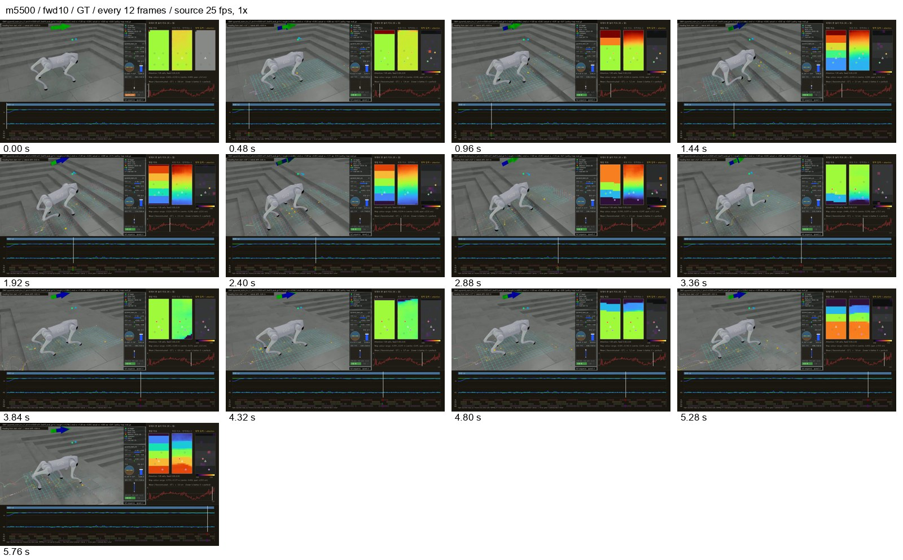
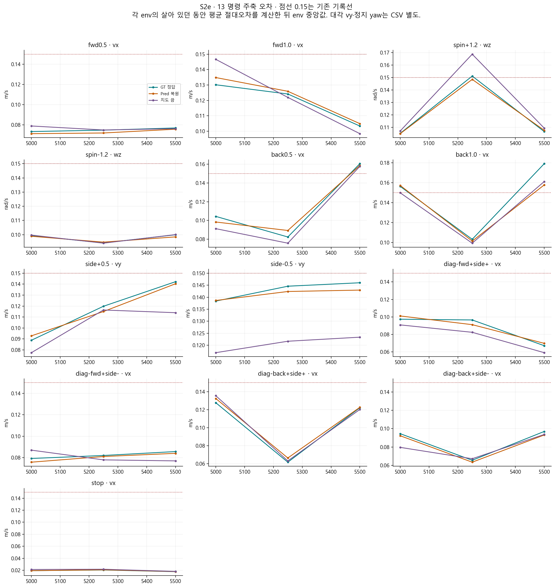
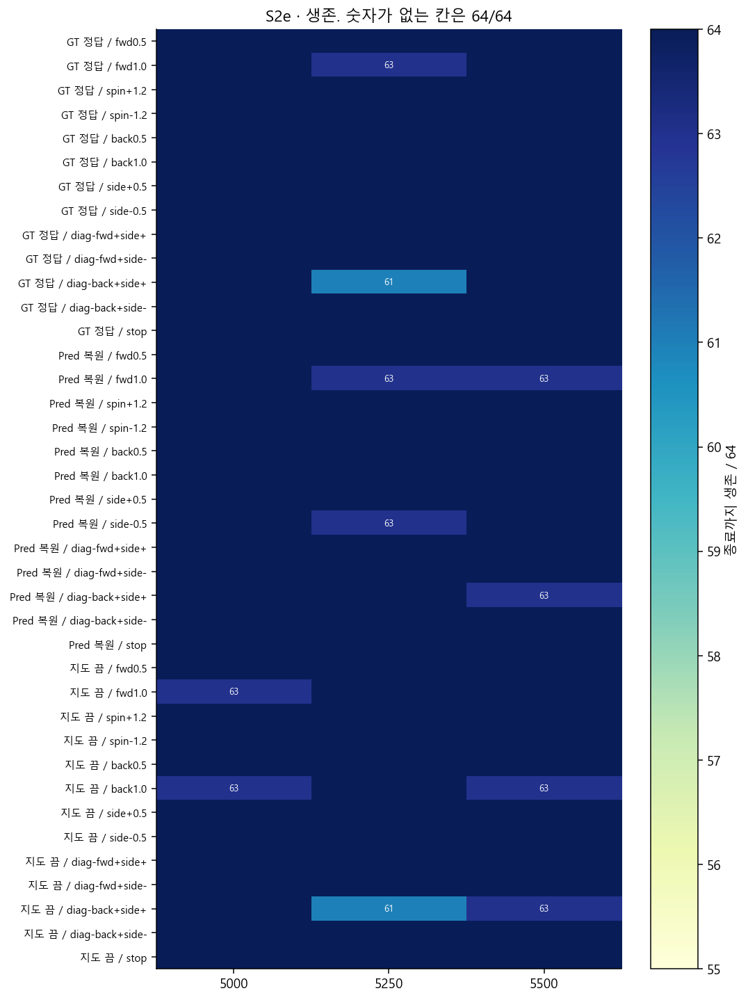
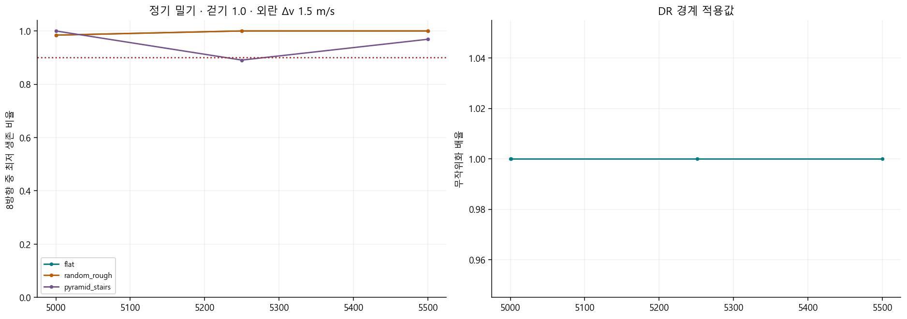
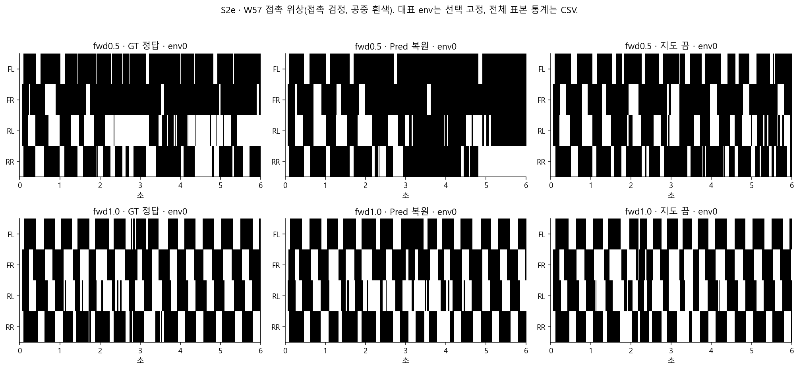
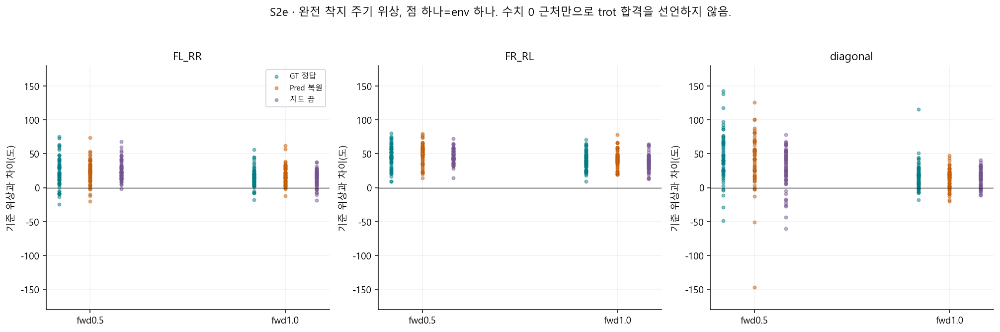
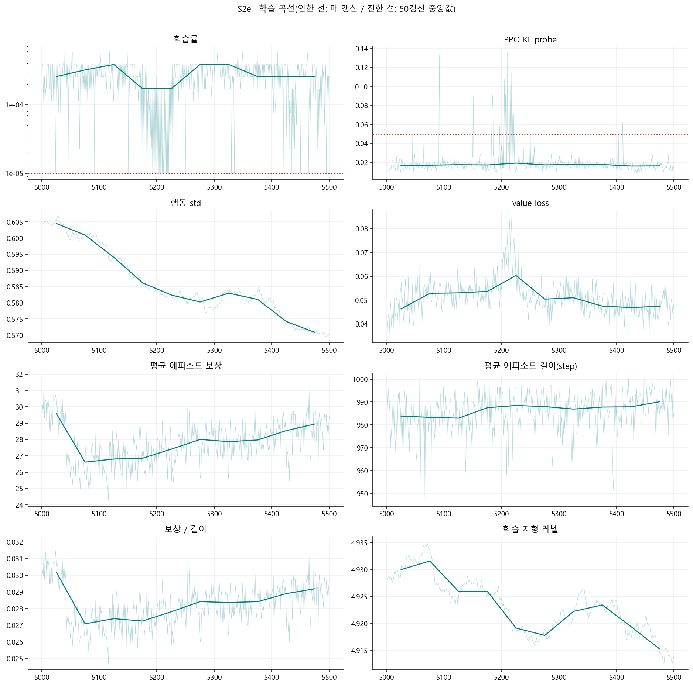
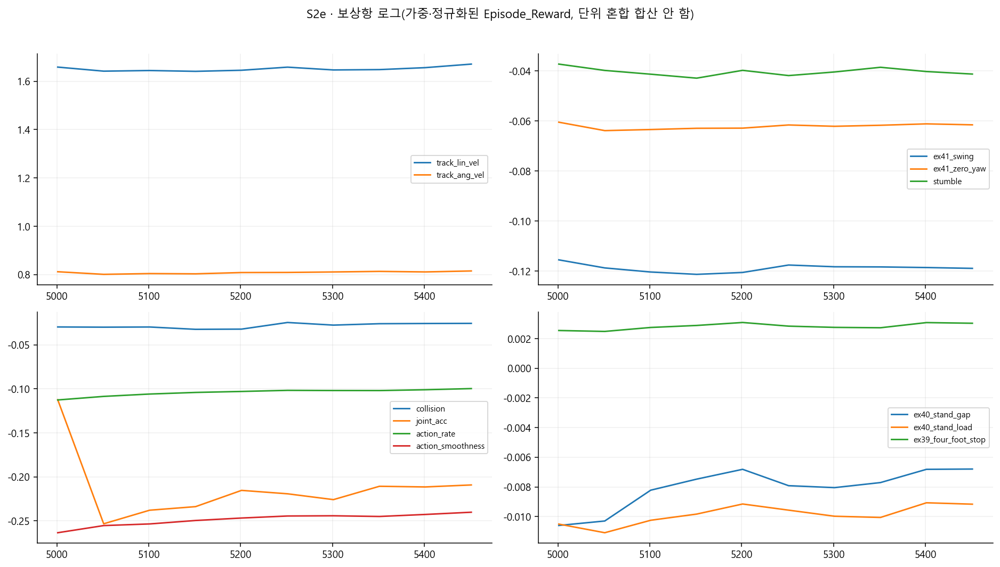

> 분류: A/평가 · EX-41 단계 분석
> 작성: analyst · 2026-11-07 09:42 대한민국 표준시
> 근거: 운영 원자료 스크립트 재계산 · OVERNIGHT-CONTRACT §2 · #555
> 요지: DR 최대 강도를 유지하며 생존과 밀기 대응은 지켰지만, 마지막에는 후진 정확도가 나빠졌다.
> 상태: 정식 단계 보고 v1.0 · W78 v2 조각 결과 대기 · 영상 판독 범위 제한

# EX-41 S2e · 로컬 5001~5500회 단계 보고

DR 최대 강도를 유지하며 생존과 밀기 대응은 지켰지만, 마지막에는 후진 정확도가 나빠졌다.

**무엇을 배웠나.** 강도를 더 올리지 않는 유지 구간에서도 높은 학습 지형에서 몸을 지탱했고, 단계 끝 등록 밀기 기준을 지켰다. 전진 오차는 직전 단계 끝보다 줄었다.

**무너진 기술은 무엇인가.** 끝 저장본에서는 두 후진 속도 모두 세 지도 모드에서 기존 오차 기록선을 넘었다. 생존 붕괴와 다른 정확도 저하다. 좌우 대칭이 좋아졌다는 사실로 이 후진 약점을 덮지 않았다.

**다음 단계에 준 영향.** 복원 지도 노출 단계에 후진의 회복과 지도별 차이 확인을 남겼다. 학습률이 작아도 표본마다 결과가 출렁일 수 있으므로 마지막 한 칸만으로 완전히 다졌다고 선언하지 않는다.

이 문서는 완료된 단계의 근거를 정리한다. 학습 승인이나 졸업 판정을 새로 만들지 않는다. 아래 수치는 원자료를 읽어 생성한 **실측**이다. 인과 설명과 다음 단계 권고는 **해석**이며 단일 시드의 결론이다.

## 영상과 비교 자료

재생 목록: `C:\Users\AI-WS01\s2_lab\_playlists\EX41-m05500-all.m3u8`. 보고 시점의 이 저장본 항목은 51편이다. 전편을 사람이 재생 확인한 수가 아니다.

| 명령(정답 지도) | 원본 프레임/초 | 완전 해독·검정 | 대표 프레임과 원본 |
| --- | --- | --- | --- |
| fwd10 | 150 / 25 | 150 해독 · 검정 0 | [프레임](figs/m5500-fwd10-frames.jpg) · `D:\mai-tmp\runner\ex41_stage_video\model_5500_2a6211040d09\EX41-pyramid_stairs_inv_L1-m5500-w57_fwd10_eval_gt-1x-success.mp4` |
| back10 | 150 / 25 | 150 해독 · 검정 0 | [프레임](figs/m5500-back10-frames.jpg) · `D:\mai-tmp\runner\ex41_stage_video\model_5500_2a6211040d09\EX41-pyramid_stairs_inv_L1-m5500-w57_back10_eval_gt-1x-success.mp4` |
| sidem05 | 150 / 25 | 150 해독 · 검정 0 | [프레임](figs/m5500-sidem05-frames.jpg) · `D:\mai-tmp\runner\ex41_stage_video\model_5500_2a6211040d09\EX41-pyramid_stairs_inv_L1-m5500-w57_sidem05_eval_gt-1x-success.mp4` |

대표 전진·후진·오른쪽 옆걸음을 고정 선택했다. 프레임 띠에서 몸을 지지하며 이동하는 모습은 확인된다. 옆걸음 후반에는 몸 방향·높이 변화가 보이므로 균일한 trot나 끌림 해소를 영상만으로 선언하지 않는다. 전 프레임 해독은 파일 검증이며 시각 판독은 아래 표본 프레임에 한정한다. 1x 실시간 전편 판독은 별도 확인 사항이다.



이 단계의 새 CMP 영상은 없음. 부모와의 정량 비교는 아래 고정 칸 표로 제공하며 영상 비교 완료로 세지 않는다.

## 무엇을 같은 조건으로 재었나

| 항목 | 조건·단위 | 출처/한계 |
| --- | --- | --- |
| 로컬/누적 회차 | 로컬 5001\~5500, 부모 학습에 이어 누적 11001\~11500 | 회차는 보고용 합산. 처음부터 학습한 새 시드가 아님 |
| 학습 출발 | EX-40 m6000 · d5e9ec400f33d74d97e7c69d4ab2092d4980195141bb8b30e683730eecd6b6f5 | ex41_application.jsonl:1 |
| 고정 명령 평가 | 64 env × 13명령 × 지도 3모드 · 300 step × 0.02초 | map_modes.json. 같은 배치 해시·시드·명령·env 수 코드 단언 |
| 지도 모드 | GT=정답, Pred=복원, 지도 끔=지도 입력 가림 | 지도 끔은 별도 G0 학습 정책이 아님 |
| 오차 집계 | env마다 살아 있던 구간의 평균 절대오차, 그 64개 중앙값 | 종료 뒤 리셋 구간 제외. 짧게 산 env도 포함하므로 생존과 함께 읽음 |
| 표의 주축 | 전후·대각 vx, 옆 vy, 회전 wz, 정지 vx | 단위: vx/vy m/s, wz rad/s. 대각 vy와 정지 wz도 전체 표에 남김 |
| 보행 위상·W57 | 고정 L2, 64 env, 발 접촉 >1 N, dt=0.02초 | 고정 명령 map64 L0\~2와 다른 평가. 직접 값을 섞지 않음 |
| 평가 DR | 핵심 map64는 dr_off 기록을 가진 유지 평가 | 학습 DR 상승과 다른 조건. 강건성은 별도 밀기 표에서 확인 |

## 실제 적용한 학습 조건

| 원장 행 | 로컬 경계 | 단계 | DR 경계값 | 지형 정책/상한 | 이유 |
| --- | --- | --- | --- | --- | --- |
| 22 | 5001 | S2e | 1.0000 | performance / L5 | schedule_continue |
| 23 | 5251 | S2e | 1.0000 | performance / L5 | schedule_continue |

DR은 마찰·질량·구동기 등 학습 조건을 흔드는 강도를 뜻한다. 위 값은 경계에서 적용한 값이다. 경계 사이 물리값 분포 전수 측정으로 오해하지 않는다.

| 명령 슬롯 | 학습 몫 % |
| --- | --- |
| diag_back_left | 2.5 |
| diag_back_right | 2.5 |
| diag_fwd_left | 2.0 |
| diag_fwd_right | 2.0 |
| forward | 23.0 |
| reverse | 14.0 |
| side_left | 7.0 |
| side_right | 7.0 |
| spin_left | 9.0 |
| spin_right | 9.0 |
| stand | 10.0 |
| walk_left | 6.0 |
| walk_right | 6.0 |

| 설정 | 실제 마지막 적용값 |
| --- | --- |
| ranges | {"diag_vx_abs": [0.3, 0.6], "diag_vy_abs": [0.2, 0.5], "forward_vx": [0.1, 1.5], "reverse_vx": [-1.3, -0.2], "side_vy_abs": [0.2, 0.6], "spin_wz_abs": [0.3, 1.5], "walk_vx": [0.3, 0.8], "walk_wz_abs": [0.2, 1.0]} |
| heading | {"forward_fraction": 0.3, "forward_wz_limit": 0.5, "gain": 0.5, "spin_target_fraction": 0.3, "target_wz_limit": 1.5} |
| reward_weights | {"feet_air_time": 0.0, "foot_slip": 0.0, "four_foot_contact_at_stop": 0.1, "hip_pos_penalty": -0.05, "joint_acc": -1e-07, "joint_limit_margin": 0.0, "knee_effort_margin": 0.0, "stand_gap": -0.2, "stand_load": -0.1, "stumble": -2.0, "swing": -10.0, "thigh_calf_pos_l1": -0.01, "track_ang_vel": 1.0, "track_lin_vel": 2.0, "zero_yaw": -0.5} |
| ppo | {"desired_kl": 0.01, "entropy_coef": 0.01} |
| force_gt | true |
| critic_mirror | false |
| episode_length_s | 20.0 |

명령 몫은 환경이 뽑을 확률이고 실제 방문 빈도와 같다고 단정하지 않는다. force_gt는 지도 켠 갈래의 정답 지도 강제 설정이며 지도 끔 표본 비율과 함께 해석해야 한다. 새 처방과 DR·지형 변화가 섞여 있으므로 보상항 하나의 효과로 귀속할 수 없다.

## 명령 추종과 생존



점선은 기존 경계 보고의 0.15 기록선이다. 새 합격선을 만든 것이 아니다. 값이 넘으면 어떤 명령·모드인지 확인한다. 이 선을 생존 관문의 통과/실패와 혼동하지 않는다.

| 명령 | 주축 | 직전 끝 GT | 이번 끝 GT | 차이(이번−이전) | Pred | 지도 끔 |
| --- | --- | --- | --- | --- | --- | --- |
| fwd0.5 | vx | 0.073 | 0.077 | 0.004 | 0.076 | 0.076 |
| fwd1.0 | vx | 0.130 | 0.103 | -0.027 | 0.105 | 0.098 |
| spin+1.2 | wz | 0.105 | 0.106 | 0.001 | 0.108 | 0.109 |
| spin-1.2 | wz | 0.099 | 0.100 | 0.001 | 0.098 | 0.100 |
| back0.5 | vx | 0.104 | 0.161 | 0.056 | 0.159 | 0.158 |
| back1.0 | vx | 0.156 | 0.179 | 0.023 | 0.158 | 0.161 |
| side+0.5 | vy | 0.089 | 0.142 | 0.053 | 0.140 | 0.114 |
| side-0.5 | vy | 0.138 | 0.146 | 0.008 | 0.143 | 0.123 |
| diag-fwd+side+ | vx | 0.097 | 0.067 | -0.030 | 0.070 | 0.059 |
| diag-fwd+side- | vx | 0.079 | 0.086 | 0.006 | 0.084 | 0.077 |
| diag-back+side+ | vx | 0.128 | 0.122 | -0.006 | 0.123 | 0.120 |
| diag-back+side- | vx | 0.094 | 0.097 | 0.002 | 0.093 | 0.094 |
| stop | vx | 0.019 | 0.018 | -0.002 | 0.018 | 0.018 |



단계 중 지도 세 모드 39칸의 최저 생존은 61/64이다. 생존은 종료까지 안 넘어진 개수이고, 명령대로 잘 이동했는지의 점수는 아니다.

### 단계 끝 전체 오차 표

| 지도 | 명령 | vx m/s | vy m/s | wz rad/s | 생존/64 |
| --- | --- | --- | --- | --- | --- |
| GT 정답 | fwd0.5 | 0.077 | 0.055 | 0.077 | 64 |
| GT 정답 | fwd1.0 | 0.103 | 0.056 | 0.082 | 64 |
| GT 정답 | spin+1.2 | 0.036 | 0.044 | 0.106 | 64 |
| GT 정답 | spin-1.2 | 0.047 | 0.047 | 0.100 | 64 |
| GT 정답 | back0.5 | 0.161 | 0.041 | 0.090 | 64 |
| GT 정답 | back1.0 | 0.179 | 0.047 | 0.094 | 64 |
| GT 정답 | side+0.5 | 0.043 | 0.142 | 0.107 | 64 |
| GT 정답 | side-0.5 | 0.044 | 0.146 | 0.094 | 64 |
| GT 정답 | diag-fwd+side+ | 0.067 | 0.195 | 0.087 | 64 |
| GT 정답 | diag-fwd+side- | 0.086 | 0.101 | 0.085 | 64 |
| GT 정답 | diag-back+side+ | 0.122 | 0.135 | 0.107 | 64 |
| GT 정답 | diag-back+side- | 0.097 | 0.160 | 0.098 | 64 |
| GT 정답 | stop | 0.018 | 0.017 | 0.079 | 64 |
| Pred 복원 | fwd0.5 | 0.076 | 0.055 | 0.076 | 64 |
| Pred 복원 | fwd1.0 | 0.105 | 0.055 | 0.085 | 63 |
| Pred 복원 | spin+1.2 | 0.036 | 0.045 | 0.108 | 64 |
| Pred 복원 | spin-1.2 | 0.049 | 0.045 | 0.098 | 64 |
| Pred 복원 | back0.5 | 0.159 | 0.042 | 0.092 | 64 |
| Pred 복원 | back1.0 | 0.158 | 0.049 | 0.096 | 64 |
| Pred 복원 | side+0.5 | 0.046 | 0.140 | 0.108 | 64 |
| Pred 복원 | side-0.5 | 0.044 | 0.143 | 0.093 | 64 |
| Pred 복원 | diag-fwd+side+ | 0.070 | 0.190 | 0.091 | 64 |
| Pred 복원 | diag-fwd+side- | 0.084 | 0.090 | 0.085 | 64 |
| Pred 복원 | diag-back+side+ | 0.123 | 0.132 | 0.112 | 63 |
| Pred 복원 | diag-back+side- | 0.093 | 0.155 | 0.097 | 64 |
| Pred 복원 | stop | 0.018 | 0.017 | 0.078 | 64 |
| 지도 끔 | fwd0.5 | 0.076 | 0.054 | 0.078 | 64 |
| 지도 끔 | fwd1.0 | 0.098 | 0.055 | 0.084 | 64 |
| 지도 끔 | spin+1.2 | 0.036 | 0.045 | 0.109 | 64 |
| 지도 끔 | spin-1.2 | 0.050 | 0.047 | 0.100 | 64 |
| 지도 끔 | back0.5 | 0.158 | 0.043 | 0.089 | 64 |
| 지도 끔 | back1.0 | 0.161 | 0.054 | 0.095 | 63 |
| 지도 끔 | side+0.5 | 0.053 | 0.114 | 0.108 | 64 |
| 지도 끔 | side-0.5 | 0.048 | 0.123 | 0.096 | 64 |
| 지도 끔 | diag-fwd+side+ | 0.059 | 0.162 | 0.085 | 64 |
| 지도 끔 | diag-fwd+side- | 0.077 | 0.083 | 0.088 | 64 |
| 지도 끔 | diag-back+side+ | 0.120 | 0.106 | 0.113 | 63 |
| 지도 끔 | diag-back+side- | 0.094 | 0.136 | 0.098 | 64 |
| 지도 끔 | stop | 0.018 | 0.018 | 0.077 | 64 |

원자료별 경로와 JSON 위치는 [command_cells.csv](data/command_cells.csv)의 source·pointer 열. 모든 경계가 들어 있어 좋은 저장본만 골라 낸 표가 아니다.

## 밀렸을 때 버티는가



밀기는 속도를 순간적으로 바꾸는 시뮬 외란이다. 아래 숫자는 변위(m)가 아니라 **생존 비율**이다. 정기 검사는 걷기 명령 1.0에서, 단계 끝 판정은 걷기 명령 1.5에서 외란 1.5 m/s를 준다. 서로 같은 조건의 반복으로 합치지 않았다.

| 단계 끝 지형/지도 | 가장 약한 방향 생존 | 기존 기준 | 통과 |
| --- | --- | --- | --- |
| flat/eval_gt | 1.0000 | 0.90 | True |
| flat/eval_pred | 1.0000 | 0.90 | True |
| flat/probe_prop_only | 1.0000 | 0.90 | True |
| pyramid_stairs/eval_gt | 0.9531 | 0.90 | True |
| pyramid_stairs/eval_pred | 0.9531 | 0.90 | True |
| pyramid_stairs/probe_prop_only | 0.9531 | 0.90 | True |
| random_rough/eval_gt | 1.0000 | 0.90 | True |
| random_rough/eval_pred | 1.0000 | 0.90 | True |
| random_rough/probe_prop_only | 1.0000 | 0.90 | True |

단계 끝 등록 칸 9개 중 9개가 기존 기준을 넘었다. 반복 시드 검증 없이 차이를 확정적 일반화 성과로 부르지 않는다. [정기 전체 값](data/push250.csv) · [단계 끝 전체 값](data/push_stage_end.csv).

기록 전용 외란 2.0 m/s는 걷기 0.5 조건이다. 부모 m6000과의 차이는 [별도 표](data/push2_record.csv)에 보존했다. 이것을 걷기 1.5 판정의 개선율로 대신 쓰지 않는다.

## W57: 직진 중 방향과 돌고 멈추기

| 지도 | 명령/목표각 | 생존/64 | 시작 대비 마지막 yaw(도) | 목표 정지 오차(도) | 정지 후 wz 절댓값(rad/s) |
| --- | --- | --- | --- | --- | --- |
| GT 정답 | fwd0.5 | 64 | 3.64 | 미측정 | 미측정 |
| GT 정답 | fwd1.0 | 64 | 3.48 | 미측정 | 미측정 |
| GT 정답 | goal_left_delta000 | 64 | -2.70 | 2.70 | 0.079 |
| GT 정답 | goal_right_delta000 | 64 | -2.70 | 2.70 | 0.079 |
| GT 정답 | goal_left_delta030 | 64 | 23.10 | 6.90 | 0.089 |
| GT 정답 | goal_right_delta030 | 64 | -30.47 | 1.68 | 0.085 |
| GT 정답 | goal_left_delta060 | 64 | 49.67 | 10.33 | 0.089 |
| GT 정답 | goal_right_delta060 | 64 | -60.46 | 2.66 | 0.084 |
| GT 정답 | goal_left_delta090 | 64 | 78.50 | 11.50 | 0.094 |
| GT 정답 | goal_right_delta090 | 64 | -86.60 | 4.09 | 0.085 |
| 지도 끔 | fwd0.5 | 64 | 0.13 | 미측정 | 미측정 |
| 지도 끔 | fwd1.0 | 64 | 1.08 | 미측정 | 미측정 |
| 지도 끔 | goal_left_delta000 | 64 | -1.70 | 1.75 | 0.077 |
| 지도 끔 | goal_right_delta000 | 64 | -1.70 | 1.75 | 0.077 |
| 지도 끔 | goal_left_delta030 | 64 | 23.01 | 6.99 | 0.092 |
| 지도 끔 | goal_right_delta030 | 64 | -30.69 | 1.49 | 0.084 |
| 지도 끔 | goal_left_delta060 | 64 | 51.04 | 8.96 | 0.086 |
| 지도 끔 | goal_right_delta060 | 64 | -61.08 | 2.62 | 0.084 |
| 지도 끔 | goal_left_delta090 | 64 | 79.42 | 10.58 | 0.088 |
| 지도 끔 | goal_right_delta090 | 64 | -83.01 | 6.99 | 0.085 |
| Pred 복원 | fwd0.5 | 64 | 2.46 | 미측정 | 미측정 |
| Pred 복원 | fwd1.0 | 63 | 3.97 | 미측정 | 미측정 |
| Pred 복원 | goal_left_delta000 | 64 | -2.62 | 2.62 | 0.079 |
| Pred 복원 | goal_right_delta000 | 64 | -2.62 | 2.62 | 0.079 |
| Pred 복원 | goal_left_delta030 | 64 | 23.41 | 6.59 | 0.089 |
| Pred 복원 | goal_right_delta030 | 64 | -29.90 | 1.55 | 0.084 |
| Pred 복원 | goal_left_delta060 | 64 | 50.44 | 9.56 | 0.087 |
| Pred 복원 | goal_right_delta060 | 64 | -60.01 | 1.91 | 0.084 |
| Pred 복원 | goal_left_delta090 | 64 | 78.48 | 11.52 | 0.095 |
| Pred 복원 | goal_right_delta090 | 64 | -86.29 | 4.00 | 0.084 |

yaw는 몸이 수평으로 돌아간 각도다. 전진의 부호 있는 중앙값은 좌·우 오차가 상쇄될 수 있으므로 전원 정확하다는 뜻이 아니다. 목표 회전은 속도만 맞추는 spin 평가와 달리 목표 각도로 돌고 멈추는 검사다.

## 보행 위상과 발 기록





| 모드/전진 | FL↔RR 오차° | FR↔RL 오차° | 대각 쌍간 오차° | R 중앙 | 주기 s | 유효 env/주기 수 | 네 발 접촉 C |
| --- | --- | --- | --- | --- | --- | --- | --- |
| GT 정답/fwd0.5 | 21.8 | 47.0 | 43.6 | 0.695 | 0.550 | 64 / 584 | 0.184 |
| GT 정답/fwd1.0 | 15.3 | 40.0 | 17.3 | 0.803 | 0.460 | 64 / 784 | 0.063 |
| Pred 복원/fwd0.5 | 23.9 | 51.7 | 45.3 | 0.707 | 0.540 | 64 / 577 | 0.190 |
| Pred 복원/fwd1.0 | 16.8 | 42.1 | 16.3 | 0.787 | 0.460 | 64 / 783 | 0.063 |
| 지도 끔/fwd0.5 | 23.1 | 45.0 | 36.7 | 0.655 | 0.530 | 64 / 633 | 0.186 |
| 지도 끔/fwd1.0 | 17.8 | 37.7 | 16.5 | 0.707 | 0.440 | 64 / 792 | 0.059 |

| 모드/전진 | FL duty | FR duty | RL duty | RR duty |
| --- | --- | --- | --- | --- |
| GT 정답/fwd0.5 | 0.739 | 0.750 | 0.562 | 0.689 |
| GT 정답/fwd1.0 | 0.597 | 0.591 | 0.561 | 0.609 |
| Pred 복원/fwd0.5 | 0.737 | 0.753 | 0.576 | 0.682 |
| Pred 복원/fwd1.0 | 0.600 | 0.596 | 0.564 | 0.600 |
| 지도 끔/fwd0.5 | 0.707 | 0.736 | 0.588 | 0.675 |
| 지도 끔/fwd1.0 | 0.599 | 0.582 | 0.561 | 0.610 |

풀이: 대각 발 쌍 안은 동시에 딛는 0°, 쌍 사이는 번갈아 딛는 180°에서 얼마나 벗어났는지 본다. 표는 env별 원형 평균의 절대 오차 중앙값이다. R은 한 env 안의 주기들이 같은 위상으로 모이는 정도이며 1에 가까울수록 일정하다. duty는 각 발이 바닥을 딛은 시간 비율, C는 네 발이 동시에 딛은 시간 비율이다. 완전한 두 착지 사이만 세며 죽거나 기록이 끊긴 주기는 제외한다. C가 낮다는 것만으로 좋은 보행이라 할 수 없다.

식은 과거 ex35-final-audit/recompute.py의 완전 주기식을 재사용하되, 고정 200 Hz 대신 각 NPZ의 실제 dt를 썼다. 동시·반대 위상·주기 결손을 답을 아는 입력으로 확인했다. [env별 원수치](data/phase_env.csv) · [집계](data/gait_summary.json).

발 끌림·스윙 높이·무릎 부하의 학습 중 시계열도 [w86_training.csv](data/w86_training.csv)에 남겼다. 이것은 변화하는 학습 분포의 기록이므로 고정 지형 평가와 동일시하지 않는다. 발자국 XY 원자료는 이번 W57 NPZ에 없고 root_xy만 있어 새 발자국 평면도를 만들지 않았다.

## 학습 곡선: 아직 배우는가





| 지표 | 단계 첫 50갱신 중앙값 | 마지막 50갱신 중앙값 |
| --- | --- | --- |
| Train/mean_reward | 29.585115 | 28.953217 |
| Train/mean_episode_length | 983.864990 | 990.144989 |
| Policy/mean_noise_std | 0.604518 | 0.570806 |
| Loss/value_function | 0.046300 | 0.047458 |
| Loss/learning_rate | 0.000256 | 0.000256 |

학습률 ≤1.00001e-5는 32/500갱신, PPO KL probe >0.05는 18/500갱신이다. KL probe는 정책 변화의 로그값이지 실기 안정성을 직접 뜻하지 않는다. 이 횟수는 기존 경계 보고와 같은 모니터 항목이며 새 중단 기준이 아니다.

학습률(lr)은 한 번에 정책을 바꾸는 크기, std는 행동 표본의 퍼짐, value loss는 예상 보상과 실제 학습 목표의 차이다. 보상/길이는 두 평균의 비이며 모든 전이의 보상을 다시 평균한 정확한 step 보상이 아니다. 시작 직후에는 에피소드 통계가 채워지는 영향이 있으므로 초기 상승을 새 보행 습득으로 곧바로 해석하지 않는다.

보상이 내려갈 때는 과제가 어려워졌는지와 같은 고정 평가도 나빠졌는지를 같이 본다. 이 판은 DR·지형과 명령 분포가 바뀌어 보상만으로 망각을 판정할 수 없다.

**이 단계 해석.** GT 전진 1.0의 대각 교대 절대오차 중앙값은 직전 끝 21.0°에서 17.3°로 변했다. 이 값은 완전 주기만의 통계이며 전체 보행이나 모든 지형의 trot 합격을 뜻하지 않는다. 학습 지형 레벨의 처음/마지막 50회 중앙값은 4.930 / 4.915다. 보상과 value loss가 끝까지 한 방향으로 발산한 모습은 아니지만, 고정 평가의 비대칭·후진 오차가 남아 더 배울 일이 없다는 결론도 내릴 수 없다.

## W78 v2와 남은 확인

**조각 결과 대기(scripter 진행 중)**. 전체 조합의 통과율·지형별 숙련도·P3 전체 대칭 결론은 이 문서에서 비워 둔다. 점수 파일 안의 정기 옆걸음 일부를 전체 W78 v2의 완료 결과로 대신하지 않았다.

영상은 선택한 GT 세 경우의 표본 프레임만 확인했다. 세 모드 전 명령의 실시간 판독·발자국 XY·단계 끝 전체 영상 묶음 완결성은 별도다. 따라서 N1 모든 축 완료나 다음 단계 승인을 이 보고서가 선언하지 않는다.

## 지도 셋 비교와 좌우 대칭

GT 정답·Pred 복원·지도 끔은 같은 저장본을 세 방식으로 평가한 것이다. 지도 끔은 새로 학습한 G0 정책이 아니다. 학습 중 force_gt 해제는 AdaSmpl 혼합을 허용하는 설정이며 복원 지도만 쓴다는 뜻은 아니다.

| 학습 단계 | 기록 항목 | 첫 50 중앙 | 마지막 50 중앙 | 단계 중앙 | 범위 |
| --- | --- | --- | --- | --- | --- |
| S2e | Loss/adasmpl/gt_fraction | 1.00000 | 1.00000 | 1.00000 | 1.00000\~1.00000 |
| S2e | Loss/adasmpl/p_smpl | 1.00000 | 1.00000 | 1.00000 | 1.00000\~1.00000 |
| S2e | Loss/map_switch/off_frac | 0.09865 | 0.09473 | 0.09734 | 0.08851\~0.11022 |
| S2e | Loss/perception/l_tr | 0.01587 | 0.01541 | 0.01557 | 0.01507\~0.01667 |

`gt_fraction`은 rollout의 use_gt 표식 평균이다(start_runner.py:582,729). 지도 끔도 별도 표식이라 이를 지도 켠 표본 중 GT 비율로 읽거나, 1에서 빼서 최종 복원 입력 비율로 쓰면 안 된다. off_frac를 따로 기록했다. TR 학습 손실은 지도 오차(m 또는 cm) 자체가 아니며 고정 지도 평가 오차와 구별한다.

| 로컬 회차 | 모드 | 39칸 중 해당 모드 최저 생존 | 주축 오차 >0.15 명령 | S 평균(20쌍) | S <0.8 쌍 수 |
| --- | --- | --- | --- | --- | --- |
| 5000 | GT 정답 | 64 | back1.0 | 0.841 | 6 |
| 5000 | Pred 복원 | 64 | back1.0 | 0.863 | 4 |
| 5000 | 지도 끔 | 63 | 없음 | 0.814 | 11 |
| 5250 | GT 정답 | 61 | spin+1.2 | 0.870 | 5 |
| 5250 | Pred 복원 | 63 | 없음 | 0.875 | 4 |
| 5250 | 지도 끔 | 61 | spin+1.2 | 0.881 | 4 |
| 5500 | GT 정답 | 64 | back0.5, back1.0 | 0.922 | 0 |
| 5500 | Pred 복원 | 63 | back0.5, back1.0 | 0.926 | 0 |
| 5500 | 지도 끔 | 63 | back0.5, back1.0 | 0.928 | 1 |

S=min(왼쪽 이동 비, 오른쪽 이동 비)/max(...)다. 1에 가까우면 양쪽 이동 비가 비슷하다는 뜻이며 두 쪽 모두 잘 움직인다는 보장은 없다. 20쌍은 map64 4쌍 + 정기 W78 계단 옆걸음 16쌍이다. 후자는 지형별 실제 이동 거리/계획 거리의 env 중앙값으로 다시 셌다. 단계 끝 전체 W78 240 조합과는 다른 묶음이다.

| 끝 회차·모드 | S <0.8 쌍 | 왼쪽 이동 비 | 오른쪽 이동 비 | S |
| --- | --- | --- | --- | --- |
| 5500 / 지도 끔 | w78/L5_a030_pyramid_stairs_inv | 0.607 | 0.454 | 0.749 |

계산 전체와 원자료 경로는 [symmetry.csv](data/symmetry.csv) · [w45_evidence.json](data/w45_evidence.json). 지도 세 모드의 평가 궤적이 달라지므로 동일 env 번호의 결과도 완전히 같은 상태에서의 단일 입력 개입 실험으로 볼 수 없다.

## 평가 장치와 결측 영상

| 항목 | 기록 | 근거 |
| --- | --- | --- |
| 밀기 영수증 상위 device | cuda:1 | C:\Users\AI-WS01\s2_lab\ex41_main_20261104_235522\eval\score-watch\model_5500_2a6211040d09\stage_end_auxiliary_eval\push_ladder\eval_receipt.json |
| 실제 자식 --device / 묶음 device | cuda:1 / cuda:1 | eval_receipt steps.push_ladder.argv · push_ladder_bundle.device |
| 실행 로그 | [INFO][AppLauncher]: Using device: cuda:1 | C:\Users\AI-WS01\s2_lab\ex41_main_20261104_235522\eval\score-watch\model_5500_2a6211040d09\stage_end_auxiliary_eval\push_ladder\push_ladder\01_flat_eval_gt_walk_0.log:1 |
| 단계별 재생 목록 | C:\Users\AI-WS01\s2_lab\_playlists\EX41-m05500-all.m3u8 | 등록 51편 |
| 게시 영상 / 등록 과제 | 51 / 51 | stage_video 공개 루트 파일 / attempts 과제 ID의 고유집합 |
| 아직 결측인 과제 | 없음 | 파일 존재를 전편 시각 판독으로 세지 않음 |

채집 시각: 2026-11-07T09:41:58.081945+09:00. 의뢰 당시 결측 9편(S2e 3·T0′ 6)은 이력으로 남긴다. 이번 채집에서 게시 파일 기준 S2e 0편·T0′ 3편이 아직 결측이다. 재시도 작업 번호만으로 완료 처리하지 않았고 파일을 다시 찾았다. 새로 게시된 전편의 시각 판독까지 끝났다는 뜻은 아니다.

m6000 밀기만 cuda:0이고 앞 단계는 cuda:1이다. 상위 영수증의 고정 cuda:1 기록과 다르다. 장치 차이가 생존 수치에 준 영향은 미확인이다. 이 문서에서는 원본 영수증을 고치지 않았다. 공용 목록에서 이름 m6000만 찾으면 EX-40 부모 영상도 섞이므로 EX-41 저장본 해시·단계별 목록을 사용한다.

## 재현과 근거 등급

- 실측: JSON/NPZ/TensorBoard에서 재계산한 표와 그림. 원자료 경로·SHA256은 [source_manifest.json](data/source_manifest.json).
- 시각 관찰: 이 문서의 프레임 띠. 해독 성공과 정상 보행 판독은 구별한다.
- 코드: [generate_reports.py](generate_reports.py) · [extract_media.py](extract_media.py) · [write_reports.py](write_reports.py) · [verify_artifacts.py](verify_artifacts.py). 학습·평가 코드는 수정하지 않았다.
- 재대조: [verification.json](data/verification.json). 원자료에서 명령 오차·생존을 별도 재계산하고 평가 모듈 해시·지형 해시·배치·시간 간격의 동일성을 확인한다. dr_off는 원문에 열거된 비활성 항목이며 모든 외란·잡음이 꺼졌다는 뜻으로 확대하지 않는다.
- 해석: 무엇을 배웠나·회귀 의심·다음 단계에 준 영향. 새 원인을 확정하거나 새 문턱을 소급 적용하지 않았다.
- 미확인: 반복 시드 일반화·전체 영상 판독·W78 v2 완결 판정.

```powershell
$env:PYTHONUTF8="1"; $env:PYTHONDONTWRITEBYTECODE="1"
& C:/Users/AI-WS01/anaconda3/envs/isaac311/python.exe generate_reports.py --stages S2e T0prime --scratch D:/mai-tmp/analyst/w45-1107
& C:/Users/AI-WS01/anaconda3/envs/isaac311/python.exe extract_media.py --new-stages
& C:/Users/AI-WS01/anaconda3/envs/isaac311/python.exe collect_w45.py
& C:/Users/AI-WS01/anaconda3/envs/isaac311/python.exe compare_canon.py
& C:/Users/AI-WS01/anaconda3/envs/isaac311/python.exe write_reports.py --stages S2e T0prime
& C:/Users/AI-WS01/anaconda3/envs/isaac311/python.exe verify_artifacts.py
```

운영 원본이 자라는 동안 다시 실행하면 채집 시점과 해시가 달라진다. 본문·그림의 재현에는 커밋에 포함된 CSV/JSON을 고정 입력으로 쓰고, 원자료 재집계는 manifest의 해시와 대조한다. 이번 TensorBoard 읽기 사본은 D:/mai-tmp/analyst/w45-1107에 있다. 원본 파일·프로세스·GPU·운영 원장을 변경하지 않았다.

## PR #586 대조

정본 후보 [PR #586](https://github.com/foothold-project/foothold-lab/pull/586) 5c1f6d6c와 [자동 재대조 표](data/canon_comparison.json)를 비교했다. 두 새 단계의 주요 수치는 일치한다. 영상 결측 수는 재시도 게시로 바뀌어 위 채집 시각 기준을 따른다. PR의 생존 최저는 단계 끝 값이다. 본문의 단계 중 최저와 시간 범위가 다르므로 수치 불일치로 세지 않았다.
