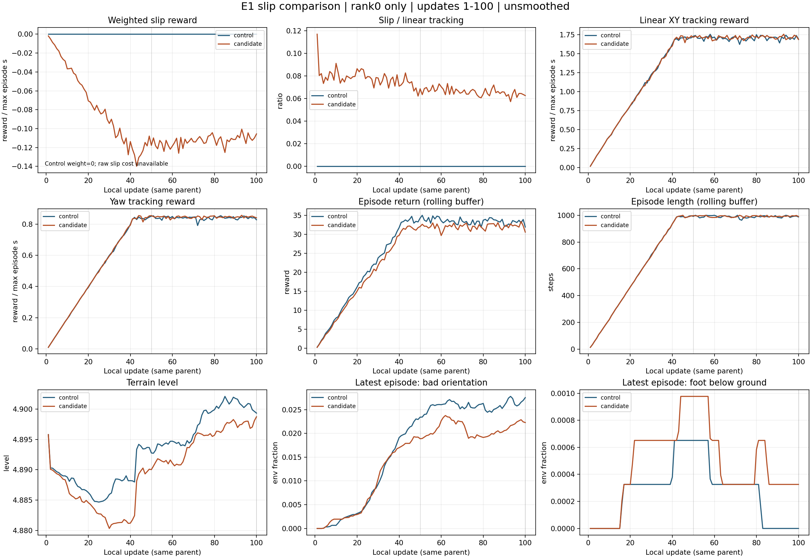

# E1 미끄럼 재학습 · 경계별 같은 회차 기록

> 분류: 실험
> 작성: 오흥재 · 2026-11-12
> 근거: 두 실행의 TensorBoard · 실행 영수증 · lead 11/12 경계 비교 의뢰
> 요지: 같은 회차의 수치만 기록
> 상태: CPU 재계산 확인됨
> 판: v1.1

생성 `2026-11-12T02:19:42+09:00`. 로컬 1~100회만 포함한다. rank0 기록으로 두 GPU 합산 평균이 아니다.

| 지표 | 구간 | 대조군 | 재학습 |
| --- | --- | --- | --- |
| 미끄럼 벌점 몫 | 91~100 | 원시 비용 없음 | 6.316% |
| 몸 XY 추종 보상 | 81~100 | 1.707413 | 1.716006 |
| 재학습/대조군 추종 비율 | 81~100 | 분모 | 100.503% |


벌점 몫은 같은 회차의 `abs(foot_slip)/track_lin_vel`을 계산한 뒤 마지막 10회 평균이다. 아래 표는 누적 구간과 마지막 50회 구간을 각각 같은 대조군 회차와 비교한다.

| 회차 | 지표 | 대조군 | 재학습 | 재학습−대조군 |
| --- | --- | --- | --- | --- |
| 1~100 | 미끄럼 가중 보상 | 0.000000 | -0.094499 | -0.094499 |
| 1~100 | 몸 XY 속도 추종 보상 | 1.353854 | 1.358022 | 0.004168 |
| 1~100 | 회전 속도 추종 보상 | 0.665496 | 0.668968 | 0.003472 |
| 1~100 | 전체 에피소드 보상 | 26.582156 | 25.219196 | -1.362960 |
| 1~100 | 에피소드 길이(step) | 783.331036 | 784.711539 | 1.380504 |
| 1~100 | 지형 레벨 | 4.893224 | 4.890117 | -0.003107 |
| 1~100 | 마지막 종료: 기울기 초과(비율) | 0.017437 | 0.014742 | -0.002696 |
| 1~100 | 마지막 종료: 발 지하(비율) | 0.000271 | 0.000475 | 0.000203 |
| 1~100 | 마지막 종료: 무효 값 격리(비율) | 0.000000 | 0.000000 | 0.000000 |
| 1~100 | 마지막 종료: 시간 만료(비율) | 0.778450 | 0.781072 | 0.002623 |
| 1~100 | 미끄럼 비용 적분/최대 시간 | 없음 | 0.629995 | 없음 |
| 51~100 | 미끄럼 가중 보상 | 0.000000 | -0.112898 | -0.112898 |
| 51~100 | 몸 XY 속도 추종 보상 | 1.704134 | 1.712794 | 0.008660 |
| 51~100 | 회전 속도 추종 보상 | 0.839230 | 0.844793 | 0.005563 |
| 51~100 | 전체 에피소드 보상 | 33.475768 | 32.066439 | -1.409329 |
| 51~100 | 에피소드 길이(step) | 989.576400 | 992.203000 | 2.626600 |
| 51~100 | 지형 레벨 | 4.897800 | 4.894844 | -0.002956 |
| 51~100 | 마지막 종료: 기울기 초과(비율) | 0.025852 | 0.020951 | -0.004901 |
| 51~100 | 마지막 종료: 발 지하(비율) | 0.000251 | 0.000485 | 0.000234 |
| 51~100 | 마지막 종료: 무효 값 격리(비율) | 0.000000 | 0.000000 | 0.000000 |
| 51~100 | 마지막 종료: 시간 만료(비율) | 0.973897 | 0.978565 | 0.004667 |
| 51~100 | 미끄럼 비용 적분/최대 시간 | 없음 | 0.752654 | 없음 |




`track_lin_vel`은 모든 명령의 몸 XY 속도 추종 보상이다. 실제 전진 속도 오차가 아니다. 종료 원인 열은 환경별 마지막 종료 원인 비율이다. 구간의 넘어짐 사건 수/종료 사건 수는 미측정이다. 종료 원인 중복이 가능하므로 합하거나 `1-time_out`으로 바꾸지 않았다.

대조군 미끄럼 가중 보상은 가중 0의 결과다. 기록이 없는 원시 미끄럼 비용은 `없음`이며 0으로 대체하지 않았다. `Episode_Reward`는 에피소드 가중 합/최대 에피소드 시간, 전체 보상과 길이는 최근 종료 에피소드 버퍼 평균이다.

## 비교 조건

| 조건 | 대조군 | 재학습 |
| --- | --- | --- |
| path | /home/jay/data/foothold/s2_lab/ex42_main_20261111_114505/main/EX-42-B-E1_20261111_114505 | /home/jay/data/foothold/s2_lab/ex42_main_20261112_013611/main/EX-42-B-E1-slip1000_20261112_013611 |
| git_head | b379eb98a1f3d0a343bb1caa2551b03410b076fc | 67d2506d454eb51592e9dbe099a4cb1a1c02484b |
| parent_sha256 | 680c820b73646d9c11f62f184fd35e6cc096ffd04681951d542b2b4b472d779e | 680c820b73646d9c11f62f184fd35e6cc096ffd04681951d542b2b4b472d779e |
| parent_cumulative_update | 13250 | 13250 |
| seed | 42 | 42 |
| num_envs_per_rank | 3072 | 3072 |
| distributed | True | True |
| dt | 0.02 | 0.02 |
| max_episode_seconds | 20.0 | 20.0 |
| slip_weight | 0.0 | -0.15 |
| terrain_manifest_sha256 | 39145e734002859dfc384d3e010c6d3115056d8ce01b341d561499b23a7f50bd | 39145e734002859dfc384d3e010c6d3115056d8ce01b341d561499b23a7f50bd |


| env.yaml 차이 | 대조군 | 재학습 |
| --- | --- | --- |
| log_dir | /mnt/win-d/mai/data/foothold/s2_lab/ex42_main_20261111_114505/main/EX-42-B-E1_20261111_114505 | /mnt/win-d/mai/data/foothold/s2_lab/ex42_main_20261112_013611/main/EX-42-B-E1-slip1000_20261112_013611 |
| rewards.ex41_foot_slip.weight | 0.0 | -0.15 |


[계산 정의와 선행 기록](https://github.com/foothold-project/foothold-lab/issues/725). 입력 prefix SHA와 회차별 값은 `tb_snapshot.json`, 결과 해시는 `SHA256SUMS`에 있다.

## 수동 갱신

250·500·750·1000회에는 아래 명령의 `--through`와 출력 폴더의 경계 번호를 함께 바꾼다. 필요한 회차가 빠지면 파일을 생성하지 않고 오류로 알린다. 예약은 만들지 않는다.

```bash
CUDA_VISIBLE_DEVICES='' PYTHONDONTWRITEBYTECODE=1 /home/jay/miniforge3/envs/isaac311/bin/python /home/jay/mai/wt/foothold-lab/analyst-lx-jeplo-c/inbox/jay/20261112-analysis/e1_slip_live.py --candidate /mnt/win-d/mai/data/foothold/s2_lab/ex42_main_20261112_013611/main/EX-42-B-E1-slip1000_20261112_013611 --control /mnt/win-d/mai/data/foothold/s2_lab/ex42_main_20261111_114505/main/EX-42-B-E1_20261111_114505 --out /home/jay/mai/wt/foothold-lab/analyst-lx-jeplo-c/inbox/jay/20261112-analysis/e1-slip1000-013611/m0100 --through 100 --record-only
```

같은 입력 재현: `--snapshot tb_snapshot.json --out <다른 폴더>`. 새 실행은 별도 폴더로 기록한다.

## 이력

| 판 | 변경 |
| --- | --- |
| v1.1 | 경계 상한 고정 · 수치 전용 기록 |
