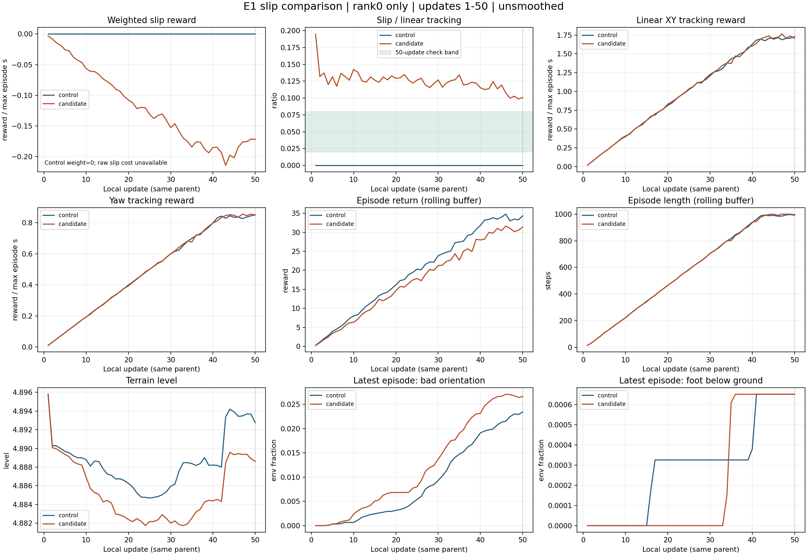

# E1 발 미끄럼 재학습 · 같은 회차 비교

> 분류: 실험
> 작성: 오흥재 · 2026-11-12
> 근거: 두 실행의 TensorBoard · env.yaml · startup_receipt · 11/12 lead 판정 정의
> 요지: 50회 판정 두 항과 학습 곡선을 같은 회차로 비교
> 상태: CPU 재계산 확인됨 · 학습 기동 판정 전체를 대신하지 않음
> 판: v1.0

생성 시각 `2026-11-12T01:09:51+09:00`. 재학습 기록은 로컬 **50회**까지 읽었다. 표와 그림의 숫자는 생성기가 원자료에서 읽었다. 두 판 모두 rank0 기록이므로 전체 GPU 합산 평균이 아니다.

`확인됨`: 50회 벌점 몫 10.929% · FAIL, 추종 유지 100.229% · PASS. 이는 의뢰한 두 항의 결과다. 전체 기동 승인이나 실제 미끄럼 감소 판정을 대신하지 않는다.

## 고정한 50회 점검

벌점 몫은 `mean(abs(slip_i) / track_lin_i, i=41..50)`, 허용 2~8%다. 추종 유지는 재학습 31~50회 평균이 대조군 같은 구간의 90% 이상인지 본다. 50회 이후 표의 같은 계산은 참고 기록이며 새 자동 승인 조건이 아니다. 분모가 0 이하이거나 회차가 하나라도 비면 판정하지 않는다.

| 경계 | 50회 창 | 벌점 몫 마지막 10회 | 벌점 판정 | 추종 마지막 20회 대조→재학습 | 추종 비율 | 추종 판정 |
| --- | --- | --- | --- | --- | --- | --- |
| 50 | 완료 | 10.929% | FAIL | 1.566830 → 1.570425 | 100.229% | PASS |


## 50회마다 같은 구간 평균

불완전한 마지막 창은 관측된 회차까지만 표시한다. `없음`은 0이 아니다. 종료 열은 사건 수를 센 넘어짐 비율이 아닌, 환경별 마지막 종료 원인 비율이다.

| 회차 | 지표 | 대조군 | 재학습 | 재학습−대조군 |
| --- | --- | --- | --- | --- |
| 1~50 / 목표 50 | 미끄럼 가중 보상 | 0.000000 | -0.120299 | -0.120299 |
| 1~50 / 목표 50 | 몸 XY 속도 추종 보상 | 1.003575 | 1.005017 | 0.001442 |
| 1~50 / 목표 50 | 회전 속도 추종 보상 | 0.491763 | 0.493697 | 0.001934 |
| 1~50 / 목표 50 | 전체 에피소드 보상 | 19.688544 | 17.517471 | -2.171073 |
| 1~50 / 목표 50 | 에피소드 길이(step) | 577.085671 | 577.234077 | 0.148407 |
| 1~50 / 목표 50 | 지형 레벨 | 4.888649 | 4.885411 | -0.003238 |
| 1~50 / 목표 50 | 마지막 종료: 기울기 초과(비율) | 0.009023 | 0.012229 | 0.003206 |
| 1~50 / 목표 50 | 마지막 종료: 발 지하(비율) | 0.000291 | 0.000211 | -0.000081 |
| 1~50 / 목표 50 | 마지막 종료: 무효 값 격리(비율) | 0.000000 | 0.000000 | 0.000000 |
| 1~50 / 목표 50 | 마지막 종료: 시간 만료(비율) | 0.583002 | 0.581251 | -0.001751 |
| 1~50 / 목표 50 | 미끄럼 비용 적분/최대 시간 | 없음 | 0.481197 | 없음 |




## 원자료와 비교 조건

| 조건 | 대조군 | 재학습 |
| --- | --- | --- |
| path | /home/jay/data/foothold/s2_lab/ex42_main_20261111_114505/main/EX-42-B-E1_20261111_114505 | /home/jay/data/foothold/s2_lab/ex42_main_20261112_004950/main/EX-42-B-E1-slip50_20261112_004950 |
| git_head | b379eb98a1f3d0a343bb1caa2551b03410b076fc | 85879393b9ab75c2bb93eb6a506d02e69c655840 |
| parent_sha256 | 680c820b73646d9c11f62f184fd35e6cc096ffd04681951d542b2b4b472d779e | 680c820b73646d9c11f62f184fd35e6cc096ffd04681951d542b2b4b472d779e |
| parent_cumulative_update | 13250 | 13250 |
| seed | 42 | 42 |
| num_envs_per_rank | 3072 | 3072 |
| distributed | True | True |
| dt | 0.02 | 0.02 |
| max_episode_seconds | 20.0 | 20.0 |
| slip_weight | 0.0 | -0.25 |
| terrain_manifest_path | /home/jay/data/foothold/s2_lab/ex42_mesh_1111/seed42_E0_c333/terrain_manifest.json | /home/jay/data/foothold/s2_lab/ex42_mesh_1111/seed42_E0_c333/terrain_manifest.json |
| terrain_manifest_sha256 | 39145e734002859dfc384d3e010c6d3115056d8ce01b341d561499b23a7f50bd | 39145e734002859dfc384d3e010c6d3115056d8ce01b341d561499b23a7f50bd |


env.yaml 전체를 자료로 읽어 대조한 차이. reset 범위 텐서는 저장 객체 ID 대신 CPU에서 복원한 수치 SHA로 비교했다:

| 필드 | 대조군 | 재학습 |
| --- | --- | --- |
| log_dir | /mnt/win-d/mai/data/foothold/s2_lab/ex42_main_20261111_114505/main/EX-42-B-E1_20261111_114505 | /mnt/win-d/mai/data/foothold/s2_lab/ex42_main_20261112_004950/main/EX-42-B-E1-slip50_20261112_004950 |
| rewards.ex41_foot_slip.weight | 0.0 | -0.25 |


## 숫자를 읽는 법과 남은 자료

- `Episode_Reward`는 가중과 dt를 적용한 에피소드 합을 최대 에피소드 시간으로 나눈 값이다. `Train/mean_reward`는 최근 종료 에피소드의 합계 평균이므로 두 종류를 직접 나눠 벌점 몫으로 삼지 않는다. 참고 분모인 양의 항 합과 모든 항 절댓값 합 대비 비율은 `iterations.csv`에 있다.

- 대조군 foot_slip 가중이 0이므로 TensorBoard의 가중 보상은 0이다. 원시 접촉·발 XY 속도 기록은 **없음**이다. 비용을 0으로 채우지 않았다. 재학습의 `slip_cost_normalized`는 가중 보상을 가중으로 나눈 에피소드 적분 비용/최대 에피소드 시간이며, 환경 스텝 전체 평균과는 다르다. 동일 체크포인트 평가로 얻을 미끄럼 비용은 후속 자료다.

- `track_lin_vel`은 모든 명령에서의 몸 XY 속도 추종 보상이다. 전진 명령만 따로 잰 오차가 아니다. 사용자가 고정한 추종 점검의 대리 지표로 쓰되, 실제 전진 거리·발 미끄럼 감소를 이 값만으로 확정하지 않는다.

- 시작 직후 보상과 에피소드 길이가 함께 오르는 것은 에피소드가 길어지는 초기 집계 영향도 있다. 짧은 곡선 상승 전체를 새 보행 학습의 효과라고 단정하지 않는다. 단일 시드 비교의 차이는 재측정 폭과 구분되지 않았다.

- `bad_orientation`, `foot_below_ground`, `ex41_invalid`, `time_out`을 분리했다. 같은 종료에 여러 원인이 잡힐 수 있어 합계나 `1-time_out`을 넘어짐 사건 비율로 해석하지 않는다. 실제 50회 구간의 넘어짐 사건 수/종료 사건 수는 미측정이다.

- 각 파일을 읽기 시작한 길이만큼 CPU 임시 사본으로 읽었다. 입력 경로·prefix 바이트 수·SHA는 `tb_snapshot.json`에 있다. 뒤에 쓰이는 이벤트를 이어 붙여 한 번의 결과로 섞지 않는다. 같은 tag·회차에 서로 다른 값이 중복되면 오류로 멈춘다. `/time` 태그는 회차 축에서 제외한다.

## 코드 근거

- [실행한 발 미끄럼 비용 식](https://github.com/foothold-project/foothold-lab/blob/85879393b9ab75c2bb93eb6a506d02e69c655840/foothold_s2/rewards/w86.py#L117). [작업과 고정한 계산 정의](https://github.com/foothold-project/foothold-lab/issues/725).

- 실제 실행 코드 `/home/jay/wt/foothold-lab/ex42-launch-slip-85879393`: `foothold_s2/rewards/w86.py:117` 접촉 발 XY 속도제곱 합; `foothold_s2/rewards/w86_runtime.py:258` 비용 계산; `:356` 누적 요약; `foothold_s2/scripts/ex42_training_entry.py:935` EX42 flush는 회차 확인만 수행; `foothold_s2/runners/start_runner.py:241` rank0만 로그 기록.

- `/home/jay/mai/projects/IsaacLab/source/isaaclab/isaaclab/managers/reward_manager.py:119` 에피소드 정규화, `:146` 가중0 건너뜀, `:150` 가중×dt; `managers/termination_manager.py:144` 마지막 종료 원인 평균, `:174` 종료 때만 갱신.

- `/home/jay/miniforge3/envs/isaac311/lib/python3.11/site-packages/rsl_rl/runners/on_policy_runner.py:184` 에피소드 로그의 회차 평균, `:231` 최근 종료 에피소드 보상·길이 평균.

## runner 교차 확인

```json
{
  "status": "runner numeric result pending"
}
```

## 갱신

수동 한 줄만 실행한다. 새로운 1000회 실행은 `--candidate`와 `--out`을 그 실행 전용으로 바꾼다. 독립 실행 둘을 하나의 학습 곡선으로 이어 붙이지 않는다.

```bash
CUDA_VISIBLE_DEVICES='' PYTHONDONTWRITEBYTECODE=1 /home/jay/miniforge3/envs/isaac311/bin/python /home/jay/mai/wt/foothold-lab/analyst-lx-terrain-d/inbox/jay/20261112-analysis/e1_slip_live.py --candidate /mnt/win-d/mai/data/foothold/s2_lab/ex42_main_20261112_004950/main/EX-42-B-E1-slip50_20261112_004950 --control /mnt/win-d/mai/data/foothold/s2_lab/ex42_main_20261111_114505/main/EX-42-B-E1_20261111_114505 --out /home/jay/mai/wt/foothold-lab/analyst-lx-terrain-d/inbox/jay/20261112-analysis/e1-slip50
```

고정된 숫자만 재현하려면 같은 생성기에 `--snapshot tb_snapshot.json --out <다른 폴더>`를 준다. 원자료·학습 코드·프로세스는 바꾸지 않는다.

## 이력

| 판 | 변경 |
| --- | --- |
| v1.0 | 50회 고정 정의 · 같은 회차 비교 · 없는 비용 명시 |
