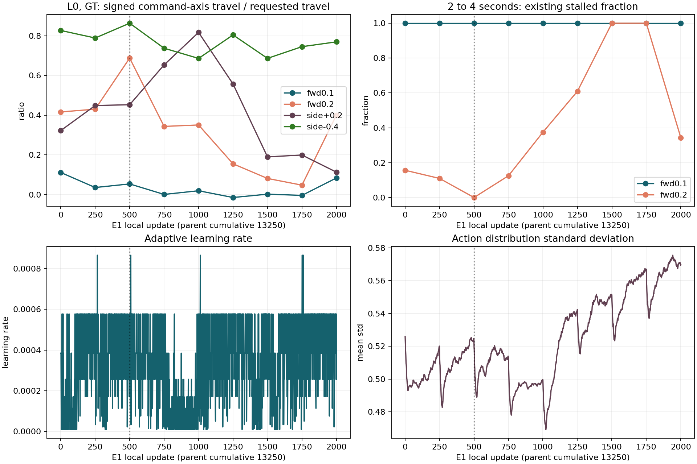

# E1: 되돌려 시작할지, 현재 보행을 보완할지

> 분류: A/평가 · 독립 분석과 설계 의견
> 작성: analyst-lx · 2026-11-13
> 근거: 이슈 #765 · lead 09:3x 의뢰 · E1 cmd7seg 원자료 · G1b · D44 /3 재평가 · 실행 코드
> 요지: m2000 보완을 우선 권고한다. 저속 취약성과 방향 이탈은 실재하지만, 되돌릴 수 없게 굳었다는 근거는 없다.
> 상태: 원자료 재계산 확인됨 · v2 문턱과 처방은 제안이며 실행 승인·정본 변경이 아님
> 판: v1.0

## 먼저 답

**m2000에서 목적을 좁힌 보완 구간을 먼저 하는 쪽을 권고한다. E1F로 바로 넘어가는 안에는 반대한다.** m13250부터 다시 하는 안은 틀린 실험이 아니지만, 지금은 재시작 자체가 필요한 원인을 찾지 못했다. 출발 모델도 아주 느린 전진이 약했다. 되돌아가기만 하면 같은 약점을 다시 물려받는다.

다만 lead의 보완안도 그대로 받아들이지는 않는다. 머리 틀어짐만 고치고 저속을 졸업 처리하면 안 된다. `zero_yaw`를 세게 하면 서 있는 해법이 더 유리해질 수도 있다. **방향, 실제 저속 진행, 기존 보행 유지를 같은 창에서 함께 본다.** 한 번의 250회 결과가 기대와 다르다고 즉시 다른 보상까지 바꾸지 않는다.

기존 E1 출구 판정은 FAIL 그대로다. 아래 v2는 다음 보완 학습을 시작하기 전에 합의할 새 기준이다. 이미 나온 결과에 맞춰 기존 FAIL을 PASS로 고치는 문서가 아니다.

## 1. 자료가 말하는 것

### 1.1 번호와 조건

- 부모는 누적 **m13250**, SHA `680c820b73646d9c11f62f184fd35e6cc096ffd04681951d542b2b4b472d779e`다. 이하 m250~m2000은 이번 E1의 **local 회차**다. m2000의 누적 번호는 15250이다. m2000 SHA는 `3937df92866b79581f7b27e8b8c9fbde1f7733a85fe5179388fcfd78aa83c4bb`다. 등급: 실행 기록.
- G1b는 GT 지도, seed 42, 64 env, 300 step × 0.02초다. **L0는 순수 평지라는 뜻이 아니다. 연속 7종의 L0다.** L5와 함께 재계산했다. G1b 부모와 이후 평가의 소스 모듈 해시는 같고, 마찰 실측 영수증도 정적 0.8·동적 0.6으로 같다. 그러나 지형 해시는 종류·레벨 배치의 해시이며 정점 전체 해시는 아니다. 이 자료는 고정 A~E 학습 메시를 장착한 평가도 아니다. 등급: 실측·코드.
- `map64` 유지 기준선은 누적 m13000의 5회 재측정에서 온다. G1b의 m13250 출발 측정과 같은 기준선이라고 부르지 않는다. 이 유지 재측정 폭을 새로운 저속·누적 yaw·옆 대칭의 반복 폭으로 전용할 수 없다.
- 새 D44 자료는 `/home/jay/mai/tmp/d44_reeval/20261113_084230`의 **trace /3**다. 실행 중 저장된 /2 성공률과 섞지 않는다. /3은 몸통과 네 발의 XY가 모두 계단참 안에 들어오는지 확인한다.

원자료별 SHA, 모든 표와 재현 코드는 [자료 목록](e1-review-data/evidence_sha256.json), [자동 생성 수치표](e1-review-data/EVIDENCE-TABLES.md), [재계산 코드](recompute_e1_review.py)에 있다. 원자료를 읽고 작성한 파생 자료이며 운영 파일은 수정하지 않았다.

### 1.2 저속은 약하다. 전부 넘어져서 생긴 값은 아니다

`R = 몸 좌표 명령 방향 속도의 적분 / 명령한 이동 거리`로 다시 계산했다. brief의 `follow = 1 − 오차/명령`과 다르다. 둘을 같은 숫자라고 쓰지 않는다.

| L0·GT·실측 | 부모 m13250 | local m500 | m1750 | m2000 |
|---|---:|---:|---:|---:|
| 전진 0.1 R | 0.1116 | 0.0539 | −0.0039 | 0.0839 |
| 전진 0.2 R | 0.4167 | 0.6881 | 0.0478 | 0.4006 |
| 옆 +0.2 R | 0.3228 | 0.4530 | 0.1996 | 0.1133 |
| 전진 0.2 정체 env / 64 | 10 | 0 | 64 | 22 |

이 표의 정체는 기존 코드대로 **2~4초 명령 방향 평균 속도 < 0.05 m/s**다. 전진 0.1은 위 네 저장본 모두 64/64 정체다. 전진 0.1·0.2의 36칸은 모두 생존 64/64이고 NPZ alive도 전부 참이다. G1b 전체 144칸에는 생존 63인 옆걸음 두 칸(m500 L5 +0.6, m1000 L5 +0.3)이 있다. 이것은 저속 전진의 “넘어져 못 감” 설명과 다르다. 발 위상은 G1b에 없으므로 “완전히 같은 자세로 서 있다”까지 확인한 것은 아니다.

m2000 실제 전진 속도 중앙값은 0.1 명령에서 **0.00839 m/s**, 0.2 명령에서 **0.08013 m/s**다. 옆 +0.2도 R이 **m1000 0.8174 → m2000 0.1133**으로 떨어졌다. **전진만의 문제로 좁히면 놓치는 저속 옆걸음이 있다.** 반대 방향 −0.2 자료는 없으므로 좌우 전체의 저속 대칭은 미확인이다.



L0·L5 결과가 비슷하다고 높은 계단에서도 저속이 검증됐다는 뜻은 아니다. 6초 동안 0.1 m/s 명령의 목표 거리부터 0.6 m이고 실제는 그보다 훨씬 짧다. 시작 받침에서 나가 어려운 단을 실제 밟았는지 따로 확인해야 한다.

### 1.3 D44는 멈춤보다 접근·재출발의 방향 이탈이 두드러진다

| /3 재평가·실측 | m2000 GT | m2000 PRED |
|---|---:|---:|
| 유효·생존 | 64·64 | 64·64 |
| 중간 정지 통과 | 63 | 64 |
| 최종 성공 | 7 | 7 |
| 꼭대기 진입 latch 없음 | 57 | 56 |
| 접근 yaw 변화 중앙값 | 약 +0.191 rad | 약 +0.187 rad |
| 정지 yaw 변화 중앙값 | 약 +0.006 rad | 약 +0.000 rad |
| 재출발 첫 2초 yaw 변화 중앙값 | 약 +0.210 rad | 약 +0.218 rad |
| 같은 2초 옆 이동 중앙값 | +0.456 m | +0.387 m |

정지 판정의 실측과 도달 실패를 나눠야 한다. “정지·재출발을 아예 못 배웠다”는 해석은 과하다. 반대로 생존했다고 계단참 도달을 배웠다는 해석도 틀린다. 원인 코드 하나가 유일한 물리 원인이라는 뜻도 아니다.

평가 기하상 접근점 x=0.5에서 계단참 앞 x=3.4까지 **2.9 m**, 계단참 폭은 **1.2 m**다. 단 높이는 0.16 m지만 꼭대기 총높이는 **1.44 m**다. 첫 단 하나를 넘는 시험과 같지 않다. m2000 GT 접근 중 발의 몸통 대비 좌우 반경 최대값은 env 중앙값 약 0.275 m다. 따라서 몸통이 판 안에 있어도 발은 밖일 수 있다. 등급: replica 영수증·NPZ 실측.

일반 전진의 6초 yaw 변화도 m1750보다 m2000에서 줄었다. GT 전진 1.0의 env별 순변화 절댓값 중앙값은 **0.2954 → 0.1178 rad**, 전진 0.5는 **0.0912 → 0.0608 rad**다. 한 방향으로 계속 나빠진다는 증거는 없다. 그렇다고 방향 문제가 해결됐다는 뜻도 아니다.

## 2. “굳었다”를 어떻게 구별할 것인가

### 확인한 학습 유인

실제 선속도 추종 항은 `2 × exp(−(vx 오차² + vy 오차²)/0.5²)`다. 완전히 서 있고 vy 오차가 0이면 0.1 명령에서도 **1.9216/2 = 96.08%**를 받는다. 완전 추종으로 더 얻는 보상률은 **0.07842**다. 0.2에서는 **85.21%**, 더 얻는 보상률 **0.29571**다. 실제 step 보상은 이 값에 dt=0.02를 곱한다. 총 보상에서 서 있는 편이 더 이득인지는 명령별 다른 비용을 재야 알 수 있다. **식은 확인됐고, 이것이 이번 저속 악화의 단독 원인이라는 주장은 추정이다.**

근거: 실행 `params/env.yaml:2044`(가중·std), IsaacLab `source/isaaclab/isaaclab/envs/mdp/rewards.py:304~315`, `managers/reward_manager.py:150`. 설치 뿌리는 `/home/jay/mai/projects/IsaacLab`이다.

저속 명령이 빠진 것은 아니다. 실제 EX-41 하위 plan 생성자는 `low_forward_fraction=.20`을 넣고 E1도 이를 물려받는다. 전진 슬롯 중 20%는 0.1~0.3, 나머지는 0.3~1.5다. 따라서 0.1~0.2의 전체 명령 추출 기대 비중은 전진 몫 0.19 때 **1.9%**, 0.16 때 **1.6%**다. heading이 아닌 순수 회전 0까지 조건을 붙이면 후자는 **1.12%**다. 실제 생성기로 CPU 100만 표본을 뽑아 **1.6091%·1.1122%**를 확인했다. 이것은 표본 추출 시험이며 실제 rollout 체류시간 비중은 아니다.

근거: 고정 사본 `ex42-launch-e1-v6/foothold_s2/curriculum/ex41.py:135~136`, `scripts/ex42_training_entry.py:1112~1119`, `commands/mixed_core.py:288~325`; 실행 `segment_commands_b3.json`과 `b8.json`. EX-40 기본 클래스의 기본값 0을 이 경로에 적용하면 잘못 계산한다.

### 확인된 고착 반례와 아직 모르는 것

| 주장 | 판단 | 근거 |
|---|---|---|
| 저속을 되돌릴 수 없게 잊었다 | 입증 안 됨 | 같은 명령·보상 설정과 상한 9에서 전진 0.2 R이 m1750 0.0478 → m2000 0.4006으로 회복. 다만 아직 목표 속도에는 못 미침 |
| 학습률이 바닥에 붙어 더 못 배운다 | 현재 종료점 설명으로는 반박 | 마지막 50회 lr 평균 4.19e-4, 마지막 값 2.56e-4. 전체 2,000회 중 하한 1e-5 근처는 127회 있어 “한 번도 바닥이 아니었다”도 틀림 |
| 탐색이 사라졌다 | 지지 안 됨 | 마지막 50회 action std 평균 0.5704. 다만 std가 크다는 사실만으로 유용한 저속 발걸음을 탐색한다는 보장은 없음 |
| 보상·표본 비중과 높은 지형 적응이 저속에 불리했다 | 유력 가설 | 낮은 명령에서 서 있기 추종 보상이 높음. m500 뒤 전진 몫 감소와 뒤따른 지형 상승. 둘이 시간상 겹쳐 이 실행 하나로 각 원인의 효과를 분리할 수 없음 |
| 양발 위상·관절 한계 때문에 저속이 불가능하다 | 미확인 | G1b 저속의 발·관절 원자료 없음. 빠른 전진의 정상 보행을 저속의 정상 보행 증거로 대신하지 않음 |

PPO는 현재 정책이 모은 표본으로 정책을 갱신하므로 이전 기술 보존을 자동 보장하지 않는다. 동시에 학습 이력이 생겼다는 이유만으로 변경 불가능해지는 알고리즘도 아니다. **저속 목표에 맞춘 처방과 실제 표본을 주고, 유지 칸을 지키면서 개선하는지**가 필요한 시험이다. [PPO 원문](https://arxiv.org/abs/1707.06347). 이 논문을 “반드시 회복한다”는 근거로 쓰지는 않는다.

## 3. 세 선택지의 반박과 권고

| 선택 | 얻는 것 | 반박·위험 | 내 의견 |
|---|---|---|---|
| m13250에서 수정 설정으로 E1 재시작 | 부모·출발 상태를 맞춘 처방 비교. 처음부터 저속 복습과 보상을 넣을 수 있음 | 부모 자체가 0.1에 약함. 새 보상·분포가 같으면 이어 가기도 가능하므로 재시작의 추가 이득은 미측정. 기존 결과를 보고 경계별 설정을 달리하면 “처치 하나의 깨끗한 대조”도 아님 | 보완이 반응하지 않거나, 같은 부모에서 처방 효과를 구분하는 연구가 목적일 때 대안 |
| m2000에서 보완 | 상한 9 적응과 회전 능력을 물려받아 작은 처방을 빨리 시험 | 저속과 방향 문제도 물려받음. 현재 성능이 모든 칸의 최고점은 아님. L9 자료만 계속 주면 쉬운 저속 과제를 못 배울 수 있음 | **우선 권고. 짧은 응답 시험과 졸업을 구별** |
| E1F 바로 | 깃발·방향 피드백으로 다음 능력 학습 | 현재 E1 FAIL. 상위 방향 보정이 하위 직진 이탈을 가릴 수 있음. 저속 능력이 저절로 회복될 근거 없음. 기존 flag sampler는 선택 속도 <0.3에서 제자리 회전하므로 저속 전진 치료로 간주할 수 없음 | 현재 권고 안 함. 선행 과제를 다른 단계로 옮기려면 명시적 설계 변경·유지표가 필요 |

마지막 flag 주장의 코드 근거는 `foothold_s2/commands/mixed_core.py:525,543,570`이다. E1F에서 별도 실행 계약을 바꾸면 그 실제 소비 경로를 다시 확인해야 한다.

### 보완 구간의 구체적인 한 안

1. **m2000을 보존하고 별도 보완 계보로 시작한다.** optimizer·lr·normalization·RNG·지형 상태를 이어받는 것은 학습 설계와 별개의 필수 확인이다. planner가 찾은 “경계 8 사본 충돌”을 폴더 이름만 바꿔 우회하지 말고 부모 SHA·local/누적 번호와 새 구간 영수증으로 명시한다. 이 보고서는 실행 사본 변경 승인이 아니다.
2. **첫 처방은 `zero_yaw` −0.5 → −1.0 하나로 좁힌 250회 응답 시험**을 수용할 수 있다(가정·제안). 단, 전진 0.1·0.2와 옆 ±0.2도 같이 재고 정체가 늘어나는지 본다. yaw가 줄어도 진행이 더 느려지면 성공이 아니다. 학습 중 총보상보다 해당 명령의 실제 속도·진행·발 위상을 본다.
3. 유지가 안전하면 **같은 설정을 다음 250회에도 유지해 두 창을 본다**(기존 250 경계의 활용, 길이는 가정). 한 창의 작은 차이만으로 −1.5, std 0.4 등 처방을 매번 바꾸는 planner 초안에는 반대한다. 그렇게 하면 재측정 흔들림과 처방 반응을 구별하기 어렵다. 뚜렷한 유지 악화는 기존 안전 규칙대로 처리한다.
4. 방향을 고쳐도 저속이 남으면 **다음 처방은 저속을 먼저 겨냥한다.** 승인된 선속도 std 0.5 → 0.4의 한 칸 시험은 구현 부담이 작지만, 0.1에서 서 있기 보상은 여전히 93.94%다. 더 좁히거나 저속 복습 비중을 늘리는 방법도 있으나 동시에 바꾸지 않는다. 전진·옆의 저속별 실제 표본 수와 각 보상률을 먼저 기록한다. std를 줄이면 빠른 명령·험지의 큰 오차에서 보상 신호가 작아지는 반대 효과도 감시한다.
5. 두 창에 반응이 없으면 **곧바로 부모로 돌아간다는 결론을 내리지 않는다.** 보상/노출이 실제 소비됐는지와 평가 잡음을 먼저 확인한다. 처방이 제대로 들어갔는데도 유지 훼손 없이 개선되지 않을 때, 같은 처방을 m13250 또는 m500에서 시작하는 제한 비교를 설계한다. 실패한 처방을 같은 채로 처음부터 길게 반복하는 것은 대안이 아니다.

이 길이로 졸업을 보장하지 않는다. 기존 연장 한도와 별도 보완 길이의 승인은 lead가 팀장과 정해야 한다. 실제 소요는 학습·평가·구간 사이 대기를 나눠 계산한다. “재시작 11시간”과 “보완 몇 시간”은 이번 분석에서 새로 측정한 ETA가 아니다.

### 머리 유지 보상에 대한 추가 반박

`zero_yaw`는 이미 존재한다. 몸 좌표 z축 각속도의 절댓값을, 회전 명령 0이고 heading controller가 꺼진 행에서 벌한다. 학습의 heading 활성 전진 약 30%에는 이 항이 꺼진다. 등급: 코드 (`rewards/w86.py:18~24`, `w86_runtime.py:164,253`).

- 벌을 키우는 가설은 합리적이다. 그러나 “지금 벌이 작아서 방향이 틀어진다”는 단독 원인으로 확정할 수 없다. 정지한 정책도 yaw 벌점이 작으므로 저속 악화 가능성이 있다.
- 몸 좌표 z 각속도와 세계 방향의 시간 변화는 경사에서 같지 않다. 몸 roll=φ, pitch=θ일 때 세계 yaw 변화율은 `(몸 q·sinφ + 몸 r·cosφ)/cosθ`다(운동학 계산). 따라서 이 항 강화만으로 경사의 세계 방향 고정을 보장하지 않는다.
- D44에 heading controller를 넣는 것은 별도 유효한 진단이다. **기존 고정 wz=0 시험과 새 heading-on 시험을 다른 ID·형식으로 함께 보존한다.** 새 시험의 성공을 기존 시험의 개선으로 바꾸지 않는다. heading-on이 성공하면 “상위 방향 보정이 있으면 계단 중간 멈춤·재출발 가능”까지 주장할 수 있다.

## 4. E1 졸업 기준 v2 초안

이 표는 **필요한 숫자를 숨기지 않은 제안**이다. 기존 결정 값과 새 공학적 허용치를 구별한다. 새 저속·대칭·누적 yaw의 동일 저장본 재측정 폭은 아직 없으므로 “검증된 통계 문턱”이라고 부를 수 없다.

| 축 | 계산·평가 조건 | 제안 문턱과 근거 등급 | 지금 판단 |
|---|---|---|---|
| 이미 배운 능력 유지 | 기존 26칸 유지표·서기·회전 및 지도 계약. GT/PRED/OFF 기록을 섞지 않고 각각 | 기존 고정 기준 그대로(결정·기존 5회 반복 실측). 새로 못 배운 칸을 부모가 약하다는 이유로 면제하지 않음 | 현재 유지 PASS는 이 지정 칸에 한정 |
| 저속 전진 | 0.1·0.2 m/s, wz=0, heading off. 기존 G1b L0·L5와 구분한 평지 진단. 시작 64 전체, 6초 R·축별 MAE·2~4초 정체. 세 지도 모드 | 각 칸 R 중앙값 **0.8~1.2**, MAE ≤ 명령의 **20%**, 진행 성공 ≥**52/64**, 생존 ≥**60/64**, 두 고정 설정 창(새 상대오차 허용은 **가정**, 52·60·두 창은 기존 D44 형식 재사용 제안). 성공은 생존하면서 위 속도 띠를 충족. 0.1 목표 최소 0.08은 기존 정체 0.05보다 높음 | 현 자료 GT만. 미측정 모드로 졸업 불가. S1=0.3은 응답 확인용이지 졸업선 아님 |
| 저속 옆과 대칭 | ±0.2·±0.4, 기존 유지 ±0.5. 각 방향 R를 먼저 계산, S=min(R+,R−)/max(R+,R−). 0 이하·분모 불가 별도 실패/무판정 | 양쪽 각각 위 절대 추종 띠 + **S≥0.8**(D101의 불균형 감시 수준을 시작 기준으로 차용한 **가정**, 성공 검증값 아님). 다른 속도를 짝짓지 않음. 추가로 상대 차 기록 | ±0.5 대칭만 보면 m2000 S=0.9523이지만 양쪽 진행 R≈0.730·0.766. 대칭만으로 졸업 못 함. −0.2가 없어 저속 대칭 미확인 |
| 순수 직진의 방향 유지 | 0.5·1.0 m/s, 6초. env별 `abs(unwrapped_yaw_end − start)`의 중앙값·p90. 부호 중앙값은 편향 기록 | 중앙값 **≤0.10 rad**, p90 **≤0.20 rad**를 초기 운영 목표로 제안(**가정**, 각각 약 5.7°·11.5°). signed median 절댓값으로 대체 금지. 같은 저장본 반복 측정 뒤 경계 근처 판정을 확정 | m2000 GT: 0.5는 중앙값0.0608/p90 0.1423, 1.0은0.1178/0.2177. 후자 미달. 잡음 때문에 미달인지 미확인 |
| E1이 넓힌 연속 지형·명령 | 연속 7종 실제 배치에서 L3·L6·L9 고정 전진, 새 범위 옆 ±0.8·걸으며 돌기·저속 회전 끝점. 기존 명령은 유지 칸 | 지형별 실제 진행·생존과 범위 끝점 추종. 기존 고정 성공 정의와 52/64·60/64 형식을 적용하되 **칸별 64와 유효 분모 충족**. 아직 기하·시간에 맞는 성공 정의가 없는 칸은 정하기 전 미확인 | cap9와 학습 평균 레벨8.18만으로 졸업 못 함. G1b L0/L5·map64 L2는 L9 고정 평가의 대체가 아님 |
| 계단참 제자리 회전 | D44 좌·우 × GT/PRED, OFF 기록 | 기존 성공52/64·생존60/64 두 창(결정) | 현재 네 칸64/64 유지 |
| 계단 중간 정지·재출발 | D44 기존 /3의 고정 wz=0 진단과 별도 heading-on을 분리. 멈춤·재출발·도달·최종정지를 각각 기록 | 기존 E1은 여전히 기존 D44 전체 계약으로 FAIL. v2에서 전체 도달을 뒤 단계로 옮길지는 **팀장 결정 필요**. 이 단계가 방향 유지까지만 가르친다면 그 좁은 기술을 재고, full D44는 E3 이전의 명시된 미해결 요구로 유지 | “실패한 칸이니 E3 것”으로 사후 면제하는 것은 반대 |
| 보행 품질 | 위 저속·직진 칸의 접촉 위상·발 끌림·몸 자세·정지 전환. 기존 정의 사용 | 정상 저속을 무조건 빠른 trot 위상에 맞추지 않음. 자료가 없으면 미확인. 새 위상 허용치를 이번 수치만으로 지어내지 않음 | G1b에서 미측정. 64/64 생존으로 이 축을 대신하지 않음 |

**planner 문턱에 대한 직접 답:**

1. **Y1 0.10 rad의 반복 폭은 없다.** 시간에 따라 학습된 다른 저장본의 0~0.31 범위는 잡음 폭이 아니다. `abs(median(Δyaw))`도 권하지 않는다. 예컨대 절반이 −0.3, 절반이 +0.3이면 0인데 모든 로봇이 틀어졌다. `median(abs(Δyaw))`와 꼬리를 쓰자. `yaw_absolute_accum`은 경로 전체 흔들림의 합이라 이 순변화 절댓값과도 다르다.
2. **S2 10%는 통계적으로 정당화되지 않았다.** `차/평균≤0.10`은 `S≥0.90476`과 같다. 기존 0.8 감시선은 `차/평균≤22.22%`다. 서로 바꿔 쓰면 안 된다. 이번 제안은 절대 성능을 먼저 두고 S≥0.8을 시작점으로, 10%는 더 엄격한 목표로 기록한다. 팀장이 10%를 운영 요구로 택할 수 있지만 반복 폭으로 입증됐다고 말하지 않는다.
3. **S1 m2000 값은 있다.** GT L0 실제 진행 R=0.0839·0.4006, brief 지표=0.078·0.394다. 정의와 원자료가 다르니 같은 열에 섞지 않는다. 기준 0.3은 0.1 명령에서 0.03 m/s를 허용해 현재 정체 문턱보다 낮다.
4. **숫자 확정 전 필요한 보완:** 같은 m2000 저장본으로 seed만 바꾼 반복을 새 평가 칸에서 실시한다. 기존 유지 기준의 5회 방식을 차용할 수 있으나 이 횟수도 최적 통계 설계라는 뜻은 아니다. 현재 단일 seed 64 env는 학습 seed 64번이 아니다. 반복 폭 근처 판정은 미확인으로 남기고 기존 능력 복습 학습은 이어가는 설계가 맞다.

0.10 rad가 D44 폭을 항상 지킨다는 뜻도 아니다. 폭 1.2의 절반0.6에서 발 반경0.275와 여유0.10 m를 빼면 몸통 여유는0.225 m다. 일정한 기울어진 진행 방향으로 2.9 m를 간다는 단순 가정에서 `atan(0.225/2.9)≈0.077 rad`다. 이는 설명용 기하 계산이지 유효한 모든 보행의 yaw 상한이 아니다. 실제 경로와 발 XY 도달 조건이 우선한다.

## 5. 검증 범위와 다음 판의 구분

- CPU 재계산: G1b 144칸, D44 /3 정지·재출발 6칸, 일반 전진 yaw 48칸, TensorBoard 2,000회. 각 원파일 SHA를 기록했다. G1b 전진은 NPZ vx 적분과 JSON을 대조했다. D44는 JSON 성공 수와 별도로 quaternion·위치에서 구간 변화를 계산했다. 성공 판정 전체를 이번 스크립트에서 새 구현하지는 않았다.
- 답 아는 입력: pi 경계를 넘는 yaw, 좌우 부호 상쇄, signed projection, reward 식, 대칭 식. 생존 종료 뒤 reset 샘플을 yaw 통계에서 제외한다. m500 PRED 전진1.0의 종료 1건에서 cmd_post 회전값이 바뀐 샘플도 alive 밖이라 제외했다.
- 학습률·std는 계속 움직이고 있다. 이것만으로 새 처방 성공을 보장하지 않는다. 마지막 50회 KL probe 평균0.0195와 value loss0.0661은 발산의 증거로 단정하지 않는다. 경계 재시작 직후 에피소드 합계 보상·길이의 일시 감소도 자세 붕괴와 구분했다.
- 보완이 성공해도 “START를 처음부터 재현했다”가 아니라 **부모 능력을 물려받고 저속·방향을 보완했다**고 기록한다. 재시작 비교를 나중에 하게 되면 학습량과 처방이 달라지는 축을 명시한다.

재현 명령(자기 작업 사본에서, CPU):

```bash
CUDA_VISIBLE_DEVICES='' PYTHONDONTWRITEBYTECODE=1 /home/jay/miniforge3/envs/isaac311/bin/python inbox/jay/20261113-analysis/recompute_e1_review.py --out inbox/jay/20261113-analysis/e1-review-data
```

원자료·학습·승인 설정을 건드리지 않는다. 현재 결론의 한계는 새 문턱의 재측정 폭, 저속 발 위상, 처방 개입 결과가 없다는 것이다.

| 판 | 바뀐 내용 |
|---|---|
| v1.0 | 독립 원자료 재계산과 세 경로 비판, planner 9bb1cb5a 문턱 질의 답, 다음 보완용 v2 기준 제안 |
