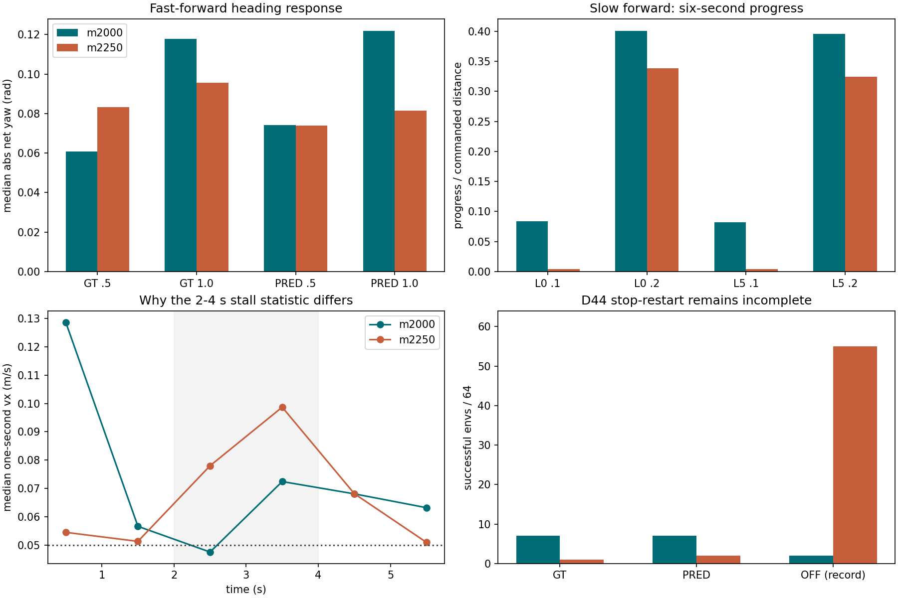

# E1 m2250 보완 결과 · 재출발과 보완 B의 독립 의견

> 분류: A/평가 · 일반화 벤치마크 · 지표
> 작성: analyst-lx · 2026-11-13 13:58
> 근거: 이슈 #765 · 결과 전 비교 계획 a68b287a · 원자료·소비 코드 SHA · CPU 재계산
> 요지: 빠른 전진의 방향은 개선됐지만 저속과 D44는 미달이다. 다음 한 구간은 속도 추종만 바꾼 B를 권고한다.
> 상태: 실측 확인됨 · 다음 처방은 권고 · 실행 및 졸업 승인 아님

**권고는 (나)-B를 한 구간 확인하는 것이다. m2250에서 선속도 추종 폭만 0.5→0.4로 바꾸고, zero_yaw는 −1.0을 유지한다.** 이번 A를 그대로 더 돌리거나 yaw 벌점을 동시에 −1.5로 올리는 안에는 반대한다. 빠른 전진의 머리 틀어짐은 실제로 줄었지만, 느린 전진을 가르치는 처방은 아직 바뀌지 않았다. m13250 재출발도 같은 저속 약점을 가진 부모에서 시작하므로, 재출발 자체가 해결책이라는 근거가 없다. 이는 **다음 한 처방을 고르는 권고**이며, B의 성공을 예측하거나 E1F 진입을 허용하는 판정이 아니다.

## 이번에 확인한 결과

수치 전체는 [자동 생성 표](e1-m2250-data/TABLES.md), [그림](e1-m2250-data/comparison.png), [원자료 경로와 SHA](e1-m2250-data/evidence_sha256.json)에 있다. 아래 숫자는 실측이며 문턱은 별도 표시했다. 순 yaw는 env별 6초 방향 변화의 절댓값을 먼저 취한 뒤 중앙값·p90을 계산했다. 좌우 방향 변화가 상쇄되는 부호 중앙값을 Y1으로 쓰지 않았다.

| 축 | m2000 → m2250 | 해석과 반례 |
|---|---|---|
| 운영 P1 / 현재 유지표 | FAIL / PASS → FAIL / PASS | 졸업하지 않았다. D44 회전 GT/PRED 네 칸은 모두 64/64 유지 |
| Y1 전진 1.0, GT | 중앙값 0.1178→0.0955 rad · p90 0.2177→0.1954 rad | 이전 세 시드 중앙값 0.1111~0.1248, p90 0.2089~0.2177보다 작다. 진행은 5.568→5.587 m로 유지 |
| Y1 전진 1.0, PRED | 중앙값 0.1219→0.0814 rad · p90 0.2314→0.1919 rad | 이전 세 시드 중앙값 0.1171~0.1219, p90 0.2314~0.2489보다 작다. 진행 5.563→5.622 m |
| Y1 전진 0.5 | GT p90 0.1423→0.1801 · PRED 0.1492→0.2031 rad | 모두 좋아진 것은 아니다. 진행도 GT 2.781→2.660, PRED 2.765→2.663 m로 감소 |
| S1 저속, GT L0 | R: 0.1 명령 0.0839→0.0042 · 0.2 명령 0.4006→0.3385 | 두 칸 모두 m2000 세 시드 범위 아래. L5도 0.0822→0.0039 · 0.3955→0.3244로 같은 방향 |
| 저속 정체, GT L0 | 0.1 명령 64→64 · 0.2 명령 22→5 env | 2~4초 정체율만 보면 0.2가 개선이다. 하지만 예정 6초 전체 진행은 줄었다. 두 통계는 다르게 움직인다 |
| 옆 ±0.4, GT L0 | 좌/우 R 0.6775/0.7697→0.7846/0.7355 | 대칭 S는 0.8802→0.9374로 개선. 오른쪽 절대 추종은 낮아졌고 양쪽 모두 제안 추종 띠 0.8~1.2 미달 |
| D44 정지→재출발 | GT 7→1 · PRED 7→2 · 끔 2→55 성공/64 | 지도 켬과 끔이 갈린다. 끔 55를 GT/PRED 실패 대신 넣을 수 없다. 끔은 기록 전용 |



**빠른 전진은 서 버려서 머리가 덜 돈 것이 아니다.** Y1 네 칸 모두 생존 64/64, 2~4초 정체 0/64이며, 전진 1.0의 진행량은 유지됐다. 반면 전진 0.5의 p90과 진행은 악화했다. 따라서 “방향 문제가 해결됐다”는 결론도 이르다.

저속 0.2는 중간 구간에서 더 잘 움직이지만 출발 직후 전진이 약해졌다. L0의 첫 1초 평균 vx 중앙값은 0.1287→0.0545 m/s, 2~3초는 0.0475→0.0780 m/s다([초별 원 수치](e1-m2250-data/slow_seconds.csv)). 정체율 한 칸으로 저속을 졸업시키면 안 되는 실측 반례다. 0.1은 두 저장본 모두 64/64 정체였고, m2250에서 전체 진행까지 더 줄었다. “새로 서기 시작했다”보다 “이미 약했던 저속 진행이 더 줄었다”가 맞다.

D44에서도 “정지할 수 없다”와 “멈춘 뒤 도달 조건을 채우지 못한다”를 나눠야 한다. GT/PRED의 정지 자체는 63/64·64/64로 유지됐고 재출발 속도도 생겼다. 그러나 플랫폼 도달 감지 조건 미충족(`no_top_latch`)은 GT 51→59, PRED 50→54다. 이는 몸통 위치와 발 위치 조건을 함께 보므로 단순히 몸통이 한 번도 들어가지 않았다는 뜻은 아니다. 정지 구간 signed yaw 중앙값은 GT 0.0062→0.0768, PRED 0.0004→0.0693 rad다([D44 성분](e1-m2250-data/d44.csv)). 현행 `stop_ok`는 위치 띠와 수평 속도로 정하며 머리 방향을 요구하지 않는다(`ex42-launch-e1-v11b/foothold_s2/eval/ex42_d44_cells.py:240~246`). 일반 map64 정지 명령의 선속도·각속도 기준 정지율은 세 모드 모두 1.0이다. 두 시험의 다른 정의를 섞지 않는다.

## 두 선택지에 대한 반박과 권고

| 선택지 | 찬성 근거 | 반박 | 이번 권고 |
|---|---|---|---|
| (가) m13250에서 다시 | 쉬운 지형·명령 구간부터 새 보상과 함께 학습할 수 있다. 현재 저속 악화와 D44 실패는 경로를 바꿀 이유가 된다 | 부모도 L0 0.1의 R 0.1116, 정체 64/64였다. 0.2의 R도 0.4167로 졸업 수준이 아니다. 부모가 저속을 잘하던 정책이라는 전제가 성립하지 않는다 | 저속을 직접 겨냥한 보완 한 구간보다 먼저 선택할 근거는 부족하다 |
| (나)-B, 폭만 0.4 | 유지표·회전·높은 레벨 학습을 보존한 채 저속 추종 항을 직접 바꿀 수 있다. 빠른 전진의 Y1·옆 움직임 변화는 정책이 처방에 반응함을 보인다 | 지금 저속과 D44는 악화했다. 0.4도 정지를 충분히 가를지 미확인이고, 높은 레벨에서 저속 노출이 부족하면 보상만으로 안 풀릴 수 있다 | **한 구간의 B를 먼저.** yaw 추가 강화나 명령·지형 동시 변경 없이 확인 |
| A 그대로 더 학습 / 바로 E1F | 같은 조건의 학습량 또는 다음 과제 노출을 늘릴 수 있다 | 저속을 겨냥한 항은 그대로이며 실제 P1은 FAIL이다. 미달을 넘길 승인 근거가 되지 않는다 | 이번 자료로 권고하지 않음 |

부모 수치는 [앞선 독립 재계산의 iteration=0](e1-review-data/g1.csv)이며, 부모 SHA는 `680c820b73646d9c11f62f184fd35e6cc096ffd04681951d542b2b4b472d779e`다. L0는 평지가 아니라 연속 지형이다. (가)의 현재 초안은 처음부터 zero_yaw와 추종 폭을 함께 바꾸므로 **보상 한 항만 다른 비교**라고 부르면 안 된다.

B의 폭 0.4도 만능 처방은 아니다. 선속도 추종식 `exp(-오차²/std²)`에서 0.1 m/s 명령에 가만히 있으면, 다른 오차가 0이라는 가정 아래 최대 추종 보상의 0.9608(std 0.5) 또는 0.9394(std 0.4)를 여전히 받는다(식 계산). 따라서 B에서 S1이 반응하지 않으면 폭을 자동으로 계속 좁히기보다 **저속 명령의 실제 노출·쉬운 지형 배치·행동 비용과 추종 보상의 균형**을 함께 확인할 필요가 있다. 이는 다음 설계 판단이며 이번 실행 설정을 바꾸라는 지시가 아니다.

planner 초안 §4.5의 B 준비물은 zero_yaw −1.0 고정·선형 std 0.4다. 같은 문서 앞 표 §4의 “Y1 미달이면 yaw −1.5도”와 다르므로, 실행 결정을 받는다면 **한 항만 바꾸는 §4.5 형태**를 고정해야 한다. 기존 §4의 “S1이 내려가면 yaw 벌을 키운 것이 원인”이라는 문장도 강하다. 같은 기간의 무처치 이어 학습 대조군이 없어 이번 결과만으로 원인을 분리하지 못한다.

## 졸업과 ‘굳었나’에 대한 판단

- **미달은 확인됨, 비가역적으로 굳었다는 것은 미확인이다.** 마지막 50회 action std는 0.5704→0.5627, lr은 0.0004188→0.0004267, KL은 0.01953→0.01784다. 명백한 탐색 소실·손실 폭주 증거는 없고 실제 행동도 변했다. 이 수치가 저속 학습 성공을 보장하지는 않는다.
- [결과 전 제안 v2](OPINION-E1-EXIT-v2-SEED-1113.md)의 문턱은 넓히지 않는다. 저속 네 칸의 `생존 AND R 0.8~1.2 AND MAE≤명령20%` 성공은 모두 0/64다. Y1 전진 1.0은 단일 시험에서 제안 문턱 안이지만, 전진 0.5 PRED p90 0.2031은 0.20 밖이다. 가까운 칸은 사전 규칙대로 반복 측정 대상이다.
- m2000 세 시드 범위는 신뢰구간이나 미래 잡음 상한이 아니다. m2250은 seed42 한 번이므로 개선·악화의 통계적 확정을 주장하지 않는다. 그래도 양 레벨 저속의 방향이 같고 이전 관측 범위 밖이라는 사실은 남긴다.
- B로 처방이 바뀌면 B 첫 창과 A를 묶어 “같은 처방 두 창 통과”라고 하지 않는다. B가 좋아져도 같은 설정에서 지속되는지 별도 확인해야 한다. 현재 P1의 유지 `previous=HOLD`, `current=PASS`도 원문 그대로 남긴다([판정 원문 발췌](e1-m2250-data/summary.json)). 이전 창 HOLD를 이번 보행 붕괴로 바꾸어 설명하지 않는다.

## 재현과 비교 범위

`recompute_e1_m2250.py`는 CPU에서 checkpoint·원자료 해시를 확인하고 map64 78행, G1b 32행, axis NPZ 60개, D44 18개 case를 읽었다. D44는 고정 코드의 `read_evidence`로 원 NPZ에서 전부 다시 계산했다. 답을 아는 입력에는 yaw 경계 넘김·reset 마스크·부호 상쇄·조기 종료 분모·0/0 대칭·중간 정체율 개선과 전체 진행 감소의 반례가 포함된다. 평가 실행·학습·원장 변경은 하지 않았다.

map64는 동일 64 env·300 step·seed42·레벨 0/1/2 배치·고정 메시·재질이다. 두 평가 사이 source hash가 달라진 `runners.contracts`·`start_runner`는 E1F 깃발 계약 경로 추가이며, 그 diff에서 평가 추론 변경은 없었다. axis와 G1b의 source hash는 같다([조건 확인](e1-m2250-data/conditions.json)). D44는 같은 plan·원본/복제 메시·시간과 성공식이며 바뀐 role 허용 코드는 이번 여섯 judge 칸을 바꾸지 않았다. G1b의 생성형 L0/L5와 axis의 고정 L2는 서로 다른 시험이다.

전진 진행량은 NPZ의 vx 적분과 JSON 값을 대조했다. 옆 진행량은 NPZ에 vy가 없어 JSON의 env별 명령 방향 투영거리에서 다시 집계했으며, 속도 원시열과의 별도 대조는 못 했다. D44 yaw 진단은 종료까지 생존한 env만 사용한다. 끔의 생존자 수가 51→64로 달라 그 yaw 두 값을 동일 집단의 변화처럼 해석하지 않는다.

재현 명령(저장소 루트, CPU):

```bash
CUDA_VISIBLE_DEVICES='' PYTHONDONTWRITEBYTECODE=1 MPLCONFIGDIR=/home/jay/mai/tmp/analyst-lx/mpl /home/jay/miniforge3/envs/isaac311/bin/python -B inbox/jay/20261113-analysis/recompute_e1_m2250.py --out /home/jay/mai/tmp/analyst-lx/e1-2250-review-1113/recomputed
```

운영 m2000 SHA `3937df92866b79581f7b27e8b8c9fbde1f7733a85fe5179388fcfd78aa83c4bb`, m2250 SHA `d845f97974f42f306bcaef26941b3ccd9a82d9addb8360a8e34db13caa500309`. 실제 보완은 local 2001~2250, 누적 15251~15500이다. 실행 폴더 이름 `remedyA`는 보완 구간 A이며 “(가) m13250 재출발”이 아니다.
