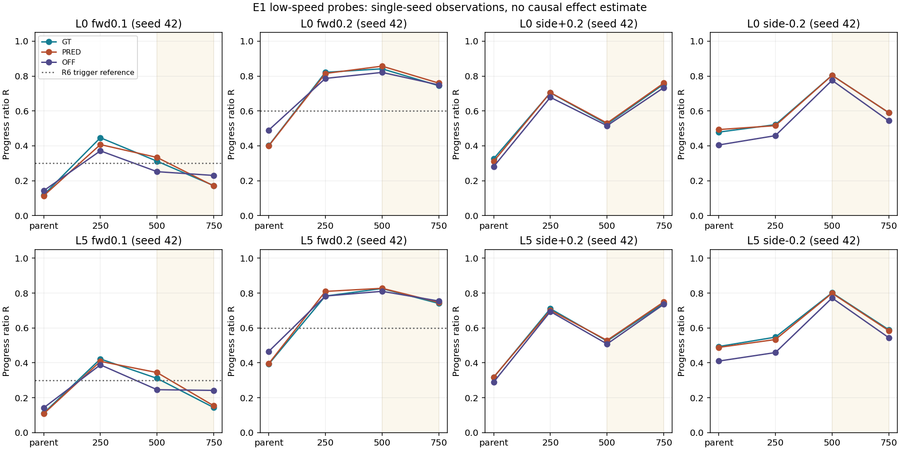
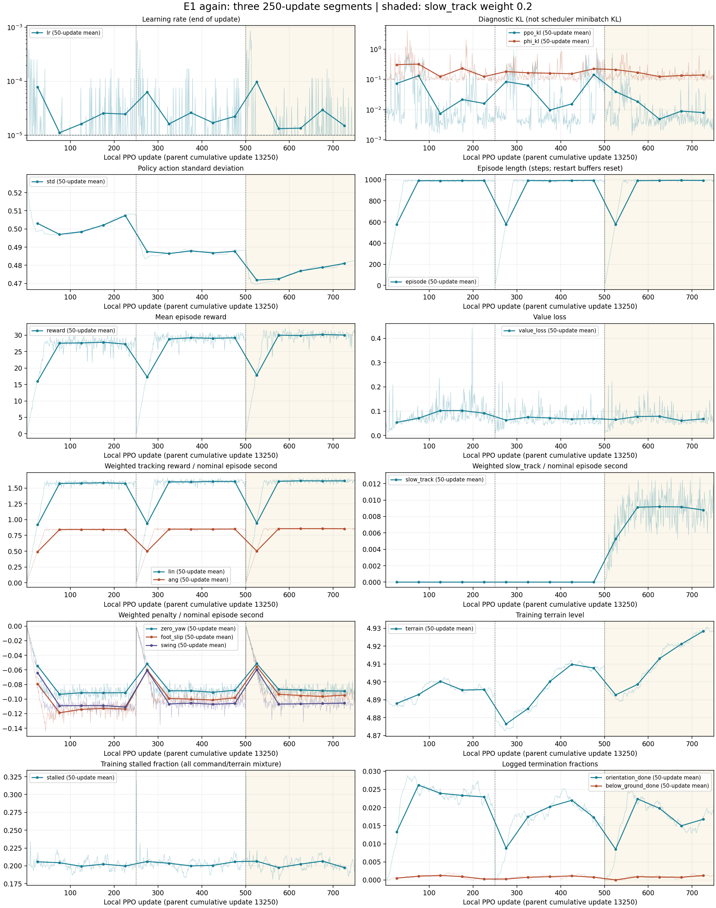

# E1 다시 학습 m750: 저속 보행과 유지 능력

> 분류: A/평가
> 작성: analyst-lx · 2026-11-14 01:12
> 근거: lead 00:56 · 원자료 TensorBoard 1~750 · m250/m500/m750 P1 · #802 기록 판독
> 요지: 전진 저속은 직전보다 낮아졌고, 옆걸음은 좌우가 엇갈렸다. 기존 유지와 지도 끔 생존은 통과했다.
> 상태: CPU 원자료 대조 완료 · 현재 시험 구간 기록 · 설정 적용 없음
> 판: v1.0

**실측:** slow_track 가중을 켠 뒤의 m750에서 GT·PRED × L0/L5 × 전진 0.1/0.2 **8/8칸 모두 m500보다 진행 비율이 낮아졌다.** 옆 +0.2는 높아졌고 옆 −0.2는 낮아졌다. 따라서 이번 경계는 느린 보행이 전반적으로 좋아졌다는 증거가 아니다.

**실측:** 기존 유지 GT·PRED는 PASS, 지도 끔 생존 감시 21칸은 모두 64/64다. 서 있기 성공도 지도 셋 모두 64/64다. 저속 전진에서 주로 드러난 문제는 넘어짐보다 **명령을 받고도 거의 나아가지 않음**이다.

**추론 한계:** m500 이후 slow_track=0을 그대로 둔 동시 대조군이 없다. 보상·명령 영수증상 바뀐 보상은 slow_track 하나지만 이어 학습·리셋·정책의 자연 변동까지 분리한 인과 효과가 아니다. 이 구간에서 해당 처방의 이득이 입증되지 않았다고 말할 수 있다.

## 조건과 출처

L0는 여기서 평지가 아니라 연속 지형 묶음의 레벨 0이다. map64·저속·Y1 비교는 seed42·64 env·300 step(6초), 같은 메시·열 배치·고정 마찰의 칸별 비교다. 별도 평지 서기는 3초 중 첫1초를 빼며, D44는 그 영수증의 별도 시간 계약이다. 부모는 지정된 P1 예행 m13250이며, 오래된 별도 G1b 자료로 바꿔 넣지 않았다. 부모의 실행 plan은 달라도 평가 칸의 비교 fingerprint는 일치한다.

| 저장본 | 체크포인트 SHA256 | 기존 유지 | 전체 졸업 |
| --- | --- | --- | --- |
| 부모 m13250 | 680c820b73646d9c11f62f184fd35e6cc096ffd04681951d542b2b4b472d779e | PASS | FAIL |
| m250 | 763a1eae9947385164b9606b8c60dd392747e3d540b8b448b86b2eb877bcf374 | PASS | FAIL |
| m500 | b5e19ae26f3b6dee7bd224b1611a6506e37ab339a10237e76233122a0820f8dc | PASS | FAIL |
| m750 | 6578d6b712401d8219b4ae8d9ea5371d7b4b2e5ddf76b2402a1230e805854d82 | PASS | FAIL |

현재 학습 plan SHA: `9087bf55ae913045a4e2c0268411b21aeed7351b6a871f59a0606160df55acf4`. 평가 메시 SHA: `88197b3adfdde327edc633c025c6ad9aa690ea59aa7df5d51d548f7f56c12a95`.

학습 1~250·251~500·501~750은 서로 다른 tfevents 세 파일이다. 각 파일에 250회, 전체 750회이며 중복 0·누락 0이다. 두 rank의 보상 영수증은 일치한다. b1→b2는 명령 슬롯·범위·low_forward_fraction=0.4가 같고 slow_track만 0→0.2다. 첫 구간 보상은 초기 manifest/plan 근거이고 별도 실시간 RewardManager 영수증은 없다는 한계를 보존한다.

## 목표 명령별 변화

각 칸은 **부모 → m250 → m500 → m750**. R은 시작 64 env 각각의 예정된 전체 6초 명령 거리 대비 진행 비율의 중앙값이다. 전진은 NPZ 몸앞 vx 적분, 옆은 JSON의 명령 방향 투영거리로 계산한다. 사망한 env를 분모에서 빼지 않는다.

| 레벨·명령 | GT R | PRED R | 지도 끔 R |
| --- | --- | --- | --- |
| L0 fwd0.1 | 0.119 → 0.447 → 0.312 → 0.172 | 0.114 → 0.407 → 0.334 → 0.170 | 0.143 → 0.371 → 0.252 → 0.230 |
| L0 fwd0.2 | 0.401 → 0.821 → 0.842 → 0.745 | 0.400 → 0.815 → 0.857 → 0.760 | 0.490 → 0.787 → 0.821 → 0.749 |
| L0 side+0.2 | 0.326 → 0.704 → 0.525 → 0.754 | 0.311 → 0.705 → 0.531 → 0.760 | 0.281 → 0.678 → 0.516 → 0.734 |
| L0 side-0.2 | 0.479 → 0.522 → 0.804 → 0.590 | 0.493 → 0.516 → 0.804 → 0.591 | 0.405 → 0.458 → 0.776 → 0.544 |
| L5 fwd0.1 | 0.112 → 0.422 → 0.311 → 0.144 | 0.108 → 0.409 → 0.344 → 0.154 | 0.142 → 0.389 → 0.246 → 0.242 |
| L5 fwd0.2 | 0.392 → 0.783 → 0.826 → 0.741 | 0.395 → 0.810 → 0.827 → 0.747 | 0.465 → 0.783 → 0.810 → 0.755 |
| L5 side+0.2 | 0.317 → 0.711 → 0.525 → 0.742 | 0.318 → 0.702 → 0.529 → 0.749 | 0.290 → 0.694 → 0.508 → 0.735 |
| L5 side-0.2 | 0.494 → 0.547 → 0.802 → 0.590 | 0.489 → 0.534 → 0.799 → 0.585 | 0.410 → 0.459 → 0.772 → 0.544 |



m500에는 seed42·7·13 반복이 이미 있다. seed·체크포인트·명령·지형 배치·DR 조건을 대조하고 NPZ를 재계산했다. 아래는 그 **관측 범위**이며 신뢰구간이 아니다. m750 seed42의 전진 여덟 칸은 모두 m500 세 시드 최솟값보다 낮다. 다만 m750의 seed7·13이 없어 양쪽의 같은 시드 반복 효과를 확정할 수 없다.

| 칸 | m500 seed42 / 7 / 13 | m500 범위 | 범위 폭 | m750 seed42 | 이전 범위 대비 |
| --- | --- | --- | --- | --- | --- |
| L0 fwd0.1 GT | 0.3120 / 0.2566 / 0.2816 | 0.2566~0.3120 | 0.0554 | 0.1721 | 아래 |
| L0 fwd0.1 PRED | 0.3336 / 0.2663 / 0.2785 | 0.2663~0.3336 | 0.0673 | 0.1701 | 아래 |
| L0 fwd0.2 GT | 0.8416 / 0.8367 / 0.8404 | 0.8367~0.8416 | 0.0049 | 0.7448 | 아래 |
| L0 fwd0.2 PRED | 0.8569 / 0.8639 / 0.8582 | 0.8569~0.8639 | 0.0070 | 0.7598 | 아래 |
| L5 fwd0.1 GT | 0.3111 / 0.2292 / 0.2858 | 0.2292~0.3111 | 0.0819 | 0.1439 | 아래 |
| L5 fwd0.1 PRED | 0.3445 / 0.2485 / 0.2856 | 0.2485~0.3445 | 0.0960 | 0.1540 | 아래 |
| L5 fwd0.2 GT | 0.8259 / 0.8226 / 0.8117 | 0.8117~0.8259 | 0.0142 | 0.7405 | 아래 |
| L5 fwd0.2 PRED | 0.8274 / 0.8388 / 0.8400 | 0.8274~0.8400 | 0.0126 | 0.7470 | 아래 |

전진 0.1 정체 수는 2~4초 몸앞 속도 평균 <0.05 m/s인 env 수다. 이 구간의 모든 전진 env가 생존하므로 사망 때문에 생긴 정체 수가 아니다.

| 레벨 | GT m500 → m750 | PRED m500 → m750 | 끔 m500 → m750 |
| --- | --- | --- | --- |
| L0 | 51 → 63 /64 | 50 → 62 /64 | 62 → 60 /64 |
| L5 | 48 → 62 /64 | 49 → 61 /64 | 62 → 61 /64 |

## 기존 능력과 머리 방향

아래는 m750 유지 13명령. 각 칸은 **생존 수 / vx·vy·wz 절댓값 오차 중앙값**이다. 속도 오차는 m/s, yaw rate 오차는 rad/s. 생존은 시작 64개 분모다. 원래 유지표 PASS가 모든 기술의 향상을 뜻하지는 않는다.

| 명령 | GT: 생존 / vx·vy·wz | PRED: 생존 / vx·vy·wz | 끔: 생존 / vx·vy·wz |
| --- | --- | --- | --- |
| fwd0.5 | 64/64 / 0.051·0.030·0.069 | 64/64 / 0.049·0.030·0.070 | 64/64 / 0.048·0.031·0.072 |
| fwd1.0 | 64/64 / 0.079·0.038·0.078 | 64/64 / 0.079·0.038·0.079 | 64/64 / 0.078·0.041·0.082 |
| spin+1.2 | 64/64 / 0.045·0.036·0.081 | 64/64 / 0.046·0.037·0.081 | 64/64 / 0.051·0.037·0.082 |
| spin-1.2 | 64/64 / 0.032·0.028·0.086 | 64/64 / 0.032·0.029·0.085 | 64/64 / 0.036·0.032·0.088 |
| back0.5 | 64/64 / 0.057·0.032·0.075 | 64/64 / 0.057·0.032·0.075 | 64/64 / 0.060·0.033·0.074 |
| back1.0 | 64/64 / 0.108·0.045·0.085 | 64/64 / 0.109·0.046·0.087 | 64/64 / 0.111·0.055·0.088 |
| side+0.5 | 64/64 / 0.039·0.089·0.076 | 64/64 / 0.041·0.086·0.078 | 64/64 / 0.050·0.069·0.078 |
| side-0.5 | 64/64 / 0.045·0.088·0.085 | 64/64 / 0.044·0.086·0.085 | 64/64 / 0.050·0.079·0.089 |
| diag-fwd+side+ | 64/64 / 0.053·0.058·0.088 | 64/64 / 0.053·0.054·0.089 | 64/64 / 0.053·0.052·0.087 |
| diag-fwd+side- | 64/64 / 0.053·0.059·0.083 | 64/64 / 0.052·0.056·0.085 | 64/64 / 0.054·0.054·0.090 |
| diag-back+side+ | 64/64 / 0.067·0.093·0.085 | 64/64 / 0.068·0.092·0.086 | 64/64 / 0.079·0.068·0.085 |
| diag-back+side- | 64/64 / 0.077·0.100·0.085 | 64/64 / 0.086·0.098·0.087 | 64/64 / 0.092·0.090·0.090 |
| stop | 64/64 / 0.019·0.016·0.067 | 64/64 / 0.019·0.016·0.066 | 64/64 / 0.019·0.016·0.067 |

Y1은 각 env 마지막 생존 시점까지 순 yaw 변화 절댓값의 중앙값·p90이다. 아래는 m500→m750, 단위 rad. 회전의 부호가 다른 env끼리 상쇄하는 계산을 하지 않는다.

| 명령 | GT 중앙값 / p90 | PRED 중앙값 / p90 | 끔 중앙값 / p90 |
| --- | --- | --- | --- |
| fwd0.5 | 0.056→0.060 / 0.127→0.136 | 0.055→0.064 / 0.144→0.131 | 0.049→0.058 / 0.121→0.124 |
| fwd1.0 | 0.063→0.049 / 0.122→0.096 | 0.074→0.051 / 0.129→0.112 | 0.083→0.058 / 0.156→0.130 |

D44 성공 수(기존 영수증 기준). 회전 네 칸은 판정, 정지→재출발은 현재 출구의 기록 칸이다.

| D44 칸 | m250 | m500 | m750 | m750 생존 |
| --- | --- | --- | --- | --- |
| turn_left_eval_gt | 64/64 | 64/64 | 64/64 | 64/64 |
| turn_left_eval_pred | 64/64 | 64/64 | 64/64 | 64/64 |
| turn_right_eval_gt | 64/64 | 64/64 | 64/64 | 64/64 |
| turn_right_eval_pred | 64/64 | 64/64 | 64/64 | 64/64 |
| stop_restart_eval_gt | 32/64 | 64/64 | 42/64 | 64/64 |
| stop_restart_eval_pred | 42/64 | 63/64 | 34/64 | 64/64 |

지도 끔 감시 21칸의 실제 수:

| 칸 | m500 생존 | m750 생존 | 분모 |
| --- | --- | --- | --- |
| map64/fwd0.5 | 64 | 64 | 64 |
| map64/fwd1.0 | 64 | 64 | 64 |
| map64/spin+1.2 | 64 | 64 | 64 |
| map64/spin-1.2 | 64 | 64 | 64 |
| map64/back0.5 | 64 | 64 | 64 |
| map64/back1.0 | 63 | 64 | 64 |
| map64/side+0.5 | 64 | 64 | 64 |
| map64/side-0.5 | 64 | 64 | 64 |
| map64/diag-fwd+side+ | 64 | 64 | 64 |
| map64/diag-fwd+side- | 64 | 64 | 64 |
| map64/diag-back+side+ | 64 | 64 | 64 |
| map64/diag-back+side- | 64 | 64 | 64 |
| map64/stop | 64 | 64 | 64 |
| e1_v2/L0/fwd0.1 | 64 | 64 | 64 |
| e1_v2/L0/fwd0.2 | 64 | 64 | 64 |
| e1_v2/L0/side+0.2 | 64 | 64 | 64 |
| e1_v2/L0/side-0.2 | 64 | 64 | 64 |
| e1_v2/L0/side+0.4 | 64 | 64 | 64 |
| e1_v2/L0/side-0.4 | 64 | 64 | 64 |
| e1_v2/L5/fwd0.1 | 64 | 64 | 64 |
| e1_v2/L5/fwd0.2 | 64 | 64 | 64 |

## 학습 곡선



LR 바닥은 **각 PPO update 끝의 값**이 1e-5인 횟수다. 미니배치 시간의 비중이 아니다. PPO·지각 진단 KL은 scheduler가 각 미니배치에서 쓴 실제 KL과 다르다. #806 장치는 후속 실행을 위한 것이며 이번 곡선에서 미니배치 원인을 실측했다고 쓰지 않는다.

| 학습 구간 | LR 바닥 횟수 | PPO 진단 KL>0.02 | action std 평균 | 평균 에피소드 steps | 보상/step 평균 | slow_track 로그 평균 |
| --- | --- | --- | --- | --- | --- | --- |
| 1~250 | 193/250 | 67 | 0.5016 | 908.1 | 0.02782 | 0.000000 |
| 251~500 | 195/250 | 88 | 0.4873 | 909.3 | 0.02943 | 0.000000 |
| 501~750 | 200/250 | 32 | 0.4762 | 909.8 | 0.03042 | 0.008305 |

첫 업데이트의 에피소드 합·길이 버퍼는 재시작마다 비워진다. 251·501 근처의 합 보상·에피소드 길이 급락을 보행 붕괴로 읽지 않는다. 보상/step은 매 update의 평균 에피소드 보상÷평균 길이를 계산한 뒤 창 평균이며, 전체 rollout을 가중 합친 평균과는 다르다. 각 보상 항은 `RewardManager`의 가중치·dt가 들어간 에피소드 누계를 최대 에피소드 초로 나눈 값이다.

50회 저장본 단위 전체 표: [CURVES-50.md](CURVES-50.md). 원 숫자: [windows50.csv](windows50.csv), [scalars.csv](scalars.csv). 보상 항 상승과 느린 전진 개선을 같은 뜻으로 취급하지 않는다.

## #802 기록 판독

실제 출력: `OBSERVE · UNCHANGED`. `apply_ready=false`, 조정 payload 없음. GT/PRED 여덟 전진 칸이 모두 비증가라 R6 증량 후보가 되지만, side−0.4가 처방 직전 m500 대비 GT/PRED·L0/L5에서 모두 0.05 넘게 내려 증량은 보류된다. 보상 변경 뒤 관측은 한 경계뿐이므로 두 경계 되돌림을 완성했다고 세지 않는다.

이 run은 시험 구간이다. `--effective-from 1000`으로 실행했으며 m750에 새 승인표를 소급 적용하지 않았다. 새 표를 반사실로 걸면 C1 소비/자료 미완비 때문에 EVIDENCE_HOLD이며, 이것이 실제 m750 운영 중단 명령은 아니다. 이번 코드 실행은 GPU·학습·운영 원장·설정을 바꾸지 않았다.

## 기준 의심 여섯 칸

| 검토 축 | 실측 또는 공백 | 해석과 다음 판단의 한계 |
| --- | --- | --- |
| 목표 대비 | 전진 GT/PRED 8칸 모두 m500 대비 하락. 전진0.1은 4칸 모두 R<0.3, 전진0.2는 4칸 모두 R>0.6. | 0.2가 문턱을 넘은 것과 처방 뒤 개선된 것은 다르다. 다음 실행의 기준을 결과에 맞춰 낮추지 않는다. |
| 곡선 | 보상/step 평균 0.02943→0.03042; slow_track 로그는 0→0.008305. | 전체 env·명령 평균의 상승이 저속 전진 개선을 가린다. 항이 실제로 켜진 것은 확인되지만 어떤 명령에서 보상/gradient를 벌었는지는 이 로그로 분리하지 못한다. |
| 세 지도 대조 | GT·PRED 전진 및 옆의 변화 방향이 일치. 지도 끔은 생존 21칸 모두64이며 전진0.1 하락 폭은 더 작다. | PRED만의 실패가 아니다. 우선 정책·명령별 보상 경쟁을 점검할 근거지만, 지도 경로가 원인에서 제외됐다는 증명도 아니다. |
| 구간 중간 | L0 GT 전진0.1 R 0.447→0.312→0.172. | slow_track를 켜기 전부터 하락했다. 저장본은50회마다 있어도 중간 저장본의 같은 저속 시험지는 없다. 하락 시점·지속을 곡선만으로 확정하지 않는다. |
| 규칙이 못 보는 칸 | 기존 유지13은 통과하지만0.1은 거의 정체. 옆+0.2 상승·−0.2 하락이 서로 가려질 수 있다. C1/L9·새 접촉 원자료 미확인. | 방향별 값을 합치지 않는다. 유지 PASS를 보행 위상·발 끌림 전체 PASS로 확대하지 않는다. 새 R5 접촉 근거를 만들어 채우지 않는다. |
| 기준 자체 | m500 전진0.1 세 시드 관측 폭은 위 표처럼 과거 R 반복폭0.007보다 크다. m750은 seed42만 있다. | 과거m2000 반복폭은 현재정책의 잡음 상한이나 신뢰구간이 아니다. m750 여덟 전진 값은 m500 세 시드 최솟값 아래지만, 양쪽 반복과 동시 대조군 없이 보상 인과·일반화를 확정하지 않는다. 등록 문턱을 이 결과에 맞춰 바꾸지는 않는다. |

## 재현과 검증

독립 확인: 알려진 입력에서 6초 중3초만 움직인 R=0.5를 확인했고, m250/m500/m750의 전진 NPZ36칸과 m500 seed7·13의24칸을 합쳐 **60칸**을 다른 집계 함수로 다시 계산해 #802 값과 차이 <1e-12였다. 이벤트 중복의 최신 wall_time 선택·같은시각 값 충돌 거절·빠진 회차 거절 시험도 통과했다.

원자료별 경로·SHA·조건·정밀 숫자는 [EVIDENCE.json](EVIDENCE.json), [independent_checks.json](independent_checks.json), [curves_summary.json](curves_summary.json)에 있다. 큰 NPZ·TensorBoard 원본은 운영 자료에서 읽기만 하고, 이벤트 바이트 사본은 아래 scratch에 보존했다.

분석 scratch: `/home/jay/mai/tmp/analyst/e1-m750-review-1114`. #802 원본 출력: `/home/jay/mai/tmp/analyst/e1-m750-review-1114/m750/REPORT.md`.

코드 근거: [boundary_read.py](../../20261113-analysis/e1-boundary-rules/boundary_read.py) 101~230행(칸·생존·정체·yaw 재계산), 271~344행(처방 영수증), [boundary_approved.py](../../20261113-analysis/e1-boundary-rules/boundary_approved.py) 9~30행(끔 생존), 97행 이후(적용 경계). 보상 로그 정의는 `/home/jay/mai/projects/IsaacLab/source/isaaclab/isaaclab/managers/reward_manager.py:116`·`:150`, 재시작 버퍼는 실행 고정 사본의 `foothold_s2/runners/start_runner.py` `learn()` 시작부다.

```bash
CUDA_VISIBLE_DEVICES='' PYTHONDONTWRITEBYTECODE=1 OMP_NUM_THREADS=2 /home/jay/miniforge3/envs/isaac311/bin/python -B inbox/jay/20261114-analysis/e1-m750/curves.py --out /home/jay/mai/tmp/analyst/e1-m750-review-1114/curves
CUDA_VISIBLE_DEVICES='' PYTHONDONTWRITEBYTECODE=1 OMP_NUM_THREADS=2 /home/jay/miniforge3/envs/isaac311/bin/python -B inbox/jay/20261113-analysis/e1-boundary-rules/boundary_read.py --score /home/jay/data/foothold/s2_lab/ex42_main_20261113_174400/main/EX-42-B-E1-again_20261113_174400/eval/scores/m750/ex42_score.json --out /home/jay/mai/tmp/analyst/e1-m750-review-1114/m750 --effective-from 1000
CUDA_VISIBLE_DEVICES='' PYTHONDONTWRITEBYTECODE=1 OMP_NUM_THREADS=2 /home/jay/miniforge3/envs/isaac311/bin/python -B inbox/jay/20261114-analysis/e1-m750/report.py --scratch /home/jay/mai/tmp/analyst/e1-m750-review-1114 --out inbox/jay/20261114-analysis/e1-m750
```

| 판 | 내용 |
|---|---|
| v1.0 | 세 구간 곡선과 m750 기록 판독, 여섯 검토 축 |
