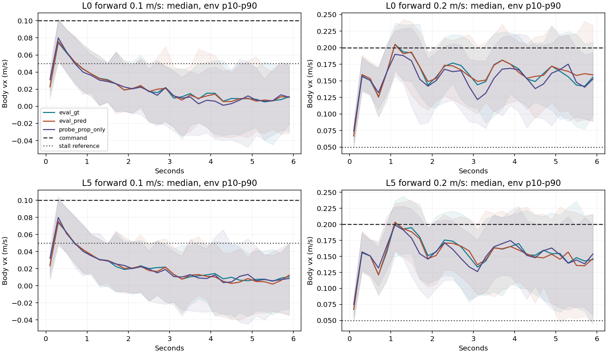
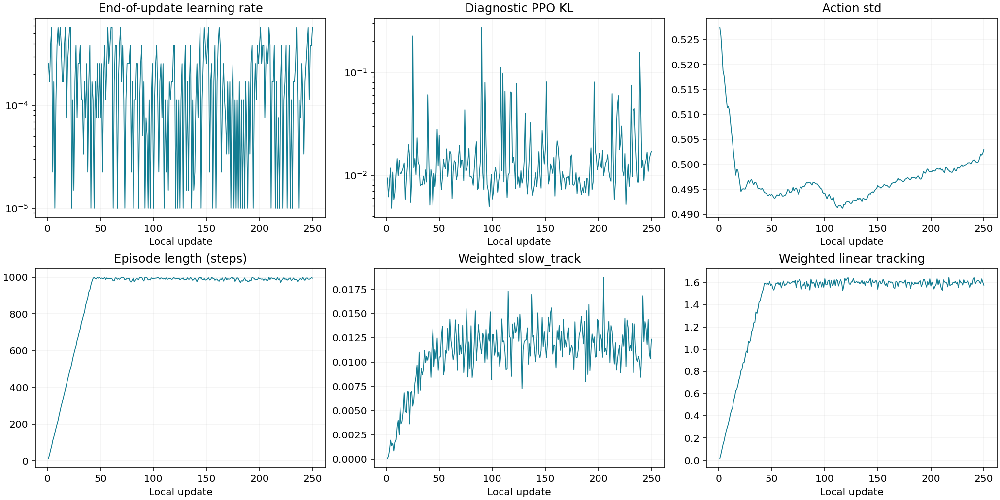

# v27 m250: 0.1 m/s는 늦게 출발하기보다 처음 움직인 뒤 정체한다

> 분류: A/평가
> 작성: analyst-lx · 2026-11-14 05:09
> 근거: lead 04:56 · #812 · m250 P1/NPZ · 학습 1~250 실시간 기록과 TensorBoard
> 요지: 학습 표본 평균과 결정 행동 평가가 다르며, 0.1 m/s는 세 지도 모두 후반 정체한다.
> 상태: CPU 원자료 대조 완료 · 발 접촉은 해당 칸 미측정 · 학습·GPU 변경 없음
> 판: v1.0

**확인됨:** 0.1 m/s 평가에서 처음 1초보다 끝 1초의 속도가 낮다. 단순히 출발을 기다리는 동안 평균이 낮아진 모양이 아니다. 첫 1초를 빼면 진행 비율 R도 더 낮아진다. 반면 0.2 m/s는 첫 1초 뒤 속도를 유지한다. 모두 생존했으므로 여기서 정체는 넘어짐과 다르다.

**확인됨:** 학습의 0.8은 0.1~0.15 m/s의 여러 명령·지형·진행 상태에서 표집한 행동으로 얻은 env-step 평균이다. 평가 0.17은 정확히 0.1 m/s를 고정하고 평균 행동으로 6초 움직인 환경별 진행 비율의 중앙값이다. 계산과 조건이 함께 다르다. 평가도 평균으로 바꾸면 GT R=0.218에 불과하므로 평균/중앙값 차이만으로 0.8을 설명하지 못한다.

**추정:** 탐색 잡음이 있는 행동과 결정 행동의 차이, 정확히 0.1과 0.1~0.15의 차이, 정지 상태에서 출발하는 능력과 이미 걷는 상태에서 감속하는 능력이 원인 후보다. 이 자료만으로 어느 하나를 확정하지 않는다. lead 05:02 의뢰에 따라 m500에서 행동 표집만 바꾸는 별도 진단을 준비한다.

## 첫 경계 판독과 출처

체크포인트 SHA `b33b9f004f700f7b5b0311bbadb1dfe3ed8962f856805ef3439391ff88086b76`. 실행 plan SHA `794e4602a04013897f146d2bf3f9527c03137647a3b3c76dfe52f9c5335315cb`. 메시 SHA `88197b3adfdde327edc633c025c6ad9aa690ea59aa7df5d51d548f7f56c12a95`. seed42와 반복 seed7·13, 각 64 env·300 step·dt0.02 s다. L0는 평지 단독이 아니라 연속7종 레벨0이다.

형식뿐 아니라 manifest 체크포인트, startup plan, P1 평가 plan, NPZ checkpoint·seed·배치 SHA·생존·속도 적분을 대조했다. 전진 원자료 36칸 재계산. 알려진 늦은 출발·감속·정지·중간 종료·종료 후 재등장 입력으로 계산기를 먼저 시험했다.

| 항목 | 이번 값 | 뜻 |
| --- | --- | --- |
| #812 내림 비교 | BASELINE_ONLY | 새 run 첫 m250. 이전 최고 경계가 없어 내림 판정을 내리지 않음 |
| 기존 유지 13명령 × GT/PRED | PASS | 저속 능력 졸업과 별개 |
| 지도 끔 연속 21칸 | 21/21칸 생존 64/64 | 생존 하한60/64 통과. 끔 저속 추종 성공이라는 뜻은 아님 |
| E1 v2 전체 졸업 | FAIL | 첫 두 창 미확보와 개별 미달을 함께 보존 |
| D44 좌우 회전 × GT/PRED | 4/4칸 성공64/64 | 정지→재출발은 GT36/64·PRED46/64로 별도 기록 |
| 발 접촉 | 미측정 | e1_v2 NPZ 36개에 힘·접촉·발 높이 키가 없음 |

**도구 사용 한계:** 요청한 `boundary_read.py --effective-from 250`은 옛 처방의 보상 키 목록을 v27과 비교해 `plan/manifest reward keys mismatch`를 낸다. 이 예외 뒤 체크포인트·부모 조회 값이 비어 추가 오류가 붙으므로 실제 체크포인트 불일치로 해석하면 안 된다. standalone `boundary_demote.py`는 임시 `eval_policy` 경로를 코드 루트로 추정해 D44 파일을 못 찾았다. 오류 원문은 아래 부록에 보존한다. 운영 파일을 고치거나 검사를 생략하지 않고, **#812의 `read_review(..., audits={250: read_audit(..., c1_code_root=고정v27)})` 공개 함수를 호출**해 동일 원자료 검증을 완료했다. 그 결과만 `BASELINE_ONLY`로 보고한다. 옛 R6 처방 초안은 사용하지 않는다.

[내림 표](boundary/DEMOTE.md) · [검증 원문](boundary/demotion.json) · [생성기](../analyze.py) · [출처 SHA](EVIDENCE.json)

## 6초 속도: 후반에 움직임이 살아나는가

각 1초 구간의 env별 몸앞 vx 평균을 구한 뒤 64개 중앙값. 단위 m/s. 끝 정체는 5~6초 평균 vx<0.05인 수, 기존 정체 수는 2~4초 평균 vx<0.05인 수다. 시간 구간이 다른 두 수를 섞지 않는다.

| 레벨·명령·지도 | 0~1 | 1~2 | 2~3 | 3~4 | 4~5 | 5~6 | 정체 2~4초 | 정체 5~6초 |
| --- | --- | --- | --- | --- | --- | --- | --- | --- |
| L0 0.1 GT | 0.0518 | 0.0285 | 0.0166 | 0.0105 | 0.0066 | 0.0078 | 60/64 | 62/64 |
| L0 0.1 PRED | 0.0525 | 0.0288 | 0.0174 | 0.0098 | 0.0072 | 0.0057 | 61/64 | 62/64 |
| L0 0.1 지도 끔 | 0.0529 | 0.0289 | 0.0154 | 0.0056 | 0.0035 | 0.0056 | 61/64 | 63/64 |
| L0 0.2 GT | 0.1303 | 0.1828 | 0.1675 | 0.1634 | 0.1634 | 0.1561 | 0/64 | 0/64 |
| L0 0.2 PRED | 0.1332 | 0.1826 | 0.1650 | 0.1667 | 0.1655 | 0.1619 | 0/64 | 0/64 |
| L0 0.2 지도 끔 | 0.1379 | 0.1712 | 0.1597 | 0.1501 | 0.1551 | 0.1550 | 1/64 | 2/64 |
| L5 0.1 GT | 0.0508 | 0.0275 | 0.0189 | 0.0105 | 0.0059 | 0.0082 | 59/64 | 62/64 |
| L5 0.1 PRED | 0.0512 | 0.0270 | 0.0179 | 0.0107 | 0.0051 | 0.0033 | 58/64 | 61/64 |
| L5 0.1 지도 끔 | 0.0529 | 0.0293 | 0.0164 | 0.0085 | 0.0041 | 0.0053 | 60/64 | 62/64 |
| L5 0.2 GT | 0.1273 | 0.1828 | 0.1680 | 0.1551 | 0.1619 | 0.1519 | 0/64 | 4/64 |
| L5 0.2 PRED | 0.1296 | 0.1820 | 0.1657 | 0.1561 | 0.1662 | 0.1502 | 0/64 | 3/64 |
| L5 0.2 지도 끔 | 0.1378 | 0.1718 | 0.1557 | 0.1512 | 0.1587 | 0.1492 | 0/64 | 2/64 |



그림의 선은 0.2초 구간 평균 속도의 환경 중앙값, 띠는 환경10~90백분위다. 시드 반복 신뢰구간이 아니다. 초기 움직임을 발을 번갈아 딛는 보행이라고 단정할 접촉 자료는 없다.

| L0 지도·명령 | 6초 R 중앙값 | 6초 R 평균 | 첫1초 제외 R | 초반·후반 모두 정체 | 초반 이동→후반 정체 | 초반 정체→후반 이동 | 양쪽 이동 |
| --- | --- | --- | --- | --- | --- | --- | --- |
| GT 0.1 | 0.1737 | 0.2178 | 0.1091 | 52/64 | 9/64 | 1/64 | 2/64 |
| PRED 0.1 | 0.1705 | 0.2226 | 0.1115 | 52/64 | 8/64 | 2/64 | 2/64 |
| 지도 끔 0.1 | 0.1626 | 0.2001 | 0.0945 | 51/64 | 9/64 | 3/64 | 1/64 |
| GT 0.2 | 0.7908 | 0.7989 | 0.8244 | 0/64 | 0/64 | 0/64 | 64/64 |
| PRED 0.2 | 0.8055 | 0.8044 | 0.8318 | 0/64 | 0/64 | 0/64 | 64/64 |
| 지도 끔 0.2 | 0.7628 | 0.7546 | 0.7813 | 0/64 | 2/64 | 0/64 | 62/64 |

위 분류는 **설명용**이다. 초반0~2초·후반4~6초의 평균 vx가 기존 정체 문턱0.05보다 작은지를 쓴다. 새 승급 기준이 아니다. L0 0.1에서 늦게 이동하기 시작한 수는 GT1·PRED2·끔3/64에 그친다. 속도가 0.05 이상인 상태가 연속0.5초도 없는 env는 GT40·PRED39·끔41/64다. 따라서 집단의 낮은 R을 대부분 늦은 출발 탓으로 돌릴 수 없다.

## 세 지도와 반복 시드

| 레벨·명령 | GT seed42 R / 부모 | PRED seed42 R / 부모 | 끔 seed42 R / 부모 |
| --- | --- | --- | --- |
| L0 0.1 | 0.1737 / 0.1188 | 0.1705 / 0.1140 | 0.1626 / 0.1429 |
| L0 0.2 | 0.7908 / 0.4014 | 0.8055 / 0.3996 | 0.7628 / 0.4900 |
| L5 0.1 | 0.1682 / 0.1118 | 0.1606 / 0.1082 | 0.1693 / 0.1422 |
| L5 0.2 | 0.7709 / 0.3924 | 0.7773 / 0.3952 | 0.7677 / 0.4652 |

부모는 같은 P1 예행의 m13250 체크포인트다. parent source SHA를 재확인했다. 아래는 현재 m250의 세 시드 관측 범위이며, 통계적 신뢰구간이나 모든 난수에서의 보증이 아니다.

| 레벨·명령·지도 | seed42 / 7 / 13 R | 관측 최소~최대 |
| --- | --- | --- |
| L0 0.1 GT | 0.1737 / 0.1772 / 0.1687 | 0.1687~0.1772 |
| L0 0.1 PRED | 0.1705 / 0.1704 / 0.1658 | 0.1658~0.1705 |
| L0 0.1 지도 끔 | 0.1626 / 0.1600 / 0.1772 | 0.1600~0.1772 |
| L0 0.2 GT | 0.7908 / 0.8177 / 0.8002 | 0.7908~0.8177 |
| L0 0.2 PRED | 0.8055 / 0.8068 / 0.7990 | 0.7990~0.8068 |
| L0 0.2 지도 끔 | 0.7628 / 0.7608 / 0.7732 | 0.7608~0.7732 |
| L5 0.1 GT | 0.1682 / 0.1734 / 0.1681 | 0.1681~0.1734 |
| L5 0.1 PRED | 0.1606 / 0.1676 / 0.1750 | 0.1606~0.1750 |
| L5 0.1 지도 끔 | 0.1693 / 0.1555 / 0.1664 | 0.1555~0.1693 |
| L5 0.2 GT | 0.7709 / 0.7862 / 0.7632 | 0.7632~0.7862 |
| L5 0.2 PRED | 0.7773 / 0.7850 / 0.7654 | 0.7654~0.7850 |
| L5 0.2 지도 끔 | 0.7677 / 0.7736 / 0.7734 | 0.7677~0.7736 |

**추론:** GT를 줘도 0.1 정체가 남고 지도 끔도 비슷하다. 복원 지도 오류만으로 설명하기 어렵다. 지도가 불필요하거나 신경망이 고장났다는 증거는 아니다. .1에서 정체하면서 .2에서 지속 이동하는 명령 크기 의존성을 먼저 분리해야 한다.

## 학습의 0.8과 평가의 0.17이 다른 이유

| 모드 | 학습231~250: 0.1~0.15 비율 평균 | env-step 수 | 학습 수평 속력<0.05 비율 | 평가 L0 정확히0.1 R 중앙값 / 평균 |
| --- | --- | --- | --- | --- |
| GT | 0.7852 | 16615 | 9.47% | 0.1737 / 0.2178 |
| PRED | 0.8209 | 41059 | 9.07% | 0.1705 / 0.2226 |
| 지도 끔 | 0.8530 | 7167 | 7.53% | 0.1626 / 0.2001 |

| 차이 | 학습 | 평가 | 확인 수준 |
| --- | --- | --- | --- |
| 행동 | 정책 정규분포에서 표집 | 정책 평균 행동 | 코드: StartRunner:686·rsl_rl ActorCritic:148~161·eval_map_modes:557 |
| 잠재 지각값 | 지각 rollout 설정에 따름 | z_mode=mean | 코드: StartRunner:679·adapters:474. 행동 효과와 지각 표집 효과를 구분 필요 |
| 명령 | 0.1 이상0.15 미만 연속 표본, 같은 forward 슬롯의 heading도 포함 | 정확히0.1, heading 끔, 매 step 같은 명령 | 코드: live_metrics:175~213·eval_map_modes:550~598 |
| 진행 상태 | 20초 에피소드 도중4초 재표본, 직전 명령·움직임이 섞임 | 명령별 env/지각 reset 뒤6초 | 코드: params/env.yaml·eval_map_modes:488~558 |
| 집계 | 살아 있는 env-step의 vx/command 평균. 서로 독립인 로봇 표본 수가 아님 | 시작64개 전체예정6초 적분 R의 중앙값 | 코드: live_metrics:193~213·ex42_e1_v2:63~110 |
| 정체 | 각 step의 수평 속력 norm(vx,vy)<0.05 | 2~4초 몸앞 vx 평균<0.05 | 코드: live_metrics:191·eval_map_modes:633 이후 |
| 지형·DR | 학습 지형 레벨 혼합·학습 DR | L0/L5 고정·DR 끔·마찰0.8/0.6 | 실행 설정·평가 영수증 |
| 정책 시각 | 231~250 여러 업데이트의 수집 정책. m250 수집은 그 PPO 갱신 전 | m250 저장 가중치 한 벌 | 코드/실측. 완전히 같은 가중치의 짝 비교 아님 |

느린 forward 전체(0.1~0.3) 활성 표본 중 heading 몫은 마지막20회 GT 30.3%·PRED 30.0%다. 0.1~0.15만의 heading별 값은 저장되지 않아 그 차이를 수치로 제거할 수 없다. 학습 비율은 과속을1로 자르지 않으므로 일부 큰 값이 평균을 끌어올렸는지도 현재 합계 로그만으로는 분포까지 확인할 수 없다.

반박도 남긴다. 평균/중앙값만 바꿔도 평가 R은0.22 근처여서 차이 전체를 설명하지 못한다. 0.1~0.15 구간을 따로 세어도 학습 비율이 높으므로 0.2~0.3을 섞어서 생긴 착시만은 아니다. 0.1의 마지막1초까지 정체하므로 단순한6초 출발 지연 설명도 약하다. 어느 조건이 주원인인지는 같은 저장본의 평균/표집 행동 짝 실측이 필요하다.

## 학습 곡선과 기준 의심 여섯 칸

Y1은 각 env의 6초 순 yaw 변화 절댓값을 집계한다. seed42 전진1.0의 머리 방향 오차도 남아 있다. 아래 값은 반복 시드를 합친 새 판정이 아니며, #812에서는 첫 경계 기준값으로만 저장한다.

| 명령·지도 | Y1 중앙값 rad | Y1 p90 rad | seed42 칸 판독 |
| --- | --- | --- | --- |
| fwd0.5 GT | 0.0719 | 0.1589 | PASS |
| fwd0.5 PRED | 0.0752 | 0.1552 | PASS |
| fwd1.0 GT | 0.1637 | 0.2231 | FAIL |
| fwd1.0 PRED | 0.1523 | 0.2256 | FAIL |

| 구간 | LR바닥 횟수 | 진단PPO KL 평균 / 최대 | action std 평균 | episode step 평균 | slow_track 평균 | track_lin 평균 |
| --- | --- | --- | --- | --- | --- | --- |
| 1~50 | 4/50 | 0.0164 / 0.2250 | 0.5009 | 577.5 | 0.00673 | 0.9248 |
| 51~100 | 9/50 | 0.0189 / 0.2739 | 0.4949 | 991.6 | 0.01170 | 1.5876 |
| 101~150 | 7/50 | 0.0200 / 0.1116 | 0.4930 | 992.0 | 0.01212 | 1.6009 |
| 151~200 | 11/50 | 0.0135 / 0.0810 | 0.4969 | 988.8 | 0.01221 | 1.5949 |
| 201~250 | 9/50 | 0.0219 / 0.1563 | 0.4997 | 990.0 | 0.01190 | 1.5955 |

LR 바닥은1e-5. 위 KL은 TensorBoard 진단값이지 scheduler가 소비한 미니배치별 KL이 아니다. 보상 항은 가중·dt가 들어간 에피소드 누계를 최대 에피소드 초로 나눈 로그다. slow_track 보상0.012를 추종 비율 R0.012로 읽지 않는다. 첫50회 에피소드 합계는 재시작 버퍼가 채워지는 구간이다. 250회 중 바닥 40/250이며 학습률이 계속 고정됐다고 읽지 않는다.



| 의심할 칸 | 이번 관측 | 해석과 남은 확인 |
| --- | --- | --- |
| 목표 대비 | 0.1 R≈0.16~0.17, 0.2 R≈0.76~0.81, 유지PASS | 0.1은 명령대로 걷기 미달. 0.2도 R 하나만 좋아졌다고 졸업시키지 않음 |
| 곡선 | 학습 저속 비율≈0.8, 에피소드≈990step | 그 비율을 결정 행동·정지 출발의 성취로 바꿔 읽지 않음 |
| 세 지도 | GT·PRED·끔에서 같은0.1 후반 정체 | PRED만의 지각 실패라는 단독 설명 약함. 지도 사용 여부는 별도 |
| 구간 중간 | 1~250 학습 구간별 집계와 끝 저장본만 있음 | m50/100/150/200의 같은 결정 행동 평가가 없어 구간 중간 성취·망각은 미확인 |
| 규칙이 못 보는 칸 | 발 접촉·움직임을 시작한 직전 상태·정확히0.1 대0.125·행동 표집 효과 없음 | 속도감소와 발을 드는 동작을 동일시하지 않음. m500 표집 대 평균 진단 준비 |
| 기준 자체 | 첫m250 BASELINE_ONLY | 내림 없음은 잘 배웠다는 뜻이 아님. 원래 졸업표FAIL과 절대 정체량을 함께 보존 |

## 발 접촉 자료의 한계

이 요청의 e1_v2 기본·반복 NPZ 36개에는 vx·alive·종료·지도오차만 있고 접촉력·접촉·발 높이·발 속력은 없다. 별도 stand의 접촉은 정지 과제이고, 같은 날 `gait_contact_m750_20261114_014644`는 다른 시험 run의 m750이므로 현재 m250의 발 박자로 쓰지 않았다. 따라서 **몸 속도상 지속 정체는 확인됨, 네 발이 붙어 있었는지·떼다 말았는지·미끄러졌는지는 미확인**이다.

[키 전수 목록](contact_inventory.json). 필요한 추가자료는 동일SHA·같은0.1/0.2·같은L0/L5·지도모드·동일6초의 네 발 접촉 원시힘과 발 위치다. 이 보고는 추가 GPU를 실행하지 않았다.

## 재현

```bash
CUDA_VISIBLE_DEVICES='' PYTHONDONTWRITEBYTECODE=1 OMP_NUM_THREADS=2 /home/jay/miniforge3/envs/isaac311/bin/python -B inbox/jay/20261114-analysis/e1-v27-m250/analyze.py --scratch /home/jay/mai/tmp/analyst/v27-m250-1114/snapshots --out inbox/jay/20261114-analysis/e1-v27-m250/results
CUDA_VISIBLE_DEVICES='' PYTHONDONTWRITEBYTECODE=1 /home/jay/miniforge3/envs/isaac311/bin/python -B inbox/jay/20261114-analysis/e1-v27-m250/report.py
```

live 파일은 실행 중 증가하므로 처음 채취한1~250 완전 행만 scratch에 고정했다. 이벤트 파일도 사본에서250까지만 읽었다. `[EVIDENCE.json]`에 사본SHA와 원래 경로가 있다. scalar CSV·원숫자 표·그림은 저장소, 큰 원자료는 실행 폴더를 그대로 참조한다.

코드 근거: `/home/jay/mai/wt/foothold-lab/ex42-launch-e1-v27`의 `foothold_s2/ex42_live_metrics.py:147~213`, `scripts/ex42_training_entry.py:1384~1427`, `eval/eval_map_modes.py:488~607`, `eval/adapters.py:420~481`, `runners/start_runner.py:675~686`. 실제 rsl_rl은 `/home/jay/miniforge3/envs/isaac311/lib/python3.11/site-packages/rsl_rl/modules/actor_critic.py:148~161`.

## 이력

| 판 | 내용 |
| --- | --- |
| v1.0 | m250 원자료36칸·세시드·250회곡선·학습/평가지표차·접촉미측정·도구호환한계 |
