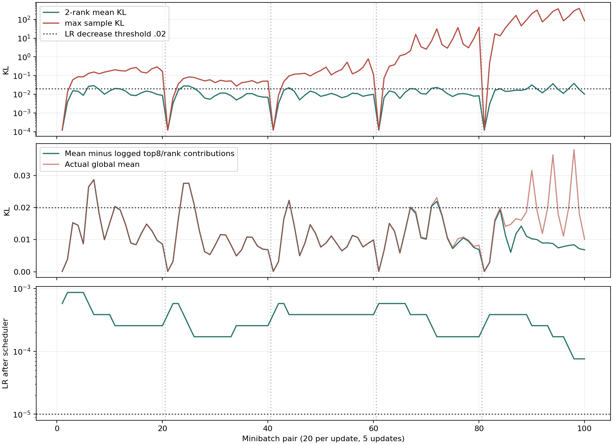

> 분류: A/정책학습
> 작성: 오흥재(analyst-lx) · 2026-11-14
> 근거: v27 Kit 양 rank JSONL · 각 manifest · 노출 영수증 · 설치 PPO 원문
> 요지: 5회차 일부 표본의 큰 KL이 학습률 감소에 기여했고, rank1은 임시 폴더에 존재함
> 상태: CPU 재계산 확인됨 · 기록기 고침의 새 Kit 확인은 미실시

# v27 Kit KL 진단

**확인됨: rank1은 누락된 실행이 아니라 다른 폴더에 기록됐다. 5회차 학습률 감소 4번 모두에서 기록된 큰 KL 표본의 기여가 감소 문턱을 넘기는 데 충분했다.** 이 짧은 실행의 최저 학습률은 0.00007594로 하한 0.00001에 닿지 않았다. 장기 실행이 계속 하한에 머무를지는 이 5회로 확정하지 않는다.

## 원자료와 집계

원본 식별자가 null인 결함은 그대로 남겨 둔다. 각 rank의 manifest PID·원 실행 경로·동일 코드·동일 plan SHA·시작 시각·양 rank 노출 영수증을 별도로 대조한 **진단용 결합**이다. 원본을 고치거나 정식 완결 영수증으로 승격하지 않는다. 코드 `d9c5ecd09e6049898f298b2cc051094e14419fde`, plan `794e4602a04013897f146d2bf3f9527c03137647a3b3c76dfe52f9c5335315cb`. 양 rank 각 5회 × 20 미니배치, 100쌍의 실제 LR 변화가 설치 scheduler 식과 전부 일치했다. 과거 기록기에 update_start가 없으므로 완료 영수증과 agent.yaml의 5 epoch × 4 batch를 대조했다.

| 회차 | 표본 KL 최댓값 | 양 rank 평균 KL 최댓값 | KL>0.02 표본 출현 비율 | 상위 표본에 등장한 고유 env | LR 감소/증가 횟수 | 회차 끝 LR |
|---|---|---|---|---|---|---|
| 1 | 0.289812 | 0.028713 | 19.30% | 130/6144 (2.116%) | 3/2 | 0.00025629 |
| 2 | 0.0840701 | 0.027569 | 13.73% | 151/6144 (2.458%) | 3/3 | 0.00025629 |
| 3 | 0.779697 | 0.022254 | 6.95% | 101/6144 (1.644%) | 1/2 | 0.00038443 |
| 4 | 38.1095 | 0.023063 | 13.86% | 83/6144 (1.351%) | 3/1 | 0.00017086 |
| 5 | 387.436 | 0.038023 | 6.30% | 36/6144 (0.586%) | 4/2 | 0.00007594 |

위 숫자는 지정된 파일의 종료본 전체를 다시 센 값이다. 의뢰 요약의 1.35→6.97→36.7→314를 그대로 옮기지 않았다. 분모는 rank당 3,072 env, 총 6,144 env. 한 회차의 평가 출현 수는 737,280(24 step × 6,144 env × 5 epoch)이고 **반복 epoch를 포함하므로 독립 표본 수가 아니다**. 상위 표본은 minibatch별 8개 중 KL>0.02만 집계했다. 5회차 296회 출현은 고유 env 36개·고유 env-step 98개이며, 전체 큰 KL 환경 비율의 하한이다. 상위에 들지 않은 환경의 높은 KL 여부는 이 로그로 식별하지 못한다. [회차 표](updates.csv), [전체 미니배치](minibatches.csv).

## 어디에 몰렸나

5회차의 큰 KL 상위 표본을 조건별로 합쳤다. 출현 수는 epoch 반복을 포함한다. 환경 비율 분모는 전체 6,144이며 **각 조건에 노출된 전체 환경을 분모로 한 위험률이 아니다**. 지형·명령·지도별 전체 노출 분모가 없어서 PRED가 GT보다 위험하다는 인과 비교는 못 한다.

| 명령 슬롯 | 지형·레벨 | 지도 | 출현 수 | 고유 env(전체 대비) | 표본 KL 최대 |
|---|---|---|---|---|---|
| side_left | pyramid_stairs_inv L4 | PRED | 52 | 2 (0.0326%) | 200.998 |
| diag_fwd_left | boxes L5 | PRED | 51 | 1 (0.0163%) | 16.756 |
| side_left | pyramid_stairs_inv L5 | PRED | 45 | 6 (0.0977%) | 1.175 |
| side_left | pyramid_stairs L5 | OFF | 44 | 1 (0.0163%) | 0.856 |
| side_right | pyramid_stairs L5 | OFF | 23 | 1 (0.0163%) | 287.706 |
| side_right | pyramid_stairs_inv L5 | PRED | 15 | 1 (0.0163%) | 387.436 |
| diag_back_right | pyramid_stairs_inv L3 | PRED | 12 | 1 (0.0163%) | 23.048 |

5회차 지도별 출현은 PRED 211 · OFF 83 · GT 2, 레벨별 L5 219 · L4 62 · L3 15다. 모두 관찰 시작 이후 reset_age 96~119 step, episode_length 127~977이며 reset 직후 표시 0건이다. **이 5회차 꼬리를 reset 직후로 설명할 직접 근거는 없다.** episode_scatter 때문에 reset_age는 첫 실제 done까지 실제 나이의 하한이다. 회차 1~5 전체와 마지막 회차를 따로 낸 [명령](all_slot.csv)·[지형](all_terrain.csv)·[레벨](all_level.csv)·[지도](all_map.csv)·[reset](all_reset.csv)·[env](update5_env.csv)를 참조한다.

## 이것이 LR을 눌렀나

설치 PPO는 두 rank의 평균 KL을 다시 평균하여 0.02 초과면 LR÷1.5, 0<KL<0.005면 LR×1.5로 바꾼다. 근거 `/home/jay/miniforge3/envs/isaac311/lib/python3.11/site-packages/rsl_rl/algorithms/ppo.py:259` 및 `:272`, `:278`.

아래는 **실제 LR 감소 4건**이다. 대조 열은 각 rank 상위 8개 KL의 합을 원래 분모로 나눈 기여만 빼서 계산했다. 나머지 표본·분모를 고정한 산술 진단이며, 해당 환경을 빼고 재학습했을 때의 결과가 아니다.

| epoch/batch(0부터) | 실제 양 rank 평균 | 상위 표본 기여 | 해당 기여를 0으로 놓은 평균 | 실제 LR |
|---|---|---|---|---|
| 2/1 | 0.031543 | 0.021270 | 0.010273 | 0.00038443 → 0.00025629 |
| 3/1 | 0.036398 | 0.027614 | 0.008783 | 0.00025629 → 0.00017086 |
| 4/0 | 0.020055 | 0.011867 | 0.008188 | 0.00017086 → 0.00011391 |
| 4/1 | 0.038023 | 0.029605 | 0.008417 | 0.00011391 → 0.00007594 |

따라서 5회차 네 감소 모두가 이 작은 상위 집합의 큰 KL에 영향을 받았다는 해석은 수치로 지지된다. 1~3회차의 감소에는 같은 상위 기여를 빼도 문턱을 넘으므로, **모든 감소를 극단값 몇 개 탓으로 일반화할 수 없다.** 전체 100쌍 중 LR 감소 14 · 증가 10 · 유지 76, 하한 도달 0이다.

## 원인 가설과 가를 측정

| 가설 | 확인된 근거 | 아직 가를 것 |
|---|---|---|
| 특정 입력에서 actor 행동 평균 변화가 큼 | 설정은 state_dependent_std=false, action별 std는 모든 env에 공통. 같은 update의 rollout sigma도 고정. 같은 minibatch 안 표본별 KL 격차는 평균 차이 항에서 발생한다 | 해당 표본의 old/current mu와 12축 sigma, 관측 성분의 크기를 다음 기록에서 대조. 현재 JSONL에 그 값은 없음 |
| 작은 std가 변화를 증폭 | 식의 분모가 2 sigma²인 것은 코드 확인됨. end-of-update mean std는 0.527498→0.517012 | 평균 std가 2% 줄었다는 것만으로 KL 최대의 폭증을 설명하지 못함. 각 관절 최소 std와 평균 변화 분리 필요 |
| 계단에서 옆·대각 이동 관측 또는 동작이 민감 | 위 조건 집중은 실측. 최대는 rank0 env1153, side_right, pyramid_stairs_inv L5, PRED, KL387.436 | 접촉·발 미끄럼·자세·행동 포화·지도 오차와 해당 env-step을 연결해야 물리/지각 원인을 나눌 수 있음 |
| PRED 자체가 원인 | PRED가 상위에서 많지만 OFF에서도 KL287.706 | GT/PRED/OFF 노출 분모와 같은 상태의 입력 대조 없이 지각 결함으로 확정 불가 |
| reset 직후 튐 | 5회차 상위 표본 reset 직후 0건 | 일반화하지 말고 이후 reset-age별 전체 노출·상위 비율을 함께 기록 |

std 근거: 실행 `params/agent.yaml:25`, 설치 `rsl_rl/modules/actor_critic.py:92`, `:140`. START actor는 저장된 actor 입력으로 PPO를 다시 계산한다(`/home/jay/mai/wt/foothold-lab/ex42-launch-e1-v27-kit/foothold_s2/models/start_policy.py:3`). 현재 자료만으로 TR-Net·센서·특정 보상 한 가지를 원인으로 확정하지 않는다. LR 상한/하한·desired_kl 변경 근거로 바로 쓰지 않는다.

## 기록 결함 고침과 CPU 확인

1. 원인: `/home/jay/mai/wt/foothold-lab/ex42-launch-e1-v27-kit/foothold_s2/scripts/train_start.py:145`가 rank1 runner.log_dir을 임시 경로로 분리하고, `:1206`에 공유 record_dir을 설정한다. 옛 KL 설치기는 runner.log_dir을 썼다. rank1 실제 경로는 아래 SHA 목록에 있다.
2. 원인: EX42 runtime.plan은 EX41 호환 객체라 SHA가 없다. 직접 속성 plan_sha256를 써야 한다. 통합의 931ceaa4에는 이 고침이 이미 있으나 이 Kit 고정본에는 그 전 기록기가 들어갔다.
3. scripter 48650679의 공유 경로 원칙을 통합판에 반영한다. 양 rank 공통 record_dir, 실제 plan/parent SHA, plan이 둘이면 일치 검사. 분산인데 공유 경로가 없으면 설치 전 거절. 기존 update_start inventory와 엄격한 사후 결합을 보존한다. 학습식·보상·명령·LR 설정은 변경하지 않는다.
4. CPU 양 rank gloo는 **실제 installer 경유**로 공유 폴더/동일 identity를 확인하고 observer OFF/ON의 모델·optimizer·RNG·손실·LR·collective 동일성을 재검한다. rank별 private 경로·null SHA·충돌 SHA·공유 경로 없음 반례 포함. 새 Kit에서 두 파일과 동일한 비null SHA가 나오는지는 lead의 후속 실행 확인 대상이다.

원자료 경로·SHA와 집계 제한: [analysis.json](analysis.json). 재현 도구 [analyze.py](../analyze.py), 검산 입력 [test_analyze.py](../test_analyze.py). 숫자는 이 생성기로 원자료에서 뽑았다.
