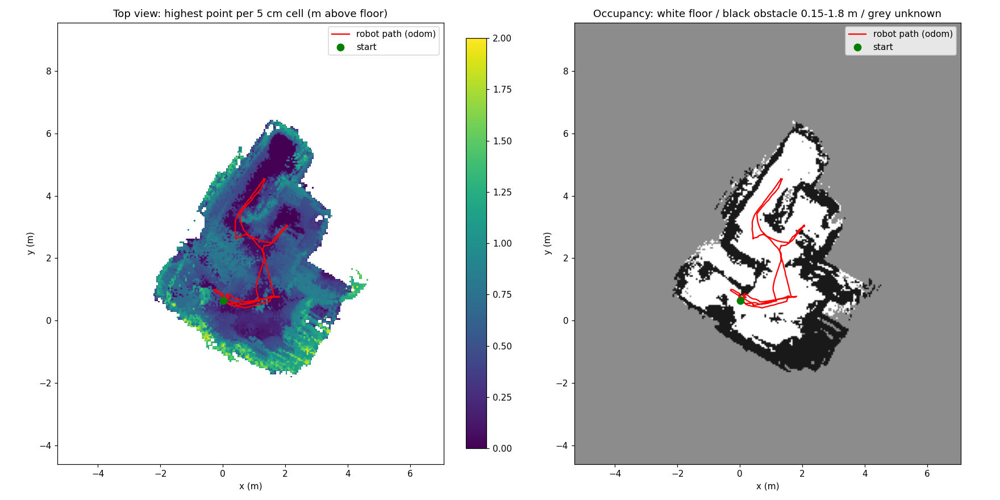

분류: 실기 원자료 (방 걷기 · L2 위에서 본 지도 1 차)
작성: Claude 세션 (오흥재 지시, lead-lx)
근거: Jetson `~/go2_diag/records/20261119-0459-room-walk/` (bag 2.6 GB · monitor.csv) · GO2X-JETSON-SETUP-1119.md 5 절
요지: 팀장이 조이스틱으로 방을 한 바퀴 (05:0x · 5 분 안) 걸은 동안 L2 점구름 (odom 틀) 과 odom 을 녹화해 위에서 본 지도를 만들었다
상태: 1 차 그림 · SLAM 아님 (Go2 odom 그대로 쌓음 · 고리 닫기 없음)

# 방 걷기 지도 (11/19 05:0x)

- 녹화: `/utlidar/cloud_deskewed` 7016 장 (13.6 Hz · odom 틀) · `/utlidar/robot_odom` · `/utlidar/imu` · `/tf` · `/tf_static` · 04:59~05:07. 원본 bag 은 Jetson 에만 있다 (2.6 GB · 저장소에 안 올림).
- 만든 법 (`room_map.py`, Jetson ROS 2 환경): 점을 그대로 쌓되 로봇 몸 둘레 수평 0.6 m 안 점은 뺌 (다리 · 몸에 맞은 점) · 걸은 길 둘레 5 m 만 · 5 cm 칸. 왼쪽 = 칸마다 가장 높은 점 (바닥 기준 m) · 오른쪽 = 흰색 바닥 · 검정 장애물 (그 칸 점의 30 % 넘게가 0.15~1.8 m) · 회색 모름. 빨간 선 = 걸은 길.
- 숫자 (`room_map_info.json`): 걸은 길 20.75 m · 그림 범위 12.4 × 14.1 m · 바닥 칸 9546 · 장애물 칸 4492.
- 안 담긴 것: D435i 색 · 깊이 영상 (이번 녹화에 안 넣음) · 카메라 각도 · 높이 측정 · 배터리 · 온도는 같은 폴더 Jetson `monitor.csv` (05:00 27 % → 05:07 21 % · 가장 뜨거운 관절 54 °C · reserve 0).
- 한계: Go2 odom 을 그대로 써서 오래 걸으면 어긋남이 쌓인다 (고리 닫기 없음). 이번은 5 분 · 20 m 라 벽이 두 겹으로 보이는 곳이 일부 있다 (눈으로 본 것 · 잰 값 아님).

- 3D 점 (11/19 14:3x 덧붙임): `room_points_5cm.npy` = 5 cm 칸마다 점 평균 하나 (125,389 점 · float32 · odom 틀). rosbags 판 스크립트 `../20261119-0520-room-walk-full/room_map_rosbags.py` 로 이 bag 을 다시 돌려 만들었다 (지도 수치는 원래와 같음 · 확인 방법은 `../20261119-0520-room-walk-full/map/README.md`). 돌려 보기: `../../20261101-app/ROOM-POINTS-3D-1119.html`.

