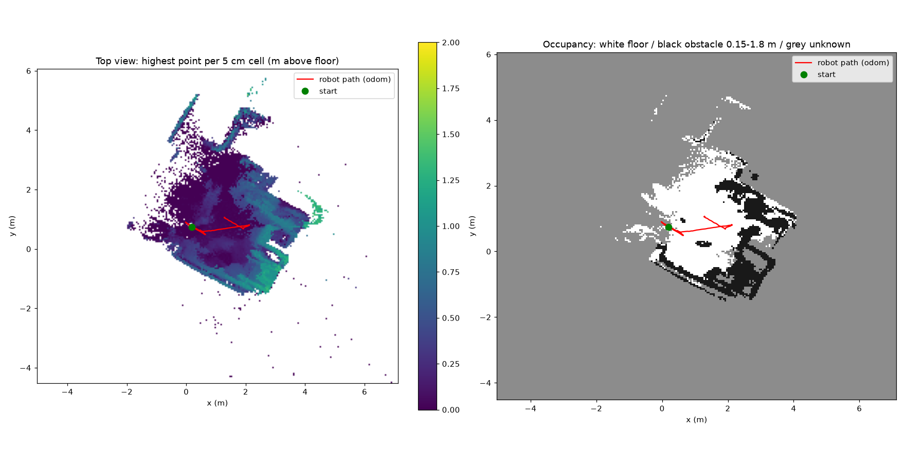

분류: 실기 원자료에서 뽑은 값 (방 걷기 2 차 · L2 위에서 본 지도 · 3D 점)
작성: Claude 세션 (오흥재 지시, go2-lx) · 2026-11-19 14:3x
근거: ai-lx01 거울 `/home/jay/data/go2x_raw/jetson_go2_diag/records/20261119-0520-room-walk-full/bag/bag_0.db3` · `../room_map_rosbags.py` (04:59 `room_map.py` 를 rosbags 로 옮긴 것)
요지: 05:20 녹화로도 위에서 본 지도를 만들었다. 다만 이 녹화의 L2 · odom 은 앞 141~147 초만 들어 있어 걸은 길이 5.12 m 뿐이다
상태: 1 차 그림 · SLAM 아님 (Go2 odom 그대로 쌓음)

# 방 걷기 2 차 (11/19 05:20) 지도



| 값 | 05:20 (이 폴더) | 04:59 (`../../20261119-0459-room-walk/`) |
|---|---|---|
| L2 점구름 장 (`/utlidar/cloud_deskewed`) | 2035 | 7016 |
| 걸은 길 · 시간 | 5.12 m · 140.9 초 | 20.75 m · 493.6 초 |
| 그림 범위 | 12.2 × 10.6 m | 12.4 × 14.1 m |
| 바닥 칸 · 장애물 칸 (5 cm) | 4257 · 1588 | 9546 · 4492 |
| 쌓은 점 · 5 cm 3D 칸 | 10,792,881 · 44,229 | 37,567,767 · 125,389 |

## 이 녹화의 L2 는 앞 141 초뿐 (확인됨 · 까닭 미확인)

bag 안 시각 (녹화 시작 기준): `/utlidar/cloud_deskewed` 0.0~141.1 초 · `/utlidar/cloud` 0.0~141.1 초 · `/utlidar/robot_odom` 0.0~146.8 초 · 깊이 `camera_info` 0.1~330.3 초. 녹화 순서가 앉음 60 초 → 섬 약 35 초 → 방 한 바퀴라서, L2 지도에는 걷기 앞부분 약 45 초만 들어 있다. 왜 L2 · odom 이 먼저 끊겼는지는 모른다 (Jetson `bag.log` 를 볼 것).

## 만든 법

```
/home/jay/data/go2x_raw/.venv-rosbags/bin/python -I room_map_rosbags.py <bag 폴더> <출력 폴더>
```

- 04:59 `room_map.py` 와 같은 수치 (몸 둘레 0.6 m 밖 · 점 둘에 하나 · 걸은 길 둘레 5 m · 5 cm 칸 · 바닥 = 높이 아래 2 % · 장애물 = 0.15~1.8 m 점이 30 % 넘음).
- 옮긴 것을 답을 아는 입력으로 먼저 시험했다: 04:59 bag 에 돌리니 `room_map_info.json` 의 모든 수 (점구름 7016 · 쌓은 점 37,567,767 · 바닥 높이 · 범위 · 바닥 칸 9546 · 장애물 칸 4492 · 걸은 길) 가 원래와 같고, `room_grid.npz` 의 `top` · `path` · `origin` 은 비트까지 같다. 점 수 칸 70 개 (0.1 %) 만 점 하나씩 이웃 칸으로 갔다 (칸 경계 반올림 · 합계 같음).
- 덧붙임: 5 cm 3D 칸마다 점 평균 하나를 `room_points_5cm.npy` (float32 · N×3 · odom 틀 원래 z) 로 남긴다. 04:59 폴더의 같은 이름 파일도 이 스크립트로 다시 만든 것이다 (ai-lx01 의 05:19 판 68,843 점과는 줄인 방법이 달라 수가 다름).

## 3D 보기

[`../../../20261101-app/ROOM-POINTS-3D-1119.html`](../../../20261101-app/ROOM-POINTS-3D-1119.html): 두 녹화의 `room_points_5cm.npy` 를 바닥 기준 -0.2~2.5 m 만 골라 mm 정수로 페이지 안에 넣었다 (1.4 MB · 따로 읽는 파일 없음 · three.js 는 인터넷에서 받음). 만든 명령:

```
python -I room_points_html.py room_points_3d.template.html ../../20261101-app/ROOM-POINTS-3D-1119.html \
  "04:59 녹화=<04:59 map 폴더>" "05:20 녹화=<05:20 map 폴더>"
```

## 파일 · sha256

| 파일 | sha256 |
|---|---|
| `room_topview.png` | c3bf5377e2c26691929cc7bb36a01343dffd8b8f345948fafe435bd81192fe3d |
| `room_map_info.json` | 45204b0ef8bc43fc44f70d92db5a14a21bfffbca8da3d813da20af1a9edc9451 |
| `room_points_5cm.npy` (530 KB) | a8f5b1c21d0ed10b6dd92a73eb2cee71e96f60f26db9f87e02c7dbfb7ddd9ae2 |
| `../../20261119-0459-room-walk/room_points_5cm.npy` (1.5 MB) | f83a0d77750c4b5e839b7562c7f09b44c6c89bfb4128b88a90fcf4422e6e3b83 |

`room_grid.npz` 는 ai-lx01 `/home/jay/data/go2x_raw/jetson_go2_diag/records/20261119-0520-room-walk-full/map/` 에만 둔다 (04:59 판은 `/home/jay/data/go2x_raw/20261119-0459-room-walk/map_rosbags/`).
