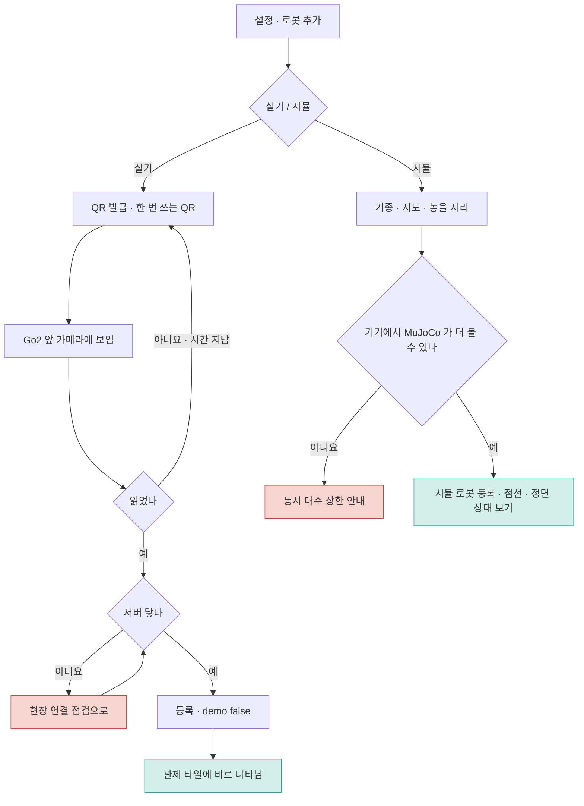
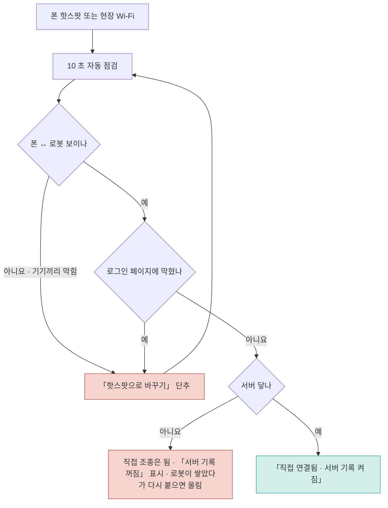
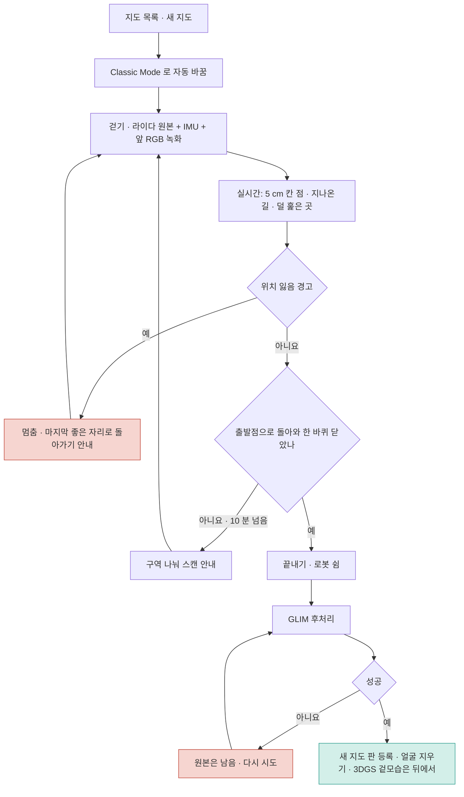
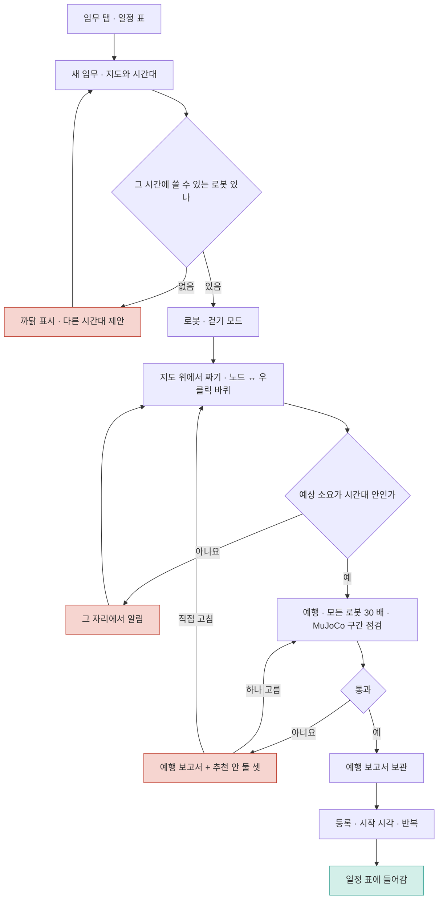
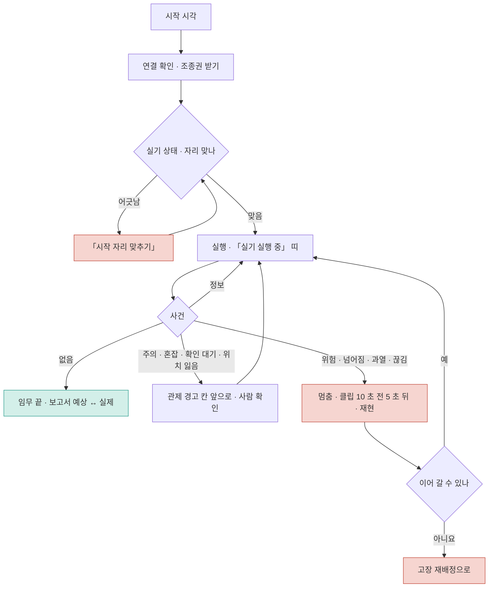
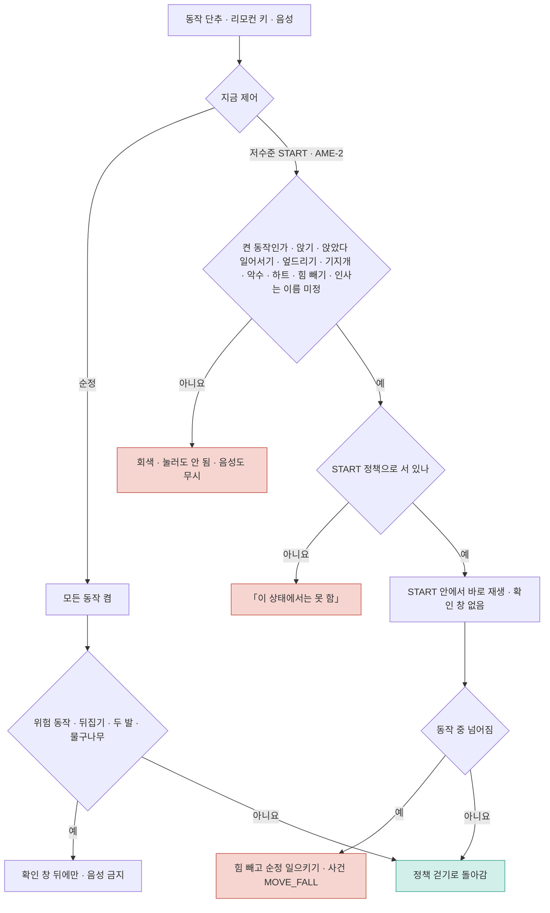
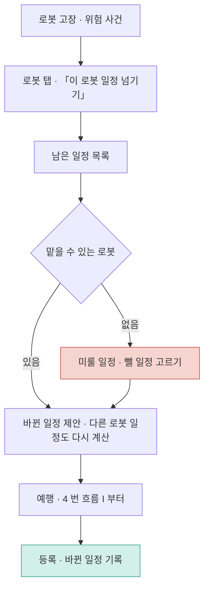

# 흐름 그림과 실패 갈래 (WORK-PROCESS 2 단계)

> 분류: 설계
> 작성: app-design-lx · 2026-11-26 08:1x
> 근거: SERVICE-FLOW.md v0.1 · REQ-LEDGER 답 1~14 · app-lx 전달 결정
> 요지: 일곱 흐름의 그림. 갈림길마다 실패 갈래와 되돌아갈 길. 끝에 누수 점검표
> 상태: v0 · 팀장 검토 전

그림은 GitHub 에서 그대로 그려진다 (mermaid). 빨간 칸은 실패, 초록 칸은 끝.

## 1. 로봇 추가

## 2. 현장 연결

## 3. 지도 만들기

## 4. 임무 짜기 → 예행 → 등록

## 5. 실행과 사건

- 끊김: 앱 명령이 0.3 초 끊기면 로봇이 멈춤. 리모컨이 우선.
- 비상 정지는 어느 칸에서나 E 로 가지 않고 바로 멈춤.

## 6. 조종 화면의 동작 단추

## 7. 고장 재배정

## 8. 데모 하루 (데모 에이전트)

```mermaid
flowchart TD
  A[계획표 · 정시 · 같은 속도 · 충전 교대] --> B[로봇마다 임무 실행 · 서버 진짜 run]
  B --> C{원인 사건}
  C -->|혼잡 시간 구역| D[감속 · 멈춤 · 우회]
  C -->|두 로봇 동선 겹침| E[한쪽 대기]
  C -->|확인 대기| F[관제 사람 확인]
  C -->|고장| G[7 번 재배정]
  C -->|없음| H[정시 끝]
  D --> I[지연 기록 · 뒤 일정으로 번짐]
  E --> I
  F --> I
  I --> J{배터리 낮음 기준 아래}
  H --> J
  J -->|예| K[충전 교대 · 계획대로 · 충전기 차 있으면 charger_busy 사건]
  J -->|아니요| B
  K --> B
```

## 누수 점검표 (이 그림에서 찾은 빈칸)

| 빈칸 | 어디 | 제안 | 누가 |
|---|---|---|---|
| QR 등록 중 로봇이 이미 다른 서버에 등록돼 있으면 | 1 | 「다른 곳에 등록됨 · 총괄이 풀어야 함」 알림, 강제 가져오기 없음 | app-lx 확인 |
| 시뮬 상한 (기기에서 MuJoCo 몇 대) | 1 · 4 | 실측 전까지 안내 문구만, 숫자 미정 | app-lx 측정 |
| 서버 끊긴 동안 쌓은 기록의 상한 | 2 | Jetson 저장 남은 양 표시 (원장 후보 #11) | app-lx |
| 지도 판이 바뀌면 그 지도로 짠 임무는 | 3 · 4 | 임무에 지도 판 id 를 묶고, 새 판이 나오면 「다시 예행 필요」 표시 | 설계 (이 문서) |
| 예행 통과 뒤 실행 전까지 다른 임무가 들어오면 | 4 | 등록 순간 다시 겹침 점검 (빠른 계산만) | 설계 |
| 조종권을 가진 사람이 화면을 떠나면 | 5 | 0.3 초 끊김 규칙으로 멈춤 · 조종권은 일정 시간 뒤 풀림 (시간 미정) | app-lx 확인 |
| 저수준 중 모드 단추 (Shift+1 Classic) 를 누르면 | 6 | 사람이 고른 전환이라 그대로 넘어감 (앉기 → 순정 붙음 → 일어섬), 띠에 「전환 중」 | 원장 확인됨 |
| 인사 (L1+A) 앱 이름 · 기록 id | 6 | app-lx 목록 (11/26 08:47) 에서 빠짐. 기록은 이미 있음 (실행기 greet_body). 제안 이름 「Greet」 · 순정 SDK 번호만 미확인 | 팀장 (app-lx 아침 보고) |
| 악수 다시 고친 판 | 6 | 실기 확인 전까지 단추 옆 「시험 중」 표시를 둘지 | 팀장 |
| 재배정할 로봇이 다른 층에 있으면 | 7 | 층 이동은 계단 제외라 사람이 옮겨야 함 · 제안에서 「옮김 필요」 표시 | 설계 |
| 데모 로봇에 실제 사람이 조종권을 잡으면 | 8 | 데모 에이전트가 조종 명령을 받아 따름 (실기와 같은 길) · 계획표는 멈추고 놓으면 이어 감 | app-lx 확인 |
