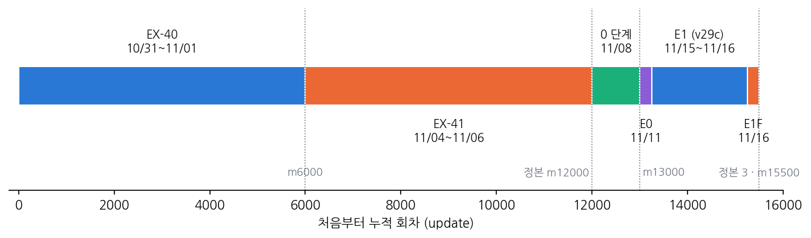

> 분류: 리서치 · 계보 초안 (승격 전 · `docs/` 에 올리는 것은 lead 판단)
> 작성: Claude 세션 (오흥재 지시, planner-lx) · 2026-11-19 18:1x
> 근거: 실측 (각 실행의 `startup_receipt.json` 부모 줄과 저장본 sha256 을 11/19 17:5x 에 다시 잼 · E1 v29c 설정 기록 · 정본 3 기록 문서) · 원장 `decisions.tsv` 11/09 ~ 11/17 줄 (가지 `feature/verify-v2-mvp-jay` 777d1f764 판) · 실행 폴더 목록
> 요지: 정본 m12000 에서 3,500 회를 더 배워 m15500 (정본 3) 이 됐다. 0 단계 1,000 회 · E0 250 회 · E1 2,000 회 · E1F 250 회다. 이 구간의 대부분은 E1 에서 「느린 전진 0.1 m/s」 를 배우게 하는 데 썼고, E1 은 같은 출발점 m13250 에서 여러 번 다시 쌓았다. E1 과 E1F 는 둘 다 단계의 마지막 저장본이 아니라 승인 줄로 넘긴 중간 저장본이다
> 상태: 초안 v0.1 (lead 검토 전 · 숫자마다 출처를 달았고 못 찾은 칸은 「미확인」)

# [계보 초안] m12000 에서 m15500 까지 · EX-42 기본 보행 구간

번호 메모. 이미 올라간 연재는 [계보 2] 를 11/03 설계판에, [계보 3] 을 정본 m12000 에, [계보 4] 를 0 단계 (m13000) 에 쓰고 있다. 이 초안의 파일 이름 `LINEAGE-2` 는 의뢰받은 이름이고, 올릴 때의 번호는 lead 가 정한다.

## 한눈에

| 무엇 | 값 | 출처 |
|---|---|---|
| 출발 | 정본 m12000 (EX-41 `model_6000.pt` · sha `1c6af631…`) | 파일 sha 다시 잼 (11/19 17:5x) |
| 끝 | m15500 (EX-42 E1F `model_250.pt` · sha `13caeb4a…`) = 정본 3 | 파일 sha 다시 잼 · 원장 11/17 01:41 |
| 더 배운 양 | 3,500 회 = 0 단계 1,000 + E0 250 + E1 2,000 + E1F 250 | 각 실행 `startup_receipt.json` 의 `parent.cumulative_update` (13000 · 13250 · 15250) |
| 저장본이 생긴 때 | m13000 11/08 20:09 · m13250 11/11 08:49 · m15250 11/16 08:08 · m15500 11/16 20:41 | 저장본 파일 시각 |
| 로봇 수 | E0 부터 3,072 env × GPU 두 장 = 6,144 env | 원장 11/11 01:4x · 02:21 (두 장 방식 승인) · 정본 3 기록 문서 2 절 |
| 가장 오래 걸린 일 | E1 의 느린 전진 0.1 m/s. 11/11 ~ 11/16 사이 E1 이름이 붙은 실행 폴더가 44 개다 (기동 실패 · 갈라 쌓기 사본 포함) | 실행 폴더 목록 (`s2_lab/ex42_main_2026111[1-6]*/main/` 아래 `EX-42-B-E1_*` 와 `EX-42-B-E1-*` · E1F 제외) |
| 넘긴 방식 | E1 → E1F 는 「상한 넘김」 (m2000) · E1F → E2 는 「첫 창 보류 넘김」 (m250) | 원장 11/16 18:05 · 11/17 01:16 |

낱말 풀이.

- **회 (update) · m 번호**: 로봇 수천 마리가 조금 걸어 보고 그 경험으로 신경망을 한 번 고치는 단위다. m15500 은 처음부터 15,500 번 고친 뒤의 저장본이다.
- **단계 이름 (0 단계 · E0 · E1 · E1F)**: EX-42 계획이 정한 순서다. 0 단계는 복원 지도 보완, E0 는 새 지형 메시 확인, E1 은 명령 넓히기와 느린 걸음, E1F 는 깃발 따라가기다.
- **R (추종 비)**: 6 초 동안 실제로 간 평균 속도를 명령 속도로 나눈 값이다. 1 이면 시킨 대로, 0.3 이면 시킨 속도의 3 할로 간 것이다. E1 졸업 기준은 0.8 ~ 1.2 다 (E1 v29c 설정 기록 5 절).
- **GT | PRED | 끔**: 정답 지도 · 복원 지도 · 지도 끔 순서로 나란히 적은 값이다. 실제 로봇이 쓰는 것은 복원 지도 (PRED) 다.
- **탐침**: 학습 중 50 회마다 저장본을 꺼내 CPU 에서 32 대를 6 초 걸려 보는 짧은 측정이다. 판정이 아니라 조기 경보용이다.

그래서 이 문서는 「정본 m12000 이 왜 그대로 지형 학습에 못 들어가고 3,500 회를 더 돌았나」 에 답한다.

## 1. 이 구간의 계획

정본 m12000 문서는 EX-41 이 남긴 과제 (후진 1.0 · 좌우 대칭 · 계단 밀기 여유) 와 함께, 다음 실험 EX-42 가 0 단계 1,000 회 뒤 지형 학습으로 간다고 적었다 ([계보 3] 한눈에 표). 실제로는 지형 학습 (E2) 앞에 네 단계가 놓였다.

| 단계 | 누적 | 무엇을 하려던 단계인가 | 근거 |
|---|---|---|---|
| 0 단계 | 12000 → 13000 | 복원 지도로 배운 양을 늘림 | [계보 4] 1 · 2 절 |
| E0 | 13000 → 13250 | 부모 저장본과 새 지형 메시가 맞는지 확인 (250 회) | [계보 4] 7 절 · 원장 11/09 10:1x (E0 승인) |
| E1 | 13250 → 15250 | 명령 범위 넓히기 · 느린 걸음 · 지형 상한 올리기 | 원장 11/12 11:28 · 12:52 · 13:03 |
| E1F | 15250 → 15500 | 깃발 (목표 지점) 따라가기 · 750 회 계획 | 원장 11/11 12:02 |

회차 예산에서 이 네 단계는 따로 센다. 11/13 15:17 팀장 결정 요지: 기본 보행 구간 (0 단계 · E0 · E1 · E1F) 은 예산 밖이고 지형 보행 (E2 부터) 에 20,000 회를 쓴다. 빠르게보다 정확하게 쌓는 것이 먼저라는 취지도 같은 줄에 있다.

그래서 이 구간은 「지형을 배우기 전에 기본 걸음을 다시 다지는 곳」 으로 계획됐고, 회차를 아끼는 대상이 아니었다.

## 2. 0 단계와 E0

0 단계 (m12000 → m13000 · 11/08) 는 [계보 4] 가 다뤘다. 여기서는 사슬만 확인한다. 0 단계 실행의 `startup_receipt.json` 은 부모 sha `1c6af631…` · 누적 12000 을 적고 있고, `model_1000.pt` 의 sha 는 `20365a2c…` 다 (11/19 17:5x 다시 잼).

E0 는 11/11 에 돌았다.

| 항목 | 값 | 출처 |
|---|---|---|
| 실행 | `EX-42-B-E0_20261111_072218` · `model_250.pt` (sha `680c820b…` · 파일 시각 11/11 08:49) | 파일 sha 다시 잼 |
| 부모 | m13000 (sha `20365a2c…` · 누적 13000) | 그 실행의 `startup_receipt.json` |
| 앞선 기동 | 같은 날 06:28 · 07:17 폴더 둘은 저장본이 없다 | 실행 폴더 목록 (저장본 0 개) |
| 로봇 수 | 두 장 3,072 × 2 = 6,144 env 로 바꿈 | 원장 11/11 01:4x (팀장 승인 요지) |
| 관문 | E0 경계 기준을 부모 m13000 기준값으로 고정하고 m250 을 다시 판정한 뒤 E1 진입 | 원장 11/11 10:29 (팀장 승인 요지) |

- E0 의 250 회 동안의 점수 표는 이 초안을 쓰며 열어 보지 않았다 (`미확인` · 자리는 `inbox/jay/20261111-analysis/REPORT-EX42-E0-BASELINE-1111.md`).
- 앞선 두 폴더가 왜 저장본 없이 끝났는지도 원장에서 찾지 않았다 (`미확인`).

그래서 E0 는 걸음을 바꾸려는 단계가 아니라 「새 지형 메시 위에서 부모가 그대로 걷는지」 를 본 250 회이고, 그 끝 m13250 이 뒤이은 E1 실행 전부의 부모가 됐다 (E1 계열 폴더 44 개의 `startup_receipt.json` 부모가 모두 `680c820b…` · 누적 13250).

## 3. E1 · 느린 전진을 배우기까지

E1 은 한 번에 끝나지 않았다. 아래 표는 줄기만 적은 것이다. 「어떻게 끝났나」 의 숫자는 lead 가 그때 원장에 적은 값이고 이 초안에서 다시 재지 않았다.

| 때 | 실행 (폴더 이름 끝) | 무엇을 바꿔 다시 했나 | 어떻게 끝났나 | 원장 |
|---|---|---|---|---|
| 11/11 11:45 | `E1_20261111_114505` (m1000 까지 저장) | 첫 E1 | 결과 숫자는 이 초안에서 `미확인`. 같은 날 밤 「발 미끄러짐 벌점 하나만 바꿔 같은 출발점에서 다시」 가 승인됨 | 11/11 11:51 · 23:49 |
| 11/12 00:37 ~ | `E1-slip50` 셋 · `E1-slip1000` | 발 미끄러짐 벌점 (foot_slip) −0.25 → 50 회 벌점 몫 10.93 % 로 미리 정한 범위 (2 ~ 8 %) 밖 → −0.15 는 7.06 % 로 통과 → 1,000 회 | 통과한 값 −0.15 가 뒤 실행에 남음 | 11/12 01:37 |
| 11/12 16:41 | `E1-cmd7seg` (m2000 까지 저장) | 위 단계 (HiPAN) 가 쓸 명령을 미리 넣음: 옆 0.1 ~ 0.8 · 걸으며 돌기 · 제자리 회전 0.15 ~ 1.5 · 걷는 명령에 회전 덧붙임. 한 실행 일곱 구간 1,750 회 계획 | 11/13 에 「m13250 에서 E1 을 다시」 로 결정. 느린 전진은 반드시 배워 넣는다는 팀장 요지 | 11/12 12:52 · 13:03 · 11/13 14:29 · 15:22 |
| 11/13 17:45 | `E1-again` (m750 까지) | 회전 0 명령 벌점 (zero_yaw) −1.0 · 추종 폭 0.35 · 느린 전진 몫 0.2 → 0.4 | m250 전진 0.1 R (GT/PRED · L0) 0.447/0.407 → m500 0.312/0.334 로 한 경계 만에 내림 | 11/13 14:29 · 15:17 · 20:25 · 23:07 |
| 11/14 02:27 | `E1-v27` (m1000 까지) | 재설계 v3c · 느린 명령 노출 늘림 (몫 0.5 · heading 판 포함) | m250 전진 0.1 R 0.174/0.170/0.163 · m750 에서 0.272 → 0.101 | 11/14 04:55 · 09:53 |
| 11/14 13:10 | `E1-v28` | 느린 진행 보상 (slow_progress) 0.2 를 첫 회부터 | m250 탐침 0.554/0.563/0.550 → m500 0.102/0.102/0.092 (m450 0.456 에서 50 회에 0.35 내림) | 11/14 12:11 · 14:46 · 17:31 |
| 11/14 17:44 ~ 11/15 오전 | `E1-v28b` ~ `E1-v28v` | m250 · m500 등에서 갈라 쌓으며 처방을 하나씩: 작은 잡음 env · 잡음 상한 · 느린 추종 보상 · 지각 쪽 처방 | 올랐다 내리기를 되풀이. 예: v28b m400 0.808 → m500 0.415 · v28c m600 0.976/0.986/0.878 → m650 0.395/0.394/0.336 | 11/14 18:53 · 19:18 · 21:32 · 21:51 |
| 11/15 13:54 | `E1-v29c` (m2300 까지) | 지각 학습률 2.5e-4 를 단계 내내 고정하고, 결과를 보고 그때그때 바꾸지 않기로 함 | 아래 표. m2000 을 E1F 부모로 넘김 | 11/15 12:22 · 14:03 |

v29c 의 느린 전진 0.1 (평지 · R · 정답 지도 | 복원 지도).

| 저장본 | 공식 평가 R | 비고 | 출처 |
|---|---|---|---|
| 부모 m13250 | 탐침 0.11 | 거의 서 있음 | E1 v29c 설정 기록 4 절 |
| m250 | 0.356 \| 0.362 | | 같은 곳 · 원장 11/15 16:31 |
| m500 | 0.804 \| 0.813 | m250 경계에서 「느린 명령 env 는 전부 작은 잡음」 (P1) 을 켬 | 같은 곳 2 절 · 4 절 |
| m750 | 0.920 \| 0.916 | 12 초로 재면 0.088 m/s | 같은 곳 4 절 · 원장 11/15 21:14 |
| m1250 | 0.719 \| 0.712 | | 원장 11/16 02:19 |

- 「작은 잡음 env」 는 학습 때 일부 로봇 (기본 몫 0.25) 을 잡음 배율 0.2 로 돌리는 것이다. m250 경계부터는 명령 속도가 0.3 m/s 아래인 로봇을 모두 이 묶음에 넣었다 (E1 v29c 설정 기록 2 · 3 절). 배율이 정확히 어느 값에 곱해지는지는 코드를 열어 확인하지 않았다 (`미확인`).
- 판정 기준도 이 사이에 고쳤다. 속도 오차를 순간값이 아니라 0.5 초 창 평균으로 재기로 했다. 순간값으로는 걸음 한 주기의 흔들림 ±0.03 만으로 0.1 칸의 문턱 0.020 을 넘기 때문이다 (원장 11/15 21:12 · 팀장 결정 요지).
- 걸음 박자 시계 입력 같은 다른 방식 (Walk These Ways) 은 이번 E1 에 넣지 않고 지금 틀 안의 처방으로 풀기로 했다 (원장 11/14 20:08 · 팀장 요지).
- 11/15 11:40 원장은 그때까지의 시행착오를 「확인 9 · 기각 10」 으로 정리해 채팅에 보고했다고 적는다. 그 열아홉 항목의 내용은 원장 줄에 없어 이 초안에 옮기지 못했다 (`미확인`).

그래서 E1 에서 일어난 일은 「느린 전진이 한 번 오른 뒤 50 ~ 250 회 안에 다시 내리는 것」 의 되풀이였다. v29c 는 공식 평가 R 이 m500 · m750 두 경계에서 졸업 범위 (0.8 ~ 1.2) 에 들었지만 m1250 에는 0.71 대로 내렸고, 끝내 두 경계 연속 통과는 채우지 못했다 (4 절).

## 4. E1 을 닫고 E1F 로

E1 졸업 기준 v2 는 같은 처방으로 두 경계를 연속 통과하라고 요구한다 (원장 11/15 22:12). v29c 는 그 두 창을 채우지 못했다.

| 무엇 | 값 | 출처 |
|---|---|---|
| 두 창 | E1 상한 2,750 안에서 불가 (m2250′ FAIL · m2500′ FAIL) | 원장 11/16 16:40 |
| 네 저장본 같은 잣대 (전진 0.1 · L0 · 성공 수 /64 · GT\|PRED) | m1750 42\|46 · m2000 55\|54 · m2250 26\|29 · m2500′ 39\|32 | 원장 11/16 18:03 (planner 측정) |
| 계단 정지 재출발 (복원 지도 · 통과 수 /64) | m1750 61 · m2000 28 · m2250 22 · m2500′ 3 | 같은 줄 |
| 공식 미달 칸 수 | m1750 11 · m2000 1 · m2250 4 · m2500′ 4 | 같은 줄 |
| 결정 | E1F 부모를 m2000 으로 하고 E1 은 「상한 넘김」 으로 닫음 | 원장 11/16 18:01 (팀장 미리 승인 요지) · 18:05 (승인 줄) |

- m2000 에서 미달로 남은 칸은 지형 L5 · 정답 지도 · 옆 −0.2 하나다 (원장 11/16 18:37).
- 「′」 가 붙은 저장본은 m2000 에서 다시 출발한 갈래 (`E1-v28u_20261116_115728`) 의 것이다 (원장 11/16 12:11).

E1F 는 11/16 19:08 에 부모 m2000 으로 기동해 750 회를 끝까지 돌았다 (원장 11/16 19:09 · 23:51). 50 회 탐침의 「정책이 보는 속도」 (전진 0.1 명령) 는 부모 0.093 → m250 0.093 → m450 0.097 → m700 0.085 → m750 0.079 로, m450 뒤 여섯 점이 한 방향으로 내렸다 (원장 11/16 19:58 · 20:58 · 22:24 · 23:38 · 23:59). 그래서 마지막 저장본 m750 이 아니라 m250 이 다음 단계의 부모가 됐다. 그 비교표와 까닭은 정본 3 문서 (`LINEAGE-3-canon3-m15500.md`) 2 절에 있다.

그래서 m15500 은 「E1F 를 다 마친 저장본」 이 아니라 「E1F 의 첫 경계 저장본」 이다. 판정 HOLD 는 실패한 칸이 있어서가 아니라 첫 창이라 견줄 직전 창이 없어서 생겼고, 그 사정을 영수증으로 남기고 넘겼다 (원장 11/17 01:16).

## 5. 돌리는 동안 생긴 일

| 때 | 무엇 | 교훈 | 원장 |
|---|---|---|---|
| 11/13 20:26 | 구간 이어 가기 런처가 끝나면서 학습 프로세스까지 같이 꺼짐 (학습 0 회) | systemd 단위의 KillMode 를 process 로 | 11/13 20:28 |
| 11/14 08:00 ~ 11:55 | lead 가 처방을 「결정 대기」 로 두어 경계가 그냥 지나감 | 위임받은 결정을 질문으로 되돌리지 않는다 | 11/14 11:55 |
| 11/14 14:37 | 「1,750 회까지 한 줄」 이라 보고했으나 실제는 첫 구간 250 회만 도는 스크립트였음 | 띄운 뒤 실제 범위를 로그로 확인 | 11/14 14:37 |
| 11/15 01:36 | CPU 부하 325 (64 코어). 시험 프로세스 14 개 이상이 겹침 | 시험은 스레드 제한 · 동시 둘까지 | 11/15 01:38 |
| 11/15 22:46 ~ 23:13 | GPU 두 장 27 분 빔. 보조 프로세스가 GPU 메모리를 잡고 있었는데 승인을 기다림 | 위임 범위 안이면 바로 처리 | 11/15 23:14 |
| 11/15 21:19 | 지각 평균 가중치 (EMA) 가 Kit 안에서 무효였음 (값 차이 0) | CPU 시험 통과와 실제 실행은 다르다 · 고친 판은 m1000 부터 | E1 v29c 설정 기록 2 절 |

그래서 E1 의 여러 날은 학습 문제만이 아니라 운영 문제 (경계에서 멈춘 결정 · 범위 착오 · 자원 겹침) 로도 길어졌다. 이 사고들의 정본 기록은 `inbox/jay/20261019-design/FAILURE-LOG.md` 다.

## 6. 이 문서가 「미확인」 으로 남기는 것

- `미확인` 첫 E1 (11/11 11:45 실행) 과 `E1-cmd7seg` 가 어떤 숫자로 끝났는지. 원장에서 결과 줄을 찾지 못했다.
- `미확인` E0 250 회의 점수 표.
- `미확인` 11/15 11:40 「확인 9 · 기각 10」 의 항목.
- `미확인` v28b ~ v28v 스무 개 남짓 갈래 각각의 처방과 결과. 이 초안은 예시 둘만 옮겼다.
- `미확인` 반복 시드 폭. 이 구간의 평가는 거의 다 시드 42 한 번이다 (정본 3 기록 문서 8 절).
- 3 절 · 4 절 표의 경계 값은 lead 가 원장에 적은 값을 옮긴 것이고, 이 초안에서 점수 파일을 다시 열어 대조하지 않았다. 다시 잰 것은 사슬 (부모 sha · 누적 회차 · 저장본 sha) 뿐이다.

## 원자료

- 사슬: `/mnt/win-d/mai/data/foothold/s2_lab/` 아래 `ex41_main_20261104_235522/…/model_6000.pt` · `ex42_main_20261108_123914/…/model_1000.pt` · `ex42_main_20261111_072218/…/model_250.pt` · `ex42_main_20261115_135412/…/EX-42-B-E1-v29c_20261115_135412/model_2000.pt` · `ex42_main_20261116_190816/…/EX-42-B-E1F_20261116_190817/model_250.pt` 와 각 폴더의 `startup_receipt.json`
- E1 v29c 설정: 가지 `feature/verify-v2-mvp-jay` 의 `inbox/jay/20261104-ex41-restart/RECORD-E1-v29c-SETTINGS.md`
- 정본 3 기록: 가지 `feature/fable-25a-jay` 의 `inbox/jay/20261102-ex42/CANON3-E1F-m250-1117.md`
- 원장: 같은 가지 (`feature/verify-v2-mvp-jay`) 의 `inbox/jay/20261104-ex41-restart/decisions.tsv` · 이 문서의 「원장 날짜 시각」 은 그 파일 첫 열 값이다
- 쓴 자료와 빠진 자료 전체 목록: 같은 폴더 `SOURCES.md`

## 판 이력

- v0.1 (2026-11-19): 처음 씀 (초안).
