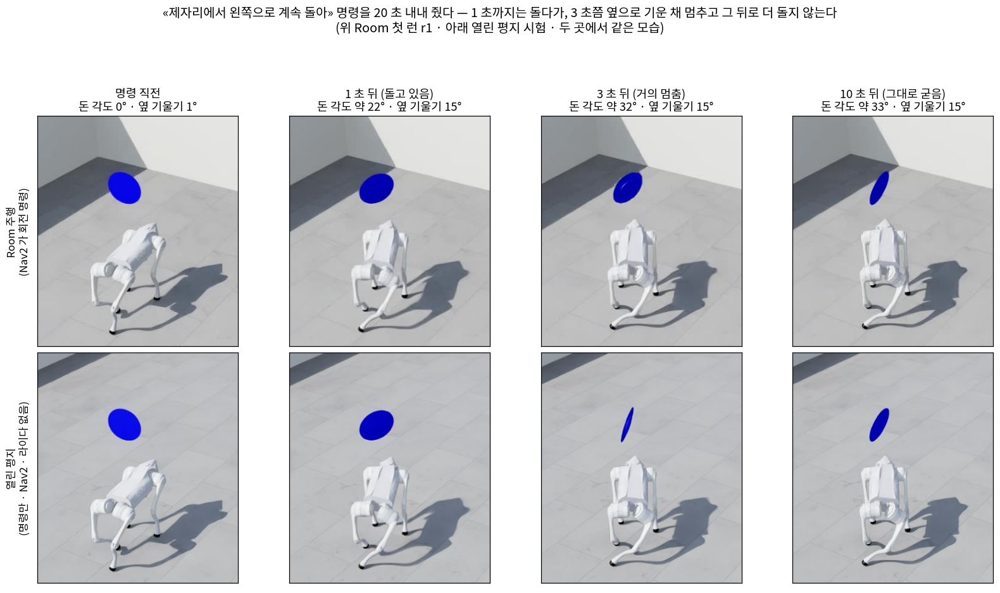
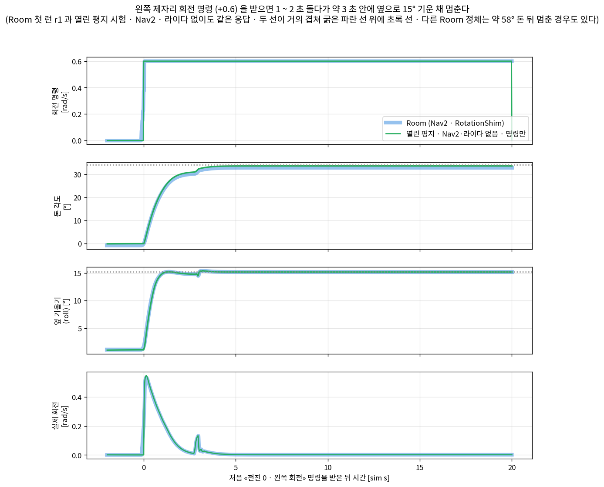
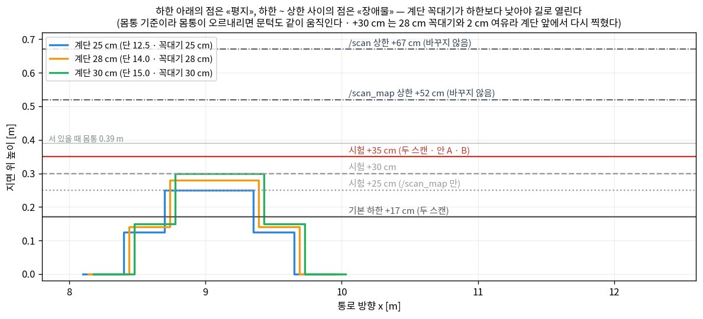
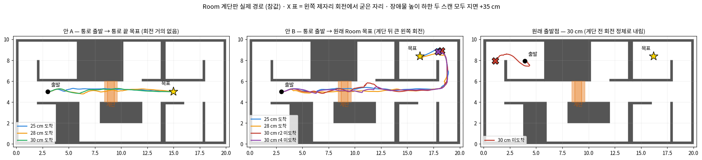
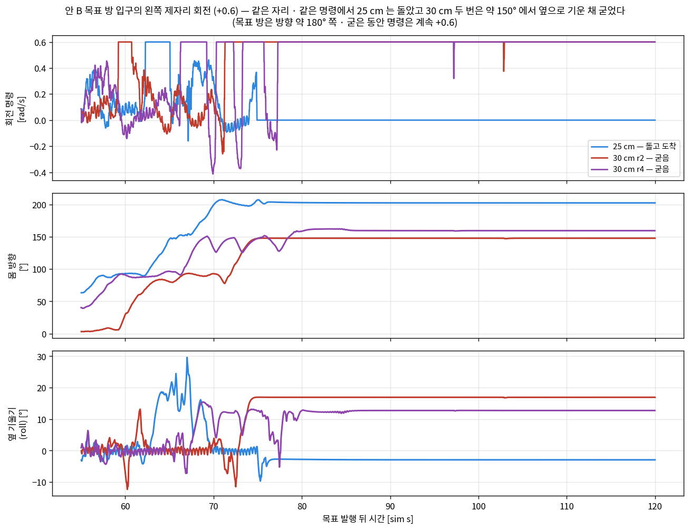

> 분류: 실험
> 작성: 이민우 · 2026-10-29
> 근거: 자체 시험 (Isaac Sim · 정책 v2 체크포인트 고정) · 수치는 런 기록에서 `확인됨` · 원인 해석은 `추측` · 정책 v2 의 회전 특성은 팀 MVP 평가 https://github.com/foothold-project/foothold-lab/blob/main/docs/research/20260928-v2-mvp-report.md
> 요지: 근사 L1 라이다로 ㄱ자 · Corridor 는 Nav2 도착, Room 은 부분 도착이고, 남은 막힘은 제자리 회전에서 보행 정책이 굳는 것이다
> 상태: 초안
> 판: v1.0

# L1 라이다 시뮬 자율보행 경과 보고 (요약판)

이민우 · 2026-10-29 · 기간 10-16 ~ 10-29 (10-28 센서 설정 확인 · 10-28 ~ 29 지형판 시험 반영) · Isaac Sim 시뮬 · 정책 v2 고정 · 관절 직접 제어 없음
세부 근거는 전체판 [2-L1-라이다-자율보행-경과보고-전체판.md](2-L1-라이다-자율보행-경과보고-전체판.md) 에 있다 (아래 «부록» 이 가리키는 절).

## 1. 결론

- 실기 L1 명목값 일부 (회전 11 Hz · 발사 21,600 점/s 설정) 를 반영한 **근사 L1** 시뮬 라이다로 **ㄱ자 · HiPAN Corridor 는 Nav2 도착, Room 은 부분 도착 (같은 설정 6 번 중 3)** 이다. 근사 L1 이 실기 점군과 같다는 검증은 없다.
- 관측된 막힘은 **«서 있다가 제자리에서 돌라» 는 명령에 보행 정책이 기운 자세로 굳는 것** 이다. Nav2 · 라이다 없이 열린 평지에서 회전 명령만 줘도 같은 자세로 굳었다 (1 회). 이 정체에서 지도 · 위치 추정 문제는 직접 관측되지 않았다 (원인이 아니라고 단정하지는 않는다).
- 지형판 (pit · 계단) 에서는 **지금 구성이 몸통 기준 높이 띠 안의 점만 장애물 후보로 남기고, 단 높이 · 경사는 따지지 않는다** 는 한계가 드러났다. 이 구성에서 계단은 장애물로 찍혀 돌아갔고, pit 은 들어간 뒤 갇혔다. 장애물 높이 하한을 두 곳 모두 지면 +35 cm 로 올리자 Nav2 가 계단 (두 단 25 · 28 · 30 cm) 으로 길을 내고 v2 가 넘었다 (+35 cm 에서 계단에 닿은 런 7 번 모두 · +30 cm 계단 앞 출발 1 번을 더하면 8 번 · 계단에 닿은 런만 센 것이라 성공률이 아니다). 다만 +35 cm 아래의 실제 장애물을 못 보는 시험용 값이라 해결책이 아니다. 30 cm 를 넘은 뒤 원래 Room 목표로 간 두 번은 목표 앞 왼쪽 제자리 회전에서 굳었다 (5절).
- 설정은 각 맵의 실패를 풀며 바꿔 왔고, 처음 보는 맵에서 통과한 사례는 아직 없다. **일반 설정이라고 주장하지 않는다.**

## 2. 맵별 결과

모두 평지 · 근사 L1 · Point-LIO · SLAM 스캔 맞추기 끔 · 도착 예산 sim 150 s.

| 맵 | 전역 플래너 | RotationShim | 주행 | Nav2 도착 | 막힌 곳 |
|---|---|---|---|---|---|
| ㄱ자 (벽 0.6 m) | Theta* | 없음 | 1 | 1 | - |
| HiPAN Corridor | Theta* | 없음 | 3 | 3 | - (기록 끝 0.25 m 안은 2) |
| HiPAN Room | Theta* | 회전 0.6 | 6 | 3 | 출발 회전 정체 3 번 (r1 · r4 · r6) · 미도착 3 번: r1 출발 정체 · r5 도중 오른쪽 회전 정체 (예산 끝 목표 2.71 m) · r6 출발 왼쪽 회전 정체 (예산 끝 3.65 m) |

- 세 맵이 같은 설정은 아니다. ㄱ자 · Corridor 는 RotationShim 없이, Room 만 붙여서 돌렸다. RotationShim 을 붙인 설정으로 ㄱ자 · Corridor 를 다시 돌린 적은 없다.
- 넘어짐 · 경로 계산 실패는 위 성공 · 실패 런 모두 0. 위치 추정 오차 (Nav2 가 믿은 위치 − 참값 · 목표 발행 뒤 150 s · 모든 표본) 는 Room 6 번의 런별 최대 0.07 ~ 0.12 m 다 (r5 0.12 m · 나머지 0.09 m 이하).
- 맵마다 1 ~ 6 번이라 성공률이 아니다. 천장 장애물을 뺀 평지 변형 맵이다.

## 3. 바꾼 설정과 이유

| 부품 (하는 일) | 팀 기본 → 지금 | 왜 바꿨나 | 성격 |
|---|---|---|---|
| 라이다 (주변 거리를 점으로) | XT-16 → **근사 L1** (실기 제원 11 Hz · 21,600 점/s + 매 바퀴 같은 방향만 쏘지 않게) | 제원만 넣은 시뮬 L1 은 매 바퀴 같은 방향만 쏴 서 있어도 위치가 흘렀다 (실기에 없는 결함) | 시뮬 결함 보정 |
| 위치추정기 (라이다 + IMU 로 이동량) | rko_lio → **Point-LIO** | 근사 L1 + rko 에서 선회 중 1.68 m 틀림 | 부품 교체 |
| SLAM 스캔 맞추기 (지도에 맞춰 위치 보정) | 켬 → **끔** | Corridor 에서 멀쩡한 위치를 1.08 m 틀어 놓음 | **환경 의존 · 가장 맵 맞춤** (루프 닫기도 꺼짐) |
| 전역 플래너 (큰 길 긋기) | NavFn → **Theta*** | Corridor 모퉁이에서 길을 뽑다 맴돌아 실패 16 회 | 부품 교체 (원인 재현 뒤) |
| 전역 코스트맵 | 크기 지정 없음 → **40 m 고정** | HiPAN 맵 크기를 담으려고 | 맵 크기 맞춤 |
| 제어기 앞 RotationShim (길이 45° 넘게 벌어지면 «제자리에서 돌아라») | 없음 → **회전 0.6** (Room) | MPPI 가 서 있는 로봇에게 아주 작은 회전만 내는 고리에 갇힘 | **정책 한계 우회** (Nav2 개선 아님) |

- 보행 정책 · 속도 범위(전진 0 ~ 1.0 · 회전 ±0.6 · 후진 · 옆걸음 막음) 는 팀 그대로다. 바꾼 것은 모두 내 사본 설정이다.
- **«HiPAN 을 통과시키려고 맞춘 설정» 으로 볼 수 있다.** 모두 특정 맵 실패에서 출발했다. 위 표의 변경은 실패 원인을 찾아 하나씩 바꿨다. 다만 지형판 시험 (5절) 에서는 높이 문턱을 25 · 30 · 35 cm 로 바꿔 가며 시험했고, 출발 · 목표도 함께 바뀐 비교가 있어 단일 변수 효과로 보지 않는다. 처음 보는 맵에서 통한다는 근거는 없다.

## 4. 남은 핵심 문제: 제자리 회전에서 굳는다

- **위 장면 읽는 법**: 왼쪽에서 오른쪽으로 명령 직전 → 1 초 → 3 초 → 10 초 뒤다. 1 초 뒤에는 몸 방향이 바뀌어 돌고 있지만, 3 초 뒤와 10 초 뒤 장면은 거의 같다. «왼쪽으로 돌아» 명령이 그동안 계속 왔는데도 몸이 그대로다. 위 줄 (Room 주행) 과 아래 줄 (Nav2 · 라이다 없이 명령만 준 열린 평지) 이 같은 모습이다.

- **아래 그래프 읽는 법**: 같은 두 런을 시간에 따라 그렸다. 위에서부터 ① 준 회전 명령 (20 초 내내 +0.6) ② 실제로 돈 각도 (약 34° 에서 멈춤) ③ 옆 기울기 (돌기 시작하자 15° 로 기운 채 고정) ④ 실제 회전 속도 (처음에 0.55 rad/s 까지 올랐다가 약 3 초 안에 0) 다. 두 선이 거의 겹친다. 같은 초기 상태에서 같은 명령을 받은 결과라, 서로 독립된 재현이라기보다 «Nav2 없이도 같은 응답이 나왔다» 는 뜻이다.

- 서 있는 로봇에 «전진 0 · 왼쪽 회전» 을 오래 줄 때 옆으로 기운 채 멈춘 사례가 반복됐다. Room 출발 (Nav2) 과 열린 평지 (Nav2 · 라이다 없음) 에서는 옆 15° 안팎으로 기운 비슷한 자세였다 (돈 각은 r1 · 열린 평지 약 33°, 직전에 반대로 돌았던 r4 · r6 등은 회전 명령 시작부터 약 58 ~ 59° · 다른 자리 정체까지 넣으면 29 ~ 69° · 옆 13 ~ 17°). 매번 그런 것은 아니다. 짧은 회전 (3 ~ 7 s) 은 굳지 않은 사례가 있다.
- RotationShim 0.6 을 쓴 Room 원래 출발 13 런에서 출발 회전 중 정체가 8 런 관측됐고, 모두 왼쪽 회전 중이었다 (같은 관측 궤적 1 런을 빼면 7). 나머지 5 런 중 r2 · r3 은 짧은 왼쪽 회전 뒤 오른쪽으로 바뀌었고, r5 · 계단판 기본 띠 런은 오른쪽으로 돈 뒤 출발했으며, 30 cm 원래 출발 런은 출발 뒤 2.7 m 걸은 다음 따로 굳었다. 출발 경로 방향은 처음 몇 초 동안 좌우로 여러 번 바뀌어 정체를 설명하는 고정 표지로 쓰지 않는다. 목표 발행 전 위치 · 방향 궤적이 모든 런에서 거의 같아 (유사한 초기 조건의 반복) 통계적으로 독립된 사례가 아니다.
- 오른쪽 회전도 굳는다: Room 10-28 · 29 런 후반에서 다른 자세 (옆 −11 ~ −16° · 몸통이 낮아짐) 로 굳었다.
- 걸으며 도는 회전은 고른 구간에서 명령 대비 실제 회전 0.86 ~ 1.01 이었다 (런별 중앙값 · 정상 동작 구간만 골라 잰 값이라 «걸으며 돌면 늘 된다» 는 근거는 아니다).
- **v2 는 «전진 0 · 회전만» 명령으로 제자리 회전을 할 수 있다.** 팀 MVP 평가 영상 (`axis2ext-turnrest-v2.mp4` · env 51) 에서 서 있다가 −1.0 명령을 받고 약 2.3 s 만에 약 98° 돌았다 (명령 시작 1.5 s · 화면 방향 +2° → 영상 3.8 s 에 −96°). 팀 평가 (`docs/research/20260928-v2-mvp-report.md` · 평지 · 한 칸에 명령 3 s · 넘어진 칸을 뺀 평균) 의 추종비는 아래와 같다.

  | 시나리오 (순서) | 넘어짐 | −1.0 | +0.5 | +1.0 |
  |---|---|---|---|---|
  | `turn` (오른쪽부터 · 쉼 없음) | 79 / 1024 | 0.76 | 0.53 | 0.42 |
  | `turn_rest` (오른쪽부터 · 1.5 s 쉼) | 5 / 64 | 0.76 | 0.63 | 0.50 |
  | `turn_rev` (왼쪽부터 · 쉼 없음) | 10 / 64 | 0.67 | 0.01 | 0.05 |

  왼쪽부터 시작한 `turn_rev` 에서만 왼쪽 평균이 특히 낮았다. 순서 · 초기 상태 · 쉼이 함께 달라 순서 하나의 효과로 보지 않는다.
- **이번 기록에서 관측한 비교로, v2 는 왼쪽 제자리 회전을 오른쪽보다 오래 이어 가지 못했다.** 왼쪽 정체 사건은 14 건이고, 그중 13 건이 돌기 시작한 뒤 약 2.8 ~ 4.5 s 에 멈췄다 (1 건은 8.5 s). 오른쪽은 9 ~ 10 s 동안 −200° 넘게 돈 사례가 4 번 있고, 오른쪽 정체 사건은 2 건이다. 팀 평가 (명령당 3 s) 에서도 시나리오별 좌우 추종 차이가 컸고, 장시간 정체를 직접 잰 시험은 아니다. 좌우로 받은 명령의 길이와 진입 상태가 달라 정책의 일반적인 좌우 능력 차이로 확정하지 않으며, 관측된 좌우 차이의 원인은 확인하지 않았다 (추측). (집계: Complex 제외 · 회전 구간이 있는 23 런 · 명령 구간 = |cmd_wz| ≥ 0.55 · |cmd_vx|, |cmd_vy| ≤ 0.1 · 정체 = 수평 0.02 m/s · 회전 0.02 rad/s 미만이 5 s 이상 · 앞 정체 끝과 이번 정체 시작의 끝점 차가 15° · 0.10 m 미만이면 재시도로 묶음 → 15 건 · 같은 관측 궤적 1 건 제외 → 14 건 · 시간은 소수 첫째 자리 반올림 · 독립 시행 수나 실패율이 아니다 · 원표 `26.10.30/검증/1-제자리회전-정체사건-원표/`)
- 걸으며 도는 곡선으로 대신하는 안은 평지에서 한 번 됐지만 (6 s 에 반 바퀴) Room 출발 방에서 안전하게 쓸 조건을 확보하지 못해 보류했다.
- 이 문제를 푸는 것은 방향 전환 제어를 새로 설계하는 별도 과제이고, 지금 성립한 대안은 없다.

## 5. 지형판 (pit · 계단): 왜 피해 가거나 갇히나 (10-28 ~ 29)

Room 평지판의 한 통로에 pit (깊이 0.20 m) 또는 두 단 계단 언덕 (단 · 꼭대기 0.14 / 0.28 m · 10-29 에 0.125 / 0.25 · 0.15 / 0.30 m 판 추가) 을 넣었다. 구성은 Room 과 같다. Room 에는 이 통로를 피하는 다른 길이 있다.

장애물 높이 문턱 (몸통 기준 · 서 있을 때 몸통 0.39 m 를 지면 기준으로 환산):

| 스캔 (쓰는 곳) | 기본 min ~ max | 시험에서 바꾼 min | max |
|---|---|---|---|
| `/scan_map` (코스트맵 장애물 층) | −0.22 ~ +0.13 (지면 +17 ~ +52 cm) | −0.14 · −0.09 · −0.04 (지면 +25 · +30 · +35 cm) | 바꾸지 않음 |
| `/scan` (SLAM 지도 → 전역 정적 층 · 충돌 감시) | −0.22 ~ +0.28 (지면 +17 ~ +67 cm) | −0.09 · −0.04 (지면 +30 · +35 cm) | 바꾸지 않음 |

- 띠 (min ~ max) 안의 점만 2D 스캔에 남고, 띠 밖의 점은 입력에서 빠진다. 빠진 점이 «지나갈 수 있음» 으로 판정되는 것은 아니다. 계단 꼭대기를 띠 밖으로 빼려고 min 만 올렸고, max (포함 높이의 상한) 는 그대로 두었다. 바꾼 값은 시험 때 환경변수로만 덮어썼고 설정 파일 기본값은 그대로다.

| 지형 · 바꾼 것 | 결과 | 왜 |
|---|---|---|
| pit · 기본 문턱 | 미도착. pit 에 내려선 뒤 길을 못 찾음 | 지금 2D 높이 띠 입력은 들어가기 전의 pit 을 «내려가는 단차» 로 표현하지 못했다 (라이다가 깊이를 못 잰다는 뜻은 아니다). 들어간 뒤 몸통이 0.20 m 내려가자 바깥 바닥 · 턱이 장애물로 찍혔다. 같은 pit 정지 진단에서는 몸통이 내려가면 바깥 바닥 · 턱이 띠 안에 들어오는 기전을 확인했지만, 보행 런에서 장애물이 어디서 찍혔는지는 확정하지 못했다 |
| 계단 · 기본 문턱 (지면 +17 cm) | **도착** · 계단을 피해 다른 길로 | 꼭대기 0.28 m 가 문턱 위라 통로 전체가 막힌 것으로 표시됐다 |
| 계단 · 코스트맵 문턱만 +25 · +30 cm | 미도착 (출발 회전 정체) · +30 cm 도 다시 우회 | 장애물 판단 문턱이 두 곳 (코스트맵 장애물 층 · SLAM 지도) 에 있는데 한 곳만 바꿨다. SLAM 지도에 남은 계단 턱이 통로를 막았다 (저장 지도 대조 · 같은 칸에 장애물 층 기여 배제 못 함) |
| 계단 · 두 곳 모두 +30 cm | 미도착 · 출발 정체와 이동 뒤 회전 정체로 계단까지 못 감 | - |
| 계단 · 두 곳 모두 +30 cm · **계단 앞 출발 (진단)** | **계단 통과 1 회** (넘어짐 없음 · 내려올 때 최대 기울기 27° · 몸통 0.29 m 까지 내려앉음) · 미도착 | 계단 0.5 m 앞에서 국소 코스트맵이 다시 턱을 찍었고, 아주 작은 전진 명령에 약 27 s 멈췄다. 진척 실패 뒤 전진을 재개해 올랐다 (지움 · 재개의 인과는 미확정). 통과 뒤 목표 앞 왼쪽 제자리 회전에서 굳었다 |
| 계단 25 · 28 · 30 cm · 두 곳 모두 **+35 cm** · 통로 출발 → 통로 끝 목표 (안 A · 회전 없는 직진) | **3 번 모두 도착** (약 38 s · 회복 0 · 계단 앞 정지 0) | 계단이 장애물로 찍히지 않아 Nav2 가 계단으로 길을 냈다. 28 cm 런은 꼭대기 끝에서 앞으로 52° 까지 숙였다가 회복했다 (넘어짐 아님) |
| 같은 설정 · 통로 출발 → **원래 Room 목표** (안 B · 계단 뒤 큰 왼쪽 회전) | 25 · 28 cm **도착** (75 · 73 s) · 30 cm **2 번 미도착** (목표 1.8 · 2.1 m 앞) | 세 높이 모두 계단은 넘었다. 30 cm 두 번은 목표 방 입구의 왼쪽 제자리 회전에서 굳었다 (같은 구역 · 옆 13 ~ 17° 기울기). 25 cm 는 같은 구역에서 비슷한 왼쪽 회전을 해냈다 |
| 같은 설정 · 30 cm · **원래 출발점** | 미도착 (출발 방에서 내림) | 첫 오른쪽 회전은 했고, 서쪽으로 2.7 m 걸은 뒤 왼쪽 제자리 회전에서 굳어 계단까지 못 갔다 |

- 안 A (왼쪽) 는 출발 · 목표가 모두 통로 위라 큰 회전이 없고, 세 높이 모두 도착했다. 안 B (가운데) 는 계단을 넘은 뒤 동쪽 끝에서 북쪽으로 올라 목표 방으로 다시 왼쪽으로 돌아야 한다. 30 cm 두 번은 이 마지막 왼쪽 회전에서 굳었다 (X 표). 원래 출발점 (오른쪽) 은 출발 방을 나온 뒤 첫 왼쪽 회전에서 굳어 계단까지 못 갔다.

- 같은 구역 · 같은 왼쪽 +0.6 명령에서 (진입 자세 · 발 위치까지 같은 통제 대조는 아니다) 25 cm 런은 방향 약 90° → 205° 로 돌아 목표에 들어갔고, 30 cm 두 런은 약 150° 에서 옆으로 13 ~ 17° 기운 채 멈췄다 (명령은 계속 +0.6).

- **정책 v2 는 이 pit 의 0.20 m 턱 (Nav2 없이 vx 0.5 · 1 회) 을 넘었고, 두 단 계단 25 · 28 · 30 cm 는 계단에 닿은 Nav2 주행 8 번 (+30 cm 계단 앞 출발 1 · +35 cm 통로 출발 7) 모두 넘었다** (넘어짐 0). 신뢰성 · 성공률은 재지 않았다.
- **지금 지형 표현에서 계단 · 턱이 장애물로 찍히고 우회 · 경로 계산 실패가 관측됐다.** 표현 방식이 원인 중 하나라는 것을 지지하지만, 출발 정체 · 저속 명령 · 코스트맵 갱신이 섞여 있어 단독 원인은 확정하지 못했다. 문턱을 올리면 그만큼 낮은 실제 장애물을 놓친다. +30 cm 계단 앞 진단에서는 국소 코스트맵에 턱이 다시 찍혔다 (출처 · 기전은 미분리). +35 cm 에서는 계단 앞 정지가 없었지만, 그보다 낮은 상자 · 턱을 못 보는 값이라 이 맵 시험용이다.
- 높이 지도에서 단 높이 · 경사로 «오를 수 있는가» 를 판단하는 층은 가능한 설계 방향 중 하나다. 별도 과제이고 적용하지 않았다.
- 계단 앞 출발 · 통로 출발은 출발 회전 정체를 피하려고 출발점을 옮긴 시험이다. 원래 Room 출발에서 계단까지 가서 넘어 도착한 런은 아직 없다 (원래 출발 런들은 모두 출발 방 근처 회전 정체로 계단에 못 갔다).
- 두 띠를 함께 올린 시험 (+30 · +35 cm) 에서 미도착한 5 런 (+35 cm: 30 cm 안 B 2 · 30 cm 원래 출발 1 / +30 cm: 원래 출발 1 · 계단 앞 출발 1) 은 모두 왼쪽 제자리 회전에서 굳었다 (4절). 원래 출발 2 런은 계단에 닿기 전이었고, 계단 앞 출발 런은 계단 앞 저속 정체도 함께 있었다.

## 6. 한계

- 시뮬 결과다. 근사 L1 이 실기 점군과 같다는 검증이 없다. 의도한 «반대쪽으로 넘겨 쓸기» 는 코드에서 덮어써져 적용되지 않았고, 라이다 장착(Isaac 공식 Go2 모델의 턱 밑 · 앞쪽 아래를 봄)이 실기와 같은지도 미확인이다.
- 발사율은 21,600 점/s 로 확인했다 (10-26 · 27 런 11 개 당시 기록). 런 기록 파일의 «기본 320,000» 은 기록 문구 오류다.
- 정책이 보는 발밑 높이는 시뮬 정답 높이 스캔이다 (라이다가 아님). 험지 판단은 지금 코스트맵이 못 한다 (5절).
- 스캔 맞추기를 꺼 루프 닫기가 없다. 긴 코스 · 실기에서는 다시 비교해야 한다.
- 주행 수가 적다 (맵마다 1 ~ 6 번 · 지형판은 대부분 조건마다 1 번 · 30 cm 안 B 만 2 번).
- 운영 결함: 시뮬 종료 단계에서 어댑터가 멈춰 손으로 내린 것이 10-27 까지 17 번이고, 10-28 · 29 런에서도 거의 매번 반복됐다 (주행 기록 해석과는 별개).

---

## 부록: 세부는 전체판 어느 절에

| 궁금한 것 | 전체판 |
|---|---|
| 라이다를 실기 제원 → 근사 L1 로 바꾼 경위 | 1 · 2 · 3절 |
| Point-LIO 로 ㄱ자 성공 | 4절 |
| 스캔 맞추기 끔 · NavFn → Theta* 의 원리와 Corridor 결과 | 5 · 6절 |
| 바꾼 설정 전체 표 · 맵 맞춤 여부 상세 | «바꾼 설정 한눈에» 절 |
| Room 제자리 회전 고착 · RotationShim · 같은 설정 4 번 · 걸으며 방향 맞추기 보류 | 7절 |
| 열린 평지 회전 시험 | 8절 |
| 지형판 pit · 계단 · 높이 문턱 시험 | 9절 |
| 대시보드 영상 · 그림 · 정리 문서 위치 | 11절 «자료» |
