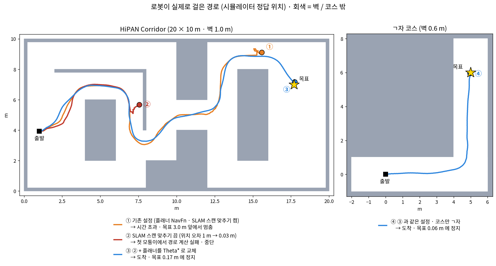
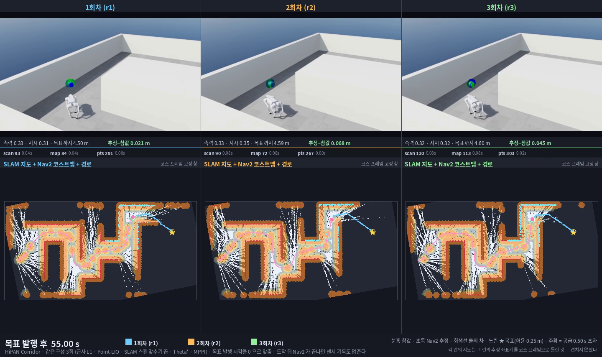
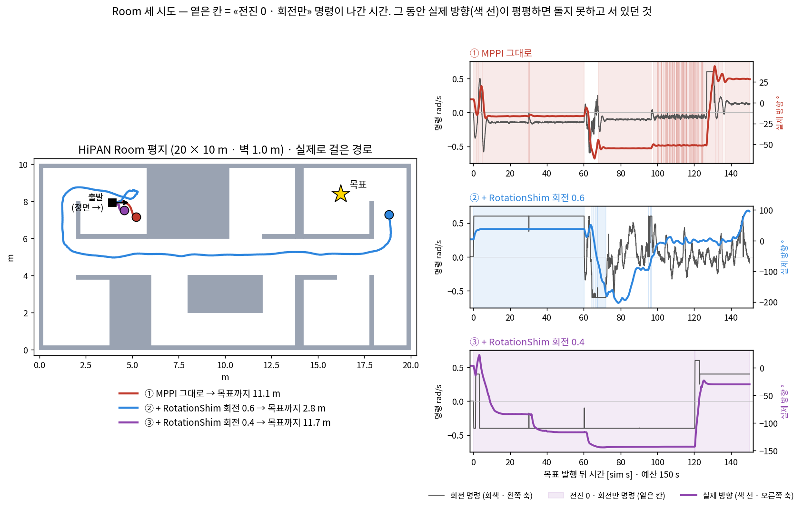
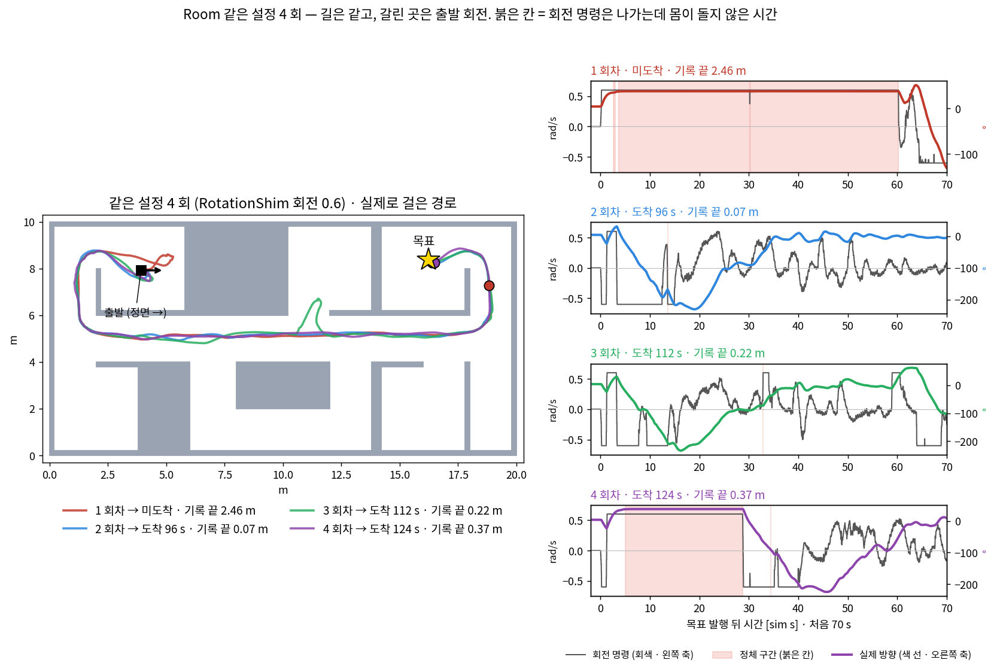
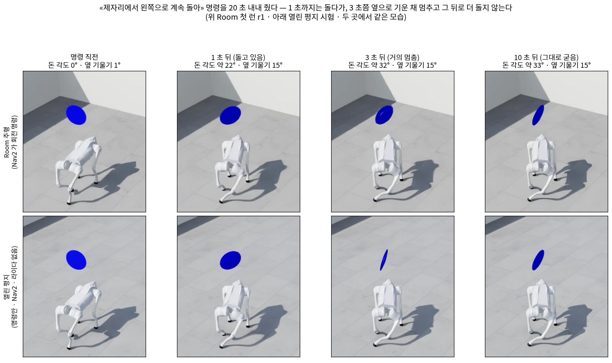
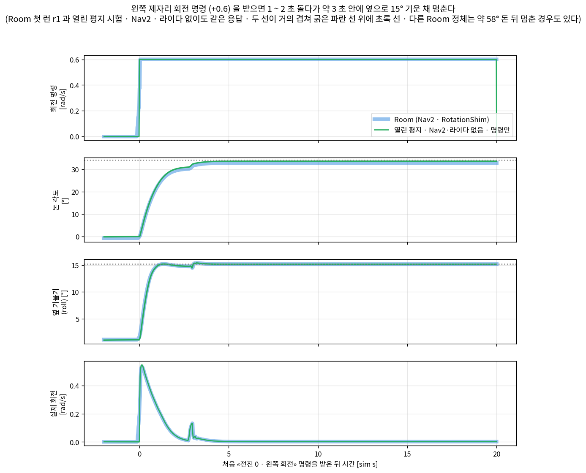
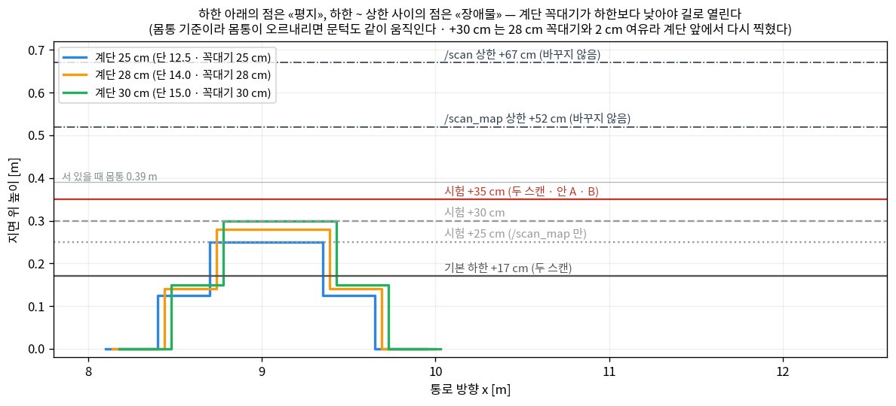
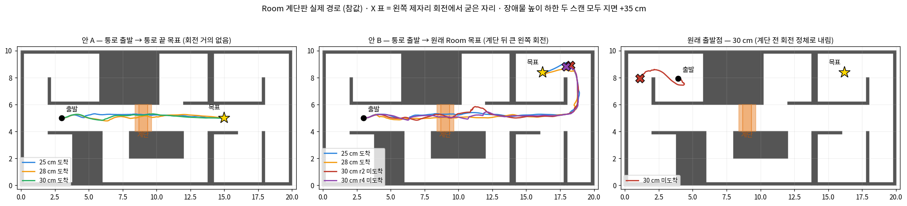
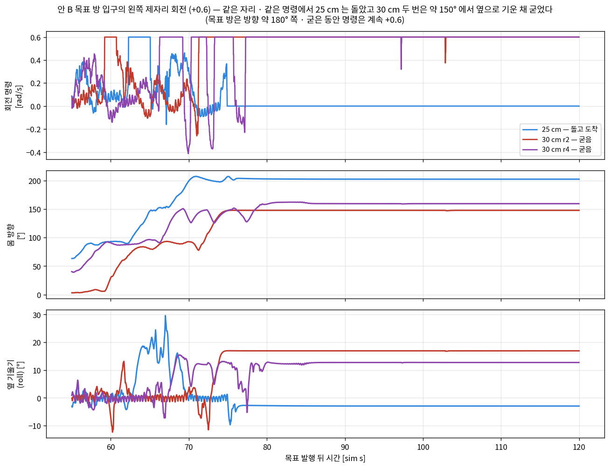

> 분류: 실험
> 작성: 이민우 · 2026-10-29
> 근거: 자체 시험 (Isaac Sim · 정책 v2 체크포인트 고정) · 수치는 런 기록에서 `확인됨` · 원인 해석은 `추측` · 정책 v2 의 회전 특성은 팀 MVP 평가 https://github.com/foothold-project/foothold-lab/blob/main/docs/research/20260928-v2-mvp-report.md
> 요지: ㄱ자 · HiPAN Corridor · Room 세 맵의 Nav2 · SLAM 자율보행 경과와 바꾼 설정의 근거를 맵별로 적은 전체판이다
> 상태: 초안
> 판: v1.0

# L1 라이다 시뮬 자율보행 경과 보고: ㄱ자 · HiPAN Corridor · Room

이민우 · 2026-10-29 · 기간 10-16 ~ 10-29 (10-28 센서 설정 확인 · 10-28 ~ 29 지형판 시험 반영) · 모두 Isaac Sim 시뮬 · 정책 v2 체크포인트 고정 · 관절 직접 제어 없음

## 요약

1. **처음 쓴 라이다 설정은 실기 L1 보다 훨씬 촘촘했다** (회전 150 Hz · 내부 발사 약 15 배). 이 설정으로 ㄱ자는 통과했지만, 실기보다 좋은 센서로 얻은 결과라 «실기 L1 으로 된다» 는 근거로는 쓸 수 없다 (시뮬 안에서 알고리즘끼리 비교한 결과까지 무효라는 뜻은 아니다).
2. **실기 제원 그대로(11 Hz · 180 Hz · 21,600 점/s) 바꾸자 ㄱ자에서 실패했다.** 위치 추정이 출발 직후부터 틀어져(1.7 m · 137°) Nav2 가 엉뚱한 곳을 믿고 뒤로 돌았다.
3. **시뮬의 L1 은 제원 숫자만 넣으면 매 바퀴 같은 방향으로만 쏜다** (실기 L1 은 비반복 주사). 그래서 제원 숫자는 지키고 주사 패턴만 실기처럼 비반복이 되게 근사했다 («근사 L1»).
4. 근사 L1 + 위치추정기 교체(rko → Point-LIO) 구성에서 ㄱ자 첫 시도는 실패, 제어기 기록 빌드로 돌린 두 시도는 **Nav2 도착** (10-25 · 각 변경의 기여량은 미분리).
5. HiPAN Corridor 는 모퉁이에서 전역 플래너 NavFn 이 경로를 못 뽑아 막혔다. **전역 플래너 플러그인을 NavfnPlanner → ThetaStarPlanner (알고리즘 NavFn → Theta*) 로 바꾼 뒤 Corridor · ㄱ자 모두 도착** (10-26). Corridor 는 같은 구성으로 **3 회 모두 도착 · 경로 계산 실패 0** (sim 220 s 기록 끝의 실제 위치가 목표 0.25 m 안인 것은 2/3, 1 회는 도착 뒤 명령 0 상태에서 자세가 크게 흔들려 멀어짐 · 원인 미확정). 3/3 은 이 코스 · 이 구성의 세 시도 결과이지 성공률 · 험지 · 실기 성능이 아니다.
6. **HiPAN Room 은 출발 방에서 제자리 회전이 막히는 것이 문제였다** (10-26 ~ 10-27). 출구가 로봇 옆·뒤에 있어 서 있는 자리에서 크게 돌아야 하는데, **보행 정책 v2 가 «서 있다가 제자리에서 크게 도는» 동작을 안정적으로 하지 못했다**. 작은 회전 명령에는 돌지 않았고, 큰 회전 명령(0.4 · 0.6 rad/s)에는 조금 돌다 몸이 기운 자세로 굳기도 했다. 제어기 앞에 RotationShim(회전 0.6)을 붙인 같은 설정으로 4 번 돌려 **sim 150 s 안 Nav2 도착 3 번, 기록 끝 실제 위치가 목표 0.25 m 안 2 번** 이었다. 출발 회전 중 오래 굳은 것도 2 번(그중 1 번은 미도착) 이라 **도착은 가능하지만 믿고 반복할 수 있는 상태는 아니다.** 10-29 에 같은 설정으로 2 번 더 돌렸고 둘 다 미도착이었다. r5 는 출발 회전은 됐지만 도중 오른쪽 제자리 회전에서 굳었고 (예산 끝 목표 2.71 m), r6 은 출발 왼쪽 회전에서 55 s 굳었다 (예산 끝 3.65 m) · 6 번 중 도착 3. 제자리 회전 대신 «걸으며 방향 맞추기» 를 검토했으나, 걷는 곡선은 한 번 됐어도 Room 출발 방에서 안전하게 쓸 조건(공간 · 정지 · 다리 여유 · 명령 넘겨주기)을 확보하지 못해 보류했다.
7. **열린 평지에서 Nav2 · 라이다 없이 «전진 0 · 왼쪽 회전» 명령만 줘도 Room 출발 정체와 비슷한 자세 (약 33° 돌고 옆으로 15° 기울어 멈춤 · Room 첫 런 r1 과 거의 같음) 로 굳었다** (10-27 · 1 회) → **지도를 잘 만들고 경로가 나와도, 지금 정책 · 실행계는 «서 있다가 제자리에서 도는» 동작을 보장하지 못해 출발 방향 전환에서 막힐 수 있다.**
8. **지형판 (Room 통로에 pit 0.20 m · 계단 0.14/0.28 m) 에서는 지금 지형 표현의 한계가 드러났다** (10-28 ~ 29 · 9절). 지금 구성은 몸통 기준 높이 띠 안의 점만 장애물 후보로 남기고 단 높이 · 경사는 따지지 않는다. 이 구성에서 계단은 장애물로 찍혀 돌아갔고 pit 은 들어간 뒤 갇혔다 (출발 정체 · 코스트맵 갱신 등이 섞여 단독 원인은 미확정). 문턱을 올려 계단을 열어 보니, 문턱이 코스트맵 장애물 층과 SLAM 지도 두 곳에 있어 한 곳만 바꾸면 SLAM 지도 쪽 표시가 남았다. 두 곳을 모두 지면 +30 cm 로 올리고 계단 앞에서 출발한 진단 런에서 **v2 는 계단을 넘었지만** (1 회), 계단 바로 앞에서는 국소 코스트맵에 턱이 다시 찍혔고 약 27 s 멈췄다 (출처 · 기전 미분리). 두 곳을 **지면 +35 cm** 로 올리고 출발 회전이 없는 통로에서 출발시키자 계단 25 · 28 · 30 cm 를 Nav2 가 길로 잡고 v2 가 넘었다 (통로 끝 목표 3/3 도착 · 원래 Room 목표 25 · 28 cm 도착 · 30 cm 2 번은 목표 앞 왼쪽 제자리 회전 정체로 미도착). +35 cm 는 그보다 낮은 실제 장애물을 못 보는 시험용 값이라, 문턱 값 조정이 지형 판단의 해결책은 아니다.

## 바꾼 설정 한눈에: 각 부품이 하는 일과 바꾼 이유

로봇이 혼자 걷는 흐름은 «라이다가 주변을 찍는다 → 위치추정기가 얼마나 움직였는지 계산한다 → SLAM 이 지도를 그린다 → 전역 플래너가 큰 길을 긋는다 → 제어기가 매 순간 속도 명령을 낸다 → 보행 정책이 다리를 움직인다» 이다. 아래는 이 흐름에서 처음에 설정한 구성 대비 바꾼 것이다. **보행 정책(v2)은 바꾸지 않았다.** 지금 Room 런은 표의 «지금» 열 구성 그대로다 (Corridor 는 RotationShim 만 없음).

| 부품 | 이 부품이 하는 일 | 처음 설정 | 지금 | 왜 바꿨나 | 대가 · 한계 | 자세히 |
|---|---|---|---|---|---|---|
| 라이다 | 주변까지의 거리를 점으로 찍는다 | XT-16 (실기에 없음) | **근사 L1**: 실기 L1 발사 제원(11 Hz · 180 Hz · 21,600 점/s) + 매 바퀴 같은 방향으로만 쏘지 않게 시작 방위를 조금씩 밀기 | 실기 Go2 센서는 L1. 시뮬 L1 을 제원 숫자만 넣으면 매 바퀴 같은 방향만 쏴서, 서 있기만 해도 위치추정이 흘렀다 (실기에 없는 결함) | 실기 L1 의 비반복 주사를 «재현» 한 것이 아니라 근사. 실기 점군과 같다는 검증 없음 | 1 · 2 · 3절 |
| 라이다 출력 묶기 | 시뮬이 내보내는 조각 프레임을 모아 한 장으로 만든다 | 한 바퀴 완성 때만 출력 | 매 프레임 출력 + 0.08 s 씩 묶어 한 장으로 (조립 노드) | 한 바퀴 완성 출력으로는 1 초에 1.7 장 · 최대 공백 1.3 s 라 쓸 수 없었다 | 묶음 길이(0.08 s)는 내가 정한 값 | 2 · 3절 |
| 위치추정기 | 라이다 + IMU 로 «방금 얼마나 움직였나» 를 쌓아 로봇 위치를 낸다 | rko_lio | **Point-LIO** | 근사 L1 + rko 에서 선회 중 회전 40.8° · 위치 1.68 m 틀림. Point-LIO 로 바꾼 뒤 이 구성에서 0.2 m 안 | 바꾼 효과와 라이다 변경 효과를 따로 나누지 못했다 | 4절 |
| SLAM (slam_toolbox) 스캔 맞추기 | 새 스캔을 지금까지의 지도에 맞춰 보고 위치를 고친다 | 켬 | **끔** (`use_scan_matching: false`) | Corridor 에서 켬이 멀쩡한 위치를 1.08 m 틀어 놓았다. 끄자 0.03 m | 루프 닫기도 같이 꺼진다. 긴 코스 · 실기에서는 오차가 쌓일 수 있다 | 5절 |
| 전역 플래너 | 지도 위에 출발 → 목표의 큰 길을 긋는다 | NavFn (플러그인 NavfnPlanner) | **Theta*** (플러그인 ThetaStarPlanner) | Corridor 모퉁이에서 NavFn 이 길을 «뽑는» 단계에서 맴돌다 실패 16 회. Theta* 로 실패 0 | 직선 위주 길이라 모퉁이 안쪽으로 붙을 수 있다. 아직 못 본 칸은 «지나갈 수 있음» 으로 보고 긋는다 (Room 첫 경로가 안 보인 벽을 가로지름) | 5절 |
| 전역 코스트맵 크기 | 전역 플래너가 길을 긋는 격자 지도의 범위 | 크기 지정 없음 (SLAM 지도를 따라감) | 40 m 로 고정 (그 전 내 사본 24 m) | HiPAN 맵(20 × 20 m)을 출발점 기준으로 담으려고 넓혔다 (설정 사본의 변경 주석 기준 · 고정 크기로 바꾼 당시 근거는 이 보고에서 다시 확인하지 않음) | 길 찾는 방식은 같다 | - |
| 제어기 (MPPI) | 큰 길을 따라 매 순간 전진 · 회전 속도 명령을 고른다 | MPPI | MPPI 그대로 · **내부 값을 기록하는 장치를 넣어 따로 빌드한 판** | 왜 제자리에서 작은 회전만 냈는지 내부를 보려고 (7절 ①) | 계산 방식은 같게 빌드했지만 «기록 장치 없는 판» 과 같은 실행물은 아니다 (4절에서 1 회차와 2 · 3 회차가 갈린 이유 미확정) | 4 · 7절 |
| 제어기 앞 RotationShim (Room 만) | 길이 몸 정면에서 45° 넘게 벌어지면 MPPI 대신 «제자리에서 돌아라» 를 직접 내고, 22.5° 안으로 맞으면 MPPI 에 넘긴다 | 없음 | **붙임** · 회전 0.6 rad/s · 명령을 실제 회전이 아니라 직전 명령 기준으로 키움(`closed_loop: false`) | Room 에서 MPPI 가 서 있는 로봇에게 ±0.175 안의 작은 회전만 내는 고리에 갇혔다 (서 있으면 다음 명령도 작게 묶임). 회전 명령을 키워 그 고리를 끊으려고 | 명령은 커졌지만 **정책이 서 있다가 제자리에서 도는 동작을 안정적으로 못 했다**. 회전 시작 뒤 수 초 안에 기운 채 굳는 일이 Room · 열린 평지에서 나왔다 (출발 정체 자세는 옆 15° 안팎으로 비슷했다). 0.4 로 낮춘 시도도 굳음 | 7 · 8절 |

- 표의 «지금» 은 모두 내 사본 설정에만 있다. 팀 원본 설정은 바꾸지 않았다.
- 한 번에 하나씩 바꾸려 했지만, 4절(라이다 · 위치추정기 · 전달부 수정)처럼 여러 개가 같이 바뀐 구간이 있어 각 변경의 기여량은 다 나누지 못했다.
- 속도 범위는 팀 설정(교재 Nav2 설정) 그대로다: 전진 0 ~ 1.0 m/s · 회전 ±0.6 rad/s · 후진(`vx_min 0`) · 옆걸음(`vy 0`) 막음. 그래서 방향을 바꾸는 방법은 «걸으며 돌기» 와 «제자리 회전» 뿐이다.
- 이 표는 이 보고 기간(10-16 ~ 10-27)에 결과를 가른 변경만 담았다. 그 전에 내 사본에서 바꾼 값(지역 코스트맵 크기 등)은 다 넣지 않았다.

### 이 설정들은 «HiPAN 맵을 통과시키려고 맞춘 것» 인가

**그렇게 볼 수 있다.** 위 변경은 모두 특정 맵(ㄱ자 · Corridor · Room)에서 실패한 뒤 그 실패를 풀려고 넣었고, 바꾼 뒤 처음 보는 맵에서 통과한 사례는 아직 없다. 그래서 **«Nav2 · SLAM 을 일반적으로 잘하게 만든 설정» 이라고 주장하지 않는다.** 다만 변경마다 성격이 다르다.

| 바꾼 것 | 계기가 된 실패 | 성격 | 맵 맞춤인가 |
|---|---|---|---|
| 근사 L1 · 전달부 결함 수정 | ㄱ자 (위치 추정 틀어짐) | **시뮬 결함 보정** | 맵과 무관. 시뮬 L1 이 매 바퀴 같은 방향만 쏘는, 실기에 없는 결함을 고친 것이고 직진 시험으로 효과를 봤다. 다만 근사 방식(시작 방위를 +8° 씩 밀기)은 내가 정한 값이다 |
| 위치추정기 rko → Point-LIO | ㄱ자 | **부품 교체** | 맵 맞춤 성격은 약하다 (실기 L1 쪽에서 쓰는 추정기). 단 ㄱ자 한 코스에서 고른 것이다 |
| 전역 플래너 NavFn → Theta* | Corridor 모퉁이 | **부품 교체 (원인 확인 뒤)** | NavFn 이 길을 뽑다 맴도는 실패를 저장 지도로 재현했고 그 기전은 맵 고유가 아니다. 그래도 Corridor 한 맵에서 확인하고 바꿨다 |
| SLAM 스캔 맞추기 끔 | Corridor (위치 1.08 m 틀어짐) | **환경 의존 맞교환** | **가장 맵 맞춤에 가깝다.** 짧은 시뮬 코스에서 Point-LIO 가 정확해서 보정을 끈 것이고, 루프 닫기도 같이 꺼져 긴 코스 · 실기에서는 오히려 나빠질 수 있다 |
| 전역 코스트맵 40 m 고정 | HiPAN 맵 크기 | **맵 크기에 맞춤** | 길 찾는 방식은 그대로지만 맵 크기를 보고 정한 값이다 |
| RotationShim (회전 0.6) | Room 출발 회전 | **정책 한계 우회** | Nav2 · SLAM 을 잘하게 한 것이 아니다. 정책이 작은 제자리 회전 명령에 반응하지 않아 명령을 키운 것이고, 그마저 굳는 문제가 남았다 |

- **위 표의 변경은 값 훑기로 고르지 않았다.** 실패마다 원인을 먼저 찾고 그 원인을 겨냥해 하나씩 바꿨다 (RotationShim 회전값만 0.6 · 0.4 두 값을 써 봤고, 그 뒤 값 조정은 멈췄다). 다만 9절 지형판에서는 높이 문턱을 25 · 30 · 35 cm 로 바꿔 가며 시험했고, 출발 · 목표도 함께 바뀐 비교가 있어 단일 변수 효과로 보지 않는다.
- 맵마다 주행이 1 ~ 6 번뿐이라, 어느 설정이 일반적으로 좋은지 말할 단계가 아니다. 일반성을 보이려면 이 설정을 고정한 채 처음 보는 맵에서 통과하는 것을 보여야 한다.

---

## 1. 처음 적용한 라이다 설정: 실기보다 촘촘했다 (10-16 ~ 10-21)

10-16 에 시뮬 라이다를 실기 Go2 에 없는 XT-16 에서 실기 센서 **L1** 으로 바꿨다. 시야(센서 기준 반구 360×90°) · 거리는 제원대로 넣고, 장착은 Isaac 공식 Go2 모델의 라이다 자리(머리 턱 밑 · 뒤집어 달아 «앞쪽 아래» 반구를 봄 · 지면 약 0.35 m)를 썼지만, **점을 내보내는 구조는 XT-16 방식을 그대로 썼다.**

| | 실기 L1 제원 | 이때 시뮬 («촘촘한 설정») |
|---|---|---|
| 회전 | 11 Hz | **150 Hz** |
| 수직 채널 | 120 점 · 0.756° 간격 | **16 채널 · 6°** |
| 내부 발사 | 21,600 점/s | **약 320,000 점/s** |
| 벽 높이 점이 덮는 방위 (2° 칸 180 개 중) | - (제원값으로 시뮬 시 30) | **97** |

- 왜 그랬나: 당시 쓰던 «한 바퀴 완성 때만 출력» 설정과 0.1 s 조회 경로에서는 완성된 한 바퀴만 나왔다 (Isaac 전체의 제약은 아니다. 10-24 에 «매 프레임 출력» 으로 바꿀 수 있음을 확인). 제원대로 넣으면 1 초에 1.7 장 · 최대 9 초 공백이 생겨 쓸 수가 없었다. 토픽에서 실기 수율을 맞추려고 내부에서 약 15 배를 쏘는 XT-16 관행을 따랐다.
- 이 설정으로 나온 결과:
  - ㄱ자: Nav2 도착 여러 번 (32.5~42.9 s). 단 최종 정지 거리는 0.43~1.51 m 로 들쭉날쭉.
  - HiPAN Corridor (10-20): 6.5 m 를 간 뒤 벽 앞에서 정체 · 시간 예산 소진.
  - (런 기록 이름: ㄱ자 l1i · l1j · l1k · la1 / Corridor hp1)
- 🔴 **문제**: 이민우의 생각 «시뮬 라이다가 실기보다 좋으면 안 된다 (같거나 모자라야 한다)» 에 어긋난다. 이 시기의 ㄱ자 통과는 실기 L1 로 된다는 근거가 아니다 (같은 설정 안에서 시뮬 알고리즘을 서로 비교한 결과는 그 범위에서 유효).

## 2. 실기 제원 그대로: ㄱ자 실패 (10-21 ~ 10-24)

| 순서 | 바꾼 것 | 결과 |
|---|---|---|
| 1 · 정지 시험 | 제원 그대로 (11 Hz · 180 Hz · 21,600) | 1 초에 1.7 장 · 공백 1.3 s → 못 씀 |
| 2 · 정지 시험 | + 매 스텝 조회 | 1 초 8.35 장 · 장당 1,920 점 (발행 장수 · 점 수는 실기 명목 계산값보다 낮음 · 실기 이하 성능인지는 미검증) |
| 3 · ㄱ자 | 위와 같음 | 출발 관문(유효 빔 수)에서 목표 전 중단 |
| 4 · Corridor | 위와 같음 | 24.7 s 에 Nav2 포기 · 위치 추정 오차 2 배 |
| **5 · ㄱ자** | 출발 관문 조정 뒤 첫 주행 | **실패**. 1.98 m 전진 뒤 뒤로 돌아 제자리 · 시간 예산 소진 |
| 6 · ㄱ자 (10-24) | 출력을 «한 바퀴 완성 때» → «매 프레임» 으로 | 라이다 출력은 10 Hz 로 고르게 됐지만 **여전히 실패** |

(런 기록 이름: 1 lr0 · 2 lr0p1 · 3 lr1_L · lr2_L · 4 lr1 · 5 lr3_L · 6 fa1_L)

**5 번 ㄱ자가 실패한 이유: 위치 추정이 틀어졌다**

| sim 시각 | 실제 위치 (코스 m) | Nav2 가 믿은 위치 | 위치 오차 | 방향 오차 |
|---|---|---|---|---|
| 48.5 s | (0.25, 0.05) | (0.12, 0.04) | 0.13 m | −1° |
| 56.0 s | (1.66, 0.38) | (0.57, 0.34) | 1.09 m | 52° |
| 61.0 s | (1.98, 0.28) | (0.27, 0.34) | **1.71 m** | **137°** |

- 로봇은 1.7 m 를 갔는데 위치추정기(rko_lio)는 0.5 m 만 갔다고 셌다. 방향도 137° 틀어졌고, Nav2 는 그 틀린 방향을 믿고 몸을 돌렸다.
- 같은 구간에서 1절의 촘촘한 설정은 오차 0.03~0.25 m · 4° 안이었다.
- 유력 후보 (추정): 제원대로면 한 장의 83 % 가 바닥 점이고, 벽 점이 덮는 방위가 촘촘한 설정의 1/3 (30 대 97 칸). 긴 평행 통로에서 스캔 정합이 앞뒤 이동과 회전을 붙잡기 어렵다.

## 3. 왜 제원 «그대로» 가 아니라 «실기와 비슷하게» 맞췄나 (10-25)

**시뮬 L1 이 실기 L1 과 다른 방식으로 나빴기 때문이다.**

- 실기 L1 은 **비반복 주사** 다. 회전마다 찍는 자리가 조금씩 달라 약 1 초면 시야가 촘촘히 메워진다.
- Isaac 에는 Unitree L1 프로파일이 없다. 회전형 라이다(Ouster OS0)를 바탕으로 제원 숫자만 넣은 모형이다.
- 그 모형은 **매 바퀴 처음 상태로 돌아가 같은 방향으로만 쐈다.** 4 프레임 떨어진 두 장의 빔 방향이 약 98 % 일치했다 (점 좌표가 아니라 쏘는 방향의 주기적 일치). 서 있기만 해도 위치추정기가 흘렀다.
- 이것은 «실기보다 모자란» 것이 아니라 «실기에 없는 결함» 이다. 이대로는 실기 L1 로 될지 안 될지를 시험할 수 없다.

그래서 **발사 제원(11 Hz · 180 Hz · 21,600 점/s)은 그대로 두고, 주사 패턴만 실기처럼 반복이 깨지게** 바꿨다 («근사 L1» · 기록 이름 nr3a):

| 바꾼 것 | 근거 |
|---|---|
| 0.08 s 마다 시작 방위를 +8° 씩 밀기 | 같은 방향 반복을 깸 (4 프레임 방향 일치 약 98 % → 0 %) · 명목 발사값(11 Hz · 180 Hz)은 고정했지만 실제 회전 11 Hz 가 그대로 재현되는지는 미확인 |
| 한 쓸기를 수평 → 천정 → 반대쪽 수평 (0→180°) 으로 **의도** | 설명서의 «수직 180° 측정» 을 참고. 🔴 **10-28 확인: 실제로는 적용되지 않았다**. 코드 뒤쪽에서 반대쪽(+180°) 방위가 덮어써져, 한 쓸기가 같은 쪽으로 올라갔다(0→90°) 다시 내려온다. 당시 로그의 «방위 +180 점 59» 줄은 덮어쓰기 전에 찍힌 값이라 적용 증거가 아니었다 |
| 시뮬 → ROS 전달부 결함 2 개 수정 | 시각값 오류로 어댑터가 죽던 것 · 회전 뒤 빈 프레임 때문에 묶음을 거의 다 버리던 것 |

- 효과: 직진 시험에서 Point-LIO 위치 오차 2~9 mm · 회전 0.1~0.3°. 위 변경을 함께 넣은 «근사 L1 구성» 의 관측이며, 각 변경의 몫은 나누지 않았다. 특히 «반대쪽 쓸기» 는 실제로 적용되지 않았으므로 이 효과를 그 덕으로 볼 수 없다.
- 🔴 한계: 실기 L1 패턴의 «재현» 이 아니라 0.88 초 주기의 근사 모형이다. 실기 점군과 같다는 검증은 없다.

**10-28 센서 설정 확인 (런 기록 · 코드 · 코덱스 교차 확인)**

- **발사율은 21,600 점/s 였다.** 10-26 · 10-27 런 11 개(ㄱ자 1 · Corridor 4 · Room 6) 모두, 런 당시 기록에 센서가 실제로 적용한 값(21,600 점/s · 회전 11 Hz · 한 쓸기 120 점)이 찍혀 있다. 지금 코드 경로도 이와 같다. 받은 점은 0.1 s 묶음당 중앙 약 1,500 · 초당 약 1.5만 ~ 1.8만 (맞힐 물체가 없는 방향은 점이 돌아오지 않는다).
- 런 기록 파일(`sha_l1_sensor.txt`)의 «기본 320,000» 은 **기록 문구 오류다.** 런을 띄우는 상위 스크립트가, 실제 값을 정하는 하위 스크립트를 보지 않고 고정 문구를 적었다. 같은 파일의 센서 해시 목록도 실제로 쓴 사본이 아닌 원본 파일을 적고 있어 근거로 쓰지 않는다. 런을 무효로 할 사안은 아니다.
- 장착은 위 1절대로 «턱 밑 · 앞쪽 아래». Isaac 공식 Go2 모델 값이며, Unitree 공식 URDF 에는 라이다 위치가 없어 **실기 장착과 같은지는 확인하지 못했다** (실기에서 `tf2_echo base_link utlidar_lidar` 한 번으로 확정 가능).
- 위 «반대쪽 쓸기» 미적용은 런 결과(도착 여부 · 위치 오차 등 관측값)를 버릴 사안이 아니다. 다만 이 런들은 «nr3a 근사 센서 구성의 관측» 이고 «실기 L1 주사를 구현한 결과» 가 아니다. 센서 코드를 고치면 다른 센서 판이 되므로, 지금 결과와 바로 비교하지 않는다.

## 4. 근사 L1 으로 ㄱ자 실패 → 성공 (10-25)

| 순서 | 구성 | 결과 |
|---|---|---|
| 시험 | 근사 L1 + 원래 위치추정기 rko | 선회 중 회전 40.8° · 위치 1.68 m 틀림 → 이 오차로는 그대로 Nav2 에 넣기를 권하지 않았다 |
| 1 회 | 위치추정기 rko → **Point-LIO** (실기 L1 쪽에서 쓰는 추정기) | 이 센서 · Point-LIO 구성에서 관측한 위치 오차가 0.07~0.16 m 로 줄었다 · 그러나 모퉁이에서 제어기(MPPI)가 계속 오른쪽으로 돌아 정체 → **실패** |
| 2 회 | 1 회와 같은 설정값 · 제어기(MPPI)는 기록 장치를 넣어 따로 빌드한 판 | **Nav2 도착** sim 37.0 s · 넘어짐 없음 |
| 3 회 | 2 회 그대로 한 번 더 | **Nav2 도착** sim 41.6 s |

(런 기록 이름: 시험 nr3a · 1 회 np1_L · 2 회 mp1_L · 3 회 mp1_L2)

- **바뀐 것**: 시뮬 L1 의 반복 주사를 깨고(3절), 위치추정기를 rko → Point-LIO 로 바꾸고, 전달부 결함을 고쳤다. 이 구성에서 관측한 위치 오차가 모퉁이를 포함해 0.2 m 안으로 줄었고, 기록 장치를 넣은 제어기 빌드로 돌린 뒤의 두 시도에서 Nav2 가 도착했다. 각 변경의 기여량은 나누지 못했다.
- 1 회 실패 · 2 회 도착이지만, 1 회와 2·3 회는 제어기 빌드가 달라 «같은 실행물로 3 회 중 2 회» 라고 쓰지 않는다. 1 회차가 모퉁이에서 오른쪽으로 돈 이유와 1 회 · 2 회가 갈린 이유는 확정하지 못했다.
- 🔴 도착 뒤 정지가 불안정: 명령이 0 이 된 뒤에도 0.2~0.3 m 더 움직여 최종 거리 0.54 / 0.46 m (목표 원 0.25 m 밖).

## 5. HiPAN Corridor: 전역 플래너 플러그인 NavfnPlanner → ThetaStarPlanner (알고리즘 NavFn → Theta*) (10-26)

### SLAM 「스캔 맞추기」 켬 · 끔이란

로봇 위치는 두 단계로 정해진다.

```
① Point-LIO (라이다 + IMU 오도메트리)   걸음마다 「얼마나 움직였나」 를 쌓아 위치를 낸다
② slam_toolbox (지도 만들기)             ① 의 위치에 새 스캔을 붙여 지도를 그린다
                                        Nav2 가 쓰는 위치 = ① 의 위치 + ② 의 보정
```

| | 스캔 맞추기 켬 (기본값) | 스캔 맞추기 끔 (`use_scan_matching: false`) |
|---|---|---|
| 하는 일 | 새 스캔을 지금까지의 지도에 «맞춰 보고», 어긋난 만큼 ① 의 위치를 고친다 | 고치지 않는다. ① 의 위치를 그대로 믿고 스캔을 지도에 붙이기만 한다 |
| 루프 닫기 | 된다 (한 바퀴 돌아 같은 곳에 오면 쌓인 오차를 한 번에 바로잡음) | **같이 꺼진다** |
| 좋은 경우 | ① 이 조금씩 흘러갈 때 지도와 맞춰 바로잡는다 | ① 이 이미 정확할 때: 괜한 보정으로 흔들지 않는다 |
| 나쁜 경우 | 맞춰 볼 특징이 약한 곳(긴 평행 벽 · 성긴 스캔)에서 잘못 맞추면 멀쩡한 위치를 오히려 틀어 놓는다 | ① 이 흘러가도 바로잡을 장치가 없다. 긴 코스 · 실기에서 오차가 쌓일 수 있다 |

- **이번 결과**: 켬(①) 에서는 Nav2 가 믿는 위치가 실제와 **1.08 m** 어긋났다. 끄자(②) **0.03 m**. 켬 런에서도 Point-LIO 자체 오차는 0.14 m 였으므로, 어긋남의 대부분은 SLAM 보정이 더한 것이다.
- 왜 잘못 맞췄는지(통로 모양 · L1 스캔 밀도 등)는 **확인하지 않았다**. 추정이다.
- 그래서 지금 끔은 «이 시뮬 · 이 코스에서 Point-LIO 가 충분히 정확해서 고를 수 있는 선택» 이지, 항상 좋은 설정이 아니다. 실기 · 긴 코스 · 같은 곳을 다시 지나는 코스에서는 켬과 다시 비교해야 한다.

### 전역 플래너 NavFn · Theta* 란

전역 플래너는 코스트맵(칸마다 «지나가기 얼마나 위험한가» 가 적힌 격자) 위에 출발 → 목표의 큰 길을 그린다. 그 길을 따라 실제 속도 명령을 내는 것은 따로 있는 제어기(MPPI)다.

Nav2 에서 전역 플래너는 «플러그인» 으로 끼우고, 플러그인 하나가 알고리즘 하나를 담는다. 그래서 설정 파일의 전역 플래너 칸에서 플러그인 이름(`nav2_navfn_planner::NavfnPlanner` → `nav2_theta_star_planner::ThetaStarPlanner`)을 바꾸면 길 찾는 알고리즘도 NavFn → Theta* 로 함께 바뀐다. 같은 칸의 NavFn 전용 값(`use_astar: true` · `tolerance: 0.5`)은 빼고 Theta* 값(`how_many_corners: 8` · `w_euc_cost: 1.0` · `w_traversal_cost: 2.0` · `allow_unknown: true` · `use_final_approach_orientation: false`, 모두 Nav2 1.3.13 기본값)을 넣었다. 아래 표의 ② → ③ 에서 바꾼 것은 이 교체 하나이고, 제어기(MPPI) · 코스트맵 · SLAM(② 에서 이미 스캔 맞추기 끔) 은 그대로다. 각 런 Nav2 로그의 `Created global planner plugin GridBased of type …` 줄로 실제로 불러온 플러그인을 확인했다. 아래에서 NavFn · Theta* 는 이 두 플러그인을 가리킨다.

| | NavFn (기존 · Nav2 기본 · 플러그인 NavfnPlanner) | Theta* (교체 · 플러그인 ThetaStarPlanner) |
|---|---|---|
| 길 찾는 방식 | ① 목표에서부터 지도 전체에 «목표까지 드는 비용» 을 물결처럼 퍼뜨려 깐다 ② 로봇 자리에서 그 비용이 낮아지는 쪽으로 한 칸씩 내려가며 길을 «뽑는다» | A* 탐색을 하면서 칸마다 «어디서 왔는지(부모)» 를 저장한다. 목표에 닿으면 그 부모 연결을 거꾸로 따라가 길을 얻는다 (NavFn 처럼 비용 경사를 따라 내려가는 추출이 아니다) |
| 길 모양 | 칸을 따라 이어진 매끈한 곡선 | 벽에 막히지 않는 한 먼 점까지 «직선» 으로 잇는다 → 꺾이는 점이 적은 꺾은선 |
| 벽 피하기 | 비용이 높은 칸을 피해 비용을 깐다 | 직선마다 지나는 칸의 비용을 더해 고른다 · 벽 칸을 지나는 직선은 버린다 |
| 이번에 문제된 점 | 저장된 지도 일부(72.7 · 80.4 s)에서 ② 의 «뽑기» 가 같은 자리를 맴돌다 반복 한도를 다 써 실패하는 것을 재현 (A* · Dijkstra 어느 쪽으로 깔아도 같음) | 실패 0 회. 다만 직선 위주라 모퉁이 안쪽에 붙는 길이 나올 수 있다. Corridor 1 회차에선 로봇 중심 ↔ 벽 최소 거리 0.69 m 로 NavFn 런(0.45~0.50 m)보다 멀었다 (충돌 검증은 아님) |

- 둘 다 2D 코스트맵만 보므로 단차 · 경사 같은 험지는 판단하지 못한다 (9 · 10절).



| | ① 기존 설정 | ② 스캔 맞추기 끔 | ③ + Theta* | ④ ③ 으로 ㄱ자 |
|---|---|---|---|---|
| 바꾼 것 | 4절 구성 그대로 (플래너 NavFn) | ① 에서 SLAM 스캔 맞추기만 끔 | ② 에서 플래너만 Theta* 로 | ③ 과 같음 · 코스만 ㄱ자 |
| Nav2 결과 | 시간 예산 소진 | Nav2 포기 | **도착** 68.8 s | **도착** 27.6 s |
| 최종 정지 (목표까지) | 3.00 m | 10.49 m | **0.17 m** | **0.055 m** |
| 위치 오차 | 1.08 m | 0.03 m | 0.02 m | 0.02 m |
| 경로 계산 실패 | 16 회 | 16 회 | **0 회** | **0 회** |

(공통: 근사 L1 · Point-LIO · MPPI · 도착 예산 sim 150 · 벽 높이 Corridor 1.0 m / ㄱ자 0.6 m. 「최종 정지」는 시뮬 정답 위치로 잰 값.
런 기록 이름: ① hp3_v2 · ② corridor_nosm_r2 · ③ corridor_theta_r1 · ④ theta_L_r1)

- **① → ② (스캔 맞추기 끔)**: SLAM 이 스캔을 지도에 맞추며 오히려 위치를 1 m 틀어 놓았다. 끄자 0.03 m 로 줄었다. 대신 루프 닫기도 같이 꺼진다.
- **② 의 실패**: 첫 모퉁이에서 앞쪽에 아직 안 본 칸이 흩어져 있을 때, NavFn 이 «목표까지 비용» 은 다 계산했지만 그 비용을 따라 경로를 «뽑는» 단계에서 같은 자리를 맴돌다 반복 한도를 다 써 실패했다. 저장된 지도 일부(72.7 · 80.4 s)로 원문 코드를 돌려 같은 실패를 재현했고, A* ↔ Dijkstra 설정을 바꿔도 같았다. 이어진 실패 16 회 전부가 같은 원인이라고 확정한 것은 아니다.
- **② → ③ (Theta*)**: 비용 경사를 따라 내려가는 대신 탐색 중 저장한 부모 연결을 역추적하는 Theta* 로 바꿨다. 실패했던 저장 지도에서 로컬 재연으로 먼저 경로가 나오는 것(그 지도 · 정한 검사 범위에서 벽 칸 0)을 확인한 뒤 주행했다. 경로 계산 실패 0 · 복구 동작 0 으로 도착했고, 목표 0.2 m 안에 멈춰 끝까지 머물렀다.
- **④ (ㄱ자 재확인)**: 같은 구성으로 ㄱ자도 도착. 최종 0.055 m 로 4절의 ㄱ자보다 정지가 가까웠다. 다만 4절과는 스캔 맞추기 · 플래너 두 가지가 달라 같은 조건 비교가 아니다.
- 🔴 두 런 모두 마지막 방향은 목표 방향과 맞지 않는다 (−64.6° · 35.0°).

## 6. Corridor 반복 검증 (3 회)

③ 과 같은 구성 그대로 Corridor 를 2 회 더 돌렸다. 시뮬도 매번 실행 속도·센서 도착 시점이 조금씩 달라, 한 번의 도착이 우연인지 보려는 것이다.

| | Nav2 결과 | 걸린 시간 | 최종 정지 | 경로 계산 실패 | 기록 이름 |
|---|---|---|---|---|---|
| 1 회차 (5절 ③) | 도착 | 68.8 s | 0.17 m | 0 | corridor_theta_r1 |
| 2 회차 | 도착 | 70.1 s | 0.61 m (도착 순간 0.12 m) | 0 | corridor_theta_r2 |
| 3 회차 | 도착 | 70.3 s | 0.09 m (도착 순간 0.18 m) | 0 | corridor_theta_r3 |

**3 회 요약**: Nav2 도착 **3/3** · 기록된 경로 계산 실패 **0/0/0** · 복구 0/0/0 · 걸린 시간 68.8~70.3 s 로 고르다. 기록 끝(sim 219.98 s)의 실제 위치가 목표 0.25 m 안인 것은 **2/3** (0.174 · 0.611 · 0.086 m). 2 회차는 도착 뒤 자세가 흔들려 멀어졌다 (원인 미확정).
(「도착 순간」 값은 정답 기록 steps.csv 기준 0.253 · 0.123 · 0.182 m. 런 요약 파일 기준으로는 0.249 · 0.118 · 0.177 m 로 표본 시각 차이만큼 수 mm 다르다. 1 회차는 0.25 m 경계라 «안» 이라고 확정하지 않는다. 방향(yaw) 판정은 별개다.)



(영상: `../성공/7-Corridor-ThetaStar-반복검증/영상/Corridor-ThetaStar-3회-3분할-대시보드.mp4` · 목표 발행 시각을 0 으로 맞춰 세 런을 나란히)

- **2 회차**: 경로 계산 실패 0 · 복구 0 으로 도착했고, 도착 순간 목표 0.12 m (가장 가까울 때 0.03 m). 그런데 **명령이 0 인 채로 서 있던 sim 134 s 에 자세가 크게 흔들렸다**. 몸이 2 초에 걸쳐 옆으로 11° 까지 기운 뒤, 앞으로 최대 25° 숙이며 몸통이 0.39 → 0.29 m 로 내려앉고 30° 돌았다 (수평 속도 최대 약 0.7 m/s). 넘어짐 판정은 없었고 다시 섰지만 목표에서 0.61 m 떨어졌다. (마지막 비영 명령 116.12 s · 116.14 s 부터 끝까지 명령 0 · 131.9~135.3 s 명령 모두 0)
  - 명령이 0 인 동안 일어난 일이라 **새 플래너 명령 탓으로 볼 근거는 없다.** 분류는 «도착 뒤 영 명령에서의 자세 유지 · 보행 실행 문제» 까지다. 정책 자체 결함인지, 접촉 · 미끄러짐 · 물리 설정 · 앞선 동작의 영향인지는 이 기록만으로 가르지 못했다 (원인 미확정). 1 회차는 같은 시간 동안 자세 변화가 거의 없었다 (옆 기울기 약 0° · 앞뒤 −6.8° 로 일정).
  - 도착 · 경로 측면의 성과(실패 0 · 복구 0)와 정지 유지 실패는 따로 센다.
- **3 회차**: 도착 순간 0.18 m → 명령이 끊긴 뒤 목표 쪽으로 0.21 m 더 걸어 최종 0.09 m (가장 가까울 때 0.015 m). 휘청임 없음. 101.7 s 에 충돌 감시가 한 번 «감속» 을 걸었다 (그때 로봇 중심 ↔ 벽 0.79 m · 실제 접촉 여부는 이 지표로 판정하지 않음).

## 7. HiPAN Room: 출발 방의 제자리 회전 (10-26 ~ 10-27)

Corridor · ㄱ자에서 도착한 구성(근사 L1 · Point-LIO · SLAM 스캔 맞추기 끔 · Theta*)을 그대로 HiPAN Room 평지판(20 × 10 m · 벽 1.0 m)에 적용했다. 출발 전 계획 그림을 따로 뽑아 확인한 뒤 돌렸다 (`../검증/9-Room-출발전-계획확인/`).

### 코스가 Corridor 와 다른 점

로봇은 출발 방 안에서 오른쪽(+x)을 보고 서고, 정면 약 1.9 m 앞은 벽이다. 방을 나가는 길은 **왼쪽 위(로봇 기준 옆·뒤)** 에 있다. 그래서 첫 경로가 몸 옆이나 등 뒤를 가리켰다 (런마다 처음 몇 초 사이 좌우가 여러 번 바뀜). 후진(`vx_min 0`) · 옆걸음(`vy 0`)은 막혀 있다 (팀 Nav2 설정 그대로 · v2 학습 명령은 전진 0.4 ~ 1.5 m/s · 회전 ±1.0 이고 후진 · 옆걸음은 없다 · `models/foothold-v2.env.yaml`). 그래서 방향을 바꾸는 방법은 «걸으며 도는 곡선» 과 «제자리 회전» 이다. 이번 런들에서는 경로와 몸 방향 차이가 커서 **제어기가 서 있는 자리에서 제자리 회전 (약 70 ~ 140°) 을 명령했다.** Corridor · ㄱ자는 출발 정면이 곧 갈 길이라 이런 회전이 거의 없었다.

### 설정을 하나씩 바꾼 세 시도

| | 바꾼 것 (앞 시도 대비 하나) | 걸은 거리 | 예산(150 s) 끝에 목표까지 | 무슨 일이 있었나 | 기록 이름 |
|---|---|---|---|---|---|
| ① | 없음 (Corridor 구성 그대로) | 2.7 m | 11.1 m | 작은 회전 명령만 나가 50 초씩 제자리에 서 있음. 출발 방을 못 나감 | room_theta_r1 |
| ② | 제어기 앞에 RotationShim · 회전 0.6 rad/s | 28.4 m | 2.8 m (기록 끝 200 s 에 2.46 m) | 0.6 회전으로 약 33° 돈 뒤 몸이 옆으로 15° 기운 채 오래 굳음 → 두 번째 진척 실패 복구 뒤 경로가 정면 쪽으로 바뀌자 걸어 나가 남쪽 통로로 목표 근처까지 | room_shim_r1 |
| ③ | 회전 0.6 → 0.4 (탐색 1 회) | 2.1 m | 11.7 m | 조금 돌다 기운 자세(옆·앞뒤 13~20°, 몸 높이 0.29~0.31 m)로 굳기를 4 번 반복 | room_shim04_r1 |

세 번 모두 경로 계산 실패 0 · 넘어짐 판정 없음 · 위치 추정 오차 0.05 m 이하였다. ② 와 같은 설정의 반복은 아래 «같은 설정 4 번» 에 따로 적었다.



### ① 왜 작은 회전만 나갔나: 제어기와 정책이 맞물린 고착

경로를 따라가는 제어기(MPPI)는 매 순간 «지금 실제 회전 속도에서 한 번에 바꿀 수 있는 만큼» 안에서만 다음 명령을 고른다 (가속 한도 3.5 rad/s² × 0.05 s = ±0.175 rad/s). 기록한 제어기 내부 값(정체 구간 1,253 주기)으로 확인한 고리는 이렇다.

1. 로봇이 서 있어 실제 회전 속도 ≈ 0 → 제어기가 고를 수 있는 첫 회전이 ±0.175 안으로 묶임 → 실제로 나간 명령 약 −0.15 rad/s.
2. 정책 v2 는 그 크기의 «전진 0 · 회전만» 명령으로는 돌지 않음.
3. 다음 주기에도 실제 회전 속도 ≈ 0 → 다시 1 번. 이 고리가 50 초씩 이어지다 예산이 끝났다.

아래는 Room 첫 실패를 분석할 때 (10-26 ~ 27 · RotationShim 의 긴 정체 런을 넣기 전) 그때까지의 기록을 모아 «전진 0 · 회전만» 명령의 크기별로 실제 회전을 잰 표다. 그 뒤 런은 넣지 않았다. 연속 표본이고 코스·상황이 섞여 있어 **보편적인 문턱값은 아니다.**

| 회전 명령 크기 (rad/s) | 그 명령이 나간 시간 | 실제로 거의 안 돈 비율 |
|---|---|---|
| 0.05 ~ 0.10 | 46 s | 96 % |
| 0.10 ~ 0.15 | 80 s | 96 % |
| 0.15 ~ 0.20 | 21 s | 71 % |
| 0.20 ~ 0.25 | 4.5 s | 2 % (명령의 약 0.3 배로 돎) |
| 0.25 ~ 0.60 | 10 s | 0~1 % (명령의 약 0.45 배로 돎) |

**v2 는 «전진 0 · 회전만» 명령으로 제자리 회전을 할 수 있다.** 팀 MVP 평가 영상 (`axis2ext-turnrest-v2.mp4` · env 51) 에서 서 있다가 −1.0 명령을 받고 약 2.3 s 만에 약 98° 돌았다 (명령 시작 1.5 s · 화면 방향 +2° → 영상 3.8 s 에 −96°). 팀 평가는 ±0.5 · ±1.0 명령으로 쟀고, 위 표의 0.2 rad/s 이하 같은 작은 회전 명령은 재지 않았다.

### ② · ③ RotationShim 을 붙여 회전 명령을 키웠지만

RotationShim 은 Nav2 에 원래 있는 제어기 부품으로, 경로가 몸 정면에서 45° 넘게 벌어지면 MPPI 대신 «제자리에서 돌아라» 명령을 직접 내고, 22.5° 안으로 맞으면 MPPI 에 넘긴다. 회전 명령을 «실제 속도» 가 아니라 «직전 명령» 기준으로 키우게 해(`closed_loop: false`) ① 의 고착 고리를 끊었다. 명령은 0.2 초 만에 설정값까지 올라갔다.

그러나 **명령이 커져도 정책이 계속 돌지는 못했다.**

| 회전 구간 | 직전 실제 회전 | 명령대로라면 돌았을 각 | 실제로 돈 각 | 자세 |
|---|---|---|---|---|
| ② 처음 (0.6 · 서 있다 시작) | 0 | +2065° | **+33°** | 옆으로 최대 15° 기운 채 굳음 |
| ② 중간 (0.6 · MPPI 로 이미 돌던 중) | −0.70 rad/s | −190° | **−139°** | 앞뒤 최대 −18° · 굳지 않음 |
| ③ 처음 (주로 0.4 · 서 있다 시작) | 0 | −2660° | **−147°** (120 초 동안) | 옆·앞뒤 13~20° 기울고 몸이 낮아진 채 굳기를 반복 |

(③ 의 명령은 −0.4 ~ +0.4 가 섞여 있다. 위 «0.4» 는 주로 나간 값이다.)

같은 크기의 명령에도 조건에 따라 반응이 달랐다 (② 중간처럼 이미 돌던 중에는 잘 돌았다). 무엇이 그 차이를 만드는지(출발 자세 · 회전 방향 · 접촉 등)는 가르지 못했다.

### 같은 설정 4 번 (② 와 같은 RotationShim 회전 0.6)

② 가 목표 근처까지 간 뒤, 설정 파일(해시 확인) · 출발점 · 목표 · 예산 sim 150 s 를 그대로 두고 3 번 더 돌렸다. 출발 방향 변경 · 출발 전 몸 풀기 · 값 조정은 하지 않았다. 반복 횟수는 미리 정했고(추가 2 번 + 앞선 반복 1 번), 결과와 상관없이 4 번에서 멈췄다. 시뮬 난수 씨앗은 고정·기록하지 못해 초기 상태가 같다고 보장하지는 않는다.

| | Nav2 (150 s 안) | 걸린 시간 | 기록 끝 실제 위치 → 목표 | 0.25 m 안 | 출발 회전 정체 (총 / 가장 긴 구간) | 기록 이름 |
|---|---|---|---|---|---|---|
| 1 번째 (위 ②) | 미도착 | - | 2.46 m (200 s) | 아니오 | 56.9 s / 30.0 s | room_shim_r1 |
| 2 번째 | **도착** | 96 s | **0.07 m** | 예 | 0.02 s / 0.02 s | room_shim_r2 |
| 3 번째 | **도착** | 112 s | **0.22 m** | 예 | 0.02 s / 0.02 s | room_shim_r3 |
| 4 번째 | **도착** | 124 s | 0.37 m | 아니오 | 23.7 s / 23.7 s | room_shim_r4 |

(정체 = «전진 0 이고 회전 명령 0.3 rad/s 이상인데 실제 회전 0.02 rad/s 미만» 인 순간들의 총 시간 / 가장 긴 연속 시간. 5 s 지속 조건을 쓰지 않은 지표라 8절의 «정체 사건» (5 s 이상) 과 다르다. 분석용 정의이고 중단 기준이 아니다. 기록 끝은 1 번째만 200 s, 나머지는 220 s. 4 번째는 Nav2 가 도착으로 판정한 순간 실제 위치가 목표 0.28 m 였고, 기록 끝에는 0.37 m 였다. 위치 추정과 실제의 차이가 약 0.07 m 였다.)



- **출발 방을 나간 뒤의 길은 4 번 모두 같았다** (출발 방 왼쪽 위 → 서쪽 → 남쪽 통로 → 목표 방). 넘어짐 · 경로 계산 실패는 4 번 모두 0 이었다.
- **갈린 곳은 출발 회전이다.** 1 · 4 번째는 왼쪽 회전(+0.6)이 이어지다 **거의 같은 기운 자세** (방향 약 38° · 옆 15° · 앞뒤 −7°) 로 굳었다. 우연한 한 번이 아니라 반복된 형태다. 다만 그것만으로 같은 원인이나 «왼쪽 회전만의 결함» 으로 단정하지 않는다 (회전 0.4 시도에서는 오른쪽 회전에서도 굳었다).
- 2 · 3 번째는 출발 중 경로가 좌우로 바뀌며 회전 명령 방향도 바뀌었고, 오래 굳지 않은 채 돌아서 걸어 나갔다. 4 번째의 정체가 풀린 시각도 명령 방향이 바뀐 때와 겹친다. 그러나 이것이 정체를 푼 원인이라고 확인하지는 않았고, 탈출 방법으로 쓰지 않는다.
- **10-29 같은 설정 1 번 더 (room_shim_r5 · 사용자 지시 · 위 4 번과 따로 센다)**: 출발 첫 회전은 오른쪽이었고 굳지 않았다. 출발 방을 나간 뒤 도중의 오른쪽 제자리 회전 (sim 110 ~ 153 s) 에서 몸이 앞으로 숙고 옆으로 기울며 몸통이 낮아진 채 거의 돌지 못했다 (이 구간 극값: 앞뒤 −28° · 옆 −25.5° · 몸통 0.26 m · 서로 다른 시각의 값). 다시 걸어 목표 쪽으로 갔지만 예산 끝에 목표 2.71 m (기록 끝 2.51 m) 로 미도착이었다. 체크포인트 · 어댑터 · 브리지 · 라이다 모듈 · Nav2 설정 해시는 10-27 런과 같다.
- **10-29 같은 설정 1 번 더 (room_shim_r6 · 사용자 지시)**: 출발 경로가 오른쪽 (약 −94°) 에서 약 1 s 뒤 왼쪽으로 바뀌었고, 왼쪽 제자리 회전 (+0.6) 을 시작해 약 58° 돈 뒤 옆 +15° · 앞뒤 −7° 로 55 s 굳었다 (10-27 1 · 4 번째와 같은 자세). 풀린 뒤 오른쪽으로 크게 돌아 출발 방을 나가 목표 쪽으로 걸었지만 예산 끝 목표 3.65 m (기록 끝 3.40 m) 로 미도착이었다 (회복 3 · 넘어짐 0).
- **출발 회전 방향과 정체 (지형판 런 포함 Room 원래 출발 런 · 10-29 r6 까지)**: RotationShim 0.6 을 쓴 Room 원래 출발 13 런에서 출발 회전 중 정체가 8 런 관측됐고, 모두 왼쪽 회전 중이었다 (같은 관측 궤적 1 런을 빼면 7). 나머지 5 런 중 r2 · r3 은 짧은 왼쪽 회전 뒤 오른쪽으로 바뀌었고, r5 · 계단판 기본 띠 런은 오른쪽으로 돈 뒤 출발했으며, 30 cm 원래 출발 런은 출발 뒤 2.7 m 걸은 다음 따로 굳었다. 출발 경로 방향은 처음 몇 초 동안 좌우로 여러 번 바뀌어 정체를 설명하는 고정 표지로 쓰지 않는다. 목표 발행 전 위치 · 방향 궤적이 모든 런에서 거의 같아 (유사한 초기 조건의 반복) 통계적으로 독립된 사례가 아니다. 현재 표본의 관련성이다. «왼쪽이면 반드시 굳는다» 가 아니고, 오른쪽 회전도 다른 자리에서 굳었다 (10-28 · 29 런).

### 결론 범위

- **지금 구성(+ RotationShim 회전 0.6)으로 Room 도착은 가능하다**. 같은 설정 4 번 중 Nav2 도착 3 번, 기록 끝 실제 위치 0.25 m 안 2 번 (10-29 추가 2 번은 미도착 → 6 번 중 도착 3). 이것은 횟수의 집계이지 성공률이 아니며, 도착 방향(yaw)은 보지 않는 설정이다.

- **그러나 «지금 v2 정책과 이 실행 조건에서는 제자리 회전을 안정적으로 해낸다고 가정할 수 없다.»** 4 번 중 2 번 출발 회전에서 오래 굳었고, 굳으면 미도착(1 번째)이나 늦은 도착(4 번째)으로 이어졌다. 반복으로 이 문제가 사라지지 않았으므로 같은 설정 반복 · 회전 값 조정은 여기서 끝냈다.
- «정책이 원래 제자리 회전을 못 한다» 나 «정책만의 결함» 으로 단정하지는 않는다 (걷던 중에는 잘 돈 반례가 있고, 팀 평가에서 v2 는 서서 오른쪽으로 돌았다).
- 1 · 4 번째 (와 10-29 r6) 에 굳은 출발 회전은 모두 왼쪽 (+0.6) 이었다. 이번 기록에서 v2 는 왼쪽 제자리 회전을 오른쪽보다 오래 이어 가지 못했다 (8절 결론 범위 · 관측 비교). 관측된 좌우 차이의 원인은 확인하지 않았다 (추측).
- 위치 추정 · 경로 계산 쪽 문제는 이 정체 고리에서 직접 관측되지 않았다. 그것들이 원인이 아니라고 단정하지는 않는다.
- ② 의 «정체가 없었으면 도착했다» 는 확인할 수 없는 가정이라 쓰지 않는다.
- 다른 맵에서 성공을 쌓는 것으로 이 한계를 덮지 않는다.
- 출발 방향을 바꾸거나 출발 전 발 떼기 동작 · 정체 때 전진을 섞는 것은 문제를 푸는 것이 아니라 피하는 것이라 쓰지 않았다.

### «걸으며 방향 맞추기» 검토: 보류 (10-27)

걸으며 도는 회전은 잘 됐으므로, 큰 방향 전환을 제자리 회전 대신 걸으면서 도는 곡선으로 하는 안을 검토했다.

- **열린 평지 1 회 시험**: 서 있다가 «전진 0.35 · 왼쪽 회전 0.55» 를 6 s 주자 반 바퀴(179°) 돌았다. 넘어지지 않았다. 다만 반경이 1 초마다 0.58 ~ 0.85 m 로 달라졌고, 멈춘 뒤에도 0.28 m 더 밀렸다. 전진 0.35 는 학습 범위(0.4 이상) 밖이다.
- **Room 출발 방에 겹쳐 보기** (정답 지도 · 진단 전용): 그 궤적 하나는 몸통이 벽에 닿지 않는다(최소 0.31 m). 그러나 반경 변동 · 멈출 때 밀림 · 다리 여유를 넣으면 위쪽 벽과 겹친다.
- **설계안의 개입 조건이 실제 사례를 못 잡았다**: Room 4 번의 첫 경로 방향은 왼쪽 79° 1 번 · 오른쪽 96 ~ 101° 3 번이라, «왼쪽 · 90° 이상» 일 때만 개입하게 한 안은 4 번 모두에서 작동하지 않았을 것이다. 정지 우선 · 명령 넘겨주기 결함도 있었다.
- → 이 안은 **Room 실행 조건을 확보하지 못해 보류**했다. 정책이나 Room 이 불가능하다는 결론은 아니다. 같은 시험을 반복해도 판단이 바뀌지 않아 추가 반복은 하지 않았다.

## 8. Nav2 · 맵 없이도 같은가: 열린 평지 순수 회전 시험 (10-27)

Nav2 · SLAM · 라이다를 모두 끄고, 열린 평지에서 서 있는 로봇에 «전진 0 · 왼쪽 회전 0.6» 만 20 초 주었다. 판정 기준은 시험 전에 고정했다.

- **결과: 같은 모습이 나왔다.** 명령을 받은 지 3.5 s 뒤부터 16.5 s 동안 거의 움직이지 않았고(지속 준정지), 그 자세는 옆 15.2° · 앞뒤 −7.6° · 방향 +33.6° 로 Room 과 같았다. 명령을 0 으로 바꾸자 31° 되돌며 풀렸다.



- **위 장면 읽는 법**: 왼쪽에서 오른쪽으로 명령 직전 → 1 초 → 3 초 → 10 초 뒤다. 1 초 뒤에는 몸 방향이 바뀌어 돌고 있지만, 3 초 뒤와 10 초 뒤 장면은 거의 같다. «왼쪽으로 돌아» 명령이 그동안 계속 왔는데도 몸이 그대로다. 위 줄 (Room 주행) 과 아래 줄 (Nav2 · 라이다 없이 명령만 준 열린 평지) 이 같은 모습이다.



- **아래 그래프 읽는 법**: 같은 두 런을 시간에 따라 그렸다. 위에서부터 ① 준 회전 명령 (20 초 내내 +0.6) ② 실제로 돈 각도 (약 34° 에서 멈춤) ③ 옆 기울기 (돌기 시작하자 15° 로 기운 채 고정) ④ 실제 회전 속도 (처음에 0.55 rad/s 까지 올랐다가 약 3 초 안에 0) 다. 두 선이 거의 겹친다. 같은 초기 상태에서 같은 명령을 받은 결과라, 서로 독립된 재현이라기보다 «Nav2 없이도 같은 응답이 나왔다» 는 뜻이다.

### 결론 범위

- **Nav2 · SLAM · 라이다와 Room 벽은 이 정체가 생기는 데 필수가 아니었다** (고정된 한 조건의 열린 평지 1 회).
- 직접 관측은 «서 있는 상태에서 순수 회전 명령이 이어지는 동안 자세가 고정되고 실제 회전이 멈춤» 이다. 원인은 정책 · 관절 제어 · 접촉 · 물리 · 초기 자세의 상호작용 후보로 남기고, «정책만의 결함» 이나 «모든 제자리 회전이 실패한다» 로 넓히지 않는다. 명령을 0 으로 했을 때 풀린 것도 관측 사실일 뿐 해결책 검증이 아니다.
- **v2 는 제자리 회전 자체는 할 수 있다.** 팀 MVP 평가 ([docs/research/20260928-v2-mvp-report.md](../../../docs/research/20260928-v2-mvp-report.md) · 평지 · 한 칸에 명령 3 s · 넘어진 칸을 뺀 평균) 의 추종비는 아래와 같다 (영상 env 51 에서는 서 있다가 −1.0 명령을 받고 약 2.3 s 만에 약 98°).

| 시나리오 (순서) | 넘어짐 | −1.0 | +0.5 | +1.0 |
|---|---|---|---|---|
| `turn` (오른쪽부터 · 쉼 없음) | 79 / 1024 | 0.76 | 0.53 | 0.42 |
| `turn_rest` (오른쪽부터 · 1.5 s 쉼) | 5 / 64 | 0.76 | 0.63 | 0.50 |
| `turn_rev` (왼쪽부터 · 쉼 없음) | 10 / 64 | 0.67 | 0.01 | 0.05 |

  왼쪽부터 시작한 `turn_rev` 에서만 왼쪽 평균이 특히 낮았다. 순서 · 초기 상태 · 쉼이 함께 달라 순서 하나의 효과로 보지 않는다.
- **이번 기록에서 관측한 비교로, v2 는 왼쪽 제자리 회전을 오른쪽보다 오래 이어 가지 못했다.** 왼쪽 정체 사건은 14 건이고, 그중 13 건이 돌기 시작한 뒤 약 2.8 ~ 4.5 s 에 멈췄다 (1 건은 8.5 s · 이 절 열린 평지 시험 포함). 오른쪽은 9 ~ 10 s 동안 −200° 넘게 돈 사례가 4 번 있고, 오른쪽 정체 사건은 2 건이다 (10-28 · 29 Room 후반). 팀 평가 (명령당 3 s) 에서도 시나리오별 좌우 추종 차이가 컸고, 우리 정체 기준 (5 s) 과 발생 시점을 직접 잰 시험은 아니다. 좌우로 받은 명령의 길이와 진입 상태가 달라 정책의 일반적인 좌우 능력 차이로 확정하지 않는다. 같은 구역에서 비슷한 왼쪽 회전을 해낸 런도 있다 (9절 계단 25 cm). 정책 · 관절 제어 · 접촉 중 무엇이 원인인지, 관측된 좌우 차이의 원인은 확인하지 않았다 (추측).
  (집계: Complex 제외 · 회전 구간이 있는 23 런 · 명령 구간 = |cmd_wz| ≥ 0.55 · |cmd_vx|, |cmd_vy| ≤ 0.1 · 정체 = 수평 0.02 m/s · 회전 0.02 rad/s 미만이 5 s 이상 · 앞 정체 끝과 이번 정체 시작의 끝점 차가 15° · 0.10 m 미만이면 재시도로 묶음 → 15 건 · 같은 관측 궤적 1 건 제외 → 14 건 · 시간은 소수 첫째 자리 반올림 · 독립 시행 수나 실패율이 아니다 · 원표 `26.10.30/검증/1-제자리회전-정체사건-원표/`)
- 집계는 분모를 그대로 둔다: Room 4 번 중 출발 정체 2 번 (10-29 추가 2 번 중 출발 정체 1 번 · r5 의 도중 정체는 따로) · 열린 평지 1 번 중 1 번. 성공률이나 재현율이 아니다.
- 따라서 지금 구성으로는 **출발 직후 크게 돌아야 하는 맵에서 같은 정체가 날 수 있다.**

### 맵 결과 한눈에 (모두 평지 · 근사 L1 · Point-LIO · SLAM 스캔 맞추기 끔 · Theta* · v2)

| 맵 | 제어기 구성 | 주행 수 | sim 150 s 안 Nav2 도착 | 막힌 곳 |
|---|---|---|---|---|
| Corridor | MPPI (RotationShim 없음) | 3 | 3 (기록 끝 0.25 m 안 2) | - |
| Room | MPPI + RotationShim 회전 0.6 | 6 | 3 (기록 끝 0.25 m 안 2) | 출발 회전 정체 3 번 (r1 · r4 · r6) · 미도착 3 번: r1 출발 정체 · r5 도중 오른쪽 회전 정체 (예산 끝 목표 2.71 m) · r6 출발 왼쪽 회전 정체 (예산 끝 3.65 m) |

- 같은 구성 시험이 아니다. ㄱ자 · Corridor 는 RotationShim 없이, Room 은 붙여서 돌렸다. Room 의 RotationShim 없는 시도(1 번 · 미도착)와 회전 0.4 시도(1 번 · 미도착)는 7절에 있다.
- 횟수가 적어 성공률이 아니다. 천장 장애물을 뺀 평지 변형 맵이라 원 논문 과제 통과로 쓰지 않는다.


## 9. 지형판: pit · 계단을 넣었을 때 왜 피해 가거나 갇히나 (10-28 ~ 29)

Room 평지판에서 목표 방으로 이어지는 통로 하나 (폭 2 m · 벽-벽) 의 한 구간 (길이 1.25 m) 에 지형을 넣었다. 나머지 구성은 7절 Room 과 같다 (근사 L1 · Point-LIO · 스캔 맞추기 끔 · Theta* · MPPI + RotationShim 0.6 · v2). Room 에는 이 통로를 거치지 않고 목표 방에 가는 다른 길이 있다.

- **pit 판**: 깊이 0.20 m 구덩이.
- **계단판**: 오르는 단 0.14 m (폭 0.30) → 꼭대기 0.28 m (0.65) → 내리는 단 0.14 m (0.30). 10-29 에 자리 · 폭은 같고 높이만 다른 0.125 / 0.25 m (25 cm 판) · 0.15 / 0.30 m (30 cm 판) 을 추가했다. 아래 «28 cm» 는 원래 계단판이다.

### 코스트맵이 지형을 보는 방법: 몸통 기준 높이 문턱

라이다 점군을 2D 스캔으로 바꿀 때, 로봇 몸통 높이 기준으로 «이 높이 띠 안의 점만 장애물» 로 남긴다. 띠는 두 갈래다.

| 스캔 | 쓰는 곳 | 띠 (몸통 기준 → 서 있을 때 몸통 0.39 m 면 지면 기준) |
|---|---|---|
| `/scan_map` | 코스트맵 장애물 층 (전역 · 국소) | −0.22 ~ +0.13 → 지면 +17 ~ +52 cm |
| `/scan` | SLAM 지도 (→ 전역 코스트맵 정적 층) · 충돌 감시 | −0.22 ~ +0.28 → 지면 +17 ~ +67 cm |

- 띠 안의 점만 2D 스캔에 남고, 띠 밖의 점은 입력에서 빠진다. 빠진 점이 «지나갈 수 있음» 으로 판정되는 것은 아니다. 단 높이 · 경사로 «오를 수 있는가» 를 따지지 않는다.
- 문턱이 몸통을 따라 움직인다. 몸통이 내려가면 띠도 같이 내려간다.
- 시험에서는 **min (하한) 만** 올렸다: `/scan_map` −0.14 · −0.09 · −0.04 (지면 +25 · +30 · +35 cm), `/scan` −0.09 · −0.04 (지면 +30 · +35 cm). **max (상한) 는 두 스캔 모두 바꾸지 않았다**. 계단 꼭대기를 띠 밖으로 빼는 데는 하한만 관계있고, 상한은 포함 높이의 상한이다.



### 결과

| 런 | 지형 · 바꾼 것 | 결과 | 관측 |
|---|---|---|---|
| room_pit_r1 | pit · 기본 띠 | 미도착 | 출발 회전 정체 56 s 뒤 걸어가 pit 에 내려섬 (몸통 0.40 → 0.19). 내려선 뒤 진행 쪽 바깥 바닥 · 턱 자리에 장애물이 늘고 (통로 가운데 0 → 최대 140 칸) 경로 계산 실패 10 회. 지금 2D 높이 띠 입력은 들어가기 전의 pit 을 내려가는 단차로 표현하지 못했다 (같은 pit 정지 진단에서 기전 확인 · 보행 런의 개별 출처는 미확정) |
| room_stairs_r1 | 계단 · 기본 띠 | **도착** (111 s) · 계단을 피해 다른 길로 | 계단 자리가 통로 폭 전체 막힘으로 표시됐다. 꼭대기 0.28 m 가 띠 (지면 +17 cm ~) 안이다 |
| room_stairs_mh25_r1 | 계단 · `/scan_map` 하한만 지면 +25 cm | 미도착 | 출발 왼쪽 회전 정체와, 출발점에서 약 1.6 m 걸은 뒤의 오른쪽 회전 정체로 계단 전 예산 소진 → 문턱 효과 판단 불가 |
| room_stairs_mh30_r1 | 계단 · `/scan_map` 하한만 지면 +30 cm | 미도착 · 다시 우회 | 계단 턱 자리 254 칸이 저장된 17 시각 모두 SLAM 지도 점유와 겹쳤다 → `/scan` (SLAM) 띠가 그대로라 SLAM 지도에 턱이 벽으로 남았을 가능성이 높다 (같은 칸에 장애물 층 기여 배제 못 함). 저장 점군 (1/5 표본) 재계산에서는 `/scan_map` 쪽에 30 cm 를 넘은 계단 점이 없었다 |
| room_stairs_scan30_r1 | 계단 · 두 띠 하한 모두 지면 +30 cm | 미도착 | 출발 왼쪽 회전 정체 (55 s) 와, 출발점에서 약 2.1 m 걸은 뒤의 왼쪽 회전 정체 (69 s) 로 계단에 6 m 넘게 못 미침 → 판단 불가 |
| room_stairsnear_scan30_r1 | 위와 같음 · **출발점을 계단 첫 단 1.0 m 앞으로 옮긴 진단** | **계단 통과 1 회** · 미도착 | 아래 |
| room_stairs30_h35_r1 | 30 cm · 두 띠 하한 모두 **지면 +35 cm** · 원래 출발 | 미도착 (목표 뒤 62 s 에 내림 · 사전 기준 «60 s 에 남은 경로가 1 m 이상 줄지 않으면») | 첫 오른쪽 회전 (약 210°) 은 했고, 서쪽으로 2.7 m 걸은 뒤 왼쪽 제자리 회전에서 굳음 (옆 +14°) → 계단 전 |
| room_stairs{25,28,30}_corr | 25 · 28 · 30 cm · 두 띠 +35 cm · **통로 출발 (3.0, 5.0) +x → 통로 끝 (15.0, 5.0)** (안 A) | **3 번 모두 도착** (38.6 · 38.2 · 38.1 s · 회복 0) | 아래 |
| room_stairs{25,28,30}_corrB | 같은 설정 · 통로 출발 → **원래 Room 목표 (16.22, 8.37)** (안 B) | 25 · 28 cm **도착** (74.7 · 72.5 s · 회복 0) · 30 cm **미도착 2 번** (예산 끝 목표 2.10 · 1.78 m) | 아래 |

계단 앞 출발 진단 런:
- 계단 0.5 m 앞에서 약 27 s 동안 아주 작은 전진 명령 (vx 중앙 0.04) 에 멈춰 있었다. 그동안 국소 코스트맵 (`/scan_map`) 이 턱 자리에 장애물을 5 ~ 6 칸 찍고 있었다 (MPPI 가 그 때문에 작은 명령을 냈는지는 미분리). 전역 코스트맵 · SLAM 지도에는 이 동안 계단이 찍히지 않았다.
- 80.3 s 진척 실패 → 80.6 s 전진 재개 → 81.8 s 저장본에서 국소 장애물 0. 무엇이 지웠는지 · 순서는 확정하지 못했다.
- 80.6 ~ 87.3 s 에 두 단을 오르내렸다. 넘어짐 없음. 몸통 0.39 → 최대 0.65 (꼭대기 위) → 내려올 때 최저 0.29 m · 최대 기울기 26.6°.
- 그 뒤 목표 방 쪽 왼쪽 제자리 회전에서 굳어 (116 ~ 197 s) 미도착이었다 (최근접 3.14 m). 계단 앞 저속 정체와 통과 뒤 회전 정체가 모두 있었다.

통로 출발 런 (안 A · B · 10-29):



- 원래 출발점에서는 출발 방의 제자리 회전 정체로 계단까지 가지 못해, 계단 통로 서쪽 (3.0, 5.0) 에서 계단 쪽 (+x) 을 보고 출발시켰다. 계단 첫 단까지 5.4 m 직진이다. 문턱 외 구성은 Room 과 같다.
- **안 A (통로 끝 목표 · 큰 회전 없음)**: 25 · 28 · 30 cm 모두 계단 앞에서 멈추지 않고 올라 넘어 도착했다 (계단 구간 약 6 s · 몸통 최고 0.61 ~ 0.64 m · 넘어짐 0). 28 cm 런은 꼭대기 끝에서 내려가는 순간 0.3 s 만에 앞으로 52° 까지 숙였다가 0.5 s 안에 회복했다 (다른 두 런은 22 ~ 24°).
- **안 B (원래 Room 목표)**: 세 높이 모두 계단을 넘었다. 계단 뒤 동쪽 끝까지 가서 북쪽으로 오른 뒤, 목표 방으로 들어가려면 다시 왼쪽으로 크게 돌아야 한다. 25 cm 는 그 자리의 왼쪽 제자리 회전을 해냈고, 28 cm 는 걸으며 돌아 제자리 회전이 나오지 않았다. **30 cm 두 번은 같은 구역 (목표 방 입구 · 방향 약 147°) 에서 «전진 0 · 왼쪽 +0.6» 명령에 옆으로 13 ~ 17° 기운 채 굳어** 예산 끝까지 풀리지 않았다 (회복 동작 1 ~ 3 번 포함).
- 기동 실패 (목표 전 중단 · 주행 분모에서 뺌): 안 A 30 cm 1 번 · 안 B 28 cm 1 번 (SLAM 이 활성화되지 않음) · 안 B 30 cm 1 번 (출발 점검에서 코스트맵이 비어 있음). 원인은 확인하지 않았고 같은 설정으로 다시 띄웠다.



- 25 cm 는 같은 구역에서 몸이 옆으로 20 ~ 30° 까지 기울었다가도 돌아 나갔다. 30 cm 두 런은 방향 약 150° 에서 명령 +0.6 이 계속되는 동안 자세가 고정됐다. 무엇이 둘을 갈랐는지 (직전 자세 · 발 위치 등) 는 확인하지 않았다.

정책 단독 시험 (Nav2 없음 · 10-28): pit 앞에서 직진 명령만 줬을 때 v2 는 vx 0.5 에서 내려섰다 올라와 사전 기준으로 성공했고, vx 0.41 에서는 높이를 회복했지만 옆으로 밀려 중단 한도에 걸려 미달이었다 (각 1 회 · 정책은 시뮬 정답 높이 스캔을 받음).

### 해석

- **v2 는 이 pit 턱 (0.20 m) 과 두 단 계단 25 · 28 · 30 cm 를 넘었다.** 계단에 닿은 Nav2 주행 8 번 (계단 앞 출발 1 · 안 A 3 · 안 B 4) 은 모두 넘었고 넘어짐은 없다. 신뢰성 · 성공률은 재지 않았다.
- **지금 지형 표현에서 계단 · 턱이 장애물로 찍히고 우회 · 경로 계산 실패가 관측됐다.** 몸통 기준 높이 띠로는 «오를 수 있는 계단» 과 «넘을 수 없는 장애물» 을 가르지 못하고, «내려가는 pit» 을 단차로 표현하지 못한다. pit 안에서는 몸통이 내려가며 띠도 내려가 바깥 바닥 · 턱이 장애물로 찍혔다. 표현 방식이 원인 중 하나라는 것을 지지하지만, 출발 정체 · 저속 명령 · 코스트맵 갱신이 섞여 있어 단독 원인은 확정하지 못했다 (pit 런의 첫 경로 계산 실패 일부는 저장 지도로 재현하지 못했다).
- **시험용 문턱으로 계단을 넘은 사례는 얻었지만, 일반 해법으로 검증되지 않았다.**
  - 문턱이 두 곳에 있어 한 곳만 바꾸면 다른 쪽이 막는다.
  - 두 곳을 모두 +30 cm 로 올린 계단 앞 진단에서도 계단 바로 앞에서 국소 코스트맵에 턱이 다시 찍혔다 (출처 · 기전은 미분리).
  - +35 cm 에서는 계단 앞 정지가 없었고 계단 30 cm 까지 열렸다. 그러나 이 값은 +35 cm 아래의 상자 · 턱 같은 실제 장애물을 못 본다. 이 맵 시험용이지 일반 설정이 아니다.
  - 문턱을 더 올리면 그만큼 낮은 실제 장애물 · 단차를 놓친다.
- **가능한 설계 방향 중 하나**: 높이 지도에서 이웃 칸과의 단 높이 · 경사로 «오를 수 있는가» 를 판정해 코스트맵에 넣는 층. Nav2 구성을 바꾸는 별도 설계 과제이고 적용하지 않았다.
- 문턱 변경은 시험할 때만 환경변수로 덮어썼다. 팀 원본 · 내 사본 설정의 기본값은 그대로다 (위 «바꾼 설정 한눈에» 표에 넣지 않는다).
- 두 띠를 함께 올린 시험 (+30 · +35 cm) 에서 미도착한 5 런 (+35 cm: 30 cm 안 B 2 · 30 cm 원래 출발 1 / +30 cm: 원래 출발 1 · 계단 앞 출발 1) 은 모두 왼쪽 제자리 회전에서 굳었다 (7 · 8절과 같은 정체). 원래 출발 2 런은 계단에 닿기 전이었고, 계단 앞 출발 런은 계단 앞 저속 정체도 함께 있었다.
- 계단 앞 출발 · 통로 출발은 회전 정체를 피해 계단 효과만 보려고 출발점을 옮긴 시험이다. 원래 Room 출발에서 계단까지 가서 넘는다는 증명이 아니다.
- 지형판 런은 대부분 조건마다 1 번이다 (30 cm 안 B 만 2 번).

## 10. 한계와 남은 것

- **시뮬 결과다.** 근사 L1 은 실기 점군과 같다는 검증이 없다. 실기 L1 확인은 아직이다. 의도한 «반대쪽 쓸기» 는 실제로 적용되지 않았고, 턱 밑 장착이 실기와 같은지도 미확인이다 (3절 «10-28 센서 설정 확인»).
- **횟수가 적다.** Theta* 구성으로 ㄱ자 1 회 · Corridor 3 회 (+ 요철판 1 회). 성공률을 말할 단계가 아니다.
- **방 · 문처럼 크게 돌아야 하는 구조는 지금 구성으로 «믿고» 지나지 못한다** (7 · 8절 · Room 같은 설정 6 번 중 도착 3 · 출발 정체 3 · 10-29 r5 는 도중 회전 정체 · 지형판 런도 회전 정체로 예산을 잃음). 서 있다가 제자리에서 도는 동작이 열린 평지 (Nav2 · 라이다 없음 · 1 회) 에서도 같은 자세로 굳었으므로, 지도 · 위치 추정만 고쳐서 이 정체가 풀린다고 기대하기는 어렵다 (그쪽이 원인이 아니라고 단정하지는 않는다). 출발 방향 전환을 다르게 하는 것은 별도 제어 설계 과제이고 아직 성립한 대안은 없다.
- **팀 설정은 바꾸지 않았다.** Theta* · 스캔 맞추기 끔은 내 사본 설정에만 있다. 팀 원본에 넣으려면 합의가 필요하다.
- **험지는 지금 코스트맵이 판단하지 못한다** (9절). 높이 띠에 걸린 것만 장애물 후보가 되어, 오를 수 있는 계단도 장애물로 찍히고 구덩이는 내려가는 단차로 표현되지 않는다. 미경험 험지를 Nav2 가 판단하게 하려면 플래너보다 먼저 경사 · 단차 · 구덩이 같은 통과 가능성을 코스트맵에 반영하는 관측 · 처리가 필요하다 (높이 지도는 그 방법 중 하나이고, 높이 지도가 있다고 보행 가능성이 보장되지도 않는다).
- 방향 정렬 미달 · 시뮬 종료 단계 정체(결과 기록 뒤 어댑터가 멈춰 수동 종료 · 10-27 까지 17 회 · 10-28 · 29 런에서도 거의 매번 · 저장 완료된 주행 기록의 해석과는 별개인 운영 결함)는 열린 문제로 둔다.

## 11. 자료

> 원자료(런마다의 정답 위치 기록 · Nav2 기록 · SLAM 지도 · 코스트맵 · 라이다 점군 · 영상)는 이민우 AWS 인스턴스 안에 있다. 필요하면 요청해 주시면 꺼내서 공유한다.
> 아래는 이 보고의 근거가 된 정리 문서 위치다. **이 경로들은 이민우 로컬 `1차 검토/` 폴더이며 저장소에는 없다.** 필요한 것을 말씀해 주시면 해당 문서를 `inbox/lee/` 로 올린다.

| 무엇 | 위치 (`1차 검토/26.10/`) |
|---|---|
| 라이다 L1 전환 · 촘촘한 설정을 고른 경위 | `26.10.16/L1-라이다-제원적용/읽어보기.md` |
| 실기 제원 런 · ㄱ자 실패 원인 | `26.10.21/L1-실기제원-런/lr3-ㄱ자-실패원인.md` |
| 실기 대비 항목표 · 통과/실패 차이표 | `26.10.22/L1-실기대비-항목표.md` · `26.10.22/라이다-통과vs실패-차이표.md` |
| 비반복 근사 · ㄱ자 성공 | `26.10.25/README.md` |
| Corridor · ㄱ자 Theta* 대시보드 · 비교 | `26.10.26/성공 · 실패 · 검증` 폴더 · `26.10.26/검증/5-런비교/런비교.md` |
| Room 출발 전 계획 그림 | `26.10.26/검증/9-Room-출발전-계획확인/` |
| L1 발사율 · 장착 · 쓸기 확인 (10-28) | `26.10.28/검증/1-L1-발사율-확인/` |
| Room 시도 경과 · 원인 · 코덱스 판정 요지 | `26.10.26/README.md` (맨 위 절) |
| Room 같은 설정 4 번 대시보드 (1~4 번째) | `26.10.27/성공/2~4` · `26.10.27/실패/1` 폴더 |
| 걸으며 방향 맞추기: 공간 검토 · 응답 시험 · 설계안(보류) | `26.10.27/검증/5~7` 폴더 |
| 열린 평지 순수 회전 시험 (Nav2 없음) | `26.10.27/검증/10` 폴더 |
| 10-27 경과 · 코덱스 판정 요지 | `26.10.27/README.md` |
| Room pit 판 본 런 · 코스트맵 대조 · 턱 오르기 정책 시험 | `26.10.28/실패/1` · `26.10.28/검증/2 ~ 9` 폴더 |
| Room 계단판 기본 띠 (우회 도착) | `26.10.28/성공/1` 폴더 |
| 계단판 문턱 25 · 30 cm · 두 띠 30 cm · Room 같은 설정 재현 (r5 · r6) | `26.10.29/실패/1 ~ 5` 폴더 |
| 30 cm 런 계단 표시 출처 (SLAM 지도 대조) | `26.10.29/검증/2-30cm-계단-254-출처/` |
| 계단 앞 출발 진단 (계단 통과) | `26.10.29/검증/3-Room-계단판-계단앞출발-계단통과/` |
| 통로 출발 안 A (통로 끝 목표 · 25 · 28 · 30 cm 도착) 3분할 대시보드 | `26.10.29/성공/1-Room-계단-통로직진-25-28-30-도착/` |
| 통로 출발 안 B (원래 목표 · 25 · 28 도착 · 30 회전 정체) 3분할 대시보드 | `26.10.29/검증/4-Room-계단-통로출발-원래목표-25-28도착-30회전정체/` |
| 10-28 · 29 경과 · 코덱스 판정 요지 | `26.10.28/README.md` · `26.10.29/README.md` |
